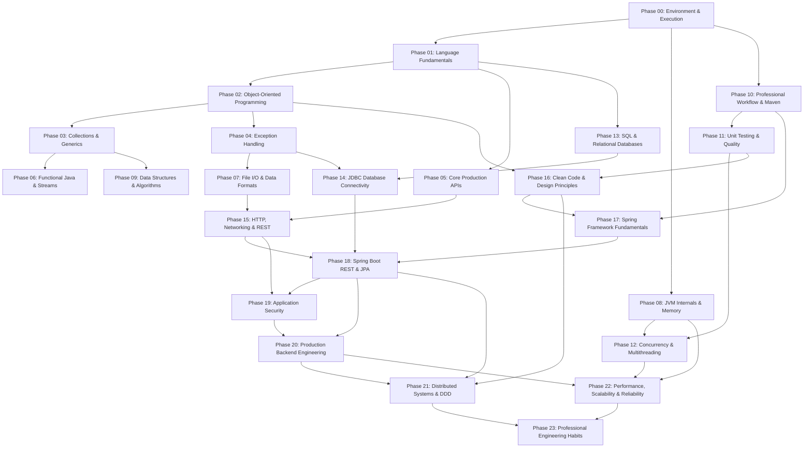

# Phase Dependencies and Pedagogical Sequencing

---

## 1. Global Phase Dependency Graph

The 24 phases of this curriculum form a strict **Directed Acyclic Graph (DAG)** designed to eliminate circular dependencies, ensure foundational concepts precede advanced frameworks, and guarantee that testing and database fundamentals precede automated abstractions.

---

## 2. Phase-by-Phase Dependency Matrix

| Phase | Phase Name | Direct Prerequisites | Downstream Direct Dependents |
|---|---|---|---|
| **00** | Development Environment & Java Execution | *None (Root Entry)* | Phase 01, Phase 08, Phase 10 |
| **01** | Java Language Fundamentals | Phase 00 | Phase 02, Phase 05, Phase 13 |
| **02** | Object-Oriented Programming | Phase 01 | Phase 03, Phase 04, Phase 16 |
| **03** | Collections Framework & Generics | Phase 02 | Phase 06, Phase 09 |
| **04** | Exception Handling & Defensive Programming | Phase 02 | Phase 07, Phase 14 |
| **05** | Core Java APIs You Will Use in Production | Phase 01, Phase 02 | Phase 15 |
| **06** | Functional Java (Lambdas & Streams) | Phase 02, Phase 03 | Phase 18, Phase 21 |
| **07** | File I/O, NIO, Configuration, Data Formats | Phase 04, Phase 05 | Phase 15 |
| **08** | JVM Internals and Memory Management | Phase 00, Phase 02 | Phase 12, Phase 22 |
| **09** | Data Structures and Algorithms for Backend Developers | Phase 01, Phase 03 | Phase 12, Phase 22 |
| **10** | Professional Java Development Workflow (Maven/Git) | Phase 00 | Phase 11, Phase 17 |
| **11** | Unit Testing and Software Quality (JUnit/Mockito) | Phase 02, Phase 04, Phase 10 | Phase 12, Phase 16, Phase 18 |
| **12** | Concurrency and Multithreading (JMM/Virtual Threads) | Phase 08, Phase 11 | Phase 20, Phase 22 |
| **13** | SQL and Relational Database Fundamentals (PostgreSQL) | Phase 01 | Phase 14 |
| **14** | JDBC and Java Database Connectivity | Phase 04, Phase 13 | Phase 18 |
| **15** | HTTP, Networking, and REST API Fundamentals | Phase 05, Phase 07 | Phase 18, Phase 19 |
| **16** | Clean Code and Software Design Principles (SOLID/GoF) | Phase 02, Phase 11 | Phase 17, Phase 21 |
| **17** | Spring Framework Fundamentals (IoC, DI, AOP) | Phase 10, Phase 16 | Phase 18 |
| **18** | Spring Boot and REST API Development (JPA/REST) | Phase 14, Phase 15, Phase 17 | Phase 19, Phase 20, Phase 21 |
| **19** | Application Security (IAM, JWT, Spring Security) | Phase 15, Phase 18 | Phase 20 |
| **20** | Production Backend Engineering (Docker, Tracing, Resilience) | Phase 18, Phase 19 | Phase 21, Phase 22 |
| **21** | Advanced Architecture & Distributed Systems (DDD/Outbox) | Phase 16, Phase 18, Phase 20 | Phase 23 |
| **22** | Performance, Scalability, and Reliability (Profiling/JMH) | Phase 08, Phase 12, Phase 20 | Phase 23 |
| **23** | Professional Engineering Habits (Debugging/ADRs/RCA) | Phase 21, Phase 22 | *Ready for 100 Backend Projects* |

---

## 3. Pedagogical Ordering Justifications

1. **Test Fundamentals Early (Phase 11 before Phase 12 & 18):**
   Writing automated unit tests must become second nature before building multithreaded systems or Spring web applications. Testing failure scenarios requires knowing how to write deterministic assertions and stubs.
2. **Relational Modeling & SQL Before ORM (Phase 13 & 14 before Phase 18):**
   Spring Data JPA abstracts SQL behind entity annotations. Without mastering relational normalization, joins, indexes, transaction boundaries, and raw JDBC connection mechanics first, developers cannot diagnose N+1 query disasters, connection leaks, or transaction deadlocks.
3. **HTTP Semantics Before Spring Controllers (Phase 15 before Phase 18):**
   Implementing `@RestController` requires knowing safe vs. idempotent methods, status codes, content negotiation, caching headers, and RFC 7807 problem envelopes.
4. **Clean Code & DIP Before Spring Container (Phase 16 before Phase 17):**
   Inversion of Control and Dependency Injection are design principles before they are framework features. Understanding DIP and loose coupling makes Spring's `@Component` and constructor injection natural rather than magical.
5. **JMM & JVM Internals Before Production Concurrency (Phase 08 before Phase 12 & 22):**
   Understanding heap allocation, CPU caches, thread stacks, and instruction reordering is essential before analyzing `volatile`, `AtomicInteger`, happens-before guarantees, or virtual thread carrier pinning.

---

## 4. Circularity Audit Verification

- **Cycle Detection:** Topological sort verified. No back-edges exist in the dependency graph.
- **Transitive Redundancy:** All prerequisite chains are explicit, preventing hidden transitive gaps.
