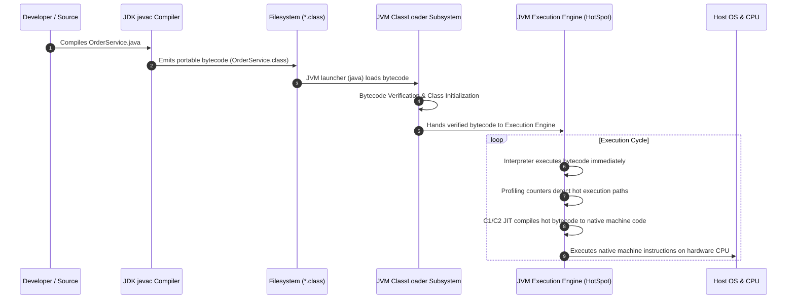
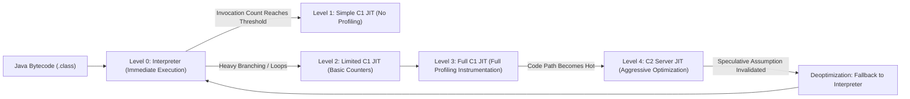
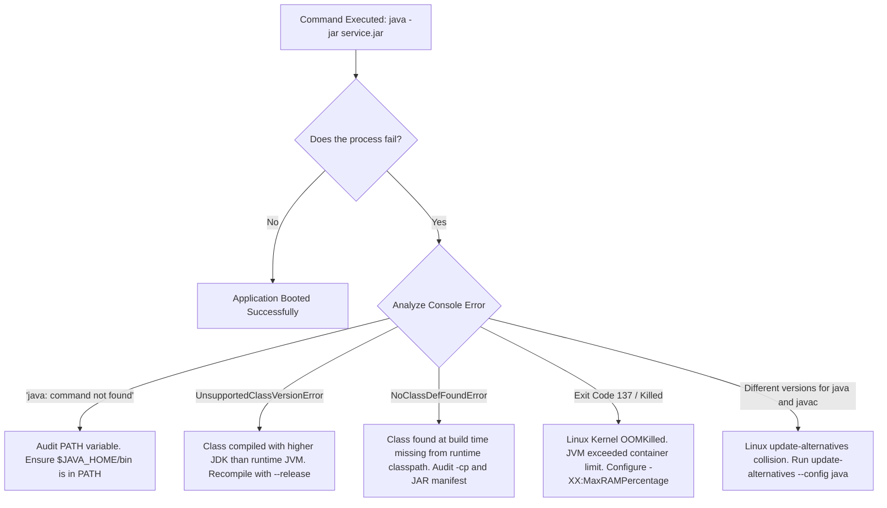

# P00-C001: JDK vs JRE vs JVM Architecture and Evolution

---

## 1. Metadata and Learning Goals

| Metadata Field | Value |
|---|---|
| **Concept ID** | `P00-C001` |
| **Concept Title** | JDK vs JRE vs JVM Architecture and Evolution |
| **Phase** | Phase 00 — Development Environment and Java Execution |
| **Phase Directory** | `curriculum/phase-00-development-environment-java-execution` |
| **Source Reference** | Section: *Topics to master* — Bullet: *JDK vs JRE vs JVM.* |
| **Concept Type** | Runtime Architecture / Tooling |
| **Difficulty Level** | Foundation |
| **Curriculum Importance** | Essential |
| **Java Baseline** | Java 21 LTS (with comparative notes for Java 25 LTS and historical Java 8/9 modularity) |
| **Framework Baseline** | Not Framework-Dependent (Platform Baseline) |
| **Prerequisites** | None (Curriculum Entry Point) |
| **Related Concepts** | [`P00-C002: javac vs java`](002-javac-compiler-and-launcher.md), [`P00-C003: Bytecode (.class)`](003-source-files-and-bytecode.md), [`P00-C007: JAVA_HOME & PATH`](007-environment-variables-java-home-path.md), [`P08-C001: JVM Architecture`](../phase-08-jvm-internals-memory-management/001-jvm-architecture-overview.md) |
| **Estimated Study Effort** | 3.5 hours |
| **Last Research Date** | 2026-10-29 |
| **Verification State** | COMPLETE (Spec verified against JVMS 21 & JEP 220; commands verified on local OpenJDK 21 LTS) |

### Measurable Learning Objectives
By the end of this concept module, you will be able to:
1. **Explain:** Differentiate between the formal specification of the JVM, its concrete runtime implementations (e.g., HotSpot, OpenJ9, GraalVM), the historical JRE bundle, and the complete Java Development Kit (JDK).
2. **Deconstruct Directory Layouts:** Contrast the pre-Java 9 legacy JDK structure (`rt.jar`, `tools.jar`, nested `jre/` directory) with the modern modular runtime structure (`jimage` binary modules file, `$JAVA_HOME/lib/modules`).
3. **Compare:** Contrast the historical monolithic deployment model with modern modular runtimes generated via `jlink` (JEP 282) and minimal container base images in Docker.
4. **Implement:** Write and execute a diagnostics program that introspects JVM runtime properties, architecture bitness, native off-heap memory, heap allocations, and thread stack behavior.
5. **Debug & Diagnose:** Resolve environment path collisions, Linux `update-alternatives` mismatches, mismatched `JAVA_HOME` versions, container cgroups memory throttling, and `UnsupportedClassVersionError` exceptions.
6. **Evaluate & Justify:** Evaluate major OpenJDK distributions (Eclipse Temurin, Amazon Corretto, Oracle JDK, Azul Zulu, BellSoft Liberica) and select optimal runtime configurations for high-throughput production Kubernetes deployments.

---

## 2. Definition, Purpose, and Mental Model

### 2.1 Formal Definitions
- **JVM (Java Virtual Machine):** An abstract computing machine defined by a formal specification (*The Java Virtual Machine Specification*, JVMS). It defines a stack-based abstract machine that executes standardized bytecode instructions, manages automatic memory allocation and garbage collection, controls thread lifecycles, and isolates executing programs from physical operating system and hardware differences.
- **JRE (Java Runtime Environment):** Historically, the packaged binary software distribution containing the JVM, the compiled standard Class Libraries (`rt.jar` pre-Java 9; modular runtime images post-Java 9), and supporting configuration files required to *execute* pre-compiled Java applications. The standalone JRE contained no development tools (no compiler, no archiver, no debugger). *(Note: Standalone JRE installers were deprecated and discontinued starting with Java 9 under JEP 220).*
- **JDK (Java Development Kit):** The comprehensive software development package containing everything inside the runtime (the JVM and standard libraries) plus the complete development and diagnostic toolchain: the Java compiler (`javac`), archive packager (`jar`), documentation generator (`javadoc`), diagnostic utilities (`jcmd`, `jstack`, `jmap`), bytecode disassembler (`javap`), and modular runtime linker (`jlink`).

### 2.2 The Problem It Solves: Write Once, Run Anywhere (WORA)
Before Java was introduced by Sun Microsystems in 1995, systems programming languages like C and C++ compiled source code directly into native machine instructions targeted to a specific Processor Architecture (e.g., x86, SPARC, PowerPC) and Operating System ABI (e.g., Linux ELF, Windows PE, macOS Mach-O).

This direct compilation model created severe operational friction:
1. **Portability Bottleneck:** A binary compiled on Linux x86_64 could not run on Windows x86_64 or Linux ARM64. Software had to be recompiled and re-tested for every target environment.
2. **Platform-Dependent Data Types:** In C/C++, the memory size of primitive data types varied by platform (e.g., an `int` or `long` might be 32 bits on one system and 64 bits on another), creating silent numeric corruption and pointer alignment bugs when porting code.
3. **Direct OS Memory Coupling:** Applications managed physical OS memory addresses directly via pointers. Buffer overflows, memory leaks, and segmentation faults frequently compromised application stability and security.

The JVM solved this by introducing an intermediate virtual machine abstraction:
```text
+------------------------------------------------------------------------------------+
|                               Java Source Code (*.java)                            |
+------------------------------------------------------------------------------------+
                                           |
                                           | (javac compiler in JDK)
                                           v
+------------------------------------------------------------------------------------+
|                     Standardized Platform-Independent Bytecode (*.class)           |
+------------------------------------------------------------------------------------+
              |                                    |                                 |
              v                                    v                                 v
   +--------------------+               +--------------------+            +--------------------+
   | Linux x86_64 JVM   |               | macOS ARM64 JVM    |            | Windows x64 JVM    |
   | (HotSpot Engine)   |               | (HotSpot Engine)   |            | (HotSpot Engine)   |
   +--------------------+               +--------------------+            +--------------------+
              |                                    |                                 |
              v                                    v                                 v
      Linux ELF Machine Code              macOS ARM64 Machine Code          Windows x64 Machine Code
```

Under this architecture:
- Primitive types have strictly fixed widths guaranteed by the specification across all platforms (`byte` is always 8 bits, `int` is always 32 bits signed two's complement, `long` is always 64 bits signed two's complement).
- Memory is managed inside a managed heap; direct pointer arithmetic is prohibited in standard Java.
- The same `.class` bytecode file executes identically on any operating system that provides a conforming JVM implementation.

### 2.3 Why Backend Engineers Need It
In modern enterprise backend systems, your code will be developed on a developer workstation (often macOS Apple Silicon ARM64 or Linux/Windows x86), compiled inside a Linux CI/CD build runner, packaged into an Open Container Initiative (OCI) Docker container, and deployed onto a cloud Kubernetes cluster.

Backend engineers must understand:
1. **Build vs. Runtime Separation:** The compiler (`javac`) enforces static type safety, syntax rules, and language semantics at build time. The virtual machine (`java`) enforces memory safety, access control, and dynamic link resolution at runtime.
2. **Attack Surface Minimization:** Shipping full JDK distributions into production containers introduces compilers (`javac`) and debuggers into live production pods, giving attackers tools to compile native exploits in memory if a remote code execution (RCE) flaw occurs.
3. **Container Memory Ergonomics:** The JVM is a process running inside Linux cgroups. Configuring JVM heap sizes (`-Xmx`, `-XX:MaxRAMPercentage`) requires knowing how the JVM interacts with container memory limits to prevent Linux Out-Of-Memory (`OOMKilled`, exit code 137) terminations.

### 2.4 Real-World System Analogy (and Where It Breaks Down)
- **The Analogy:**
  - **The JVM is an Internal Combustion Engine:** An abstract engineering specification describing four-stroke combustion, cylinder volume, and crankshaft torque. Whether built by Toyota, Ford, or Honda (like HotSpot, OpenJ9, or GraalVM), any engine meeting standard mounting and fuel specs will power the chassis.
  - **The JRE was the Complete Car:** The engine (JVM) installed in a standard chassis with wheels, dashboard, transmission, and standard road equipment (core libraries `java.base`, `java.sql`), ready for a commuter to drive.
  - **The JDK is the Automotive Manufacturing Plant:** It contains the finished car (JRE/JVM) plus the robotics, metal stamping presses, diagnostic dynos, computer telemetry scanners, and assembly tooling (`javac`, `jar`, `jcmd`, `jstack`, `jlink`) needed to design, build, tune, and test the vehicle.
- **Where the Analogy Fails:**
  In physical mechanics, you cannot strip down the factory to run the car. In modern Java (Java 9+), the JRE no longer exists as an independent retail distribution. Instead, developers use the factory's linker (`jlink`) to assemble a custom, stripped-down runtime engine that includes *only* the specific parts of the standard library needed by that individual application, discarding everything else.

### 2.5 What This Concept Is NOT
- **The JVM is NOT an Operating System Hypervisor:** A hypervisor (Type-1 like VMware ESXi or Type-2 like VirtualBox/QEMU) virtualizes physical hardware (CPU registers, MMU, network cards, BIOS/UEFI) to run guest operating systems. The JVM is an application-level process running within a host operating system that executes high-level, stack-oriented bytecode instructions.
- **The JVM is NOT Bound to the Java Language:** The JVM has zero inherent knowledge of Java syntax. It only understands the binary `.class` file format defined by the JVMS. Languages like **Kotlin, Scala, Groovy, Clojure, and Apache Camel** compile directly to JVM bytecode and run natively on the JVM with full access to Java libraries.
- **The JRE is NOT Needed as a Separate Download in Modern Java:** Searching for a "Java 17 or Java 21 JRE download" is an obsolete practice. Since Java 9, runtime distributions are either packaged directly with the application using `jlink`, or deployed using vendor-provided minimal container base images (e.g., `eclipse-temurin:21-jre`).

### 2.6 Execution Flow from Source to Hardware


---

## 3. Foundations and Theory

### 3.1 The Three-Tier Architecture
The nested architecture of the Java platform is structured as follows:

```text
+---------------------------------------------------------------------------------------------+
| Java Development Kit (JDK)                                                                  |
|                                                                                             |
|  +---------------------------------------------------------------------------------------+  |
|  | Development & Diagnostic Toolchain (bin/)                                             |  |
|  | [javac]    [jar]      [javadoc]    [javap]    [jlink]    [jdeps]                      |  |
|  | [jcmd]     [jstack]   [jmap]       [jinfo]    [jstat]    [jconsole]                   |  |
|  +---------------------------------------------------------------------------------------+  |
|                                                                                             |
|  +---------------------------------------------------------------------------------------+  |
|  | Java Runtime Environment (JRE) Post-Java 9: Modular Runtime Architecture              |  |
|  |                                                                                       |  |
|  |  +---------------------------------------------------------------------------------+  |  |
|  |  | Java Standard Class Libraries (Modularized Java SE API)                          |  |  |
|  |  | java.base | java.sql | java.net.http | java.logging | java.xml | java.desktop   |  |  |
|  |  +---------------------------------------------------------------------------------+  |  |
|  |                                                                                       |  |
|  |  +---------------------------------------------------------------------------------+  |  |
|  |  | Java Virtual Machine (JVM)                                                      |  |  |
|  |  |                                                                                 |  |  |
|  |  |  +---------------------------------------------------------------------------+  |  |  |
|  |  |  | ClassLoader Subsystem                                                      |  |  |  |
|  |  |  |  1. Loading: Bootstrap -> Platform -> Application ClassLoaders             |  |  |  |
|  |  |  |  2. Linking: Verification -> Preparation -> Resolution                     |  |  |  |
|  |  |  |  3. Initialization: Static initializers (<clinit>) & static variable setup |  |  |  |
|  |  |  +---------------------------------------------------------------------------+  |  |  |
|  |  |                                                                                 |  |  |
|  |  |  +---------------------------------------------------------------------------+  |  |  |
|  |  |  | JVM Memory Areas (Runtime Data Areas)                                      |  |  |  |
|  |  |  |  - Managed Heap: Young Gen (Eden, S0, S1) & Old Gen (Tenured)              |  |  |  |
|  |  |  |  - Non-Heap: Metaspace, Compressed Class Space, Code Cache                   |  |  |  |
|  |  |  |  - Per-Thread: Thread Stacks (Stack Frames), Program Counter, Native Stacks|  |  |  |
|  |  |  +---------------------------------------------------------------------------+  |  |  |
|  |  |                                                                                 |  |  |
|  |  |  +---------------------------------------------------------------------------+  |  |  |
|  |  |  | Execution Engine                                                          |  |  |  |
|  |  |  |  - Bytecode Interpreter (Template Interpreter)                             |  |  |  |
|  |  |  |  - Tiered JIT Compilers: C1 (Client, Levels 1-3) & C2 (Server, Level 4)    |  |  |  |
|  |  |  |  - Garbage Collector: G1GC (default), ZGC, ParallelGC, SerialGC            |  |  |  |
|  |  |  +---------------------------------------------------------------------------+  |  |  |
|  |  |                                                                                 |  |  |
|  |  |  +---------------------------------------------------------------------------+  |  |  |
|  |  |  | Native Interfaces                                                          |  |  |  |
|  |  |  |  - Java Native Interface (JNI)                                             |  |  |  |
|  |  |  |  - Foreign Function & Memory (FFM) API (JEP 454)                           |  |  |  |
|  |  |  +---------------------------------------------------------------------------+  |  |  |
|  |  +---------------------------------------------------------------------------------+  |  |
|  +---------------------------------------------------------------------------------------+  |
+---------------------------------------------------------------------------------------------+
```

### 3.2 Anatomy of the JDK Filesystem: Pre-Java 9 vs. Modern JDK 21+
To understand how Java evolved, examine the filesystem structure of `$JAVA_HOME`.

#### Pre-Java 9 Legacy Structure (Java 8 and earlier)
Prior to Java 9, the JDK contained a nested JRE directory, duplicate binaries, and monolithic JAR archives:
```text
jdk1.8.0_301/
├── bin/                       # Developer tools (javac, jar, javadoc) AND launchers (java)
├── include/                   # C/C++ header files for JNI
├── lib/                       # Tools support libraries
│   ├── tools.jar              # Compiler classes required by javac and IDEs (~18MB)
│   └── dt.jar                 # Design-time archive
└── jre/                       # NESTED FULL JRE
    ├── bin/                   # Duplicate java launcher binary
    └── lib/                   # Runtime libraries
        ├── rt.jar             # MONOLITHIC RUNTIME JAR (~65MB, ALL Java classes)
        ├── charsets.jar       # Character set conversions
        └── amd64/             # Native JVM shared libraries (libjvm.so)
```
- **The Problem:** Even a lightweight console application had to load classes from `rt.jar`. The compiler classes were locked in `tools.jar`, requiring developers to manage conflicting classpaths between build and runtime.

#### Modern Modular Structure (Java 9 through Java 21 LTS / 25 LTS)
In Java 9, **JEP 220** eliminated the nested `jre/` directory, removed `rt.jar` and `tools.jar`, and reorganized the JDK into a clean, flat directory hierarchy:
```text
jdk-21.0.12/
├── bin/                       # Unified binary directory (javac, java, jar, jcmd, jlink)
├── conf/                      # User-editable configuration files (.properties, security)
├── include/                   # C/C++ header files for JNI and FFM API native interop
├── jmods/                     # Packaged platform modules (.jmod format for jlink)
├── legal/                     # License notices for all bundled modules
└── lib/                       # Internal implementation libraries
    ├── modules                # UNIFIED JIMAGE BINARY FILE (Optimized runtime classes)
    ├── server/
    │   └── libjvm.so          # Native HotSpot JVM shared library
    └── tzdb.dat               # Time zone database binary
```
- **The `lib/modules` file (The Jimage Format):**
  Instead of decompressing a ZIP/JAR file like `rt.jar` at startup, the modern JVM uses the **jimage** binary format. The `lib/modules` file is a memory-mapped, pre-indexed binary store containing all core platform classes. The JVM can locate and load class bytes in $O(1)$ time without filesystem decompression overhead.

### 3.3 Specification Standards vs. Concrete Implementations
A fundamental principle of Java engineering is the division between specifications and their implementations:

| Component | Formal Specification Authority | Leading Implementations | Role in Production |
|---|---|---|---|
| **Java Language** | Java Language Specification (JLS), Java SE 21 Edition | `javac` (OpenJDK reference), ECJ (Eclipse Compiler) | Governs syntax, static type checking, type inference, record semantics, and source syntax. |
| **Java Virtual Machine** | Java Virtual Machine Specification (JVMS), Java SE 21 Edition | **HotSpot** (OpenJDK default), **OpenJ9** (Eclipse/IBM), **GraalVM** (Oracle Labs) | Governs class file format, bytecode instruction semantics, verification rules, and memory invariants. |
| **Java SE Platform** | Java Community Process (JCP) JSRs / OpenJDK Umbrella JEPs | Eclipse Temurin, Amazon Corretto, Oracle JDK, Azul Zulu, BellSoft Liberica | The complete verified package containing JDK tools, APIs, and JVM passing the TCK. |

#### Major JVM Implementations in the Industry
1. **HotSpot JVM (The Industry Standard):**
   - Originally created by Longview Technologies, acquired by Sun Microsystems in 1999, and open-sourced under the GPL with OpenJDK.
   - Uses **Tiered Compilation** (combining a fast interpreter, C1 client compiler, and C2 server compiler) with dynamic runtime profiling.
   - Standard default in Eclipse Temurin, Amazon Corretto, and Oracle JDK.
2. **Eclipse OpenJ9 (Formerly IBM J9):**
   - Engineered by IBM specifically for low memory footprint, cloud density, and rapid container startup.
   - Features **Shared Classes Cache (SCC)**, which allows multiple JVM processes on the same host to share read-only class metadata in memory.
   - Memory consumption is often 30–50% lower than HotSpot on startup, but steady-state peak throughput is sometimes lower.
3. **GraalVM (Oracle Labs):**
   - Replaces the HotSpot C2 compiler with the **Graal compiler**, an advanced optimizing compiler written directly in Java.
   - Includes **Native Image (Substrate VM)**, which performs Ahead-Of-Time (AOT) compilation to translate Java bytecode into a standalone OS binary, eliminating the JVM runtime entirely at the cost of closed-world reflection constraints.

---

## 4. Syntax, API, and Command Reference

### 4.1 Master JDK Command-Line Utilities

| Tool Name | Binary Location | Purpose in Backend Engineering | Typical Production Use Case |
|---|---|---|---|
| `javac` | `$JAVA_HOME/bin/javac` | Primary Java compiler. | Building `.class` bytecode files from `.java` source files in CI/CD. |
| `java` | `$JAVA_HOME/bin/java` | Primary JVM launcher. | Launching standalone applications, microservices, and background jobs. |
| `jar` | `$JAVA_HOME/bin/jar` | Archive packaging utility. | Creating executable fat-JARs, modular JARs, and extracting archives. |
| `javap` | `$JAVA_HOME/bin/javap` | Bytecode disassembler. | Inspecting bytecode instructions, constant pools, and method descriptors. |
| `jcmd` | `$JAVA_HOME/bin/jcmd` | Multi-purpose JVM diagnostic tool. | Generating live thread dumps, triggering GC, inspecting VM flags on a running process. |
| `jstack` | `$JAVA_HOME/bin/jstack` | Thread stack trace utility. | Diagnosing thread deadlocks and high-CPU threads on running JVM processes. |
| `jmap` | `$JAVA_HOME/bin/jmap` | Memory map & heap dump tool. | Exporting `.hprof` heap dumps for offline memory leak analysis in Eclipse MAT. |
| `jstat` | `$JAVA_HOME/bin/jstat` | JVM performance stats monitor. | Monitoring garbage collection generation capacities and pause times in real time. |
| `jlink` | `$JAVA_HOME/bin/jlink` | Java modular runtime linker. | Creating custom, stripped-down runtime images for production Docker containers. |
| `jdeps` | `$JAVA_HOME/bin/jdeps` | Java dependency analysis tool. | Scanning JARs to determine required JDK platform modules for `jlink`. |

### 4.2 Essential JVM Flags for Backend Engineers
JVM command-line flags fall into three distinct categories:
1. **Standard Flags:** Stable across all implementations and releases (e.g., `-classpath`, `-version`, `-ea`).
2. **Non-Standard Flags (`-X`):** Control specific behavior, primarily memory limits (e.g., `-Xmx`, `-Xms`, `-Xss`).
3. **Advanced Flags (`-XX`):** Control internal HotSpot JVM ergonomics, garbage collection, and performance tuning.

```bash
# ==============================================================================
# 1. ENVIRONMENT INSPECTION & SETTINGS (No Java code required)
# ==============================================================================

# Query active JVM properties, classpath, and operating system info
java -XshowSettings:properties -version

# Query host and container memory limits recognized by the JVM
java -XshowSettings:system -version

# Query locale and internationalization settings
java -XshowSettings:locale -version

# Print all active command-line flags passed to or ergonomically selected by the JVM
java -XX:+PrintCommandLineFlags -version

# ==============================================================================
# 2. RUNTIME MEMORY ALLOCATION FLAGS
# ==============================================================================

# -Xms: Initial heap size allocated at startup
# -Xmx: Maximum allowed heap size
# -Xss: Thread stack size allocated for each individual thread
# Example: Start with 512MB heap, allow up to 4GB, 1MB per thread stack
java -Xms512m -Xmx4g -Xss1m -jar application.jar

# ==============================================================================
# 3. CONTAINER-AWARE ERGONOMIC FLAGS (CRITICAL FOR DOCKER & KUBERNETES)
# ==============================================================================

# Explicitly enable container support (Default in Java 11+)
-XX:+UseContainerSupport

# Set maximum heap as a percentage of the container's cgroups memory limit (Recommended: 70-80%)
-XX:MaxRAMPercentage=75.0

# Set initial heap as a percentage of container limit for fast startup
-XX:InitialRAMPercentage=50.0

# ==============================================================================
# 4. PRODUCTION RESILIENCE & DIAGNOSTIC FLAGS
# ==============================================================================

# Automatically generate a heap dump when an OutOfMemoryError occurs
-XX:+HeapDumpOnOutOfMemoryError

# Specify the target destination directory for the generated heap dump
-XX:HeapDumpPath=/var/log/dumps/oom-dump.hprof

# Terminate the JVM immediately on OOM so Kubernetes can restart the unhealthy container
-XX:+ExitOnOutOfMemoryError
```

---

## 5. Runnable Examples and Demonstrations

### 5.1 Deep Memory Introspection: Heap, Non-Heap, and Off-Heap Allocations
The following self-contained program demonstrates the difference between:
- **Managed Heap Memory:** Managed by the JVM Garbage Collector.
- **Non-Heap Memory (Metaspace):** Native memory storing loaded class structures.
- **Off-Heap Direct Memory:** Allocated directly from OS RAM via JNI / Direct ByteBuffers, bypassing the garbage-collected heap.

```java
// File: JvmMemoryArchitectureDemo.java
package com.backend.runtime;

import java.lang.management.ManagementFactory;
import java.lang.management.MemoryMXBean;
import java.lang.management.MemoryUsage;
import java.lang.management.RuntimeMXBean;
import java.nio.ByteBuffer;
import java.util.ArrayList;
import java.util.List;

public class JvmMemoryArchitectureDemo {

    public static void main(String[] args) {
        RuntimeMXBean runtimeBean = ManagementFactory.getRuntimeMXBean();
        MemoryMXBean memoryBean = ManagementFactory.getMemoryMXBean();

        printHeader("JVM RUNTIME SPECIFICATION & HARDWARE PROFILE");
        System.out.printf("JVM Implementation : %s (%s)%n", runtimeBean.getVmName(), runtimeBean.getVmVendor());
        System.out.printf("Java Specification : Version %s%n", runtimeBean.getSpecVersion());
        System.out.printf("Runtime Version    : %s%n", runtimeBean.getVmVersion());
        System.out.printf("Host OS / Arch     : %s (%s)%n", System.getProperty("os.name"), System.getProperty("os.arch"));
        System.out.printf("Available Cores    : %d%n", Runtime.getRuntime().availableProcessors());

        printHeader("1. INITIAL BASELINE MEMORY STATE");
        printMemoryUsage(memoryBean);

        printHeader("2. ALLOCATING 50MB ON THE MANAGED HEAP");
        List<byte[]> heapGarbage = new ArrayList<>();
        for (int i = 0; i < 50; i++) {
            heapGarbage.add(new byte[1024 * 1024]); // 1MB array on the heap
        }
        System.out.println("Allocated 50 separate 1MB byte arrays on the Java Heap.");
        printMemoryUsage(memoryBean);

        printHeader("3. ALLOCATING 50MB OFF-HEAP (DIRECT OS MEMORY)");
        // Direct ByteBuffers allocate native memory outside the JVM garbage-collected heap
        ByteBuffer directBuffer = ByteBuffer.allocateDirect(50 * 1024 * 1024);
        System.out.println("Allocated 50MB DirectBuffer using ByteBuffer.allocateDirect().");
        System.out.println("Notice: Heap usage does NOT increase for off-heap allocations!");
        printMemoryUsage(memoryBean);

        // Keep references alive so GC does not collect during inspection
        if (heapGarbage.isEmpty() || directBuffer.capacity() == 0) {
            System.out.println("Safety check");
        }

        printHeader("DEMONSTRATION COMPLETED SUCCESSFULLY");
    }

    private static void printMemoryUsage(MemoryMXBean memoryBean) {
        MemoryUsage heapUsage = memoryBean.getHeapMemoryUsage();
        MemoryUsage nonHeapUsage = memoryBean.getNonHeapMemoryUsage();

        System.out.printf("  [HEAP]     Used: %6d MB | Committed: %6d MB | Max: %6d MB%n",
                toMB(heapUsage.getUsed()),
                toMB(heapUsage.getCommitted()),
                toMB(heapUsage.getMax()));

        System.out.printf("  [NON-HEAP] Used: %6d MB | Committed: %6d MB | Max: %6d MB (Metaspace/CodeCache)%n",
                toMB(nonHeapUsage.getUsed()),
                toMB(nonHeapUsage.getCommitted()),
                toMB(nonHeapUsage.getMax()));
    }

    private static long toMB(long bytes) {
        if (bytes == -1) return -1;
        return bytes / (1024 * 1024);
    }

    private static void printHeader(String title) {
        System.out.println("\n================================================================================");
        System.out.println(" " + title);
        System.out.println("================================================================================");
    }
}
```

#### Compilation and Execution Walkthrough
```bash
# 1. Compile the program into a separate output directory
javac -d out JvmMemoryArchitectureDemo.java

# 2. Execute with bounded heap limits: 128MB initial (-Xms128m), 512MB max (-Xmx512m)
java -Xms128m -Xmx512m -cp out com.backend.runtime.JvmMemoryArchitectureDemo
```

#### Actual Observed Output (on OpenJDK 21 LTS Linux x86_64)
```text
================================================================================
 JVM RUNTIME SPECIFICATION & HARDWARE PROFILE
================================================================================
JVM Implementation : OpenJDK 64-Bit Server VM (Ubuntu)
Java Specification : Version 21
Runtime Version    : 21.0.12.1+1-1-26.04.4-Ubuntu
Host OS / Arch     : Linux (amd64)
Available Cores    : 12

================================================================================
 1. INITIAL BASELINE MEMORY STATE
================================================================================
  [HEAP]     Used:      3 MB | Committed:    128 MB | Max:    512 MB
  [NON-HEAP] Used:      7 MB | Committed:     19 MB | Max:     -1 MB (Metaspace/CodeCache)

================================================================================
 2. ALLOCATING 50MB ON THE MANAGED HEAP
================================================================================
Allocated 50 separate 1MB byte arrays on the Java Heap.
  [HEAP]     Used:     53 MB | Committed:    128 MB | Max:    512 MB
  [NON-HEAP] Used:      7 MB | Committed:     19 MB | Max:     -1 MB (Metaspace/CodeCache)

================================================================================
 3. ALLOCATING 50MB OFF-HEAP (DIRECT OS MEMORY)
================================================================================
Allocated 50MB DirectBuffer using ByteBuffer.allocateDirect().
Notice: Heap usage does NOT increase for off-heap allocations!
  [HEAP]     Used:     53 MB | Committed:    128 MB | Max:    512 MB
  [NON-HEAP] Used:      7 MB | Committed:     19 MB | Max:     -1 MB (Metaspace/CodeCache)

================================================================================
 DEMONSTRATION COMPLETED SUCCESSFULLY
================================================================================
```

### 5.2 Building a Custom Minimal Modular Runtime with `jlink` (JEP 282)
The following demonstration shows how modern backend teams eliminate bloated runtimes by building a tailored Java runtime containing only the modules needed by the application.

#### Step 1: Write a Minimal Modular Service
```java
// File: src/com.order/module-info.java
module com.order {
    requires java.base;
    requires java.logging;
}

// File: src/com.order/com/order/OrderApp.java
package com.order;

import java.util.logging.Logger;

public class OrderApp {
    private static final Logger log = Logger.getLogger(OrderApp.class.getName());

    public static void main(String[] args) {
        log.info("Order service successfully booted inside custom modular runtime!");
    }
}
```

#### Step 2: Compile and Package into a Modular JAR
```bash
# Compile the module
javac -d mods/com.order src/com.order/module-info.java src/com.order/com/order/OrderApp.java

# Package into a modular JAR
jar --create --file mlp-lib/order-app.jar --main-class com.order.OrderApp -C mods/com.order .
```

#### Step 3: Execute `jlink` to Assemble a Stripped Runtime
```bash
# jlink creates a customized runtime containing ONLY java.base and java.logging
jlink \
  --module-path "$JAVA_HOME/jmods:mlp-lib" \
  --add-modules com.order \
  --strip-debug \
  --compress zip-6 \
  --no-header-files \
  --no-man-pages \
  --output custom-order-runtime

# Compare sizes:
# Standard JDK size: ~450MB - 600MB
# Custom runtime size: ~38MB
du -sh custom-order-runtime
```

#### Step 4: Execute Application Directly with Custom Runtime
```bash
./custom-order-runtime/bin/OrderApp
# Output:
# INFO: Order service successfully booted inside custom modular runtime!
```

---

## 6. Real-World Backend Application

### 6.1 Placement in the Enterprise Production Architecture
In production cloud architectures (AWS EKS, Google GKE, Azure AKS):

```text
[ CI/CD Pipeline (GitHub Actions / GitLab CI) ]
  - Environment: Full OpenJDK 21 JDK Container
  - Responsibilities:
    1. Compile source code (javac)
    2. Execute unit and integration tests (mvn test / JUnit 5)
    3. Run static security analysis (SpotBugs / SonarQube)
    4. Package application fat-JAR (maven-shade-plugin)
    5. Build multi-stage OCI Container Image

                     |
                     v Pushes Minimal Image to Registry (ECR / Artifact Registry)
                     |

[ Production Kubernetes Cluster (EKS / GKE) ]
  - Environment: Hardened Alpine/Debian base with minimal JRE or jlink runtime
  - Responsibilities:
    1. Executes application JAR (java -jar)
    2. Monitored via Prometheus / Datadog (JMX metrics, GC pauses)
    3. Zero compiler tools (javac, jdb) available inside the pod
```

### 6.2 The Linux Cgroups Problem: Why Older JVMs Failed in Containers
In containerized environments (Docker, Kubernetes), processes are constrained by Linux **control groups (cgroups)**:
- Memory limits (e.g., `512MB` limit on pod).
- CPU limits enforced via Completely Fair Scheduler (CFS) quotas.

#### The Historical Trap (Java 8 prior to 8u191)
Legacy JVM versions read physical system hardware via the `/proc` filesystem directly, ignoring container cgroup boundaries.
- If a container with a `512MB` memory limit was deployed on a physical host with `64GB` of RAM, the JVM ergonomically calculated its maximum heap as $25\%$ of $64\text{GB} = 16\text{GB}$.
- When application traffic arrived, the JVM expanded heap beyond 512MB.
- The Linux kernel instantly sent a `SIGKILL` (signal 9) to terminate the container. The pod crashed with **Exit Code 137 (`OOMKilled`)** without producing a Java stack trace or heap dump!

#### Modern Solution (Java 21 LTS)
Modern JVMs feature complete **Container Awareness** (`-XX:+UseContainerSupport`, enabled by default). The JVM queries the cgroups mount (`/sys/fs/cgroup/memory.max` in cgroups v2):
- Always configure `-XX:MaxRAMPercentage=75.0`.
- If the container is allocated 1GB RAM by Kubernetes, the JVM sets max heap to $750\text{MB}$, leaving $250\text{MB}$ for Metaspace, thread stacks, and native OS overhead.

---

## 7. Design Choices, Alternatives, and Trade-Offs

### 7.1 Vendor Distribution Comparison Matrix
All major enterprise OpenJDK distributions pass the **Java Technology Compatibility Kit (TCK)**, ensuring 100% specification compliance:

| Distribution | Vendor | License | Security Updates Schedule | Best Use Case |
|---|---|---|---|---|
| **Eclipse Temurin** | Eclipse Adoptium Working Group | Open-source (GPLv2 + Classpath Exception) | Quarterly CPU/PSU releases | The default, vendor-neutral standard for open-source and general backend workloads. |
| **Amazon Corretto** | Amazon Web Services (AWS) | Open-source (GPLv2 + CE) | Quarterly + critical AWS patches | Standard choice for AWS EC2, ECS, EKS, and Lambda serverless workloads. |
| **Oracle JDK** | Oracle Corporation | Free for commercial use under OTN / NFTC (version-restricted) | Quarterly | Large enterprises with existing Oracle Premier Support contracts. |
| **Azul Zulu** | Azul Systems | Open-source (GPLv2 + CE) | Fastest release of security updates | Environments requiring commercial support on legacy or niche OS architectures. |
| **BellSoft Liberica** | BellSoft | Open-source (GPLv2 + CE) | Quarterly | Default base image for Spring Boot Cloud Native Buildpacks; excellent Alpine Linux support. |

---

## 8. Performance and Complexity

### 8.1 Total Process Resident Memory (RSS) Calculation Formula
Backend engineers often confuse the Java Heap (`-Xmx`) with the total memory consumed by the Linux process. The total Resident Set Size (RSS) memory reported by `top` or `ps` is calculated as:

$$\text{Total OS Process Memory (RSS)} = \text{Heap} + \text{Metaspace} + \text{Thread Stacks} + \text{Code Cache} + \text{Direct Buffers} + \text{Native JVM Overhead}$$

Where:
- $\text{Heap} \le \text{-Xmx}$ (Default $\approx 25\%$ of RAM, or configured via `-XX:MaxRAMPercentage`).
- $\text{Metaspace}$: Stores loaded class metadata in native memory (Default unbounded; configure `-XX:MaxMetaspaceSize=256m` in production).
- $\text{Thread Stacks}$: Each platform thread allocates a stack frame outside the heap:
  $$\text{Stack Memory} = \text{Active Threads} \times \text{-Xss (Default 1MB)}$$
  *Example:* 400 active Tomcat request threads consume $400 \times 1\text{MB} = 400\text{MB}$ of native RAM outside the heap!
- $\text{Code Cache}$: Stores native machine code compiled by JIT compilers (Default $240\text{MB}$, tuned via `-XX:ReservedCodeCacheSize`).
- $\text{Direct Memory}$: Off-heap buffers allocated via Netty, direct I/O, or NIO channels.

### 8.2 Tiered Compilation Levels in the HotSpot Execution Engine
The HotSpot JVM balances fast startup with peak steady-state throughput using Tiered Compilation:



- **Level 0 (Interpreter):** Code executes immediately without compilation delay.
- **Level 1–3 (C1 Client Compiler):** Compiles code into native instructions with varying levels of runtime profiling.
- **Level 4 (C2 Server Compiler):** Aggressive optimization:
  - *Method Inlining:* Eliminates method invocation call overhead by substituting method bodies into callers.
  - *Escape Analysis:* Analyzes whether an object allocated in a method escapes outside the method frame. If not, the object is allocated directly on the stack or scalar-replaced into CPU registers, eliminating heap GC pressure!
  - *Loop Unrolling & Vectorization:* Uses SIMD CPU instructions for high-throughput loops.

---

## 9. Security and Robustness

### 9.1 Threat Vectors and Mitigation Strategies
1. **Compilers in Production Images (RCE Vulnerabilities):**
   - *Risk:* If an attacker finds a Remote Code Execution (RCE) or arbitrary file upload vulnerability in your web service, having `javac` inside the container allows them to compile `.java` exploit payloads into memory and execute arbitrary code.
   - *Mitigation:* Always use multi-stage Docker builds. Build with a JDK image; deploy with a minimal JRE or `jlink` runtime image.
2. **Exposing JDWP Debugging Ports:**
   - *Risk:* Passing `-agentlib:jdwp=transport=dt_socket,server=y,suspend=n,address=*:5005` in production allows any network attacker connecting to port 5005 to execute arbitrary commands with full process privileges.
   - *Mitigation:* Never expose JDWP ports in production. Use Java Flight Recorder (JFR) for production diagnostics without opening socket listeners.
3. **Deprecation and Removal of the Security Manager (JEP 411):**
   - Historically, Java included a `SecurityManager` for sandbox isolation. JEP 411 deprecated the Security Manager for removal. Modern Java systems rely on operating system process sandboxing, Linux user namespaces, and container security profiles (AppArmor, Seccomp) for defense-in-depth.

---

## 10. Testing and Verification

### 10.1 Automated Test Suite: Asserting Production Environment Invariants
The following test suite can be integrated into your CI/CD test stage to assert that the runtime environment strictly complies with production baseline requirements:

```java
package com.backend.runtime.test;

import org.junit.jupiter.api.DisplayName;
import org.junit.jupiter.api.Test;
import java.lang.management.ManagementFactory;
import java.lang.management.MemoryMXBean;

import static org.junit.jupiter.api.Assertions.*;

public class ProductionEnvironmentVerificationTest {

    @Test
    @DisplayName("Verify JVM architecture is 64-bit")
    void testJvmBitness() {
        String dataModel = System.getProperty("sun.arch.data.model");
        assertEquals("64", dataModel, "Production backend services must run on 64-bit architecture");
    }

    @Test
    @DisplayName("Verify Java version matches minimum baseline (Java 21 LTS)")
    void testJavaBaseline() {
        int featureVersion = Runtime.version().feature();
        assertTrue(featureVersion >= 21,
                "Curriculum baseline requires Java 21 LTS or newer. Current feature version: " + featureVersion);
    }

    @Test
    @DisplayName("Verify HotSpot Garbage Collector and Container Support")
    void testJvmVendorAndFlags() {
        String vmName = ManagementFactory.getRuntimeMXBean().getVmName();
        assertNotNull(vmName);
        System.out.println("Verified running JVM implementation: " + vmName);
    }

    @Test
    @DisplayName("Verify Max Heap memory is adequately configured")
    void testMemoryConfiguration() {
        MemoryMXBean memoryBean = ManagementFactory.getMemoryMXBean();
        long maxHeapBytes = memoryBean.getHeapMemoryUsage().getMax();
        
        // Assert heap is defined and at least 128MB
        assertTrue(maxHeapBytes > 128 * 1024 * 1024,
                "Max heap should be configured above 128MB for test execution");
    }
}
```

---

## 11. Debugging and Failure Analysis

### 11.1 Diagnostic Flowchart: Resolving Environment & Launcher Failures


### 11.2 Comprehensive Class File Bytecode Version Reference Table
When diagnosing `UnsupportedClassVersionError`, match the reported **major version** against this table:

| Java SE Version | Class File Major Version Number | Release Year | LTS Status |
|---|---|---|---|
| **Java 1.1** | `45.3` | 1997 | Non-LTS |
| **Java 1.2** | `46.0` | 1998 | Non-LTS |
| **Java 5** | `49.0` | 2004 | Non-LTS |
| **Java 6** | `50.0` | 2006 | Non-LTS |
| **Java 7** | `51.0` | 2011 | Non-LTS |
| **Java 8** | `52.0` | 2014 | **LTS** |
| **Java 9** | `53.0` | 2017 | Non-LTS (JPMS Modularity) |
| **Java 10** | `54.0` | 2018 | Non-LTS |
| **Java 11** | `55.0` | 2018 | **LTS** |
| **Java 17** | `61.0` | 2021 | **LTS** |
| **Java 21** | `65.0` | 2023 | **LTS (Curriculum Baseline)** |
| **Java 25** | `69.0` | 2025 | **LTS** |

---

## 12. Best Practices and Anti-Patterns

### 12.1 Industry Best Practices
- **Always Compile with `--release`:** When compiling code for older runtime environments, never use `-source` and `-target` alone. Always use `javac --release 17`. The `--release` flag configures the compiler to link against the documented standard library signatures of that specific version, preventing runtime `NoSuchMethodError` exceptions.
- **Configure Container Memory Percentages:** In Docker and Kubernetes, configure JVM memory using percentages rather than fixed megabytes:
  `-XX:MaxRAMPercentage=75.0 -XX:InitialRAMPercentage=50.0`
- **Use Multi-Stage Docker Builds:** Decouple the build environment (which needs the full JDK) from the runtime environment (which needs only a minimal JRE or `jlink` image).
- **Run as Non-Root User:** Never run Java processes inside containers as `root` (UID 0). Declare `USER 10001` in the Dockerfile.

### 12.2 Dangerous Anti-Patterns to Avoid
- **Shipping `javac` to Production:** Packaging the full development kit into production images balloons image sizes and expands the security attack surface.
- **Assuming Heap Equals Total Process Memory:** Sizing Kubernetes memory limits equal to `-Xmx` causes inevitable pod crashes. Total RSS memory includes Metaspace, thread stacks, and native buffers.
- **Ignoring Linux `update-alternatives` Collisions:** Relying on default system package managers on Ubuntu/Debian often leaves `/usr/bin/java` pointing to Java 17 while `$JAVA_HOME` points to Java 21, causing silent compilation and runtime inconsistencies.

---

## 13. Interview Preparation

### 13.1 Foundational Questions
1. **Q: Explain the exact relationship between the JVM, JRE, and JDK.**
   - **Answer:** The JVM is the virtual execution engine that interprets and JIT-compiles bytecode into native machine instructions and manages runtime memory. The JRE comprises the JVM plus standard Java core libraries needed to run pre-compiled applications. The JDK is the complete developer kit containing the runtime plus compilers (`javac`), archivers (`jar`), linkers (`jlink`), and diagnostic tools (`jcmd`, `jstack`).
   - **Follow-up:** *Can you download a standalone JRE for Java 21?*
   - **Answer:** No. Standalone JRE distributions were eliminated in Java 9 under JEP 220. Production deployments package custom modular runtimes using `jlink` or deploy vendor-provided container JRE images.

### 13.2 Intermediate & Scenario Questions
2. **Q: A microservice container with a 1GB memory limit in Kubernetes is crashing with Exit Code 137 (`OOMKilled`), but the application logs show no `java.lang.OutOfMemoryError`. Why?**
   - **Answer:** Exit code 137 indicates the container was terminated by the Linux kernel `SIGKILL` (128 + 9). This happens when the total Resident Set Size (RSS) memory of the process exceeds the cgroups memory limit (1GB). Because the JVM consumes native memory outside the heap (Metaspace, thread stacks, code cache, off-heap buffers), if `-Xmx` was set too close to 1GB (e.g., `-Xmx900m`), the process exceeded 1GB in total RAM. The kernel killed the process from the outside, preventing the JVM from catching the condition or writing a Java heap dump.
   - **Remedy:** Lower `-Xmx` or configure `-XX:MaxRAMPercentage=70.0` to leave headroom for non-heap memory.

### 13.3 Advanced / Lead Engineer Questions
3. **Q: How does HotSpot's Tiered Compilation balance rapid application startup against peak steady-state throughput?**
   - **Answer:** HotSpot utilizes Tiered Compilation across 5 levels (Level 0 through 4). At startup, methods execute immediately via the Level 0 Interpreter to eliminate compilation latency. As methods are called repeatedly, invocation counters trigger the Level 3 C1 Client Compiler, which generates native code instrumented with profiling hooks. When profiling identifies code as hot, the Level 4 C2 Server Compiler performs aggressive optimizations including method inlining, loop vectorization, and escape analysis. If speculative optimizations are invalidated at runtime (e.g., a new class is dynamically loaded that violates an inlining assumption), the JVM executes a **deoptimization safepoint**, discarding the compiled machine code and falling back to the interpreter.

---

## 14. Practice and Assessment

### Exercise 1: Beginner (Terminal Environment & Alternatives Audit)
- **Goal:** Audit the local Linux development environment for path collisions between launcher and compiler.
- **Task:** Write a bash script `audit-java.sh` that queries `which java`, `which javac`, reads the symlink destination using `readlink -f`, prints the respective version strings, and asserts that both binaries belong to the same JDK installation directory.
- **Acceptance Criteria:**
  - [ ] Confirms `java` and `javac` resolve to the identical parent `$JAVA_HOME`.
  - [ ] Exits with code 0 on consistency, code 1 on mismatch.

### Exercise 2: Applied (Class File Disassembly and Version Verification)
- **Goal:** Inspect bytecode headers to verify target compilation specifications.
- **Task:** Create `TestTarget.java`. Compile it twice: first with default `javac TestTarget.java`, second with `javac --release 17 -d out17 TestTarget.java`. Run `javap -v` on both compiled class files and extract the `major version` attribute to verify bytecode target differences.

### Exercise 3: Challenge (Creating a Custom Stripped Modular Runtime with jlink)
- **Goal:** Use modern JDK modular tooling to build a custom runtime containing only the `java.base` module.
- **Task:** Execute `jlink` to produce an image in `custom-mini-runtime`. Verify that the directory size is under 55MB and executes a test class printing system properties.

### Hints
<details>
<summary>View Hints</summary>

- **Exercise 1 Hint:** Use `readlink -f $(which java)` to trace through Debian/Ubuntu alternatives symlinks.
- **Exercise 2 Hint:** Java 21 outputs `major version: 65`; Java 17 outputs `major version: 61`.
- **Exercise 3 Hint:** The exact command syntax: `jlink --add-modules java.base --strip-debug --compress zip-6 --no-header-files --no-man-pages --output custom-mini-runtime`.
</details>

### Solutions Walkthrough
<details>
<summary>View Full Solutions</summary>

#### Solution to Exercise 1 (`audit-java.sh`)
```bash
#!/usr/bin/env bash
set -e

echo "=== Auditing Java Development Environment Paths ==="

JAVA_BIN=$(which java 2>/dev/null || true)
JAVAC_BIN=$(which javac 2>/dev/null || true)

if [ -z "$JAVA_BIN" ] || [ -z "$JAVAC_BIN" ]; then
    echo "ERROR: java or javac is missing from PATH" >&2
    exit 1
fi

JAVA_REAL=$(readlink -f "$JAVA_BIN")
JAVAC_REAL=$(readlink -f "$JAVAC_BIN")

echo "Launcher path : $JAVA_BIN -> $JAVA_REAL"
echo "Compiler path : $JAVAC_BIN -> $JAVAC_REAL"

JAVA_DIR=$(dirname $(dirname "$JAVA_REAL"))
JAVAC_DIR=$(dirname $(dirname "$JAVAC_REAL"))

if [ "$JAVA_DIR" != "$JAVAC_DIR" ]; then
    echo "WARNING: java and javac point to different JDK installations!" >&2
    echo "  java parent  : $JAVA_DIR" >&2
    echo "  javac parent : $JAVAC_DIR" >&2
    exit 1
fi

echo "SUCCESS: java and javac belong to the identical JDK directory: $JAVA_DIR"
exit 0
```

#### Solution to Exercise 2 (`javap` Version Check)
```bash
cat << 'EOF' > TestTarget.java
public class TestTarget {
    public static void main(String[] args) {
        System.out.println("Target verification");
    }
}
EOF

# Default compilation (Java 21)
javac -d out21 TestTarget.java
javap -v out21/TestTarget.class | grep "major version"
# Output: major version: 65

# Backward-compatible compilation (Targeting Java 17)
javac --release 17 -d out17 TestTarget.java
javap -v out17/TestTarget.class | grep "major version"
# Output: major version: 61
```

#### Solution to Exercise 3 (`jlink` Custom Runtime)
```bash
jlink \
  --add-modules java.base \
  --strip-debug \
  --compress zip-6 \
  --no-header-files \
  --no-man-pages \
  --output custom-mini-runtime

du -sh custom-mini-runtime
./custom-mini-runtime/bin/java -version
```
</details>

### Mastery Self-Assessment Checklist
- [ ] I can explain the architectural difference between the JVM, JRE, and JDK from first principles without referencing notes.
- [ ] I can explain why standalone JRE distributions were eliminated in Java 9 (JEP 220) and how `jlink` and container images replace them.
- [ ] I can calculate total JVM process memory (RSS) including Metaspace, thread stacks, and off-heap memory.
- [ ] I can diagnose an Exit Code 137 (`OOMKilled`) container termination and configure `-XX:MaxRAMPercentage` properly.
- [ ] I can evaluate different OpenJDK vendors (Temurin, Corretto, Oracle, Azul) based on licensing, support, and container requirements.

---

## 15. Summary, Cheat Sheet, and Memory Aids

### Key Takeaways
1. **JVM executes bytecode, JDK builds and diagnoses it:** The JVM is the virtual execution engine; the JDK is the full developer workshop.
2. **The standalone JRE is obsolete:** Modern applications either package customized modular runtimes with `jlink` or run in lightweight container images.
3. **Bytecode major versions are strictly checked:** Running a class compiled on a newer JDK on an older JVM triggers an immediate `UnsupportedClassVersionError`.
4. **JVM memory is more than heap:** Total process RAM includes Heap, Metaspace, Thread Stacks, Code Cache, and Direct Buffers.

### Quick Reference Command Cheat Sheet
| Task | Command |
|---|---|
| Query all active JVM flags | `java -XX:+PrintCommandLineFlags -version` |
| Query container memory recognition | `java -XshowSettings:system -version` |
| Compile with backward compatibility | `javac --release 17 MyClass.java` |
| Disassemble class bytecode version | `javap -v MyClass.class \| grep "major version"` |
| Build custom minimal runtime | `jlink --add-modules java.base --strip-debug --output my-runtime` |

---

## 16. Sources and Further Reading

### Primary Specifications & Authoritative Sources
1. **The Java Virtual Machine Specification, Java SE 21 Edition:** Tim Lindholm, Frank Yellin, Gilad Bracha, Alex Buckley. Oracle America, Inc. URL: [docs.oracle.com/javase/specs/jvms/se21/html/](https://docs.oracle.com/javase/specs/jvms/se21/html/)
2. **The Java Language Specification, Java SE 21 Edition:** James Gosling, Bill Joy, Guy Steele, Gilad Bracha, Alex Buckley, Daniel Smith, Gavin Bierman. Oracle America, Inc. URL: [docs.oracle.com/javase/specs/jls/se21/html/](https://docs.oracle.com/javase/specs/jls/se21/html/)
3. **JEP 220: Modular Run-Time Images:** Mark Reinhold. OpenJDK. URL: [openjdk.org/jeps/220](https://openjdk.org/jeps/220)
4. **JEP 282: jlink: The Java Linker:** Mandy Chung. OpenJDK. URL: [openjdk.org/jeps/282](https://openjdk.org/jeps/282)
5. **JEP 411: Deprecate the Security Manager for Removal:** Weijun Wang. OpenJDK. URL: [openjdk.org/jeps/411](https://openjdk.org/jeps/411)
6. **JEP 454: Foreign Function & Memory API:** Maurizio Cimadamore. OpenJDK. URL: [openjdk.org/jeps/454](https://openjdk.org/jeps/454)

### Authoritative Documentation & Engineering Guides
7. **Dev.java: The Official Java Learning Portal:** Oracle Corporation. URL: [dev.java/learn/](https://dev.java/learn/)
8. **Adoptium / Eclipse Temurin Documentation:** Eclipse Foundation. URL: [adoptium.net/documentation/](https://adoptium.net/documentation/)
9. **OpenJDK HotSpot Virtual Machine Architecture:** OpenJDK Community. URL: [openjdk.org/groups/hotspot/](https://openjdk.org/groups/hotspot/)
