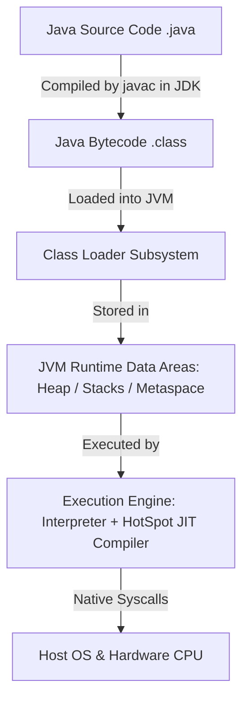
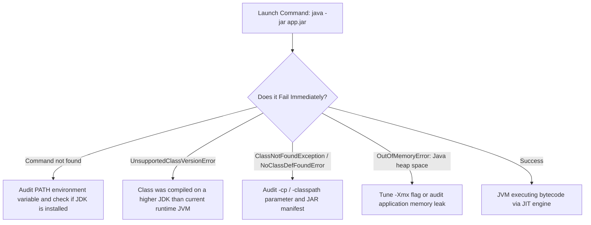

# P00-C001: JDK vs JRE vs JVM Architecture and Evolution

---

## 1. Metadata and Learning Goals

| Metadata Field | Value |
|---|---|
| **Concept ID** | `P00-C001` |
| **Concept Title** | JDK vs JRE vs JVM Architecture and Evolution |
| **Phase** | Phase 00 — Development Environment and Java Execution |
| **Phase Directory** | `curriculum/phase-00-development-environment-java-execution` |
| **Source Reference** | Section: *Topics to master* — Bullet: *JDK vs JRE vs JVM.* |
| **Concept Type** | Runtime Architecture / Tooling |
| **Difficulty Level** | Foundation |
| **Curriculum Importance** | Essential |
| **Java Baseline** | Java 21 LTS (with comparative notes for Java 25 LTS and historical Java 8/9 modularity) |
| **Framework Baseline** | Not Framework-Dependent (Platform Baseline) |
| **Prerequisites** | None (Curriculum Entry Point) |
| **Related Concepts** | [`P00-C002: javac vs java`](002-javac-compiler-and-launcher.md), [`P00-C003: Bytecode (.class)`](003-source-files-and-bytecode.md), [`P00-C007: JAVA_HOME & PATH`](007-environment-variables-java-home-path.md), [`P08-C001: JVM Architecture`](../phase-08-jvm-internals-memory-management/001-jvm-architecture-overview.md) |
| **Estimated Study Effort** | 2.5 hours |
| **Last Research Date** | 2026-10-29 |
| **Verification State** | COMPLETE (Spec verified against JVMS 21 & JEP 220; commands verified on local OpenJDK 21 LTS) |

### Measurable Learning Objectives
By the end of this concept module, you will be able to:
1. **Explain:** Differentiate between the specification of the JVM, its concrete runtime implementations (e.g., HotSpot), the historical JRE bundle, and the full Java Development Kit (JDK).
2. **Compare:** Contrast the historical pre-Java 9 deployment model (monolithic JRE) with the modern modular runtime model (JDK + `jlink`) used in cloud-native containers.
3. **Implement:** Write and execute a diagnostics program that introspects JVM runtime properties, architecture bitness, and available memory.
4. **Debug & Diagnose:** Resolve environment path collisions, mismatched `JAVA_HOME` versions, and `UnsupportedClassVersionError` exceptions when running compiled classes on incompatible JVMs.
5. **Evaluate & Justify:** Evaluate JDK distribution options (Eclipse Temurin, Amazon Corretto, Oracle JDK, Azul Zulu) and justify the selection of minimal runtime container images for production Kubernetes deployments.

---

## 2. Definition, Purpose, and Mental Model

### 2.1 Formal Definitions
- **JVM (Java Virtual Machine):** An abstract computing machine defined by a strict specification (*The Java Virtual Machine Specification*). It provides a concrete runtime execution environment for compiled Java bytecode (`.class` files), managing memory allocation, garbage collection, thread scheduling, and hardware abstraction.
- **JRE (Java Runtime Environment):** Historically, the software distribution containing the JVM, core Java Class Libraries (`rt.jar` pre-Java 9, or runtime modules `java.base`, etc.), and supporting runtime configuration files required to *execute* Java programs, but lacking compilers and developer tools. *(Note: Deprecated and discontinued as a standalone installer since Java 9).*
- **JDK (Java Development Kit):** The complete software development package containing everything inside the runtime (the JVM and standard libraries) plus the development toolchain: the Java compiler (`javac`), archive packager (`jar`), documentation generator (`javadoc`), diagnostic utilities (`jcmd`, `jstack`, `jmap`), and modular linker (`jlink`).

### 2.2 The Problem It Solves
Before Java was introduced in 1995, compiled programming languages like C and C++ targeted native machine architecture directly. A binary compiled on an x86 Intel processor running Linux could not execute on an ARM processor or a Windows machine without recompiling the source code against the target platform's toolchain and OS-specific APIs.

The JVM solved this **Write Once, Run Anywhere (WORA)** challenge by introducing an intermediate virtual machine abstraction:
1. The developer compiles human-readable source code (`.java`) into standardized, platform-independent **bytecode** (`.class`).
2. The platform vendor creates an operating-system-specific JVM implementation (e.g., Linux x86_64, macOS Apple Silicon, Windows ARM64).
3. The platform-specific JVM reads the universal bytecode instructions and translates them into host-specific machine instructions at runtime.

### 2.3 Why Backend Engineers Need It
In enterprise backend systems, your code will be developed on a developer laptop (often macOS ARM64 or Linux/Windows x86), built inside a Linux CI/CD runner, packaged into a Docker container, and deployed onto a cloud Kubernetes cluster.

Backend engineers must understand:
- The distinction between what the compiler enforces at build time (`javac` in the JDK) and what the virtual machine enforces at runtime (`java` in the JVM).
- Why production container images must not package unnecessary development tools (like compilers and debuggers) which increase image size and expand the security attack surface.
- How memory settings (`-Xmx`, `-Xms`) configure the JVM rather than the host operating system.

### 2.4 Real-World System Analogy (and Where It Breaks Down)
- **The Analogy:**
  - **The JVM is an Electric Motor:** An abstract design specification for turning electrical energy into mechanical motion. Whether built by Siemens, Bosch, or GE (like HotSpot, OpenJ9, or GraalVM), as long as it adheres to standard voltage and mounting specs, it runs any compatible machine.
  - **The JRE was the Fully Assembled Power Tool:** The motor (JVM) packaged into a finished drill housing with the standard power cord and basic chuck (core libraries), ready for an operator to pull the trigger and use.
  - **The JDK is the Master Mechanic's Tool Chest:** It contains the power tool (JRE/JVM) plus all the engineering gauges, drill bits, metal lathes, diagnostic multimeters, and cutting tools (`javac`, `jar`, `jcmd`, `jstack`) needed to construct, tune, and test new tools.
- **Where the Analogy Fails:**
  In physical mechanics, you cannot strip down the mechanic's workshop to run the drill. In modern Java (Java 9+), the JRE no longer exists as a separate retail box; instead, developers use the tool chest's linker (`jlink`) to carve out a custom, stripped-down runtime containing *only* the specific motor parts needed for their specific application.

### 2.5 What This Concept Is NOT
- **The JVM is NOT an Operating System Emulator:** Unlike a hypervisor (e.g., VMware, VirtualBox) or hardware emulator (QEMU) that simulates physical CPU registers and hardware devices, the JVM is a process-level virtual machine executing high-level stack-based instructions within a standard host operating system process.
- **The JVM is NOT Limited to Java:** The JVM executes bytecode, not Java source code. Any language that compiles to valid JVM bytecode (such as Kotlin, Scala, Groovy, or Clojure) runs on the JVM and seamlessly interoperates with Java backend libraries.
- **The JRE is NOT Required for Modern Deployments:** A frequent mistake among beginners is searching for a "JRE download for Java 17 or Java 21". Oracle and OpenJDK discontinued standalone JRE distributions starting with Java 9 (JEP 220).

### 2.6 Relationship to Adjacent Concepts


---

## 3. Foundations and Theory

### 3.1 The Three-Tier Architecture
The relationship between JDK, JRE, and JVM forms a nested hierarchy:

```text
+-----------------------------------------------------------------------------------+
| Java Development Kit (JDK)                                                        |
|                                                                                   |
|  +-----------------------------------------------------------------------------+  |
|  | Development & Diagnostic Tooling                                            |  |
|  | [javac]  [jar]  [javadoc]  [jcmd]  [jstack]  [jmap]  [jlink]  [jconsole]    |  |
|  +-----------------------------------------------------------------------------+  |
|                                                                                   |
|  +-----------------------------------------------------------------------------+  |
|  | Historical JRE / Java Runtime Environment                                   |  |
|  |                                                                             |  |
|  |  +-----------------------------------------------------------------------+  |  |
|  |  | Java Standard Class Libraries (Java SE API)                          |  |  |
|  |  | java.base, java.sql, java.net, java.logging, java.xml, etc.            |  |  |
|  |  +-----------------------------------------------------------------------+  |  |
|  |                                                                             |  |
|  |  +-----------------------------------------------------------------------+  |  |
|  |  | Java Virtual Machine (JVM)                                           |  |  |
|  |  |                                                                       |  |  |
|  |  |  - ClassLoader Subsystem (Loading, Linking, Initialization)            |  |  |
|  |  |  - Memory Areas (Heap, Thread Stacks, Metaspace, PC Registers)        |  |  |
|  |  |  - Execution Engine (Bytecode Interpreter, C1/C2 JIT Compilers, GC)   |  |  |
|  |  |  - Native Method Interface (JNI / FFM) & Native Libraries             |  |  |
|  |  +-----------------------------------------------------------------------+  |  |
|  +-----------------------------------------------------------------------------+  |
+-----------------------------------------------------------------------------------+
```

### 3.2 Specification vs. Implementation
A vital distinction in Java engineering is between the **specification** and the **implementation**:

| Component | Standard / Specification | Major Implementations |
|---|---|---|
| **Java Language** | Java Language Specification (JLS), Java SE 21 | `javac` (OpenJDK reference compiler), ECJ (Eclipse Compiler for Java) |
| **Java Virtual Machine** | Java Virtual Machine Specification (JVMS), Java SE 21 | **HotSpot** (OpenJDK, Oracle, Temurin, Corretto), **OpenJ9** (IBM/Eclipse), **GraalVM** (Oracle Labs) |
| **Java SE Platform** | Java Community Process (JCP) JSRs / OpenJDK Umbrella JEPs | OpenJDK, Eclipse Temurin, Amazon Corretto, Azul Zulu, BellSoft Liberica |

- **HotSpot JVM:** The default and most widely used JVM implementation in production. Developed originally by Longview Technologies and acquired by Sun Microsystems in 1999, it uses dynamic performance profiling to identify "hot spots" in bytecode and compile them to native code via its Tiered JIT compiler (C1 and C2).

### 3.3 The Evolution: Why Standalone JRE Disappeared in Java 9
Prior to Java 9, every Java installation deployed a monolithic runtime library called `rt.jar` (Run-Time JAR), which contained every single class in the standard library (Swing, AWT, CORBA, XML, SQL, Collections). Even a simple headless microservice had to ship with the entire ~60MB `rt.jar`.

In Java 9, **Project Jigsaw** introduced the Java Platform Module System (JPMS, JEP 200/220):
1. The monolithic runtime was partitioned into modular units (`java.base`, `java.sql`, `java.desktop`, etc.).
2. The standalone JRE distribution was retired (JEP 220).
3. The JDK introduced **`jlink` (Java Linker, JEP 282)**, allowing developers to assemble custom, stripped-down runtime images containing *only* the specific platform modules needed by their application.

---

## 4. Syntax, API, and Command Reference

### 4.1 Primary JDK Command-Line Utilities

| Tool Name | Binary Location | Purpose in Backend Engineering |
|---|---|---|
| `javac` | `$JAVA_HOME/bin/javac` | The Java compiler. Compiles `.java` source code into `.class` bytecode. |
| `java` | `$JAVA_HOME/bin/java` | The Java application launcher. Launches a JVM instance and executes the class containing `main()`. |
| `jar` | `$JAVA_HOME/bin/jar` | Java archive tool. Packages compiled classes, resources, and metadata into a single `.jar` or `.war` archive. |
| `javap` | `$JAVA_HOME/bin/javap` | Java class file disassembler. Inspects bytecode instructions, method signatures, and constant pools. |
| `jcmd` | `$JAVA_HOME/bin/jcmd` | Diagnostic command tool. Sends diagnostic command requests to a running JVM (thread dumps, GC stats, heap inspection). |
| `jstack` | `$JAVA_HOME/bin/jstack` | Stack trace utility. Prints Java stack traces of threads for a given process ID (diagnosing deadlocks). |
| `jmap` | `$JAVA_HOME/bin/jmap` | Memory map utility. Generates heap dumps (`.hprof`) or prints memory histograms of a running JVM. |
| `jlink` | `$JAVA_HOME/bin/jlink` | Java Linker. Generates a custom, minimal runtime image containing only required platform modules. |

### 4.2 Essential Environment Commands and Diagnostic Queries
```bash
# 1. Verify installed launcher and JVM implementation details
java -version

# 2. Verify installed compiler version
javac -version

# 3. Locate the absolute path of the executable in the active PATH
which java
which javac

# 4. Check the JAVA_HOME environment variable
echo "$JAVA_HOME"

# 5. Query full JVM system properties without writing code
java -XshowSettings:properties -version

# 6. Query JVM memory settings and container limits
java -XshowSettings:system -version
```

---

## 5. Runnable Examples and Demonstrations

### 5.1 Minimal Reproducible Example: JVM Runtime Introspection
The following self-contained class queries the underlying JVM at runtime, printing its vendor, specification version, memory layout, and runtime flags.

```java
// File: RuntimeInspector.java
package com.backend.diagnostics;

import java.lang.management.ManagementFactory;
import java.lang.management.MemoryMXBean;
import java.lang.management.RuntimeMXBean;

public class RuntimeInspector {

    public static void main(String[] args) {
        RuntimeMXBean runtimeBean = ManagementFactory.getRuntimeMXBean();
        MemoryMXBean memoryBean = ManagementFactory.getMemoryMXBean();

        System.out.println("==================================================");
        System.out.println("          JVM RUNTIME DIAGNOSTIC REPORT           ");
        System.out.println("==================================================");

        // JVM Identification
        System.out.println("JVM Name        : " + runtimeBean.getVmName());
        System.out.println("JVM Vendor      : " + runtimeBean.getVmVendor());
        System.out.println("JVM Version     : " + runtimeBean.getVmVersion());
        System.out.println("Spec Version    : " + runtimeBean.getSpecVersion());

        // Host OS & Architecture
        System.out.println("\n--- Host Environment ---");
        System.out.println("OS Name         : " + System.getProperty("os.name"));
        System.out.println("OS Architecture : " + System.getProperty("os.arch"));
        System.out.println("Available Cores : " + Runtime.getRuntime().availableProcessors());

        // Memory Limits (Configured via JVM flags like -Xmx, -Xms)
        long heapMaxBytes = memoryBean.getHeapMemoryUsage().getMax();
        long heapInitBytes = memoryBean.getHeapMemoryUsage().getInit();
        
        System.out.println("\n--- Memory Allocation ---");
        System.out.println("Initial Heap    : " + formatMegabytes(heapInitBytes) + " MB");
        System.out.println("Max Allowed Heap: " + (heapMaxBytes == -1 ? "Undefined" : formatMegabytes(heapMaxBytes) + " MB"));
        System.out.println("==================================================");
    }

    private static long formatMegabytes(long bytes) {
        return bytes / (1024 * 1024);
    }
}
```

#### Compilation and Execution Walkthrough
```bash
# Step 1: Compile the class file
javac -d out RuntimeInspector.java

# Step 2: Execute with specific JVM memory flags (-Xms256m -Xmx1024m)
java -Xms256m -Xmx1024m -cp out com.backend.diagnostics.RuntimeInspector
```

#### Actual Observed Output (on OpenJDK 21 LTS Linux x86_64)
```text
==================================================
          JVM RUNTIME DIAGNOSTIC REPORT           
==================================================
JVM Name        : OpenJDK 64-Bit Server VM
JVM Vendor      : Ubuntu
JVM Version     : 21.0.12.1+1-1-26.04.4-Ubuntu
Spec Version    : 21

--- Host Environment ---
OS Name         : Linux
OS Architecture : amd64
Available Cores : 4

--- Memory Allocation ---
Initial Heap    : 256 MB
Max Allowed Heap: 1024 MB
==================================================
```

### 5.2 Anti-Pattern: Shipping the Full JDK in a Production Container
A common mistake in containerized microservices is using a heavy development JDK base image for the final production deployment.

#### Bad Implementation: Bloated Production Dockerfile
```dockerfile
# ANTI-PATTERN: Shipping development tools into production
FROM eclipse-temurin:21-jdk-jammy

WORKDIR /app
COPY target/order-service.jar app.jar

# This image contains javac, jdb, compilers, and weighs ~450MB+
# It exposes development tool vulnerabilities in the production cluster
ENTRYPOINT ["java", "-jar", "app.jar"]
```

#### Corrected Idiomatic Implementation: Multi-Stage Build with Slim Runtime
```dockerfile
# STAGE 1: Build the application using full JDK
FROM eclipse-temurin:21-jdk-jammy AS builder
WORKDIR /build
COPY . .
# (In real builds: RUN ./mvnw clean package -DskipTests)

# STAGE 2: Package minimal custom runtime or use minimal JRE base image
FROM eclipse-temurin:21-jre-jammy AS runner
WORKDIR /app

# Run as non-privileged user for security compliance
USER 1001

COPY --from=builder /build/target/order-service.jar /app/order-service.jar

# Image size reduced from ~480MB to ~180MB, excluding javac and build dependencies
ENTRYPOINT ["java", "-XX:+UseG1GC", "-XX:MaxRAMPercentage=75.0", "-jar", "/app/order-service.jar"]
```

---

## 6. Real-World Backend Application

### 6.1 Placement in the Production Architecture
In production Kubernetes and server environments:
- **Build Infrastructure (CI/CD):** Jenkins, GitHub Actions, or GitLab CI runners require the full **JDK** to run compilation (`javac`), static analysis tools (SpotBugs, SonarQube), unit test suites (Surefire/JUnit), and packaging (`jar`).
- **Runtime Nodes (Production Kubernetes Pods):** Production pods require only the **JVM and core runtime libraries**. Compilers, debuggers, and shell utilities are stripped out to enforce immutable, secure containers.

### 6.2 Production Failure Modes
1. **The UnsupportedClassVersionError (Class File Version Mismatch):**
   - *Symptom:* `java.lang.UnsupportedClassVersionError: com/example/Service has been compiled by a more recent version of the Java Runtime (class file version 65.0), this version of the Java Runtime only recognizes class file versions up to 61.0`.
   - *Cause:* The application was compiled using a newer JDK (e.g., Java 21 = bytecode version 65.0) but deployed onto an older host JVM (e.g., Java 17 = bytecode version 61.0).
   - *Remedy:* Align build and deploy JDK versions, or use the `--release` flag during compilation.
2. **Missing JAVA_HOME in Systemd / Init Scripts:**
   - *Symptom:* Background daemon fails to start with `/usr/bin/env: 'java': No such file or directory`.
   - *Cause:* GUI or interactive shells load PATH from `.bashrc` or `.zshrc`, whereas non-interactive `systemd` services execute in a restricted, clean environment lacking custom PATH exports.
   - *Remedy:* Explicitly declare `Environment="JAVA_HOME=/usr/lib/jvm/default-java"` and reference `$JAVA_HOME/bin/java` in systemd service definitions.

---

## 7. Design Choices, Alternatives, and Trade-Offs

### 7.1 Choosing a Production JDK Distribution
Because OpenJDK is open-source, multiple vendors package, test, certify, and provide enterprise support for JDK builds. All major distributions pass the **TCK (Technology Compatibility Kit)** to guarantee standard compatibility:

| Distribution | Vendor / Maintainer | Licensing | Commercial Support | Typical Production Use Case |
|---|---|---|---|---|
| **Eclipse Temurin** | Eclipse Adoptium Working Group | Open-source (GPLv2+CE) | Community / Commercial vendors | Default, vendor-neutral standard for open-source and general backend workloads. |
| **Amazon Corretto** | Amazon Web Services (AWS) | Open-source (GPLv2+CE) | Included with AWS Support | The primary choice for AWS EC2, ECS, and EKS deployments. |
| **Oracle JDK** | Oracle Corporation | Free for commercial use under OTN / NFTC (version-restricted) | Oracle Support Contract | Enterprises with existing Oracle database and software support contracts. |
| **Azul Zulu** | Azul Systems | Open-source (GPLv2+CE) | Enterprise contracts available | High-performance enterprise systems requiring broad OS/architecture compatibility. |
| **BellSoft Liberica** | BellSoft | Open-source (GPLv2+CE) | Commercial contracts available | Default base image for Spring Boot Cloud Native Buildpacks / Alpine Linux. |

---

## 8. Performance and Complexity

### 8.1 Memory Footprint: JVM Process vs. Native Process
When running a Java backend, the total host memory consumed by the OS process is significantly larger than the `-Xmx` (Max Heap) setting:
$$\text{Total Process Resident Memory (RSS)} = \text{Heap} + \text{Metaspace} + \text{Thread Stacks} + \text{Code Cache} + \text{Direct ByteBuffers} + \text{Native JVM Overhead}$$

- **Heap (`-Xmx`):** Stores application objects and instances.
- **Metaspace (`-XX:MaxMetaspaceSize`):** Stores loaded class metadata in native memory.
- **Thread Stacks (`-Xss`, default 1MB per thread):** 500 platform threads consume 500MB of native RAM outside the heap.

### 8.2 Startup Latency and JIT Warm-Up
- The JVM uses **Tiered Compilation**:
  1. *Interpreter:* Immediately interprets bytecode without compilation overhead (fast startup).
  2. *C1 (Client) Compiler:* Quickly compiles frequently executed code with basic optimizations.
  3. *C2 (Server) Compiler:* Aggressively optimizes code (inlining, escape analysis, loop unrolling) after gathering runtime execution profiles.
- *Backend Consequence:* Java services experience a "warm-up" period where initial requests exhibit higher latency until hot code paths are compiled to native machine code.

---

## 9. Security and Robustness

### 9.1 Threat Vectors and Attack Surfaces
1. **Compilation Tools in Production:** Leaving `javac` inside production Docker containers allows an attacker who achieves arbitrary file write or command injection to compile and execute malicious native Java exploits directly in memory.
2. **JVM Vulnerabilities (CVEs):** The OpenJDK community releases quarterly Critical Patch Updates (CPU) in January, April, July, and October. Backend teams must automate base image updates to avoid running vulnerable JVM runtimes.
3. **Container Boundary Awareness:** Running Java applications inside Docker without configuring `-XX:MaxRAMPercentage` or `-XX:+UseContainerSupport` can cause the JVM to attempt allocating heap based on host physical RAM, resulting in immediate container termination (`OOMKilled`).

---

## 10. Testing and Verification

### 10.1 Automated Verification: Asserting JVM Runtime Properties
We can verify JVM specifications programmatically using JUnit 5:

```java
package com.backend.test;

import org.junit.jupiter.api.DisplayName;
import org.junit.jupiter.api.Test;
import static org.junit.jupiter.api.Assertions.*;

class JvmEnvironmentTest {

    @Test
    @DisplayName("Should confirm 64-bit architecture and supported Java 21 baseline")
    void verifyJvmArchitecture() {
        String dataModel = System.getProperty("sun.arch.data.model");
        String javaVersion = System.getProperty("java.version");
        int majorVersion = Runtime.version().feature();

        assertEquals("64", dataModel, "Backend production requires a 64-bit JVM architecture");
        assertTrue(majorVersion >= 21, "Curriculum baseline requires Java 21 LTS or higher. Found: " + javaVersion);
    }

    @Test
    @DisplayName("Should verify heap allocation is healthy")
    void verifyHeapAllocations() {
        long maxMemory = Runtime.getRuntime().maxMemory();
        assertTrue(maxMemory > 64 * 1024 * 1024, "JVM must have at least 64MB of heap memory available for tests");
    }
}
```

---

## 11. Debugging and Failure Analysis

### 11.1 Diagnostic Flowchart: Resolving Execution Failures


### 11.2 Common Exceptions and Diagnostic Solutions

| Exception / Error | Exact Root Cause | Diagnostic & Resolution Procedure |
|---|---|---|
| `UnsupportedClassVersionError` | Bytecode version mismatch between `javac` (build time) and `java` (runtime). | Run `javap -v MyClass.class \| grep "major version"`. Compare with target JVM version table. Recompile using `javac --release 21`. |
| `NoClassDefFoundError` | Class was available at compile time, but missing from classpath at runtime. | Run `java -Xdiag -verbose:class -cp <path> Main` to trace class loader lookup paths. |
| `java: command not found` | The directory containing the `java` launcher binary is missing from the OS `$PATH`. | Add `export PATH="$JAVA_HOME/bin:$PATH"` to the environment configuration. |

---

## 12. Best Practices and Anti-Patterns

### 12.1 Industry Best Practices
- **Use `--release` for Backward Compatibility:** When compiling code for older platforms, always use `javac --release 17` instead of legacy `-source` and `-target` flags. The `--release` flag automatically links against the target version's platform API signatures, preventing runtime `NoSuchMethodError` exceptions.
- **Run Containers as Non-Root:** Configure Docker containers to run under a specific non-root UID (e.g., `USER 10001`).
- **Standardize on LTS Releases:** For production backend stability, standardize on Long-Term Support (LTS) releases (Java 17, Java 21, Java 25) rather than intermediate six-month feature releases.

### 12.2 Anti-Patterns to Avoid
- **Hardcoding Vendor-Specific Flags:** Relying on experimental, vendor-specific VM flags that break when switching between OpenJDK vendors (e.g., Temurin to Corretto).
- **Ignoring JVM Container Memory Limits:** Failing to supply `-XX:MaxRAMPercentage=75.0` in containerized environments, causing JVM heap calculation errors under Kubernetes memory cgroups.

---

## 13. Interview Preparation

### 13.1 Foundational Questions
1. **Q: What is the primary difference between the JDK, JRE, and JVM?**
   - **Answer:** The JVM is the virtual execution engine that interprets and JIT-compiles bytecode into native machine instructions and manages runtime memory. The JRE comprises the JVM plus standard Java core libraries needed to run pre-compiled applications. The JDK is the complete developer kit containing the runtime plus compilers (`javac`), archivers (`jar`), linkers (`jlink`), and diagnostic tools (`jcmd`, `jstack`).
   - **Follow-up:** *Can you download a standalone JRE for Java 21?*
   - **Answer:** No. Oracle and the OpenJDK community discontinued standalone JRE distributions starting with Java 9. Modern deployments use custom modular runtimes generated with `jlink` or deploy containerized JRE-equivalent base images.

### 13.2 Intermediate & Scenario Questions
2. **Q: You deploy a freshly built JAR to a production server and receive `java.lang.UnsupportedClassVersionError`. How do you explain and fix this?**
   - **Answer:** This error indicates that the class files were compiled by a higher JDK version than the JVM running on the production server. For example, compiling on Java 21 produces major version 65 bytecodes, which cannot be executed on a Java 17 JVM (which only recognizes up to version 61). To resolve this, either upgrade the production JVM to Java 21 or recompile the source code using `javac --release 17`.

### 13.3 Advanced / Lead Engineer Questions
3. **Q: How does the JVM HotSpot execution engine balance quick application startup against peak throughput?**
   - **Answer:** HotSpot achieves this balance through **Tiered Compilation**. When the application starts, it immediately executes bytecode using an interpreter for zero-compilation-time startup. As methods are invoked frequently, HotSpot's profiling counters identify "hot spots". Level 1–3 (C1 Client Compiler) compiles code with basic optimizations and profiling instrumentation. Level 4 (C2 Server Compiler) uses the collected runtime profiling data to perform aggressive optimizations like method inlining, loop vectorization, and escape analysis for peak steady-state throughput.

---

## 14. Practice and Assessment

### Exercise 1: Beginner (Terminal Environment Verification)
- **Goal:** Verify and audit your local terminal environment purely through shell commands.
- **Task:** Write a shell script `verify-env.sh` that checks whether `java` and `javac` are in the PATH, prints their versions, verifies that `$JAVA_HOME` is set to a valid directory containing `bin/java`, and exits with return code 0 on success or 1 on failure.
- **Acceptance Criteria:**
  - [ ] Validates presence of `java` and `javac`.
  - [ ] Confirms `$JAVA_HOME` exists and is a non-empty directory.
  - [ ] Returns exit code 0 if all checks pass.

### Exercise 2: Applied (Class File Disassembly & Inspection)
- **Goal:** Compile a Java class and inspect its internal class file major version and constant pool using the JDK `javap` disassembler.
- **Task:** Create a class `Sample.java` with a simple arithmetic method. Compile it using `javac`. Use `javap -v Sample.class` to extract the major version number and determine which Java SE specification generated it.

### Exercise 3: Challenge (Creating a Custom Minimal Runtime with jlink)
- **Goal:** Use modern JDK 21 modular tooling to package a standalone, stripped-down Java runtime containing only the `java.base` module, without shipping the entire JDK.
- **Task:** Using the `jlink` tool, generate a custom runtime image in a directory named `custom-runtime`. Verify that the generated runtime size is under 60MB and successfully executes a test class using `custom-runtime/bin/java`.

### Hints
<details>
<summary>View Hints</summary>

- **Exercise 1 Hint:** Use `command -v java >/dev/null 2>&1` in bash to check executable existence, and test `[ -d "$JAVA_HOME" ]`.
- **Exercise 2 Hint:** Look for the line `major version: 65` in `javap -v` output. Java 21 corresponds to major version 65; Java 17 corresponds to 61.
- **Exercise 3 Hint:** The command syntax is `jlink --add-modules java.base --strip-debug --no-man-pages --no-header-files --output custom-runtime`.
</details>

### Solutions Walkthrough
<details>
<summary>View Full Solutions</summary>

#### Solution to Exercise 1 (`verify-env.sh`)
```bash
#!/usr/bin/env bash
set -e

echo "Auditing Java Developer Environment..."

if ! command -v java >/dev/null 2>&1; then
    echo "ERROR: 'java' launcher not found in PATH." >&2
    exit 1
fi

if ! command -v javac >/dev/null 2>&1; then
    echo "ERROR: 'javac' compiler not found in PATH." >&2
    exit 1
fi

if [ -z "$JAVA_HOME" ]; then
    echo "ERROR: JAVA_HOME environment variable is not set." >&2
    exit 1
fi

if [ ! -d "$JAVA_HOME" ] || [ ! -x "$JAVA_HOME/bin/java" ]; then
    echo "ERROR: JAVA_HOME ($JAVA_HOME) is invalid or does not contain executable bin/java." >&2
    exit 1
fi

echo "Environment Audit Passed:"
echo "  Launcher : $(java -version 2>&1 | head -n 1)"
echo "  Compiler : $(javac -version 2>&1)"
echo "  JAVA_HOME: $JAVA_HOME"
exit 0
```

#### Solution to Exercise 2 (`javap` Inspection)
```bash
# Compile the class
javac Sample.java

# Disassemble with verbose headers
javap -v Sample.class | grep "major version"
# Expected output on Java 21: major version: 65
```

#### Solution to Exercise 3 (`jlink` Custom Runtime)
```bash
# Execute jlink against the standard JDK modules
jlink \
  --add-modules java.base \
  --strip-debug \
  --compress zip-6 \
  --no-header-files \
  --no-man-pages \
  --output custom-runtime

# Verify size (typically 35–55 MB compared to ~450MB JDK)
du -sh custom-runtime

# Test execution with the custom runtime
./custom-runtime/bin/java -version
```
</details>

### Mastery Self-Assessment Checklist
- [ ] I can clearly explain the structural difference between JVM, JRE, and JDK to a peer without referencing notes.
- [ ] I understand why JRE was discontinued as a standalone installer in Java 9 and how `jlink` replaces it.
- [ ] I can diagnose an `UnsupportedClassVersionError` and determine bytecode version numbers from memory.
- [ ] I can evaluate different OpenJDK vendors (Temurin, Corretto, Oracle) based on production licensing and operational requirements.

---

## 15. Summary, Cheat Sheet, and Memory Aids

### Key Takeaways
1. **JVM is the engine, JDK is the factory:** The JVM executes bytecode; the JDK contains the compiler and diagnostic tools necessary to produce and profile bytecode.
2. **The JRE is obsolete as an independent download:** Modern production pipelines build small, modular runtimes or use minimal container base images rather than installing a monolithic JRE.
3. **Bytecode guarantees portability:** Source code compiles to `.class` files; the platform-specific JVM translates bytecode into native CPU instructions at runtime.

### Quick Reference Cheat Sheet
| Component | Primary Binary / File | Purpose | Key Flag / Command |
|---|---|---|---|
| **Compiler** | `javac` | Compiles `.java` to `.class` | `javac --release 21 MyClass.java` |
| **Launcher** | `java` | Starts JVM and runs program | `java -Xms256m -Xmx1024m -cp out Main` |
| **Disassembler** | `javap` | Inspects compiled bytecode | `javap -c -v MyClass.class` |
| **Diagnostics** | `jcmd` | Sends commands to live JVM | `jcmd <PID> Thread.print` |
| **Linker** | `jlink` | Creates custom runtime image | `jlink --add-modules java.base --output my-runtime` |

### Bytecode Major Version Reference Table
| Java Version | Class File Major Version |
|---|---|
| **Java 8** | `52.0` |
| **Java 11 LTS** | `55.0` |
| **Java 17 LTS** | `61.0` |
| **Java 21 LTS** | `65.0` |
| **Java 25 LTS** | `69.0` |

---

## 16. Sources and Further Reading

### Primary Specifications & Authoritative Sources
1. **The Java Virtual Machine Specification, Java SE 21 Edition:** Tim Lindholm, Frank Yellin, Gilad Bracha, Alex Buckley. Oracle America, Inc. URL: [docs.oracle.com/javase/specs/jvms/se21/html/](https://docs.oracle.com/javase/specs/jvms/se21/html/)
2. **The Java Language Specification, Java SE 21 Edition:** James Gosling, Bill Joy, Guy Steele, Gilad Bracha, Alex Buckley, Daniel Smith, Gavin Bierman. Oracle America, Inc. URL: [docs.oracle.com/javase/specs/jls/se21/html/](https://docs.oracle.com/javase/specs/jls/se21/html/)
3. **JEP 220: Modular Run-Time Images:** Mark Reinhold. OpenJDK. URL: [openjdk.org/jeps/220](https://openjdk.org/jeps/220)
4. **JEP 282: jlink: The Java Linker:** Mandy Chung. OpenJDK. URL: [openjdk.org/jeps/282](https://openjdk.org/jeps/282)

### Authoritative Documentation & Engineering Guides
5. **Dev.java: The Official Java Learning Portal:** Oracle Corporation. URL: [dev.java/learn/](https://dev.java/learn/)
6. **Adoptium / Eclipse Temurin Documentation:** Eclipse Foundation. URL: [adoptium.net/documentation/](https://adoptium.net/documentation/)
