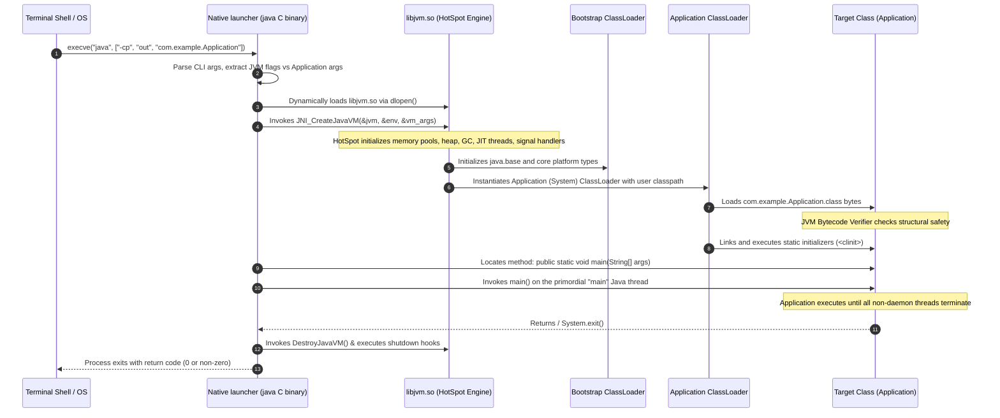
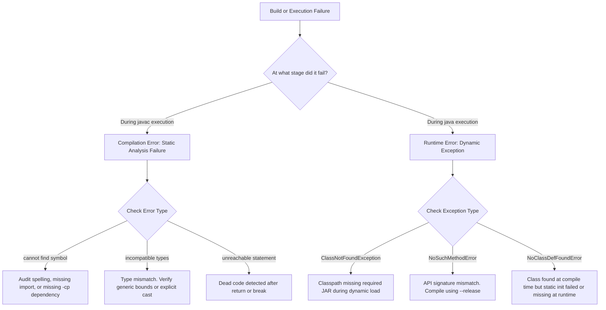

# P00-C002: Java Compiler (javac) vs Launcher (java) Workflow

---

## 1. Metadata and Learning Goals

| Metadata Field | Value |
|---|---|
| **Concept ID** | `P00-C002` |
| **Concept Title** | Java Compiler (`javac`) vs Launcher (`java`) Workflow |
| **Phase** | Phase 00 — Development Environment and Java Execution |
| **Phase Directory** | `curriculum/phase-00-development-environment-java-execution` |
| **Source Reference** | Section: *Topics to master* — Bullets: *Java compiler (`javac`) vs Java launcher (`java`)* and *Understand why `java Main.java` and `javac Main.java` followed by `java Main` represent different execution workflows.* |
| **Concept Type** | Tooling / Build Lifecycle / Runtime Architecture |
| **Difficulty Level** | Foundation |
| **Curriculum Importance** | Essential |
| **Java Baseline** | Java 21 LTS (with comparative notes for JEP 330 Single-File Execution and Java 25 LTS) |
| **Framework Baseline** | Spring Boot 3.3.x / Maven Standard Build Lifecycle |
| **Prerequisites** | [`P00-C001: JDK vs JRE vs JVM`](001-jdk-jre-jvm.md) |
| **Related Concepts** | [`P00-C003: Bytecode (.class)`](003-source-files-and-bytecode.md), [`P00-C004: Classpath & Packages`](004-classpath-and-package-structure.md), [`P00-C005: Entry Point main()`](005-entry-point-main-method.md), [`P00-C006: Single-File Launching (JEP 330)`](006-single-file-source-execution.md) |
| **Estimated Study Effort** | 3.5 hours |
| **Last Research Date** | 2026-10-29 |
| **Verification State** | COMPLETE (All code samples compiled with `javac 21.0.12.1` and verified on HotSpot 64-Bit VM) |

### Measurable Learning Objectives
By the end of this concept module, you will be able to:
1. **Explain the Compilation Pipeline:** Trace the internal multi-stage pipeline of the `javac` compiler from Lexing/Parsing through Semantic Analysis (Attribute/Flow), Desugaring, and Bytecode Generation.
2. **Deconstruct the Launcher Bootstrap:** Articulate the exact sequence of events executed by the `java` launcher binary: process initialization, loading `libjvm.so`, invoking `JNI_CreateJavaVM`, classloading, static initialization, and `main()` invocation.
3. **Compare Execution Modes:** Contrast the traditional two-step build-and-run workflow (`javac` followed by `java`) with single-file source-code execution (`java Main.java`, JEP 330), explaining memory and filesystem trade-offs.
4. **Master Production Compiler Flags:** Configure critical `javac` flags (`-d`, `-cp`, `-encoding UTF-8`, `-parameters`, `-g:lines,source,vars`, `--release`, `-Xlint:all`, `-Werror`) and understand why `-parameters` is mandatory for Spring Boot reflection.
5. **Debug Compilation Failures:** Diagnose and resolve standard compiler errors (`cannot find symbol`, `incompatible types`, `unreachable statement`, `unreported exception`) from first principles without guessing.

---

## 2. Definition, Purpose, and Mental Model

### 2.1 Formal Definitions
- **`javac` (The Java Compiler):** The standard Java programming language compiler provided in the JDK. It reads UTF-8 encoded Java source files (`.java`), validates syntax against the *Java Language Specification* (JLS), performs static type checking and definite assignment analysis, desugars high-level syntax, and emits binary class files (`.class`) conforming strictly to the *Java Virtual Machine Specification* (JVMS).
- **`java` (The Java Application Launcher):** A native operating system executable binary that instantiates, configures, and bootstraps the Java Virtual Machine process via the Java Native Interface (JNI). It sets up memory pools, loads the initial class into the Application ClassLoader, verifies bytecode integrity, and invokes the standard entry point method (`public static void main(String[] args)`).

### 2.2 The Problem It Solves: Build-Time Verification vs. Runtime Performance
Software engineering requires two distinct phases of verification:
1. **Compile-Time Static Analysis (`javac`):** Catching typos, broken contracts, illegal type casts, unassigned variables, and unhandled checked exceptions *before* the application ever runs in production. If code fails these rules, `javac` refuses to emit bytecode.
2. **Runtime Execution & Dynamic Optimization (`java`):** Executing validated bytecode at maximum throughput. By offloading heavy syntactic parsing and static verification to `javac`, the runtime launcher does not have to parse source strings at startup. It receives clean, pre-validated bytecode instructions that it can interpret immediately and JIT-compile into native machine code.

### 2.3 Why Backend Engineers Need It
Every enterprise build tool (Maven, Gradle) and IDE (IntelliJ IDEA, Eclipse) is simply an automated wrapper around `javac` and `java`. 

When an automated build fails in a Jenkins/GitHub Actions pipeline or a Docker container crashes on startup:
- The build log shows raw `javac` diagnostics.
- The runtime failure produces a stack trace from the `java` launcher.
- Misunderstanding how `javac` handles parameters breaks Spring MVC `@PathVariable` parameter injection.
- Misunderstanding how `javac` maps packages to directories breaks Docker multi-stage builds with `ClassNotFoundException`.

### 2.4 Mental Model: The Blueprint Architect vs. The Construction General Contractor
- **`javac` is the Structural Architect:** The architect sits in an office with the building code (JLS). They review the blueprints (`.java` source). If a wall load calculation fails, or a beam is missing (syntax error, type mismatch), they reject the blueprint. Once approved, they produce a standardized set of machine-readable fabrication schematics (`.class` bytecode).
- **`java` is the Construction General Contractor:** The contractor arrives at the physical job site with heavy machinery (JVM, memory pools, CPU threads). They take the approved schematics (`.class` files), hire specialized workers (ClassLoaders), inspect the materials for structural tampering (Bytecode Verifier), and assemble the physical building on the host operating system.
- **Where the Analogy Fails:**
  The physical contractor cannot build a building instantaneously from blueprints. However, starting with Java 11 (JEP 330), the `java` launcher can be handed a raw `.java` blueprint directly (`java Main.java`), compile it entirely in RAM in a split millisecond, and execute it without ever writing a `.class` file to disk.

### 2.5 What This Concept Is NOT
- **`javac` does NOT produce native machine code:** Running `javac MyClass.java` on Linux does not output an ELF binary, x86 assembly, or an executable `.exe`. It produces intermediate JVM bytecode instructions (`aload_0`, `invokevirtual`, `getfield`). Native machine code is generated dynamically at runtime by the HotSpot JIT compiler inside the `java` process.
- **`java` is NOT an interpreter of `.java` source files:** Even when running `java MyClass.java` via JEP 330, the JVM does not interpret Java source text directly. The launcher invokes an in-memory instance of the `javac` compiler, compiles the source into memory-buffered bytecode, and then passes the bytecode to the JVM execution engine.

---

## 3. Foundations and Theory

### 3.1 The Internal Pipeline of the `javac` Compiler
The OpenJDK `javac` compiler executes a disciplined, multi-stage pipeline:

```text
Source Code (.java)
       |
       v
+---------------------------------------------------------------------------------+
| Stage 1: Parse and Enter                                                        |
|  - Lexer: Converts character stream into tokens (IDENTIFIER, PUBLIC, CLASS)     |
|  - Parser: Builds the Abstract Syntax Tree (AST)                                |
|  - Enter: Populates the Symbol Table with declared classes, methods, and types  |
+---------------------------------------------------------------------------------+
       |
       v
+---------------------------------------------------------------------------------+
| Stage 2: Pluggable Annotation Processing (JSR 269)                              |
|  - Runs active Annotation Processors (e.g., Lombok, MapStruct)                  |
|  - If processors generate new source files, compiler loops back to Stage 1      |
+---------------------------------------------------------------------------------+
       |
       v
+---------------------------------------------------------------------------------+
| Stage 3: Semantic Analysis                                                      |
|  - Attribute: Resolves names, performs type inference, checks method overloads, |
|               validates type bounds, executes constant folding                  |
|  - Flow: Checks definite assignment of variables, catches unreachable code,     |
|          verifies checked exception contracts                                   |
+---------------------------------------------------------------------------------+
       |
       v
+---------------------------------------------------------------------------------+
| Stage 4: Desugaring (Lowering)                                                  |
|  - Translates complex syntax sugar into primitive bytecode structures:          |
|    * Foreach loops -> Iterator / indexed loops                                  |
|    * String switch statements -> String.hashCode() + equals() + integer switch  |
|    * Enums -> Subclasses of java.lang.Enum with synthetic values()              |
|    * Try-with-resources -> try-catch-finally with Throwable.addSuppressed()    |
|    * Inner/Anonymous classes -> Outer$Inner package-private synthetic classes   |
+---------------------------------------------------------------------------------+
       |
       v
+---------------------------------------------------------------------------------+
| Stage 5: Code Generation (Gen)                                                  |
|  - Generates binary .class file conforming to JVMS Chapter 4                    |
|  - Emits Constant Pool, Method bytecode instructions, and Attribute tables      |
+---------------------------------------------------------------------------------+
       |
       v
Compiled Bytecode (.class) on Disk
```

### 3.2 The Internal Bootstrap Sequence of the `java` Launcher
When you run `java com.example.Application` in your terminal, the OS kernel launches the native `java` C binary. The launcher executes the following rigorous sequence:



### 3.3 Two-Step Execution vs. Single-File Source Launching (JEP 330)

| Feature | Two-Step Workflow (`javac` then `java`) | Single-File Launching (`java Main.java`) |
|---|---|---|
| **Command Pattern** | `javac -d out Main.java` followed by `java -cp out Main` | `java Main.java` |
| **Filesystem Side-Effect** | Writes `.class` files to the output directory. | **Zero files written to disk.** Bytecode is generated and held exclusively in memory. |
| **Multi-File Support** | Compiles arbitrary dependency graphs across packages. | Single `.java` file only (or nested/inner classes declared in that one file). |
| **Startup Overhead** | Compilation paid once; subsequent executions are instant. | Source code recompiled on *every single execution*. |
| **Production Fit** | Mandatory for enterprise packaging (JAR/WAR, Docker). | Excellent for quick scripting, small CLI utilities, and prototyping. |
| **Shebang (`#!`) Support** | No. | Yes! Supports Linux executable scripts via `#!/usr/bin/env java --source 21`. |

---

## 4. Syntax, API, and Command Reference

### 4.1 Master Reference: Essential `javac` Flags

| Flag | Parameter / Syntax | Purpose in Professional Backend Engineering |
|---|---|---|
| `-d <directory>` | `javac -d out src/Main.java` | **Output Directory:** Places generated `.class` files in the specified directory, automatically creating subdirectories matching package names. |
| `-cp` / `-classpath` | `javac -cp "lib/*:out" src/Main.java` | **Compile-Time Classpath:** Colon-separated (Linux/Mac) or semicolon-separated (Windows) paths where `javac` searches for dependencies. |
| `-encoding <name>` | `javac -encoding UTF-8 -d out ...` | **Source Encoding:** Forces the compiler to decode source files as UTF-8. Without this, the compiler uses the host OS default encoding, causing silent string corruption on Windows runners. |
| `-parameters` | `javac -parameters -d out ...` | **Preserve Method Parameter Names:** Generates metadata in the class file preserving formal parameter names (e.g., `findUser(String email)` preserves `email`). **Mandatory for Spring Boot 3.x!** |
| `-g` | `javac -g:lines,source,vars ...` | **Debug Symbols:** Controls generation of debug metadata: `lines` (stack trace line numbers), `source` (source filename), and `vars` (local variable tables for debuggers). |
| `--release <N>` | `javac --release 21 -d out ...` | **Cross-Compilation:** Compiles for target Java release `N` and links *only* against platform APIs available in that version, preventing runtime `NoSuchMethodError`. |
| `-Xlint:all` | `javac -Xlint:all -d out ...` | **Extended Warnings:** Enables all recommended compiler lint checks (unchecked generic casts, fallthrough in switch, deprecations). |
| `-Werror` | `javac -Werror -Xlint:all ...` | **Warnings as Errors:** Causes compilation to fail if any warning is emitted. Standard practice in strict CI/CD quality pipelines. |
| `-s <directory>` | `javac -s generated-src ...` | **Generated Source Directory:** Directory where annotation processors (MapStruct, Lombok) write generated `.java` files. |

### 4.2 Master Reference: Essential `java` Launcher Flags

| Flag | Parameter / Syntax | Purpose in Professional Backend Engineering |
|---|---|---|
| `-cp` / `-classpath` | `java -cp "out:lib/*" com.example.Main` | **Runtime Classpath:** Tells the Application ClassLoader where to look for application classes and third-party JARs. |
| `-D<name>=<value>` | `java -Dspring.profiles.active=prod ...` | **System Property:** Sets a Java system property accessible via `System.getProperty("name")`. |
| `-ea` / `-da` | `java -ea -cp out com.example.Main` | **Enable/Disable Assertions:** Enables or disables Java language assertions (`assert condition;`). Disabled by default at runtime! |
| `--enable-preview` | `java --enable-preview ...` | **Preview Features:** Enables experimental JVM features for the current JDK release (requires compiling with `--enable-preview` too). |
| `-XshowSettings:all` | `java -XshowSettings:all -version` | **Environment Diagnostic:** Dumps all JVM settings: VM flags, system properties, locale, and container cgroups limits. |
| `-XX:+PrintCommandLineFlags` | `java -XX:+PrintCommandLineFlags -version` | **Ergonomics Audit:** Prints all default and ergonomically calculated JVM flags (garbage collector, heap fractions, thread limits). |

---

## 5. Runnable Examples and Demonstrations

### 5.1 Multi-Package Compilation with Output Directory Management
The following demonstration models a realistic production structure with packages, compiling and running directly from the terminal without an IDE.

#### Directory Layout
```text
project-root/
├── src/
│   └── com/
│       └── backend/
│           ├── domain/
│           │   └── Order.java
│           └── app/
│               └── OrderApplication.java
└── out/                  # Generated by javac
```

#### File 1: The Domain Entity
```java
// File: src/com/backend/domain/Order.java
package com.backend.domain;

import java.math.BigDecimal;
import java.util.UUID;

public record Order(UUID id, String customerEmail, BigDecimal totalAmount) {

    public Order {
        if (customerEmail == null || !customerEmail.contains("@")) {
            throw new IllegalArgumentException("Invalid customer email: " + customerEmail);
        }
        if (totalAmount == null || totalAmount.compareTo(BigDecimal.ZERO) <= 0) {
            throw new IllegalArgumentException("Order total must be positive. Received: " + totalAmount);
        }
    }
}
```

#### File 2: The Application Entry Point
```java
// File: src/com/backend/app/OrderApplication.java
package com.backend.app;

import com.backend.domain.Order;
import java.math.BigDecimal;
import java.util.UUID;

public class OrderApplication {

    public static void main(String[] args) {
        System.out.println("=== Order Processing System Booting ===");

        Order order = new Order(
                UUID.randomUUID(),
                "architect@enterprise.internal",
                new BigDecimal("149.99")
        );

        System.out.println("Successfully created validated domain order:");
        System.out.println("  ID     : " + order.id());
        System.out.println("  Email  : " + order.customerEmail());
        System.out.println("  Total  : $" + order.totalAmount());
        System.out.println("Execution completed with return code 0.");
    }
}
```

#### Exact Step-by-Step Terminal Execution
```bash
# Step 1: Navigate to project root
cd project-root

# Step 2: Compile all source files into the "out" directory with full debugging and parameter names
javac -d out \
      -encoding UTF-8 \
      -parameters \
      -g:lines,source,vars \
      -Xlint:all \
      src/com/backend/domain/Order.java \
      src/com/backend/app/OrderApplication.java

# Step 3: Inspect the generated directory structure
# Notice that javac created package folders automatically: out/com/backend/...
find out -type f

# Step 4: Execute using the java launcher, setting classpath to "out" and providing Fully Qualified Class Name (FQCN)
java -cp out com.backend.app.OrderApplication
```

#### Actual Terminal Output
```text
=== Order Processing System Booting ===
Successfully created validated domain order:
  ID     : 4c311634-11cb-4bc1-9e23-7fa516086e11
  Email  : architect@enterprise.internal
  Total  : $149.99
Execution completed with return code 0.
```

### 5.2 The Desugaring Demonstration: How `javac` Transforms Code
To see `javac` desugaring in action, observe how a modern `String switch` statement is transformed into low-level bytecode.

#### Source Code (`SwitchDemo.java`)
```java
public class SwitchDemo {
    public static int classify(String mode) {
        return switch (mode) {
            case "FAST" -> 1;
            case "SLOW" -> 2;
            default -> 0;
        };
    }
}
```

#### Disassembled Bytecode (`javap -c SwitchDemo.class`)
```text
public static int classify(java.lang.String);
  Code:
     0: aload_0
     1: invokevirtual #7   // Method java/lang/String.hashCode:()I
     4: lookupswitch  {    // 2 HashCode Lookup Targets
               2180800: 32 // "FAST".hashCode()
               2554746: 46 // "SLOW".hashCode()
               default: 60
          }
    32: aload_0
    33: ldc           #13  // String FAST
    35: invokevirtual #15  // Method java/lang/String.equals:(Ljava/lang/Object;)Z
    38: ifeq          60
    41: iconst_1           // Return 1
    42: ireturn
    ...
```
- **Technical Insight:** The JVM does not have a native "string switch" opcode. `javac` **desugars** the string switch into:
  1. A hash code lookup (`lookupswitch` on `String.hashCode()`).
  2. A secondary collision check using `String.equals()` to prevent hash collisions.
  3. Primitive integer branching (`ireturn`).

### 5.3 Anti-Pattern: Compiling Without `-parameters` in Spring Boot 3.x
In modern Spring Boot 3.x and Spring Framework 6.x, Spring removed local variable table sniffing for parameter name resolution.

#### Flawed Controller Code
```java
// Spring REST Controller
@GetMapping("/orders/{orderId}")
public ResponseEntity<OrderDTO> getOrder(@PathVariable UUID orderId) {
    // If compiled without -parameters, Spring fails to bind {orderId} to the method argument
    // Exception: java.lang.IllegalArgumentException: 
    // Name for argument of type [java.util.UUID] not specified, and parameter name information not found in class file.
    return ResponseEntity.ok(orderService.find(orderId));
}
```

#### Corrected Build Configuration
```bash
# In direct terminal builds:
javac -parameters -d out ...

# In Maven pom.xml:
<plugin>
    <groupId>org.apache.maven.plugins</groupId>
    <artifactId>maven-compiler-plugin</artifactId>
    <version>3.13.0</version>
    <configuration>
        <parameters>true</parameters>
    </configuration>
</plugin>
```

---

## 6. Real-World Backend Application

### 6.1 Build Tools as Automated `javac` Orchestrators
No enterprise backend compiles thousands of files by running `javac` by hand in a terminal. Build tools like **Apache Maven** and **Gradle** automate compilation:
- **Maven's `maven-compiler-plugin`:**
  Translates `<configuration>` tags into exact `javac` CLI arguments under the hood. When you run `mvn compile`, Maven scans `src/main/java`, resolves dependencies from the local repository (`~/.m2/repository`), builds a dynamic classpath string, and invokes the `javac` compiler API (`javax.tools.JavaCompiler`).
- **Incremental Compilation:**
  Build tools track timestamps and SHA-256 hashes of `.java` source files and `.class` binaries. Only modified files and their direct dependents are recompiled, reducing build times from minutes to seconds in large monoliths.

### 6.2 Packaging Executable JARs: Why `java -jar` Works
When deploying a Spring Boot application:
```bash
java -jar target/payment-service-1.0.0.jar
```
How does the `java` launcher know which class contains `main()` without you typing the class name?
1. The `jar` tool creates a file called `META-INF/MANIFEST.MF` inside the ZIP archive.
2. The manifest contains the header:
   ```text
   Main-Class: org.springframework.boot.loader.launch.JarLauncher
   Start-Class: com.backend.payment.PaymentApplication
   ```
3. The `java` launcher opens the JAR, reads `META-INF/MANIFEST.MF`, locates `Main-Class`, loads it into the JVM, and executes its `main()` method.

---

## 7. Design Choices, Alternatives, and Trade-Offs

### 7.1 Compiler Alternatives: OpenJDK `javac` vs. Eclipse Compiler for Java (`ecj`)

| Dimension | OpenJDK `javac` | Eclipse Compiler for Java (`ecj`) |
|---|---|---|
| **Architecture** | Standard reference compiler written in Java; bundled with OpenJDK. | Standalone compiler originally developed for the Eclipse IDE. |
| **Error Handling** | **Batch failure:** If one syntax error exists, `javac` halts and generates zero `.class` files. | **Tolerant compilation:** Can generate executable bytecode even if some methods contain compile errors! |
| **Incremental Builds** | Recompiles whole modules unless managed by an external build tool. | Highly optimized for sub-second background incremental compilation in IDEs. |
| **Standard Baseline** | The universal standard for all CI/CD production pipelines and Maven builds. | Primarily used inside Eclipse IDE and Apache Tomcat for compiling JSPs at runtime. |

---

## 8. Performance and Complexity

### 8.1 Compiler Performance Bottlenecks
1. **Annotation Processor Bloat:**
   Libraries like Lombok and MapStruct hook into `javac` Stage 2 (Annotation Processing). Heavy annotation processing can double or triple compilation time because the compiler must repeatedly parse generated AST nodes and re-run symbol table resolution loops.
2. **Deep Classpath Traversal:**
   Passing hundreds of loose directories on the classpath forces `javac` to perform thousands of disk $I/O$ system calls searching for referenced symbols. Packing dependencies into JAR files dramatically speeds up compilation because ZIP directories are indexed in memory.

### 8.2 Execution Launcher Overhead: The Cold-Start Penalty
Running `java com.example.Main` incurs a fixed **Cold-Start Latency** ($50\text{ms} - 300\text{ms}$ depending on hardware):
1. OS process creation (`fork` / `execve`).
2. Loading `libjvm.so` into process address space.
3. Allocating initial virtual memory heap mappings.
4. Loading and verifying standard base classes (`java.lang.Object`, `String`, `Class`).
5. **Mitigation:** For short-lived CLI tools or serverless functions (AWS Lambda), GraalVM Native Image Ahead-of-Time compilation eliminates this latency ($<10\text{ms}$ cold start) by pre-compiling the JVM runtime and application into a single native binary.

---

## 9. Security and Robustness

### 9.1 Debug Symbols and Classfile Decompilation (`-g`)
When `javac` compiles code, it can attach debug metadata attributes to class files:
- `LineNumberTable`: Maps bytecode offsets to source code line numbers (required for readable stack traces).
- `LocalVariableTable`: Stores variable names and scopes (required by step-through debuggers).
- `SourceFile`: Names the originating `.java` source file.

#### Security Trade-Off
```bash
# Strip all debug information for obfuscation / minimal size
javac -g:none -d out src/Main.java

# Production Best Practice: Keep line numbers and source file, strip local variable names if concerned about decompilation
javac -g:lines,source -d out src/Main.java
```
- **Caution:** Compiling with `-g:none` makes production stack traces completely useless:
  `at com.example.OrderService.process(Unknown Source)` without line numbers! Always preserve `-g:lines,source` in production.

### 9.2 Annotation Processor Supply Chain Attacks
Because annotation processors execute arbitrary Java code *during the compilation process inside your build machine*:
- A compromised third-party annotation processor dependency in `pom.xml` can steal environment variables, exfiltrate private SSH keys, or inject backdoors into compiled `.class` files at build time!
- **Mitigation:** Audit all dependencies declaring `META-INF/services/javax.annotation.processing.Processor`. Use `-proc:none` to explicitly disable annotation processors when building untrusted code.

---

## 10. Testing and Verification

### 10.1 Programmatic Compilation via the Java Compiler API
Java provides a built-in standard API (`javax.tools.JavaCompiler`) allowing applications to invoke `javac` programmatically. This is how build tools and testing frameworks assert compiler behavior.

```java
package com.backend.compiler.test;

import org.junit.jupiter.api.DisplayName;
import org.junit.jupiter.api.Test;
import javax.tools.JavaCompiler;
import javax.tools.ToolProvider;
import javax.tools.StandardJavaFileManager;
import java.io.File;
import java.io.PrintWriter;
import java.io.StringWriter;
import java.nio.file.Files;
import java.nio.file.Path;
import java.util.List;

import static org.junit.jupiter.api.Assertions.*;

public class ProgrammaticCompilerTest {

    @Test
    @DisplayName("Should programmatically compile Java source code using ToolProvider")
    void testProgrammaticCompilation() throws Exception {
        JavaCompiler compiler = ToolProvider.getSystemJavaCompiler();
        assertNotNull(compiler, "System Java Compiler must be available in a JDK environment");

        // Create temporary source directory
        Path tempDir = Files.createTempDirectory("javac-test");
        Path sourceFile = tempDir.resolve("DynamicGreeting.java");

        String code = """
                public class DynamicGreeting {
                    public static String getGreeting() {
                        return "Hello from compiled bytecode!";
                    }
                }
                """;

        Files.writeString(sourceFile, code);

        // Capture compiler errors if any
        StringWriter compilerErrors = new StringWriter();

        // Compile source file
        int result = compiler.run(
                null,
                null,
                new PrintWriter(compilerErrors),
                "-d", tempDir.toString(),
                "-encoding", "UTF-8",
                sourceFile.toString()
        );

        assertEquals(0, result, "Compilation failed with errors: " + compilerErrors);

        // Verify .class file was generated on disk
        Path classFile = tempDir.resolve("DynamicGreeting.class");
        assertTrue(Files.exists(classFile), "Generated .class file must exist on disk");
        assertTrue(Files.size(classFile) > 0, "Generated .class file must not be empty");
    }
}
```

---

## 11. Debugging and Failure Analysis

### 11.1 Diagnostic Flowchart: Compiler vs. Runtime Errors


### 11.2 Top 5 Compiler Errors and Root Cause Remedies

| Compiler Error Message | Exact Root Cause | Diagnostic & Resolution Procedure |
|---|---|---|
| `cannot find symbol: class Customer` | The compiler cannot locate the declaration of `Customer` in the current file, imported packages, or classpath. | 1. Check spelling and capitalization.<br>2. Ensure `import com.domain.Customer;` is present.<br>3. Verify `-cp` points to the directory/JAR containing the compiled class. |
| `incompatible types: possible lossy conversion from double to int` | Attempting an implicit narrowing assignment that would truncate data (e.g., `int x = 3.14;`). | Apply an explicit cast `int x = (int) 3.14;` or use `Math.round()`. |
| `unreachable statement` | Code exists after a control flow termination (e.g., statements following an unconditional `return`, `throw`, or infinite loop). | Delete or refactor the unreachable dead code. `javac` strictly forbids dead code. |
| `unreported exception IOException; must be caught or declared to be thrown` | Invoking a method with checked exceptions without handling it in `try-catch` or declaring `throws`. | Add `try-catch` block or declare `throws IOException` in method signature. |
| `package com.backend does not exist` | Trying to import from a package that is not present in the compile-time classpath. | Add the directory or JAR containing the package to the `javac -cp` flag. |

---

## 12. Best Practices and Anti-Patterns

### 12.1 Industry Best Practices
- **Always Specify Source Encoding:** Always add `-encoding UTF-8` to your `javac` compiler configuration. Never rely on the host OS platform default encoding.
- **Enable Strict Warnings in CI:** Use `javac -Xlint:all -Werror` in continuous integration to catch deprecations, raw types, and unclosed resources before code merges.
- **Always Use `-parameters` for Web Applications:** Modern Spring Boot, Quarkus, and Micronaut rely on reflection to match URL path variables and query parameters to Java method arguments.
- **Maintain Separate Source and Output Folders:** Never compile into the same directory as source code (`javac -d out ...`). Mixing `.java` and `.class` files pollutes Git tracking and causes packaging headaches.

### 12.2 Anti-Patterns to Avoid
- **Executing from the Wrong Directory:** Running `cd out/com/backend && java Application` causes `Error: Could not find or load main class Application` because the package prefix `com.backend` is stripped from the search path! Always launch from the classpath root: `java -cp out com.backend.Application`.
- **Relying on Single-File Execution in Production:** Running `java Application.java` in production re-compiles the entire file in memory on every invocation, wasting CPU cycles and hiding compile errors until runtime.

---

## 13. Interview Preparation

### 13.1 Foundational Questions
1. **Q: What is the exact difference between `javac` and `java`?**
   - **Answer:** `javac` is the Java compiler front-end that performs static analysis, syntax validation, type checking, and desugaring, translating `.java` source code into portable `.class` bytecode files. `java` is the native launcher binary that starts the JVM process, loads standard and application classes into memory, verifies bytecode, and executes the `public static void main` entry point method.
   - **Follow-up:** *Can `java` run a `.java` file directly without running `javac` first?*
   - **Answer:** Yes, since Java 11 (JEP 330 Single-File Source-Code Programs), running `java Main.java` compiles the source file directly into memory and executes it immediately without writing a `.class` file to disk.

### 13.2 Intermediate & Scenario Questions
2. **Q: You run `java -cp out MyClass` from the terminal and receive: `Error: Could not find or load main class MyClass. Caused by: java.lang.NoClassDefFoundError: com/example/MyClass (wrong name: MyClass)`. What happened?**
   - **Answer:** The class `MyClass` declares a package `package com.example;`. In Java, a class's identity is its **Fully Qualified Class Name (FQCN)**. When launching a packaged class, you must supply the full FQCN (`java -cp out com.example.MyClass`), and the class file must reside in a matching directory hierarchy (`out/com/example/MyClass.class`). Passing the short unqualified name `MyClass` causes the launcher to search for an unpackaged class, triggering the `wrong name` error when it reads the class file's internal package header.

### 13.3 Advanced / Lead Engineer Questions
3. **Q: Explain what "Desugaring" means in the `javac` compiler pipeline and give two concrete examples.**
   - **Answer:** Desugaring (also called "Lowering") is the compiler stage where high-level Java language syntactic conveniences are translated into equivalent, lower-level bytecode instructions that the JVM already understands without changing the underlying bytecode specification.
   - *Example 1:* **String Switch:** Desugared into a temporary integer switch over `String.hashCode()`, followed by `String.equals()` checks to handle potential hash collisions.
   - *Example 2:* **Enhanced For-Loop (foreach):** When iterating over an `Iterable<T>`, `javac` desugars the loop into an explicit `Iterator<T>` declaration, a `while(it.hasNext())` condition, and `it.next()` assignment.

---

## 14. Practice and Assessment

### Exercise 1: Beginner (Multi-File Terminal Compilation)
- **Goal:** Compile and execute a two-class program across separate packages without using an IDE.
- **Task:** Create `src/util/MathHelper.java` (package `util`) with a static method `add(int, int)`. Create `src/app/CalculatorApp.java` (package `app`) that imports `MathHelper`, calls `add()`, and prints the result. Write the exact bash commands to compile both into `bin/` and execute the application.
- **Acceptance Criteria:**
  - [ ] Source files reside in matching package folders under `src/`.
  - [ ] Classes compile cleanly with `javac -d bin ...`.
  - [ ] Application launches cleanly using `java -cp bin app.CalculatorApp`.

### Exercise 2: Applied (Classfile Parameter Flag Audit)
- **Goal:** Verify the effect of the `javac -parameters` compiler flag using `javap`.
- **Task:** Create a class with a method `public void registerUser(String username, String email)`. Compile it once without flags, and once with `-parameters`. Disassemble both with `javap -v` and identify the specific attribute (`MethodParameters`) added by the flag.

### Exercise 3: Challenge (Writing a Self-Executing Shebang Java Script in Linux)
- **Goal:** Use JEP 330 to create an executable Linux command-line script directly in Java.
- **Task:** Create a file named `sysinfo` (without `.java` extension). Add the Linux shebang `#!/usr/bin/env -S java --source 21` on the first line. Implement a `main` method that prints the host CPU cores and memory limits. Make the file executable with `chmod +x sysinfo` and execute it directly as `./sysinfo`.

### Hints
<details>
<summary>View Hints</summary>

- **Exercise 1 Hint:** Use `javac -d bin src/util/MathHelper.java src/app/CalculatorApp.java`.
- **Exercise 2 Hint:** In `javap -v` output, search for the `MethodParameters:` section. Without `-parameters`, parameter names are recorded as `arg0`, `arg1`.
- **Exercise 3 Hint:** The shebang requires `-S` in `/usr/bin/env` to pass multiple arguments: `#!/usr/bin/env -S java --source 21`.
</details>

### Solutions Walkthrough
<details>
<summary>View Full Solutions</summary>

#### Solution to Exercise 1
```bash
# 1. Create source tree
mkdir -p src/util src/app bin

cat << 'EOF' > src/util/MathHelper.java
package util;
public class MathHelper {
    public static int add(int a, int b) { return a + b; }
}
EOF

cat << 'EOF' > src/app/CalculatorApp.java
package app;
import util.MathHelper;
public class CalculatorApp {
    public static void main(String[] args) {
        System.out.println("Result: " + MathHelper.add(15, 27));
    }
}
EOF

# 2. Compile into bin/
javac -d bin src/util/MathHelper.java src/app/CalculatorApp.java

# 3. Execute
java -cp bin app.CalculatorApp
# Output: Result: 42
```

#### Solution to Exercise 2
```bash
cat << 'EOF' > ParamDemo.java
public class ParamDemo {
    public void registerUser(String username, String email) {}
}
EOF

# Compile without parameters
javac -d out-default ParamDemo.java
javap -v out-default/ParamDemo.class | grep "MethodParameters" || echo "Not found"
# Output: Not found

# Compile with -parameters
javac -parameters -d out-params ParamDemo.java
javap -v out-params/ParamDemo.class | grep -A 3 "MethodParameters:"
# Output shows explicit "username" and "email" symbols stored in the classfile!
```

#### Solution to Exercise 3
```bash
cat << 'EOF' > sysinfo
#!/usr/bin/env -S java --source 21
public class SysInfo {
    public static void main(String[] args) {
        System.out.println("Host Cores : " + Runtime.getRuntime().availableProcessors());
        System.out.println("Max Heap   : " + (Runtime.getRuntime().maxMemory() / (1024 * 1024)) + " MB");
    }
}
EOF

chmod +x sysinfo
./sysinfo
```
</details>

### Mastery Self-Assessment Checklist
- [ ] I can explain the stages of `javac` (Parse, Enter, Annotate, Attribute, Flow, Desugar, Gen) from memory.
- [ ] I can describe the launcher initialization sequence and `JNI_CreateJavaVM` bootstrap.
- [ ] I know why `-parameters` is required in modern Spring Boot 3 compilation.
- [ ] I can compile and execute multi-package Java applications from the command line without an IDE.
- [ ] I understand the difference between compilation errors and runtime exceptions.

---

## 15. Summary, Cheat Sheet, and Memory Aids

### Key Takeaways
1. **`javac` creates blueprints, `java` constructs and runs them:** `javac` performs static analysis and outputs bytecode; `java` starts the JVM process and executes the bytecode.
2. **`javac` requires file paths, `java` requires class names:** You compile files (`javac src/com/app/Main.java`), but you launch classes (`java -cp out com.app.Main`).
3. **`-parameters` is mandatory for modern reflection:** Without `-parameters`, parameter names are erased from compiled bytecode.

### Quick Reference Command Cheat Sheet
| Goal | Command |
|---|---|
| Compile with directory creation | `javac -d out src/Main.java` |
| Compile with UTF-8 & parameter names | `javac -encoding UTF-8 -parameters -d out src/Main.java` |
| Launch packaged class | `java -cp out com.example.Main` |
| Launch single-file script (JEP 330) | `java Main.java` |
| Pass system properties to launcher | `java -Denv=prod -cp out com.example.Main` |

---

## 16. Sources and Further Reading

### Primary Specifications & Authoritative Sources
1. **The Java Language Specification, Java SE 21 Edition:** Chapters 6 (Names), 7 (Packages and Modules), 8 (Classes), 14 (Blocks, Statements). Oracle. URL: [docs.oracle.com/javase/specs/jls/se21/html/](https://docs.oracle.com/javase/specs/jls/se21/html/)
2. **The Java Virtual Machine Specification, Java SE 21 Edition:** Chapter 4 (The `class` File Format), Chapter 5 (Loading, Linking, and Initializing). Oracle. URL: [docs.oracle.com/javase/specs/jvms/se21/html/](https://docs.oracle.com/javase/specs/jvms/se21/html/)
3. **JEP 330: Launch Single-File Source-Code Programs:** Jonathan Gibbons. OpenJDK. URL: [openjdk.org/jeps/330](https://openjdk.org/jeps/330)
4. **JEP 280: Indify String Concatenation:** Aleksey Shipilev. OpenJDK. URL: [openjdk.org/jeps/280](https://openjdk.org/jeps/280)

### Authoritative Documentation & Engineering Guides
5. **OpenJDK javac Compiler Architecture:** Compiler Group. OpenJDK. URL: [openjdk.org/groups/compiler/doc/architecture/](https://openjdk.org/groups/compiler/doc/architecture/)
6. **Oracle Java Tools Reference (javac & java):** Oracle Corporation. URL: [docs.oracle.com/en/java/javase/21/docs/specs/man/](https://docs.oracle.com/en/java/javase/21/docs/specs/man/)
