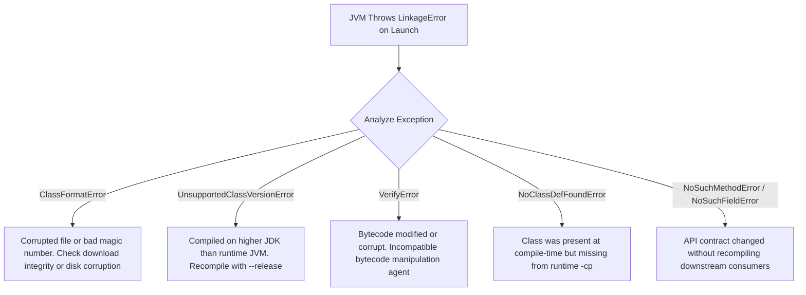

# P00-C003: Source Files (.java) and Bytecode (.class) Disassembly

---

## 1. Metadata and Learning Goals

| Metadata Field | Value |
|---|---|
| **Concept ID** | `P00-C003` |
| **Concept Title** | Source Files (`.java`) and Bytecode (`.class`) Disassembly |
| **Phase** | Phase 00 — Development Environment and Java Execution |
| **Phase Directory** | `curriculum/phase-00-development-environment-java-execution` |
| **Source Reference** | Section: *Topics to master* — Bullet: *Source files (`.java`) and bytecode (`.class`).* |
| **Concept Type** | Runtime Architecture / Bytecode Mechanics / Diagnostics |
| **Difficulty Level** | Foundation to Intermediate |
| **Curriculum Importance** | Essential |
| **Java Baseline** | Java 21 LTS (with comparative notes for JVMS 21 Class File Format) |
| **Framework Baseline** | Not Framework-Dependent (JVM Platform Baseline) |
| **Prerequisites** | [`P00-C001: JDK vs JRE vs JVM`](001-jdk-jre-jvm.md), [`P00-C002: javac vs java`](002-javac-compiler-and-launcher.md) |
| **Related Concepts** | [`P00-C004: Classpath & Packages`](004-classpath-and-package-structure.md), [`P00-C008: JDK Versions & Bytecode`](008-jdk-versions-lts-compatibility.md), [`P08-C001: JVM Architecture`](../phase-08-jvm-internals-memory-management/001-jvm-architecture-overview.md) |
| **Estimated Study Effort** | 3.5 hours |
| **Last Research Date** | 2026-10-29 |
| **Verification State** | COMPLETE (Class file binary structure verified with `xxd` and `javap`; programmatic verification test verified on OpenJDK 21 LTS) |

### Measurable Learning Objectives
By the end of this concept module, you will be able to:
1. **Deconstruct the Binary Class File Layout:** Map the exact 10 physical segments of a compiled `.class` binary file according to *The Java Virtual Machine Specification* (JVMS §4.1), starting from the magic header `0xCAFEBABE`.
2. **Master the Constant Pool:** Explain the purpose of the runtime constant pool (`cp_info`), identifying symbolic references (`Methodref`, `Fieldref`, `Class`, `Utf8`, `NameAndType`) and how the JVM resolves them dynamically.
3. **Trace Stack-Based Bytecode Execution:** Disassemble Java methods using `javap -c -v` and trace execution frame states: Operand Stack, Local Variable Array, and instruction evaluation (`iload`, `istore`, `invokevirtual`, `invokespecial`).
4. **Identify Compiler Inlining Hazards:** Demonstrate how `public static final` primitive and String constants are inlined at compile time, and diagnose binary incompatibility traps (`NoSuchFieldError`) in production.
5. **Inspect Bytecode Programmatically:** Write automated tests using `DataInputStream` to parse and validate classfile magic numbers and version headers without third-party libraries.

---

## 2. Definition, Purpose, and Mental Model

### 2.1 Formal Definitions
- **Java Source File (`.java`):** A human-readable text document encoded in UTF-8 containing Java programming language declarations (classes, interfaces, records, enums), statements, and expressions conforming to the *Java Language Specification* (JLS).
- **Java Class File (`.class`):** A platform-independent binary stream format defined by Chapter 4 of *The Java Virtual Machine Specification* (JVMS). A `.class` file contains a single class, interface, or record definition represented as an indexed constant pool, access flags, field/method descriptors, attribute tables, and executable JVM bytecode instructions.
- **Disassembly:** The reverse-engineering process of translating binary `.class` bytecode instructions back into human-readable symbolic assembly mnemonics using tools like the JDK disassembler (`javap`).

### 2.2 The Problem It Solves: Hardware Abstraction & Verification
Why did Java introduce bytecode instead of compiling directly to native machine code or distributing raw source code?

1. **Hardware & OS Decoupling:** Physical microprocessors use vastly different instruction set architectures (x86_64 uses variable-length CISC instructions; ARM64 uses 32-bit fixed RISC instructions). Distributing `.class` bytecode frees software creators from building separate binaries for every CPU architecture on Earth.
2. **The Verification Boundary (Security):** Distributing raw source code would require every end-user machine to run a full compiler. Conversely, running raw native machine binaries from the internet introduces catastrophic security vulnerabilities (arbitrary memory writes, buffer overflows). Bytecode allows the host JVM's **Bytecode Verifier** to mathematically prove that incoming code will not corrupt memory, overflow stacks, or forge pointers *before* execution.
3. **Target for Dynamic JIT Optimization:** Intermediate bytecode preserves semantic metadata (class hierarchies, method types, field access). The HotSpot runtime uses this rich metadata to perform sophisticated runtime optimizations (method inlining, devirtualization, loop vectorization) tailored to the exact CPU running the code.

### 2.3 Why Backend Engineers Need It
In enterprise Java backend engineering:
- **Debugging Phantom Bugs:** When a third-party dependency throws `NoSuchMethodError` or `AbstractMethodError` despite your code compiling cleanly, disassembling the offending `.class` file with `javap` reveals the exact missing descriptor or binary mismatch.
- **Understanding Performance:** High-throughput backend systems live or die by HotSpot JIT inlining. Knowing whether a method's bytecode is under the HotSpot `-XX:MaxInlineSize` threshold (default 35 bytes) determines whether an abstraction is free or incurs method dispatch overhead.
- **Observability & Profiling:** APM agents (Datadog, OpenTelemetry, New Relic) and frameworks (Spring AOP, Hibernate) dynamically generate or rewrite bytecode at runtime using libraries like Byte Buddy and ASM. You cannot understand APM traces or Spring proxy failures without understanding bytecode.

### 2.4 Mental Model: Musical Sheet Music vs. The Symphony Performance
- **The `.java` Source File is the Composer's Draft:** Written in high-level Italian musical notation (`allegro`, `crescendo`), containing comments and expressive styling meant for human comprehension.
- **The `.class` Bytecode is the Standard MIDI File:** A precise, standardized binary protocol encoding exact notes, timestamps, velocity, and instrument channels. It is not acoustic sound itself, but an unambiguous digital score that any MIDI synthesizer can read.
- **The JVM is the Synthesizer / Audio Engine:** It takes the universal MIDI score and renders it into physical sound waves (native machine instructions) tailored to the specific speaker hardware (Intel, AMD, Apple Silicon) attached to the system.
- **Where the Analogy Fails:**
  A MIDI file is played sequentially. A Java `.class` file contains rich relational symbol tables (the Constant Pool) and undergoes dynamic compilation and speculative re-optimization (JIT) while playing!

---

## 3. Foundations and Theory

### 3.1 The Physical Structure of a `.class` Binary File
According to JVMS §4.1, a class file consists of a stream of 8-bit bytes. Multi-byte data items are stored in **big-endian** order (most significant byte first). 

Here is the exact pseudo-C definition from the specification:

```c
ClassFile {
    u4             magic;                    // 4 bytes: 0xCAFEBABE
    u2             minor_version;            // 2 bytes: Minor version (e.g., 0)
    u2             major_version;            // 2 bytes: Major version (e.g., 65 for Java 21)
    u2             constant_pool_count;      // 2 bytes: Number of entries in constant pool + 1
    cp_info        constant_pool[constant_pool_count-1]; // Variable: The Constant Pool
    u2             access_flags;             // 2 bytes: ACC_PUBLIC, ACC_FINAL, ACC_RECORD, etc.
    u2             this_class;               // 2 bytes: Constant pool index pointing to this class
    u2             super_class;              // 2 bytes: Constant pool index pointing to superclass
    u2             interfaces_count;         // 2 bytes: Number of implemented interfaces
    u2             interfaces[interfaces_count]; // Constant pool indexes of interfaces
    u2             fields_count;             // 2 bytes: Number of declared fields
    field_info     fields[fields_count];     // Variable: Field definitions and attributes
    u2             methods_count;            // 2 bytes: Number of declared methods
    method_info    methods[methods_count];   // Variable: Method definitions and bytecode
    u2             attributes_count;         // 2 bytes: Number of class attributes
    attribute_info attributes[attributes_count]; // Variable: SourceFile, InnerClasses, etc.
}
```

```text
+---------------------------------------------------------------------------------------------+
| Binary Representation of a Compiled .class File (Raw Hexadecimal Layout)                    |
|                                                                                             |
| [CA FE BA BE] [00 00] [00 41] [00 24] [ ... Constant Pool Entries ... ]                     |
|    Magic       Minor   Major   CP Count                                                     |
|   (4 bytes)  (2 bytes)(2 bytes)(2 bytes)                                                    |
|                                                                                             |
| [00 21]       [00 02]      [00 04]       [00 00]         [00 01]         [00 02]            |
| Access Flags  This Class   Super Class   Interfaces Count Fields Count   Methods Count      |
|                                                                                             |
| [ ... Method Info: Code Attribute, Max Stack, Max Locals, Bytecode Opcodes ... ]             |
+---------------------------------------------------------------------------------------------+
```

### 3.2 The Magic Number: `0xCAFEBABE`
The first 4 bytes of every valid Java class file must be the hexadecimal number `0xCAFEBABE`.
- **Origin:** Chosen by James Gosling in the early days of Java to easily distinguish compiled Java class files from other binary formats on Unix filesystems.
- **Verification Rule:** If a file does not begin with `CA FE BA BE`, the JVM class loader instantly rejects it with `java.lang.ClassFormatError: Incompatible magic value`.

### 3.3 The Constant Pool: The JVM's Central Relational Dictionary
The Constant Pool is the most critical structure in a class file. It acts as an indexed dictionary containing all literal values (integers, floats, string literals) and **symbolic references** to classes, interfaces, fields, and methods.

#### Why Symbolic References Matter
In C++, a compiled binary contains hardcoded absolute or relative virtual memory offsets pointing to function addresses. 
In Java, a `.class` file contains **no memory addresses**. Instead, when method `A()` calls method `B()`, the bytecode references a slot in the Constant Pool, such as `#12 = Methodref #13.#14`. 
- Slot `#13` points to a `Class` entry (e.g., `java/io/PrintStream`).
- Slot `#14` points to a `NameAndType` entry (e.g., `println:(Ljava/lang/String;)V`).
The JVM resolves these symbolic references into concrete memory pointers dynamically at runtime during the **Linking (Resolution)** phase!

#### Common Constant Pool Tag Types (JVMS §4.4)
| Tag Name | Tag Byte | Content Description |
|---|---|---|
| `CONSTANT_Utf8` | 1 | UTF-8 encoded text string (class names, field names, method signatures). |
| `CONSTANT_Integer` | 3 | 4-byte big-endian integer constant. |
| `CONSTANT_Float` | 4 | 4-byte IEEE 754 floating-point constant. |
| `CONSTANT_Long` | 5 | 8-byte signed two's complement integer (consumes 2 slots in the pool). |
| `CONSTANT_Double` | 6 | 8-byte IEEE 754 double precision float (consumes 2 slots in the pool). |
| `CONSTANT_Class` | 7 | Index to a `CONSTANT_Utf8` string representing an internal class name. |
| `CONSTANT_String` | 8 | Index to a `CONSTANT_Utf8` string literal. |
| `CONSTANT_Fieldref` | 9 | Symbolic reference to a field (points to Class and NameAndType). |
| `CONSTANT_Methodref` | 10 | Symbolic reference to a method declared in a class. |
| `CONSTANT_InterfaceMethodref`| 11 | Symbolic reference to a method declared in an interface. |
| `CONSTANT_NameAndType` | 12 | Name and descriptor (type signature) of a field or method. |
| `CONSTANT_InvokeDynamic` | 18 | Bootstrap method index and NameAndType (used for lambdas, records, string concat). |

### 3.4 Method Execution Architecture: Stack Frames
When a thread calls a Java method, the JVM allocates a **Stack Frame** on the thread's call stack. A stack frame has two primary structures governed directly by bytecode:

1. **Local Variable Array (`max_locals`):**
   - An array of 32-bit slots storing method parameters and local variables.
   - For an **instance method**, slot `0` always contains the `this` reference!
   - Method arguments occupy subsequent slots (`1`, `2`, ...).
   - Primitive `long` and `double` values occupy two consecutive slots.
2. **Operand Stack (`max_stack`):**
   - A Last-In, First-Out (LIFO) stack used to push values, pass arguments to instructions, evaluate arithmetic, and receive return values.
   - The compiler calculates the exact maximum depth (`max_stack`) at compile time. The operand stack never grows dynamically beyond this pre-calculated limit.

```text
+-----------------------------------------------------------------------------+
| JVM STACK FRAME FOR AN INSTANCE METHOD: add(int a, int b)                  |
|                                                                             |
| Local Variable Array:                                                       |
| [ Slot 0: this ] [ Slot 1: int a ] [ Slot 2: int b ] [ Slot 3: int result ] |
|                                                                             |
| Operand Stack (LIFO):                                                       |
|   |         |                                                               |
|   | int b   |  <- Pushed by iload_2                                         |
|   | int a   |  <- Pushed by iload_1                                         |
|   +---------+                                                               |
|   Evaluated by 'iadd' -> Pops both, pushes result onto stack                |
+-----------------------------------------------------------------------------+
```

---

## 4. Syntax, API, and Command Reference

### 4.1 Master Reference: `javap` Disassembler Options

| Flag | Parameter / Example | Purpose in Backend Engineering |
|---|---|---|
| `-c` | `javap -c MyClass.class` | **Disassemble Code:** Prints the symbolic bytecode instructions for each method. |
| `-v` / `-verbose` | `javap -v MyClass.class` | **Full Verbose Dump:** Prints class file version, constant pool, access flags, stack limits (`max_stack`, `max_locals`), and attribute tables. |
| `-p` / `-private` | `javap -p MyClass.class` | **Expose Private Members:** Shows all fields and methods, including `private` and package-private members. |
| `-s` | `javap -s MyClass.class` | **Print Internal Type Signatures:** Prints JVM internal type descriptors (e.g., `(Ljava/lang/String;)V`). Essential for JNI and reflection. |
| `-l` | `javap -l MyClass.class` | **Line Number & Local Variable Tables:** Prints line number mappings (`LineNumberTable`) and variable scopes (`LocalVariableTable`). |
| `-sysinfo` | `javap -sysinfo MyClass.class`| **System Information:** Prints file size, last modified date, SHA-256 fingerprint, and source path. |

### 4.2 Reading JVM Internal Type Signatures (Descriptors)
The JVM uses a compact, single-character syntax for data types inside `.class` files:

| Descriptor | Java Type Equivalent | Example |
|---|---|---|
| `B` | `byte` | Signed 8-bit integer |
| `C` | `char` | Unicode 16-bit character |
| `D` | `double` | 64-bit IEEE 754 floating point |
| `F` | `float` | 32-bit IEEE 754 floating point |
| `I` | `int` | 32-bit signed integer |
| `J` | `long` | 64-bit signed integer |
| `S` | `short` | 16-bit signed integer |
| `Z` | `boolean` | Boolean (represented as 0 or 1 in bytecode) |
| `V` | `void` | Return type void |
| `L<classname>;` | Reference to an Object | `Ljava/lang/String;` |
| `[` | Array of type | `[I` = `int[]`, `[[Ljava/lang/String;` = `String[][]` |

- **Method Descriptor Example:**
  - Java Method: `public String process(int id, double balance, List names)`
  - Internal Descriptor: `(IDLjava/util/List;)Ljava/lang/String;`
  - *(Parameters inside parentheses; return type follows).*

---

## 5. Runnable Examples and Demonstrations

### 5.1 Disassembling an Arithmetic Method: Step-by-Step Operand Stack Walkthrough
The following self-contained class performs arithmetic calculations. We will disassemble it and trace the operand stack instruction by instruction.

```java
// File: BytecodeCalculation.java
package com.backend.bytecode;

public class BytecodeCalculation {

    public int compute(int base, int multiplier, int offset) {
        int result = (base * multiplier) + offset;
        return result;
    }
}
```

#### Compilation & Disassembly
```bash
javac -d out BytecodeCalculation.java
javap -c -v -p out/com/backend/bytecode/BytecodeCalculation.class
```

#### Disassembled Method Output
```text
public int compute(int, int, int);
  descriptor: (III)I
  flags: (0x0001) ACC_PUBLIC
  Code:
    stack=2, locals=5, args_size=4
       0: iload_1
       1: iload_2
       2: imul
       3: iload_3
       4: iadd
       5: istore        4
       7: iload         4
       9: ireturn
```

#### Instruction-by-Instruction Operand Stack Trace
Let us trace what happens inside the JVM when executing `compute(10, 5, 2)`:
- Initial state:
  - `args_size = 4`: Slot `0` = `this`, Slot `1` = `base (10)`, Slot `2` = `multiplier (5)`, Slot `3` = `offset (2)`.
  - `locals = 5`: Slot `4` is reserved for `result`.
  - `stack = 2`: Maximum stack depth is 2.

| Bytecode Offset | Opcode Instruction | Operand Stack State (Top at right) | Explanation |
|---|---|---|---|
| `0:` | `iload_1` | `[10]` | Load `int` from local variable slot 1 (`base`) onto the operand stack. |
| `1:` | `iload_2` | `[10, 5]` | Load `int` from local variable slot 2 (`multiplier`) onto the operand stack. |
| `2:` | `imul` | `[50]` | Pop top two integers (10 and 5), multiply them, and push the result (50). |
| `3:` | `iload_3` | `[50, 2]` | Load `int` from local variable slot 3 (`offset`) onto the operand stack. |
| `4:` | `iadd` | `[52]` | Pop top two integers (50 and 2), add them, and push the result (52). |
| `5:` | `istore 4` | `[]` | Pop the top integer (52) and store it into local variable slot 4 (`result`). |
| `7:` | `iload 4` | `[52]` | Load `int` from local variable slot 4 back onto the operand stack. |
| `9:` | `ireturn` | `[]` | Pop the top integer (52) and return it to the calling method frame. |

### 5.2 The "Compile-Time Constant Inlining" Trap
One of the most dangerous binary compatibility bugs in Java backend systems is caused by how `javac` handles `public static final` primitive and String constants.

#### Step 1: The Library Provider Defines a Constant
```java
// File: lib/com/payment/PaymentConfig.java
package com.payment;

public class PaymentConfig {
    // Compile-time constant (ConstantValue attribute emitted in classfile)
    public static final int MAX_RETRIES = 3;
}
```

#### Step 2: The Service Consumer Uses the Constant
```java
// File: app/com/service/PaymentService.java
package com.service;

import com.payment.PaymentConfig;

public class PaymentService {
    public void executePayment() {
        for (int i = 0; i < PaymentConfig.MAX_RETRIES; i++) {
            System.out.println("Payment attempt: " + i);
        }
    }
}
```

#### Step 3: Inspect the Compiled `PaymentService.class`
```bash
javap -c out/com/service/PaymentService.class
```
```text
Code:
   0: iconst_0
   1: istore_1
   2: iload_1
   3: iconst_3       // NOTICE THIS: The compiler inlined the literal value '3'!
   4: if_icmpge     30
   ...
```
- **The Catastrophe:** `PaymentService.class` contains **zero reference** to `PaymentConfig.class` in its bytecode! `javac` inlined the literal integer `3` directly into the opcode stream (`iconst_3`).
- **The Production Failure Mode:**
  1. The library developer updates `PaymentConfig.java` to `MAX_RETRIES = 5` and deploys a new `payment-config-1.1.jar` into the production server.
  2. Because the application JAR was *not recompiled*, `PaymentService` continues to execute with `MAX_RETRIES = 3`!
  3. The team spends days debugging why their configuration change did not take effect despite inspecting the new JAR.
- **Idiomatic Solution:**
  Never expose raw `public static final` constants across module or JAR boundaries if they might ever change. Expose an accessor method:
  ```java
  public static int getMaxRetries() { return 5; }
  ```
  Method invocations (`invokestatic`) are linked dynamically at runtime and can never be inlined across separate compilation units!

---

## 6. Real-World Backend Application

### 6.1 Bytecode Instrumentation: How APM Tools and Spring Work
In production Java backends, bytecode is frequently modified *on the fly* inside the running JVM process:

```text
[ Developer's Original Bytecode ]
            |
            v
[ JVM ClassLoader Loads Class Bytes ]
            |
            v
[ Java Agent / Instrumentation Hook (java.lang.instrument) ]
   - Tools like Datadog, Dynatrace, OpenTelemetry Java Agent, or Spring AOP
   - Uses libraries like Byte Buddy or ASM to inject bytecode instructions:
       * Injects System.nanoTime() at method entry
       * Injects try-finally block to measure execution duration
       * Injects span emission to Datadog tracer
            |
            v
[ Transformed Bytecode Sent to Execution Engine & JIT Compiler ]
```

- When you add `@Transactional` in Spring, Spring does not modify your source code. It uses a bytecode generator (CGLIB / Byte Buddy) to generate an entirely new `.class` file in memory (e.g., `OrderService$$SpringCGLIB$$0.class`) that wraps your business method with transaction `commit()` and `rollback()` calls.

### 6.2 HotSpot JIT Inlining Threshold (`-XX:MaxInlineSize`)
When the HotSpot C2 compiler compiles hot code:
- Calling a method has overhead: allocating a stack frame, pushing parameters, jumping to an address, and returning.
- If a called method is small, C2 **inlines** the method's bytecode directly into the caller's machine code.
- **The Rule:** By default, HotSpot inlines methods whose bytecode length is less than or equal to **35 bytes** (`-XX:MaxInlineSize=35`).
- **Backend Takeaway:** Keep service helper methods small, focused, and cohesive. Monolithic methods with hundreds of lines of code will exceed bytecode inlining limits, preventing C2 from performing escape analysis and loop optimizations.

---

## 7. Design Choices, Alternatives, and Trade-Offs

### 7.1 Virtual Machine Architectures: Stack-Based vs. Register-Based

| Dimension | Stack-Based VM (The Java JVM) | Register-Based VM (Dalvik / Lua VM / LLVM) |
|---|---|---|
| **Storage Model** | Operands are pushed onto and popped from a Last-In, First-Out (LIFO) stack. | Operands are stored in a set of virtual registers (e.g., `r0`, `r1`, `r2`). |
| **Instruction Size** | **Compact:** Most instructions are 1 byte long (`iadd`, `pop`). Zero register operands needed in instruction encoding. | **Larger:** Instructions must explicitly encode source and destination registers (e.g., `ADD r0, r1, r2` requires 3–4 bytes). |
| **Code Length** | Requires more instructions to perform an operation (e.g., push, push, add, store = 4 instructions). | Requires fewer instructions (e.g., 1 instruction: `ADD r0, r1, r2`). |
| **Hardware Portability** | **Extremely high:** Does not assume any fixed number of physical CPU registers. Easily maps to any real hardware. | Must map virtual registers to physical CPU registers, which is complex if physical registers are scarce (like x86). |
| **Why Java Chose Stack-Based:** | In 1995, Java targeted embedded devices and slow web applets. Stack-based bytecode was compact, simplified verification, and had minimal memory footprint. |

---

## 8. Performance and Complexity

### 8.1 Big-O Complexity of Bytecode Instructions
- Almost all JVM bytecode instructions execute in $O(1)$ constant time on physical hardware (`iadd`, `aload`, `getfield`).
- **Control Transfer Complexity:**
  - `tableswitch`: Used when case values in a switch statement are dense (e.g., 1, 2, 3, 4). Executes in **$O(1)$ constant time** using an internal jump index table.
  - `lookupswitch`: Used when case values are sparse (e.g., 100, 50000, 999999). Executes in **$O(\log N)$ time** using an internal binary search table sorted by keys!

---

## 9. Security and Robustness

### 9.1 The Bytecode Verifier: Preventing Memory Corruption
The JVM's security model fundamentally relies on the **Bytecode Verifier** (JVMS §4.10). When a `.class` file is loaded from an external network or disk, the Verifier proves that:
1. The class file structure is intact (correct magic number, valid attributes).
2. The operand stack will never underflow (popping an empty stack) or overflow (`max_stack`).
3. Methods are invoked with arguments of the correct type (cannot pass a `String` to a method expecting an `int`).
4. Access control rules are respected (`private` methods cannot be invoked by external classes).
5. No instruction attempts to forge an object reference or treat an integer as a raw memory pointer.

If any invariant fails, the JVM refuses to execute and immediately throws `java.lang.VerifyError`.

---

## 10. Testing and Verification

### 10.1 Programmatic Classfile Inspection Test
The following automated JUnit 5 test parses a `.class` binary file using pure Java standard library streams (`DataInputStream`), asserting the magic number, major version, and constant pool count.

```java
package com.backend.bytecode.test;

import org.junit.jupiter.api.DisplayName;
import org.junit.jupiter.api.Test;
import java.io.DataInputStream;
import java.io.InputStream;

import static org.junit.jupiter.api.Assertions.*;

public class ClassFileBinaryStructureTest {

    @Test
    @DisplayName("Assert compiled classfile matches JVMS binary specifications")
    void verifyClassFileBinaryHeader() throws Exception {
        // Read this test class's own compiled .class file from the classpath
        String classResourcePath = "/" + getClass().getName().replace('.', '/') + ".class";
        
        try (InputStream rawIn = getClass().getResourceAsStream(classResourcePath)) {
            assertNotNull(rawIn, "Classfile must be loadable from classpath");
            DataInputStream in = new DataInputStream(rawIn);

            // 1. Verify Magic Number: 0xCAFEBABE
            int magic = in.readInt();
            assertEquals(0xCAFEBABE, magic, "Class file must start with magic header 0xCAFEBABE");

            // 2. Verify Minor Version: Typically 0
            int minorVersion = in.readUnsignedShort();
            assertEquals(0, minorVersion, "Minor version should be 0");

            // 3. Verify Major Version: Java 21 baseline = 65 (0x41)
            int majorVersion = in.readUnsignedShort();
            assertTrue(majorVersion >= 65, 
                    "Classfile should be compiled with Java 21 (major version 65) or newer. Found: " + majorVersion);

            // 4. Verify Constant Pool Count: Must be greater than 0
            int constantPoolCount = in.readUnsignedShort();
            assertTrue(constantPoolCount > 0, "Constant pool must contain entries");

            System.out.printf("Successfully verified binary classfile:%n" +
                    "  Magic Header        : 0x%X%n" +
                    "  Major Version       : %d (Java %d)%n" +
                    "  Constant Pool Count : %d entries%n",
                    magic, majorVersion, (majorVersion - 44), constantPoolCount);
        }
    }
}
```

---

## 11. Debugging and Failure Analysis

### 11.1 Diagnostic Flowchart: Class File & Verification Errors


### 11.2 Common Binary Errors and Root Cause Remedies

| Exception Name | Root Cause | Exact Remedy |
|---|---|---|
| `java.lang.ClassFormatError: Incompatible magic value 12345678` | The file being loaded does not start with `0xCAFEBABE`. Typically caused by downloading an HTML 404 page instead of a JAR, or corrupted network transfers. | Inspect file using `hexdump -C file.class \| head -n 1`. Verify file is a valid binary. |
| `java.lang.VerifyError` | Bytecode violates JVMS type safety or stack invariants. Almost always caused by a buggy bytecode manipulation tool (bad ASM/Byte Buddy script) or incompatible Java agent. | Disable Java agents (`-javaagent:...`) one by one to isolate the offending agent. |
| `java.lang.NoSuchFieldError` | Code was compiled against a library where a field was renamed or removed, but the old library JAR is present at runtime. | Audit runtime classpath using `mvn dependency:tree` to identify conflicting older library versions. |

---

## 12. Best Practices and Anti-Patterns

### 12.1 Industry Best Practices
- **Never Change `public static final` Values Without Recompiling Consumers:** Always understand that primitive and String constants are inlined at compile time.
- **Inspect Bytecode When Benchmarking:** Before concluding that one code style is faster than another, run `javap -c` to verify whether `javac` generates the identical bytecode instructions for both.
- **Retain Line Numbers in Production:** Always compile with `-g:lines,source` so that production stack traces pinpoint the exact line number where exceptions occurred.

### 12.2 Anti-Patterns to Avoid
- **Relying on Reflection to Mutate `final` Fields:** Mutating `final` fields via reflection often fails silently because `javac` already inlined the original value into the caller's bytecode!
- **Manually Implementing Optimization Sugar:** Writing hand-rolled string concatenations with loops instead of trusting modern `javac` (which uses `invokedynamic` via [JEP 280](https://openjdk.org/jeps/280) for high-performance string concatenation).

---

## 13. Interview Preparation

### 13.1 Foundational Questions
1. **Q: What is a Java class file, and what is its first 4-byte header?**
   - **Answer:** A `.class` file is a standardized binary stream conforming to JVMS Chapter 4 that contains the compiled representation of a single Java class, interface, or record. Its first 4 bytes are the hexadecimal magic number `0xCAFEBABE`, used by the JVM classloader to verify that the file is an authentic Java class file.

### 13.2 Intermediate & Scenario Questions
2. **Q: What is the Constant Pool in a `.class` file, and why does Java use symbolic references instead of memory addresses?**
   - **Answer:** The Constant Pool is an indexed dictionary inside the class file containing literal constants and symbolic references to classes, fields, and methods. Java uses symbolic references (`Methodref`, `Fieldref`) rather than direct memory addresses to ensure platform independence and support dynamic classloading. The JVM resolves these symbolic references into concrete memory addresses dynamically when the class is loaded and linked into the runtime environment.

### 13.3 Advanced / Lead Engineer Questions
3. **Q: Explain how Java's operand stack and local variable array interact during method execution, and what `max_stack` and `max_locals` represent.**
   - **Answer:** Every method invocation creates a stack frame containing an Operand Stack (a LIFO computation workspace) and a Local Variable Array (storing `this`, parameters, and local variables). Bytecode instructions load values from local variables onto the operand stack (`iload`), perform operations (`iadd`), and store results back into local variables (`istore`). `max_stack` is the compile-time calculated maximum depth the operand stack can reach at any moment, while `max_locals` is the total number of 32-bit slots required by local variables and parameters. HotSpot uses these fixed numbers to allocate stack frames efficiently without dynamic reallocation.

---

## 14. Practice and Assessment

### Exercise 1: Beginner (Binary Magic Header Hex Inspection)
- **Goal:** Verify the raw binary layout of a compiled Java class file using Linux command-line utilities.
- **Task:** Create and compile a minimal class `HelloBytecode.java`. Use `hexdump -C HelloBytecode.class | head -n 2` or `xxd HelloBytecode.class | head -n 2` to inspect the first 8 bytes. Identify the magic number and the major/minor version numbers in hexadecimal.
- **Acceptance Criteria:**
  - [ ] Locates `ca fe ba be` at offset `0x00000000`.
  - [ ] Locates minor version (`00 00`) at offset `0x00000004`.
  - [ ] Identifies major version (e.g., `00 41` = 65 = Java 21) at offset `0x00000006`.

### Exercise 2: Applied (Operand Stack Arithmetic Trace)
- **Goal:** Write a Java method and predict its exact disassembled bytecode and stack depth before disassembling.
- **Task:** Write a method `public int formula(int x) { return (x + 10) * 2; }`. Trace the expected instructions. Compile with `javac` and disassemble with `javap -c`. Compare your manual trace with the actual bytecode output.

### Exercise 3: Challenge (Recreating the Constant Inlining Bug)
- **Goal:** Prove binary incompatibility caused by compile-time constant inlining in an isolated terminal test.
- **Task:** Create `Config.java` with `public static final String ENV = "STAGING";`. Create `Client.java` printing `Config.ENV`. Compile both. Update `Config.java` to `ENV = "PROD";`. Recompile *only* `Config.java` (`javac Config.java`). Run `java Client`. Verify that `Client` still outputs `STAGING`. Then explain why and demonstrate the method-based fix.

### Hints
<details>
<summary>View Hints</summary>

- **Exercise 1 Hint:** Hexadecimal `0x41` is $4 \times 16 + 1 = 65$ (Java 21).
- **Exercise 2 Hint:** Expect `iload_1`, `bipush 10`, `iadd`, `iconst_2`, `imul`, `ireturn`.
- **Exercise 3 Hint:** Inspect `javap -c Client.class` to see the inlined `"STAGING"` string literal.
</details>

### Solutions Walkthrough
<details>
<summary>View Full Solutions</summary>

#### Solution to Exercise 1
```bash
cat << 'EOF' > HelloBytecode.java
public class HelloBytecode {
    public static void main(String[] args) {}
}
EOF

javac HelloBytecode.java
xxd -p -l 8 HelloBytecode.class
# Output on Java 21: cafebabe00000041
# cafe babe = Magic Number
# 0000      = Minor version 0
# 0041      = Major version 65 (Java 21)
```

#### Solution to Exercise 2
```bash
cat << 'EOF' > FormulaDemo.java
public class FormulaDemo {
    public int formula(int x) {
        return (x + 10) * 2;
    }
}
EOF

javac FormulaDemo.java
javap -c FormulaDemo.class
# Output:
#  0: iload_1
#  1: bipush 10
#  3: iadd
#  4: iconst_2
#  5: imul
#  6: ireturn
```

#### Solution to Exercise 3
```bash
# 1. Setup files
cat << 'EOF' > Config.java
public class Config { public static final String ENV = "STAGING"; }
EOF

cat << 'EOF' > Client.java
public class Client {
    public static void main(String[] args) {
        System.out.println("Current Environment: " + Config.ENV);
    }
}
EOF

# 2. Compile both
javac Config.java Client.java
java Client
# Output: Current Environment: STAGING

# 3. Change Config and recompile ONLY Config
sed -i 's/STAGING/PROD/' Config.java
javac Config.java

# 4. Run Client without recompiling it
java Client
# Output STILL: Current Environment: STAGING (Proves constant inlining!)

# 5. The Fix: Replace field with a method accessor
cat << 'EOF' > ConfigFixed.java
public class ConfigFixed { 
    public static String getEnv() { return "STAGING"; } 
}
EOF
```
</details>

### Mastery Self-Assessment Checklist
- [ ] I can explain the physical 10-part structure of a `.class` file from memory.
- [ ] I can read the first 8 bytes of a classfile in hexadecimal and calculate the Java major version.
- [ ] I can trace the evaluation of simple arithmetic expressions on the JVM operand stack.
- [ ] I can explain why constant inlining causes binary incompatibility and how to prevent it in API design.
- [ ] I can use `javap` with `-c`, `-v`, and `-p` to diagnose class loading and method signature issues.

---

## 15. Summary, Cheat Sheet, and Memory Aids

### Key Takeaways
1. **`0xCAFEBABE` is the universal header:** Every conforming class file begins with this 4-byte magic number.
2. **The Constant Pool is the central symbol table:** Class files contain symbolic descriptors, not hardcoded memory pointers.
3. **The JVM is a stack machine:** Methods execute by pushing and popping operands on an evaluation stack within pre-calculated stack frame boundaries.
4. **Compile-time constants inline:** `public static final` primitive/String constants are inlined into callers, breaking runtime modularity if changed without recompilation.

### Quick Reference Command Cheat Sheet
| Task | Command |
|---|---|
| Disassemble bytecode instructions | `javap -c MyClass.class` |
| View constant pool and stack limits | `javap -v MyClass.class` |
| View private members and line numbers | `javap -p -l MyClass.class` |
| Print internal type signatures | `javap -s MyClass.class` |
| Hex dump class file header | `xxd -l 8 MyClass.class` |

---

## 16. Sources and Further Reading

### Primary Specifications & Authoritative Sources
1. **The Java Virtual Machine Specification, Java SE 21 Edition:** Chapter 4: The `class` File Format; Chapter 5: Loading, Linking, and Initializing. Oracle. URL: [docs.oracle.com/javase/specs/jvms/se21/html/](https://docs.oracle.com/javase/specs/jvms/se21/html/)
2. **The Java Language Specification, Java SE 21 Edition:** Chapter 13: Binary Compatibility. Oracle. URL: [docs.oracle.com/javase/specs/jls/se21/html/](https://docs.oracle.com/javase/specs/jls/se21/html/)
3. **JEP 280: Indify String Concatenation:** OpenJDK. URL: [openjdk.org/jeps/280](https://openjdk.org/jeps/280)

### Authoritative Documentation & Engineering Guides
4. **ASM 4.0 A Java Bytecode Engineering Library:** Eric Bruneton. OW2 Consortium. URL: [asm.ow2.io](https://asm.ow2.io/)
5. **Byte Buddy: Runtime Code Generation for the Java Virtual Machine:** Rafael Winterhalter. URL: [bytebuddy.net](https://bytebuddy.net/)
