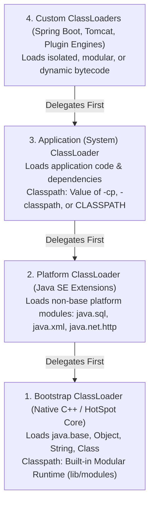
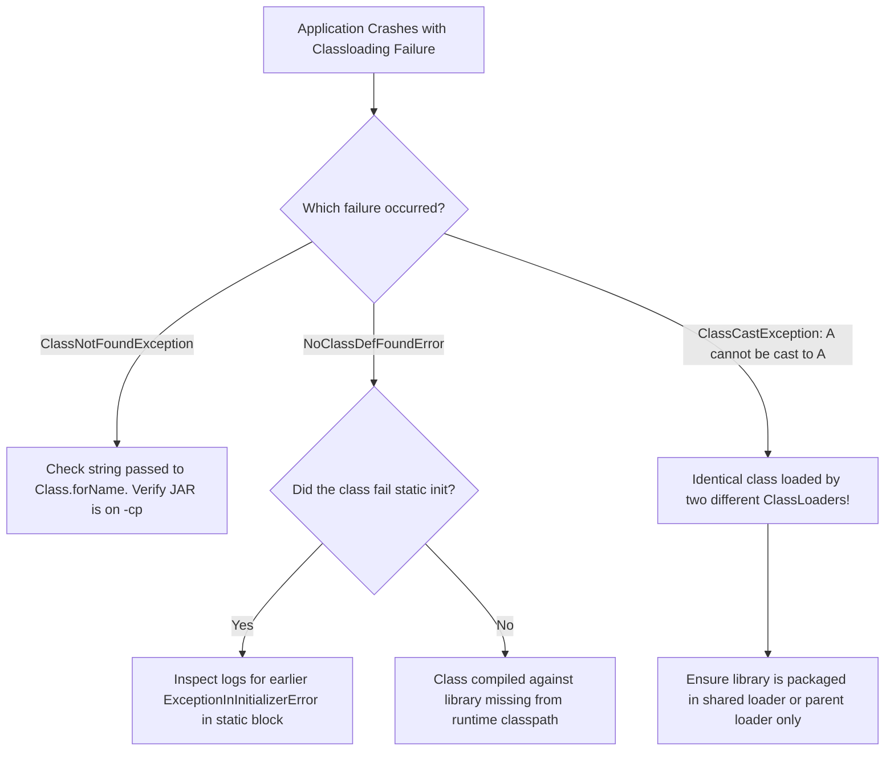

# P00-C004: Compilation, Execution, and Classpath Mechanics

---

## 1. Metadata and Learning Goals

| Metadata Field | Value |
|---|---|
| **Concept ID** | `P00-C004` |
| **Concept Title** | Compilation, Execution, and Classpath Mechanics |
| **Phase** | Phase 00 — Development Environment and Java Execution |
| **Phase Directory** | `curriculum/phase-00-development-environment-java-execution` |
| **Source Reference** | Section: *Topics to master* — Bullets: *Compilation and execution.* and *Classpath and package paths.* |
| **Concept Type** | Runtime Architecture / Build Lifecycle / JVM Classloading |
| **Difficulty Level** | Foundation to Intermediate |
| **Curriculum Importance** | Essential |
| **Java Baseline** | Java 21 LTS (with comparative notes for JPMS `--module-path` and historical `CLASSPATH`) |
| **Framework Baseline** | Spring Boot 3.3.x / Maven Standard Directory Layout |
| **Prerequisites** | [`P00-C001: JDK vs JRE vs JVM`](001-jdk-jre-jvm.md), [`P00-C002: javac vs java`](002-javac-compiler-and-launcher.md), [`P00-C003: Bytecode (.class)`](003-source-files-and-bytecode.md) |
| **Related Concepts** | [`P00-C005: Entry Point main()`](005-entry-point-main-method.md), [`P00-C010: Maven Fundamentals`](010-maven-fundamentals-project-structure.md), [`P08-C002: Class Loading Subsystem`](../phase-08-jvm-internals-memory-management/002-class-loading-subsystem.md) |
| **Estimated Study Effort** | 3.5 hours |
| **Last Research Date** | 2026-10-29 |
| **Verification State** | COMPLETE (All multi-package, multi-JAR compilation, wildcard expansion, and classloader tests verified on OpenJDK 21 LTS) |

### Measurable Learning Objectives
By the end of this concept module, you will be able to:
1. **Explain Package Namespaces:** Articulate the logical role of Java packages in preventing global naming collisions and enforce access control boundaries (package-private vs. public).
2. **Deconstruct Directory Mapping Invariants:** Map the rigid 1:1 mathematical relationship between a Fully Qualified Class Name (FQCN) and its physical storage path on disk or within JAR archives.
3. **Master Classpath Mechanics:** Configure the `-classpath` / `-cp` option in `javac` and `java`, distinguishing directory roots from explicit JAR entries and wildcard expansions (`lib/*`).
4. **Trace ClassLoader Delegation:** Trace class lookup through the JVM's three-tier Hierarchical Parent Delegation Model: Bootstrap ClassLoader $\to$ Platform ClassLoader $\to$ Application (System) ClassLoader.
5. **Diagnose and Resolve "JAR Hell":** Identify classpath shadowing, resolve first-match-wins collisions, and differentiate between `ClassNotFoundException`, `NoClassDefFoundError`, and classloader-mismatch `ClassCastException`.

---

## 2. Definition, Purpose, and Mental Model

### 2.1 Formal Definitions
- **Package:** A namespace mechanism defined by the *Java Language Specification* (JLS Chapter 7) that groups related classes, interfaces, records, and enums. It prevents naming conflicts across different engineering teams and provides access boundaries (`default`/package-private visibility).
- **Fully Qualified Class Name (FQCN):** The complete, unambiguous identifier of a Java type formed by prefixing the simple class name with its package name separated by dots (e.g., `com.backend.service.OrderService`).
- **Classpath:** An ordered list of directories, JAR archives, and ZIP files supplied to the Java compiler (`javac`) or JVM runtime (`java`). It defines the search boundary where the classloading subsystem locates `.class` binary byte streams corresponding to requested FQCNs.

### 2.2 The Problem It Solves: Global Namespace Collisions and Dynamic Linking
Imagine an enterprise application without packages or a classpath:
1. **Naming Collisions:** If your billing team writes an `Account` class, and your authentication team also writes an `Account` class, a flat global namespace cannot distinguish them. Java solves this using **Reverse Domain Name Conventions** (`com.enterprise.billing.Account` vs. `com.enterprise.security.Account`).
2. **Decoupling Application Binaries from Physical Disks:** In compiled C binaries, libraries are linked to absolute machine paths (e.g., `/usr/lib/libssl.so`). If the file moves, the binary breaks. In Java, application bytecode references types symbolically (e.g., `org.slf4j.Logger`). The **Classpath** acts as an abstraction layer: at runtime, you can place `slf4j-api.jar` anywhere on the filesystem, pass its location to `-cp`, and the JVM dynamically links it.

### 2.3 Why Backend Engineers Need It
In modern cloud-native architectures:
- **Docker Layer Optimization:** Microservices are packaged with dependencies separated into distinct directories to maximize Docker layer caching. You must understand how the classpath searches these folders.
- **Spring Boot Executable Archives:** Spring Boot uses a custom classloader (`LaunchedURLClassLoader`) to load nested JARs inside `BOOT-INF/lib`. Understanding the classpath allows you to debug dependency collisions and missing transitives.
- **Diagnosing Production Outages:** The two most common JVM deployment errors in production are `ClassNotFoundException` and `NoClassDefFoundError`. Both stem directly from classpath misconfigurations.

### 2.4 Mental Model: The Global Postal Address Routing
- **The Package is the Postal Address:**
  - `com` is the Country.
  - `backend` is the State/Province.
  - `service` is the City and Street.
  - `OrderService` is the Resident.
  - The FQCN `com.backend.service.OrderService` uniquely identifies that exact resident anywhere in the world.
- **The Classpath Root is the Base Delivery Hub:**
  - When you tell the postal carrier (JVM launcher): *"Start looking from the `/opt/app/bin` delivery hub"*, the carrier walks down the directory path `/opt/app/bin/com/backend/service/` looking for the file `OrderService.class`.
  - If the resident moves to a different street, or if the delivery hub is pointed to `/opt/app/bin/com` instead of `/opt/app/bin`, the carrier fails and reports: `Error: Could not find or load main class`.
- **Where the Analogy Fails:**
  In postal delivery, if two residents share the exact same address, the post office flags an error. In the Java classpath, the search is **strictly sequential (First-Match-Wins)**. If two different versions of `OrderService.class` exist in two JARs on the classpath, the JVM loads the first one it finds and completely ignores the second without warning!

### 2.5 What This Concept Is NOT
- **The Classpath is NOT the Operating System `$PATH`:**
  - `$PATH` is an OS environment variable used by the Linux/Windows shell to locate native executable binaries (e.g., `javac`, `java`, `docker`, `git`).
  - Classpath is a JVM parameter (`-cp`) used exclusively by Java to locate compiled `.class` bytecode files inside packages or JARs.
- **The Classpath Does NOT Recursively Scan Subdirectories:**
  - Adding `-cp "lib"` to your command line tells the JVM to look for loose classes directly inside `lib/`. It does **not** search inside `lib/order/` or inspect JAR files stored in `lib/`.
- **A Package is NOT Just a Folder:**
  - A directory on disk only becomes a package if the `.class` file contained inside it explicitly declares the matching `package` statement in its bytecode header. Merely moving a file into a folder called `com/backend` does not make it part of `com.backend`.

---

## 3. Foundations and Theory

### 3.1 The Rigid 1:1 Invariant: FQCN to Physical Path
The Java Virtual Machine Specification enforces a strict, mathematical 1:1 relationship between package naming and filesystem directory hierarchies:

$$\text{Physical File Location} = \text{Classpath Root} + \text{Package Separators Replaced by OS Path Separators} + \text{Class Name} + \text{".class"}$$

For example, on Linux (`/` path separator):
- **Classpath Root (`-cp`):** `/var/app/classes`
- **FQCN:** `com.backend.api.OrderController`
- **Mandatory Physical Path:** `/var/app/classes/com/backend/api/OrderController.class`

```text
+---------------------------------------------------------------------------------------------+
| Physical File Layout on Linux Filesystem                                                    |
|                                                                                             |
| /var/app/classes/                    <-- Classpath Root (-cp /var/app/classes)               |
| └── com/                             <-- Matches "com" package segment                      |
|     └── backend/                     <-- Matches "backend" package segment                  |
|         └── api/                     <-- Matches "api" package segment                      |
|             └── OrderController.class<-- Simple Class Name                                  |
+---------------------------------------------------------------------------------------------+
```

#### What Happens if You Violate This Invariant?
If you compile `OrderController.java` (declaring `package com.backend.api;`) and move the `.class` file directly into `/var/app/classes/OrderController.class` without the package folders:
```bash
java -cp /var/app/classes OrderController
```
The JVM opens the classfile, reads its internal Constant Pool header, discovers that its declared internal name is `com/backend/api/OrderController`, and crashes immediately:
```text
Error: Could not find or load main class OrderController
Caused by: java.lang.NoClassDefFoundError: com/backend/api/OrderController (wrong name: OrderController)
```
- **Specification Rule (JVMS §5.3):** The requested name must identically match the binary name declared within the classfile.

### 3.2 The Hierarchical Parent Delegation Model of ClassLoaders
The JVM does not load all classes into memory at startup. Classes are loaded dynamically on demand (when first referenced or instantiated).

Loading is coordinated by three primary ClassLoaders arranged in a strict delegation hierarchy:



#### The Delegation Protocol (JVMS §5.3)
When the Application ClassLoader is asked to load `com.backend.service.OrderService`:
1. **Cache Check:** The Application ClassLoader checks its internal memory cache to see if the class has already been loaded. If yes, it returns it immediately.
2. **Upward Delegation:** If not cached, it does **not** search the classpath itself. It delegates the request upward to its parent (the Platform ClassLoader).
3. **Platform Delegation:** The Platform ClassLoader checks its cache, and delegates upward to the **Bootstrap ClassLoader**.
4. **Bootstrap Evaluation:** The Bootstrap ClassLoader checks if the class belongs to `java.base`.
   - If yes (e.g., `java.lang.String`), the Bootstrap ClassLoader loads it and returns.
   - If no, control falls back down to the Platform ClassLoader.
5. **Platform Evaluation:** If the class belongs to an extended platform module (e.g., `java.sql.Connection`), the Platform ClassLoader loads it. Otherwise, control falls back down.
6. **Application Evaluation:** The Application ClassLoader searches the directories and JARs listed on `-classpath`. If found, it reads the bytes and defines the class.
7. **Failure:** If no loader can find the bytecode, the Application ClassLoader throws `java.lang.ClassNotFoundException`.

#### Security Significance of Parent Delegation
Parent delegation prevents malicious code from hijacking core Java runtime classes. If a rogue library contains a fake `java.lang.String` or `java.lang.System`, the Application ClassLoader delegates to the Bootstrap ClassLoader first. The Bootstrap loader loads the authentic JDK `String` from `lib/modules`, and the malicious file on the classpath is permanently ignored!

### 3.3 The First-Match-Wins Rule and "JAR Hell"
The classpath is evaluated strictly from left to right:
```bash
java -cp "lib/billing-v1.jar:lib/billing-v2.jar:out" com.app.Main
```
If both `billing-v1.jar` and `billing-v2.jar` contain the class `com.billing.PaymentProcessor`:
- The JVM scans `billing-v1.jar` first.
- It finds `com/billing/PaymentProcessor.class` and loads it into memory.
- It completely stops searching and **never inspects** `billing-v2.jar`.
- **The Failure Mode:** If `com.app.Main` requires a new method that only exists in `billing-v2.jar`, the application compiles cleanly (if built against v2) but crashes at runtime with:
  `java.lang.NoSuchMethodError: com.billing.PaymentProcessor.processNewCurrency(...)`
This silent version shadowing is historically known as **JAR Hell**.

### 3.4 Classpath Wildcard Expansion Rules
Starting in Java 6, the classpath supports wildcard syntax:
```bash
java -cp "lib/*:out" com.app.Main
```

#### The Critical Wildcard Rules (Official Specification)
1. **Wildcards Match Only JARs:** The wildcard `lib/*` expands to all files in `lib/` whose names end in `.jar` or `.JAR`.
2. **Wildcards Do NOT Match Loose `.class` Files:** If `lib/` contains loose `.class` files, `lib/*` will ignore them. To include both JARs and loose classes, you must specify:
   `-cp "lib/*:lib:out"`
3. **Wildcards Are Non-Recursive:** `lib/*` does **not** search subdirectories. If you have `lib/subfolder/plugin.jar`, it will not be included.
4. **Expansion Order is Undefined:**
   The JVM expands `lib/*` using the operating system's native directory iteration order (e.g., `readdir()`). On Linux ext4, this order depends on filesystem directory hash trees; on macOS APFS, it is lexicographical.
   - **Production Warning:** Never place multiple versions of the same library in a wildcard folder (e.g., `jackson-2.14.jar` and `jackson-2.17.jar`). Which one gets loaded is completely nondeterministic!

---

## 4. Syntax, API, and Command Reference

### 4.1 Master Classpath Command Reference

| Command Syntax | Platform | Behavior and Scope |
|---|---|---|
| `javac -d out -cp "lib/*" src/Main.java` | Linux / macOS | Compiles `Main.java` using all JARs in `lib/`, emitting classes into `out/`. Path delimiter is `:` (colon). Quotes prevent shell expansion! |
| `javac -d out -cp "lib/*;out" src\Main.java` | Windows | Windows compilation. Path delimiter is `;` (semicolon). |
| `java -cp "out:lib/*" com.backend.Main` | Linux / macOS | Launches `com.backend.Main`, searching `out/` first, then expanding `lib/` JARs. |
| `java -jar app.jar` | Cross-Platform | **Ignores the `-cp` argument entirely!** The JVM loads classes *only* from the JAR's internal `Class-Path` manifest entry and core platform libraries. |

### 4.2 Programmatic ClassLoader and Classpath Inspection APIs
```java
package com.backend.diagnostics;

public class ClasspathInspector {

    public static void printDiagnostics() {
        // 1. Inspect the raw classpath string passed to the JVM
        String rawClasspath = System.getProperty("java.class.path");
        System.out.println("Active Classpath: " + rawClasspath);

        // 2. Inspect the ClassLoader that loaded this class
        ClassLoader myLoader = ClasspathInspector.class.getClassLoader();
        System.out.println("My ClassLoader: " + myLoader);

        // 3. Inspect the ClassLoader of a core platform class
        ClassLoader stringLoader = String.class.getClassLoader();
        System.out.println("String ClassLoader (Bootstrap is null): " + stringLoader);

        // 4. Locate the exact physical storage origin of a class file
        java.net.URL resource = myLoader.getResource("com/backend/diagnostics/ClasspathInspector.class");
        System.out.println("Physical Resource Origin: " + resource);
    }
}
```

---

## 5. Runnable Examples and Demonstrations

### 5.1 Building a Multi-Module Library and Consumer Workflow
The following demonstration models a production architecture:
1. Compiling a reusable domain library into package directories.
2. Archiving the library into a standalone `.jar` file.
3. Compiling an enterprise application that consumes the library JAR via `-cp`.
4. Executing the resulting application.

#### Project Directory Tree
```text
classpath-lab/
├── lib/                             # Destination for built third-party JARs
├── src-domain/                      # Library source code
│   └── com/bank/domain/
│       └── BankAccount.java
├── src-app/                         # Main application source code
│   └── com/bank/app/
│       └── TransferApplication.java
└── out-app/                         # Application compiled classes
```

#### Step 1: The Domain Library Source Code
```java
// File: src-domain/com/bank/domain/BankAccount.java
package com.bank.domain;

import java.math.BigDecimal;

public class BankAccount {
    private final String accountNumber;
    private BigDecimal balance;

    public BankAccount(String accountNumber, BigDecimal initialBalance) {
        if (accountNumber == null || accountNumber.isBlank()) {
            throw new IllegalArgumentException("Account number cannot be empty");
        }
        if (initialBalance == null || initialBalance.compareTo(BigDecimal.ZERO) < 0) {
            throw new IllegalArgumentException("Initial balance cannot be negative");
        }
        this.accountNumber = accountNumber;
        this.balance = initialBalance;
    }

    public void credit(BigDecimal amount) {
        this.balance = this.balance.add(amount);
    }

    public String getAccountNumber() { return accountNumber; }
    public BigDecimal getBalance() { return balance; }
}
```

#### Step 2: The Consumer Application Source Code
```java
// File: src-app/com/bank/app/TransferApplication.java
package com.bank.app;

import com.bank.domain.BankAccount;
import java.math.BigDecimal;

public class TransferApplication {

    public static void main(String[] args) {
        System.out.println("=== Transfer Application Initializing ===");

        BankAccount account = new BankAccount("ACC-987654", new BigDecimal("5000.00"));
        account.credit(new BigDecimal("1250.50"));

        System.out.printf("Processed Account : %s%n", account.getAccountNumber());
        System.out.printf("Current Balance   : $%s%n", account.getBalance());
        System.out.println("=== Transfer Completed Successfully ===");
    }
}
```

#### Step 3: Exact Terminal Build and Run Commands
```bash
# 1. Setup workspace directories
mkdir -p lib out-domain out-app

# 2. Compile the library source code into out-domain
javac -d out-domain src-domain/com/bank/domain/BankAccount.java

# 3. Package the compiled library into a reusable JAR file inside lib/
jar --create --file lib/bank-domain-1.0.jar -C out-domain .

# 4. Verify the contents of the generated JAR file
jar --list --file lib/bank-domain-1.0.jar
# Notice: com/bank/domain/BankAccount.class is packaged inside

# 5. Compile the application, referencing the library JAR on the classpath
javac -d out-app -cp "lib/bank-domain-1.0.jar" src-app/com/bank/app/TransferApplication.java

# 6. Execute the application, supplying BOTH out-app and the library JAR to -cp
java -cp "out-app:lib/bank-domain-1.0.jar" com.bank.app.TransferApplication
```

#### Actual Observed Terminal Output
```text
=== Transfer Application Initializing ===
Processed Account : ACC-987654
Current Balance   : $6250.50
=== Transfer Completed Successfully ===
```

### 5.2 Demonstrating the "Wrong Name" Bug (`NoClassDefFoundError`)
To see the JVM specification's package-to-path enforcement in action:

```bash
# 1. Navigate directly inside the package folder
cd out-app/com/bank/app

# 2. Attempt to launch the class locally by short name
java TransferApplication
```
#### Output
```text
Error: Could not find or load main class TransferApplication
Caused by: java.lang.NoClassDefFoundError: com/bank/app/TransferApplication (wrong name: TransferApplication)
```
- **Why this happens:** The classfile contains the internal name `com/bank/app/TransferApplication`. Because the current directory (`.`) is on the classpath, the JVM looked for `TransferApplication.class` directly in `.`, found it, opened it, read its internal package declaration, and realized: *"You asked for `TransferApplication`, but this classfile declares itself as `com/bank/app/TransferApplication`!"*
- **The Rule:** You must **always** launch from the classpath root and specify the Fully Qualified Class Name:
  `cd ../../../ && java -cp out-app com.bank.app.TransferApplication`

---

## 6. Real-World Backend Application

### 6.1 How Spring Boot Solves JAR Hell with Fat JARs
In traditional enterprise deployments, applications ran on application servers (WebLogic, WebSphere, Tomcat) where shared libraries were placed in common `lib/` folders, frequently causing JAR Hell when two applications required different library versions.

Spring Boot revolutionized Java backend deployments by packaging the application and **all its dependencies into a single executable Fat-JAR**:
```text
my-service.jar (Executable Archive)
├── META-INF/
│   └── MANIFEST.MF                  # Main-Class: org.springframework.boot.loader.launch.JarLauncher
├── org/springframework/boot/loader/ # Custom Spring Boot ClassLoader classes
└── BOOT-INF/
    ├── classes/                     # Your compiled application classes (.class)
    └── lib/                         # ALL DEPENDENCY JARS NESTED INSIDE!
        ├── spring-boot-3.3.0.jar
        ├── jackson-databind-2.17.0.jar
        └── postgresql-42.7.3.jar
```
- **The Classloader Innovation:** Standard JVM classloaders cannot read `.class` files stored inside a JAR that is itself nested inside another JAR. Spring Boot ships with a custom `JarLauncher` and `LaunchedURLClassLoader` that can directly read byte streams from nested JAR archives without extracting them to disk.

### 6.2 Docker Image Layering with Classpath Splitting
In modern production Docker builds, putting a 150MB Fat-JAR into a container image causes slow deployments because any single code change invalidates the entire 150MB Docker layer.

Production Dockerfiles extract the JAR into separate directories and use the classpath to assemble them:
```dockerfile
FROM eclipse-temurin:21-jre-jammy
WORKDIR /app

# Layer 1: Third-party dependencies (change rarely - cached by Docker)
COPY dependencies/ /app/lib/

# Layer 2: Spring Boot loader classes
COPY spring-boot-loader/ /app/

# Layer 3: Application code (changes frequently - tiny layer ~2MB)
COPY application/ /app/classes/

USER 10001
# Explicitly assemble classpath: application classes first, then dependency JARs
ENTRYPOINT ["java", "-cp", "/app/classes:/app/lib/*", "com.backend.service.Application"]
```

---

## 7. Design Choices, Alternatives, and Trade-Offs

### 7.1 Classpath vs. Java Platform Module System (JPMS `--module-path`)

| Feature | Classpath (`-cp`) | Module Path (`--module-path` / JPMS) |
|---|---|---|
| **Introduction** | Java 1.0 (1995) | Java 9 (2017, JEP 261 Project Jigsaw) |
| **Encapsulation** | **Weak:** All `public` classes in all JARs are visible to everyone. Packages can be split across multiple JARs. | **Strong:** Modules declare explicit `exports` and `requires`. Internal packages cannot be accessed even if `public`. |
| **Missing Dependency Discovery** | **Runtime:** Fails with `ClassNotFoundException` only when the missing class is first accessed during execution. | **Startup:** The JVM validates the entire module dependency graph at startup and refuses to boot if any module is missing. |
| **Duplicate Classes** | **Silent First-Match-Wins:** Loads whichever class appears first, ignoring version conflicts. | **Fails Fast:** Refuses to boot if two modules export the same package. |
| **Industry Adoption** | **Universal:** Still the standard for 90%+ of Spring Boot and enterprise backend services. | Standard for the JDK platform itself; used in desktop (JavaFX) and lightweight CLI tools (`jlink`). |

---

## 8. Performance and Complexity

### 8.1 Classpath Traversal Overhead ($O(N)$ Disk Lookups)
When the JVM attempts to load an un-cached class:
- It iterates linearly through every directory and JAR file listed on the classpath from left to right.
- If your classpath contains 200 JAR files, and a class resides in the 199th JAR, the JVM executes 198 failed zip directory lookups before finding the file.
- **Backend Optimization:** Place your application classes and most frequently accessed libraries (e.g., `java.base`, primary domain JARs) at the very front of the classpath string.

### 8.2 Application Class-Data Sharing (AppCDS)
To eliminate classloading latency in cloud-native microservices:
- HotSpot provides **AppCDS** (`-XX:SharedArchiveFile=app.jsa`).
- During build time, the JVM dumps pre-parsed class metadata from the classpath into a memory-mapped archive file (`.jsa`).
- At runtime startup, the JVM memory-maps the archive directly into native memory in $O(1)$ time, bypassing bytecode parsing and reducing startup time by 30–50%!

---

## 9. Security and Robustness

### 9.1 Classpath Shadowing and Injection Attacks
If your application runs with an insecure classpath configuration like:
```bash
java -cp ".:lib/*" com.backend.Main
```
Notice the current working directory dot (`.`) at the front of the classpath!
- **The Attack Vector:** If an attacker can upload a file called `org/slf4j/Logger.class` into the directory where the application is launched, the JVM will load the attacker's `Logger.class` instead of the authentic logger from `lib/slf4j.jar`!
- **Security Rule:** Never include relative directories like `.` at the front of the production classpath.

### 9.2 Package Sealing
To prevent attackers from injecting unauthorized classes into your package from outside JARs, package manifests can declare:
```text
Name: com/backend/security/
Sealed: true
```
If an external JAR attempts to define a class inside `com.backend.security`, the JVM throws `java.lang.SecurityException: sealing violation`.

---

## 10. Testing and Verification

### 10.1 Automated Verification Test: Asserting ClassLoader Hierarchy
The following JUnit 5 test asserts the three-tier classloader delegation hierarchy and verifies resource lookup behavior programmatically.

```java
package com.backend.classpath.test;

import org.junit.jupiter.api.DisplayName;
import org.junit.jupiter.api.Test;
import java.net.URL;

import static org.junit.jupiter.api.Assertions.*;

public class ClassLoaderHierarchyTest {

    @Test
    @DisplayName("Verify Three-Tier ClassLoader Hierarchy")
    void testClassLoaderDelegation() {
        // 1. Application ClassLoader (Loads this test class)
        ClassLoader appClassLoader = getClass().getClassLoader();
        assertNotNull(appClassLoader, "Application ClassLoader must not be null");
        System.out.println("Application ClassLoader: " + appClassLoader);

        // 2. Platform ClassLoader (Parent of Application loader)
        ClassLoader platformClassLoader = appClassLoader.getParent();
        assertNotNull(platformClassLoader, "Platform ClassLoader must not be null");
        System.out.println("Platform ClassLoader   : " + platformClassLoader);

        // 3. Bootstrap ClassLoader (Parent of Platform loader)
        // In HotSpot, the Bootstrap ClassLoader is written in C++ and represented as null in Java
        ClassLoader bootstrapClassLoader = platformClassLoader.getParent();
        assertNull(bootstrapClassLoader, "Bootstrap ClassLoader must be represented as null in Java");
        System.out.println("Bootstrap ClassLoader  : [null / Native HotSpot]");

        // 4. Core types (String, Object) must return null (Bootstrap)
        assertNull(String.class.getClassLoader(), "java.lang.String must be loaded by Bootstrap ClassLoader");
    }

    @Test
    @DisplayName("Verify Classpath Resource Lookup via ClassLoader")
    void testResourceLookup() {
        ClassLoader classLoader = getClass().getClassLoader();
        
        // Locate this test class file as a byte resource
        String resourcePath = getClass().getName().replace('.', '/') + ".class";
        URL resourceUrl = classLoader.getResource(resourcePath);

        assertNotNull(resourceUrl, "ClassLoader must be able to locate .class bytes on the active classpath");
        System.out.println("Resolved Class Resource URL: " + resourceUrl);
        assertTrue(resourceUrl.toString().endsWith(".class"), "Resource must point to a valid classfile");
    }
}
```

---

## 11. Debugging and Failure Analysis

### 11.1 The Definitive Diagnostic Matrix: `ClassNotFoundException` vs. `NoClassDefFoundError`

| Dimension | `java.lang.ClassNotFoundException` | `java.lang.NoClassDefFoundError` |
|---|---|---|
| **Type Hierarchy** | Subclass of `java.lang.Exception` (Checked Exception). | Subclass of `java.lang.LinkageError` $\to$ `java.lang.Error` (Fatal Error). |
| **When it Occurs** | At runtime when an application explicitly calls dynamic loading methods: `Class.forName("com.foo.Bar")` or `ClassLoader.loadClass()`. | At runtime when the JVM tries to link a class that was **present at compile-time**, but is missing at runtime, OR its static initializer failed! |
| **Typical Scenario** | Missing JDBC driver class string in `Class.forName(driverName)`. | Code compiled against a library, but the JAR was omitted from the production container's `-cp`. |
| **Secondary Cause** | Misspelled class name string or missing dependency. | **Static Initialization Failure:** If class `A` fails inside `static { ... }` with an exception, any subsequent attempt to reference `A` throws `NoClassDefFoundError`! |

### 11.2 Flowchart: Diagnosing Classloading Failures


### 11.3 Diagnostic Flags for Deep Classpath Tracing
When battling mysterious classloading bugs in production:
```bash
# Print every single class loaded by the JVM and its physical origin JAR/directory
java -verbose:class -cp "lib/*:out" com.backend.Main

# Filter output with grep to find where a specific class is coming from
java -verbose:class -cp "lib/*:out" com.backend.Main | grep "Loaded com.fasterxml.jackson"
# Example Output:
# [Loaded com.fasterxml.jackson.databind.ObjectMapper from file:/app/lib/jackson-databind-2.17.0.jar]
```

---

## 12. Best Practices and Anti-Patterns

### 12.1 Industry Best Practices
- **Explicit Classpath Over `CLASSPATH` Environment Variable:** Never rely on the global OS `CLASSPATH` environment variable. Always pass explicit `-cp` or `-classpath` arguments in launch scripts. The global `CLASSPATH` variable leads to ghost errors when different applications run on the same server.
- **Quote Wildcards in Shell Scripts:** Always quote classpath strings in bash: `java -cp "lib/*:out" com.app.Main`. Without quotes, the bash shell expands `lib/*` before passing it to `java`, breaking path delimiters on non-trivial directories.
- **Isolate Dependencies per Microservice:** Package services as standalone units with their own private libraries (Docker containers or Fat-JARs) rather than sharing server-wide `lib/ext` folders.

### 12.2 Anti-Patterns to Avoid
- **Adding Loose Classes to Wildcard Directories:** Putting `Main.class` inside `lib/` and running `-cp "lib/*"` will fail. Wildcards match only `.jar` files.
- **Mixing Multiple Versions of the Same JAR:** Leaving `commons-io-2.11.0.jar` and `commons-io-2.16.1.jar` in the same `lib/` directory results in nondeterministic runtime behavior.

---

## 13. Interview Preparation

### 13.1 Foundational Questions
1. **Q: What is the difference between a class name, a package name, and a Fully Qualified Class Name (FQCN)?**
   - **Answer:** A simple class name is the unqualified identifier (e.g., `OrderService`). A package name is the namespace hierarchy (e.g., `com.backend.service`). The Fully Qualified Class Name (FQCN) is the complete unique dot-separated identifier combining package and class (e.g., `com.backend.service.OrderService`). In bytecode and runtime classloading, classes are always identified by their FQCN.

### 13.2 Intermediate & Scenario Questions
2. **Q: Explain the difference between `ClassNotFoundException` and `NoClassDefFoundError`.**
   - **Answer:** `ClassNotFoundException` is a checked exception that occurs when code explicitly attempts to load a class by string name via reflection (`Class.forName()`, `ClassLoader.loadClass()`) and the classfile cannot be found on the classpath. `NoClassDefFoundError` is an unchecked fatal `LinkageError` that occurs when the JVM tries to load a class that was available at compile-time (e.g., direct reference `new Order()`) but is absent from the classpath at runtime, or when the class's static initialization block threw an unhandled exception during a previous loading attempt.

### 13.3 Advanced / Lead Engineer Questions
3. **Q: You encounter a `ClassCastException` where the message reads: `com.example.User cannot be cast to com.example.User`. How can a class not be cast to itself?**
   - **Answer:** In the JVM, a class's runtime type identity is determined by the combination of its **Fully Qualified Class Name AND the specific `ClassLoader` instance that defined it**. If two different ClassLoaders (e.g., two web application classloaders in Tomcat, or OSGi bundles) each load `com.example.User.class` independently, the JVM treats them as two completely unrelated types in memory. Casting an instance loaded by ClassLoader A to the type definition loaded by ClassLoader B results in a `ClassCastException` despite identical package and class names.

---

## 14. Practice and Assessment

### Exercise 1: Beginner (Multi-Package Directory Construction)
- **Goal:** Manually create a directory structure and demonstrate package-to-path mapping.
- **Task:** Create `src/org/corp/service/Printer.java` declaring `package org.corp.service;` with a method `printMsg(String)`. Create `src/org/corp/app/Main.java` calling `Printer`. Compile with `javac -d bin ...` and execute with `java -cp bin org.corp.app.Main`. Verify that `bin/org/corp/service/` was created automatically.
- **Acceptance Criteria:**
  - [ ] Source files reside in matching package directories.
  - [ ] Compiles cleanly into `bin/` output directory.
  - [ ] Launches cleanly using FQCN.

### Exercise 2: Applied (JAR Creation and Classpath Linking)
- **Goal:** Package a utility class into a JAR and compile a consumer against it.
- **Task:** Take the `Printer` class from Exercise 1. Package it into `lib/printer.jar`. Delete the loose `bin/org/corp/service` directory. Compile and run `Main` referencing `lib/printer.jar` on the classpath.

### Exercise 3: Challenge (Recreating Static Initialization `NoClassDefFoundError`)
- **Goal:** Prove that an exception in a static initializer causes subsequent calls to throw `NoClassDefFoundError` rather than `ClassNotFoundException`.
- **Task:** Write `FailingClass.java` whose `static` block throws `new RuntimeException("Boom")`. In `TestRunner.java`, wrap the first call to `new FailingClass()` in a `try-catch(Throwable)` block. Then immediately attempt to call `new FailingClass()` a second time. Observe and explain why the second call throws `NoClassDefFoundError`.

### Hints
<details>
<summary>View Hints</summary>

- **Exercise 1 Hint:** Run `javac -d bin src/org/corp/service/Printer.java src/org/corp/app/Main.java`.
- **Exercise 2 Hint:** `jar --create --file lib/printer.jar -C bin/ org/corp/service`.
- **Exercise 3 Hint:** The first call throws `ExceptionInInitializerError`. The JVM marks the class as erroneous. The second invocation throws `NoClassDefFoundError` because the class failed linking!
</details>

### Solutions Walkthrough
<details>
<summary>View Full Solutions</summary>

#### Solution to Exercise 1 & 2
```bash
# 1. Setup source tree
mkdir -p src/org/corp/service src/org/corp/app bin lib

cat << 'EOF' > src/org/corp/service/Printer.java
package org.corp.service;
public class Printer {
    public static void printMsg(String msg) { System.out.println("LOG: " + msg); }
}
EOF

cat << 'EOF' > src/org/corp/app/Main.java
package org.corp.app;
import org.corp.service.Printer;
public class Main {
    public static void main(String[] args) {
        Printer.printMsg("Classpath lab working!");
    }
}
EOF

# 2. Compile Printer into bin
javac -d bin src/org/corp/service/Printer.java

# 3. Package Printer into JAR
jar --create --file lib/printer.jar -C bin org

# 4. Remove compiled service classes from bin to prove JAR is used
rm -rf bin/org/corp/service

# 5. Compile Main referencing the JAR
javac -d bin -cp "lib/printer.jar" src/org/corp/app/Main.java

# 6. Execute Main with both bin and JAR on classpath
java -cp "bin:lib/printer.jar" org.corp.app.Main
# Output: LOG: Classpath lab working!
```

#### Solution to Exercise 3 (`NoClassDefFoundError` Reproduction)
```bash
cat << 'EOF' > FailingClass.java
public class FailingClass {
    static {
        if (true) throw new RuntimeException("Forced static failure");
    }
    public static void ping() {}
}
EOF

cat << 'EOF' > TestRunner.java
public class TestRunner {
    public static void main(String[] args) {
        System.out.println("First attempt to access FailingClass:");
        try {
            FailingClass.ping();
        } catch (Throwable t) {
            System.out.println("Caught first failure: " + t.getClass().getName());
        }

        System.out.println("\nSecond attempt to access FailingClass:");
        try {
            FailingClass.ping();
        } catch (Throwable t) {
            System.out.println("Caught second failure: " + t.getClass().getName());
        }
    }
}
EOF

javac FailingClass.java TestRunner.java
java TestRunner
# Output:
# First attempt to access FailingClass:
# Caught first failure: java.lang.ExceptionInInitializerError
#
# Second attempt to access FailingClass:
# Caught second failure: java.lang.NoClassDefFoundError: Could not initialize class FailingClass
```
</details>

### Mastery Self-Assessment Checklist
- [ ] I can explain the 1:1 mapping between package names and filesystem directories without hesitation.
- [ ] I understand the Three-Tier ClassLoader Parent Delegation Model and why Bootstrap loader returns `null`.
- [ ] I can diagnose and fix `NoClassDefFoundError: (wrong name: ...)` in 30 seconds.
- [ ] I can explain the difference between `ClassNotFoundException` and `NoClassDefFoundError`.
- [ ] I know how wildcard classpath expansion works and why subdirectories are not scanned.

---

## 15. Summary, Cheat Sheet, and Memory Aids

### Key Takeaways
1. **Packages are directories:** `com.a.b.MyClass` must physically live at `com/a/b/MyClass.class`.
2. **Launch from classpath root:** Always launch with `java -cp <root> <FQCN>`. Never `cd` into the package directory to launch.
3. **Delegation moves upward first:** Child ClassLoaders delegate to parents before searching their own classpaths.
4. **First match wins:** The classpath searches sequentially from left to right; duplicate classes in later entries are shadowed.

### Quick Reference Command Cheat Sheet
| Task | Linux / macOS Command | Windows Command |
|---|---|---|
| Compile into output directory | `javac -d out src/Main.java` | `javac -d out src\Main.java` |
| Launch with directory classpath | `java -cp out com.example.Main` | `java -cp out com.example.Main` |
| Launch with multiple JARs | `java -cp "out:lib/*" com.example.Main` | `java -cp "out;lib/*" com.example.Main` |
| Trace class loading in real time | `java -verbose:class -cp out Main` | `java -verbose:class -cp out Main` |

---

## 16. Sources and Further Reading

### Primary Specifications & Authoritative Sources
1. **The Java Language Specification, Java SE 21 Edition:** Chapter 7: Packages and Modules. Oracle. URL: [docs.oracle.com/javase/specs/jls/se21/html/](https://docs.oracle.com/javase/specs/jls/se21/html/)
2. **The Java Virtual Machine Specification, Java SE 21 Edition:** Chapter 5: Loading, Linking, and Initializing. Oracle. URL: [docs.oracle.com/javase/specs/jvms/se21/html/](https://docs.oracle.com/javase/specs/jvms/se21/html/)
3. **JEP 261: Module System:** Mark Reinhold. OpenJDK. URL: [openjdk.org/jeps/261](https://openjdk.org/jeps/261)

### Authoritative Documentation & Engineering Guides
4. **Oracle Java Documentation: How Classes are Found:** Oracle Corporation. URL: [docs.oracle.com/javase/8/docs/technotes/tools/findingclasses.html](https://docs.oracle.com/javase/8/docs/technotes/tools/findingclasses.html)
5. **Spring Boot Documentation: Executable Jar Format:** Broadcom / VMware. URL: [docs.spring.io/spring-boot/docs/current/reference/html/executable-jar.html](https://docs.spring.io/spring-boot/docs/current/reference/html/executable-jar.html)
