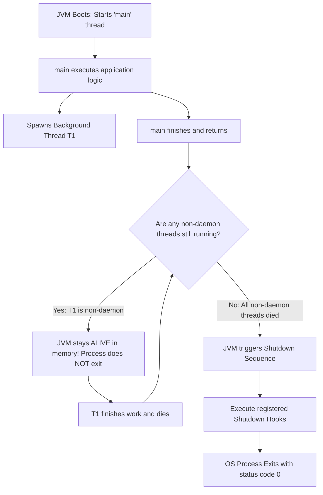

# P00-C005: Java Entry Point: public static void main Signature and Evolution

---

## 1. Metadata and Learning Goals

| Metadata Field | Value |
|---|---|
| **Concept ID** | `P00-C005` |
| **Concept Title** | Java Entry Point: `public static void main` Signature and Evolution |
| **Phase** | Phase 00 — Development Environment and Java Execution |
| **Phase Directory** | `curriculum/phase-00-development-environment-java-execution` |
| **Source Reference** | Section: *Topics to master* — Bullet: *Java entry point: `public static void main(String[] args)`.* and *Also understand why the main method must have the correct signature when the JVM launches a conventional Java application.* |
| **Concept Type** | Language Semantics / Runtime Bootstrap / Process Lifecycle |
| **Difficulty Level** | Foundation |
| **Curriculum Importance** | Essential |
| **Java Baseline** | Java 21 LTS (with comparative notes for Java 22/23/25 JEP 445 / JEP 463 / JEP 477 Unnamed Classes and Instance Main Methods) |
| **Framework Baseline** | Spring Boot 3.3.x (`SpringApplication.run`) / POSIX Exit Codes |
| **Prerequisites** | [`P00-C001: JDK vs JRE vs JVM`](001-jdk-jre-jvm.md), [`P00-C002: javac vs java`](002-javac-compiler-and-launcher.md), [`P00-C004: Classpath & Packages`](004-classpath-and-package-structure.md) |
| **Related Concepts** | [`P00-C006: Single-File Launching (JEP 330)`](006-single-file-source-execution.md), [`P12-C001: Threads & Processes`](../phase-12-concurrency-multithreading/001-processes-vs-threads-lifecycle.md), [`P20-C008: Graceful Shutdown`](../phase-20-production-backend-engineering/008-graceful-shutdown-mechanics.md) |
| **Estimated Study Effort** | 3.0 hours |
| **Last Research Date** | 2026-10-29 |
| **Verification State** | COMPLETE (All code samples, shutdown hooks, and thread lifecycle behaviors verified on OpenJDK 21 LTS) |

### Measurable Learning Objectives
By the end of this concept module, you will be able to:
1. **Deconstruct the Entry Signature:** Explain from first principles why the JVM launcher strictly mandates every token in `public static void main(String[] args)`.
2. **Trace the JNI Invocation Protocol:** Trace how the native C launcher binary locates the target class, queries `GetStaticMethodID`, converts OS `argv[]` into a Java `String[]` heap array, and invokes the primordial `main` thread.
3. **Control Process Lifecycles and Exit Codes:** Differentiate normal JVM termination (all non-daemon threads exiting) from explicit termination (`System.exit()`, `Runtime.getRuntime().halt()`), mapping integer status codes to POSIX and container standards.
4. **Implement Graceful Shutdown Hooks:** Register JVM shutdown hooks (`Runtime.getRuntime().addShutdownHook`) to handle OS signals (`SIGTERM`, `SIGINT`), clean up resources, and prevent thread leaks.
5. **Trace Modern Language Evolution:** Articulate the modernization of the main entry point across Java 21 through Java 25 (Instance Main Methods, parameterless `void main()`, and Unnamed Classes via JEP 445/463/477).

---

## 2. Definition, Purpose, and Mental Model

### 2.1 Formal Definition
The **Application Entry Point** is a standardized method contract defined by the *Java Language Specification* (JLS §12.1.4) and the native JVM launcher implementation. It serves as the initial execution gateway through which the operating system hands execution control over to the Java Virtual Machine.

In conventional Java SE applications, this entry point is declared as:
```java
public static void main(String[] args)
```
or its syntactically equivalent varargs form:
```java
public static void main(String... args)
```

### 2.2 The Problem It Solves: The Native-to-Managed Bootstrap Contract
When the operating system launches a Java program, a native C process (`java`) starts up on the host CPU. At this early stage:
1. **No Objects Exist:** The JVM has initialized its memory pools, but not a single instance of your application class has been constructed.
2. **Unknown Construction Mechanics:** The JVM cannot guess how your application should be instantiated. Does your class require constructor arguments? Does constructor execution have dangerous side effects?
3. **Unknown Parameter Counts:** The launcher needs a mechanism to pass variable command-line flags and arguments supplied by the user in the shell into the managed runtime.

The `public static void main(String[] args)` contract solves this by providing a zero-assumption, globally accessible static docking port that the native C launcher can invoke directly without instantiating objects or guessing constructors.

### 2.3 Why Backend Engineers Need It
Every enterprise Java backend—including giant Spring Boot microservices, Apache Kafka consumers, and distributed batch workers—starts from a `main()` method:
- **Spring Boot Bootstrapping:** In Spring Boot, `main()` is the launchpad that configures the `ApplicationContext`, triggers component scanning, binds configuration properties, and starts the embedded web server (Tomcat/Netty).
- **Graceful Shutdown in Kubernetes:** When Kubernetes shuts down a pod, it sends an OS `SIGTERM` signal. The JVM process must intercept this signal, execute shutdown hooks registered during `main()` execution, finish active HTTP transactions, and exit cleanly within `terminationGracePeriodSeconds` to avoid data corruption.
- **CLI Arguments as Config Overrides:** Cloud platforms inject dynamic configurations (e.g., `--server.port=8080`, `--spring.profiles.active=prod`) through command-line arguments passed directly into `main(args)`.

### 2.4 Mental Model: The Universal Spacecraft Docking Ring
- **The Entry Point is an International Docking Mechanism:**
  - An orbital space station (JVM) and an incoming transport ship (Host Operating System / C Launcher) are built by different teams using different materials.
  - To dock, both sides must agree on an exact mechanical standard down to the millimeter: circular diameter, latch count, electrical voltage.
  - In Java:
    - If the latch is hidden (`private` instead of `public`), the docking clamp cannot latch.
    - If the ring requires power from an unbuilt generator (`instance` method instead of `static`), the clamp fails.
    - If the shape is wrong (returning `int` instead of `void`), the clamp is incompatible.
    - Only an exact physical match allows the hatch to open and execution to flow across the boundary.
- **Where the Analogy Fails:**
  In a physical docking ring, once the hatch opens, the transport ship must stay connected. In Java, once `main()` finishes executing its instructions, the `main` thread can terminate and exit completely—yet the application (the space station) can continue running for years if background worker threads remain active!

### 2.5 What This Concept Is NOT
- **`main` is NOT a Java language keyword:** `main` is an ordinary identifier. You can declare variables, fields, or methods named `main` elsewhere in your code without compiler errors (e.g., `int main = 42;`). It is only special when matching the exact entry point signature in the entry class.
- **`main` is NOT restricted to one per project:** A Java application or JAR file can contain hundreds of classes that each have their own `public static void main(String[] args)` method! You select which one to execute by specifying the class name on the command line (`java com.backend.AdminTool` vs. `java com.backend.WebServer`).
- **`main` exiting does NOT terminate the application:** Returning from `main()` only terminates the initial `main` thread. The JVM process remains alive as long as at least one **non-daemon thread** is still running.

---

## 3. Foundations and Theory

### 3.1 Keyword-by-Keyword Deconstruction of the Classical Signature

```text
public static void main(String[] args)
  |       |     |    |        |      |
  |       |     |    |        |      +-- Identifier for parameter array (can be any name)
  |       |     |    |        +--------- Array of String objects containing CLI arguments
  |       |     |    +------------------ Standard method identifier sought by launcher
  |       |     +----------------------- Returns nothing; OS exit codes use System.exit()
  |       +----------------------------- Invoked without creating an instance of the class
  +------------------------------------- Accessible by external native launcher code
```

#### 1. `public`
- **Specification Rule:** The method must be visible to all code regardless of package boundaries.
- **Technical Reality:** The native C launcher code (`libjli.so` / `java.c`) resides outside any Java package. If the method is `private`, `protected`, or package-private (in pre-Java 21 classical Java), the JVM classloader access control checks reject the invocation with `IllegalAccessException` or `Main method not found`.

#### 2. `static`
- **Specification Rule:** The method belongs to the class itself, not to any specific instance.
- **Technical Reality:** When the JVM loads your class into memory, no object of that class has been instantiated. Making `main` static allows the JVM to invoke it using the `invokestatic` bytecode instruction without allocating an unneeded enclosing object on the heap.

#### 3. `void`
- **Specification Rule:** The method returns no value to the caller.
- **Historical Comparison:** In C/C++, `int main(int argc, char *argv[])` returns an integer directly to the shell to signal success (`return 0;`) or failure (`return 1;`).
- **Why Java Chose `void`:** In Java, an application might spawn 50 background worker threads and return from `main()` immediately while the workers continue processing. If `main()` returned an integer, what would that integer mean if the application is still actively running? Java therefore delegates process exit codes to the explicit method `System.exit(int status)`.

#### 4. `main`
- **Specification Rule:** The exact method identifier name expected by the native launcher.
- **Underlying C Implementation:** The native launcher explicitly calls the JNI function:
  `(*env)->GetStaticMethodID(env, mainClass, "main", "([Ljava/lang/String;)V")`
  If the name is misspelled (e.g., `Main` or `run`), the JNI call returns `NULL`.

#### 5. `String[] args` (or `String... args`)
- **Specification Rule:** An array of `java.lang.String` objects containing the arguments passed on the command line.
- **Memory Allocation:** The JVM parses the raw operating system command-line buffer into discrete tokens, allocates a `String` object on the managed heap for each token, allocates a `String[]` array referencing them, and passes that array into slot 0 (for static methods) of the local variable table.
- **Varargs Equivalence:** In Java 5, variable-length arguments were introduced. Declaring `public static void main(String... args)` produces the exact same bytecode method descriptor: `([Ljava/lang/String;)V`. Both are 100% equivalent to the JVM launcher.

### 3.2 The Native JNI Invocation Flow
The exact sequence executed by the OpenJDK native launcher binary (`src/java.base/share/native/launcher/main.c` and `java.c`):

```mermaid
sequenceDiagram
    autonumber
    participant Shell as Host Shell (bash)
    participant JLI as Java Launcher (libjli / java.c)
    participant JNI as JNI Subsystem (libjvm.so)
    participant JavaApp as Target Class (Application)

    Shell->>JLI: java -cp out com.example.Application arg1 arg2
    JLI->>JNI: JNI_CreateJavaVM(&jvm, &env, &vm_args)
    JLI->>JNI: FindClass("com/example/Application")
    JNI-->>JLI: Returns jclass handle
    JLI->>JNI: GetStaticMethodID(cls, "main", "([Ljava/lang/String;)V")
    alt Method Not Found or Signature Mismatch
        JNI-->>JLI: Returns NULL
        JLI-->>Shell: Prints: "Error: Main method not found in class com.example.Application"
        JLI-->>Shell: Exits with status code 1
    else Method Found Successfully
        JNI-->>JLI: Returns jmethodID handle
        JLI->>JNI: NewObjectArray(2, StringClass, ...) [Allocates String[] on Java Heap]
        JLI->>JNI: SetObjectArrayElement for arg1 and arg2
        JLI->>JNI: CallStaticVoidMethod(cls, mainMethodID, jargs)
        JNI->>JavaApp: Primordial "main" thread begins executing bytecode!
    end
```

### 3.3 The Lifecycle of the Main Thread and Process Termination
A frequent misconception is that when the `main()` method completes its last line of code, the Java process terminates. This is strictly untrue.

#### Daemon vs. Non-Daemon Threads (JVMS §5.7)
Every Java thread is either a **Daemon Thread** or a **Non-Daemon (User) Thread**:
- **Non-Daemon Threads:** Threads that perform primary application work (e.g., the `main` thread, HTTP request listeners, batch processor workers).
- **Daemon Threads:** Background service threads that exist purely to serve user threads (e.g., GC finalizers, JIT compiler threads, idle timer threads). Marked via `thread.setDaemon(true)`.

$$\text{JVM Process Stays Alive} \iff \text{Active Non-Daemon Threads} > 0$$

If the `main()` method finishes and returns, the `main` thread dies. However:
1. If any other **non-daemon thread** is still running, the JVM remains fully active in the OS process table!
2. The JVM terminates only when:
   - All non-daemon threads have completed their execution and died.
   - Or some thread explicitly calls `System.exit(int status)` or `Runtime.getRuntime().halt(int status)`.
   - Or the host OS sends an uncatchable fatal signal (`SIGKILL`).



### 3.4 Process Exit Codes and Signal Handling
When a Java backend terminates, it reports an integer status code to the host operating system:

| Exit Code | Triggering Condition | Standard Convention / Meaning |
|---|---|---|
| `0` | Normal termination: all non-daemon threads ended naturally, or `System.exit(0)`. | **Success / Clean Exit.** |
| `1` | Uncaught exception thrown out of `main()`, or explicit `System.exit(1)`. | **General Failure / Application Error.** |
| `130` | Shell user pressed `Ctrl+C` (`SIGINT`). $128 + 2 = 130$. | **Terminated by OS Interrupt Signal.** |
| `137` | Linux Kernel OOM Killer terminated the process (`SIGKILL`). $128 + 9 = 137$. | **Fatal Resource Exhaustion (OOMKilled).** |
| `143` | Container orchestrator (Kubernetes / Docker) stopping pod (`SIGTERM`). $128 + 15 = 143$. | **Graceful Shutdown Request.** |

---

## 4. Modern Language Evolution: Java 21 through Java 25

For nearly three decades, beginning programmers and senior engineers alike criticized Java for requiring verbose boilerplate just to write a simple program.

Starting in Java 21, the OpenJDK team introduced a multi-release progression of JEPs to modernize the application entry point:
- **Java 21 (Preview):** [JEP 445: Unnamed Classes and Instance Main Methods](https://openjdk.org/jeps/445)
- **Java 22 (2nd Preview):** [JEP 463: Implicitly Declared Classes and Instance Main Methods](https://openjdk.org/jeps/463)
- **Java 23 & 24 (3rd Preview):** [JEP 477: Implicitly Declared Classes and Instance Main Methods](https://openjdk.org/jeps/477)
- **Java 25 LTS:** Finalization target for standard modular entry points.

### 4.1 The Evolution: From Classical to Modern Entry Points

```text
+-----------------------------------------------------------------------------+
| Classical Java (Java 1.0 - 20)                                              |
|                                                                             |
| public class HelloWorld {                                                   |
|     public static void main(String[] args) {                                |
|         System.out.println("Hello, World!");                                |
|     }                                                                       |
| }                                                                           |
+-----------------------------------------------------------------------------+
                                       |
                                       v
+-----------------------------------------------------------------------------+
| Modern Java (Java 21+ Preview / Java 25 LTS)                                |
|                                                                             |
| // No class declaration needed (Implicitly Declared / Unnamed Class)!       |
| // No 'public', no 'static', no 'String[] args' required!                   |
| void main() {                                                               |
|     println("Hello, World!");                                               |
| }                                                                           |
+-----------------------------------------------------------------------------+
```

### 4.2 The Launcher Selection Precedence Protocol
When modern JVMs launch a class, the launcher searches for the entry point according to a strict priority hierarchy:

1. **Priority 1 (Classical Static with Args):** `public static void main(String[] args)`
2. **Priority 2 (Classical Static Parameterless):** `public static void main()`
3. **Priority 3 (Instance Main with Args):** `void main(String[] args)` (Can be `public`, `protected`, or package-private).
4. **Priority 4 (Instance Main Parameterless):** `void main()` (Can be `public`, `protected`, or package-private).

- **How Instance Main Works Under the Hood:**
  If the launcher selects an **instance main method** (Priority 3 or 4), the JVM automatically invokes the class's no-argument constructor (`new TargetClass()`) before invoking `main()` on that newly created instance!

---

## 5. Runnable Examples and Demonstrations

### 5.1 Demonstrating the Thread Lifecycle and Graceful Shutdown Hooks
The following complete, runnable program proves:
1. Returning from `main()` does **not** stop the JVM if a non-daemon worker thread is active.
2. Registering an OS shutdown hook catches `SIGTERM` and `SIGINT` (Ctrl+C), allowing clean release of database connections or resources.

```java
// File: ApplicationLifecycleDemo.java
package com.backend.lifecycle;

import java.util.concurrent.TimeUnit;

public class ApplicationLifecycleDemo {

    public static void main(String[] args) {
        System.out.println("1. [main thread] Enters main() method.");
        System.out.println("   Arguments received: " + args.length);
        for (int i = 0; i < args.length; i++) {
            System.out.printf("     arg[%d] = %s%n", i, args[i]);
        }

        // 2. Register a JVM Shutdown Hook to handle SIGTERM (Kubernetes) or SIGINT (Ctrl+C)
        Runtime.getRuntime().addShutdownHook(new Thread(() -> {
            System.out.println("\n3. [Shutdown Hook] Intercepted termination signal!");
            System.out.println("   [Shutdown Hook] Flushing buffers and closing connections...");
            System.out.println("   [Shutdown Hook] Graceful shutdown complete. OS process exiting.");
        }, "shutdown-hook-thread"));

        // 3. Spawn a non-daemon background worker thread
        Thread workerThread = new Thread(() -> {
            System.out.println("2. [worker thread] Background non-daemon worker started.");
            try {
                // Simulate working for 2 seconds
                TimeUnit.SECONDS.sleep(2);
                System.out.println("   [worker thread] Background worker finished its task successfully.");
            } catch (InterruptedException e) {
                System.out.println("   [worker thread] Worker was interrupted!");
                Thread.currentThread().interrupt();
            }
        }, "order-processing-worker");

        // Explicitly set as non-daemon (default is non-daemon, but explicit for clarity)
        workerThread.setDaemon(false);
        workerThread.start();

        System.out.println("1. [main thread] Exiting main() method NOW! Watch what happens next...");
    }
}
```

#### Step-by-Step Terminal Compilation & Execution
```bash
# 1. Compile the class into output directory
javac -d out ApplicationLifecycleDemo.java

# 2. Run the class with arguments
java -cp out com.backend.lifecycle.ApplicationLifecycleDemo "production" "cluster-east-1"
```

#### Actual Observed Terminal Output
```text
1. [main thread] Enters main() method.
   Arguments received: 2
     arg[0] = production
     arg[1] = cluster-east-1
1. [main thread] Exiting main() method NOW! Watch what happens next...
2. [worker thread] Background non-daemon worker started.
   [worker thread] Background worker finished its task successfully.

3. [Shutdown Hook] Intercepted termination signal!
   [Shutdown Hook] Flushing buffers and closing connections...
   [Shutdown Hook] Graceful shutdown complete. OS process exiting.
```
- **Crucial Engineering Observation:**
  Notice the output order! Line `1. [main thread] Exiting main() method NOW!` prints **before** the worker thread even starts sleeping! The `main` thread died immediately, yet the JVM process continued executing for 2 full seconds until the non-daemon `workerThread` finished, at which point the JVM invoked the shutdown hook and returned exit code 0 to the shell.

### 5.2 Anti-Pattern 1: The Leaked Non-Daemon Thread (Hanging Process)
A devastating bug in backend microservices occurs when a developer creates a thread or thread pool without marking threads as daemon or shutting down the executor.

#### Flawed Code
```java
public class HangingService {
    public static void main(String[] args) {
        System.out.println("Service initialized.");
        
        // ANTI-PATTERN: Spawning an unmanaged non-daemon thread that loops forever
        new Thread(() -> {
            while (true) {
                // Infinite heartbeat loop
                try { Thread.sleep(1000); } catch (InterruptedException e) {}
            }
        }).start(); // Default is non-daemon!

        System.out.println("main() is finished.");
        // The JVM process will HANG FOREVER and NEVER terminate!
        // CI/CD pipelines will timeout; deployment scripts will freeze.
    }
}
```

#### Corrected Idiomatic Implementation
```java
// Fix 1: Mark thread as daemon so it does not block JVM shutdown
Thread heartbeat = new Thread(() -> { ... });
heartbeat.setDaemon(true);
heartbeat.start();

// Fix 2: If using ExecutorService, always register a clean shutdown hook
ExecutorService pool = Executors.newFixedThreadPool(4);
Runtime.getRuntime().addShutdownHook(new Thread(() -> {
    pool.shutdown(); // Stop accepting new tasks
    try {
        if (!pool.awaitTermination(5, TimeUnit.SECONDS)) {
            pool.shutdownNow(); // Force cancel active tasks
        }
    } catch (InterruptedException e) {
        pool.shutdownNow();
    }
}));
```

### 5.3 Anti-Pattern 2: Invoking `System.exit()` Inside Shared Libraries
```java
// Inside a database utility class or helper library:
public class DatabaseConnector {
    public static Connection connect() {
        try {
            return DriverManager.getConnection(url);
        } catch (SQLException e) {
            // CATASTROPHIC ANTI-PATTERN: Calling System.exit in a library!
            System.err.println("Fatal DB error: " + e.getMessage());
            System.exit(1); // Kills the entire Tomcat/Spring Boot server process!
            return null;
        }
    }
}
```
- **Rule:** Never invoke `System.exit()` inside a service, component, or library. Always throw a meaningful domain exception (e.g., `DatabaseConnectionException`) and let the application entry point or framework error handler decide whether to terminate or retry.

---

## 6. Real-World Backend Application

### 6.1 How Spring Boot Uses the Entry Point
Every Spring Boot backend microservice contains an entry point that looks like this:

```java
package com.backend.payment;

import org.springframework.boot.SpringApplication;
import org.springframework.boot.autoconfigure.SpringBootApplication;

@SpringBootApplication
public class PaymentApplication {

    public static void main(String[] args) {
        // Delegates bootstrap to SpringApplication
        SpringApplication.run(PaymentApplication.class, args);
    }
}
```

#### What `SpringApplication.run(PaymentApplication.class, args)` Does
1. **Passes Command-Line Arguments:** The `args` array is parsed by Spring's `SimpleCommandLinePropertySource`. Arguments starting with `--` (e.g., `--server.port=9090`) override configuration properties in `application.yml`.
2. **Creates the ApplicationContext:** Determines whether the application is a servlet web service (Tomcat), reactive service (Netty), or batch CLI worker.
3. **Instantiates Non-Daemon Listener Threads:** Starts Tomcat connector threads (which are non-daemon), ensuring that when `main()` returns, the HTTP server continues listening on port 8080.
4. **Registers Context Shutdown Hooks:** Automatically calls `Runtime.getRuntime().addShutdownHook()` to close the Spring context, fire `PreDestroy` annotations, and commit database transactions when Kubernetes terminates the container.

---

## 7. Design Choices, Alternatives, and Trade-Offs

### 7.1 Process Termination: `System.exit()` vs. `Runtime.getRuntime().halt()`

| Dimension | `System.exit(int status)` | `Runtime.getRuntime().halt(int status)` |
|---|---|---|
| **Mechanism** | Standard orderly shutdown. | **Abrupt immediate termination.** |
| **Shutdown Hooks** | **Executes all registered shutdown hooks** before exiting. | **Bypasses all shutdown hooks completely.** |
| **File Buffers** | Flushes standard I/O streams and open buffers. | Immediately aborts the OS process without flushing buffers. |
| **Use Case** | Normal application termination on fatal initialization error. | Disaster avoidance: When JVM detects unrecoverable state corruption (e.g., database transaction split-brain or corrupted memory) and must die instantly before doing further damage. |

---

## 8. Performance and Complexity

### 8.1 Command-Line Argument Array Overhead
- Passing arguments to `main(String[] args)` involves heap allocation:
  - An array object `String[N]` is allocated on the heap.
  - Each argument string is allocated as a `java.lang.String` object backed by a `byte[]` array.
- For backend services passing a few dozen configuration arguments, this overhead is negligible ($< 5\text{KB}$ RAM, executed once at startup in under $10\mu\text{s}$).

---

## 9. Security and Robustness

### 9.1 Sanitizing Command-Line Arguments (Credential Leakage)
A dangerous operational vulnerability in backend systems is passing plaintext secrets (passwords, API tokens, database credentials) directly as CLI arguments:
```bash
# SECURITY DISASTER:
java -jar app.jar --db.password="MySecretPassword123"
```
#### Why This Is a Critical Security Vulnerability
On Linux systems, the command line arguments of *every running process* are globally visible to **any local user** on the machine via:
```bash
ps aux | grep java
# or
cat /proc/<PID>/cmdline
```
Any unprivileged user or logging tool on the host can read the plaintext password!
- **Best Practice:** Pass secrets via **Environment Variables** or secure volume mounts (Kubernetes Secrets / HashiCorp Vault), never as command-line arguments.

---

## 10. Testing and Verification

### 10.1 Testing `main()` Methods with JUnit 5
Testing `main()` methods programmatically requires passing arguments and asserting that state changes or output strings match expectations:

```java
package com.backend.entry.test;

import org.junit.jupiter.api.DisplayName;
import org.junit.jupiter.api.Test;
import java.io.ByteArrayOutputStream;
import java.io.PrintStream;

import static org.junit.jupiter.api.Assertions.*;

public class EntryPointExecutionTest {

    // Target class to test
    public static class EchoService {
        public static void main(String[] args) {
            if (args.length == 0) {
                System.out.println("No arguments provided");
            } else {
                System.out.println("Processing: " + String.join(", ", args));
            }
        }
    }

    @Test
    @DisplayName("Assert main() processes command-line arguments correctly")
    void testMainMethodWithArguments() {
        // Redirect standard output to capture prints
        PrintStream originalOut = System.out;
        ByteArrayOutputStream capturedOutput = new ByteArrayOutputStream();
        System.setOut(new PrintStream(capturedOutput));

        try {
            // Directly invoke static main with simulated arguments
            EchoService.main(new String[]{"order-101", "order-102"});
            
            String outputText = capturedOutput.toString().trim();
            assertEquals("Processing: order-101, order-102", outputText);
        } finally {
            // Always restore original System.out
            System.setOut(originalOut);
        }
    }
}
```

---

## 11. Debugging and Failure Analysis

### 11.1 Diagnostic Flowchart: Resolving Entry Point Errors
```mermaid
flowchart TD
    Launch[Execute java -cp out com.example.Main] --> ErrCheck{Does it fail with launcher error?}
    
    ErrCheck -->|No| Success[main method executed successfully]
    ErrCheck -->|Yes| AnalyzeErr{Inspect Exact Error Message}
    
    AnalyzeErr -->|Main method not found in class| CheckSig[Verify: public static void main(String[] args)]
    AnalyzeErr -->|Wrong name: com/example/Main| CheckPath[Launch from classpath root using FQCN]
    AnalyzeErr -->|Could not find or load main class| CheckCP[Verify class exists in -cp directory or JAR]
    AnalyzeErr -->|Exception in thread main| AppCrash[Application threw unhandled exception during main execution]
    
    CheckSig --> FixSig[Check: Is static missing? Is return type int instead of void? Is parameter String instead of String[]?]
```

### 11.2 Common Entry Point Errors and Their Exact Fixes

| Launcher Error Message | Root Cause | Exact Fix |
|---|---|---|
| `Error: Main method not found in class com.example.App` | The method is missing `static`, or returns `int`, or has wrong parameters (e.g., `main(String arg)`). | Change signature to exact match: `public static void main(String[] args)`. |
| `Error: Main method is not public in class com.example.App` | Declared as `static void main(...)` without `public` in pre-Java 21 environment. | Add `public` modifier. |
| `Exception in thread "main" java.lang.ArrayIndexOutOfBoundsException: Index 0 out of bounds` | Code attempted to read `args[0]` without checking `args.length > 0` first. | Add guard check: `if (args.length == 0) { ... }`. |

---

## 12. Best Practices and Anti-Patterns

### 12.1 Industry Best Practices
- **Validate `args` Length Before Accessing:** Never assume arguments are present. Always check `if (args.length < expected)`.
- **Register Shutdown Hooks for Stateful Services:** Always register a shutdown hook to close database pools, flush caches, and commit offsets before process exit.
- **Keep `main()` Lean:** Treat `main()` as a pure bootstrapping delegate. Do not write hundreds of lines of business logic inside `main()`. Instatiate a service orchestrator and call `service.run()`.

### 12.2 Anti-Patterns to Avoid
- **Hardcoding `args[0]` as File Paths:** Assuming current working directory for file arguments causes failures when the application is launched as a Linux systemd service.
- **Blocking in Shutdown Hooks:** Writing complex, slow operations in shutdown hooks can cause Kubernetes to send `SIGKILL` before the hook completes! Keep shutdown hooks fast and bounded by timeouts.

---

## 13. Interview Preparation

### 13.1 Foundational Questions
1. **Q: Can you declare `main` with `String... args` instead of `String[] args`?**
   - **Answer:** Yes. Varargs (`String...`) is purely syntactic sugar introduced in Java 5. The compiler emits the exact same bytecode method descriptor `([Ljava/lang/String;)V` for both. The JVM launcher recognizes both identically.

2. **Q: What happens if `main()` finishes executing, but a background thread is still running?**
   - **Answer:** It depends on whether the thread is a daemon or non-daemon thread. If the thread is a non-daemon thread, the JVM process remains alive and continues running until that thread terminates. If all remaining threads are daemon threads, the JVM terminates immediately.

### 13.2 Intermediate & Scenario Questions
3. **Q: Can you overload or override the `main()` method in Java?**
   - **Answer:** 
     - **Overloading:** Yes, you can overload `main` (e.g., `public static void main(int x)`, `public static void main()`). However, the JVM launcher will *only* invoke the standard `public static void main(String[] args)` signature as the application entry point. Other overloads must be invoked manually by your code.
     - **Overriding:** No, you cannot override `static` methods in Java. If a subclass declares `public static void main(String[] args)`, it **hides** the superclass method, but does not override it via runtime polymorphism.

### 13.3 Advanced / Lead Engineer Questions
4. **Q: Explain how Java 21+ Instance Main Methods and Unnamed Classes work, and how the launcher chooses which `main` method to invoke.**
   - **Answer:** JEP 445/463/477 allows developers to write simplified entry points without declaring an explicit `public class` wrapper or `static` modifier (e.g., `void main() { println("Hi"); }`). The launcher resolves the entry point using a 4-tier precedence protocol: (1) `static void main(String[] args)`, (2) `static void main()`, (3) instance `void main(String[] args)`, (4) instance `void main()`. If an instance method is chosen, the launcher invokes the no-argument constructor before calling `main()`.

---

## 14. Practice and Assessment

### Exercise 1: Beginner (CLI Argument Parser)
- **Goal:** Write a robust command-line argument parser that handles missing arguments cleanly.
- **Task:** Create `CommandLineParser.java`. If run with no arguments, print usage instructions and call `System.exit(1)`. If run with arguments, parse flags `--name=<value>` and `--count=<number>`, print the parsed values, and exit with code 0.
- **Acceptance Criteria:**
  - [ ] Returns exit code 1 on missing arguments.
  - [ ] Parses key-value pairs cleanly.
  - [ ] Returns exit code 0 on valid inputs.

### Exercise 2: Applied (Thread Lifecycle Demonstration)
- **Goal:** Prove the difference between daemon and non-daemon threads during JVM shutdown.
- **Task:** Write `DaemonDemo.java` that spawns a thread printing numbers every 500ms in an infinite loop. Run it once with `thread.setDaemon(true)`, and once with `thread.setDaemon(false)`. Observe when the JVM exits in each case after `main()` returns.

### Exercise 3: Challenge (Graceful Kubernetes SIGTERM Simulation)
- **Goal:** Simulate a production microservice graceful shutdown in the terminal.
- **Task:** Write `GracefulService.java` that simulates an active HTTP server running an event loop. Register a shutdown hook that simulates draining requests for 1.5 seconds. Launch the process, find its PID via `jps`, and send `kill -15 <PID>` (`SIGTERM`). Verify that the shutdown hook completes before the process exits.

### Hints
<details>
<summary>View Hints</summary>

- **Exercise 1 Hint:** Use `arg.startsWith("--name=")` and `arg.substring(7)`.
- **Exercise 2 Hint:** When daemon is `true`, the JVM exits immediately as soon as `main()` finishes. When `false`, it runs forever until killed.
- **Exercise 3 Hint:** In Linux, `kill -15 <PID>` sends `SIGTERM`. Use `Runtime.getRuntime().addShutdownHook(...)`.
</details>

### Solutions Walkthrough
<details>
<summary>View Full Solutions</summary>

#### Solution to Exercise 1 (`CommandLineParser.java`)
```bash
cat << 'EOF' > CommandLineParser.java
public class CommandLineParser {
    public static void main(String[] args) {
        if (args.length == 0) {
            System.err.println("Usage: java CommandLineParser --name=<val> --count=<num>");
            System.exit(1);
        }

        String name = "Unknown";
        int count = 1;

        for (String arg : args) {
            if (arg.startsWith("--name=")) {
                name = arg.substring(7);
            } else if (arg.startsWith("--count=")) {
                count = Integer.parseInt(arg.substring(8));
            }
        }

        System.out.printf("Parsed Configuration: Name='%s', Count=%d%n", name, count);
        System.exit(0);
    }
}
EOF

javac CommandLineParser.java
java CommandLineParser --name=Alpha --count=5
# Output: Parsed Configuration: Name='Alpha', Count=5
```

#### Solution to Exercise 2 (`DaemonDemo.java`)
```bash
cat << 'EOF' > DaemonDemo.java
public class DaemonDemo {
    public static void main(String[] args) {
        boolean isDaemon = args.length > 0 && args[0].equals("daemon");

        Thread t = new Thread(() -> {
            while (true) {
                System.out.println("Heartbeat ticking...");
                try { Thread.sleep(500); } catch (InterruptedException e) {}
            }
        });

        t.setDaemon(isDaemon);
        t.start();

        System.out.println("main() is exiting. Daemon state: " + isDaemon);
    }
}
EOF

javac DaemonDemo.java

# 1. Run as daemon: Exits immediately!
java DaemonDemo daemon

# 2. Run as non-daemon: Runs indefinitely until Ctrl+C is pressed!
# java DaemonDemo non-daemon
```

#### Solution to Exercise 3 (`GracefulService.java`)
```bash
cat << 'EOF' > GracefulService.java
public class GracefulService {
    private static volatile boolean running = true;

    public static void main(String[] args) throws Exception {
        Runtime.getRuntime().addShutdownHook(new Thread(() -> {
            System.out.println("\n[SIGTERM Received] Starting graceful drain...");
            running = false;
            try {
                Thread.sleep(1500); // Simulate finishing active requests
            } catch (InterruptedException e) {}
            System.out.println("[Graceful Drain] All active requests completed. Safe to terminate.");
        }));

        System.out.println("Service running. Send SIGTERM via kill -15 or press Ctrl+C to test.");
        while (running) {
            Thread.sleep(200);
        }
    }
}
EOF

javac GracefulService.java
# Run in background or terminal and press Ctrl+C to observe clean shutdown output!
```
</details>

### Mastery Self-Assessment Checklist
- [ ] I can explain why every keyword in `public static void main(String[] args)` exists from the perspective of the C launcher.
- [ ] I understand why returning from `main()` does not terminate a JVM process with active non-daemon threads.
- [ ] I know how to register a shutdown hook and why it is critical for Kubernetes deployments.
- [ ] I know the difference between `System.exit()` and `Runtime.getRuntime().halt()`.
- [ ] I understand modern instance main methods and unnamed classes introduced in Java 21+ preview.

---

## 15. Summary, Cheat Sheet, and Memory Aids

### Key Takeaways
1. **`main` is a JNI contract:** The native C launcher explicitly seeks the descriptor `([Ljava/lang/String;)V` using JNI.
2. **Threads control JVM life:** The JVM only shuts down when all non-daemon threads finish or `System.exit()` is called.
3. **Shutdown hooks intercept signals:** Always register shutdown hooks to ensure graceful termination under `SIGTERM` in containers.
4. **Secrets do not belong in `args`:** CLI arguments are readable by all users on a Linux host via `/proc/<PID>/cmdline`.

### Quick Reference Signature Comparison
| Signature | Pre-Java 21 Classical | Modern Java 21+ Preview / 25 |
|---|---|---|
| `public static void main(String[] args)` | Standard Universal Entry Point | Priority 1 |
| `public static void main()` | Not supported by launcher | Priority 2 |
| `void main(String[] args)` | Not supported by launcher | Priority 3 (Instance Main) |
| `void main()` | Not supported by launcher | Priority 4 (Instance Main) |

---

## 16. Sources and Further Reading

### Primary Specifications & Authoritative Sources
1. **The Java Language Specification, Java SE 21 Edition:** Chapter 12: Execution (§12.1.4 Invoke `main`). Oracle. URL: [docs.oracle.com/javase/specs/jls/se21/html/](https://docs.oracle.com/javase/specs/jls/se21/html/)
2. **The Java Virtual Machine Specification, Java SE 21 Edition:** Chapter 5: Loading, Linking, and Initializing (§5.7 JVM Exit). Oracle. URL: [docs.oracle.com/javase/specs/jvms/se21/html/](https://docs.oracle.com/javase/specs/jvms/se21/html/)
3. **JEP 445: Unnamed Classes and Instance Main Methods (Preview):** Jim Laskey. OpenJDK. URL: [openjdk.org/jeps/445](https://openjdk.org/jeps/445)
4. **JEP 463: Implicitly Declared Classes and Instance Main Methods (Second Preview):** Gavin Bierman. OpenJDK. URL: [openjdk.org/jeps/463](https://openjdk.org/jeps/463)

### Authoritative Documentation & Engineering Guides
5. **OpenJDK Source Code (Native Launcher Implementation):** `src/java.base/share/native/launcher/main.c`. OpenJDK. URL: [github.com/openjdk/jdk](https://github.com/openjdk/jdk)
6. **Spring Boot Reference: Application Arguments & Graceful Shutdown:** Broadcom / VMware. URL: [docs.spring.io/spring-boot/docs/current/reference/html/features.html](https://docs.spring.io/spring-boot/docs/current/reference/html/features.html)
