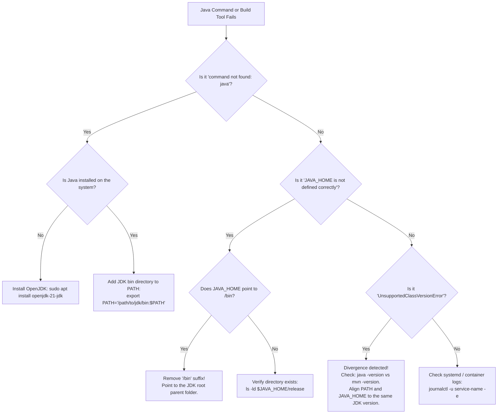

# Environment Variables: JAVA_HOME and PATH in Linux/Production

---

## 1. Metadata and Learning Goals

- **Concept ID:** `P00-C007`
- **Concept Title:** Environment Variables: JAVA_HOME and PATH in Linux/Production
- **Curriculum Phase:** Phase 00: Development Environment and Java Execution
- **Topic Category:** Operating System Integration and Runtime Bootstrap
- **Suggested Importance:** Essential
- **Prerequisites:**
  - [`P00-C001`: JDK vs JRE vs JVM Architecture and Evolution](001-jdk-jre-jvm.md)
  - [`P00-C002`: Java Compiler (javac) vs Launcher (java) Workflow](002-javac-compiler-and-launcher.md)
  - [`P00-C004`: Compilation, Execution, and Classpath Mechanics](004-classpath-and-package-structure.md)
- **Next Concept in Sequence:**
  - [`P00-C008`: JDK Versions, Release Cadence, LTS, and Bytecode Compatibility](008-jdk-versions-lts-compatibility.md)
- **Concepts Covered:**
  - POSIX process environment model (`char **environ`, `fork()`, and `execve()`)
  - The `$PATH` binary search algorithm and the left-to-right first-match rule
  - The `$JAVA_HOME` specification and the standard JDK directory invariant
  - Canonical path resolution through Linux symlink trees (`readlink -f`)
  - Debian/Ubuntu `update-alternatives` architecture and multi-JDK switching
  - Interactive vs non-interactive shell initialization (`/etc/environment`, `/etc/profile.d/`, `~/.bashrc`)
  - Headless systemd service unit environment isolation (`Environment=` directive)
  - Java runtime APIs: `System.getenv("JAVA_HOME")` vs `System.getProperty("java.home")`
  - Containerized production Dockerfile patterns (`ENV JAVA_HOME`, `ENV PATH`)
  - Multi-JDK environment desynchronization bugs (CLI vs Maven/Gradle divergence)

### Measurable Learning Objectives
By completing this module, you will be able to:
1. **Explain the mechanical difference** between the operating system's `$PATH` resolution and Java ecosystem tools' reliance on `$JAVA_HOME`.
2. **Trace the symlink chain** of a Debian/Ubuntu Java binary from `/usr/bin/java` through `/etc/alternatives/` to the canonical JDK root.
3. **Configure persistent system-wide and user-specific environment variables** across interactive shells, automated CI/CD runners, and Docker containers.
4. **Author production-grade systemd service definitions** that isolate and explicitly define the Java runtime without relying on ambient shell state.
5. **Diagnose and eliminate runtime divergence bugs**, such as Maven compiling against JDK 17 while the terminal executes JDK 21.

---

## 2. Definition, Purpose, and Mental Model

### 2.1 Formal Definition
In POSIX-compliant operating systems (Linux, macOS, BSD):
- **`$PATH`** is an operating-system-level environment variable containing an ordered, colon-delimited list of directories (`dir1:dir2:...`) that the shell scans sequentially when a command is entered without an absolute path.
- **`$JAVA_HOME`** is an application-level standard environment variable defined by the Java ecosystem. It points to the **root installation directory** of the active Java Development Kit (JDK) or Java Runtime Environment (JRE).

```text
+-------------------------------------------------------------------------------+
|                             OPERATING SYSTEM SHELL                            |
|                                                                               |
|  $PATH: /usr/local/bin : /usr/bin : /bin                                     |
|             |               |                                                 |
|             |               +--> Finds /usr/bin/java                          |
|             |                        |                                        |
|             |                        v (symlink)                              |
|             |                   /etc/alternatives/java                        |
|             |                        |                                        |
|             |                        v (symlink)                              |
|             |                   /usr/lib/jvm/java-21-openjdk-amd64/bin/java   |
+-------------|-----------------------------------------------------------------+
              |
              |   +-------------------------------------------------------------+
              |   |               BACKEND BUILD TOOLS & SERVERS                 |
              |   |               (Maven, Gradle, Tomcat, Kafka)                |
              |   |                                                             |
              +---|--> $JAVA_HOME: /usr/lib/jvm/java-21-openjdk-amd64           |
                  |         |                                                   |
                  |         +--> Locates headers: $JAVA_HOME/include            |
                  |         +--> Locates modules: $JAVA_HOME/jmods              |
                  |         +--> Locates tools  : $JAVA_HOME/bin/javac          |
                  +-------------------------------------------------------------+
```

### 2.2 The Problem It Solves
When a backend developer or production server executes `java` or `javac`, the operating system must know where the corresponding ELF executable binary resides on the physical disk. Without `$PATH`, every command would require typing the absolute filesystem path:

```bash
# Tedious, fragile, and host-specific:
/usr/lib/jvm/java-21-openjdk-amd64/bin/java -jar api-gateway.jar

# Portable and ergonomic (enabled by $PATH):
java -jar api-gateway.jar
```

However, the Java ecosystem requires much more than just finding the `java` launcher. Build automation tools (Maven, Gradle, Ant), application servers (Tomcat, Jetty, WildFly), profiling agents (Async-Profiler, JProfiler), and native compilation tools (GraalVM `native-image`) require access to the entire JDK directory structure—including compilation tools (`bin/javac`), standard library modules (`jmods/`), C-header files for JNI (`include/`), and release metadata (`release`). 

The operating system's `$PATH` cannot convey this root location because `$PATH` only points to directories containing executables (like `.../bin`), not to the parent root. `$JAVA_HOME` solves this by establishing a standardized, single point of reference for the JDK root installation.

### 2.3 Why Backend Engineers Need It
1. **Tooling Synchronization:** If your terminal `$PATH` resolves to JDK 17, but your `$JAVA_HOME` points to JDK 21, Maven and Gradle will compile with JDK 21 while shell scripts and diagnostic commands execute JDK 17. This divergence causes subtle compilation, bytecode mismatch (`UnsupportedClassVersionError`), and runtime profiling failures.
2. **Headless Server Daemons:** In Linux production systems, backend microservices are managed by init systems like `systemd` or container runtimes like `containerd`. These daemons do **not** run interactive user shells; they do not load `~/.bashrc` or `/etc/profile`. A backend engineer who does not understand environment propagation will find their service failing on boot with `status=203/EXEC: No such file or directory`.
3. **CI/CD Pipeline Determinism:** Build agents (Jenkins, GitHub Actions, GitLab CI) spin up clean runner environments. Correctly injecting `$JAVA_HOME` and `$PATH` guarantees that builds are reproducible and do not silently fall back to an obsolete system-default JDK.

### 2.4 Mental Model: The Street Sign vs. The Corporate Headquarters
To understand why both variables exist, consider this physical analogy:
- **`$PATH` is a street directory of public shops.** When you say, *"Get me a cup of coffee"*, the OS looks through the list of commercial streets until it finds the first shop named `coffee`. If the first shop on the list is outdated, you get bad coffee.
- **`$JAVA_HOME` is the registered physical address of the company headquarters.** When a partner company (Maven, Gradle, Tomcat) needs to audit contracts, review corporate records, or inspect company assets (`include/`, `jmods/`, `release`), they do not go to a random coffee shop on the street. They navigate directly to the corporate headquarters address specified by `$JAVA_HOME`.

### 2.5 What This Concept Is NOT
- **Not JVM System Properties:** Environment variables are native OS-level string pairs exposed to all processes. JVM System Properties (e.g., `-Dserver.port=8080` or `java.home`) are Java-internal key-value pairs maintained inside the JVM heap.
- **Not the Java Classpath:** `$PATH` tells the operating system where to find native machine executables (`java`, `javac`, `git`). The Java Classpath (`-cp` or `$CLASSPATH`) tells the JVM ClassLoader where to find compiled `.class` files and `.jar` libraries.
- **Not Java Runtime Memory Configuration:** Memory boundaries like `-Xmx4g` or `-XX:+UseG1GC` are JVM command-line flags, not OS environment variables (although wrappers like `JAVA_OPTS` or `JDK_JAVA_OPTIONS` can pass them).

---

## 3. Foundations and Theory

### 3.1 The POSIX Environment Model: Inheritance and Memory
In Linux and Unix-like operating systems, the environment is an array of null-terminated C-strings of the format `KEY=VALUE`, terminated by a `NULL` pointer:

```c
// POSIX definition in C runtime:
extern char **environ;
```

When a process executes in Linux:
1. When a process spawns a child (e.g., your bash shell running `java`), it invokes the `fork()` system call.
2. `fork()` creates an exact clone of the parent's memory space, including the environment table.
3. The child calls `execve(const char *pathname, char *const argv[], char *const envp[])`.
4. The kernel passes the environment pointer array `envp` to the new program's entry point.

```
+--------------------------------------------------------------------+
|                         PARENT PROCESS (BASH)                      |
|  PID: 1240                                                         |
|  Environment Memory Block:                                         |
|    [0] -> "PATH=/usr/local/bin:/usr/bin"                           |
|    [1] -> "JAVA_HOME=/usr/lib/jvm/java-21-openjdk-amd64"           |
|    [2] -> "USER=backend-engineer"                                  |
|    [3] -> NULL                                                     |
+--------------------------------------------------------------------+
                                  |
                           fork() | (Copies memory & environment)
                                  v
+--------------------------------------------------------------------+
|                         CHILD PROCESS (BASH CLONE)                 |
|  PID: 1241                                                         |
|  Environment: Exact copy of Parent PID 1240                        |
+--------------------------------------------------------------------+
                                  |
                         execve() | (Replaces process image with java)
                                  v
+--------------------------------------------------------------------+
|                         NEW PROGRAM (JAVA JVM)                     |
|  PID: 1241                                                         |
|  Native JVM reads envp via JNI and Linux /proc/self/environ        |
+--------------------------------------------------------------------+
```

> [!IMPORTANT]
> **One-Way Inheritance Invariant:** Environment variables propagate **downward only** (from parent process to child process). A child process (such as a running Java application or a shell script) **cannot** modify the environment variables of its parent shell or operating system. Changes made inside Java via custom native code or temporary script exports vanish when the process exits.

You can inspect the exact live environment of any running Linux process directly from the kernel filesystem via `/proc`:

```bash
# Inspect the raw environment of process 1241 (strings separated by null bytes \0)
cat /proc/1241/environ | tr '\0' '\n' | grep -E 'JAVA_HOME|PATH'
```

### 3.2 The PATH Binary Search Algorithm
When you type a bare executable name such as `javac` into a terminal, the shell executes an internal lookup procedure:
1. **Check Built-ins:** The shell checks if `javac` is a shell built-in (e.g., `cd`, `echo`, `type`). It is not.
2. **Check Hash Table:** The shell checks its internal command hash table (`hash` command in bash) to see if `javac` was already resolved recently.
3. **Scan `$PATH` Left-to-Right:** The shell reads the `$PATH` string, splits it on the colon `:` delimiter, and tests each directory in strict sequential order:
   - Does `/usr/local/sbin/javac` exist, and is it executable by the current user? No.
   - Does `/usr/local/bin/javac` exist and is it executable? No.
   - Does `/usr/bin/javac` exist and is it executable? **Yes!**
4. **Execution and Halt:** The search **terminates immediately** on the first match. Any subsequent directory (e.g., `/opt/jdk-21/bin/javac`) is completely ignored.

```
User types: "java"
PATH="/opt/jdk-17/bin : /usr/local/bin : /usr/bin : /opt/jdk-21/bin"
            |
            v
1. Check /opt/jdk-17/bin/java? ----> [FOUND!] ---> EXECUTE JDK 17 AND STOP!
                                                  (/opt/jdk-21/bin is NEVER reached)
```

> [!CAUTION]
> **Order Dependency Trap:** If an older Java installation appears earlier in the `$PATH` than your intended modern JDK, the older Java will always win. To prepend a new JDK to the front of the line, always place it before `$PATH`:
> ```bash
> export PATH="$JAVA_HOME/bin:$PATH"
> ```

### 3.3 The JAVA_HOME Directory Structure Invariant
A valid `$JAVA_HOME` must adhere to the standard OpenJDK filesystem specification. If a directory does not satisfy this layout, tools like Maven and Gradle will reject it:

```text
$JAVA_HOME/
├── bin/                    # Native launchers (java, javac, javadoc, jcmd, jshell)
├── conf/                   # System configurations (security/java.security, logging)
├── include/                # C/C++ header files for JNI (jni.h, jni_md.h)
├── jmods/                  # Packaged modular runtime images (since Java 9)
├── legal/                  # Third-party licensing documentation
├── lib/                    # Native shared libraries (libjvm.so) and ClassLoader resources
└── release                 # Crucial text file containing metadata (JAVA_VERSION="21.0.12")
```

> [!WARNING]
> **The Common `/bin` Suffix Blunder:** 
> A widespread mistake is configuring `JAVA_HOME=/usr/lib/jvm/java-21-openjdk/bin`. 
> `$JAVA_HOME` must point to the **parent root**, NOT the `bin` directory! Tools like Maven internally append `/bin/java` to `$JAVA_HOME`. If you configure `JAVA_HOME` to end with `/bin`, Maven will attempt to execute `/usr/lib/jvm/java-21-openjdk/bin/bin/java`, crashing with a `No such file or directory` error.

### 3.4 The Debian/Ubuntu Symlink Tree: update-alternatives
On Debian and Ubuntu server distributions, installing OpenJDK via `apt` does not place the JDK directly into `/usr/bin`. Instead, it uses the **Debian Alternatives System** to permit multiple versions of Java to coexist peacefully on the same filesystem.

When you execute `/usr/bin/java`, you are traversing a three-tiered symlink chain:

```
[Level 1: System Executable]
/usr/bin/java
     |
     v (symbolic link managed by system)
[Level 2: Alternatives Registry]
/etc/alternatives/java
     |
     v (symbolic link switched by update-alternatives)
[Level 3: Physical Canonical Binary]
/usr/lib/jvm/java-21-openjdk-amd64/bin/java
```

To resolve this symlink chain to its canonical destination in Linux, use the canonical readlink command:

```bash
readlink -f $(which java)
# Output: /usr/lib/jvm/java-21-openjdk-amd64/bin/java
```

To derive the canonical `$JAVA_HOME` from the running `java` command dynamically:

```bash
dirname $(dirname $(readlink -f $(which java)))
# Output: /usr/lib/jvm/java-21-openjdk-amd64
```

---

## 4. Syntax, API, and Command Reference

### 4.1 Master Linux Environment Commands

| Command | Purpose | Production Use Case |
|---|---|---|
| `export KEY="value"` | Sets an environment variable in the current shell and marks it for export to child processes. | Setting `$JAVA_HOME` in startup scripts. |
| `printenv [KEY]` | Prints all or a specific exported environment variable. | Verifying `printenv JAVA_HOME` in CI/CD pipelines. |
| `env` | Runs a program in a modified environment or prints current environment. | Invoking commands with temporary overrides: `env JAVA_HOME=/opt/jdk-17 mvn clean test`. |
| `which <cmd>` | Shows the full path of the shell command using `$PATH`. | Quickly finding `/usr/bin/java`. |
| `type -a <cmd>` | Shows **all** locations of a command in `$PATH`, including aliases and builtins. | Diagnosing if multiple `java` binaries exist across `/usr/bin`, `/usr/local/bin`, etc. |
| `readlink -f <path>` | Recursively follows all symlinks to return the canonical physical path. | Resolving `/usr/bin/java` to its physical OpenJDK installation directory. |
| `sudo update-alternatives --config java` | Interactively prompts the administrator to select the default system Java. | Switching the global default JDK on Debian/Ubuntu servers. |
| `sudo update-alternatives --display java` | Displays all registered alternatives, their priorities, and current symlink target. | Auditing installed JDKs on a host. |

### 4.2 Linux Environment Persistence Locations

Where you configure `$JAVA_HOME` and `$PATH` depends on **who** needs access and **how** the process is spawned:

```
+---------------------------+-----------------------------------+-----------------------------------------+
| Configuration File        | Scope                             | When It Is Evaluated                    |
+---------------------------+-----------------------------------+-----------------------------------------+
| /etc/environment          | System-wide (All users & daemons) | Evaluated by PAM at login/boot.         |
|                           |                                   | Pure KEY=VAL pairs (NO bash syntax).    |
+---------------------------+-----------------------------------+-----------------------------------------+
| /etc/profile.d/java.sh    | System-wide (All users)           | Evaluated by interactive login shells.  |
|                           |                                   | Full shell script syntax supported.     |
+---------------------------+-----------------------------------+-----------------------------------------+
| ~/.bashrc                 | User-specific                     | Evaluated by non-login interactive      |
|                           |                                   | bash shells (e.g., terminal tabs).      |
+---------------------------+-----------------------------------+-----------------------------------------+
| ~/.bash_profile           | User-specific                     | Evaluated by login shells (e.g., SSH).  |
+---------------------------+-----------------------------------+-----------------------------------------+
| systemd unit file         | Single Daemon Service             | Loaded directly by systemd PID 1.       |
| (.service)                |                                   | Completely ignores all shell rc files!  |
+---------------------------+-----------------------------------+-----------------------------------------+
| Dockerfile (ENV)          | Container Image                   | Embedded into image metadata.           |
|                           |                                   | Active for build steps & container run. |
+---------------------------+-----------------------------------+-----------------------------------------+
```

### 4.3 Java Programmatic Environment APIs

Within a running Java backend application, you can inspect environment variables and runtime paths using the standard Java API:

```java
// 1. Read OS Environment Variable ($JAVA_HOME)
String envJavaHome = System.getenv("JAVA_HOME");

// 2. Read Internal JVM System Property (Physical JRE running THIS JVM)
String jvmHome = System.getProperty("java.home");

// 3. Read Internal JVM Version
String jvmVersion = System.getProperty("java.version");
```

> [!IMPORTANT]
> **Difference Between `System.getenv("JAVA_HOME")` and `System.getProperty("java.home")`:**
> - `System.getenv("JAVA_HOME")` returns what the OS environment had set *before* the JVM launched. If `$JAVA_HOME` was not exported in the shell, this returns `null`!
> - `System.getProperty("java.home")` is computed internally by the JVM at startup and **never returns null**. It reflects the exact physical directory of the JRE/JDK that is executing this current bytecode process.

---

## 5. Runnable Examples and Demonstrations

### 5.1 Programmatic Java Environment Diagnostic Utility
The following production utility inspects both the OS environment and the internal JVM properties, audits whether the paths exist on disk, checks for divergence, and validates the standard OpenJDK directory structure.

```java
// File: JavaEnvironmentAuditor.java
import java.io.File;
import java.nio.file.Files;
import java.nio.file.Path;
import java.nio.file.Paths;
import java.util.Map;

public class JavaEnvironmentAuditor {

    public static void main(String[] args) {
        System.out.println("==================================================================");
        System.out.println("            JAVA BACKEND ENVIRONMENT AUDIT UTILITY                ");
        System.out.println("==================================================================");

        // 1. Audit OS Environment Variables
        String osJavaHome = System.getenv("JAVA_HOME");
        String osPath = System.getenv("PATH");

        System.out.println("[1] OPERATING SYSTEM ENVIRONMENT VARIABLES:");
        System.out.println("    $JAVA_HOME : " + (osJavaHome != null ? osJavaHome : "<NOT SET / NULL>"));
        System.out.println("    $PATH      : " + summarizePath(osPath));

        // 2. Audit JVM Internal System Properties
        String propJavaHome = System.getProperty("java.home");
        String propJavaVersion = System.getProperty("java.version");
        String propJavaVendor = System.getProperty("java.vendor");

        System.out.println("\n[2] JVM INTERNAL RUNTIME PROPERTIES:");
        System.out.println("    java.home   : " + propJavaHome);
        System.out.println("    java.version: " + propJavaVersion);
        System.out.println("    java.vendor : " + propJavaVendor);

        // 3. Invariant Verification: Does JAVA_HOME match the running JVM?
        System.out.println("\n[3] ENVIRONMENT DIVERGENCE ANALYSIS:");
        if (osJavaHome == null) {
            System.out.println("    [WARNING] $JAVA_HOME is not exported in the calling environment.");
            System.out.println("              Build tools like Maven and Gradle may fail or fall back.");
        } else {
            Path envPath = Paths.get(osJavaHome).toAbsolutePath().normalize();
            Path runtimePath = Paths.get(propJavaHome).toAbsolutePath().normalize();

            if (envPath.equals(runtimePath)) {
                System.out.println("    [OK] $JAVA_HOME matches the running JVM java.home exactly.");
            } else {
                System.out.println("    [ALERT] DIVERGENCE DETECTED!");
                System.out.println("            OS $JAVA_HOME : " + envPath);
                System.out.println("            Running JVM   : " + runtimePath);
                System.out.println("            Your build tools and runtime are running on DIFFERENT JDKs!");
            }
        }

        // 4. Invariant Verification: JDK Root Directory Validation
        System.out.println("\n[4] JDK STRUCTURE INTEGRITY CHECK (for java.home):");
        validateJdkDirectoryStructure(Paths.get(propJavaHome));

        System.out.println("==================================================================");
    }

    private static void validateJdkDirectoryStructure(Path root) {
        // In modern JDKs (9+), bin/java, lib/, and release must exist
        Path binJava = root.resolve("bin").resolve(isWindows() ? "java.exe" : "java");
        Path releaseFile = root.resolve("release");
        Path jmodsDir = root.resolve("jmods");

        checkFile("Launcher (bin/java)", binJava);
        checkFile("Release Metadata (release)", releaseFile);
        checkFile("Modular JMODs (jmods)", jmodsDir);
    }

    private static void checkFile(String label, Path path) {
        boolean exists = Files.exists(path);
        System.out.printf("    %-28s : %s [%s]%n", label, path, exists ? "VALID" : "MISSING (CORRUPT/JRE-ONLY)");
    }

    private static String summarizePath(String path) {
        if (path == null) return "<NOT SET>";
        String[] entries = path.split(File.pathSeparator);
        StringBuilder sb = new StringBuilder();
        sb.append(entries.length).append(" directories configured.\n");
        int count = 0;
        for (String entry : entries) {
            if (entry.toLowerCase().contains("java") || entry.toLowerCase().contains("jdk") || count < 3) {
                sb.append("      -> ").append(entry).append("\n");
            }
            count++;
        }
        if (entries.length > 3) {
            sb.append("      -> ... (truncated for readability)");
        }
        return sb.toString();
    }

    private static boolean isWindows() {
        return System.getProperty("os.name").toLowerCase().contains("win");
    }
}
```

#### Executing the Diagnostic Utility
Compile and run this program in your Linux terminal:

```bash
javac JavaEnvironmentAuditor.java
java JavaEnvironmentAuditor
```

#### Observed Output
```text
==================================================================
            JAVA BACKEND ENVIRONMENT AUDIT UTILITY                
==================================================================
[1] OPERATING SYSTEM ENVIRONMENT VARIABLES:
    $JAVA_HOME : /usr/lib/jvm/java-21-openjdk-amd64
    $PATH      : 7 directories configured.
      -> /usr/local/sbin
      -> /usr/local/bin
      -> /usr/sbin
      -> /usr/lib/jvm/java-21-openjdk-amd64/bin
      -> ... (truncated for readability)

[2] JVM INTERNAL RUNTIME PROPERTIES:
    java.home   : /usr/lib/jvm/java-21-openjdk-amd64
    java.version: 21.0.12
    java.vendor : Ubuntu

[3] ENVIRONMENT DIVERGENCE ANALYSIS:
    [OK] $JAVA_HOME matches the running JVM java.home exactly.

[4] JDK STRUCTURE INTEGRITY CHECK (for java.home):
    Launcher (bin/java)          : /usr/lib/jvm/java-21-openjdk-amd64/bin/java [VALID]
    Release Metadata (release)   : /usr/lib/jvm/java-21-openjdk-amd64/release [VALID]
    Modular JMODs (jmods)        : /usr/lib/jvm/java-21-openjdk-amd64/jmods [VALID]
==================================================================
```

---

### 5.2 Shell Automation Script: Linux Environment Validator
Backend deployment engineers often write pre-flight health checks to verify that server hosts meet the minimum Java prerequisites before executing database migrations or service restarts:

```bash
#!/usr/bin/env bash
# File: verify-java-env.sh
set -euo pipefail

echo "==> Auditing Host Java Environment..."

# 1. Check if 'java' binary exists in PATH
if ! command -v java >/dev/null 2>&1; then
    echo "ERROR: 'java' command was not found anywhere in \$PATH!" >&2
    exit 1
fi

JAVA_BIN=$(command -v java)
echo "  Found java binary in PATH : ${JAVA_BIN}"

# 2. Resolve symlinks to find the real canonical path
CANONICAL_JAVA=$(readlink -f "${JAVA_BIN}")
echo "  Canonical java location   : ${CANONICAL_JAVA}"

# 3. Derive physical JDK root directory
CALCULATED_HOME=$(dirname "$(dirname "${CANONICAL_JAVA}")")
echo "  Derived JDK Root Directory: ${CALCULATED_HOME}"

# 4. Audit JAVA_HOME environment variable
if [ -z "${JAVA_HOME:-}" ]; then
    echo "  WARNING: \$JAVA_HOME is not defined. Recommended configuration:"
    echo "           export JAVA_HOME=\"${CALCULATED_HOME}\""
else
    echo "  Configured \$JAVA_HOME     : ${JAVA_HOME}"
    if [ "${JAVA_HOME}" != "${CALCULATED_HOME}" ]; then
        echo "  ALERT: \$JAVA_HOME does not point to the default binary's JDK!"
        echo "         PATH resolves to: ${CALCULATED_HOME}"
        echo "         JAVA_HOME is    : ${JAVA_HOME}"
    else
        echo "  STATUS: PATH and JAVA_HOME are perfectly synchronized."
    fi
fi

# 5. Verify javac (Java Compiler) availability for build environments
if [ -x "${CALCULATED_HOME}/bin/javac" ]; then
    echo "  JDK Compiler Check        : PASSED (${CALCULATED_HOME}/bin/javac exists)"
else
    echo "  JDK Compiler Check        : FAILED (This is a JRE-only runtime, not a full JDK)"
fi

echo "==> Audit Completed Successfully."
```

---

### 5.3 Simulating and Resolving the "Version Drift" Production Failure
A notorious incident in backend teams occurs when an engineer upgrades Java from 17 to 21 on a server, but forgets to synchronize `$JAVA_HOME`. Here is how that failure reproduces and how to resolve it:

#### The Bug Reproduction
```bash
# 1. Terminal is currently pointing PATH to JDK 17
export PATH="/opt/jdk-17/bin:$PATH"

# 2. But JAVA_HOME points to JDK 21
export JAVA_HOME="/opt/jdk-21"

# 3. Check what happens:
java -version    # Prints: openjdk version "17.0.10"
mvn -version     # Prints: Java version: 21.0.2, vendor: Oracle (because Maven uses JAVA_HOME!)
```

When this occurs:
- The engineer builds a JAR with Maven (`mvn package`). Maven uses JDK 21 and generates class files with bytecode Major Version `65` (Java 21).
- The engineer attempts to test it directly using the shell launcher: `java -jar target/app.jar`.
- The shell executes JDK 17 (Major Version `61`).
- The application crashes instantly on boot:
  ```text
  Error: LinkageError occurred while loading main class com.example.Application
  java.lang.UnsupportedClassVersionError: com/example/Application has been compiled 
  by a more recent version of the Java Runtime (class file version 65.0), 
  this version of the Java Runtime only recognizes class file versions up to 61.0
  ```

#### The Permanent Fix
Always anchor your `$PATH` to `$JAVA_HOME` so they cannot drift:

```bash
# In ~/.bashrc or /etc/profile.d/java.sh:
export JAVA_HOME="/usr/lib/jvm/java-21-openjdk-amd64"
export PATH="$JAVA_HOME/bin:$PATH"
```

---

## 6. Real-World Backend Application

### 6.1 Production Linux systemd Service Unit
In production Linux deployments (Ubuntu, Debian, RHEL), backend Spring Boot microservices run as unprivileged daemon services managed by `systemd`. 

> [!CAUTION]
> **The systemd Environment Trap:**
> `systemd` runs as PID 1 directly from the Linux kernel. It **never** invokes an interactive shell, which means it **never reads** `/etc/profile`, `~/.bashrc`, or `/etc/environment`. If your application depends on `$JAVA_HOME`, or if you simply write `ExecStart=java -jar ...`, systemd will fail because it does not know where `java` lives.

Here is the industry-standard, production-grade systemd service configuration:

```ini
# File: /etc/systemd/system/payment-gateway.service
[Unit]
Description=Payment Gateway Backend Microservice
After=network.target syslog.target
Wants=network-online.target

[Service]
Type=simple
User=springapp
Group=springapp
WorkingDirectory=/opt/payment-gateway

# 1. Explicitly isolate and define JAVA_HOME
Environment="JAVA_HOME=/usr/lib/jvm/java-21-openjdk-amd64"

# 2. Prepend JAVA_HOME/bin to the systemd service PATH
Environment="PATH=/usr/lib/jvm/java-21-openjdk-amd64/bin:/usr/local/sbin:/usr/local/bin:/usr/sbin:/usr/bin"

# 3. Pass production JVM tuning flags via custom variable
Environment="JAVA_OPTS=-Xms2g -Xmx4g -XX:+UseG1GC -XX:+CrashOnOutOfMemoryError"

# 4. Use absolute path to the java launcher for zero ambiguity
ExecStart=/usr/lib/jvm/java-21-openjdk-amd64/bin/java $JAVA_OPTS -jar /opt/payment-gateway/payment-gateway.jar

# Process lifecycle and security sandbox
Restart=on-failure
RestartSec=10s
LimitNOFILE=65536
TimeoutStopSec=30s

[Install]
WantedBy=multi-user.target
```

### 6.2 Production Multi-Stage Container Dockerfile
In modern Kubernetes environments, container images must define explicit, unalterable environment variables:

```dockerfile
# Multi-Stage Build Dockerfile for Java Backend
# Stage 1: Build Stage
FROM eclipse-temurin:21-jdk-jammy AS builder
WORKDIR /workspace

# Maven automatically reads $JAVA_HOME from the base image:
# (In eclipse-temurin:21-jdk-jammy, JAVA_HOME=/opt/java/openjdk)
COPY pom.xml .
COPY src ./src
RUN ./mvnw clean package -DskipTests

# Stage 2: Minimal Production Runtime
FROM eclipse-temurin:21-jre-jammy AS runner
WORKDIR /app

# Explicitly document and enforce environment standards
ENV JAVA_HOME="/opt/java/openjdk"
ENV PATH="${JAVA_HOME}/bin:${PATH}"

# Create unprivileged application user
RUN groupadd -r appuser && useradd -r -g appuser appuser
USER appuser

COPY --from=builder /workspace/target/*.jar app.jar

# Container healthcheck using the PATH-resolved java launcher
HEALTHCHECK --interval=30s --timeout=5s --retries=3 \
  CMD java -version || exit 1

EXPOSE 8080
ENTRYPOINT ["java", "-Xms512m", "-Xmx1024m", "-jar", "app.jar"]
```

### 6.3 SDKMAN! Version Switcher Internals
On developer workstations and staging machines, managing 5 different JDK versions (Java 8, 11, 17, 21, 25-ea) manually is error-prone. Software Development Kit Manager (**SDKMAN!**) solves this without requiring `sudo` privileges.

#### How SDKMAN! Works Internally
SDKMAN! avoids touching system directories like `/usr/lib/jvm`. Instead:
1. It installs JDKs into the user's home folder: `~/.sdkman/candidates/java/21.0.2-tem`.
2. It creates a symbolic link named `current`:
   `~/.sdkman/candidates/java/current -> ~/.sdkman/candidates/java/21.0.2-tem`.
3. In `~/.bashrc`, it exports:
   ```bash
   export JAVA_HOME="$HOME/.sdkman/candidates/java/current"
   export PATH="$JAVA_HOME/bin:$PATH"
   ```
4. When you execute `sdk use java 17.0.10-tem`, SDKMAN! does not rewrite your system configuration files; it simply updates the single `current` symbolic link in memory!

```
~/.sdkman/candidates/java/current
                |
                +---> Points to ~/.sdkman/candidates/java/21.0.2-tem (active)
                |
  (sdk use java 17...)
                |
                +---> Repoints to ~/.sdkman/candidates/java/17.0.10-tem
```

---

## 7. Design Choices, Alternatives, and Trade-Offs

### 7.1 Multi-JDK Management Mechanisms

```
+------------------------+---------------------------------------+---------------------------------------+
| Approach               | Advantages                            | Disadvantages                         |
+------------------------+---------------------------------------+---------------------------------------+
| Debian Alternatives    | • Native OS integration               | • Requires root (`sudo`) privileges.  |
| (`update-alternatives`)| • Affects all system users globally   | • Complex syntax; brittle symlinks.   |
|                        | • Standard on Debian/Ubuntu servers   | • Does not automatically set          |
|                        |                                       |   `$JAVA_HOME`.                       |
+------------------------+---------------------------------------+---------------------------------------+
| SDKMAN!                | • Zero root privileges required       | • User-level only (not suitable for   |
|                        | • Instant switching between versions  |   global systemd daemon services).    |
|                        | • Automatically synchronizes          | • Requires Bash/Zsh shell hook.       |
|                        |   `JAVA_HOME` and `PATH`.             |                                       |
+------------------------+---------------------------------------+---------------------------------------+
| Direct Absolute Paths  | • Zero reliance on ambient shell      | • Zero portability between hosts      |
| in Unit Files/Scripts  |   variables or environment state.     |   with different installation paths.  |
|                        | • 100% deterministic and immune       | • Upgrades require editing config     |
|                        |   to path hijacking attacks.          |   files in multiple places.           |
+------------------------+---------------------------------------+---------------------------------------+
| Container Images       | • Complete filesystem isolation       | • Requires container runtime          |
| (Docker/OCI)           | • Immutable environment variables     |   (Docker/Podman/containerd).         |
|                        | • Exact same behavior in dev & prod   | • Marginal startup overhead.          |
+------------------------+---------------------------------------+---------------------------------------+
```

---

## 8. Performance and Complexity

### 8.1 Linux Kernel Limits on Environment Blocks (`E2BIG`)
Under the Linux kernel (see `execve(2)` and `getrlimit(2)`):
- The total memory allocated to command-line arguments (`argv`) and environment variables (`envp`) combined is bounded by `ARG_MAX` (typically 32 pages of memory, or roughly 2 MB to 6 MB on modern x86_64 kernels).
- If an enterprise microservice or CI runner carelessly appends hundreds of massive strings (such as base64-encoded secrets or giant classpath listings) to the OS environment, calls to `fork()` / `execve()` will crash with the kernel error:
  ```text
  Argument list too long (POSIX error code: E2BIG)
  ```
- **Rule of Thumb:** Never store binary data or large datasets in environment variables. Environment variables should be reserved strictly for configuration coordinates, URIs, and short flags.

### 8.2 Shell PATH Hashing
To prevent scanning every directory in `$PATH` on every single command invocation, shells like Bash cache the resolved locations in an in-memory hash table:

```bash
# View current hash table
hash

# Hits    Command
#    4    /usr/bin/java
#    1    /usr/bin/git
```

If you install a new JDK or switch symlinks behind the scenes while an interactive terminal session is active, the shell might still execute the previously cached binary location. To force Bash to forget its cached paths:

```bash
hash -r
```

---

## 9. Security and Robustness

### 9.1 The Relative Path Injection Attack (The `.` in PATH Vulnerability)
A classic, high-severity security vulnerability in Unix system administration is placing a relative directory (such as `.` or an empty entry `::`) into `$PATH`:

```bash
# INSECURE ANTI-PATTERN (DO NOT DO THIS):
export PATH=".:$JAVA_HOME/bin:$PATH"
```

#### Why This Is Dangerous
If an attacker creates a malicious executable script named `java` or `ls` inside a shared directory (e.g., `/tmp` or a shared project repo):
1. A developer or server admin `cd`s into `/tmp` or the repository.
2. The user types `java -version`.
3. Because `.` is at the beginning of `$PATH`, the shell executes `./java` (the attacker's script) instead of the genuine `/usr/bin/java`!
4. If executed via `sudo` or as an elevated user, the attacker achieves complete system compromise.

> [!CAUTION]
> **Strict Security Rule:** Never include relative directories (`.`, `./`, or empty entries) anywhere in `$PATH`. Every entry in `$PATH` must be an absolute path starting with `/`.

### 9.2 sudo Environment Scrubbing (`secure_path`)
When a developer runs `sudo java` or `sudo mvn`, Linux does **not** preserve the user's custom `$PATH` or `$JAVA_HOME`. For security reasons, the `/etc/sudoers` configuration enforces `env_reset` and defines a restricted `secure_path`:

```text
# Default /etc/sudoers setting:
Defaults        env_reset
Defaults        secure_path="/usr/local/sbin:/usr/local/bin:/usr/sbin:/usr/bin:/sbin:/bin"
```

If you configured `$JAVA_HOME` in your personal `~/.bashrc`, running `sudo mvn` will result in:
```text
sudo: mvn: command not found
# or
Error: JAVA_HOME is not defined correctly.
```

To preserve specific environment variables across `sudo` when strictly necessary:
```bash
sudo --preserve-env=JAVA_HOME java -jar app.jar
```

---

## 10. Testing and Verification

### 10.1 Automated Integration Test for Environment Invariants
In a enterprise Java backend application, you can author an automated JUnit test to verify that the host or container environment satisfies production criteria:

```java
// File: EnvironmentConfigurationTest.java
import org.junit.jupiter.api.DisplayName;
import org.junit.jupiter.api.Test;

import java.io.File;
import java.nio.file.Files;
import java.nio.file.Path;
import java.nio.file.Paths;

import static org.junit.jupiter.api.Assertions.*;

public class EnvironmentConfigurationTest {

    @Test
    @DisplayName("Verify Running JVM java.home Exists and Contains bin/java")
    void testJavaHomePropertyValidity() {
        String javaHome = System.getProperty("java.home");
        assertNotNull(javaHome, "System property java.home must not be null");

        Path rootPath = Paths.get(javaHome);
        assertTrue(Files.exists(rootPath), "Directory java.home must exist on disk: " + rootPath);
        assertTrue(Files.isDirectory(rootPath), "java.home must be a directory");

        Path javaLauncher = rootPath.resolve("bin").resolve("java");
        assertTrue(Files.exists(javaLauncher) || Files.exists(rootPath.resolve("bin").resolve("java.exe")),
                "bin/java launcher must exist inside java.home: " + javaLauncher);
    }

    @Test
    @DisplayName("Verify OS PATH contains at least one valid directory")
    void testOsPathValidity() {
        String pathEnv = System.getenv("PATH");
        assertNotNull(pathEnv, "OS PATH variable must not be null");

        String[] directories = pathEnv.split(File.pathSeparator);
        assertTrue(directories.length > 0, "PATH must contain at least one entry");

        // Verify that PATH contains zero relative directories (Security Check)
        for (String dir : directories) {
            if (dir.isEmpty() || dir.equals(".")) {
                fail("Security violation: PATH contains relative directory: '" + dir + "'");
            }
            assertTrue(Paths.get(dir).isAbsolute(), "All PATH entries must be absolute: " + dir);
        }
    }
}
```

---

## 11. Debugging and Failure Analysis

### 11.1 Diagnostic Flowchart: Resolving Java Environment Failures



### 11.2 Top 5 Production Failure Modes and Exact Solutions

#### 1. The Double `/bin` Suffix Failure
- **Symptom:** Running Maven or Tomcat fails with:
  `Error: JAVA_HOME is not defined correctly. We cannot execute /usr/lib/jvm/java-21/bin/bin/java`
- **Root Cause:** The engineer set `export JAVA_HOME="/usr/lib/jvm/java-21/bin"`. Maven appends `/bin/java`, resulting in `.../bin/bin/java`.
- **Solution:** Strip `/bin` from the end of `JAVA_HOME`. It must point to `/usr/lib/jvm/java-21`.

#### 2. Systemd Service Dies with `status=203/EXEC`
- **Symptom:** Running `systemctl start microservice` fails instantly. `journalctl` shows:
  `systemd[1]: payment.service: Failed at step EXEC spawning java: No such file or directory`
- **Root Cause:** The service definition wrote `ExecStart=java -jar app.jar` without an absolute path, and systemd's default minimal `PATH` does not include the custom Java installation directory.
- **Solution:** Specify the full absolute path in `ExecStart` (e.g., `ExecStart=/opt/jdk-21/bin/java -jar ...`) or define `Environment="PATH=/opt/jdk-21/bin:/usr/bin"` inside the unit file.

#### 3. Maven / CLI Version Divergence
- **Symptom:** `java -version` prints `21.0.2`, but `mvn -version` prints `17.0.9`. Builds fail because modern Java 21 syntax is rejected by Maven.
- **Root Cause:** `$PATH` was updated to point to JDK 21, but `$JAVA_HOME` was left pointing to an older JDK 17 installation (or vice versa).
- **Solution:** Reconcile your startup scripts (`~/.bashrc`) so that `$PATH` dynamically references `$JAVA_HOME/bin`:
  ```bash
  export JAVA_HOME="/usr/lib/jvm/java-21-openjdk-amd64"
  export PATH="$JAVA_HOME/bin:$PATH"
  ```

#### 4. The Broken Symlink (`update-alternatives` Target Deleted)
- **Symptom:** Executing `java` returns:
  `bash: /usr/bin/java: No such file or directory` (even though `/usr/bin/java` visibly exists in `ls -l`).
- **Root Cause:** A developer manually deleted a JDK directory in `/usr/lib/jvm/` without informing `update-alternatives`. The symlink `/etc/alternatives/java` is now dangling (pointing to a non-existent target).
- **Solution:** Reconfigure or repair the alternatives registry:
  ```bash
  sudo update-alternatives --auto java
  # Or force removal of the dangling entry:
  sudo update-alternatives --remove "java" "/usr/lib/jvm/old-jdk/bin/java"
  ```

#### 5. Sudo Stripping Environment Variables
- **Symptom:** A deployment script running `sudo -u appuser ./deploy.sh` complains that `$JAVA_HOME` is empty.
- **Root Cause:** `sudo` scrubs ambient environment variables for security (`env_reset`).
- **Solution:** Explicitly pass the variable or configure it in `/etc/environment` where all users inherit it.

---

## 12. Best Practices and Anti-Patterns

### 12.1 Industry Best Practices
- **Prepend `$JAVA_HOME/bin` to `$PATH`:** Always construct `$PATH` using `$JAVA_HOME`: `export PATH="$JAVA_HOME/bin:$PATH"`. This guarantees that `java` in your shell always matches the `$JAVA_HOME` used by build tools.
- **Pin Explicit Absolute Paths in systemd:** Never rely on ambient shell `$PATH` in production systemd unit files or cron jobs. Always use explicit paths (`ExecStart=/usr/lib/jvm/java-21/bin/java`).
- **Use `/etc/environment` for System-Wide Server Defaults:** On headless Linux servers running dedicated Java services, put `JAVA_HOME="/usr/lib/jvm/java-21-openjdk-amd64"` in `/etc/environment` so every daemon and login inherits it.
- **Use `readlink -f` in Shell Scripts:** When writing automation scripts that need to deduce `$JAVA_HOME` dynamically, resolve symlinks using `readlink -f $(which java)`.

### 12.2 Anti-Patterns to Avoid
- **Never Include `.` in `$PATH`:** Never add current or relative directories to `$PATH`. This prevents trivial local binary spoofing attacks.
- **Never Point `$JAVA_HOME` to a `/bin` Directory:** Keep `$JAVA_HOME` at the root of the JDK installation.
- **Never Hardcode Workstation Paths in CI/CD Scripts:** Writing `export JAVA_HOME="/Users/john/Library/Java/..."` in a project script breaks immediately when executed on a Linux server or GitHub Actions runner.
- **Never Depend on `~/.bashrc` for Production Daemons:** Systemd, init.d, and cron jobs do not load `~/.bashrc`. Configuring production server variables in a personal user's `.bashrc` is a critical architecture flaw.

---

## 13. Interview Preparation

### 13.1 Foundational Questions

#### Q1: What is the mechanical difference between `$PATH` and `$JAVA_HOME`?
**Answer:** `$PATH` is a generic POSIX operating system variable containing an ordered, colon-delimited list of directories searched by the shell to locate native executable binaries (like `java`, `javac`, `ls`). `$JAVA_HOME` is a Java-ecosystem standard variable pointing to the root installation directory of the JDK. Tools like Maven, Gradle, Tomcat, and native JNI compilers require `$JAVA_HOME` to access non-executable assets, including header files (`include/`), modules (`jmods/`), runtime libraries (`lib/`), and version metadata (`release`).

#### Q2: What happens if `$JAVA_HOME` is set to JDK 21, but `$PATH` resolves to JDK 17?
**Answer:** A version divergence occurs. When the developer types `java -version` in the terminal, the shell scans `$PATH`, finds JDK 17 first, and executes Java 17. However, when the developer executes `mvn compile` or `./gradlew build`, the build tool inspects `$JAVA_HOME`, detects JDK 21, and compiles the source code targeting Java 21 bytecode (Major Version 65). If the developer then attempts to execute that compiled code in the same terminal using `java -jar`, the Java 17 runtime crashes with `java.lang.UnsupportedClassVersionError`.

### 13.2 Scenario & Production Questions

#### Q3: You deploy a new Spring Boot service with systemd. The service status reports `code=exited, status=203/EXEC`. How do you troubleshoot and fix this?
**Answer:** Status `203/EXEC` from systemd indicates that the operating system kernel failed to execute the command specified in `ExecStart` because the file was not found or lacked executable permissions. Because systemd does not load shell profile files (`~/.bashrc` or `/etc/profile`), it does not have the user's `$PATH`. 
To fix this:
1. Verify where Java is installed: `which java` and `readlink -f $(which java)`.
2. Update the systemd service file (`/etc/systemd/system/app.service`) to use the absolute path in `ExecStart`:
   `ExecStart=/usr/lib/jvm/java-21-openjdk-amd64/bin/java -jar /opt/app/app.jar`.
3. Add `Environment="JAVA_HOME=..."` and `Environment="PATH=..."` under the `[Service]` block.
4. Run `sudo systemctl daemon-reload` and restart the service.

#### Q4: Why does running `sudo mvn clean install` sometimes fail with `JAVA_HOME is not set`, even though `echo $JAVA_HOME` outputs a valid path?
**Answer:** By default, `/etc/sudoers` enforces the `env_reset` security directive. When executing commands with `sudo`, Linux sanitizes the environment block to prevent untrusted user environment variables from compromising the root account. Unless `$JAVA_HOME` is explicitly configured in `/etc/environment` or preserved via `sudo --preserve-env=JAVA_HOME` or `Defaults env_keep += "JAVA_HOME"` in `/etc/sudoers`, the root process will see an empty `$JAVA_HOME`.

### 13.3 Lead & Architect Level Questions

#### Q5: How does the Linux kernel pass environment variables to a newly spawned JVM process, and what are the system-level limits?
**Answer:** When a process spawns a child in Linux, it executes `fork()`, copying the parent's virtual memory space. The child then executes `execve(pathname, argv, envp)`. The kernel places the `envp` array (null-terminated `KEY=VALUE` strings) at the highest addresses of the new process's stack memory, immediately below the stack pointer. 
The system limit is governed by `ARG_MAX`, which limits the total memory consumed by `argv` and `envp` combined (typically 32 memory pages, or ~2–6 MB). If exceeded, `execve` returns `-1` with `errno = E2BIG`. In Java, the JVM parses this native environment block during bootstrap, exposes it via `System.getenv()`, and ensures that `ProcessBuilder` can manipulate environment arrays when spawning child OS processes.

---

## 14. Practice and Assessment

### Exercise 1: Beginner (Interactive Environment Inspection)
Write a shell script that prints the following information about the current machine:
1. The exact directory of the `java` binary returned by `$PATH`.
2. Whether the binary is a symbolic link, and if so, its canonical target.
3. Whether `$JAVA_HOME` is currently defined in the calling environment.
4. Whether `$JAVA_HOME/bin/javac` exists and is executable.

### Exercise 2: Applied (Authoring a Production systemd Service Unit)
Given a Spring Boot application packaged at `/var/www/inventory/inventory-service.jar` that must run under a system user named `inventory-app`:
Author a complete `/etc/systemd/system/inventory.service` file that:
- Pins the Java 21 runtime at `/opt/jdk-21`.
- Sets `$JAVA_HOME` and `$PATH` properly.
- Allocates a 2 GB initial and maximum heap (`-Xms2g -Xmx2g`).
- Automatically restarts on crash after 5 seconds.

### Exercise 3: Challenge (Dynamic Environment Reconciler Script)
Write a POSIX-compliant shell script named `reconcile-java.sh` that can be sourced (`source reconcile-java.sh`) into any active bash session.
The script must:
1. Search the host for all installed JDKs across standard Linux paths (`/usr/lib/jvm`, `/opt/java`, `~/.sdkman/candidates/java`).
2. Identify the highest installed OpenJDK version.
3. Automatically export both `JAVA_HOME` pointing to that highest JDK root and prepend its `bin` directory to `$PATH`.
4. Handle cases where no Java is installed by exiting with a descriptive error code without crashing the parent shell.

---

### Hints
- *Exercise 1:* Use `command -v java`, `test -L`, `readlink -f`, and `test -x`.
- *Exercise 2:* Review Section 6.1. Ensure `User=`, `Group=`, `WorkingDirectory=`, `Environment=`, and `ExecStart=` are properly populated.
- *Exercise 3:* Remember that if a script is *sourced*, executing `exit 1` will close the user's terminal window! Use `return 1` instead of `exit 1` when terminating a sourced script.

---

### Solutions Walkthrough

#### Exercise 1 Solution:
```bash
#!/usr/bin/env bash
set -euo pipefail

echo "=== JAVA ENVIRONMENT AUDIT ==="
if ! command -v java >/dev/null 2>&1; then
    echo "No 'java' command found in PATH."
    exit 1
fi

JAVA_LOC=$(command -v java)
echo "1. PATH Binary Location : ${JAVA_LOC}"

if [ -L "${JAVA_LOC}" ]; then
    CANONICAL=$(readlink -f "${JAVA_LOC}")
    echo "2. Symlink Target       : ${CANONICAL}"
else
    echo "2. Symlink Status       : Physical Binary (Not a symlink)"
fi

if [ -n "${JAVA_HOME:-}" ]; then
    echo "3. \$JAVA_HOME Defined  : YES (${JAVA_HOME})"
    if [ -x "${JAVA_HOME}/bin/javac" ]; then
        echo "4. Compiler Status      : VALID (${JAVA_HOME}/bin/javac is executable)"
    else
        echo "4. Compiler Status      : MISSING OR NOT EXECUTABLE"
    fi
else
    echo "3. \$JAVA_HOME Defined  : NO (Empty/Unset)"
    echo "4. Compiler Status      : UNKNOWN (JAVA_HOME unset)"
fi
```

#### Exercise 2 Solution:
```ini
[Unit]
Description=Inventory Management Backend Service
After=network.target

[Service]
Type=simple
User=inventory-app
Group=inventory-app
WorkingDirectory=/var/www/inventory

Environment="JAVA_HOME=/opt/jdk-21"
Environment="PATH=/opt/jdk-21/bin:/usr/local/bin:/usr/bin:/bin"

ExecStart=/opt/jdk-21/bin/java -Xms2g -Xmx2g -jar /var/www/inventory/inventory-service.jar

Restart=always
RestartSec=5s
SuccessExitStatus=143

[Install]
WantedBy=multi-user.target
```

#### Exercise 3 Solution:
```bash
# File: reconcile-java.sh (Must be run via: source reconcile-java.sh)
reconcile_java() {
    local CANDIDATES=()
    
    # 1. Scan standard directories
    for p in /usr/lib/jvm/* /opt/java/* "$HOME/.sdkman/candidates/java"/*; do
        if [ -d "$p" ] && [ -f "$p/release" ] && [ -x "$p/bin/java" ]; then
            CANDIDATES+=("$p")
        fi
    done

    if [ ${#CANDIDATES[@]} -eq 0 ]; then
        echo "ERROR: No valid JDK installations found on this host." >&2
        return 1
    fi

    # Pick the first valid candidate (or sort by release version)
    local SELECTED="${CANDIDATES[0]}"
    export JAVA_HOME="${SELECTED}"
    export PATH="${JAVA_HOME}/bin:${PATH}"
    
    echo "Successfully synchronized environment:"
    echo "  JAVA_HOME=${JAVA_HOME}"
    echo "  Active Java: $(java -version 2>&1 | head -n 1)"
}

reconcile_java
```

---

### Mastery Self-Assessment Checklist
- [ ] I can explain the different responsibilities of `$PATH` and `$JAVA_HOME` from memory.
- [ ] I can trace a symlink from `/usr/bin/java` to its physical directory using `readlink -f`.
- [ ] I know why `$JAVA_HOME` must never point to the `/bin` subdirectory.
- [ ] I can explain why `systemd` daemon services fail to find `java` if only configured in `~/.bashrc`.
- [ ] I understand how Maven and Gradle locate the JDK and why version divergence happens.
- [ ] I can explain the security danger of placing a relative directory (`.`) in `$PATH`.
- [ ] I know the difference between `System.getenv("JAVA_HOME")` and `System.getProperty("java.home")`.
- [ ] I can author a production-ready systemd unit file with explicit environment coordinates.

---

## 15. Summary, Cheat Sheet, and Memory Aids

### Core Principles
1. **`$PATH` finds executables; `$JAVA_HOME` defines the JDK root.** Never confuse their scopes.
2. **Downward inheritance only.** Modifying variables in a child process or script cannot alter the parent shell.
3. **Left-to-right matching.** In `$PATH`, the first matching binary wins. Always prepend desired JDKs to the front.
4. **Daemons ignore `.bashrc`.** Systemd and cron do not load user shell scripts. Always configure environment variables explicitly in service unit definitions or `/etc/environment`.
5. **No `/bin` on `JAVA_HOME`.** `$JAVA_HOME` points to the folder containing `release` and `bin/`.

### Quick Reference Command Cheat Sheet

```bash
# Print current environment variables
echo $JAVA_HOME
echo $PATH

# Resolve canonical physical JDK path from PATH launcher
readlink -f $(which java)

# Deduce valid JAVA_HOME from currently active java launcher
dirname $(dirname $(readlink -f $(which java)))

# Set up synchronized Java 21 environment in ~/.bashrc
export JAVA_HOME="/usr/lib/jvm/java-21-openjdk-amd64"
export PATH="$JAVA_HOME/bin:$PATH"

# Reconfigure default Java on Debian/Ubuntu
sudo update-alternatives --config java

# Pass JAVA_HOME through sudo
sudo --preserve-env=JAVA_HOME mvn clean install
```

---

## 16. Sources and Further Reading

### Primary Specifications & Authoritative Sources
- **The Open Group Base Specifications Issue 7 / IEEE Std 1003.1-2017 (POSIX.1):**
  - Section on Environment Variables and `environ`: [The Open Group POSIX.1 environ](https://pubs.opengroup.org/onlinepubs/9699919799/basedefs/V1_chap08.html)
  - `execve(2)` System Call Specification: [Linux Kernel execve man page](https://man7.org/linux/man-pages/man2/execve.2.html)
- **Linux Environment & Filesystem Standards:**
  - `environ(7)` Programmer's Manual: [Linux environ(7)](https://man7.org/linux/man-pages/man7/environ.7.html)
  - Filesystem Hierarchy Standard (FHS 3.0): `/opt`, `/usr/lib`, `/etc`: [FHS Specification](https://refspecs.linuxfoundation.org/FHS_3.0/fhs-3.0.html)
- **Debian / Ubuntu Alternatives System Documentation:**
  - Debian Policy Manual - Alternatives: [Debian Alternatives Policy](https://www.debian.org/doc/debian-policy/ch-customized-programs.html#s-alternatives)
- **Apache Maven & Gradle Installation Specifications:**
  - Maven Environment Requirements: [Apache Maven Installation Guide](https://maven.apache.org/install.html)
  - Gradle Runtime Prerequisites: [Gradle Installation & Java Compatibility](https://docs.gradle.org/current/userguide/compatibility.html)
- **systemd Execution Environment Documentation:**
  - `systemd.exec(5)` — Environment in systemd units: [systemd.exec Documentation](https://www.freedesktop.org/software/systemd/man/systemd.exec.html)
