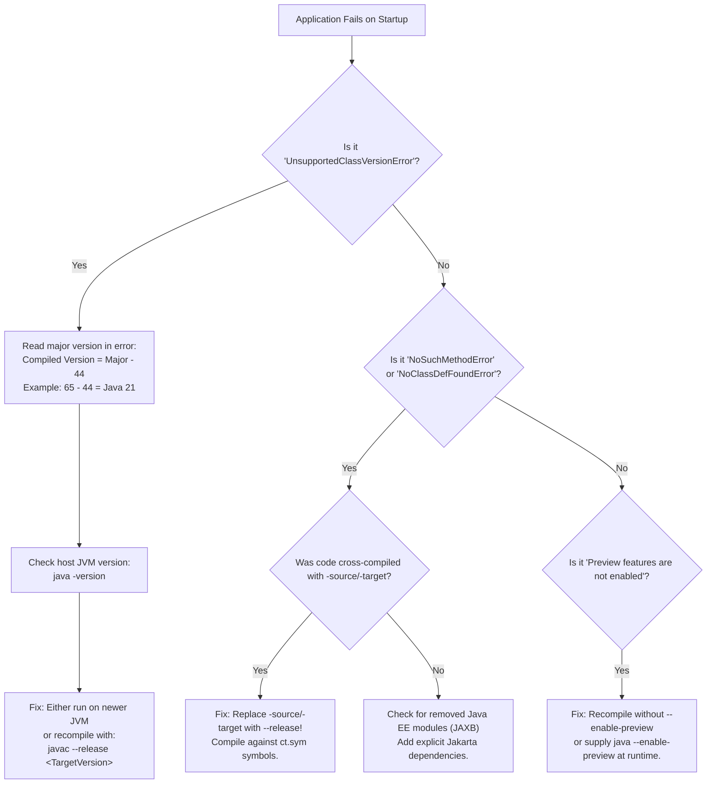

# JDK Versions, Release Cadence, LTS, and Bytecode Compatibility

---

## 1. Metadata and Learning Goals

- **Concept ID:** `P00-C008`
- **Concept Title:** JDK Versions, Release Cadence, LTS, and Bytecode Compatibility
- **Curriculum Phase:** Phase 00: Development Environment and Java Execution
- **Topic Category:** Java Platform Lifecycle and Binary Evolution
- **Suggested Importance:** Essential
- **Prerequisites:**
  - [`P00-C001`: JDK vs JRE vs JVM Architecture and Evolution](001-jdk-jre-jvm.md)
  - [`P00-C002`: Java Compiler (javac) vs Launcher (java) Workflow](002-javac-compiler-and-launcher.md)
  - [`P00-C003`: Source Files (.java) and Bytecode (.class) Disassembly](003-source-files-and-bytecode.md)
  - [`P00-C007`: Environment Variables: JAVA_HOME and PATH in Linux/Production](007-environment-variables-java-home-path.md)
- **Next Concept in Sequence:**
  - [`P00-C009`: IDEs vs Headless Terminal Development in Server Environments](009-ide-vs-terminal-development.md)
- **Concepts Covered:**
  - Time-driven 6-month release cadence (March and September schedule)
  - Long-Term Support (LTS) lifecycle vs non-LTS feature releases
  - Class file major and minor version numbers (from Java 1.1 `45.3` to Java 25 `69.0`)
  - The Asymmetric Compatibility Guarantee (Backward compatibility vs Forward incompatibility)
  - Binary root cause of `java.lang.UnsupportedClassVersionError`
  - The modern `--release N` compiler flag (JEP 247) and `lib/ct.sym`
  - The fatal flaw of legacy `-source N -target N` cross-compilation
  - Preview Features (JEP 12) and incubator modules (`--enable-preview`)
  - Certified OpenJDK distributions and TCK compliance (Temurin, Corretto, Zulu, Oracle)
  - Enterprise migration pathways (Java 8 -> 11 -> 17 -> 21)

### Measurable Learning Objectives
By completing this module, you will be able to:
1. **Explain the 6-month release train model** and determine which OpenJDK releases are safe for enterprise production deployments.
2. **Decode class file version headers** and mathematically map Java version numbers to bytecode major version identifiers ($Major = 44 + Version$).
3. **Prevent and diagnose `UnsupportedClassVersionError`** across heterogeneous deployment environments.
4. **Use `javac --release N` to safely cross-compile** for older runtime targets without risking runtime `NoSuchMethodError` exceptions.
5. **Configure Maven and Gradle build scripts** with Java toolchains and release targets to enforce deterministic enterprise bytecode.

---

## 2. Definition, Purpose, and Mental Model

### 2.1 Formal Definition
- **JDK Release Cadence:** A strict, time-driven engineering release schedule adopted by OpenJDK starting with Java 10. A new feature release of the Java platform is delivered every six months (in March and September), irrespective of whether any single planned feature is finished.
- **Long-Term Support (LTS):** Designated landmark releases (currently every two years: Java 17, 21, 25; previously Java 8 and 11) for which vendors (Adoptium, Amazon, Red Hat, Oracle, Azul) provide multi-year quarterly security updates, bug fixes, and critical patch updates (CPUs).
- **Bytecode Versioning:** A 4-byte header in every `.class` file consisting of a 2-byte minor version and a 2-byte major version that uniquely dictates the minimum JVM runtime specification required to load and execute that binary.

```text
+-----------------------------------------------------------------------------------------+
|                                MODERN OPENJDK RELEASE TRAIN                             |
|                                                                                         |
|   Mar 2021     Sep 2021     Mar 2022     Sep 2022     Mar 2023     Sep 2023     Mar 2024|
|   Java 16   -> Java 17   -> Java 18   -> Java 19   -> Java 20   -> Java 21   -> Java 22 |
|  (Feature)      (LTS)      (Feature)    (Feature)    (Feature)     (LTS)      (Feature) |
|   6 months     Support:     6 months     6 months     6 months    Support:     6 months |
|   support      5-10 yrs     support      support      support     5-10 yrs     support  |
+-----------------------------------------------------------------------------------------+
```

### 2.2 The Problem It Solves
Prior to Java 9, Java releases were **feature-driven** rather than time-driven. A release was published only when an enormous, monolithic feature set was complete. This caused devastating delays:
- Java 6 to Java 7 took **5 years** (2006 to 2011).
- Java 7 to Java 8 took **3 years** (2011 to 2014).
- Java 8 to Java 9 took **3.5 years** (2014 to late 2017) due to Project Jigsaw complexity.

If a developer's feature missed a release deadline, they had to wait up to five years for the next window. This stalled language modernization and made Java appear sluggish compared to rapidly evolving ecosystems.

The 6-month time-driven cadence solved this by shifting the paradigm from *"Hold the train until the cargo arrives"* to *"The train departs on schedule; cargo boards the next train if it is not ready"*.

### 2.3 Why Backend Engineers Need It
1. **Infrastructure Stability:** Deploying a non-LTS release (such as Java 19 or 20) into production means security support terminates after 6 months. If a zero-day vulnerability (CVE) is discovered in month 7, no security patch will be provided for that release. Enterprise backends must run on LTS versions.
2. **Ecosystem Minimum Baselines:** Major enterprise frameworks set strict minimum Java versions. For example, **Spring Boot 3.x and Spring Framework 6.x require Java 17 as an absolute baseline**. Attempting to run modern Spring Boot on Java 8 or 11 will fail to start.
3. **Cross-Compilation Hygiene:** Modern developer workstations may have JDK 21 installed, while production servers or client deployments might still run JDK 17 or 11. Without understanding bytecode compatibility and the `--release` flag, developers will build binaries locally that crash in production.

### 2.4 Mental Model: The Train Schedule and the Asymmetric Air-Lock
- **The 6-Month Train:** Imagine a commuter train leaving the station at precisely 9:00 AM and 3:00 PM every day. If a major feature (e.g., Virtual Threads or Structured Concurrency) is ready, it boards. If it needs more testing, the train leaves anyway, and the feature catches the next train.
- **The Asymmetric Air-Lock (Bytecode Compatibility):** Bytecode compatibility is a one-way air-lock. A newer JVM can always read and execute older bytecode (a Java 21 JVM happily executes Java 8 bytecode compiled in 2014). However, an older JVM flatly refuses to open bytecode manufactured by a newer compiler.

```
                    [Asymmetric Compatibility Rule]

+--------------------+      Loads Older Bytecode       +--------------------+
|  JDK 8 / 11 / 17   | <------------------------------ |       JDK 21       |
|    Compiled JAR    |                                 |     JVM Runtime    |
+--------------------+                                 +--------------------+
         ^                                                        |
         |                                                        |
         |              CANNOT Load Newer Bytecode                |
         +--------------------------------------------------------+
                       Throws: UnsupportedClassVersionError
```

### 2.5 What This Concept Is NOT
- **Not Semantic Versioning (SemVer):** The Java platform does not follow `MAJOR.MINOR.PATCH` in the traditional SemVer sense where breaking changes increment the major version. In Java, each 6-month release increments the version number by 1 (e.g., 20 $\to$ 21 $\to$ 22).
- **Not Immediate Feature Deprecation:** When an API is marked `@Deprecated(forRemoval = true)`, it is not removed immediately. It typically stays in the JDK for multiple releases to allow the industry to transition.

---

## 3. Foundations and Theory

### 3.1 The Long-Term Support (LTS) Cadence Shift
Initially (from Java 9 onwards), Oracle and OpenJDK established that an LTS release would occur every **three years** (Java 8 in 2014, Java 11 in 2018, Java 17 in 2021). 

However, during the release of Java 17 in September 2021, Oracle and the OpenJDK community proposed accelerating the LTS cycle from three years to **every two years**. This proposal was ratified, establishing the current cadence:

| LTS Release | General Availability (GA) | Typical Vendor Support Lifespan |
|---|---|---|
| **Java 8 (LTS)** | March 2014 | Extended support through at least December 2030 (Adoptium, Red Hat, Azul) |
| **Java 11 (LTS)** | September 2018 | Extended support through at least 2027 |
| **Java 17 (LTS)** | September 2021 | Extended support through at least 2029 |
| **Java 21 (LTS)** | September 2023 | Extended support through at least 2031 |
| **Java 25 (LTS)** | September 2025 (Projected) | Active next LTS milestone |

Non-LTS releases (e.g., Java 18, 19, 20, 22, 23, 24) are intended for experimentation, testing new features, and providing early feedback. **They are not recommended for production workloads with long maintenance windows.**

### 3.2 The Class File Version Table
As detailed in [`P00-C003`](003-source-files-and-bytecode.md), bytes 4–7 of any compiled `.class` file encode the minor and major version:

```text
Offset 0..3: 0xCAFEBABE (Magic Number)
Offset 4..5: Minor Version (2 bytes, big-endian)
Offset 6..7: Major Version (2 bytes, big-endian)
```

The mathematical formula connecting modern Java versions to their class file major version is:
$$\text{Major Version} = 44 + \text{Java Version} \quad (\text{for Java } \ge 7)$$

Here is the complete historical and modern version mapping reference:

| Java Platform Release | Class File Major Version (Decimal) | Class File Major Version (Hexadecimal) | LTS Status |
|---|---|---|---|
| JDK 1.1 | 45 | `0x002D` | Legacy |
| JDK 1.2 | 46 | `0x002E` | Legacy |
| JDK 1.3 | 47 | `0x002F` | Legacy |
| JDK 1.4 | 48 | `0x0030` | Legacy |
| Java SE 5.0 | 49 | `0x0031` | Legacy |
| Java SE 6 | 50 | `0x0032` | Legacy |
| Java SE 7 | 51 | `0x0033` | Legacy |
| **Java SE 8** | **52** | `0x0034` | **LTS** |
| Java SE 9 | 53 | `0x0035` | Feature |
| Java SE 10 | 54 | `0x0036` | Feature |
| **Java SE 11** | **55** | `0x0037` | **LTS** |
| Java SE 12 | 56 | `0x0038` | Feature |
| Java SE 13 | 57 | `0x0039` | Feature |
| Java SE 14 | 58 | `0x003A` | Feature |
| Java SE 15 | 59 | `0x003B` | Feature |
| Java SE 16 | 60 | `0x003C` | Feature |
| **Java SE 17** | **61** | `0x003D` | **LTS** |
| Java SE 18 | 62 | `0x003E` | Feature |
| Java SE 19 | 63 | `0x003F` | Feature |
| Java SE 20 | 64 | `0x0040` | Feature |
| **Java SE 21** | **65** | `0x0041` | **LTS** |
| Java SE 22 | 66 | `0x0042` | Feature |
| Java SE 23 | 67 | `0x0043` | Feature |
| Java SE 24 | 68 | `0x0044` | Feature |
| **Java SE 25** | **69** | `0x0045` | **LTS (Target)** |

### 3.3 Anatomy of `UnsupportedClassVersionError`
When a JVM attempts to load a `.class` file, the ClassLoader verifies the binary header during the `Linkage / Verification` phase. If `major_version > JVM_SUPPORTED_MAX`, the JVM aborts immediately:

```text
java.lang.UnsupportedClassVersionError: com/example/BackendService has been compiled 
by a more recent version of the Java Runtime (class file version 65.0), 
this version of the Java Runtime only recognizes class file versions up to 61.0
```

#### Decoding the Error Message:
- **`class file version 65.0`**: The class was compiled with JDK 21 ($65 - 44 = 21$).
- **`only recognizes class file versions up to 61.0`**: The running JVM is JDK 17 ($61 - 44 = 17$).
- **Root Cause**: You are attempting to run a Java 21 binary on an older Java 17 runtime!

### 3.4 The Fatal Flaw of `-source` / `-target` vs. JEP 247 (`--release`)
Before Java 9, developers cross-compiled for older Java runtimes using two flags:
```bash
# The OLD, DANGEROUS way:
javac -source 8 -target 8 MyClass.java
```

#### Why This Caused Catastrophic Production Failures:
1. `-source 8` told `javac` to restrict the Java language grammar to Java 8 rules (e.g., reject `var` or `record`).
2. `-target 8` told `javac` to write bytecode with Major Version 52.
3. **The Fatal Flaw:** The compiler still linked against the **host JDK's standard runtime library** (e.g., Java 11 or 17 `java.base`).

If your code invoked an API method that was added in Java 9 or 11 (such as `String.repeat()` or `List.of()`), the compiler saw the method in its host JDK and compiled successfully without warnings! The resulting `.class` file had major version `52` (Java 8), but inside its bytecode, it contained an instruction:
`invokestatic java/util/List.of:(Ljava/lang/Object;)Ljava/util/List;`

When deployed to an actual Java 8 production server:
1. The Java 8 JVM checked the header: Version `52.0` (Valid! It loads the class).
2. The JVM attempted to resolve the method `List.of()`.
3. Because `List.of()` did not exist in Java 8, the application crashed at runtime with:
   ```text
   java.lang.NoSuchMethodError: java.util.List.of(Ljava/lang/Object;)Ljava/util/List;
   ```

To solve this properly in the past, developers had to supply the `-bootclasspath` flag pointing to an actual physical `rt.jar` extracted from a real Java 8 JDK—which almost nobody did because it was painful to maintain.

#### The JEP 247 Solution: `--release N`
Starting in Java 9, [JEP 247](https://openjdk.org/jeps/247) introduced the `--release` flag. When you specify:
```bash
javac --release 8 MyClass.java
```
`javac` automatically:
1. Sets the source language level to 8.
2. Sets the bytecode target to 52.
3. **Restricts the platform APIs to the exact signatures that existed in Java 8!**

`javac` accomplishes this using a built-in symbol database bundled inside every JDK at `$JAVA_HOME/lib/ct.sym`. If you try to call `List.of()` while compiling with `--release 8`, `javac` fails **at compile-time** with:
`error: cannot find symbol: method of(String)`

```
+-----------------------------------------------------------------------------------------+
|                                 CROSS-COMPILATION COMPARISON                            |
|                                                                                         |
|  Legacy: javac -source 8 -target 8                                                      |
|    Syntax: Java 8 Checked  | Bytecode: 52 Generated | API: Uses Host JDK 21 rt/jmods!   |
|    Result: Silent runtime NoSuchMethodError in production!                              |
|                                                                                         |
|  Modern: javac --release 8 (JEP 247)                                                    |
|    Syntax: Java 8 Checked  | Bytecode: 52 Generated | API: Restricted via lib/ct.sym    |
|    Result: 100% Guaranteed compile-time safety and binary compatibility!                |
+-----------------------------------------------------------------------------------------+
```

### 3.5 Preview Features and Incubator Modules
To gather real-world developer feedback on language changes before committing to backwards-compatibility forever, OpenJDK uses **Preview Features** (governed by [JEP 12](https://openjdk.org/jeps/12)):

- **Preview Features:** Fully specified and implemented language or VM features that are not yet permanent parts of the Java SE Standard. They typically participate in two rounds of preview across consecutive releases (e.g., Records were previewed in Java 14 and 15, becoming permanent in 16; Virtual Threads were previewed in 19 and 20, becoming permanent in 21).
- **The Binary Safety Lock:** When code is compiled with `javac --enable-preview --release N`, `javac` writes a special minor version marker: **`0xFFFF` (65535)** into the `.class` file.
- The standard JVM launcher **refuses to run** any class file with minor version `0xFFFF` unless the operator explicitly passes `--enable-preview` at startup. This prevents unstable, experimental bytecode from silently leaking into production environments.

---

## 4. Syntax, API, and Command Reference

### 4.1 Master Compiler Version Flags

| Command / Flag | Purpose | Safety Level | Example |
|---|---|---|---|
| `javac --release N` | Compiles source code to target version $N$, enforcing both language syntax and API signature restrictions via `ct.sym`. | **High (Recommended)** | `javac --release 17 Service.java` |
| `javac -source N -target N` | Sets syntax and bytecode level without restricting standard library APIs. | **Unsafe (Do not use)** | `javac -source 11 -target 11 Service.java` |
| `javac --enable-preview --release N` | Enables experimental preview features for the specified Java release. Sets minor version `0xFFFF`. | **Development / Testing Only** | `javac --enable-preview --release 21 Test.java` |
| `java --enable-preview <Class>` | Allows the JVM to load and execute preview bytecode. | **Development / Testing Only** | `java --enable-preview Test` |
| `javap -v <Class>` | Prints verbose disassembly, including the exact major and minor version numbers. | Diagnostic Tool | `javap -v MyClass \| grep "major version"` |

### 4.2 Programmatic Runtime Version Inspection API (Java 9+)
Since Java 9 ([JEP 223](https://openjdk.org/jeps/223)), the Java Platform provides a structured, type-safe API to query the runtime version:

```java
import java.lang.Runtime.Version;

public class VersionChecker {
    public static void main(String[] args) {
        // Obtains the structured version of the running JVM
        Version version = Runtime.version();

        int feature = version.feature();   // e.g., 21
        int interim = version.interim();   // e.g., 0
        int update  = version.update();    // e.g., 12
        int patch   = version.patch();     // e.g., 1

        System.out.printf("Running Java %d.%d.%d.%d%n", feature, interim, update, patch);

        // Check if running on an LTS baseline (e.g., minimum Java 17)
        if (feature < 17) {
            throw new IllegalStateException("This backend requires Java 17 LTS or higher!");
        }
    }
}
```

### 4.3 Build Tool Enforcements

#### Maven Configuration (`pom.xml`):
Always enforce `--release` inside `maven-compiler-plugin`:

```xml
<project>
    <properties>
        <maven.compiler.release>21</maven.compiler.release>
    </properties>

    <build>
        <plugins>
            <plugin>
                <groupId>org.apache.maven.plugins</groupId>
                <artifactId>maven-compiler-plugin</artifactId>
                <version>3.13.0</version>
                <configuration>
                    <release>21</release>
                </configuration>
            </plugin>
        </plugins>
    </build>
</project>
```

#### Gradle Configuration (`build.gradle`):
Use Gradle Java Toolchains to decouple the build daemon from the compiled runtime:

```groovy
java {
    toolchain {
        languageVersion = JavaLanguageVersion.of(21)
    }
}

tasks.withType(JavaCompile).configureEach {
    options.release = 21
}
```

---

## 5. Runnable Examples and Demonstrations

### 5.1 Programmatic Class File Major Version Inspector
The following complete Java utility reads the raw binary header of any `.class` file on disk, extracts the magic number, minor version, and major version, and decodes the exact Java version required to run it:

```java
// File: ClassVersionInspector.java
import java.io.DataInputStream;
import java.io.FileInputStream;
import java.io.IOException;
import java.nio.file.Path;
import java.nio.file.Paths;

public class ClassVersionInspector {

    record ClassHeader(int magic, int minorVersion, int majorVersion, String javaVersionName, boolean isPreview) {}

    public static ClassHeader inspect(Path classFilePath) throws IOException {
        try (DataInputStream in = new DataInputStream(new FileInputStream(classFilePath.toFile()))) {
            int magic = in.readInt();
            if (magic != 0xCAFEBABE) {
                throw new IllegalArgumentException("File " + classFilePath + " is NOT a valid Java class file! Magic: 0x" + Integer.toHexString(magic));
            }

            int minor = in.readUnsignedShort();
            int major = in.readUnsignedShort();

            boolean isPreview = (minor == 0xFFFF);
            String javaName = decodeMajorVersion(major);

            return new ClassHeader(magic, minor, major, javaName, isPreview);
        }
    }

    private static String decodeMajorVersion(int major) {
        return switch (major) {
            case 45 -> "JDK 1.1";
            case 46 -> "JDK 1.2";
            case 47 -> "JDK 1.3";
            case 48 -> "JDK 1.4";
            case 49 -> "Java 5";
            case 50 -> "Java 6";
            case 51 -> "Java 7";
            case 52 -> "Java 8 (LTS)";
            case 53 -> "Java 9";
            case 54 -> "Java 10";
            case 55 -> "Java 11 (LTS)";
            case 56 -> "Java 12";
            case 57 -> "Java 13";
            case 58 -> "Java 14";
            case 59 -> "Java 15";
            case 60 -> "Java 16";
            case 61 -> "Java 17 (LTS)";
            case 62 -> "Java 18";
            case 63 -> "Java 19";
            case 64 -> "Java 20";
            case 65 -> "Java 21 (LTS)";
            case 66 -> "Java 22";
            case 67 -> "Java 23";
            case 68 -> "Java 24";
            case 69 -> "Java 25 (LTS Target)";
            default -> (major > 69) ? "Java " + (major - 44) + " (Future Version)" : "Unknown/Pre-release (" + major + ")";
        };
    }

    public static void main(String[] args) throws Exception {
        if (args.length == 0) {
            System.out.println("Usage: java ClassVersionInspector <path-to-class-file>");
            System.exit(1);
        }

        Path target = Paths.get(args[0]);
        ClassHeader header = inspect(target);

        System.out.println("==================================================================");
        System.out.println("               BYTECODE BINARY VERSION INSPECTION                 ");
        System.out.println("==================================================================");
        System.out.printf("  Target File      : %s%n", target.getFileName());
        System.out.printf("  Magic Identifier : 0x%X (0xCAFEBABE)%n", header.magic());
        System.out.printf("  Minor Version    : %d (0x%04X)%n", header.minorVersion(), header.minorVersion());
        System.out.printf("  Major Version    : %d (0x%04X)%n", header.majorVersion(), header.majorVersion());
        System.out.printf("  Target Platform  : %s%n", header.javaVersionName());
        System.out.printf("  Preview Feature  : %s%n", header.isPreview() ? "YES (Minor=65535, Requires --enable-preview)" : "NO (Standard Production Bytecode)");
        System.out.println("==================================================================");
    }
}
```

---

### 5.2 Demonstrating Cross-Compilation with `--release 17` on a Java 21 Compiler
Let's verify how a modern compiler targeting an older LTS produces the exact expected bytecode header:

```bash
# 1. Compile the inspector using the host Java 21 compiler
javac ClassVersionInspector.java

# 2. Author a simple target class
cat << 'EOF' > TargetService.java
public class TargetService {
    public static void main(String[] args) {
        System.out.println("Running target service.");
    }
}
EOF

# 3. Cross-compile TargetService specifically targeting Java 17
javac --release 17 TargetService.java

# 4. Inspect TargetService.class using our inspector
java ClassVersionInspector TargetService.class
```

#### Observed Output
```text
==================================================================
               BYTECODE BINARY VERSION INSPECTION                 
==================================================================
  Target File      : TargetService.class
  Magic Identifier : 0xCAFEBABE (0xCAFEBABE)
  Minor Version    : 0 (0x0000)
  Major Version    : 61 (0x003D)
  Target Platform  : Java 17 (LTS)
  Preview Feature  : NO (Standard Production Bytecode)
==================================================================
```
Notice that even though the compiler was OpenJDK 21, the generated bytecode major version is **61** (Java 17), making it 100% safe to deploy on a Java 17 production server!

---

### 5.3 Demonstrating Compile-Time API Guarding via `--release`
Let's see how `--release` prevents illegal API calls at compile time:

```java
// File: ModernApiTest.java
import java.util.List;

public class ModernApiTest {
    public static void main(String[] args) {
        // String.repeat() was introduced in Java 11
        // List.of() was introduced in Java 9
        List<String> items = List.of("Backend", "Engineering");
        String message = "Java ".repeat(3);
        System.out.println(items + " -> " + message);
    }
}
```

If we attempt to cross-compile this for Java 8 using `--release 8`:

```bash
javac --release 8 ModernApiTest.java
```

`javac` aborts with clear compile-time errors:
```text
ModernApiTest.java:7: error: cannot find symbol
        List<String> items = List.of("Backend", "Engineering");
                                 ^
  symbol:   method of(String,String)
  location: interface List
ModernApiTest.java:8: error: cannot find symbol
        String message = "Java ".repeat(3);
                                ^
  symbol:   method repeat(int)
  location: class String
2 errors
```

> [!TIP]
> **The Takeaway:** `--release` saved us from a disastrous production outage. Instead of producing a binary with major version 52 that would crash in production with `NoSuchMethodError`, the compiler caught the incompatibility before the code ever left the developer's machine!

---

## 6. Real-World Backend Application

### 6.1 Enterprise Migration Playbook: Upgrading from Java 8/11 to Java 17/21
Upgrading enterprise backend services across LTS releases involves well-defined engineering hurdles:

```text
+-------------------+      +--------------------+      +--------------------+
|      JAVA 8       | ---> |      JAVA 11       | ---> |     JAVA 17/21     |
+-------------------+      +--------------------+      +--------------------+
  • PermGen Removed          • Jigsaw Modules            • Strong Encapsulation
  • Compact Strings          • JAXB / JAX-WS removed       (Illegal reflective access
  • G1GC becomes default       from JDK standard library   blocked by default)
                             • TLS 1.3 default           • Spring Boot 3 Baseline
                                                         • Virtual Threads (Java 21)
```

#### Major Upgrade Roadblocks and Solutions:

1. **The Removal of Java EE Modules in Java 11:**
   - In Java 8, XML bindings (JAXB: `javax.xml.bind.*`) and Web Services (JAX-WS) were bundled inside the JDK runtime (`rt.jar`).
   - In Java 11, they were completely removed.
   - **Solution:** Add explicit Maven dependencies for standalone JAXB:
     ```xml
     <dependency>
         <groupId>jakarta.xml.bind</groupId>
         <artifactId>jakarta.xml.bind-api</artifactId>
         <version>4.0.2</version>
     </dependency>
     <dependency>
         <groupId>org.glassfish.jaxb</groupId>
         <artifactId>jaxb-runtime</artifactId>
         <version>4.0.5</version>
     </dependency>
     ```

2. **Strong Encapsulation of JDK Internals in Java 17 (JEP 403):**
   - In Java 8 and 11, libraries like Lombok, older Mockito, and legacy serialization frameworks used reflection to access private JDK internal fields (`sun.misc.Unsafe`, `java.lang.reflect.Field`).
   - In Java 17, deep reflection into JDK internal packages is forbidden by default. Attempting to do so throws:
     `java.lang.reflect.InaccessibleObjectException: Unable to make field accessible`.
   - **Solution:** Upgrade third-party dependencies to modern releases. If temporarily blocked by legacy libraries, open the internal packages using the `--add-opens` JVM flag:
     ```bash
     java --add-opens java.base/java.lang=ALL-UNNAMED -jar app.jar
     ```

3. **The Namespace Shift from `javax.*` to `jakarta.*` in Spring Boot 3:**
   - Spring Boot 3.x dropped Java 8 and 11 support, requiring Java 17+ and Jakarta EE 9/10.
   - All imports must be refactored: `import javax.persistence.*` $\to$ `import jakarta.persistence.*`, and `import javax.servlet.*` $\to$ `import jakarta.servlet.*`.

---

### 6.2 Certified OpenJDK Distributions and Vendor Selection
OpenJDK is an open-source reference implementation, but what runs in production is a certified binary distribution. The **Java Technology Compatibility Kit (TCK)** is an exhaustive test suite (over 100,000 tests) that verifies a vendor's distribution conforms to the Java SE specification.

```
+--------------------------+--------------------+-----------------------------------------------------+
| Vendor / Distribution    | TCK Certified?     | Typical Production Use Case                         |
+--------------------------+--------------------+-----------------------------------------------------+
| Eclipse Temurin          | Yes                | General-purpose cloud workloads, Docker base images |
| (Adoptium Foundation)    |                    | (Most widely used community standard).              |
+--------------------------+--------------------+-----------------------------------------------------+
| Amazon Corretto          | Yes                | AWS production deployments, Amazon Linux, ECS, EKS. |
|                          |                    | Free multi-platform LTS support.                    |
+--------------------------+--------------------+-----------------------------------------------------+
| Red Hat OpenJDK          | Yes                | Enterprise Linux (RHEL, OpenShift, CentOS).         |
|                          |                    | Industry-leading Linux enterprise integration.     |
+--------------------------+--------------------+-----------------------------------------------------+
| Azul Zulu                | Yes                | High-performance enterprise deployments, extensive  |
|                          |                    | legacy support architectures (ARM, PowerPC, x86).   |
+--------------------------+--------------------+-----------------------------------------------------+
| Oracle JDK               | Yes                | Commercial enterprise support contracts.            |
|                          |                    | Oracle "No-Fee Terms and Conditions" (NFTC).        |
+--------------------------+--------------------+-----------------------------------------------------+
```

> [!IMPORTANT]
> **Production Standard:** For containerized microservices running in Kubernetes, **Eclipse Temurin** (`eclipse-temurin:21-jre-jammy`) and **Amazon Corretto** (`public.ecr.aws/amazoncorretto/amazoncorretto:21`) are the two undisputed industry standards.

---

## 7. Design Choices, Alternatives, and Trade-Offs

### 7.1 LTS vs. Non-LTS Adoption Strategy in Enterprises

```
+-----------------------------------+-----------------------------------+
| Strategy: Strict LTS-Only         | Strategy: Fast-Follower (All)     |
+-----------------------------------+-----------------------------------+
| • Upgrade every 2 years           | • Upgrade every 6 months          |
| • Maximum stability & CVE patches | • Access new language features    |
| • Long vendor support windows     |   immediately                     |
| • Lower maintenance churn         | • Massive testing and upgrade     |
|                                   |   overhead every 6 months         |
| • Preferred by: Banks, Healthcare,| • Preferred by: High-speed tech   |
|   Telecommunications, SaaS        |   startups, R&D labs              |
+-----------------------------------+-----------------------------------+
```

---

## 8. Performance and Complexity

### 8.1 Performance Gains Between LTS Versions
Migrating across LTS versions yields substantial out-of-the-box performance and garbage collection enhancements without altering a single line of business code:

1. **Java 8 to Java 11:**
   - **Compact Strings:** In Java 8, strings used `char[]` (2 bytes per character). In Java 9+, strings use `byte[]` with a latin1/UTF-16 encoding flag, slashing heap consumption for text-heavy applications by 30–40%.
   - **G1GC Default:** The Garbage-First collector replaced Parallel GC, dramatically improving latency for multi-gigabyte heaps.
2. **Java 11 to Java 17:**
   - Massive G1GC latency improvements (parallelized phases, reduced pause times by up to 60%).
   - Introduction of **ZGC** and **Shenandoah** sub-millisecond low-latency collectors.
3. **Java 17 to Java 21:**
   - **Virtual Threads (Project Loom):** Lightweight concurrency capable of handling 1,000,000 concurrent network connections per JVM instance without exhausting OS thread limits.
   - **Generational ZGC:** Sub-millisecond pause times even on multi-terabyte heaps.

---

## 9. Security and Robustness

### 9.1 The OpenJDK Quarterly CPU (Critical Patch Update) Cycle
Security updates for active LTS releases follow a synchronized quarterly schedule across all certified vendors:
- **January, April, July, and October**

These releases deliver critical security vulnerability fixes (CVEs) without introducing breaking language changes. 

> [!CAUTION]
> **The Non-LTS CVE Abandonment Trap:**
> When Java 20 reached End-of-Life upon the release of Java 21 in September 2023, all vendor security patches for Java 20 ceased immediately. Any backend remaining on Java 20 became permanently vulnerable to all CVEs discovered after that date. **Never run non-LTS releases in environments handling customer data or financial transactions.**

---

## 10. Testing and Verification

### 10.1 Automated CI Pipeline Bytecode Version Guard
To ensure no developer accidentally commits code compiled against an unapproved JDK version, you can add an automated bytecode audit test to your build pipeline:

```java
// File: BytecodeComplianceTest.java
import org.junit.jupiter.api.DisplayName;
import org.junit.jupiter.api.Test;

import java.io.DataInputStream;
import java.io.File;
import java.io.FileInputStream;
import java.io.IOException;
import java.nio.file.*;
import java.util.stream.Stream;

import static org.junit.jupiter.api.Assertions.*;

public class BytecodeComplianceTest {

    // Target: We are targeting Java 17 LTS (Major Version 61)
    private static final int MAX_ALLOWED_MAJOR_VERSION = 61;

    @Test
    @DisplayName("Verify All Compiled Classes Adhere to Java 17 Bytecode (Major <= 61)")
    void testAllCompiledClassesBytecodeVersion() throws IOException {
        Path targetDir = Paths.get("target/classes");
        if (!Files.exists(targetDir)) {
            // If running without maven target, check current directory
            targetDir = Paths.get(".");
        }

        try (Stream<Path> stream = Files.walk(targetDir)) {
            stream.filter(p -> p.toString().endsWith(".class"))
                  .forEach(this::assertClassVersion);
        }
    }

    private void assertClassVersion(Path classFile) {
        try (DataInputStream in = new DataInputStream(new FileInputStream(classFile.toFile()))) {
            int magic = in.readInt();
            assertEquals(0xCAFEBABE, magic, "Must be valid class file: " + classFile);

            int minor = in.readUnsignedShort();
            int major = in.readUnsignedShort();

            assertTrue(major <= MAX_ALLOWED_MAJOR_VERSION,
                    String.format("Class %s has major version %d, which exceeds allowed maximum %d (Java 17)!",
                            classFile.getFileName(), major, MAX_ALLOWED_MAJOR_VERSION));

            assertNotEquals(0xFFFF, minor,
                    "Class " + classFile.getFileName() + " was compiled with preview features! Do not deploy to production.");
        } catch (IOException e) {
            fail("Failed to inspect class file: " + classFile + " -> " + e.getMessage());
        }
    }
}
```

---

## 11. Debugging and Failure Analysis

### 11.1 Diagnostic Flowchart: Version and Bytecode Errors



### 11.2 Top 5 Version-Related Production Failures

#### 1. The Container Runtime Mismatch (`65.0 vs 61.0`)
- **Symptom:** Docker container crashes instantly on Kubernetes startup with:
  `java.lang.UnsupportedClassVersionError: ... (class file version 65.0), this version of the Java Runtime only recognizes class file versions up to 61.0`.
- **Root Cause:** The application was built on a CI runner using JDK 21, but the runtime Docker image used `eclipse-temurin:17-jre-jammy`.
- **Solution:** Align the Docker base image: update the Dockerfile to `eclipse-temurin:21-jre-jammy`, or set `<release>17</release>` in Maven.

#### 2. The `NoSuchMethodError: java.nio.ByteBuffer.flip()` Trap
- **Symptom:** Code compiled on Java 9+ crashes on a Java 8 server with:
  `java.lang.NoSuchMethodError: java.nio.ByteBuffer.flip()Ljava/nio/ByteBuffer;`
- **Root Cause:** In Java 8, `ByteBuffer.flip()` returned `Buffer`. In Java 9, the method was overridden to return `ByteBuffer`. Compiling with `-target 8` on a Java 9+ compiler produced bytecode referencing the covariant return type `Ljava/nio/ByteBuffer;`, which did not exist on Java 8!
- **Solution:** Use `--release 8`.

#### 3. Accidental Preview Bytecode Leakage
- **Symptom:** `Error: LinkageError occurred while loading main class ... java.lang.UnsupportedClassVersionError: Preview features are not enabled for class ... (class file version 65.65535)`.
- **Root Cause:** A developer used experimental language syntax and built the production release with `--enable-preview`.
- **Solution:** Remove `--enable-preview` from build plugins before creating production releases.

#### 4. The Spring Boot 3 on Java 11 Failure
- **Symptom:** Upgrading to Spring Boot 3 causes Maven or Gradle to fail immediately on startup.
- **Root Cause:** Spring Boot 3 explicitly validates the compiler version and refuses to build on anything below Java 17.
- **Solution:** Upgrade your development and runtime environments to Java 17 LTS or Java 21 LTS.

#### 5. Broken CI/CD Matrix on GitHub Actions
- **Symptom:** Build passes on the developer's laptop but fails in GitHub Actions with compiler errors.
- **Root Cause:** Developer has Java 21 installed locally, while the CI action workflow specifies `java-version: '17'`.
- **Solution:** Enforce Java Toolchains in Gradle or Maven Enforcer Plugin to guarantee identical JDKs across local and CI environments.

---

## 12. Best Practices and Anti-Patterns

### 12.1 Industry Best Practices
- **Standardize on LTS Releases:** Deploy only LTS versions (Java 17 or Java 21) into enterprise production systems.
- **Always Use `--release` for Cross-Compilation:** Never use `-source` and `-target` without `--release`.
- **Pin Exact Docker Tag Digests in Production:** Use `eclipse-temurin:21.0.2_13-jre-jammy` rather than mutable tags like `latest` or `21`.
- **Use Gradle / Maven Toolchains:** Configure toolchains so the build tool automatically downloads and uses the exact required JDK, regardless of what is installed in the ambient `$PATH`.

### 12.2 Anti-Patterns to Avoid
- **Never Run Non-LTS Releases in Mission-Critical Systems:** Avoid deploying Java 18, 19, 20, 22, 23 to production.
- **Never Deploy Preview Bytecode (`0xFFFF`) to Production:** Experimental features are subject to syntax and semantic changes in future releases.
- **Never Ignore Class File Major Version Numbers:** Always know the bytecode version of your deliverables ($44 + Version$).
- **Never Rely on Local JDK Defaults in CI:** Explicitly configure `setup-java` in CI workflows.

---

## 13. Interview Preparation

### 13.1 Foundational Questions

#### Q1: What is the release cadence of the modern Java platform, and what is an LTS release?
**Answer:** Since Java 10, OpenJDK follows a time-driven 6-month release cadence, publishing a new feature release every March and September. An LTS (Long-Term Support) release is a designated version published every two years (previously three years) that receives multi-year commercial and community security updates, stability patches, and bug fixes. Java 8, 11, 17, and 21 are LTS releases; Java 25 is the next planned LTS. Non-LTS releases are supported for only six months and are not recommended for long-term production deployments.

#### Q2: What is the relationship between a Java version and its class file major version?
**Answer:** The first 4 bytes of a `.class` file contain the magic number `0xCAFEBABE`. Bytes 4–5 contain the minor version, and bytes 6–7 contain the major version. Starting with Java 7, the major version is calculated as $\text{Major} = 44 + \text{Java Version}$. For example, Java 8 is 52, Java 11 is 55, Java 17 is 61, and Java 21 is 65. If a JVM encounters a class file with a major version greater than what it supports, it throws `java.lang.UnsupportedClassVersionError`.

### 13.2 Production Scenario Questions

#### Q3: You deploy a compiled Spring Boot application to a server and it throws `UnsupportedClassVersionError: ... class file version 65.0, this version only recognizes up to 61.0`. What happened, and how do you resolve it?
**Answer:** The application was compiled with JDK 21 (Major Version 65), but the server runtime is running JDK 17 (which only recognizes up to Major Version 61). To resolve this, there are two choices:
1. Upgrade the server runtime environment to Java 21 LTS (the preferred solution).
2. If the server must remain on Java 17, recompile the application targeting Java 17 using `javac --release 17` or by setting `<release>17</release>` in Maven, provided the source code does not use features introduced in Java 18–21.

#### Q4: Why is `javac --release 11` preferred over `javac -source 11 -target 11` when building on a JDK 17 workstation?
**Answer:** While `-source 11 -target 11` generates class files with major version 55, the compiler still links against the host JDK 17 standard library (`java.base`). If the code accidentally calls an API introduced in Java 12–17, compilation will succeed, but the application will crash at runtime on a real Java 11 JVM with `NoSuchMethodError`. In contrast, `--release 11` (JEP 247) uses the bundled `lib/ct.sym` symbol database to restrict the available API signatures to exactly what existed in Java 11, catching signature incompatibilities at compile-time.

### 13.3 Lead & Principal Architect Questions

#### Q5: How do Preview Features work at the bytecode level, and why did OpenJDK introduce them?
**Answer:** Preview Features (JEP 12) allow the Java language designers to introduce fully realized language and VM features into standard releases to gather feedback from the developer community without committing to permanent backward compatibility. At the bytecode level, classes compiled with `--enable-preview` have their minor version set to `0xFFFF` (65535). Standard JVM runtimes refuse to load any class with minor version `65535` unless the JVM launcher is also passed `--enable-preview`. This architectural safety lock guarantees that experimental bytecode cannot be accidentally distributed as a standard production library.

---

## 14. Practice and Assessment

### Exercise 1: Beginner (Calculating Bytecode Versions)
For each of the following scenarios, calculate the exact decimal and hexadecimal class file major version:
1. A microservice compiled targeting Java 11.
2. A legacy system running on Java 8.
3. A modern backend compiled targeting Java 21.
4. A next-generation service compiled targeting Java 25.

### Exercise 2: Applied (Authoring a Maven POM with Release Guardrails)
Create a minimal `pom.xml` file that:
- Configures `maven-compiler-plugin` to target Java 21 using modern `--release`.
- Adds `maven-enforcer-plugin` to fail the build if the developer's host JDK is anything lower than OpenJDK 21.0.0.

### Exercise 3: Challenge (Bytecode Header Stripping Utility)
Write a standalone Java program `ClassVersionPatcher.java` that:
1. Opens an existing `.class` file.
2. Reads and displays the current major version.
3. Modifies the 2-byte major version in-place to target an older or newer version (for educational/testing purposes).
4. Demonstrates that altering the major version causes the JVM to throw `UnsupportedClassVersionError` or `ClassFormatError`.

---

### Hints
- *Exercise 1:* Use the formula $Major = 44 + N$. Convert to hex using standard base-16 arithmetic.
- *Exercise 2:* Look up `requireJavaVersion` in the Maven Enforcer Plugin.
- *Exercise 3:* Use `RandomAccessFile` in mode `"rw"` and seek to position 6 (`seek(6)`) to overwrite the 2-byte major version integer.

---

### Solutions Walkthrough

#### Exercise 1 Solution:
1. **Java 11:** Decimal $44 + 11 = \mathbf{55}$ | Hex: `0x0037`
2. **Java 8:** Decimal $44 + 8 = \mathbf{52}$ | Hex: `0x0034`
3. **Java 21:** Decimal $44 + 21 = \mathbf{65}$ | Hex: `0x0041`
4. **Java 25:** Decimal $44 + 25 = \mathbf{69}$ | Hex: `0x0045`

#### Exercise 2 Solution:
```xml
<project xmlns="http://maven.apache.org/POM/4.0.0"
         xmlns:xsi="http://www.w3.org/2001/XMLSchema-instance"
         xsi:schemaLocation="http://maven.apache.org/POM/4.0.0 
         http://maven.apache.org/xsd/maven-4.0.0.xsd">
    <modelVersion>4.0.0</modelVersion>

    <groupId>com.example</groupId>
    <artifactId>version-enforced-service</artifactId>
    <version>1.0.0</version>

    <properties>
        <maven.compiler.release>21</maven.compiler.release>
        <project.build.sourceEncoding>UTF-8</project.build.sourceEncoding>
    </properties>

    <build>
        <plugins>
            <!-- 1. Enforce Compilation with --release 21 -->
            <plugin>
                <groupId>org.apache.maven.plugins</groupId>
                <artifactId>maven-compiler-plugin</artifactId>
                <version>3.13.0</version>
                <configuration>
                    <release>21</release>
                </configuration>
            </plugin>

            <!-- 2. Enforce Host JDK 21+ -->
            <plugin>
                <groupId>org.apache.maven.plugins</groupId>
                <artifactId>maven-enforcer-plugin</artifactId>
                <version>3.4.1</version>
                <executions>
                    <execution>
                        <id>enforce-jdk-versions</id>
                        <goals><goal>enforce</goal></goals>
                        <configuration>
                            <rules>
                                <requireJavaVersion>
                                    <version>[21,)</version>
                                    <message>Compilation requires JDK 21 LTS or higher!</message>
                                </requireJavaVersion>
                            </rules>
                        </configuration>
                    </execution>
                </executions>
            </plugin>
        </plugins>
    </build>
</project>
```

#### Exercise 3 Solution:
```java
// File: ClassVersionPatcher.java
import java.io.RandomAccessFile;
import java.nio.file.Path;
import java.nio.file.Paths;

public class ClassVersionPatcher {
    public static void main(String[] args) throws Exception {
        if (args.length < 2) {
            System.out.println("Usage: java ClassVersionPatcher <class-file> <new-major-version>");
            return;
        }

        Path target = Paths.get(args[0]);
        short newMajor = Short.parseShort(args[1]);

        try (RandomAccessFile raf = new RandomAccessFile(target.toFile(), "rw")) {
            int magic = raf.readInt();
            if (magic != 0xCAFEBABE) {
                System.err.println("Not a valid class file!");
                return;
            }

            short oldMinor = raf.readShort();
            short oldMajor = raf.readShort();

            System.out.printf("Current Version: Major=%d, Minor=%d%n", oldMajor, oldMinor);

            // Seek to offset 6 (major version bytes)
            raf.seek(6);
            raf.writeShort(newMajor);

            System.out.printf("SUCCESS: Patched Major Version from %d to %d in %s%n",
                    oldMajor, newMajor, target.getFileName());
        }
    }
}
```

---

### Mastery Self-Assessment Checklist
- [ ] I can state the modern OpenJDK release schedule and differentiate LTS from feature releases.
- [ ] I can calculate the class file major version for any Java release ($Major = 44 + Version$).
- [ ] I understand the root cause and diagnostic procedure for `UnsupportedClassVersionError`.
- [ ] I can explain why `--release N` is fundamentally safer than `-source N -target N`.
- [ ] I know how `lib/ct.sym` enforces compile-time API restrictions during cross-compilation.
- [ ] I understand how Preview Features work and why their minor version is `0xFFFF`.
- [ ] I can evaluate OpenJDK distributions (Temurin, Corretto, Red Hat) for production use.
- [ ] I can configure Maven and Gradle to enforce deterministic bytecode versions.

---

## 15. Summary, Cheat Sheet, and Memory Aids

### Core Principles
1. **6-Month Cadence:** Releases arrive every March and September without exception.
2. **LTS Every 2 Years:** Java 17 (2021), Java 21 (2023), Java 25 (2025). Production systems must stick to LTS.
3. **Backward Compatible, Never Forward Compatible:** Newer JVMs run older bytecode; older JVMs fail on newer bytecode.
4. **Formula:** $\text{Major Version} = 44 + \text{Java Version}$ (e.g., $44 + 21 = 65$).
5. **Always `--release`:** Never use `-source` and `-target` without `--release`.
6. **Preview Lock:** Preview bytecode has minor version `65535` (`0xFFFF`) and will not run in standard production JVMs without `--enable-preview`.

### Quick Reference Table

```text
+---------------+---------------+---------------+---------------------------------------+
| Java Version  | Major Version | Release Date  | Production Support Horizon            |
+---------------+---------------+---------------+---------------------------------------+
| Java 8 (LTS)  | 52 (0x34)     | Mar 2014      | Extended Support through 2030+        |
| Java 11 (LTS) | 55 (0x37)     | Sep 2018      | Extended Support through 2027         |
| Java 17 (LTS) | 61 (0x3D)     | Sep 2021      | Extended Support through 2029+        |
| Java 21 (LTS) | 65 (0x41)     | Sep 2023      | Extended Support through 2031+        |
| Java 25 (LTS) | 69 (0x45)     | Sep 2025      | Next Target LTS                       |
+---------------+---------------+---------------+---------------------------------------+
```

---

## 16. Sources and Further Reading

### Primary Specifications & Authoritative Sources
- **JEP 223: New Version-String Scheme:** [OpenJDK JEP 223 Specification](https://openjdk.org/jeps/223)
- **JEP 247: Compile for Older Platform Versions (`--release`):** [OpenJDK JEP 247 Specification](https://openjdk.org/jeps/247)
- **JEP 12: Preview Features:** [OpenJDK JEP 12 Specification](https://openjdk.org/jeps/12)
- **The Java Virtual Machine Specification (Java SE 21 Edition):**
  - Section 4.1: The `ClassFile` Structure: [JVMS 21 §4.1](https://docs.oracle.com/javase/specs/jvms/se21/html/jvms-4.html#jvms-4.1)
- **Adoptium / Eclipse Temurin Support Roadmap:** [Adoptium Support Lifecycle](https://adoptium.net/support/)
- **Amazon Corretto Long-Term Support Schedule:** [Amazon Corretto FAQs](https://aws.amazon.com/corretto/faqs/)
