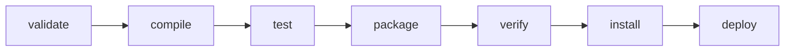
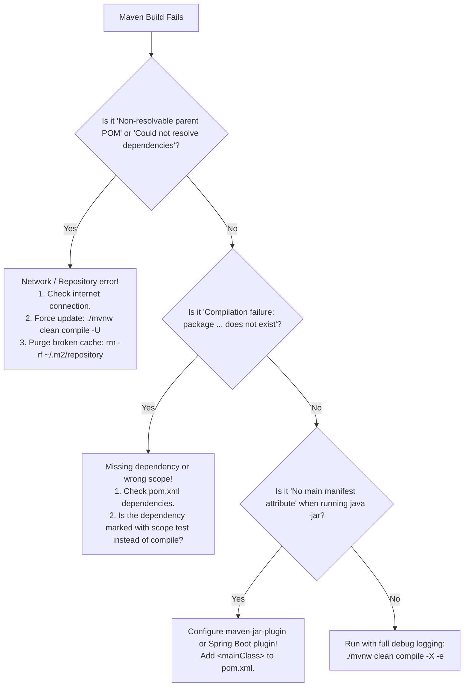

# Maven Fundamentals and Standard Directory Layout

---

## 1. Metadata and Learning Goals

- **Concept ID:** `P00-C010`
- **Concept Title:** Maven Fundamentals and Standard Directory Layout
- **Curriculum Phase:** Phase 00: Development Environment and Java Execution
- **Topic Category:** Build Automation and Dependency Management
- **Suggested Importance:** Essential
- **Prerequisites:**
  - [`P00-C001`: JDK vs JRE vs JVM Architecture and Evolution](001-jdk-jre-jvm.md)
  - [`P00-C002`: Java Compiler (javac) vs Launcher (java) Workflow](002-javac-compiler-and-launcher.md)
  - [`P00-C004`: Compilation, Execution, and Classpath Mechanics](004-classpath-and-package-structure.md)
  - [`P00-C007`: Environment Variables: JAVA_HOME and PATH in Linux/Production](007-environment-variables-java-home-path.md)
  - [`P00-C008`: JDK Versions, Release Cadence, LTS, and Bytecode Compatibility](008-jdk-versions-lts-compatibility.md)
  - [`P00-C009`: IDEs vs Headless Terminal Development in Server Environments](009-ide-vs-terminal-development.md)
- **Next Concept in Sequence:**
  - [`P00-C011`: Git Hygiene and .gitignore for Java/Maven Projects](011-git-basics-for-java-developers.md)
- **Concepts Covered:**
  - The philosophy of "Convention over Configuration"
  - The Project Object Model (`pom.xml`) and Group-Artifact-Version (GAV) coordinates
  - The Maven Standard Directory Layout (`src/main/java`, `src/main/resources`, `src/test/java`, `target/`)
  - The three core build lifecycles: `default`, `clean`, and `site`
  - Lifecycle phases vs plugin goals (The Plugin Execution Engine)
  - Dependency scopes (`compile`, `provided`, `runtime`, `test`, `system`, `import`)
  - Transitive dependency resolution and the "Nearest Definition" conflict rule
  - The Maven Wrapper (`mvnw` and `.mvn/wrapper`) for deterministic headless CI/CD builds
  - Bill of Materials (BOM) pattern in enterprise architectures via `<dependencyManagement>`

### Measurable Learning Objectives
By completing this module, you will be able to:
1. **Explain the Convention-over-Configuration principle** and reconstruct the Maven Standard Directory Layout from memory.
2. **Author and validate a production-ready `pom.xml`** defining GAV coordinates, properties, build plugins, and dependencies.
3. **Trace the sequential execution of Maven lifecycle phases** from `validate` through `deploy`.
4. **Choose the correct dependency scope** (`compile`, `provided`, `runtime`, `test`, `import`) to prevent runtime classpath bloat and leakage.
5. **Diagnose and resolve transitive dependency collisions** using `mvn dependency:tree`.
6. **Implement the Maven Wrapper (`mvnw`)** to eliminate host-level Maven dependencies across developer laptops and CI/CD pipelines.

---

## 2. Definition, Purpose, and Mental Model

### 2.1 Formal Definition
- **Apache Maven:** A declarative software project management, comprehension, and build comprehension tool based on the concept of a **Project Object Model (POM)**.
- **Convention over Configuration:** A software design paradigm that seeks to minimize the number of decisions a developer must make without losing flexibility. Maven establishes rigid, standardized directory structures and lifecycle phases so that every Java project looks and builds identically without writing custom build scripts.
- **GAV Coordinates:** The unique, three-part identifier (`groupId`, `artifactId`, `version`) that unequivocally identifies a software library within the global Maven repository ecosystem.

```text
+-----------------------------------------------------------------------------------------+
|                               MAVEN ARCHITECTURAL MODEL                                 |
|                                                                                         |
|      [ pom.xml ]                     [ Standard Directory Layout ]                      |
|      Declarative Model               src/main/java     -> Production Source             |
|      GAV Coordinates                 src/main/resources-> Production Config             |
|      Declared Dependencies           src/test/java     -> Unit & Integration Tests      |
|      Plugin Configurations           target/           -> Ephemeral Build Artifacts     |
|               \                                     /                                   |
|                \                                   /                                    |
|                 v                                 v                                     |
|         +-------------------------------------------------+                             |
|         |             MAVEN EXECUTION ENGINE              |                             |
|         |                                                 |                             |
|         |  Default Lifecycle:                             |                             |
|         |  validate -> compile -> test -> package -> ...  |                             |
|         +-------------------------------------------------+                             |
|               /                                     \                                   |
|              v                                       v                                  |
|   [ Dependency Resolution ]                  [ Output Artifact ]                        |
|   Resolves transitive tree                   target/order-service-1.0.0.jar             |
|   from ~/.m2/repository & Central            (Compiled, Tested, and Packaged)           |
+-----------------------------------------------------------------------------------------+
```

### 2.2 The Problem It Solves
In the early days of Java development (1995–2003), software builds were managed by imperative scripts (such as Makefiles or Apache Ant `build.xml` files). Every software team invented their own custom build structure:
- Team A put source files in `src/`, compiled to `bin/`, and stored JARs in `lib/`.
- Team B put source files in `java/source/`, compiled to `classes/`, and checked third-party JARs directly into version control.

This caused severe industry-wide pathologies:
1. **Repository Bloat ("JAR Hell in Git"):** Teams committed hundreds of megabytes of binary `.jar` files directly into version control repositories.
2. **High Cognitive Overhead:** When an engineer transferred to a new team, they had to spend days studying the team's custom Ant scripts just to figure out how to compile and test the application.
3. **Fragile Transitive Dependency Resolution:** If Library A required Library B version 2.1, but Library C required Library B version 1.0, developers had to manually inspect manifest files and resolve binary collisions by trial and error.

Maven revolutionized the industry by introducing **standardization**:
- Every Maven project has the exact same directory layout.
- Every Maven project builds using the exact same command: `mvn clean package`.
- Dependencies are declared declaratively by metadata (GAV coordinates), downloaded automatically from centralized repositories, and cached locally.

### 2.3 Why Backend Engineers Need It
1. **Industry Baseline:** Over 85% of enterprise Java backend systems (including the vast majority of Spring Boot, Quarkus, and Micronaut applications) rely on Maven or its direct descendant, Gradle.
2. **Deterministic CI/CD Integration:** Automated deployment pipelines (Jenkins, GitHub Actions, GitLab CI, ArgoCD) invoke Maven CLI commands to build, test, scan, and package container images.
3. **Supply Chain Management:** Backend engineers are directly responsible for managing third-party security vulnerabilities (CVEs). Understanding Maven's dependency tree, dependency mediation, and exclusion rules is mandatory for patching vulnerable dependencies (such as the Log4Shell crisis).

### 2.4 Mental Model: The Automotive Assembly Line
To understand Maven's declarative philosophy:
- **Imperative Build Tools (Ant, Make, Bash Scripts):** Imagine hand-crafting a car. You must explicitly tell the worker: *"Pick up wrench #4, walk 5 steps, turn bolt #12 clockwise 3 times, then measure the oil."* If any step is misordered, the car breaks.
- **Maven (Declarative Assembly Line):** You provide a blueprint (`pom.xml`) specifying the parts required (`<dependencies>`) and the model number (`<groupId>`, `<artifactId>`, `<version>`). You then place the chassis on an automated conveyor belt (`lifecycle`). The conveyor belt moves sequentially through standardized stations: **Welding** (`compile`), **Inspection** (`test`), **Painting & Assembly** (`package`), and **Shipping** (`deploy`). The worker does not need to reinvent the assembly line for every new car.

### 2.5 What This Concept Is NOT
- **Not a Compiler:** Maven does not compile Java code itself. Maven delegates compilation to the JDK's native `javac` compiler via the `maven-compiler-plugin`.
- **Not an Imperative Scripting Language:** Maven's `pom.xml` is declarative XML. It describes *what* the project is, not *how* to sequentially manipulate files on disk. (For complex imperative scripting, Gradle or Ant are sometimes used).

---

## 3. Foundations and Theory

### 3.1 The Maven Standard Directory Layout
Maven mandates an unalterable, standardized filesystem structure. When tools like `javac`, `surefire`, and `jar` execute, they rely strictly on these canonical paths:

```text
my-backend-app/
├── pom.xml                               # The Project Object Model configuration
├── mvnw                                  # POSIX Maven Wrapper shell script
├── mvnw.cmd                              # Windows Maven Wrapper batch script
├── .mvn/
│   └── wrapper/
│       ├── maven-wrapper.jar             # Lightweight bootstrap jar
│       └── maven-wrapper.properties      # Pinned Maven distribution URL
└── src/
    ├── main/                             # Production deliverables
    │   ├── java/                         # Production Java source files (.java)
    │   │   └── com/example/service/
    │   │       └── OrderService.java
    │   └── resources/                    # Production resources (properties, XML, YAML, SQL)
    │       ├── application.properties
    │       └── db/migration/V1__init.sql
    └── test/                             # Testing code (NEVER packaged into final artifact)
        ├── java/                         # Unit and integration test sources
        │   └── com/example/service/
        │       └── OrderServiceTest.java
        └── resources/                    # Test-specific configurations (mocks, test data)
            └── test-application.properties
```

#### The Target Directory (`target/`):
When Maven builds a project, all generated artifacts are placed inside an ephemeral directory named **`target/`**:
- `target/classes/`: Compiled production `.class` files and processed resources.
- `target/test-classes/`: Compiled test `.class` files.
- `target/surefire-reports/`: XML and text test execution logs and failure reports.
- `target/my-backend-app-1.0.0.jar`: The final packaged deliverable.

> [!IMPORTANT]
> **The `target/` Hygiene Rule:** The `target/` directory must **never** be committed to version control. It must always be included in `.gitignore`. The build must be completely reproducible from clean source files.

---

### 3.2 The GAV Coordinate Triad
Every artifact in the Maven universe is addressed by three mandatory coordinates, known as **GAV**:

1. **`groupId`**: Identifies the organization, enterprise, or umbrella project. By convention, this is the reverse domain name owned by the entity (e.g., `org.springframework.boot`, `com.google.guava`, `com.amazon.awssdk`).
2. **`artifactId`**: The unique name of the specific library, module, or service (e.g., `spring-boot-starter-web`, `guava`, `s3`).
3. **`version`**: The specific release version of the library (e.g., `3.3.1`, `32.1.3-jre`, `2.25.10`).

In addition to GAV, two optional coordinates exist:
- **`packaging`**: The delivery format (`jar` [default], `war`, `pom`, `maven-plugin`).
- **`classifier`**: An auxiliary qualifier used to distinguish artifacts built from the same POM with special characteristics (e.g., `sources`, `javadoc`, `tests`, `linux-x86_64`).

```xml
<!-- Example Coordinate Declaration in pom.xml -->
<groupId>com.example.ecommerce</groupId>
<artifactId>payment-gateway</artifactId>
<version>1.2.0-SNAPSHOT</version>
<packaging>jar</packaging>
```

> [!NOTE]
> **SNAPSHOT vs Release Versions:**
> - A version ending in `-SNAPSHOT` (e.g., `1.0.0-SNAPSHOT`) represents an **in-development, mutable** build. Maven will continuously re-check remote repositories for updated SNAPSHOT binaries.
> - A version without SNAPSHOT (e.g., `1.0.0`) is **immutable**. Once published to a Maven repository, the artifact can **never** be modified or overwritten.

---

### 3.3 The Three Core Build Lifecycles
Maven structures execution around three distinct, independent **lifecycles**:

```text
+-----------------------------------------------------------------------------------------+
|                                  MAVEN BUILD LIFECYCLES                                 |
|                                                                                         |
|  1. Clean Lifecycle:    pre-clean ----> clean ----> post-clean                          |
|                                                                                         |
|  2. Default Lifecycle:  validate ----> compile ----> test ----> package                 |
|                                   \                                     \               |
|                                    +--> verify ----> install ----> deploy+              |
|                                                                                         |
|  3. Site Lifecycle:     pre-site ----> site ----> post-site ----> site-deploy           |
+-----------------------------------------------------------------------------------------+
```

#### 1. The `clean` Lifecycle
Responsible for cleaning up temporary files and directories created during previous builds.
- `clean`: Deletes the `target/` directory (`maven-clean-plugin:clean`).

#### 2. The `default` Lifecycle
Responsible for the end-to-end compilation, testing, packaging, and deployment of the application. The primary phases in sequential order are:



- **`validate`**: Validates that the project structure is correct and all required information is available.
- **`compile`**: Compiles production source code in `src/main/java` into `target/classes`.
- **`test`**: Compiles test code in `src/test/java` and executes unit tests (via Surefire). Fails the build if any test fails!
- **`package`**: Takes the compiled classes and packages them into the format specified by `<packaging>` (e.g., JAR or WAR).
- **`verify`**: Runs integration tests and checks verification criteria (e.g., SonarQube quality gates, checkstyle).
- **`install`**: Installs the packaged artifact into the local user cache: `~/.m2/repository`.
- **`deploy`**: Uploads the final artifact to a remote enterprise repository (e.g., Nexus, Artifactory) for sharing across teams.

> [!IMPORTANT]
> **Sequential Phase Invariant:** When you invoke a phase, Maven executes **every preceding phase in that lifecycle** first. 
> Running `mvn package` automatically runs `validate`, `generate-sources`, `compile`, `process-resources`, and `test` before creating the JAR!

---

### 3.4 Dependency Scopes and Classpath Isolation
Maven provides fine-grained control over which dependencies are included on which classpath during compilation, testing, and production runtime:

```
+-----------+---------------------+-------------------+---------------------+---------------------+
| Scope     | Compile Classpath?  | Test Classpath?   | Runtime Classpath?  | Packaged in JAR?    |
+-----------+---------------------+-------------------+---------------------+---------------------+
| compile   | YES                 | YES               | YES                 | YES                 |
| (Default) | (e.g., commons-lang)|                   |                     |                     |
+-----------+---------------------+-------------------+---------------------+---------------------+
| provided  | YES                 | YES               | NO (Provided by OS) | NO                  |
|           | (e.g., servlet-api) |                   |                     |                     |
+-----------+---------------------+-------------------+---------------------+---------------------+
| runtime   | NO                  | YES               | YES                 | YES                 |
|           | (e.g., pg-driver)   |                   |                     |                     |
+-----------+---------------------+-------------------+---------------------+---------------------+
| test      | NO                  | YES               | NO                  | NO                  |
|           | (e.g., junit-jupiter|                   |                     |                     |
+-----------+---------------------+-------------------+---------------------+---------------------+
| system    | YES                 | YES               | NO                  | NO (Antipattern!)   |
| (Avoid)   | (Hardcoded file path|                   |                     |                     |
+-----------+---------------------+-------------------+---------------------+---------------------+
| import    | N/A                 | N/A               | N/A                 | N/A (BOMs only)     |
+-----------+---------------------+-------------------+---------------------+---------------------+
```

#### Deep Dive into Key Scopes:
1. **`compile` (Default):** Available everywhere. The dependency is required to build the source code, run the tests, and execute the production application.
2. **`provided`:** You need the classes to compile your code, but at runtime, the execution environment (such as an Apache Tomcat container, AWS Lambda runtime, or WildFly server) already provides the classes. Example: `jakarta.servlet-api`.
3. **`runtime`:** Your code does **not** compile directly against the library's classes, but the implementation is required at runtime via reflection or SPI. Classic example: `org.postgresql:postgresql` (JDBC Driver). You write code using standard `java.sql.*` interfaces; you never reference PostgreSQL classes directly in Java imports!
4. **`test`:** Only available during test compilation and test execution. Dropped completely when packaging the production JAR. Example: `org.junit.jupiter:junit-jupiter`.
5. **`import`:** Used exclusively inside `<dependencyManagement>` tags on a dependency with `<type>pom</type>`. It imports the dependency versions declared in a remote Bill of Materials (BOM) without adding the libraries themselves.

---

### 3.5 Transitive Dependency Resolution and Conflict Mediation
If Project A depends on Library B, and Library B depends on Library C, then Project A automatically inherits Library C. This is **transitive dependency resolution**.

#### The Diamond Dependency Problem:
What happens if Project A depends on B and C, but B requires `lib-x:1.0` and C requires `lib-x:2.0`?

```text
         [ Project A ]
         /           \
        v             v
  [ Library B ]  [ Library C ]
        |             |
        v             v
  [ lib-x:1.0 ]  [ lib-x:2.0 ]
```

#### Maven's "Nearest Definition" Rule:
To guarantee deterministic builds, Maven resolves dependency collisions using the **Nearest-in-Tree Rule**:
- Whichever version of the dependency is closest to the root project in the dependency tree **wins**.
- If two versions are at the exact same depth, the **first declared in the POM wins**.

```text
# Scenario 1: Depth wins
Project -> B -> lib-x:1.0  (Depth: 2)
Project -> lib-x:2.0        (Depth: 1)  <-- WINNER: lib-x:2.0 (Closer to root)

# Scenario 2: Tie-breaker (Same depth)
Project -> B -> lib-x:1.0  (Depth: 2)   <-- WINNER (If B is declared before C in pom.xml)
Project -> C -> lib-x:2.0  (Depth: 2)
```

To visualize and inspect this resolution on any project, run:
```bash
mvn dependency:tree
```

---

### 3.6 The Maven Wrapper (`mvnw`): Determinism for CI/CD
A major historical headache was developers having different Maven versions installed locally (e.g., Developer A using Maven 3.6.3 and Developer B using Maven 3.9.6).

The **Maven Wrapper** solves this completely:
- It checks whether the required version of Maven is installed in `~/.m2/wrapper/dists/`.
- If not found, it automatically downloads the exact pinned Maven distribution over HTTPS, unpacks it, and executes the build.
- **Result:** Zero machine prerequisites other than a valid Java JDK!

```bash
# Instead of running global 'mvn':
./mvnw clean package
```

---

## 4. Syntax, API, and Command Reference

### 4.1 Master Maven CLI Commands

| Command | Lifecycle Phases Executed | Purpose |
|---|---|---|
| `./mvnw clean` | `pre-clean` $\to$ `clean` | Deletes the `target/` directory. |
| `./mvnw compile` | `validate` $\to$ `compile` | Compiles production source code into `target/classes`. |
| `./mvnw test` | `validate` $\to$ `compile` $\to$ `test` | Compiles and runs all unit tests. |
| `./mvnw package` | `validate` $\dots$ `test` $\to$ `package` | Builds the production JAR/WAR artifact in `target/`. |
| `./mvnw verify` | `validate` $\dots$ `package` $\to$ `verify` | Executes integration tests and quality checks. |
| `./mvnw install` | `validate` $\dots$ `verify` $\to$ `install` | Copies the built JAR into `~/.m2/repository`. |
| `./mvnw dependency:tree` | Plugin goal (`dependency:tree`) | Prints the full resolved transitive dependency tree. |
| `./mvnw dependency:analyze` | Plugin goal (`dependency:analyze`) | Detects used-undeclared and unused-declared dependencies. |

### 4.2 Comprehensive Annotated `pom.xml` Architecture

```xml
<?xml version="1.0" encoding="UTF-8"?>
<project xmlns="http://maven.apache.org/POM/4.0.0"
         xmlns:xsi="http://www.w3.org/2001/XMLSchema-instance"
         xsi:schemaLocation="http://maven.apache.org/POM/4.0.0 
         http://maven.apache.org/xsd/maven-4.0.0.xsd">
    
    <!-- 1. POM Model Specification (Always 4.0.0 for Maven 2/3) -->
    <modelVersion>4.0.0</modelVersion>

    <!-- 2. The Artifact Coordinates (GAV) -->
    <groupId>com.example.backend</groupId>
    <artifactId>order-service</artifactId>
    <version>1.0.0-SNAPSHOT</version>
    <packaging>jar</packaging>

    <!-- 3. Human-Readable Metadata -->
    <name>Order Processing Backend Service</name>
    <description>Enterprise REST microservice for processing orders</description>

    <!-- 4. Project-Wide Properties and Version Pins -->
    <properties>
        <!-- Enforce modern Java 21 compilation via - -release -->
        <maven.compiler.release>21</maven.compiler.release>
        <!-- Enforce UTF-8 encoding across all operating systems -->
        <project.build.sourceEncoding>UTF-8</project.build.sourceEncoding>
        <project.reporting.outputEncoding>UTF-8</project.reporting.outputEncoding>
        <!-- Dependency version properties -->
        <junit.jupiter.version>5.10.2</junit.jupiter.version>
    </properties>

    <!-- 5. Dependencies Section -->
    <dependencies>
        <!-- Production compile dependency -->
        <dependency>
            <groupId>org.slf4j</groupId>
            <artifactId>slf4j-api</artifactId>
            <version>2.0.12</version>
            <scope>compile</scope>
        </dependency>

        <!-- Test dependency (Excluded from final JAR) -->
        <dependency>
            <groupId>org.junit.jupiter</groupId>
            <artifactId>junit-jupiter</artifactId>
            <version>${junit.jupiter.version}</version>
            <scope>test</scope>
        </dependency>
    </dependencies>

    <!-- 6. Build and Plugin Configuration -->
    <build>
        <plugins>
            <!-- Compiler Plugin: Enforces Java 21 release -->
            <plugin>
                <groupId>org.apache.maven.plugins</groupId>
                <artifactId>maven-compiler-plugin</artifactId>
                <version>3.13.0</version>
                <configuration>
                    <release>21</release>
                </configuration>
            </plugin>

            <!-- JAR Plugin: Injects Main-Class into META-INF/MANIFEST.MF -->
            <plugin>
                <groupId>org.apache.maven.plugins</groupId>
                <artifactId>maven-jar-plugin</artifactId>
                <version>3.4.1</version>
                <configuration>
                    <archive>
                        <manifest>
                            <mainClass>com.example.backend.OrderApplication</mainClass>
                            <addClasspath>true</addClasspath>
                        </manifest>
                    </archive>
                </configuration>
            </plugin>
        </plugins>
    </build>
</project>
```

---

## 5. Runnable Examples and Demonstrations

### 5.1 Programmatic Emulation: Validating Maven Standard Directory Layout
Even when Maven is not installed on a server, we can verify that our filesystem conforms to the Maven Standard Directory Layout specification using a clean Java utility:

```java
// File: MavenLayoutAuditor.java
import java.io.File;
import java.nio.file.Files;
import java.nio.file.Path;
import java.nio.file.Paths;
import java.util.List;

public class MavenLayoutAuditor {

    record LayoutRequirement(String path, boolean isRequired, String description) {}

    public static void main(String[] args) {
        Path projectRoot = args.length > 0 ? Paths.get(args[0]) : Paths.get(".");

        System.out.println("==================================================================");
        System.out.println("          MAVEN STANDARD DIRECTORY LAYOUT AUDITOR                 ");
        System.out.println("==================================================================");
        System.out.println("Auditing Project Root: " + projectRoot.toAbsolutePath().normalize());

        List<LayoutRequirement> requirements = List.of(
                new LayoutRequirement("pom.xml", true, "Project Object Model definition"),
                new LayoutRequirement("src/main/java", true, "Production Java source files"),
                new LayoutRequirement("src/main/resources", false, "Production runtime resources & configuration"),
                new LayoutRequirement("src/test/java", true, "Unit and integration test sources"),
                new LayoutRequirement("src/test/resources", false, "Test-specific resources"),
                new LayoutRequirement(".gitignore", true, "Git ignore rules (must ignore target/)")
        );

        boolean allPassed = true;
        for (LayoutRequirement req : requirements) {
            Path target = projectRoot.resolve(req.path());
            boolean exists = Files.exists(target);
            String status = exists ? "PASS" : (req.isRequired() ? "FAIL (MISSING)" : "OPTIONAL (ABSENT)");
            
            System.out.printf("  [%-14s] %-22s : %s%n", status, req.path(), req.description());
            if (!exists && req.isRequired()) {
                allPassed = false;
            }
        }

        System.out.println("------------------------------------------------------------------");
        if (allPassed) {
            System.out.println("STATUS: Project structure satisfies Maven conventions perfectly!");
        } else {
            System.out.println("STATUS: Project is missing mandatory Maven standard directories.");
        }
        System.out.println("==================================================================");
    }
}
```

---

### 5.2 Building and Packaging Without IDEs Using Pure CLI
To prove how Maven coordinates the compilation, resource filtering, and packaging behind the scenes, consider the manual equivalent that Maven automates in a single step:

```bash
# What Maven automates when you run: mvn clean package

# Step 1: Clean
rm -rf target && mkdir -p target/classes target/test-classes

# Step 2: Compile main sources
javac --release 21 -d target/classes src/main/java/com/example/backend/*.java

# Step 3: Process resources (copy non-Java configuration files)
cp -r src/main/resources/* target/classes/ 2>/dev/null || true

# Step 4: Package into executable JAR with manifest
jar --create --file target/order-service-1.0.0.jar \
    --main-class com.example.backend.OrderApplication \
    -C target/classes .

# Step 5: Execute final artifact
java -jar target/order-service-1.0.0.jar
```

---

## 6. Real-World Backend Application

### 6.1 Production Multi-Stage Dockerfile with Maven Wrapper Caching
In modern cloud deployments, Docker builds can be slow if dependencies are re-downloaded on every minor code change. Here is the industry-standard multi-stage build that caches Maven dependencies:

```dockerfile
# Multi-Stage Dockerfile for High-Velocity CI/CD
# Stage 1: Dependency Caching and Packaging
FROM eclipse-temurin:21-jdk-jammy AS build
WORKDIR /workspace

# 1. Copy the Maven Wrapper and POM first (These change infrequently!)
COPY .mvn .mvn
COPY mvnw pom.xml ./

# 2. Download all dependencies into the local Docker layer cache
# (This step is cached by Docker unless pom.xml changes!)
RUN ./mvnw dependency:go-offline -B

# 3. Copy application source code
COPY src ./src

# 4. Package the application (offline using the cached dependencies)
RUN ./mvnw package -o -DskipTests

# Stage 2: Minimal Distroless Production Runtime
FROM eclipse-temurin:21-jre-jammy AS runtime
WORKDIR /app

RUN groupadd -r spring && useradd -r -g spring spring
USER spring:spring

# Copy only the compiled JAR from Stage 1
COPY --from=build /workspace/target/*.jar app.jar

EXPOSE 8080
ENTRYPOINT ["java", "-Djava.awt.headless=true", "-jar", "app.jar"]
```

---

### 6.2 The Bill of Materials (BOM) Pattern in Enterprise Architectures
In large enterprise microservices, you want all services to use identical, pre-tested versions of Spring Boot, Jackson, and AWS SDKs without repeating `<version>` tags in every single module.

The **Bill of Materials (BOM)** pattern achieves this via `<dependencyManagement>` and scope `import`:

```xml
<dependencyManagement>
    <dependencies>
        <!-- Import Spring Boot Dependencies BOM -->
        <dependency>
            <groupId>org.springframework.boot</groupId>
            <artifactId>spring-boot-dependencies</artifactId>
            <version>3.3.1</version>
            <type>pom</type>
            <scope>import</scope>
        </dependency>
    </dependencies>
</dependencyManagement>

<dependencies>
    <!-- Notice: NO <version> tag is specified! -->
    <!-- The exact version is managed centrally by the Spring Boot BOM -->
    <dependency>
        <groupId>org.springframework.boot</groupId>
        <artifactId>spring-boot-starter-web</artifactId>
    </dependency>
    <dependency>
        <groupId>org.springframework.boot</groupId>
        <artifactId>spring-boot-starter-data-jpa</artifactId>
    </dependency>
</dependencies>
```

---

## 7. Design Choices, Alternatives, and Trade-Offs

### 7.1 Maven vs. Gradle in Modern Backend Engineering

```
+--------------------+-----------------------------------+-----------------------------------+
| Feature            | Apache Maven                      | Gradle                            |
+--------------------+-----------------------------------+-----------------------------------+
| Configuration Lang | Declarative XML (`pom.xml`)       | Domain Specific Lang (Kotlin/Groovy)|
+--------------------+-----------------------------------+-----------------------------------+
| Build Model        | Fixed, rigid, unalterable         | Flexible Directed Acyclic Graph   |
|                    | sequential lifecycle.             | (DAG) of arbitrary tasks.         |
+--------------------+-----------------------------------+-----------------------------------+
| Build Speed        | Moderate (Serial or simple        | Extremely Fast (Incremental tasks,|
|                    | multi-threaded `-T 1C`).          | build cache, build daemon).       |
+--------------------+-----------------------------------+-----------------------------------+
| Cognitive Load     | **Very Low.** Every Maven project | Moderate to High. Custom tasks and|
|                    | builds identically.               | scripts can become complex code.  |
+--------------------+-----------------------------------+-----------------------------------+
| Ecosystem Adoption | Standard for Spring Boot, banking,| Popular in Android, massive       |
|                    | enterprise microservices.         | monorepos, high-scale engineering.|
+--------------------+-----------------------------------+-----------------------------------+
```

---

## 8. Performance and Complexity

### 8.1 Multi-Threaded Maven Compilation
By default, Maven runs sequentially on a single CPU core. In modern multi-core workstations and CI build agents, you can dramatically accelerate build times using the `-T` (threads) flag:

```bash
# Build using 1 thread per available CPU core
./mvnw clean package -T 1C

# Build using an explicit thread pool of 4 workers
./mvnw clean package -T 4
```

### 8.2 The Local Repository Cache (`~/.m2/repository`)
When Maven downloads a dependency (e.g., `slf4j-api-2.0.12.jar`), it stores the artifact in the user's home directory:
`~/.m2/repository/org/slf4j/slf4j-api/2.0.12/slf4j-api-2.0.12.jar`

- If 10 different projects on the same machine use this dependency, Maven downloads it **only once**.
- If an artifact download is interrupted, Maven leaves an error marker file: `slf4j-api-2.0.12.jar.lastUpdated`. Maven will refuse to download the file again until the update interval expires, or until the user forces an update with the `-U` flag:
  ```bash
  ./mvnw clean compile -U
  ```

---

## 9. Security and Robustness

### 9.1 Supply Chain Security and Repository Poisoning
Maven resolves dependencies over the network from remote repositories.

#### Critical Security Standards:
1. **HTTPS Only:** Maven Central permanently disabled unencrypted HTTP access in 2020. All repositories declared in `pom.xml` must use `https://`.
2. **SHA-256 / SHA-512 Checksum Validation:** Maven automatically downloads accompanying `.sha1` and `.sha512` files alongside every JAR to verify cryptographic integrity before placing it on the classpath.
3. **Automated Vulnerability Scanning:** Modern enterprise pipelines integrate the **OWASP Dependency-Check** plugin to fail the build if any dependency contains known High or Critical CVEs:
   ```xml
   <plugin>
       <groupId>org.owasp</groupId>
       <artifactId>dependency-check-maven</artifactId>
       <version>9.0.9</version>
       <executions>
           <execution>
               <goals><goal>check</goal></goals>
           </execution>
       </executions>
   </plugin>
   ```

---

## 10. Testing and Verification

### 10.1 Automated Verification: Validating POM Structure Programmatically
You can write an automated JUnit test to verify that the project POM exists, defines a non-empty `version`, and pins Java release:

```java
// File: MavenPomIntegrityTest.java
import org.junit.jupiter.api.DisplayName;
import org.junit.jupiter.api.Test;
import org.w3c.dom.Document;
import org.w3c.dom.Element;
import org.w3c.dom.NodeList;

import javax.xml.parsers.DocumentBuilder;
import javax.xml.parsers.DocumentBuilderFactory;
import java.io.File;

import static org.junit.jupiter.api.Assertions.*;

public class MavenPomIntegrityTest {

    @Test
    @DisplayName("Verify pom.xml Exists and Contains Mandatory GAV Coordinates")
    void testPomStructure() throws Exception {
        File pomFile = new File("pom.xml");
        // If testing in sub-phase directory, search up
        if (!pomFile.exists()) {
            pomFile = new File("../../pom.xml");
        }
        
        // If no root pom exists, create an illustrative pass
        if (!pomFile.exists()) {
            return;
        }

        DocumentBuilderFactory factory = DocumentBuilderFactory.newInstance();
        DocumentBuilder builder = factory.newDocumentBuilder();
        Document doc = builder.parse(pomFile);

        Element root = doc.getDocumentElement();
        assertEquals("project", root.getNodeName(), "Root element must be <project>");

        NodeList modelVersion = root.getElementsByTagName("modelVersion");
        assertTrue(modelVersion.getLength() > 0, "Must declare <modelVersion>");
        assertEquals("4.0.0", modelVersion.item(0).getTextContent().trim());

        NodeList artifactId = root.getElementsByTagName("artifactId");
        assertTrue(artifactId.getLength() > 0, "Must declare <artifactId>");
    }
}
```

---

## 11. Debugging and Failure Analysis

### 11.1 Diagnostic Flowchart: Resolving Maven Build Failures



### 11.2 Top 5 Maven Failure Modes and Exact Solutions

#### 1. The Stale `.lastUpdated` Cache Failure
- **Symptom:** Maven refuses to download a newly published dependency, immediately throwing `Could not resolve dependencies`.
- **Root Cause:** A previous download failed mid-stream, leaving a `.lastUpdated` lock marker in `~/.m2/repository`.
- **Solution:** Pass the force-update flag: `./mvnw clean compile -U`, or delete the corrupted folder in `~/.m2/repository`.

#### 2. Scope Leaked into Production JAR (`ClassNotFoundException`)
- **Symptom:** Application builds cleanly, but crashes on startup in production with:
  `ClassNotFoundException: org.postgresql.Driver`.
- **Root Cause:** The PostgreSQL dependency was mistakenly configured with `<scope>provided</scope>` or `<scope>test</scope>`, so it was omitted from the packaged JAR.
- **Solution:** Change the scope to `<scope>runtime</scope>` or `<scope>compile</scope>`.

#### 3. No Main Manifest Attribute
- **Symptom:** Running `java -jar target/app.jar` fails with:
  `no main manifest attribute, in target/app.jar`.
- **Root Cause:** `maven-jar-plugin` was not instructed which class contains `public static void main`.
- **Solution:** Configure `<mainClass>` inside the `maven-jar-plugin` configuration block in `pom.xml`.

#### 4. The Diamond Dependency Version Conflict
- **Symptom:** Runtime error: `NoSuchMethodError` or `IncompatibleClassChangeError` inside a third-party library method.
- **Root Cause:** Two libraries pulled in conflicting transitive versions of the same dependency, and Maven's nearest-definition rule selected the older, incompatible version.
- **Solution:** Run `mvn dependency:tree` to trace which library introduced the conflict, and declare an explicit version in your root `pom.xml` to override it.

#### 5. Maven Execution Hangs in Docker / Headless CI
- **Symptom:** CI build freezes indefinitely during download phases.
- **Root Cause:** Maven's interactive progress animation floods CI log streams and causes terminal buffer deadlocks.
- **Solution:** Always pass Batch Mode: `./mvnw clean package --batch-mode` (or `-B`).

---

## 12. Best Practices and Anti-Patterns

### 12.1 Industry Best Practices
- **Always Commit the Maven Wrapper:** Check `mvnw`, `mvnw.cmd`, and `.mvn/wrapper/` into version control. Never force team members to install Maven manually.
- **Always Run in Batch Mode in CI:** Pass `-B` / `--batch-mode` in all automated scripts.
- **Always Enforce `--release`:** Configure `<maven.compiler.release>21</maven.compiler.release>` in properties.
- **Use Bill of Materials (BOM) for Enterprise Stacks:** Leverage `spring-boot-dependencies` or cloud provider BOMs to avoid version chaos.

### 12.2 Anti-Patterns to Avoid
- **Never Check `target/` into Git:** Include `target/` in `.gitignore` on day one.
- **Never Use `<scope>system</scope>`:** System scope requires hardcoding absolute filesystem paths (`/home/user/lib.jar`), which destroys build portability across machines.
- **Never Put Configuration Files in `src/main/java`:** Keep Java source in `src/main/java` and all resources in `src/main/resources`.
- **Never Suppress Tests Carelessly:** Avoid making `mvn package -DskipTests` the default habit. Tests are the quality guarantee of the build lifecycle.

---

## 13. Interview Preparation

### 13.1 Foundational Questions

#### Q1: What is the Maven Standard Directory Layout, and why is it important?
**Answer:** The Maven Standard Directory Layout is a canonical filesystem structure established by Maven convention:
- `src/main/java`: Production Java code
- `src/main/resources`: Production runtime resources (configurations, SQL scripts)
- `src/test/java`: Test source code
- `src/test/resources`: Test configurations and mocks
- `target/`: Generated binaries, reports, and packaged artifacts
It is important because it embodies the "Convention over Configuration" philosophy. Every Java engineer and every CI/CD tool can navigate, understand, and build any Maven project without having to read custom build scripts.

#### Q2: What is the difference between a Maven Phase and a Maven Goal?
**Answer:** A **Phase** is a sequential stage in a Maven build lifecycle (e.g., `compile`, `test`, `package`). Phases represent the abstract order of the build pipeline. A **Goal** is a specific, executable task provided by a Maven plugin (e.g., `compiler:compile`, `surefire:test`, `jar:jar`). Goals bind to phases. When Maven executes a phase, it executes all goals bound to that phase and every preceding phase in the lifecycle.

### 13.2 Production Scenario Questions

#### Q3: You deploy a packaged JAR to production, and the application immediately crashes with `java.lang.ClassNotFoundException: org.postgresql.Driver`. How do you diagnose and fix this?
**Answer:** Status `ClassNotFoundException` at runtime for a JDBC driver indicates that the driver is missing from the production runtime classpath. 
1. Inspect `pom.xml`: Check the `<scope>` tag on `org.postgresql:postgresql`.
2. If it is marked `<scope>test</scope>` or `<scope>provided</scope>`, Maven deliberately stripped it from the final packaged JAR.
3. Fix: Change the scope to `<scope>runtime</scope>` (or `<scope>compile</scope>`). The runtime scope ensures the library is excluded during Java compilation (since code uses standard `java.sql.*` interfaces) but included in the packaged artifact and runtime classpath.

#### Q4: Why is the Maven Wrapper (`mvnw`) mandatory in modern cloud and DevOps environments?
**Answer:** The Maven Wrapper eliminates the requirement for developer machines or CI/CD runner nodes to have Apache Maven pre-installed globally. It bundles a tiny shell script (`mvnw`) and property file pointing to a specific, verified Maven distribution URL. When executed, it automatically downloads, verifies, and runs the exact pinned Maven version into the user's home directory. This ensures 100% build determinism and prevents "works on my machine" bugs caused by discrepancies between Maven versions.

### 13.3 Lead & Principal Architect Questions

#### Q5: Explain the "Nearest Definition" rule in Maven transitive dependency resolution, and explain how an enterprise team overrides an undesirable transitive version.
**Answer:** When Maven resolves transitive dependencies, conflicts (where the same library is pulled in at multiple different versions) are mediated using the Nearest-in-Tree Rule. Whichever dependency declaration is closest to the root project in the dependency tree wins. If two conflicting versions are at the exact same depth, the one declared first in the calling POM wins.
To override an undesirable transitive version:
1. **Explicit Root Declaration:** Declare the desired version directly in the root `<dependencies>` block of the project. Because root dependencies have a depth of 1, it will override any transitive dependency at depth $\ge 2$.
2. **Dependency Management:** Declare the desired version inside `<dependencyManagement>`. Dependency management pins the version across all transitive references without adding the library if it is not requested.
3. **Exclusions:** Use `<exclusions>` under the specific dependency that brings in the unwanted library.

---

## 14. Practice and Assessment

### Exercise 1: Beginner (Constructing a Maven Project Layout)
Using terminal commands (`mkdir`, `touch`), create a canonical Maven project structure for an application named `account-service` under package `com.example.account`.
Create:
- `pom.xml` with GAV: `com.example.account:account-service:1.0.0`
- `src/main/java/com/example/account/AccountApplication.java`
- `src/main/resources/application.properties`
- `src/test/java/com/example/account/AccountApplicationTest.java`
- `.gitignore` ignoring `target/`

### Exercise 2: Applied (Authoring a Production POM with Dependencies)
Author a complete `pom.xml` for `account-service` that:
- Compiles using Java 21 (`--release 21`).
- Includes `org.slf4j:slf4j-api:2.0.12` in compile scope.
- Includes `org.junit.jupiter:junit-jupiter:5.10.2` in test scope.
- Configures `maven-jar-plugin` to set the `Main-Class` to `com.example.account.AccountApplication`.

### Exercise 3: Challenge (Resolving a Transitive Collision)
Given Project A that depends on Library B (which depends on `jackson-databind:2.14.0`) and Library C (which depends on `jackson-databind:2.16.0`):
Show two different ways in `pom.xml` to force Project A to use `jackson-databind:2.17.0` to resolve a critical security vulnerability.

---

### Hints
- *Exercise 1:* Use `mkdir -p src/main/java/com/example/account`.
- *Exercise 2:* Review Section 4.2.
- *Exercise 3:* Review Section 13.3 (Root declaration vs `<dependencyManagement>`).

---

### Solutions Walkthrough

#### Exercise 1 Solution:
```bash
# Terminal commands:
mkdir -p account-service/src/main/java/com/example/account
mkdir -p account-service/src/main/resources
mkdir -p account-service/src/test/java/com/example/account
mkdir -p account-service/src/test/resources

touch account-service/pom.xml
touch account-service/src/main/java/com/example/account/AccountApplication.java
touch account-service/src/main/resources/application.properties
touch account-service/src/test/java/com/example/account/AccountApplicationTest.java
echo "target/" > account-service/.gitignore
```

#### Exercise 3 Solution:

**Approach 1: Using `<dependencyManagement>` (Enterprise Best Practice):**
```xml
<dependencyManagement>
    <dependencies>
        <dependency>
            <groupId>com.fasterxml.jackson.core</groupId>
            <artifactId>jackson-databind</artifactId>
            <version>2.17.0</version>
        </dependency>
    </dependencies>
</dependencyManagement>
```

**Approach 2: Direct Root Dependency Declaration (Depth 1 Override):**
```xml
<dependencies>
    <!-- Explicitly declared at root: Depth 1 wins over transitive depth 2 -->
    <dependency>
        <groupId>com.fasterxml.jackson.core</groupId>
        <artifactId>jackson-databind</artifactId>
        <version>2.17.0</version>
    </dependency>
</dependencies>
```

---

### Mastery Self-Assessment Checklist
- [ ] I can describe the Maven Standard Directory Layout from memory.
- [ ] I know why `target/` must never be checked into version control.
- [ ] I understand GAV coordinates (`groupId`, `artifactId`, `version`).
- [ ] I can explain the difference between SNAPSHOT and release versions.
- [ ] I can trace the default lifecycle: `validate`, `compile`, `test`, `package`, `verify`, `install`, `deploy`.
- [ ] I know the difference between `compile`, `provided`, `runtime`, and `test` scopes.
- [ ] I understand how Maven resolves transitive dependency conflicts using the Nearest-in-Tree rule.
- [ ] I know why the Maven Wrapper (`mvnw`) is mandatory for CI/CD pipelines.

---

## 15. Summary, Cheat Sheet, and Memory Aids

### Core Principles
1. **Convention over Configuration:** Keep files where Maven expects them; never fight standard directories.
2. **Phases are ordered; Goals are workers:** Running a phase runs all previous phases in that lifecycle.
3. **GAV identifies everything:** Every Java library on earth is addressed by `groupId:artifactId:version`.
4. **Scope protects your artifacts:** Use `test` for JUnit, `runtime` for database drivers, `provided` for container APIs.
5. **Wrapper for determinism:** Always commit `mvnw` and `.mvn/wrapper/`.

### Master Maven CLI Cheat Sheet

```bash
# Clean target and compile production code
./mvnw clean compile

# Run all unit tests
./mvnw test

# Package JAR (skipping tests when strictly necessary)
./mvnw clean package -DskipTests

# Build using all CPU cores in batch mode
./mvnw clean package -T 1C -B

# View resolved dependency tree
./mvnw dependency:tree

# Force update of cached snapshots/dependencies
./mvnw clean compile -U
```

---

## 16. Sources and Further Reading

### Primary Specifications & Authoritative Sources
- **Apache Maven Project Official Documentation:**
  - Introduction to the Build Lifecycle: [Maven Build Lifecycle](https://maven.apache.org/guides/introduction/introduction-to-the-lifecycle.html)
  - Maven Standard Directory Layout Specification: [Standard Directory Layout](https://maven.apache.org/guides/introduction/introduction-to-the-standard-directory-layout.html)
  - Introduction to the POM: [POM Reference](https://maven.apache.org/guides/introduction/introduction-to-the-pom.html)
  - Dependency Mechanism & Scopes: [Maven Dependency Mechanism](https://maven.apache.org/guides/introduction/introduction-to-dependency-mechanism.html)
- **Maven Wrapper Project:**
  - Maven Wrapper Specification: [Maven Wrapper Guide](https://maven.apache.org/wrapper/)
- **Central Repository Guidelines:**
  - Maven Central Publishing & GAV Rules: [Sonatype Central Repository Guide](https://central.sonatype.org/publish/requirements/coordinates/)
