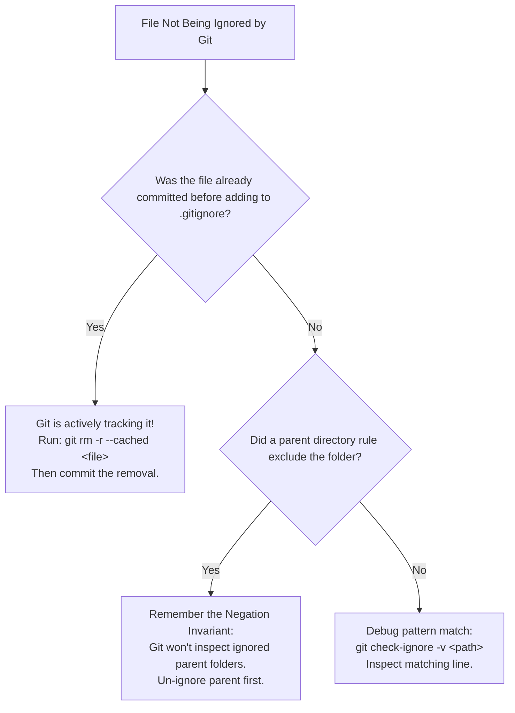

# Git Hygiene and .gitignore for Java/Maven Projects

---

## 1. Metadata and Learning Goals

- **Concept ID:** `P00-C011`
- **Concept Title:** Git Hygiene and .gitignore for Java/Maven Projects
- **Curriculum Phase:** Phase 00: Development Environment and Java Execution
- **Topic Category:** Version Control, Repository Hygiene, and Engineering Standards
- **Suggested Importance:** Essential
- **Prerequisites:**
  - [`P00-C001`: JDK vs JRE vs JVM Architecture and Evolution](001-jdk-jre-jvm.md)
  - [`P00-C002`: Java Compiler (javac) vs Launcher (java) Workflow](002-javac-compiler-and-launcher.md)
  - [`P00-C003`: Source Files (.java) and Bytecode (.class) Disassembly](003-source-files-and-bytecode.md)
  - [`P00-C010`: Maven Fundamentals and Standard Directory Layout](010-maven-fundamentals-project-structure.md)
- **Next Concept in Sequence:**
  - Phase 00 Completion Gate & Capstone Assessment
  - [`P01-C001`: Primitive Types: byte, short, int, long](../phase-01-java-language-fundamentals/012-primitive-types-integers.md)
- **Concepts Covered:**
  - The Git object model: Blobs, Trees, Commits, and why binary files ruin repository performance
  - The comprehensive Java/Maven `.gitignore` specification
  - The Maven Wrapper `.gitignore` exception pattern (`!.mvn/wrapper/maven-wrapper.jar`)
  - Staging area mechanics and index hygiene (`git status`, `git add`, `git diff --staged`)
  - Untracking previously committed build artifacts (`git rm --cached`)
  - The Conventional Commits specification for enterprise Java systems
  - Cross-platform line-ending hygiene (`.gitattributes` and `core.autocrlf`)
  - Pre-commit verification hooks for Java compilation and credential leaks
  - Emergency remediation for accidentally committed secrets

### Measurable Learning Objectives
By completing this module, you will be able to:
1. **Explain the mechanical consequences** of committing binary build artifacts (`.class`, `.jar`, `target/`) to a Git repository.
2. **Author a bulletproof enterprise `.gitignore`** covering Maven build outputs, IDE metadata, OS clutter, crash dumps, and secrets.
3. **Correctly implement the Maven Wrapper tracking exception** so that `mvnw` works in fresh CI clones.
4. **Untrack accidentally committed files from Git history** without deleting physical files from the local filesystem.
5. **Write structured Conventional Commit messages** to enable automated semantic versioning and changelog generation.
6. **Configure `.gitattributes` to prevent CRLF line-ending corruption** across Windows, macOS, and Linux team members.

---

## 2. Definition, Purpose, and Mental Model

### 2.1 Formal Definition
- **Git Repository Hygiene:** The disciplined practice of maintaining a clean, deterministic, and secure version control history by strictly tracking **only human-authored source blueprints** and excluding all ephemeral build outputs, personal workstation metadata, binary dependencies, and sensitive credentials.
- **`.gitignore` File:** A plain-text configuration file located in the root (or subdirectories) of a Git repository that instructs the Git engine to ignore specific untracked files and patterns when determining repository status.
- **Conventional Commits:** A formal specification for commit messages that provides an explicit lightweight convention on top of commit messages, enabling human readability and automated tooling integration.

```text
+-----------------------------------------------------------------------------------------+
|                                  THE GIT HYGIENE BOUNDARY                               |
|                                                                                         |
|   [ TRACKED IN GIT ]                                  [ EXCLUDED VIA .gitignore ]       |
|   Human-Authored Blueprints                           Machine-Generated Ephemera        |
|   -------------------------------------------------   -------------------------------   |
|   • Java Source Code (src/main/java)                  • Compiled Bytecode (*.class)     |
|   • Standard Configurations (src/main/resources)      • Build Directories (target/)     |
|   • Automated Unit Tests (src/test/java)              • IDE Metadata (.idea/, *.iml)    |
|   • Declarative POM Model (pom.xml)                   • OS Junk (.DS_Store, Thumbs.db)  |
|   • Repository Scripts (mvnw, mvnw.cmd)               • Secrets (*.pem, .env)           |
|   • Wrapper Properties (.mvn/wrapper/*)               • JVM Crash Dumps (hs_err_pid*.log|
+-----------------------------------------------------------------------------------------+
```

### 2.2 The Problem It Solves
When inexperienced developers work with Java and Git, they frequently execute `git add .` without a proper `.gitignore` file. This commits everything on their machine into Git:
1. **Repository Bloat ("The 2 GB Clone"):** Compiled `.class` files, JARs, and `target/` folders are binary files. When code is edited and recompiled, the entire binary changes. Git cannot compute line-by-line diffs on binary data, so it stores a completely new copy of every compiled file on every single commit. Within months, a repository that contains 5 MB of Java code grows into a 2 GB repository that takes 20 minutes to clone on CI runners.
2. **Unresolvable Merge Conflicts:** Two developers building the same project will generate different bytecode timestamps and manifest files in `target/`. When they attempt to merge branches, Git reports binary merge conflicts that cannot be resolved with text editors.
3. **Workstation Cross-Contamination:** Developer A commits their Windows IntelliJ configuration (`.idea/workspace.xml` with hardcoded Windows paths like `C:\Users\Alice\...`). Developer B on macOS pulls the branch, and their IntelliJ immediately crashes or resets their project settings.
4. **Security Catastrophes:** Developers accidentally commit `application-secret.properties`, private SSH keys, or cloud credentials. Once pushed to GitHub or GitLab, bots scrape the credentials within seconds, leading to security breaches.

Proper Git hygiene solves all of these problems at the root.

### 2.3 Why Backend Engineers Need It
1. **CI/CD Build Velocity:** Clean repositories clone in seconds (`git clone --depth=1`), minimizing container startup latency and reducing cloud CI bills.
2. **Deterministic Team Collaboration:** When you switch branches or pull updates from teammates, only genuine source code changes. You never have your IDE project settings silently overwritten.
3. **Compliance and Auditing:** Enterprise security standards (SOC 2, ISO 27001, PCI-DSS) mandate that code repositories contain zero hardcoded secrets and maintain clean, auditable commit histories.

### 2.4 Mental Model: The Cleanroom Laboratory
Imagine a high-precision pharmaceutical cleanroom:
- **Inside the cleanroom:** Scientists work exclusively with sterile chemical formulas, raw active ingredients, and clean blueprints (**Tracked in Git: `.java`, `pom.xml`**).
- **The waste chute:** Sawdust, cardboard packaging, protective gloves, and chemical byproducts are immediately discarded into a hazardous waste chute (**Excluded in `.gitignore`: `target/`, `*.class`, `*.log`**).
- If a scientist were to box up all the dirty gloves and trash and store them in the permanent document vault alongside the formulas, the vault would quickly fill with garbage and become unusable. That is what committing `target/` does to Git.

### 2.5 What This Concept Is NOT
- **Not a Replacement for Vault or KMS:** Putting a password file in `.gitignore` does not mean secrets are securely managed; it only ensures they are not committed to Git. Enterprise applications must inject secrets dynamically via environment variables, HashiCorp Vault, AWS Secrets Manager, or Kubernetes Secrets.
- **Not File Deletion:** Adding a file to `.gitignore` does **not** delete the file from your physical disk. It only tells Git to stop tracking it.

---

## 3. Foundations and Theory

### 3.1 The Git Object Model: Why Binaries Destroy Git Repositories
To understand why committing compiled `.class` or `.jar` files is destructive, we must look at how Git stores data internally inside `.git/objects/`:

```text
+-----------------------------------------------------------------------------+
|                             GIT OBJECT ARCHITECTURE                         |
|                                                                             |
|      [ Commit Object ]                                                      |
|      Author: Backend Dev                                                    |
|      Tree: 7a9f...  -----------------------+                                |
|                                             |                               |
|                                             v                               |
|                                      [ Tree Object ]                        |
|                                      100644 blob 3b1a... OrderService.java  |
|                                      100644 blob 9f4c... OrderService.class |
|                                             |                      |        |
|                       +---------------------+                      |        |
|                       v                                            v        |
|               [ Text Blob ]                                [ Binary Blob ]  |
|               OrderService.java                            OrderService.class|
|               (Compressed Text)                            (Compressed Bytecode)
+-----------------------------------------------------------------------------+
```

#### How Git Compresses Text vs. Binaries:
- When you edit a 100-line Java source file (`OrderService.java`) by changing 1 line:
  - Git creates a new blob for the file.
  - During `git gc` (packfile generation), Git uses **directed delta compression**. It notices that version 2 is 99% identical to version 1 and stores only the 1-line text difference! The repository size grows by a few dozen bytes.
- When you recompile `OrderService.java` into `OrderService.class`:
  - Every single byte of the `.class` file can change due to constant pool re-indexing, bytecode offsets, and compilation timestamps.
  - Furthermore, JAR files are already compressed ZIP archives. **Compressed data has maximum entropy and cannot be delta-compressed!**
  - Git is forced to store the entire new binary file in full.
  - If 5 developers build a 20 MB application 10 times a day, the `.git` directory absorbs:
    $$5 \text{ devs} \times 10 \text{ builds} \times 20 \text{ MB} = \mathbf{1,000\text{ MB (1 GB) per day!}}$$

---

### 3.2 The `.gitignore` Pattern Matching Engine
Git interprets `.gitignore` rules using standard globbing syntax evaluated against relative file paths:

```text
+---------------------+---------------------------------------------------------------+
| Pattern Syntax      | Matching Behavior                                             |
+---------------------+---------------------------------------------------------------+
| `target/`           | Matches any directory named `target` at any depth.            |
| `/target/`          | Matches ONLY the `target` directory located at project root.  |
| `*.class`           | Matches all files ending with `.class` anywhere in repo.      |
| `build/**/cache`    | Matches any path starting with `build/` and ending in `cache`.|
| `!filename`         | Negation: Re-includes a previously excluded pattern.          |
+---------------------+---------------------------------------------------------------+
```

#### The Critical Negation Invariant (The Wrapper Trap):
> [!CAUTION]
> **The Git Negation Invariant:**
> Git will **never** inspect the contents of a directory that has already been excluded by a parent directory rule.
> If your `.gitignore` contains:
> ```gitignore
> .mvn/
> !.mvn/wrapper/maven-wrapper.jar
> ```
> Git ignores the entire `.mvn/` directory immediately. It **will not** traverse into `.mvn/wrapper/` to evaluate the negation rule!
> To re-include a file inside an ignored folder, you must un-ignore every parent directory along the path:
> ```gitignore
> # The CORRECT pattern:
> *.jar
> !.mvn/wrapper/maven-wrapper.jar
> ```

---

### 3.3 The Canonical Java & Maven `.gitignore` Architecture
Here is the industry-standard `.gitignore` specification used across enterprise Java backend projects:

```gitignore
# ==============================================================================
# CANONICAL ENTERPRISE JAVA & MAVEN .gitignore SPECIFICATION
# ==============================================================================

# ------------------------------------------------------------------------------
# 1. Compiled Bytecode and Binary Artifacts
# ------------------------------------------------------------------------------
*.class
*.war
*.ear
*.nar
*.zip
*.tar.gz
*.rar

# ------------------------------------------------------------------------------
# 2. Build Tool Output Directories
# ------------------------------------------------------------------------------
# Maven build directory
target/
pom.xml.tag
pom.xml.releaseBackup
pom.xml.versionsBackup
pom.xml.next
release.properties
dependency-reduced-pom.xml
buildNumber.properties
.mvn/timing.properties

# Gradle build output (in case multi-build tools coexist)
.gradle/
build/

# ------------------------------------------------------------------------------
# 3. Maven Wrapper Invariant (CRITICAL)
# ------------------------------------------------------------------------------
# Ignore all JAR files by default...
*.jar
# ...BUT EXPLICITLY TRACK the Maven Wrapper bootstrap JAR!
!.mvn/wrapper/maven-wrapper.jar

# ------------------------------------------------------------------------------
# 4. JVM Crash Logs and Diagnostics
# ------------------------------------------------------------------------------
hs_err_pid*
replay_pid*
*.hprof
*.dump

# ------------------------------------------------------------------------------
# 5. IDE and Editor Configuration Files
# ------------------------------------------------------------------------------
# IntelliJ IDEA
.idea/
*.iml
*.iws
*.ipr
out/

# Eclipse
.project
.classpath
.settings/
.metadata/
bin/
tmp/
*.tmp
*.bak
*.swp
*~.nib
local.properties

# Visual Studio Code
.vscode/

# ------------------------------------------------------------------------------
# 6. Operating System Pollution
# ------------------------------------------------------------------------------
# macOS
.DS_Store
.AppleDouble
.LSOverride
._*

# Windows
Thumbs.db
ehthumbs.db
Desktop.ini
$RECYCLE.BIN/

# Linux
*~
.directory

# ------------------------------------------------------------------------------
# 7. Environment Variables, Secrets, and Security Credentials
# ------------------------------------------------------------------------------
.env
.env.*
!.env.example
*.pem
*.key
*.pkcs12
*.jks
*.p12
application-secret.properties
application-secret.yml
application-secret.yaml
```

---

### 3.4 Cross-Platform Line-Ending Discipline (`.gitattributes`)
When engineers work across Windows and Linux/macOS, line endings can cause massive Git corruption:
- Windows uses **CRLF** (`\r\n`).
- Linux and macOS use **LF** (`\n`).

If a Windows developer edits a Java file without line-ending discipline, Git detects that every single line of the file has changed (because `\r` was added to each line). Running `git diff` shows the entire file replaced!

#### The Solution: `.gitattributes`
Every enterprise Java repository must include a `.gitattributes` file in the root directory:

```gitattributes
# Set default behavior to automatically normalize text files to LF on commit
* text=auto eol=lf

# Explicitly declare Java and config files as text requiring LF
*.java text eol=lf
*.xml text eol=lf
*.properties text eol=lf
*.md text eol=lf
*.sh text eol=lf
*.json text eol=lf
*.yml text eol=lf
*.yaml text eol=lf

# Windows batch files must retain CRLF
*.cmd text eol=crlf
*.bat text eol=crlf

# Binary files must never be altered
*.jar binary
*.class binary
*.png binary
*.jpg binary
```

---

### 3.5 The Conventional Commits Standard
To maintain a professional, readable repository history, enterprise backend teams adhere to the **Conventional Commits 1.0.0** specification:

```text
<type>[optional scope]: <description>

[optional body]

[optional footer(s)]
```

#### Standard Commit Types:
- **`feat`**: A new user-facing or API feature (e.g., `feat(order): add idempotency key support`).
- **`fix`**: A bug fix (e.g., `fix(auth): prevent NPE during token validation`).
- **`refactor`**: Code changes that neither fix a bug nor add a feature (e.g., `refactor(db): migrate to repository pattern`).
- **`test`**: Adding or refactoring unit/integration tests (e.g., `test(payment): add stripe timeout test`).
- **`chore`**: Maintenance tasks, dependency bumps, or build changes (e.g., `chore(deps): bump spring-boot to 3.3.1`).
- **`docs`**: Documentation updates only (e.g., `docs(readme): add docker run instructions`).

---

## 4. Syntax, API, and Command Reference

### 4.1 Master Git Hygiene Commands

| Command | Purpose | Production Use Case |
|---|---|---|
| `git status --ignored` | Shows all files currently ignored by `.gitignore`. | Verifying that `target/` and `.class` files are truly being ignored. |
| `git check-ignore -v <path>` | Prints the exact line number of the `.gitignore` rule matching a file. | Debugging why a file is unexpectedly ignored. |
| `git rm -r --cached <path>` | Removes a file/directory from Git index tracking **without deleting the physical file from disk**. | Untracking an accidentally committed `target/` or `.idea/` folder. |
| `git clean -fdX` | **Danger:** Permanently deletes all untracked files ignored by Git. | Restoring a repository to a pristine state before reproducing a clean build. |
| `git diff --staged` | Inspects the exact changes currently in the staging area. | Mandatory pre-commit sanity check before running `git commit`. |

---

## 5. Runnable Examples and Demonstrations

### 5.1 Programmatic Java Repository Hygiene Auditor
The following complete Java utility scans a local Git repository workspace, searches for forbidden files that should never be tracked, checks if `.gitignore` exists, and validates the Maven Wrapper rule:

```java
// File: GitHygieneAuditor.java
import java.io.File;
import java.io.IOException;
import java.nio.file.*;
import java.nio.file.attribute.BasicFileAttributes;
import java.util.ArrayList;
import java.util.List;

public class GitHygieneAuditor {

    private static final List<String> FORBIDDEN_EXTENSIONS = List.of(
            ".class", ".hprof", ".dump", ".pem", ".key"
    );

    private static final List<String> FORBIDDEN_DIRECTORIES = List.of(
            "target", ".idea", ".gradle", "bin", "out"
    );

    public static void main(String[] args) throws IOException {
        Path root = args.length > 0 ? Paths.get(args[0]) : Paths.get(".");

        System.out.println("==================================================================");
        System.out.println("            ENTERPRISE GIT REPOSITORY HYGIENE AUDITOR             ");
        System.out.println("==================================================================");
        System.out.println("Auditing Workspace: " + root.toAbsolutePath().normalize());

        // 1. Check for .gitignore existence
        Path gitignore = root.resolve(".gitignore");
        if (Files.exists(gitignore)) {
            System.out.println("  [PASS] .gitignore found.");
            validateGitignoreContent(gitignore);
        } else {
            System.out.println("  [FAIL] .gitignore is MISSING from repository root!");
        }

        // 2. Scan workspace for hygiene violations
        List<String> violations = new ArrayList<>();
        Files.walkFileTree(root, new SimpleFileVisitor<Path>() {
            @Override
            public FileVisitResult preVisitDirectory(Path dir, BasicFileAttributes attrs) {
                String dirName = dir.getFileName().toString();
                // Skip the .git internal folder
                if (dirName.equals(".git")) {
                    return FileVisitResult.SKIP_SUBTREE;
                }
                return FileVisitResult.CONTINUE;
            }

            @Override
            public FileVisitResult visitFile(Path file, BasicFileAttributes attrs) {
                String name = file.getFileName().toString();
                for (String ext : FORBIDDEN_EXTENSIONS) {
                    if (name.endsWith(ext)) {
                        violations.add("Forbidden binary/secret file found in tree: " + file);
                    }
                }
                return FileVisitResult.CONTINUE;
            }
        });

        System.out.println("\n--- WORKSPACE FILE SCAN RESULTS ---");
        if (violations.isEmpty()) {
            System.out.println("  [CLEAN] No stray unmanaged binaries or sensitive files found.");
        } else {
            System.out.println("  [WARNING] Detected " + violations.size() + " potential hygiene violations:");
            violations.stream().limit(5).forEach(v -> System.out.println("    -> " + v));
            if (violations.size() > 5) {
                System.out.println("    -> ... (truncated)");
            }
        }
        System.out.println("==================================================================");
    }

    private static void validateGitignoreContent(Path gitignore) throws IOException {
        List<String> lines = Files.readAllLines(gitignore);
        boolean ignoresTarget = lines.stream().anyMatch(l -> l.trim().startsWith("target/") || l.trim().equals("target"));
        boolean ignoresClass = lines.stream().anyMatch(l -> l.trim().contains("*.class"));
        boolean preservesWrapper = lines.stream().anyMatch(l -> l.trim().contains("maven-wrapper.jar"));

        System.out.printf("    - Ignores target/            : %s%n", ignoresTarget ? "YES (PASS)" : "NO (FAIL)");
        System.out.printf("    - Ignores *.class            : %s%n", ignoresClass ? "YES (PASS)" : "NO (FAIL)");
        System.out.printf("    - Preserves Maven Wrapper    : %s%n", preservesWrapper ? "YES (PASS)" : "NO (WARNING)");
    }
}
```

---

### 5.2 Simulating and Remediating an Accidental Commit
Let's see the exact failure mode when a developer commits `target/` and how to repair the repository without losing work:

#### The Accident:
```bash
# Developer accidentally commits target/
touch target/MyCompiledService.class
git add .
git commit -m "feat: implement my service"
```

#### The Symptom:
`git status` reports clean, but `git ls-files` shows that `target/MyCompiledService.class` is now actively tracked by Git! Even if you add `target/` to `.gitignore` right now, Git **continues tracking the file** because `.gitignore` only applies to *untracked* files.

#### The Permanent Fix:
```bash
# Step 1: Remove the tracked directory from Git index without deleting local files
git rm -r --cached target/

# Step 2: Ensure target/ is in .gitignore
echo "target/" >> .gitignore

# Step 3: Commit the hygiene remediation
git add .gitignore
git commit -m "chore(git): untrack target/ directory and enforce .gitignore"
```

---

## 6. Real-World Backend Application

### 6.1 Automated Git Pre-Commit Hook for Java Quality
You can configure a Git pre-commit hook (`.git/hooks/pre-commit`) that automatically runs before every commit, preventing broken builds or hardcoded credentials from ever being recorded:

```bash
#!/usr/bin/env bash
# File: .git/hooks/pre-commit
# Enforces Java compilation and secret scanning before allowing a commit

set -euo pipefail

echo "==> Running Pre-Commit Java Hygiene Guard..."

# 1. Secret scanning: Check for common private key patterns
if git diff --staged | grep -E 'BEGIN RSA PRIVATE KEY|BEGIN OPENSSH PRIVATE KEY|AKIA[0-9A-Z]{16}'; then
    echo "ERROR: Attempting to commit an unencrypted private key or AWS Access Key!" >&2
    echo "Commit aborted by Git hook." >&2
    exit 1
fi

# 2. Check for committed .class files
if git diff --staged --name-only | grep '\.class$'; then
    echo "ERROR: Attempting to commit compiled .class bytecode files!" >&2
    echo "Run: git rm --cached *.class and update .gitignore." >&2
    exit 1
fi

# 3. Check for committed target/ directory
if git diff --staged --name-only | grep '^target/'; then
    echo "ERROR: Attempting to commit files inside target/!" >&2
    exit 1
fi

echo "==> All Pre-Commit Hygiene Checks Passed Successfully."
exit 0
```

To install and activate this hook:
```bash
chmod +x .git/hooks/pre-commit
```

---

## 7. Design Choices, Alternatives, and Trade-Offs

### 7.1 Should `.idea/` (IntelliJ Metadata) Be Tracked in Git?

```
+-----------------------------------+-----------------------------------+
| Strategy A: Completely Ignore     | Strategy B: Selectively Track     |
| `.idea/` (Recommended Standard)   | Code Style Profiles Only          |
+-----------------------------------+-----------------------------------+
| • Maximum cleanliness             | • Enforces uniform code formatting|
| • Zero workstation pollution      |   settings across all team members|
| • Developers free to use IntelliJ,| • Risk of accidental commit of    |
|   Eclipse, VS Code, or Neovim     |   personal workspace configurations|
| • Maven POM is the ONLY truth     | • Requires meticulous .gitignore  |
|                                   |   exceptions inside `.idea/`      |
+-----------------------------------+-----------------------------------+
```

> [!TIP]
> **Enterprise Best Practice:** **Ignore `.idea/` completely.** Enforce code formatting and style guidelines via the **Spotless** or **Checkstyle** Maven plugins directly in `pom.xml`. This guarantees that code formatting is verified identically on developer machines, Eclipse users, and headless Linux CI/CD runners.

---

## 8. Performance and Complexity

### 8.1 Git Garbage Collection and Packfile Optimization
Over time, as branches are merged and temporary objects created, the `.git` directory accumulates loose object files. To compact and defragment repository storage:

```bash
# Compact repository objects into efficient packfiles
git gc --prune=now
```

### 8.2 CI/CD Shallow Clones
In automated deployment pipelines, downloading the complete 10-year Git commit history for a microservice is a massive waste of bandwidth and time. Use **shallow clones**:

```bash
# Clone only the single most recent commit on the target branch
git clone --depth=1 --branch=main https://github.com/company/order-service.git
```
Shallow clones reduce clone time from minutes to milliseconds!

---

## 9. Security and Robustness

### 9.1 Emergency Remediation: What to Do When a Secret is Pushed
If a developer accidentally commits and pushes a production secret (e.g., a database password or AWS secret key) to a remote GitHub or GitLab repository:

> [!CAUTION]
> **Rule #1: The Secret is Already Compromised!**
> Do not waste time trying to "clean" the Git history first. **Immediately rotate / revoke the credential in the cloud provider console!** 
> Automated bots scrape public Git pushes within seconds. Assume the key is compromised the instant `git push` completes.

#### Steps to Clean Git History:
1. **Rotate the Key:** Immediately generate a new secret and revoke the compromised one.
2. **Rewrite History:** Use `git-filter-repo` (the official modern replacement for `git filter-branch` and BFG) to expunge the file from all commits:
   ```bash
   git-filter-repo --path application-secret.properties --invert-paths
   ```
3. **Force Push:** Force-push the sanitized history to all remote branches:
   ```bash
   git push origin --force --all
   ```

---

## 10. Testing and Verification

### 10.1 Automated Integration Test for Repository Hygiene
In your Maven test suite, you can author a fast unit test to verify that no developer accidentally un-ignored `target/` or committed `.class` files:

```java
// File: RepositoryHygieneTest.java
import org.junit.jupiter.api.DisplayName;
import org.junit.jupiter.api.Test;

import java.io.File;
import java.io.IOException;
import java.nio.file.Files;
import java.nio.file.Path;
import java.nio.file.Paths;
import java.util.List;

import static org.junit.jupiter.api.Assertions.*;

public class RepositoryHygieneTest {

    @Test
    @DisplayName("Verify .gitignore Exists and Ignores Target Directory")
    void testGitignoreRules() throws IOException {
        Path gitignore = Paths.get(".gitignore");
        if (!Files.exists(gitignore)) {
            gitignore = Paths.get("../../.gitignore");
        }

        assertTrue(Files.exists(gitignore), ".gitignore must exist in repository");

        List<String> lines = Files.readAllLines(gitignore);
        boolean hasTarget = lines.stream().anyMatch(l -> l.trim().startsWith("target"));
        boolean hasClass = lines.stream().anyMatch(l -> l.trim().contains("*.class"));

        assertTrue(hasTarget, ".gitignore must ignore target/ directory");
        assertTrue(hasClass, ".gitignore must ignore *.class files");
    }
}
```

---

## 11. Debugging and Failure Analysis

### 11.1 Diagnostic Flowchart: Resolving Git Ignore Failures



### 11.2 Top 5 Git Hygiene Failure Modes and Exact Solutions

#### 1. `.gitignore` Rule "Not Working"
- **Symptom:** You added `target/` to `.gitignore`, but `git status` still shows modified files inside `target/`.
- **Root Cause:** The files were already tracked in Git before the rule was added. `.gitignore` only applies to *untracked* files.
- **Solution:** Execute: `git rm -r --cached target/` and commit.

#### 2. Maven Wrapper Broken in CI (`MavenWrapperMain Not Found`)
- **Symptom:** CI runner fails on `./mvnw` with:
  `Error: Could not find or load main class org.apache.maven.wrapper.MavenWrapperMain`.
- **Root Cause:** A generic `*.jar` rule in `.gitignore` silently blocked `.mvn/wrapper/maven-wrapper.jar` from being committed to Git!
- **Solution:** Add the negation rule to `.gitignore`:
  ```gitignore
  *.jar
  !.mvn/wrapper/maven-wrapper.jar
  ```
  Then force-add and commit: `git add -f .mvn/wrapper/maven-wrapper.jar && git commit -m "fix(mvn): track wrapper jar"`.

#### 3. Merge Conflict in Binary JAR File
- **Symptom:** Merging branches reports: `CONFLICT (content): Merge conflict in lib/dependency.jar. Binary files differ`.
- **Root Cause:** A developer checked a compiled `.jar` file directly into version control.
- **Solution:** Remove binary JARs from Git tracking. Use Maven POM dependencies instead.

#### 4. CRLF Line-Ending Warnings on Windows
- **Symptom:** Git constantly warns: `warning: CRLF will be replaced by LF in src/main/java/...`.
- **Root Cause:** Windows shell created CRLF endings, and Git is auto-converting them.
- **Solution:** Add `.gitattributes` with `* text=auto eol=lf`.

#### 5. Accidental Commit of Personal `.iml` File
- **Symptom:** Teammates report build breakage or project sync issues because your personal IntelliJ `.iml` was committed.
- **Root Cause:** Missing `.idea/` and `*.iml` in `.gitignore`.
- **Solution:** Run `git rm --cached *.iml` and add `*.iml` and `.idea/` to `.gitignore`.

---

## 12. Best Practices and Anti-Patterns

### 12.1 Industry Best Practices
- **Commit Early, Commit Often, Commit Small:** Make small, logical, atomic commits rather than massive 2,000-line omnibus commits.
- **Enforce Conventional Commits:** Use `feat:`, `fix:`, `chore:`, `refactor:`, `test:` prefixes.
- **Always Include `.gitattributes`:** Lock line-endings to `eol=lf` to prevent cross-platform whitespace conflicts.
- **Track the Maven Wrapper:** Always check in `mvnw`, `mvnw.cmd`, and `.mvn/wrapper/maven-wrapper.jar`.

### 12.2 Anti-Patterns to Avoid
- **Never Run `git add .` Blindly:** Always inspect `git status` and `git diff --staged` before committing.
- **Never Check `target/` or `.class` into Git:** Generated artifacts belong in artifact repositories (Nexus, Artifactory), not in Git.
- **Never Commit Secrets or Private Keys:** Passwords, API tokens, and private keys must be injected via runtime environment variables.
- **Never Commit Personal IDE Preferences:** Keep `.idea/workspace.xml` and personal user settings out of Git.

---

## 13. Interview Preparation

### 13.1 Foundational Questions

#### Q1: Why should compiled `.class` files and the `target/` directory never be committed to a Git repository?
**Answer:** Compiled `.class` files and `target/` directories are machine-generated binary artifacts. Committing them causes three major problems:
1. **Repository Bloat:** Git stores binary files using full snapshots rather than line-by-line delta compression. Repeatedly recompiling binaries rapidly balloons repository size from megabytes to gigabytes.
2. **Unresolvable Merge Conflicts:** Two developers building the same project will generate different bytecode timestamps, resulting in binary merge conflicts that cannot be resolved with text editors.
3. **Build Non-Determinism:** Storing compiled binaries undermines the principle of a clean, reproducible build from source code.

#### Q2: What is the purpose of `.gitattributes` in a cross-platform Java team?
**Answer:** `.gitattributes` establishes deterministic repository rules for line endings and file attributes across different operating systems. By default, Windows uses CRLF (`\r\n`) while Linux and macOS use LF (`\n`). Setting `* text=auto eol=lf` guarantees that all text files (Java sources, XML POMs, properties) are automatically normalized to LF when committed, preventing massive artificial diffs where every line of a file appears changed due to carriage-return discrepancies.

### 13.2 Production Scenario Questions

#### Q3: You added `target/` to `.gitignore`, but when you run `git status`, files inside `target/` still show up as modified. Why is this happening, and how do you fix it?
**Answer:** The files inside `target/` were already being tracked by Git before the `.gitignore` rule was created. Git's `.gitignore` rules apply exclusively to *untracked* files; once a file is in the Git index, Git continues tracking modifications to it regardless of what is in `.gitignore`.
To fix this:
1. Untrack the files from the Git index without deleting them from the filesystem: `git rm -r --cached target/`.
2. Commit the index change: `git commit -m "chore(git): untrack target/ directory"`.
3. Subsequent builds will now ignore `target/` as expected.

#### Q4: A new hire clones your Java microservice on a fresh machine and attempts to build with `./mvnw clean package`, but the build fails with `Error: Could not find or load main class org.apache.maven.wrapper.MavenWrapperMain`. What happened?
**Answer:** The repository's `.gitignore` contains a blanket rule `*.jar` that ignored all JAR files, which inadvertently blocked `.mvn/wrapper/maven-wrapper.jar` from being committed to Git. The shell script `mvnw` was committed, but the bootstrap JAR it executes was omitted from the repository.
To fix this, add the explicit negation rule to `.gitignore`:
```gitignore
*.jar
!.mvn/wrapper/maven-wrapper.jar
```
Then force-add and commit the wrapper JAR: `git add -f .mvn/wrapper/maven-wrapper.jar` and push.

### 13.3 Lead & Principal Architect Questions

#### Q5: A developer accidentally committed and pushed a database password in `application.properties` to a remote Git repository. Describe the complete incident response procedure.
**Answer:**
1. **Immediate Credential Revocation (P0):** The primary and most urgent action is to immediately rotate and revoke the exposed database password in the database/IAM system. Assume the credential was scraped immediately upon pushing.
2. **Sanitize Git History:** Merely adding a new commit that deletes the password does **not** remove it from Git history; the secret remains visible in previous commits. Use `git-filter-repo` to permanently purge the file or sensitive strings from the entire commit DAG:
   `git-filter-repo --path src/main/resources/application.properties --invert-paths`.
3. **Force-Push History:** Force-push the sanitized commit history to all remote branches (`git push origin --force --all`).
4. **Audit and Invalidate Caches:** Inspect database access logs for unauthorized connections made during the exposure window.
5. **Implement Preventative Guardrails:** Install automated pre-commit secret scanning hooks (e.g., Gitleaks or TruffleHog) and integrate automated secret scanning in the CI/CD pipeline.

---

## 14. Practice and Assessment

### Exercise 1: Beginner (Auditing Git Repository Status)
In a practice Git repository:
1. Create a file named `SecretKey.pem` and a file named `App.class`.
2. Author a `.gitignore` file that ignores both `.pem` files and `.class` files.
3. Run `git status` to verify that both files are ignored.
4. Run `git status --ignored` to confirm Git recognizes them as intentionally ignored.

### Exercise 2: Applied (Recovering from Accidental Staging)
1. Intentionally stage a temporary file: `touch target_dummy.class && git add target_dummy.class`.
2. Verify that it is in the staging area with `git diff --staged --name-only`.
3. Untrack the file from staging without deleting it using `git rm --cached`.
4. Verify that `git status` shows the file as untracked.

### Exercise 3: Challenge (Writing a Conventional Commit Linter Hook)
Author a Git `commit-msg` hook (`.git/hooks/commit-msg`) in bash that:
1. Reads the commit message from `$1`.
2. Checks whether the first line matches the Conventional Commits format:
   `^(feat|fix|docs|style|refactor|perf|test|build|ci|chore|revert)(\([a-zA-Z0-9_-]+\))?: .+$`
3. Aborts the commit with an informative error message if the format is violated.

---

### Hints
- *Exercise 1:* Review Section 4.1.
- *Exercise 2:* Use `git rm --cached <file>`.
- *Exercise 3:* In bash, read the first line of `$1` with `head -n 1 "$1"`, and test against the regex using `grep -qE`.

---

### Solutions Walkthrough

#### Exercise 3 Solution:
```bash
#!/usr/bin/env bash
# File: .git/hooks/commit-msg
set -euo pipefail

COMMIT_MSG_FILE=$1
FIRST_LINE=$(head -n 1 "$COMMIT_MSG_FILE")

CONVENTIONAL_REGEX="^(feat|fix|docs|style|refactor|perf|test|build|ci|chore|revert)(\([a-zA-Z0-9_-]+\))?: .+$"

if ! echo "$FIRST_LINE" | grep -qE "$CONVENTIONAL_REGEX"; then
    echo "==================================================================" >&2
    echo "ERROR: Invalid Conventional Commit message format!" >&2
    echo "Commit message: '$FIRST_LINE'" >&2
    echo "------------------------------------------------------------------" >&2
    echo "Expected format: <type>(<scope>): <subject>" >&2
    echo "Allowed types  : feat, fix, docs, style, refactor, perf, test, build, ci, chore, revert" >&2
    echo "Example        : feat(order): add idempotency key support" >&2
    echo "==================================================================" >&2
    exit 1
fi
```

---

### Mastery Self-Assessment Checklist
- [ ] I can explain why committing `.class` and `.jar` files destroys Git repository performance.
- [ ] I can construct a complete enterprise `.gitignore` for Java/Maven projects from memory.
- [ ] I understand the Maven Wrapper exception rule: `*.jar` followed by `!.mvn/wrapper/maven-wrapper.jar`.
- [ ] I know how to untrack previously committed files using `git rm --cached`.
- [ ] I can write structured commit messages following the Conventional Commits specification.
- [ ] I understand why `.gitattributes` is necessary to prevent CRLF line-ending corruption.
- [ ] I know the immediate first step when a secret is accidentally pushed (credential revocation).

---

## 15. Summary, Cheat Sheet, and Memory Aids

### Core Principles
1. **Blueprints only in Git.** Track source code; never track build outputs or compiled bytecode.
2. **Untrack with `--cached`.** If Git continues tracking an ignored file, use `git rm -r --cached`.
3. **Preserve the Wrapper.** Always track `mvnw` and `!.mvn/wrapper/maven-wrapper.jar`.
4. **Normalize line endings.** Use `* text=auto eol=lf` in `.gitattributes`.
5. **Rotate first, scrub second.** If secrets are committed, rotate them in the cloud console immediately.

### Git Hygiene CLI Cheat Sheet

```bash
# Check ignored files
git status --ignored

# Debug which .gitignore rule is matching a file
git check-ignore -v path/to/file

# Untrack file without deleting it
git rm --cached path/to/file

# Untrack directory without deleting it
git rm -r --cached target/

# Remove all ignored files for a clean build
git clean -fdX

# Check staged changes before commit
git diff --staged
```

---

## 16. Sources and Further Reading

### Primary Specifications & Authoritative Sources
- **Git Documentation:**
  - `gitignore(5)` Manual Page: [Git gitignore Documentation](https://git-scm.com/docs/gitignore)
  - `gitattributes(5)` Manual Page: [Git gitattributes Documentation](https://git-scm.com/docs/gitattributes)
  - `githooks(5)` Hooks Guide: [Git Hooks Reference](https://git-scm.com/docs/githooks)
- **Conventional Commits Specification:**
  - Conventional Commits 1.0.0 Standard: [Conventional Commits](https://www.conventionalcommits.org/)
- **GitHub Open Source Templates:**
  - Official GitHub Java .gitignore: [GitHub Java.gitignore](https://github.com/github/gitignore/blob/main/Java.gitignore)
- **Git Security & History Rewriting:**
  - `git-filter-repo` Official Repository: [git-filter-repo Documentation](https://github.com/newren/git-filter-repo)
