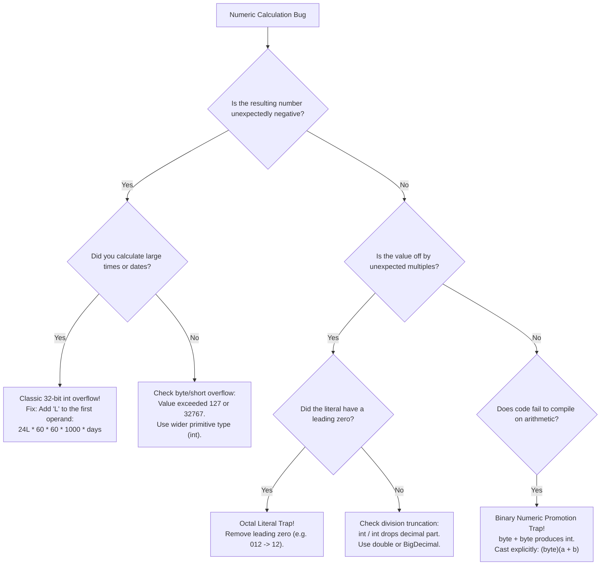

# Primitive Data Types, Bit Widths, and Numeric Ranges

---

## 1. Metadata and Learning Goals

- **Concept ID:** `P01-C001`
- **Concept Title:** Primitive Data Types, Bit Widths, and Numeric Ranges
- **Curriculum Phase:** Phase 01: Java Language Fundamentals
- **Topic Category:** Data Types, Memory Representation, and Binary Encoding
- **Suggested Importance:** Essential
- **Prerequisites:**
  - [`P00-C001`: JDK vs JRE vs JVM Architecture and Evolution](../phase-00-development-environment-java-execution/001-jdk-jre-jvm.md)
  - [`P00-C003`: Source Files (.java) and Bytecode (.class) Disassembly](../phase-00-development-environment-java-execution/003-source-files-and-bytecode.md)
- **Next Concept in Sequence:**
  - [`P01-C002`: Floating-Point Precision, IEEE 754, and Rounding Hazards](002-floating-point-types-and-precision.md)
- **Concepts Covered:**
  - The 8 Java primitive types: `byte`, `short`, `int`, `long`, `char`, `boolean`, `float`, `double`
  - Physical memory bit widths and exact byte sizes
  - Two's Complement binary integer representation
  - Calculating exact minimum and maximum bounds ($-2^{n-1}$ to $2^{n-1}-1$)
  - The unsigned 16-bit nature of `char` ($0$ to $65,535$) and UTF-16 code units
  - The physical JVM memory reality of `boolean` (4 bytes on stack, 1 byte in arrays)
  - Number literal formats: Decimal, Hexadecimal (`0x`), Binary (`0b`), Octal (`0`), and underscores (`_`)
  - The `L` suffix on `long` literals and the silent integer overflow trap
  - Binary integer promotion rules in arithmetic expressions (`byte + byte = int`)
  - Java 8+ Unsigned Integer APIs (`Integer.toUnsignedString()`, `Integer.divideUnsigned()`)
  - Safe arithmetic using `Math.addExact()` and `Math.multiplyExact()`

### Measurable Learning Objectives
By completing this module, you will be able to:
1. **State the exact bit width, byte size, and numeric bounds** for every integer primitive type in Java from memory.
2. **Explain Two's Complement encoding** and trace how bits flip during positive-to-negative sign inversion and numeric overflow.
3. **Prevent silent integer overflow bugs** in time calculations, entity counters, and database primary keys.
4. **Explain Java's Binary Numeric Promotion** and write correct arithmetic operations involving `byte`, `short`, and `char`.
5. **Differentiate JavaScript/MERN dynamic number representation** (IEEE 754 float) from Java's rigid, hardware-mapped primitive type system.

---

## 2. Definition, Purpose, and Mental Model

### 2.1 Formal Definition
- **Primitive Data Type:** A predefined, language-level value type built directly into the Java Virtual Machine. Primitive values are **not objects**; they have no methods, no object headers, no identity hash codes, and are stored directly as raw binary bits in CPU registers, stack frames, or contiguous memory blocks.
- **Two's Complement:** A mathematical binary encoding system for signed integers where the most significant bit (MSB) acts as a negative weight ($-2^{n-1}$). This ensures a single unique zero (`00000000`) and identical hardware addition/subtraction circuitry.

```text
+-----------------------------------------------------------------------------------------+
|                               JAVA'S 8 PRIMITIVE DATA TYPES                             |
|                                                                                         |
|                    +----------------------------+-----------------------------+         |
|                    |     Integral Types         |     Floating-Point Types    |         |
|                    |  (Two's Complement Signed) |    (IEEE 754 Standard)      |         |
|                    +----------------------------+-----------------------------+         |
|                    |  byte  :  8 bits (1 byte)  |  float  : 32 bits (4 bytes) |         |
|                    |  short : 16 bits (2 bytes) |  double : 64 bits (8 bytes) |         |
|                    |  int   : 32 bits (4 bytes) +-----------------------------+         |
|                    |  long  : 64 bits (8 bytes) |                             |         |
|                    +----------------------------+     Logical / Textual       |         |
|                    |  char  : 16 bits (2 bytes) |                             |         |
|                    |          (Unsigned UTF-16) +-----------------------------+         |
|                    |  boolean: JVM-dependent    |  boolean: 1 bit logical     |         |
|                    |          (4B stack, 1B arr)|                             |         |
|                    +----------------------------+-----------------------------+         |
+-----------------------------------------------------------------------------------------+
```

### 2.2 The Problem It Solves: Why Primitives Exist in an Object-Oriented Language
Beginning programmers often ask: *"If Java is an Object-Oriented language, why doesn't Java make everything an object like Python or Ruby?"*

The answer is **raw CPU hardware throughput and memory efficiency**:
1. **Memory Overhead:** Every object in HotSpot 64-bit JVM requires an **Object Header** (12 to 16 bytes: 8-byte Mark Word + 4-to-8-byte Klass Word). If a 32-bit integer (`int`) were an object (`Integer`), storing a single number would consume:
   $$\text{16 bytes (header)} + \text{4 bytes (data)} + \text{4 bytes (alignment padding)} = \mathbf{24\text{ bytes}}$$
   Storing 100 million integers as objects consumes **2.4 Gigabytes** of RAM. Storing them as raw primitive `int`s consumes only **400 Megabytes**—an **83% memory reduction**!
2. **CPU Cache Locality:** Primitive arrays (`int[]`, `long[]`) are stored in flat, contiguous physical memory blocks. Modern CPU hardware prefetchers can load these cache lines (64 bytes at a time) into L1/L2 cache in a single cycle. Objects, by contrast, require pointer chasing across the heap, triggering frequent CPU cache misses.
3. **Register Allocation:** Primitives can live directly inside high-speed CPU registers ($RAX, RBX, RDX$). Objects cannot.

### 2.3 Transition from JavaScript/MERN to Java: The Critical Mental Shift
If your background is in JavaScript or TypeScript (MERN stack):
- In JavaScript, there is fundamentally only **one numeric type**: `Number`. A `Number` is an IEEE 754 64-bit double-precision floating-point value.
  ```javascript
  // JavaScript:
  let count = 42;          // 64-bit double precision float!
  let price = 19.99;       // 64-bit double precision float!
  typeof count === typeof price; // true!
  ```
- In Java, this is **completely forbidden**. Java is a strictly statically-typed language where numbers have rigid bit widths and distinct binary architectures. An integer (`int`) has zero decimal precision and truncates division; a floating-point number (`double`) cannot be assigned to an integer without an explicit cast.

```text
JavaScript (MERN) Perspective:
  Value 42 -----> [ IEEE 754 64-bit Floating Point Cell ]

Java Backend Perspective:
  byte  b = 42;  -----> [ 8 bits  : 00101010 ]
  short s = 42;  -----> [ 16 bits : 00000000 00101010 ]
  int   i = 42;  -----> [ 32 bits : 00000000 00000000 00000000 00101010 ]
  long  l = 42L; -----> [ 64 bits : 00000000 ... 00101010 ]
```

### 2.4 Mental Model: The Fixed-Width Hardware Storage Trays
Imagine physical wooden trays in a precision factory:
- A **`byte`** is a tiny tray with 8 slots. It can hold values up to 127. If you try to force 128 items into it, the top slot spills over, the sign bit flips, and the tray suddenly reads $-128$.
- An **`int`** is a standard 32-slot tray. It holds up to $\approx 2.14$ billion.
- A **`long`** is a deep 64-slot vault. It holds up to $9.22 \times 10^{18}$ items.
- You can easily drop an 8-slot tray into a 64-slot vault (**Widening Conversion**). But you cannot dump a 64-slot vault into an 8-slot tray without violently shearing off 56 slots of data (**Narrowing Conversion / Overflow**).

### 2.5 What This Concept Is NOT
- **Not Wrapper Objects:** `int` is a primitive. `java.lang.Integer` is a heap-allocated reference object. (Covered in detail in [`P01-C006`](006-wrapper-classes-autoboxing.md)).
- **Not Arbitrary-Precision Math:** Primitives have fixed hardware bounds. For unbounded numbers (e.g., 500-digit encryption keys), Java provides `java.math.BigInteger`.
- **Not Floating-Point Mechanics:** The binary nuances of IEEE 754 floats, NaN, infinity, and rounding errors are covered in [`P01-C002`](002-floating-point-types-and-precision.md).

---

## 3. Foundations and Theory

### 3.1 Two's Complement Binary Representation
All signed integer types in Java (`byte`, `short`, `int`, `long`) are represented using **Two's Complement** notation.

#### How Two's Complement Works:
In an $n$-bit signed integer:
- The leftmost bit (bit $n-1$) is the **Sign Bit** (Most Significant Bit, MSB).
- In Two's Complement, the MSB has a **negative weight**: $-2^{n-1}$.
- All other bits $i$ have positive weights: $+2^i$.

For an 8-bit `byte`:
$$\text{Value} = (-b_7 \times 2^7) + (b_6 \times 2^6) + (b_5 \times 2^5) + (b_4 \times 2^4) + (b_3 \times 2^3) + (b_2 \times 2^2) + (b_1 \times 2^1) + (b_0 \times 2^0)$$

```text
Bit Position:    7      6      5      4      3      2      1      0
Weight:        -128   +64    +32    +16     +8     +4     +2     +1
-------------------------------------------------------------------
Binary 0:        0      0      0      0      0      0      0      0  = 0
Binary 1:        0      0      0      0      0      0      0      1  = 1
Binary 127:      0      1      1      1      1      1      1      1  = 64+32+16+8+4+2+1 = 127
Binary -128:     1      0      0      0      0      0      0      0  = -128
Binary -1:       1      1      1      1      1      1      1      1  = -128 + 127 = -1
```

#### Why Two's Complement is Brilliant:
1. **Single Zero:** In older systems like One's Complement or Sign-Magnitude, there were two zeroes: $+0$ (`00000000`) and $-0$ (`10000000`). This required complex conditional logic in CPU arithmetic circuits. In Two's Complement, zero is unique.
2. **Unified Arithmetic Hardware:** Subtraction $A - B$ is performed using standard addition circuits: $A + (\sim B + 1)$. The CPU adder does not need separate subtraction logic.

#### Formula for Calculating Numeric Ranges:
Given $n$ bits of precision:
$$\text{Range} = \left[ -2^{n-1}, \; 2^{n-1} - 1 \right]$$

- **`byte` ($n = 8$):** $-2^7$ to $2^7 - 1 = \mathbf{-128 \text{ to } 127}$
- **`short` ($n = 16$):** $-2^{15}$ to $2^{15} - 1 = \mathbf{-32,768 \text{ to } 32,767}$
- **`int` ($n = 32$):** $-2^{31}$ to $2^{31} - 1 = \mathbf{-2,147,483,648 \text{ to } 2,147,483,647}$ ($\approx \pm 2.14 \text{ billion}$)
- **`long` ($n = 64$):** $-2^{63}$ to $2^{63} - 1 = \mathbf{-9,223,372,036,854,775,808 \text{ to } 9,223,372,036,854,775,807}$ ($\approx \pm 9.22 \times 10^{18}$)

---

### 3.2 The Unsigned 16-Bit Integer: `char`
In Java, **`char` is an integer type**. Unlike `byte`, `short`, `int`, and `long`, `char` is **unsigned**:
- Bit width: 16 bits ($n = 16$).
- Minimum value: $0$ (`'\u0000'`).
- Maximum value: $2^{16} - 1 = \mathbf{65,535}$ (`'\uffff'`).

```java
char letter = 'A';
int asciiCode = letter; // Widening conversion: no cast required!
System.out.println(asciiCode); // Prints: 65

char nextLetter = (char) (letter + 1); // Arithmetic produces int; cast back to char
System.out.println(nextLetter); // Prints: 'B'
```

> [!IMPORTANT]
> **UTF-16 Code Units vs Unicode Code Points:**
> Because `char` is strictly 16 bits, it represents a single **UTF-16 code unit**. Modern Unicode characters (emojis like 🚀 or rare Asian glyphs) require **32 bits** (code points above `U+FFFF`). These characters do not fit into a single `char`; they are represented as **surrogate pairs** consisting of two consecutive `char` elements!

---

### 3.3 The Truth About `boolean` in JVM Memory
The Java Language Specification (JLS §4.2.5) defines `boolean` as representing one bit of information: `true` or `false`. However, computer architectures cannot address individual bits directly; the smallest addressable unit of CPU memory is a byte (8 bits).

The Java Virtual Machine Specification (JVMS §2.3.4) reveals how HotSpot actually stores booleans:
1. **On the JVM Stack Frame / Local Variable Slots:** The JVM has **no boolean bytecode instructions**. Instead, Java compiles boolean expressions into standard 32-bit `int` instructions!
   - `true` is evaluated as integer literal `1` (`iconst_1`).
   - `false` is evaluated as integer literal `0` (`iconst_0`).
   - Each local `boolean` variable on the stack consumes **4 bytes (32 bits)**!
2. **Inside Heap Arrays (`boolean[]`):** In arrays, HotSpot packs booleans as **1 byte (8 bits)** each, encoded as `0x01` or `0x00` (identical to `byte[]`).

---

### 3.4 Binary Numeric Promotion: Why `byte + byte = int`
One of the most confusing rules for beginners is **Binary Numeric Promotion** (JLS §5.6).

In Java, arithmetic operators (`+`, `-`, `*`, `/`, `%`, `&`, `|`, `^`) are defined **only** for 32-bit and 64-bit operands:
- There is no such thing as an 8-bit `badd` or 16-bit `sadd` instruction in JVM bytecode. The smallest arithmetic instruction in the JVM is `iadd` (32-bit integer addition).
- Therefore, if operands are smaller than `int` (`byte`, `short`, `char`), **both operands are automatically promoted to `int` before the operation is performed!**

```java
byte a = 10;
byte b = 20;

// COMPILE ERROR: Type mismatch: cannot convert from int to byte
byte c = a + b; 

// The expression (a + b) is evaluated as an int!
// To store it back into a byte, an explicit narrowing cast is mandatory:
byte c = (byte) (a + b);
```

> [!NOTE]
> **Compound Assignment Exception:**
> The compound assignment operator (`+=`, `-=`, `*=`) contains an **implicit narrowing cast**:
> ```java
> byte b = 10;
> b += 20; // Identical to: b = (byte)(b + 20); Compiles cleanly!
> ```

---

### 3.5 Number Literals: Radices, Underscores, and Suffixes

Java supports literals in four different numeric bases:

```java
int dec = 42;          // Base 10 (Decimal)
int hex = 0x2A;        // Base 16 (Hexadecimal: prefix '0x' or '0X')
int bin = 0b0010_1010; // Base 2  (Binary: prefix '0b' or '0B')
int oct = 052;         // Base 8  (Octal: prefix '0') -- THE OCTAL TRAP!
```

> [!WARNING]
> **The Accidental Octal Trap:**
> In Java, **any numeric literal beginning with a leading zero `0` is interpreted as octal (Base 8)!**
> ```java
> int month = 08; // COMPILE ERROR: The digit 8 is invalid in Base 8 (0..7)!
> int code  = 012; // Valid, but value is 10, NOT 12!
> ```
> Never prefix numeric literals with leading zeroes.

#### Numeric Underscores (Java 7+):
You can place underscores `_` between digits to improve readability. The compiler discards them entirely:
```java
long creditCardNumber = 4111_2222_3333_4444L;
int oneMillion        = 1_000_000;
int binaryMask        = 0b1111_0000_1010_0101;
```

#### The Mandatory `L` Suffix on `long` Literals:
In Java, all integer literals without a suffix are treated as **32-bit `int`s**:
```java
// COMPILE ERROR: Integer number too large
long worldPopulation = 8000000000; 

// FIX: Append uppercase 'L'
long worldPopulation = 8000000000L;
```
Always use uppercase `L`. A lowercase `l` looks identical to the digit `1` in many programming fonts (`8000000000l`), causing severe visual confusion.

---

## 4. Syntax, API, and Command Reference

### 4.1 Master Primitive Types Reference Table

| Type | Bit Width | Bytes | Minimum Value | Maximum Value | Default Value | Wrapper Class | Bytecode Descriptor |
|---|---|---|---|---|---|---|---|
| **`byte`** | 8 bits | 1 | $-128$ | $127$ | `0` | `java.lang.Byte` | `B` |
| **`short`** | 16 bits | 2 | $-32,768$ | $32,767$ | `0` | `java.lang.Short` | `S` |
| **`int`** | 32 bits | 4 | $-2,147,483,648$ | $2,147,483,647$ | `0` | `java.lang.Integer` | `I` |
| **`long`** | 64 bits | 8 | $-9,223,372,036,854,775,808$ | $9,223,372,036,854,775,807$ | `0L` | `java.lang.Long` | `J` |
| **`char`** | 16 bits | 2 | `0` (`'\u0000'`) | $65,535$ (`'\uffff'`) | `'\u0000'` | `java.lang.Character` | `C` |
| **`boolean`** | JVM | $1 \sim 4$ | `false` | `true` | `false` | `java.lang.Boolean` | `Z` |
| **`float`** | 32 bits | 4 | $\approx \pm 1.4 \times 10^{-45}$ | $\approx \pm 3.4 \times 10^{38}$ | `0.0f` | `java.lang.Float` | `F` |
| **`double`** | 64 bits | 8 | $\approx \pm 4.9 \times 10^{-324}$ | $\approx \pm 1.8 \times 10^{308}$ | `0.0d` | `java.lang.Double` | `D` |

### 4.2 Modern Unsigned Arithmetic APIs (Java 8+)
While Java does not have unsigned primitive keywords (like C/C++ `uint32_t`), Java 8 introduced utility methods that treat standard signed `int` and `long` variables as unsigned binary bit patterns:

```java
int signedVal = -1; // Binary: 11111111 11111111 11111111 11111111

// Convert to unsigned string representation
String unsignedStr = Integer.toUnsignedString(signedVal);
System.out.println(unsignedStr); // Prints: "4294967295" (2^32 - 1)

// Unsigned division
int a = -1; // 4,294,967,295 unsigned
int b = 2;
int quotient = Integer.divideUnsigned(a, b);
System.out.println(Integer.toUnsignedString(quotient)); // Prints: "2147483647"

// Unsigned comparison
int x = -1; // 4,294,967,295
int y = 100;
boolean isSmaller = Integer.compareUnsigned(x, y) > 0; // x is larger when unsigned!
```

### 4.3 Safe Arithmetic APIs (`Math.*Exact`)
To prevent silent arithmetic overflow from corrupting backend calculations, Java 8 introduced overflow-checking methods in `java.lang.Math`:

```java
// Throws java.lang.ArithmeticException: integer overflow
int overflowed = Math.addExact(Integer.MAX_VALUE, 1);

// Safe subtraction, multiplication, and negation
long safeProduct = Math.multiplyExact(1_000_000L, 5_000_000L);
int safeNegate   = Math.negateExact(value);
```

---

## 5. Runnable Examples and Demonstrations

### 5.1 Programmatic Binary and Two's Complement Bit Visualizer
The following complete program prints the physical binary bit patterns of integer primitives, demonstrates sign bit flipping, and verifies Two's Complement mathematics:

```java
// File: BitRepresentationVisualizer.java
public class BitRepresentationVisualizer {

    public static void main(String[] args) {
        System.out.println("==================================================================");
        System.out.println("          TWO'S COMPLEMENT BINARY BIT PATTERN AUDITOR             ");
        System.out.println("==================================================================");

        // 1. Inspect 8-bit byte representation
        System.out.println("[1] 8-BIT BYTE TWO'S COMPLEMENT REPRESENTATION:");
        printByteBits("Zero        (0)", (byte) 0);
        printByteBits("One         (1)", (byte) 1);
        printByteBits("Max Byte  (127)", Byte.MAX_VALUE);
        printByteBits("Overflow (+128)", (byte) (Byte.MAX_VALUE + 1));
        printByteBits("Min Byte (-128)", Byte.MIN_VALUE);
        printByteBits("Minus One  (-1)", (byte) -1);

        // 2. Inspect 32-bit int representation
        System.out.println("\n[2] 32-BIT INTEGER BIT PATTERNS:");
        printIntBits("Integer 42     ", 42);
        printIntBits("Integer MAX    ", Integer.MAX_VALUE);
        printIntBits("Overflow (MAX+1)", Integer.MAX_VALUE + 1);
        printIntBits("Integer -1     ", -1);

        // 3. Inspect 16-bit unsigned char representation
        System.out.println("\n[3] 16-BIT UNSIGNED CHAR REPRESENTATION:");
        char letterA = 'A';
        char maxChar = Character.MAX_VALUE;
        System.out.printf("  'A' Code Point: %5d | Hex: 0x%04X | Binary: %s%n",
                (int) letterA, (int) letterA, to16BitBinary(letterA));
        System.out.printf("  MAX CHAR      : %5d | Hex: 0x%04X | Binary: %s%n",
                (int) maxChar, (int) maxChar, to16BitBinary(maxChar));

        System.out.println("==================================================================");
    }

    private static void printByteBits(String label, byte b) {
        // Convert to 8-bit binary string
        String bits = String.format("%8s", Integer.toBinaryString(b & 0xFF)).replace(' ', '0');
        System.out.printf("  %-16s : Value = %4d | Binary = %s (MSB Sign: %c)%n",
                label, b, bits, bits.charAt(0));
    }

    private static void printIntBits(String label, int i) {
        String bits = String.format("%32s", Integer.toBinaryString(i)).replace(' ', '0');
        // Group into 8-bit nibbles for readability
        String grouped = String.join(" ",
                bits.substring(0, 8), bits.substring(8, 16),
                bits.substring(16, 24), bits.substring(24, 32));
        System.out.printf("  %-16s : Value = %11d | %s%n", label, i, grouped);
    }

    private static String to16BitBinary(char c) {
        return String.format("%16s", Integer.toBinaryString(c)).replace(' ', '0');
    }
}
```

#### Executing the Bit Visualizer:
```bash
javac BitRepresentationVisualizer.java
java BitRepresentationVisualizer
```

#### Observed Output:
```text
==================================================================
          TWO'S COMPLEMENT BINARY BIT PATTERN AUDITOR             
==================================================================
[1] 8-BIT BYTE TWO'S COMPLEMENT REPRESENTATION:
  Zero        (0)  : Value =    0 | Binary = 00000000 (MSB Sign: 0)
  One         (1)  : Value =    1 | Binary = 00000001 (MSB Sign: 0)
  Max Byte  (127)  : Value =  127 | Binary = 01111111 (MSB Sign: 0)
  Overflow (+128)  : Value = -128 | Binary = 10000000 (MSB Sign: 1)
  Min Byte (-128)  : Value = -128 | Binary = 10000000 (MSB Sign: 1)
  Minus One  (-1)  : Value =   -1 | Binary = 11111111 (MSB Sign: 1)

[2] 32-BIT INTEGER BIT PATTERNS:
  Integer 42       : Value =          42 | 00000000 00000000 00000000 00101010
  Integer MAX      : Value =  2147483647 | 01111111 11111111 11111111 11111111
  Overflow (MAX+1) : Value = -2147483648 | 10000000 00000000 00000000 00000000
  Integer -1       : Value =          -1 | 11111111 11111111 11111111 11111111

[3] 16-BIT UNSIGNED CHAR REPRESENTATION:
  'A' Code Point:    65 | Hex: 0x0041 | Binary: 0000000001000001
  MAX CHAR      : 65535 | Hex: 0xFFFF | Binary: 1111111111111111
==================================================================
```

---

### 5.2 The 30-Day Millisecond Silent Overflow Trap
The following demonstration illustrates one of the most widespread production outages in enterprise backend systems:

```java
// File: SilentOverflowTrap.java
public class SilentOverflowTrap {

    public static void main(String[] args) {
        System.out.println("Calculating milliseconds in 30 days:");

        // INCORRECT: All literals are 32-bit int!
        // 24 * 60 * 60 * 1000 * 30 = 2,592,000,000
        // But Integer.MAX_VALUE is 2,147,483,647!
        long incorrectMillis = 24 * 60 * 60 * 1000 * 30;

        // CORRECT: First operand is explicitly 64-bit long (24L)
        long correctMillis = 24L * 60 * 60 * 1000 * 30;

        System.out.println("  INCORRECT Result: " + incorrectMillis);
        System.out.println("  CORRECT Result  : " + correctMillis);

        if (incorrectMillis < 0) {
            System.out.println("  CATASTROPHE: Overflow produced a NEGATIVE timeout!");
            System.out.println("  Any cache TTL or thread sleep using this value will FAIL instantly!");
        }
    }
}
```

#### Observed Output:
```text
Calculating milliseconds in 30 days:
  INCORRECT Result: -1702967296
  CORRECT Result  : 2592000000
  CATASTROPHE: Overflow produced a NEGATIVE timeout!
  Any cache TTL or thread sleep using this value will FAIL instantly!
```

> [!CAUTION]
> **Why `long incorrectMillis = 24 * 60 * 60 * 1000 * 30;` Overflows:**
> Declaring the variable type as `long` does **not** make the calculation execute in 64-bit precision! The right-hand side of the `=` sign is evaluated first. Because all numbers (`24`, `60`, `1000`, `30`) are integer literals, Java performs 32-bit integer arithmetic, overflows to `-1702967296`, and *then* widens that corrupted negative number to `long`!
> **Rule:** Always append `L` to the **very first operand** in the expression: `24L * ...`.

---

## 6. Real-World Backend Application

### 6.1 Database Primary Key Exhaustion (The 2.14 Billion Row Outage)
In relational database engineering (PostgreSQL, MySQL), choosing the primary key type has massive operational consequences:

```text
+-----------------------------------------------------------------------------+
|                     PRIMARY KEY ID DATA TYPE SELECTION                      |
|                                                                             |
|  Java: int (32-bit signed)   | SQL: INT / SERIAL                            |
|  Maximum Capacity            | 2,147,483,647 rows (2.14 Billion)            |
|  Production Risk             | CRITICAL: High-throughput tables (payments,  |
|                              | audit logs, telemetry) will EXHAUST this in  |
|                              | 6 to 24 months, crashing the database!       |
|  ----------------------------+--------------------------------------------- |
|  Java: long (64-bit signed)  | SQL: BIGINT / BIGSERIAL                      |
|  Maximum Capacity            | 9,223,372,036,854,775,807 rows               |
|  Production Risk             | ZERO: At 1 million rows/sec, this will last  |
|                              | 292,000 years!                               |
+-----------------------------------------------------------------------------+
```

#### Production Incident Case Study:
A major payments processor stored audit log entries using `Integer id`. On Black Friday, the table inserted record number `2,147,483,647`. The next insert attempted to insert `2,147,483,648`, which breached the 32-bit signed integer boundary. The database rejected the insert with:
`ERROR: integer out of range`. 
The entire global checkout pipeline halted for 4 hours while database engineers executed an emergency online table migration to `BIGINT`.

**Enterprise Standard:** Always use `long` (`BIGINT`) for database primary keys and entity IDs in backend architectures.

---

### 6.2 High-Throughput Binary Protocol Serialization
In financial trading backends (LMAX Disruptor, FIX protocol) and high-speed network gateways (Netty), allocating JSON or XML strings causes severe garbage collection pauses. Engineers pack multiple numeric fields into contiguous primitive `byte` arrays:

```java
// File: BinaryPacketCodec.java
import java.nio.ByteBuffer;

public class BinaryPacketCodec {

    // Wire format: [1 byte: MsgType] [8 bytes: OrderId] [4 bytes: Shares] [8 bytes: PriceCents]
    public static byte[] serializeOrder(byte msgType, long orderId, int shares, long priceCents) {
        ByteBuffer buffer = ByteBuffer.allocate(1 + 8 + 4 + 8); // Exactly 21 bytes! Zero GC overhead
        buffer.put(msgType);
        buffer.putLong(orderId);
        buffer.putInt(shares);
        buffer.putLong(priceCents);
        return buffer.array();
    }

    public static void main(String[] args) {
        byte[] wireBytes = serializeOrder((byte) 0x01, 108492049102L, 500, 19999L);
        System.out.printf("Serialized high-performance binary packet: %d bytes (vs ~150 bytes in JSON)%n",
                wireBytes.length);
    }
}
```

---

## 7. Design Choices, Alternatives, and Trade-Offs

### 7.1 Primitives vs. Boxed Objects (`int` vs. `Integer`)

```
+------------------------+---------------------------------------+---------------------------------------+
| Criterion              | Primitive (`int`, `long`)             | Boxed Wrapper (`Integer`, `Long`)     |
+------------------------+---------------------------------------+---------------------------------------+
| Nullability            | **Never null** (Defaults to 0).       | **Nullable** (Can represent absence). |
| Memory Overhead        | 4 bytes (`int`), 8 bytes (`long`).    | 16–24 bytes per instance + 8B ref.    |
| CPU Performance        | Direct registers, SIMD vectorization. | Pointer indirection; cache misses.    |
| Collections Support    | Cannot be used in standard            | Supported: `List<Integer>`,           |
|                        | `List<T>`, `Map<K,V>` directly.       | `Map<String, Long>`.                  |
| Recommended Use Case   | High-throughput loops, counters,      | JPA Entity optional fields, DTOs,     |
|                        | array buffers, math calculations.     | standard Generic Collections.         |
+------------------------+---------------------------------------+---------------------------------------+
```

---

## 8. Performance and Complexity

### 8.1 Memory Hierarchy & CPU Hardware Cache Lines
Modern x86_64 processors fetch memory from RAM into CPU L1/L2 caches in **64-byte Cache Lines**:
- A single 64-byte cache line can hold **sixteen** contiguous 32-bit `int` primitives ($16 \times 4\text{ bytes} = 64\text{ bytes}$).
- When an algorithm iterates across a primitive array `int[]`, a single CPU memory fetch satisfies the next 16 iterations!
- If the algorithm instead iterates across an array of objects `Integer[]`, each array element is an 8-byte pointer to a separate object scattered across the heap. Each access requires traversing a pointer to unpredictable memory addresses, destroying cache locality and stalling CPU execution pipelines.

### 8.2 SIMD (Single Instruction, Multiple Data) Vectorization
The HotSpot C2 JIT compiler automatically inspects loops operating on primitive arrays (`int[]`, `float[]`). Using modern CPU instruction sets (**AVX2, AVX-512**), the JIT compiler can vectorize the loop, executing addition across **eight or sixteen integers simultaneously in a single CPU cycle**!
This hardware vectorization is impossible with object graphs.

---

## 9. Security and Robustness

### 9.1 The Integer Overflow Buffer Bypass Vulnerability
A classic security flaw (CWE-190: Integer Overflow or Wraparound) occurs when memory allocation sizes or buffer boundary validations are calculated using 32-bit arithmetic:

```java
// INSECURE VULNERABILITY EXAMPLE:
public byte[] allocateBuffer(int userProvidedCount) {
    // If an attacker passes userProvidedCount = Integer.MAX_VALUE
    // (userProvidedCount + 1) overflows to -2147483648!
    int bufferSize = userProvidedCount + 1; 

    // Negative size check bypassed if coded poorly:
    if (bufferSize > 10_000_000) {
        throw new SecurityException("Requested buffer is too large!");
    }

    // Passes security check! But allocates negative or corrupted array size!
    return new byte[bufferSize]; 
}
```

#### The Secure Implementation:
Always use `Math.addExact()` or validate bounds before arithmetic operations:

```java
// SECURE IMPLEMENTATION:
public byte[] allocateBufferSecure(int userProvidedCount) {
    if (userProvidedCount < 0 || userProvidedCount > 10_000_000) {
        throw new IllegalArgumentException("Invalid count: " + userProvidedCount);
    }
    // Safe from overflow:
    int bufferSize = Math.addExact(userProvidedCount, 1);
    return new byte[bufferSize];
}
```

---

## 10. Testing and Verification

### 10.1 Automated Unit Tests for Primitive Bounds and Safe Math
You can author exhaustive JUnit tests to verify primitive boundary behavior and assert that overflow detection works:

```java
// File: PrimitiveBoundaryTest.java
import org.junit.jupiter.api.DisplayName;
import org.junit.jupiter.api.Test;

import static org.junit.jupiter.api.Assertions.*;

public class PrimitiveBoundaryTest {

    @Test
    @DisplayName("Verify Two's Complement Integer Boundaries")
    void testIntegerBoundaries() {
        assertEquals(-2147483648, Integer.MIN_VALUE);
        assertEquals(2147483647, Integer.MAX_VALUE);

        // Verify standard silent overflow behavior
        assertEquals(Integer.MIN_VALUE, Integer.MAX_VALUE + 1);
        assertEquals(Integer.MAX_VALUE, Integer.MIN_VALUE - 1);
    }

    @Test
    @DisplayName("Verify Safe Math Throws ArithmeticException on Overflow")
    void testSafeMathThrowsOnOverflow() {
        assertThrows(ArithmeticException.class, () -> {
            Math.addExact(Integer.MAX_VALUE, 1);
        }, "Math.addExact must throw ArithmeticException when crossing MAX_VALUE");

        assertThrows(ArithmeticException.class, () -> {
            Math.multiplyExact(Long.MAX_VALUE, 2L);
        }, "Math.multiplyExact must throw ArithmeticException when crossing Long MAX_VALUE");
    }

    @Test
    @DisplayName("Verify Unsigned Integer Comparison")
    void testUnsignedComparison() {
        int smallSigned = -1; // 0xFFFFFFFF (Largest possible unsigned 32-bit int: 4,294,967,295)
        int largeSigned = 100;

        // Standard signed comparison
        assertTrue(smallSigned < largeSigned, "-1 is smaller than 100 in signed comparison");

        // Modern unsigned comparison
        assertTrue(Integer.compareUnsigned(smallSigned, largeSigned) > 0,
                "0xFFFFFFFF must be larger than 100 in unsigned comparison");
    }
}
```

---

## 11. Debugging and Failure Analysis

### 11.1 Diagnostic Flowchart: Resolving Integer and Primitive Bugs



### 11.2 Top 5 Primitive Failure Modes and Exact Solutions

#### 1. The Integer Millisecond Overflow
- **Symptom:** Scheduling a task for 30 days causes it to fire immediately or throw `IllegalArgumentException: timeout must be positive`.
- **Root Cause:** `24 * 60 * 60 * 1000 * 30` evaluates to `-1702967296` due to 32-bit signed overflow.
- **Solution:** Change `24` to `24L`.

#### 2. The Octal Leading Zero Glitch
- **Symptom:** Formatting a string or passing an account code like `int code = 025;` produces `21`.
- **Root Cause:** Leading `0` invokes octal notation ($2 \times 8 + 5 = 21$).
- **Solution:** Store account numbers or zero-padded codes as `String`, not integer primitives.

#### 3. Compilation Failure on `byte` Arithmetic
- **Symptom:** `byte x = 1; byte y = 2; byte z = x + y;` fails to compile with `cannot convert from int to byte`.
- **Root Cause:** Java automatically promotes `byte` operands to `int` during arithmetic.
- **Solution:** Cast back explicitly: `byte z = (byte) (x + y);` or use `int` for calculations.

#### 4. The Database Primary Key Overflow (`INT` vs `BIGINT`)
- **Symptom:** High-volume transaction table starts throwing `ERROR: integer out of range` on insert.
- **Root Cause:** Table reached row `2,147,483,648`, exceeding 32-bit signed `int`.
- **Solution:** Migrate database column to `BIGINT` and entity field to `long`.

#### 5. Unintended Integer Division Truncation
- **Symptom:** `double percentage = 5 / 2;` assigns `2.0` instead of `2.5`.
- **Root Cause:** Both operands are integer primitives, so integer division performs truncation before widening to `double`.
- **Solution:** Make at least one operand floating-point: `5.0 / 2` or `(double) 5 / 2`.

---

## 12. Best Practices and Anti-Patterns

### 12.1 Industry Best Practices
- **Default to `int` for Whole Numbers, `long` for IDs/Counters:** Use `int` for standard array indexing and loop counters; use `long` for timestamps, database primary keys, and file byte offsets.
- **Always Suffix `long` Literals with Uppercase `L`:** Never use lowercase `l`.
- **Use Underscores for Readability:** Write `1_000_000` instead of `1000000`.
- **Use `Math.*Exact()` for Security-Critical Arithmetic:** Throw an exception instead of silently wrapping around.
- **Use `char` Only for Text Characters:** Do not use `char` as a generic unsigned integer unless building low-level binary parsers.

### 12.2 Anti-Patterns to Avoid
- **Never Use Leading Zeroes on Decimal Literals:** Avoid triggering octal parsing.
- **Never Assume `long` Prevents Overflow in Right-Hand Expressions:** Always ensure the first operand has the `L` suffix.
- **Never Use `int` for System Time or Milliseconds:** Epoch millisecond timestamps exceeded 32-bit capacity in 1970 ($2^{31}-1$ ms is only 24.8 days!).
- **Never Use `float` or `double` for Financial Currency:** Rounding errors will corrupt balances (use `long` in cents or `BigDecimal`).

---

## 13. Interview Preparation

### 13.1 Foundational Questions

#### Q1: What are the eight primitive data types in Java, and what are their bit widths?
**Answer:**
1. `byte`: 8 bits (signed)
2. `short`: 16 bits (signed)
3. `int`: 32 bits (signed)
4. `long`: 64 bits (signed)
5. `char`: 16 bits (unsigned UTF-16 code unit)
6. `boolean`: 1 bit logically (stored as 32-bit int on the stack, 8-bit byte in arrays)
7. `float`: 32 bits (IEEE 754 single-precision float)
8. `double`: 64 bits (IEEE 754 double-precision float)

#### Q2: What is Two's Complement representation, and what is the range of an $n$-bit signed integer?
**Answer:** Two's Complement is a binary notation system for signed integers where the Most Significant Bit (MSB) has a negative weight of $-2^{n-1}$, while all other bits have positive weights $+2^i$. For an $n$-bit signed integer, the range is $[-2^{n-1}, \; 2^{n-1} - 1]$. It provides a unique zero representation and allows addition and subtraction to be performed using identical CPU circuitry.

### 13.2 Production Scenario Questions

#### Q3: What is the output of `System.out.println(24 * 60 * 60 * 1000 * 30);`, and why does it occur?
**Answer:** The output is a negative integer: `-1702967296`. Even though the mathematical product ($2,592,000,000$) is intended for a 64-bit calculation, all literals in the expression are 32-bit `int` literals. Java evaluates the multiplication left-to-right using 32-bit signed integer arithmetic. Because $2,592,000,000$ exceeds `Integer.MAX_VALUE` ($2,147,483,647$), the 32nd bit (the sign bit) flips to `1`, wrapping the value around into a negative number. To fix this, at least one operand must be declared as a 64-bit literal: `24L * 60 * ...`.

#### Q4: Why does `byte b1 = 10; byte b2 = 20; byte b3 = b1 + b2;` fail to compile in Java?
**Answer:** This fails with a compile error because of Java's Binary Numeric Promotion rule. Java's JVM does not have bytecode arithmetic instructions for types smaller than 32 bits. When binary arithmetic operators (`+`, `-`, `*`, `/`) are applied to operands of type `byte`, `short`, or `char`, the JVM automatically promotes both operands to 32-bit `int`s. The result of `b1 + b2` is an `int`. Assigning an `int` to a `byte` variable is a narrowing conversion that requires an explicit cast: `byte b3 = (byte) (b1 + b2);`.

### 13.3 Lead & Principal Architect Questions

#### Q5: Explain the memory layout differences between `long[]` and `Long[]` on a 64-bit JVM with compressed oops, and explain the architectural implications for a high-throughput backend.
**Answer:**
- A `long[]` of size $N$ is a single contiguous heap array containing raw 64-bit values. The memory consumed is:
  $$\text{Array Header (16 bytes)} + (N \times 8\text{ bytes}) + \text{Padding}$$
  For $N = 1,000,000$, this consumes $\approx \mathbf{8\text{ MB}}$ of RAM. Iteration is cache-line friendly (8 longs per 64-byte L1 cache line) and hardware prefetchers eliminate CPU pipeline stalls.
- A `Long[]` of size $N$ is an array of object references. The array itself consumes:
  $$\text{Array Header (16 bytes)} + (N \times 4\text{ bytes for compressed pointer}) = \mathbf{4\text{ MB}}$$
  However, each element points to a separate `java.lang.Long` object on the heap, each consuming:
  $$\text{Object Header (12–16 bytes)} + \text{Value (8 bytes)} = \mathbf{24\text{ bytes per object}}$$
  Total memory consumed is $4\text{ MB} + (N \times 24\text{ bytes}) = \mathbf{28\text{ MB}}$—a **350% memory increase**!
  Architecturally, iterating `Long[]` causes massive pointer chasing across fragmented heap regions, triggering CPU L1/L2 cache misses and generating severe garbage collection pressure. High-throughput backends (LMAX Disruptor, Kafka, Netty) strictly use primitive arrays or off-heap byte buffers.

---

## 14. Practice and Assessment

### Exercise 1: Beginner (Boundary Arithmetic & Literal Suffixes)
Write a small Java class `BoundaryCheck.java` that:
1. Prints the maximum value of `short`.
2. Adds `1` to that maximum value using standard addition and casts it back to `short`.
3. Prints the resulting value and explains why it flipped to a negative number.

### Exercise 2: Applied (Safe Financial Interest Calculation)
Create a financial utility method `calculateTotalCents(long principalCents, int interestRatePercent, int years)` that:
- Multiplies principal, rate, and years to calculate simple interest in cents.
- Uses `Math.multiplyExact()` and `Math.addExact()` to guarantee that if the calculation crosses `Long.MAX_VALUE`, an `ArithmeticException` is thrown rather than returning a corrupt negative balance.

### Exercise 3: Challenge (Bitwise Byte Packer)
Write a class `BitPacker.java` that packs four 8-bit `byte` values ($B_0, B_1, B_2, B_3$) into a single 32-bit `int` using bitwise shift (`<<`) and bitwise OR (`|`), and then unpacks that `int` back into the four original `byte` values.

---

### Hints
- *Exercise 1:* `Short.MAX_VALUE` is 32767. `(short)(Short.MAX_VALUE + 1)` flips to -32768.
- *Exercise 2:* Review Section 4.3.
- *Exercise 3:* Remember that `byte` promotes to `int`. When shifting, mask with `0xFF` to prevent sign extension from corrupting higher-order bits: `(b & 0xFF) << 24`.

---

### Solutions Walkthrough

#### Exercise 1 Solution:
```java
public class BoundaryCheck {
    public static void main(String[] args) {
        short max = Short.MAX_VALUE; // 32767
        short overflowed = (short) (max + 1);
        System.out.println("Max Short : " + max);
        System.out.println("Overflowed: " + overflowed);
        // Explanation: In 16-bit Two's Complement, 32767 is 01111111 11111111.
        // Adding 1 produces 10000000 00000000, which has an MSB of 1, representing -32768.
    }
}
```

#### Exercise 2 Solution:
```java
public class SafeFinancialCalculator {
    public static long calculateTotalCents(long principalCents, int ratePercent, int years) {
        try {
            // Simple interest = (principal * rate * years) / 100
            long interestNumerator = Math.multiplyExact(principalCents, (long) ratePercent);
            interestNumerator = Math.multiplyExact(interestNumerator, (long) years);
            long interest = interestNumerator / 100L;
            return Math.addExact(principalCents, interest);
        } catch (ArithmeticException e) {
            throw new IllegalStateException("Financial calculation exceeded 64-bit integer capacity!", e);
        }
    }
}
```

#### Exercise 3 Solution:
```java
public class BitPacker {
    public static int pack(byte b3, byte b2, byte b1, byte b0) {
        return ((b3 & 0xFF) << 24) |
               ((b2 & 0xFF) << 16) |
               ((b1 & 0xFF) << 8)  |
               (b0 & 0xFF);
    }

    public static byte[] unpack(int packed) {
        return new byte[] {
            (byte) ((packed >>> 24) & 0xFF),
            (byte) ((packed >>> 16) & 0xFF),
            (byte) ((packed >>> 8) & 0xFF),
            (byte) (packed & 0xFF)
        };
    }

    public static void main(String[] args) {
        byte b3 = (byte) 0x12, b2 = (byte) 0x34, b1 = (byte) 0xAB, b0 = (byte) 0xCD;
        int packed = pack(b3, b2, b1, b0);
        System.out.printf("Packed 32-bit int: 0x%08X%n", packed);

        byte[] unpacked = unpack(packed);
        System.out.printf("Unpacked bytes  : 0x%02X 0x%02X 0x%02X 0x%02X%n",
                unpacked[0], unpacked[1], unpacked[2], unpacked[3]);
        assert unpacked[0] == b3 && unpacked[2] == b1;
    }
}
```

---

### Mastery Self-Assessment Checklist
- [ ] I can list all 8 primitive types, their bit widths, and byte sizes from memory.
- [ ] I can explain why Two's Complement enables single-circuit addition and subtraction.
- [ ] I understand why `24 * 60 * 60 * 1000 * 30` produces a negative number and how to fix it with `24L`.
- [ ] I can explain why `byte + byte` evaluates to an `int` in Java.
- [ ] I know why leading zeroes on integer literals are dangerous (the Octal Trap).
- [ ] I understand why enterprise backends use `long` (BIGINT) instead of `int` for primary keys.
- [ ] I know the memory and CPU cache locality difference between `long[]` and `Long[]`.
- [ ] I can use `Math.addExact()` and `Math.multiplyExact()` to prevent integer overflow exploits.

---

## 15. Summary, Cheat Sheet, and Memory Aids

### Core Principles
1. **Primitives are values, not objects.** Zero object headers, zero pointer chasing, flat contiguous memory.
2. **Formula:** $n$ bits signed range is $[-2^{n-1}, \; 2^{n-1}-1]$.
3. **`char` is unsigned 16-bit.** Range is $0$ to $65,535$.
4. **Promotion rule:** Any integer arithmetic smaller than 32 bits is promoted to `int`.
5. **Always uppercase `L`:** Use `100L`, not `100l`.
6. **No leading zero:** `012` is octal $10$, not decimal $12$.

### Quick Reference Size and Range Card

```text
+----------+-------+--------+-----------------------------------------------------------+
| Type     | Bits  | Bytes  | Exact Value Range                                         |
+----------+-------+--------+-----------------------------------------------------------+
| byte     | 8     | 1      | -128 to 127                                               |
| short    | 16    | 2      | -32,768 to 32,767                                         |
| int      | 32    | 4      | -2,147,483,648 to 2,147,483,647 (~2.14 Billion)           |
| long     | 64    | 8      | -9,223,372,036,854,775,808 to 9,223,372,036,854,775,807   |
| char     | 16    | 2      | 0 to 65,535 (Unsigned UTF-16 code units)                  |
| boolean  | 1*    | 1 ~ 4  | false, true (32-bit int on stack, 8-bit byte in arrays)   |
+----------+-------+--------+-----------------------------------------------------------+
```

---

## 16. Sources and Further Reading

### Primary Specifications & Authoritative Sources
- **The Java Language Specification (Java SE 21 Edition):**
  - Section 4.2: Primitive Types and Values: [JLS 21 §4.2](https://docs.oracle.com/javase/specs/jls/se21/html/jls-4.html#jls-4.2)
  - Section 5.6: Numeric Promotions: [JLS 21 §5.6](https://docs.oracle.com/javase/specs/jls/se21/html/jls-5.html#jls-5.6)
- **The Java Virtual Machine Specification (Java SE 21 Edition):**
  - Section 2.3.4: The `boolean` Type in HotSpot: [JVMS 21 §2.3.4](https://docs.oracle.com/javase/specs/jvms/se21/html/jvms-2.html#jvms-2.3.4)
- **CWE MITRE Security Standards:**
  - CWE-190: Integer Overflow or Wraparound: [CWE-190](https://cwe.mitre.org/data/definitions/190.html)
- **Project Valhalla (OpenJDK Language & VM Evolution):**
  - Project Valhalla State of Values: [OpenJDK Valhalla](https://openjdk.org/projects/valhalla/)
