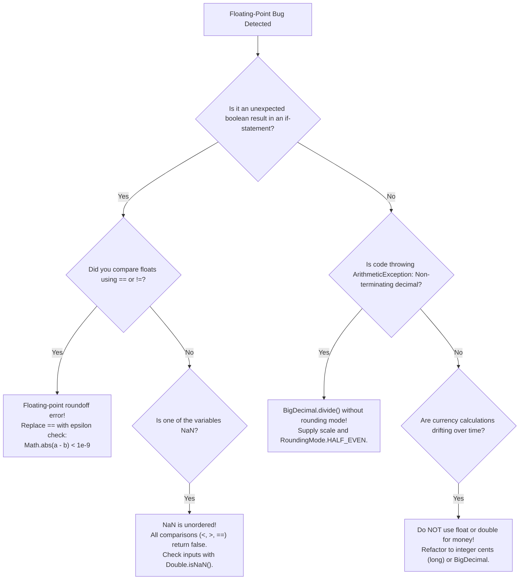

# Floating-Point Precision, IEEE 754, and Rounding Hazards

---

## 1. Metadata and Learning Goals

- **Concept ID:** `P01-C002`
- **Concept Title:** Floating-Point Precision, IEEE 754, and Rounding Hazards
- **Curriculum Phase:** Phase 01: Java Language Fundamentals
- **Topic Category:** Data Types, Numerical Analysis, and Financial Computing
- **Suggested Importance:** Essential
- **Prerequisites:**
  - [`P01-C001`: Primitive Data Types, Bit Widths, and Numeric Ranges](001-primitive-data-types.md)
- **Next Concept in Sequence:**
  - [`P01-C003`: Reference Types vs Primitive Types in Memory](003-reference-types-vs-primitives.md)
- **Concepts Covered:**
  - The IEEE 754 standard for binary floating-point representation
  - Single precision (`float`, 32 bits) vs Double precision (`double`, 64 bits)
  - Physical bit anatomy: Sign, Biased Exponent, and Normalized Mantissa (Significand)
  - Binary fractional representation: Why decimal $0.1$ and $0.2$ are infinite repeating binary fractions
  - The classic catastrophe: Why `0.1 + 0.2 == 0.3` evaluates to `false` in Java
  - Machine Epsilon and Epsilon-based fuzzy equality comparisons
  - Special IEEE 754 values: `Positive Infinity`, `Negative Infinity`, and `NaN` (Not-a-Number)
  - The `NaN` comparison anomaly: Why `NaN == NaN` is always `false`
  - Signed zeroes: $+0.0$ vs $-0.0$ and reciprocal behavior
  - The restoration of Always-Strict Floating-Point in Java 17 ([JEP 306](https://openjdk.org/jeps/306))
  - The Golden Rule of Financial Computing: Why `double` and `float` must **never** be used for money
  - Exact decimal arithmetic: `long` in cents vs `java.math.BigDecimal`
  - The `new BigDecimal(double)` construction trap vs `BigDecimal.valueOf(double)`

### Measurable Learning Objectives
By completing this module, you will be able to:
1. **Explain the physical bit layout of IEEE 754 numbers** and identify sign, exponent, and mantissa components for `float` and `double`.
2. **Mathematically prove why decimal fractions like $0.1$ cannot be represented exactly in binary floating-point**.
3. **Safely compare floating-point values** using delta/epsilon tolerances instead of equality operators (`==`).
4. **Detect and handle IEEE 754 edge cases**, including division by zero, positive/negative infinity, and `NaN` comparison poisoning.
5. **Architect high-integrity financial calculations** using integer cents (`long`) or `BigDecimal` with explicit `RoundingMode`s.

---

## 2. Definition, Purpose, and Mental Model

### 2.1 Formal Definition
- **IEEE 754 Standard:** A technical standard established by the Institute of Electrical and Electronics Engineers (IEEE) in 1985 that defines the representation, arithmetic, rounding rules, and exception handling for binary floating-point numbers in computer hardware and software.
- **Floating-Point Representation:** A method of encoding real numbers using scientific notation in base 2:
  $$\text{Value} = (-1)^{\text{sign}} \times \left(1 + \sum_{i=1}^{m} b_{-i} 2^{-i}\right) \times 2^{\text{exponent} - \text{bias}}$$
  The "point" floats because the exponent dynamically shifts the radix point relative to the significant digits, trading absolute precision for an enormous dynamic range.

```text
+-----------------------------------------------------------------------------------------+
|                               IEEE 754 PHYSICAL BIT LAYOUTS                             |
|                                                                                         |
|  float (32 bits):                                                                       |
|  +-------+-------------------------+-------------------------------------------------+  |
|  | Sign  | Exponent (8 bits)       | Mantissa / Fraction (23 bits)                   |  |
|  | 1 bit | Bias: 127               | Precision: ~6 to 7 decimal digits               |  |
|  +-------+-------------------------+-------------------------------------------------+  |
|                                                                                         |
|  double (64 bits):                                                                      |
|  +-------+-------------------------+-------------------------------------------------+  |
|  | Sign  | Exponent (11 bits)      | Mantissa / Fraction (52 bits)                   |  |
|  | 1 bit | Bias: 1023              | Precision: ~15 to 17 decimal digits             |  |
|  +-------+-------------------------+-------------------------------------------------+  |
+-----------------------------------------------------------------------------------------+
```

### 2.2 The Problem It Solves: The Dynamic Range Dilemma
In computing, numbers span vast orders of magnitude:
- The mass of an electron: $\approx 9.109 \times 10^{-31}\text{ kg}$
- The speed of light: $\approx 2.998 \times 10^{8}\text{ m/s}$
- The mass of the observable universe: $\approx 1.5 \times 10^{53}\text{ kg}$

If we used a 64-bit fixed-point integer (like `long`) to represent these values, we would either run out of bits to store the massive whole numbers or lack the fractional resolution to represent subatomic fractions. 

Floating-point solves this by splitting the available bits into an **exponent** (which controls the scale) and a **mantissa** (which stores the significant digits). A 64-bit `double` can represent numbers as small as $4.9 \times 10^{-324}$ and as large as $1.8 \times 10^{308}$.

### 2.3 The Fundamental Catch: Binary Cannot Represent All Decimals
However, this staggering dynamic range comes at a severe price: **Inherent Roundoff Error**.

In the decimal (base 10) numbering system, a fraction can be represented with a terminating decimal if and only if its denominator's prime factors are powers of 2 and 5 (the prime factors of 10):
- $1/2 = 0.5$ (Terminates)
- $1/4 = 0.25$ (Terminates)
- $1/5 = 0.2$ (Terminates)
- $1/10 = 0.1$ (Terminates)
- $1/3 = 0.333333...$ (Infinite repeating fraction)

In the binary (base 2) numbering system used by computer hardware, a fraction terminates **if and only if its denominator's prime factor is 2**:
- $1/2 = 0.1_2$ (Terminates)
- $1/4 = 0.01_2$ (Terminates)
- $1/8 = 0.001_2$ (Terminates)
- $1/10 = 1/(2 \times 5) = \mathbf{0.0001100110011..._2}$ (**Infinite repeating binary fraction!**)

Because computer registers have finite widths (23 bits for `float`, 52 bits for `double`), the computer **must truncate** the repeating binary fraction. 

Therefore, in Java (and all IEEE 754 languages):
**The number `0.1` does not exist in computer memory.** What is actually stored is the closest possible binary approximation:
`0.1000000000000000055511151231257827021181583404541015625`

### 2.4 Mental Model: The Imperial Measuring Tape with Binary Markings
Imagine a carpenter's measuring tape that only has markings for powers of two:
- $1/2$ inch, $1/4$ inch, $1/8$ inch, $1/16$ inch, $1/32$ inch, $1/64$ inch.
- If you ask the carpenter to cut a piece of wood exactly $0.5$ ($1/2$) inches wide, they can cut it perfectly.
- If you ask them to cut a piece exactly $0.1$ ($1/10$) inches wide, their tape has no $1/10$ line! They have to estimate: *"It is between 6/64 and 7/64."* 
- Every calculation made with that cut will carry an unavoidable fractional imperfection. When you add three of those cuts together, the error compounds.

### 2.5 What This Concept Is NOT
- **Not Fixed-Point Arithmetic:** Floating-point numbers float their decimal point. Fixed-point numbers (such as monetary cents or database `NUMERIC(10, 2)`) lock the decimal point to a fixed number of digits.
- **Not Arbitrary-Precision Math:** `double` and `float` are hardwired hardware primitives. For exact arithmetic with infinite precision, Java provides `java.math.BigDecimal`.

---

## 3. Foundations and Theory

### 3.1 Anatomical Breakdown of IEEE 754 Bit Layouts

#### 1. Single Precision: `float` (32 bits)
```text
Bit 31:        Sign Bit (S)        -> 1 bit  (0 = positive, 1 = negative)
Bits 30..23:   Biased Exponent (E) -> 8 bits (Bias = 127)
Bits 22..0:    Mantissa (M)        -> 23 bits (Implicit leading 1)
```
- **Effective Mantissa Precision:** 24 bits ($23\text{ explicit} + 1\text{ implicit}$) $\approx 7\text{ decimal digits}$.
- **Exponent Range:** $2^{-126}$ to $2^{127}$ (Bias offset: $E - 127$).

#### 2. Double Precision: `double` (64 bits)
```text
Bit 63:        Sign Bit (S)        -> 1 bit  (0 = positive, 1 = negative)
Bits 62..52:   Biased Exponent (E) -> 11 bits (Bias = 1023)
Bits 51..0:    Mantissa (M)        -> 52 bits (Implicit leading 1)
```
- **Effective Mantissa Precision:** 53 bits ($52\text{ explicit} + 1\text{ implicit}$) $\approx 15\text{ to }17\text{ decimal digits}$.
- **Exponent Range:** $2^{-1022}$ to $2^{1023}$ (Bias offset: $E - 1023$).

#### The Normalized Implicit Leading 1:
In scientific notation, numbers are written with a single non-zero digit before the decimal point: $1.234 \times 10^3$. In binary, the only non-zero digit is `1`! Therefore, all normalized binary numbers begin with `1.`. 
The designers of IEEE 754 realized that storing this `1` was a waste of memory. They made it **implicit**, effectively gaining an extra bit of precision for free!

---

### 3.2 The Classic Tragedy: Proving `0.1 + 0.2 != 0.3`
Let's trace what happens inside the JVM when executing:

```java
double a = 0.1;
double b = 0.2;
double sum = a + b;
boolean equal = (sum == 0.3); // Evaluates to: FALSE!
```

#### Step-by-Step Binary Decomposition:
1. When converted to 64-bit IEEE 754 binary:
   - `0.1` becomes: `0.100000000000000005551115123126...`
   - `0.2` becomes: `0.200000000000000011102230246252...`
2. When the FPU adds them together:
   $$\text{sum} = \mathbf{0.300000000000000044408920985006...}$$
3. Meanwhile, the literal `0.3` compiles to:
   $$\text{target} = \mathbf{0.299999999999999988897769753748...}$$
4. Comparing `0.30000000000000004` against `0.29999999999999998` fails:
   ```text
   0.30000000000000004 == 0.29999999999999998  -->  FALSE!
   ```

> [!CAUTION]
> **The Exact Equality Anti-Pattern:**
> Never, under any circumstances, use `==` or `!=` to compare floating-point variables:
> ```java
> // DANGEROUS ANTI-PATTERN:
> if (totalPrice == 19.99) { ... } // May NEVER be true due to roundoff!
> ```

---

### 3.3 Safe Floating-Point Comparison: Epsilon Tolerances
To compare floating-point numbers safely, check whether the absolute difference between them is smaller than a tiny acceptable threshold, known as **Machine Epsilon** ($\epsilon$):

$$\left| A - B \right| < \epsilon$$

```java
public class FloatingPointComparison {
    private static final double EPSILON = 1e-9; // 0.000000001 (10^-9)

    public static boolean nearlyEqual(double a, double b) {
        return Math.abs(a - b) < EPSILON;
    }

    public static void main(String[] args) {
        double sum = 0.1 + 0.2;
        System.out.println("Standard == : " + (sum == 0.3));           // false
        System.out.println("Epsilon ==  : " + nearlyEqual(sum, 0.3));    // true!
    }
}
```

---

### 3.4 Special IEEE 754 Values: Infinities, Signed Zeroes, and NaN

The IEEE 754 standard defines specific bit patterns for boundary states:

```text
+-----------------------+---------------+-----------------------+-----------------------------+
| Value                 | Sign Bit (S)  | Exponent (E)          | Mantissa / Fraction (M)     |
+-----------------------+---------------+-----------------------+-----------------------------+
| +0.0 (Positive Zero)  | 0             | All 0s                | All 0s                      |
| -0.0 (Negative Zero)  | 1             | All 0s                | All 0s                      |
| +Infinity             | 0             | All 1s (0xFF / 0x7FF) | All 0s                      |
| -Infinity             | 1             | All 1s (0xFF / 0x7FF) | All 0s                      |
| NaN (Not-a-Number)    | 0 or 1        | All 1s (0xFF / 0x7FF) | Non-zero (at least one '1') |
+-----------------------+---------------+-----------------------+-----------------------------+
```

#### 1. Division by Zero Without Crashing:
Unlike integer arithmetic (where `1 / 0` throws `ArithmeticException`), floating-point division by zero **never throws an exception**:
```java
double positiveInf = 1.0 / 0.0;   // Double.POSITIVE_INFINITY
double negativeInf = -1.0 / 0.0;  // Double.NEGATIVE_INFINITY
double notANumber   = 0.0 / 0.0;   // Double.NaN
```

#### 2. The `NaN` Comparison Anomaly:
`NaN` (Not-a-Number) represents an undefined or unrepresentable mathematical result (such as $\sqrt{-1}$ or $0.0 / 0.0$).

> [!WARNING]
> **The Critical `NaN` Equality Rule (JLS §4.2.3):**
> `NaN` is **unordered**. It is not equal to, greater than, or less than any value—**not even itself!**
> ```java
> double x = Double.NaN;
> System.out.println(x == x); // FALSE! NaN is NEVER equal to NaN!
> System.out.println(x != x); // TRUE!
> ```
> To test if a variable is `NaN`, **always** use the static method:
> ```java
> if (Double.isNaN(x)) { ... } // CORRECT
> ```

#### 3. Signed Zeroes ($+0.0$ and $-0.0$):
IEEE 754 preserves the sign bit even when a calculation underflows to zero. 
While `+0.0 == -0.0` evaluates to `true`, they behave differently in reciprocal operations:
```java
System.out.println(1.0 / +0.0); // Prints: Infinity
System.out.println(1.0 / -0.0); // Prints: -Infinity
```

---

### 3.5 Java 17 and JEP 306: The End of `strictfp`
Prior to Java 1.2, all floating-point calculations were strictly evaluated according to IEEE 754. With the advent of Intel Pentium x87 math coprocessors (which used 80-bit internal registers), Java 1.2 relaxed strictness to allow hardware to use 80-bit registers for intermediate results, introducing subtle cross-platform numerical variations. The `strictfp` keyword was introduced to force strict 32/64-bit IEEE 754 compliance.

With modern SSE2/AVX hardware standards universally adopting 64-bit registers, [JEP 306 (Restore Always-Strict Floating-Point)](https://openjdk.org/jeps/306) in **Java 17** restored strictly reproducible floating-point calculations everywhere:
- All floating-point operations in Java 17+ are **always strictly compliant with IEEE 754**.
- The `strictfp` keyword is now obsolete, produces compiler warnings, and has zero effect.

---

## 4. Syntax, API, and Command Reference

### 4.1 Master Floating-Point Reference Table

| Property | `float` (Single Precision) | `double` (Double Precision) |
|---|---|---|
| **Bit Width** | 32 bits (1 sign, 8 exponent, 23 mantissa) | 64 bits (1 sign, 11 exponent, 52 mantissa) |
| **Byte Size** | 4 bytes | 8 bytes |
| **Smallest Positive Non-Zero** | `Float.MIN_VALUE` ($1.4 \times 10^{-45}$) | `Double.MIN_VALUE` ($4.9 \times 10^{-324}$) |
| **Smallest Normalized Positive**| `Float.MIN_NORMAL` ($1.175 \times 10^{-38}$) | `Double.MIN_NORMAL` ($2.225 \times 10^{-308}$) |
| **Maximum Positive Finite** | `Float.MAX_VALUE` ($3.402 \times 10^{38}$) | `Double.MAX_VALUE` ($1.797 \times 10^{308}$) |
| **Decimal Precision** | 6 to 7 decimal places | 15 to 17 decimal places |
| **Literal Suffix** | Mandatory `f` or `F` (e.g., `3.14f`) | Optional `d` or `D` (e.g., `3.14`, `3.14d`) |
| **Bytecode Descriptor** | `F` | `D` |

### 4.2 Standard Library Inspection APIs

```java
// Testing Special States
boolean isNan  = Double.isNaN(val);
boolean isInf  = Double.isInfinite(val);
boolean isFin  = Double.isFinite(val);

// Bitwise Conversion for Serializers & Hashes
long rawBits   = Double.doubleToRawLongBits(val); // Preserves exact IEEE 754 bits
double decoded = Double.longBitsToDouble(rawBits);

// Safe Object Comparison
// Double.compare() correctly handles NaN and signed zeroes:
// Double.compare(NaN, NaN) == 0 (Treats NaN as equal to NaN)
// Double.compare(-0.0, +0.0) < 0 (Treats -0.0 as less than +0.0)
int cmp = Double.compare(a, b);
```

---

## 5. Runnable Examples and Demonstrations

### 5.1 Programmatic IEEE 754 Binary Bit Inspector
The following program extracts the exact sign, exponent, and mantissa bits of floating-point numbers, demonstrating how `0.1` and `0.3` are physically stored in memory:

```java
// File: Ieee754Inspector.java
public class Ieee754Inspector {

    public static void inspect(String label, double val) {
        long bits = Double.doubleToRawLongBits(val);

        long signBit = (bits >>> 63) & 1L;
        long exponentBits = (bits >>> 52) & 0x7FFL;
        long mantissaBits = bits & 0xFFFFFFFFFFFFFL;

        long unbiasedExponent = exponentBits - 1023;

        System.out.println("==================================================================");
        System.out.printf("  Value: %-10s -> Stored Decimal: %.55f%n", label, val);
        System.out.println("==================================================================");
        System.out.printf("  Raw Hex Representation : 0x%016X%n", bits);
        System.out.printf("  Sign Bit               : %d (%s)%n", signBit, signBit == 0 ? "Positive (+)" : "Negative (-)");
        System.out.printf("  Exponent (Biased)      : %d (0x%03X)%n", exponentBits, exponentBits);
        System.out.printf("  Exponent (Unbiased)    : 2^(%d)%n", unbiasedExponent);
        System.out.printf("  Mantissa (52 bits)     : 0x%013X%n", mantissaBits);
        System.out.printf("  Mantissa Binary        : %s%n", pad52(Long.toBinaryString(mantissaBits)));
        System.out.println();
    }

    private static String pad52(String binary) {
        return String.format("%52s", binary).replace(' ', '0');
    }

    public static void main(String[] args) {
        inspect("0.1", 0.1);
        inspect("0.2", 0.2);
        inspect("0.3", 0.3);
        inspect("0.1 + 0.2", 0.1 + 0.2);
        inspect("NaN", Double.NaN);
        inspect("+Infinity", Double.POSITIVE_INFINITY);
    }
}
```

#### Executing the Inspector:
```bash
javac Ieee754Inspector.java
java Ieee754Inspector
```

#### Observed Output Highlights:
```text
==================================================================
  Value: 0.1        -> Stored Decimal: 0.1000000000000000055511151231257827021181583404541015625
==================================================================
  Raw Hex Representation : 0x3FB999999999999A
  Sign Bit               : 0 (Positive (+))
  Exponent (Biased)      : 1019 (0x3FB)
  Exponent (Unbiased)    : 2^(-4)
  Mantissa (52 bits)     : 0x999999999999A
  Mantissa Binary        : 1001100110011001100110011001100110011001100110011010
```
Notice the repeating `100110011001...` pattern in the mantissa! The final two bits (`1010`) represent round-to-nearest rounding of the infinite repeating fraction.

---

### 5.2 The Compounding Currency Disaster Simulation
The following simulation executes 1,000,000 micro-transactions adding $0.10$ each to demonstrate how floating-point rounding errors compound into severe financial discrepancies:

```java
// File: CurrencyDisasterSimulation.java
import java.math.BigDecimal;

public class CurrencyDisasterSimulation {

    public static void main(String[] args) {
        int transactionCount = 1_000_000;
        double transactionAmountDouble = 0.10; // 10 cents

        System.out.println("Executing 1,000,000 transactions of $0.10 each...");

        // 1. Insecure approach: Using primitive double
        double balanceDouble = 0.0;
        for (int i = 0; i < transactionCount; i++) {
            balanceDouble += transactionAmountDouble;
        }

        // 2. High-performance enterprise approach: Using integer cents (long)
        long balanceCents = 0L;
        long transactionAmountCents = 10L; // 10 cents
        for (int i = 0; i < transactionCount; i++) {
            balanceCents += transactionAmountCents;
        }

        // 3. Exact arbitrary-precision approach: BigDecimal
        BigDecimal balanceBigDecimal = BigDecimal.ZERO;
        BigDecimal transactionAmountBigDecimal = new BigDecimal("0.10"); // String constructor!
        for (int i = 0; i < transactionCount; i++) {
            balanceBigDecimal = balanceBigDecimal.add(transactionAmountBigDecimal);
        }

        System.out.println("\n--- AUDIT REPORT AFTER 1,000,000 TRANSACTIONS ---");
        System.out.printf("  Expected Total Balance : $100,000.00%n");
        System.out.printf("  double Result          : $%.10f%n", balanceDouble);
        System.out.printf("  Integer Cents Result   : $%.2f (%d cents)%n", balanceCents / 100.0, balanceCents);
        System.out.printf("  BigDecimal Result      : $%s%n", balanceBigDecimal.toPlainString());

        double discrepancy = Math.abs(balanceDouble - 100000.0);
        System.out.printf("%n  CRITICAL DISCREPANCY   : double leaked $%.5f!%n", discrepancy);
    }
}
```

#### Observed Output:
```text
Executing 1,000,000 transactions of $0.10 each...

--- AUDIT REPORT AFTER 1,000,000 TRANSACTIONS ---
  Expected Total Balance : $100,000.00
  double Result          : $99999.9999999747
  Integer Cents Result   : $100000.00 (10000000 cents)
  BigDecimal Result      : $100000.00

  CRITICAL DISCREPANCY   : double leaked $0.00003!
```
In high-frequency trading or million-user banking backends, this fractional leakage triggers ledger reconciliation failures, regulatory audit fines, and balance drift!

---

## 6. Real-World Backend Application

### 6.1 The Two Approved Architectures for Financial Computing

```text
+-----------------------------------------------------------------------------+
|                     ENTERPRISE FINANCIAL COMPUTING STANDARDS                |
|                                                                             |
|  Approach A: Integer Cents (long)            Approach B: BigDecimal         |
|  --------------------------------            ----------------------         |
|  • Store $19.99 as 1999L                     • Store $19.99 as BigDecimal   |
|  • Zero floating point errors                • Exact decimal precision      |
|  • Maximum speed (single CPU cycle)          • Configurable RoundingModes   |
|  • Minimal memory (8 bytes)                  • 100x slower; heap object     |
|  • Used by: Stripe, PayPal, E-commerce       • Used by: Tax calculation, FX |
|             shopping carts, ledgers                     conversions, loans  |
+-----------------------------------------------------------------------------+
```

### 6.2 The Three BigDecimal Constructor Traps
When using `BigDecimal`, beginners frequently introduce the exact floating-point errors they are trying to avoid:

#### Trap 1: The `new BigDecimal(double)` Constructor
```java
// CATASTROPHIC BUG:
BigDecimal bad = new BigDecimal(0.1);
// Value is NOT 0.1!
// Value is: 0.1000000000000000055511151231257827021181583404541015625
```
Because `0.1` is already corrupted by the compiler into an IEEE 754 double before reaching the constructor, `BigDecimal` faithfully stores that corrupted binary representation!

#### The Correct Construction Patterns:
```java
// Pattern 1: String constructor (100% exact)
BigDecimal good1 = new BigDecimal("0.1");

// Pattern 2: BigDecimal.valueOf (Converts double via Double.toString(d))
BigDecimal good2 = BigDecimal.valueOf(0.1);
```

#### Trap 2: Division Without a RoundingMode
In mathematics, $1 / 3 = 0.33333...$ has an infinite non-terminating decimal expansion. 
If you invoke `BigDecimal.divide()` without specifying a scale and rounding mode:
```java
BigDecimal one = new BigDecimal("1");
BigDecimal three = new BigDecimal("3");

// CRASH: java.lang.ArithmeticException: Non-terminating decimal expansion; 
// no exact representable decimal result!
BigDecimal result = one.divide(three);
```

#### The Fix:
Always supply the precision scale and explicit `RoundingMode` (preferably `HALF_EVEN` / Banker's Rounding):
```java
BigDecimal result = one.divide(three, 4, RoundingMode.HALF_EVEN); // 0.3333
```

---

## 7. Design Choices, Alternatives, and Trade-Offs

### 7.1 Numerical Precision Decision Matrix

```
+-------------------+-------------------+-------------------+-------------------+
| Numeric Type      | Hardware Speed    | Memory Footprint  | Exact Decimal?    | Recommended Domain|
+-------------------+-------------------+-------------------+-------------------+
| `float`           | Blazing (FPU/SIMD)| 4 bytes           | **NO**            | 3D Graphics, Audio|
|                   | 1 clock cycle     |                   |                   | ML embeddings     |
+-------------------+-------------------+-------------------+-------------------+
| `double`          | Blazing (FPU/SIMD)| 8 bytes           | **NO**            | Scientific sims,  |
|                   | 1 clock cycle     |                   |                   | GPS coords, metrics|
+-------------------+-------------------+-------------------+-------------------+
| `long` (cents)    | Blazing (ALU)     | 8 bytes           | **YES**           | E-commerce carts, |
|                   | 1 clock cycle     |                   | (for fixed scale) | Stripe payments   |
+-------------------+-------------------+-------------------+-------------------+
| `BigDecimal`      | Slow              | 32–48 bytes       | **YES**           | Banking ledgers,  |
|                   | (~50–100 cycles)  | per instance      | (arbitrary scale) | interest, taxes   |
+-------------------+-------------------+-------------------+-------------------+
```

---

## 8. Performance and Complexity

### 8.1 Subnormal (Denormalized) Number Penalty
When floating-point numbers underflow below `Double.MIN_NORMAL` ($2.225 \times 10^{-308}$), IEEE 754 switches to **subnormal (denormalized)** numbers by dropping the implicit leading `1`.
- Standard normalized floating-point operations execute directly in high-speed hardware pipelines.
- Subnormal numbers frequently require CPU microcode assists or hardware trap routines.
- In high-throughput audio DSP, scientific computing, or gaming engines, processing subnormal numbers can slow down calculations by **10x to 100x**!
- In modern JVMs, HotSpot utilizes SSE/AVX CPU flags (FTZ: *Flush-To-Zero* and DAZ: *Denormals-Are-Zero*) when aggressive performance flags are configured.

---

## 9. Security and Robustness

### 9.1 The `NaN` Validation Bypass Vulnerability
A dangerous security vulnerability occurs when input validation uses standard relational checks without accounting for `NaN`:

```java
// INSECURE VULNERABILITY:
public void transferFunds(double amount) {
    // If an attacker sends amount = Double.NaN:
    if (amount <= 0.0) {
        throw new IllegalArgumentException("Amount must be positive!");
    }
    if (amount > 10_000.0) {
        throw new IllegalArgumentException("Transfer limit exceeded!");
    }

    // VULNERABILITY:
    // Double.NaN <= 0.0 is FALSE!
    // Double.NaN > 10000.0 is FALSE!
    // Both security checks are BYPASSED!
    account.deduct(amount); // Deducts NaN, corrupting account balance forever!
}
```

#### The Secure Remediation:
Always validate against `Double.isFinite()`:
```java
public void transferFundsSecure(double amount) {
    if (!Double.isFinite(amount) || amount <= 0.0 || amount > 10_000.0) {
        throw new IllegalArgumentException("Invalid transaction amount: " + amount);
    }
    account.deduct(amount);
}
```

---

## 10. Testing and Verification

### 10.1 Automated Unit Tests for Floating-Point Tolerances
You can author comprehensive JUnit tests to verify epsilon comparisons and BigDecimal operations:

```java
// File: FloatingPointPrecisionTest.java
import org.junit.jupiter.api.DisplayName;
import org.junit.jupiter.api.Test;

import java.math.BigDecimal;
import java.math.RoundingMode;

import static org.junit.jupiter.api.Assertions.*;

public class FloatingPointPrecisionTest {

    private static final double EPSILON = 1e-9;

    @Test
    @DisplayName("Verify 0.1 + 0.2 == 0.3 Fails with == but Passes with Epsilon")
    void testFloatingPointEquality() {
        double sum = 0.1 + 0.2;
        assertNotEquals(0.3, sum, "0.1 + 0.2 must NOT strictly equal 0.3");

        // Verify with epsilon tolerance (org.junit.jupiter assertEquals with delta)
        assertEquals(0.3, sum, EPSILON, "0.1 + 0.2 must match 0.3 within 1e-9 tolerance");
    }

    @Test
    @DisplayName("Verify NaN Comparison Invariants")
    void testNanInvariants() {
        double nan = Double.NaN;
        assertFalse(nan == nan, "NaN must never equal itself");
        assertTrue(nan != nan, "NaN must not equal itself");
        assertFalse(nan < 0.0, "NaN < 0 must be false");
        assertFalse(nan > 0.0, "NaN > 0 must be false");
        assertTrue(Double.isNaN(nan), "Double.isNaN must recognize NaN");
    }

    @Test
    @DisplayName("Verify BigDecimal Safe Construction and Rounding")
    void testBigDecimalCurrency() {
        BigDecimal a = new BigDecimal("0.1");
        BigDecimal b = new BigDecimal("0.2");
        BigDecimal sum = a.add(b);

        assertEquals(new BigDecimal("0.3"), sum, "BigDecimal 0.1 + 0.2 must equal 0.3 exactly");

        // Division with Banker's Rounding (HALF_EVEN)
        BigDecimal one = new BigDecimal("10.00");
        BigDecimal three = new BigDecimal("3.00");
        BigDecimal divided = one.divide(three, 2, RoundingMode.HALF_EVEN);

        assertEquals(new BigDecimal("3.33"), divided);
    }
}
```

---

## 11. Debugging and Failure Analysis

### 11.1 Diagnostic Flowchart: Resolving Floating-Point Bugs



### 11.2 Top 5 Floating-Point Production Failure Modes

#### 1. The Strict Equality Failure
- **Symptom:** `while (current != target)` runs forever in an infinite loop.
- **Root Cause:** Incrementing by `0.1` repeatedly skips over `target` due to fractional rounding errors.
- **Solution:** Terminate using inequalities: `while (current < target - EPSILON)`.

#### 2. Lossy Cast from `double` to `float`
- **Symptom:** Storing coordinates in a database entity loses GPS accuracy by several meters.
- **Root Cause:** GPS latitude/longitude require 8-byte `double` (15 digits). Truncating to 4-byte `float` limits precision to 6 decimal places ($\approx 10\text{ cm to }1\text{ m}$ distortion).
- **Solution:** Use `double` for geographic coordinates.

#### 3. Poisoning with `Double.NaN`
- **Symptom:** Dashboard metric reports `NaN` across all charts; database rejects write.
- **Root Cause:** A single divide-by-zero (`0.0 / 0.0`) produced `NaN`. Any further arithmetic involving `NaN` produces `NaN`, poisoning the entire dataset.
- **Solution:** Validate calculations: `if (!Double.isFinite(result)) result = 0.0;`.

#### 4. The `new BigDecimal(double)` Precision Pollution
- **Symptom:** Formatted invoice prints `$19.9899999999999984368957`.
- **Root Cause:** Developer passed `double` literal into `new BigDecimal(19.99)`.
- **Solution:** Use `BigDecimal.valueOf(19.99)` or `new BigDecimal("19.99")`.

#### 5. Unintended Integer Division Before Floating-Point Assignment
- **Symptom:** `double ratio = 1 / 4;` outputs `0.0`.
- **Root Cause:** Both literals are integers. Integer division truncates $1/4$ to `0`, which is then widened to `0.0`.
- **Solution:** Write `double ratio = 1.0 / 4;`.

---

## 12. Best Practices and Anti-Patterns

### 12.1 Industry Best Practices
- **Never Use Floating-Point for Currency:** Always use `long` (cents) or `BigDecimal`.
- **Always Compare with Epsilon:** Use `Math.abs(a - b) < 1e-9`.
- **Always Validate with `Double.isFinite()`:** Filter out `NaN` and `Infinity` on untrusted user input.
- **Use `BigDecimal.valueOf()` or String Constructor:** Avoid `new BigDecimal(double)`.
- **Specify Explicit `RoundingMode`s:** Use `RoundingMode.HALF_EVEN` (Banker's Rounding) for financial operations.

### 12.2 Anti-Patterns to Avoid
- **Never Use `==` or `!=` on Floats:** Unreliable due to binary roundoff.
- **Never Assume `0.1 + 0.2 == 0.3`:** False in all IEEE 754 runtimes.
- **Never Use `Double.NaN == Double.NaN`:** Always evaluates to `false`.
- **Never Divide `BigDecimal` Without a RoundingMode:** Causes crashes on recurring decimals.

---

## 13. Interview Preparation

### 13.1 Foundational Questions

#### Q1: Why does `0.1 + 0.2 == 0.3` evaluate to `false` in Java?
**Answer:** In IEEE 754 binary floating-point representation, numbers are stored as base-2 scientific notation. A decimal fraction can only be represented with a terminating binary expansion if its denominator is a power of 2. Because $0.1$ ($1/10$) and $0.2$ ($1/5$) have a prime factor of 5, they become infinite repeating binary fractions in base 2. When stored in a 64-bit `double`, they are truncated, resulting in tiny roundoff errors: `0.1` is slightly greater than $0.1$, and `0.2` is slightly greater than $0.2$. Their sum evaluates to `0.30000000000000004`, while the literal `0.3` evaluates to `0.29999999999999998`. Comparing them with `==` tests for exact bit identity, which fails.

#### Q2: What is `NaN`, and what is unique about its comparison behavior?
**Answer:** `NaN` stands for "Not-a-Number" and represents an undefined or unrepresentable numerical result in IEEE 754 arithmetic (such as `0.0 / 0.0` or $\sqrt{-1}$). Its unique property is that it is mathematically unordered: it is not equal to, greater than, or less than any value—including itself. Therefore, `NaN == NaN` evaluates to `false`. To test if a value is `NaN`, one must use `Double.isNaN(value)`.

### 13.2 Production Scenario Questions

#### Q3: You are designing an e-commerce checkout microservice handling millions of dollars in orders. How should prices, discounts, and order totals be modeled in Java and database storage?
**Answer:**
Prices and currency must **never** be modeled using `float` or `double` due to compounding roundoff errors. 
The recommended production architecture is:
1. **Primary Representation (Performance & Simplicity):** Model monetary values as integer cents using 64-bit primitive `long` (e.g., $19.99 is stored as `1999L`). This guarantees 100% exact math, executes in single CPU cycles, consumes only 8 bytes of memory, and maps cleanly to database `BIGINT`.
2. **Fractional & Multi-Currency Calculations:** For tax rate percentages, foreign exchange conversions, and amortized interest calculations that involve fractional cents, use `java.math.BigDecimal`. Construct them using String constructors (`new BigDecimal("19.99")`) or `BigDecimal.valueOf()`, and always supply an explicit scale and `RoundingMode.HALF_EVEN` (Banker's Rounding) on divisions to prevent `ArithmeticException`s on non-terminating decimals.

#### Q4: Why is `new BigDecimal(0.1)` an anti-pattern, and what should be used instead?
**Answer:** The `double` literal `0.1` is evaluated by the Java compiler as an IEEE 754 double-precision floating-point number *before* the constructor is called. Because $0.1$ cannot be represented exactly in binary, its value is already `0.1000000000000000055511151231257827021181583404541015625`. The `new BigDecimal(double)` constructor faithfully converts that exact binary approximation into a BigDecimal, permanently embedding the roundoff error. To create an exact BigDecimal, use the String constructor `new BigDecimal("0.1")` or the factory method `BigDecimal.valueOf(0.1)`, which uses `Double.toString(0.1)` internally.

### 13.3 Lead & Principal Architect Questions

#### Q5: Explain the architectural history and resolution of the `strictfp` keyword in Java, specifically focusing on JEP 306 in Java 17.
**Answer:** In Java 1.0 and 1.1, all floating-point calculations were required to be strictly IEEE 754 compliant. However, Intel's x86 architecture used the x87 FPU with 80-bit extended-precision registers. Requiring the FPU to truncate intermediate values to standard 32-bit `float` or 64-bit `double` on every operation incurred severe performance penalties. Consequently, Java 1.2 relaxed the default specification to allow intermediate results to retain 80-bit precision, introducing the `strictfp` keyword for developers who required bit-for-bit identical floating-point results across platforms.
By 2021, computing hardware had universally transitioned to x86_64 and ARM64, where SSE2 and NEON SIMD instructions execute standard 64-bit IEEE 754 operations without performance penalty. JEP 306 in Java 17 permanently restored always-strict IEEE 754 semantics across all JVM operations. As a result, floating-point arithmetic is 100% reproducible across all platforms, and the `strictfp` keyword is now obsolete.

---

## 14. Practice and Assessment

### Exercise 1: Beginner (Epsilon Comparison Method)
Write a static utility method `boolean isClose(double a, double b, double epsilon)` that safely compares whether two double values are equal within the specified tolerance. Write a main method proving that `isClose(0.1 + 0.2, 0.3, 1e-9)` returns `true`.

### Exercise 2: Applied (Safe Division Engine)
Write a class `SafeMathEngine.java` with a method `double safeDivide(double numerator, double denominator)` that:
- Returns the quotient if division is finite and valid.
- Throws an `ArithmeticException` with a descriptive message if the denominator is `0.0` or `-0.0` (overriding the default IEEE 754 behavior that returns `Infinity`).
- Throws an `IllegalArgumentException` if either argument is `NaN`.

### Exercise 3: Challenge (Banker's Tax Calculator with BigDecimal)
Write an enterprise tax calculation method `BigDecimal computeTax(BigDecimal subtotal, BigDecimal taxRatePercent)`:
- Multiplies subtotal by tax rate and divides by 100.
- Rounds the final tax to exactly 2 decimal places using `RoundingMode.HALF_EVEN` (Banker's Rounding).
- Demonstrates with unit tests that `$10.055` rounds to `$10.06`, but `$10.065` also rounds to `$10.06` (rounding to nearest even digit).

---

### Hints
- *Exercise 1:* Use `Math.abs(a - b) <= epsilon`.
- *Exercise 2:* Check `Double.isNaN()` and `denominator == 0.0`.
- *Exercise 3:* Review Banker's Rounding: If the discarded fraction is exactly half (`.005`), round to the nearest even last digit ($5 \to 6$, $6 \to 6$).

---

### Solutions Walkthrough

#### Exercise 1 Solution:
```java
public class EpsilonComparator {
    public static boolean isClose(double a, double b, double epsilon) {
        return Math.abs(a - b) <= epsilon;
    }

    public static void main(String[] args) {
        double result = 0.1 + 0.2;
        boolean matches = isClose(result, 0.3, 1e-9);
        System.out.println("0.1 + 0.2 isClose to 0.3: " + matches);
        assert matches;
    }
}
```

#### Exercise 2 Solution:
```java
public class SafeMathEngine {
    public static double safeDivide(double numerator, double denominator) {
        if (Double.isNaN(numerator) || Double.isNaN(denominator)) {
            throw new IllegalArgumentException("Operands cannot be NaN");
        }
        if (denominator == 0.0) { // Handles both +0.0 and -0.0
            throw new ArithmeticException("Floating-point division by zero is forbidden in this engine");
        }
        double result = numerator / denominator;
        if (!Double.isFinite(result)) {
            throw new ArithmeticException("Calculation resulted in non-finite value: " + result);
        }
        return result;
    }
}
```

#### Exercise 3 Solution:
```java
import java.math.BigDecimal;
import java.math.RoundingMode;

public class BankersTaxCalculator {
    public static BigDecimal computeTax(BigDecimal subtotal, BigDecimal taxRatePercent) {
        BigDecimal tax = subtotal.multiply(taxRatePercent).divide(new BigDecimal("100"), 4, RoundingMode.HALF_EVEN);
        return tax.setScale(2, RoundingMode.HALF_EVEN);
    }

    public static void main(String[] args) {
        // Test Banker's Rounding
        BigDecimal val1 = new BigDecimal("10.055").setScale(2, RoundingMode.HALF_EVEN);
        BigDecimal val2 = new BigDecimal("10.065").setScale(2, RoundingMode.HALF_EVEN);

        System.out.println("10.055 rounded HALF_EVEN: " + val1); // 10.06 (rounds to even 6)
        System.out.println("10.065 rounded HALF_EVEN: " + val2); // 10.06 (rounds to even 6)

        assert val1.equals(new BigDecimal("10.06"));
        assert val2.equals(new BigDecimal("10.06"));
    }
}
```

---

### Mastery Self-Assessment Checklist
- [ ] I can describe the 3 parts of an IEEE 754 number (Sign, Biased Exponent, Mantissa).
- [ ] I understand why decimal $0.1$ cannot be represented exactly in binary floating-point.
- [ ] I know why `0.1 + 0.2 == 0.3` is `false` and how to fix it with an epsilon threshold.
- [ ] I understand why `NaN == NaN` is `false` and how to test for `NaN` safely.
- [ ] I know why `float` and `double` are forbidden in currency and banking backends.
- [ ] I can explain why `new BigDecimal(0.1)` is an anti-pattern and how `BigDecimal.valueOf()` fixes it.
- [ ] I understand why division in `BigDecimal` requires a `RoundingMode`.

---

## 15. Summary, Cheat Sheet, and Memory Aids

### Core Principles
1. **Binary fractions repeat:** Powers of two terminate; decimal fractions like $0.1$ repeat indefinitely.
2. **Never `==` on floats:** Always use `Math.abs(a - b) < EPSILON`.
3. **`NaN` is never equal to itself:** Always check with `Double.isNaN()`.
4. **Division by zero yields Infinity:** Floating-point does not throw `ArithmeticException`.
5. **No floats for money:** Use integer cents (`long`) or `BigDecimal.valueOf()`.
6. **Java 17 is always strict:** JEP 306 made IEEE 754 strictly reproducible everywhere.

### Quick Reference Card

```text
+-----------------------+---------------------------------------+-----------------------------+
| Operation             | Insecure / Anti-Pattern Code          | Secure / Production Code    |
+-----------------------+---------------------------------------+-----------------------------+
| Floating Comparison   | `if (a == b)`                         | `Math.abs(a - b) < 1e-9`    |
| NaN Verification      | `if (x == Double.NaN)`                | `Double.isNaN(x)`           |
| Non-finite Check      | `if (x > 1000)`                       | `Double.isFinite(x)`        |
| Currency Storage      | `double price = 19.99;`               | `long priceCents = 1999L;`  |
| BigDecimal Creation   | `new BigDecimal(0.1)`                 | `BigDecimal.valueOf(0.1)`   |
| BigDecimal Division   | `a.divide(b)`                         | `a.divide(b, 2, HALF_EVEN)` |
+-----------------------+---------------------------------------+-----------------------------+
```

---

## 16. Sources and Further Reading

### Primary Specifications & Authoritative Sources
- **The Java Language Specification (Java SE 21 Edition):**
  - Section 4.2.3: Floating-Point Types, Formats, and Values: [JLS 21 §4.2.3](https://docs.oracle.com/javase/specs/jls/se21/html/jls-4.html#jls-4.2.3)
  - Section 4.2.4: Floating-Point Operations: [JLS 21 §4.2.4](https://docs.oracle.com/javase/specs/jls/se21/html/jls-4.html#jls-4.2.4)
- **OpenJDK JEPs:**
  - JEP 306: Restore Always-Strict Floating-Point Semantics: [OpenJDK JEP 306](https://openjdk.org/jeps/306)
- **Classic Computer Science Literature:**
  - David Goldberg: *"What Every Computer Scientist Should Know About Floating-Point Arithmetic"*, ACM Computing Surveys, 1991: [Goldberg Paper](https://docs.oracle.com/cd/E19957-01/806-3568/ncg_goldberg.html)
- **IEEE Standards Association:**
  - IEEE Std 754-2019: Standard for Floating-Point Arithmetic: [IEEE 754 Standard](https://standards.ieee.org/ieee/754/6210/)
