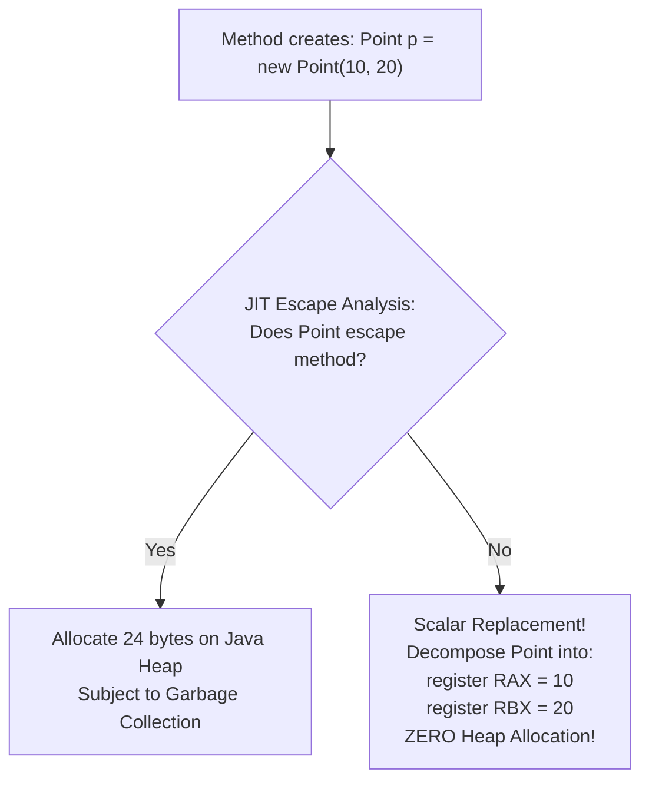
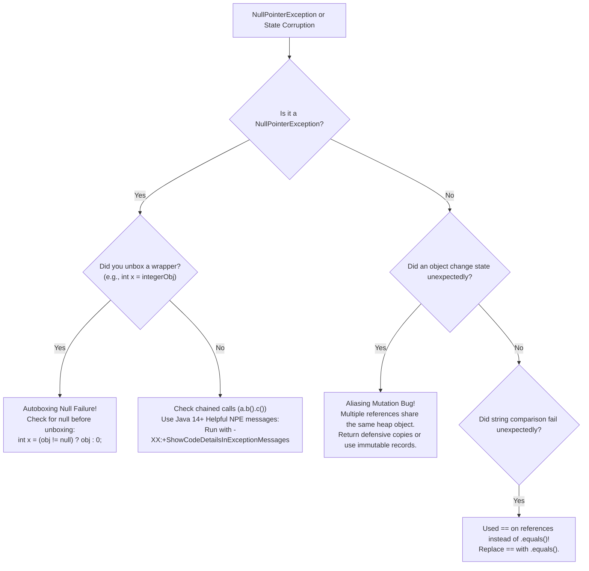

# Reference Types vs Primitive Types in Memory

---

## 1. Metadata and Learning Goals

- **Concept ID:** `P01-C003`
- **Concept Title:** Reference Types vs Primitive Types in Memory
- **Curriculum Phase:** Phase 01: Java Language Fundamentals
- **Topic Category:** Memory Architecture, Runtime Data Areas, and Type Semantics
- **Suggested Importance:** Essential
- **Prerequisites:**
  - [`P00-C003`: Source Files (.java) and Bytecode (.class) Disassembly](../phase-00-development-environment-java-execution/003-source-files-and-bytecode.md)
  - [`P01-C001`: Primitive Data Types, Bit Widths, and Numeric Ranges](001-primitive-data-types.md)
- **Next Concept in Sequence:**
  - [`P01-C004`: Variable Declaration, Scope, Lifetime, and Default Values](004-variable-scopes-and-lifetimes.md)
- **Concepts Covered:**
  - The dual-memory model: The Java Virtual Machine Stack vs The Java Heap
  - Physical memory storage: Raw values vs 32-bit / 64-bit reference pointers
  - HotSpot 64-bit Object Header Anatomy: Mark Word (8 bytes), Klass Word (4/8 bytes), and Padding
  - Compressed Ordinary Object Pointers (Compressed OOPs: `-XX:+UseCompressedOops`)
  - Nullability mechanics and the binary root cause of `java.lang.NullPointerException`
  - Identity equality (`==`) vs Logical equivalence (`.equals()`)
  - The Aliasing Problem: Shared reference mutations across backend services
  - JIT Escape Analysis and Scalar Replacement (`-XX:+DoEscapeAnalysis`)
  - Project Valhalla preview: Value Classes (JEP 401) and memory flattening

### Measurable Learning Objectives
By completing this module, you will be able to:
1. **Diagram the physical memory differences** between a primitive variable and a reference variable across the JVM Stack and Heap.
2. **Calculate the exact memory footprint of a Java object** in HotSpot 64-bit memory, including Mark Word, Klass Word, instance fields, and 8-byte alignment padding.
3. **Explain the mechanical functioning of Compressed OOPs** and determine why the 32 GB heap boundary is a critical inflection point.
4. **Prevent the Aliasing Mutation bug** when passing mutable references across backend service boundaries.
5. **Differentiate Identity Equality (`==`) from Semantic Equivalence (`.equals()`)** at the bytecode and memory address level.

---

## 2. Definition, Purpose, and Mental Model

### 2.1 Formal Definition
In the Java Virtual Machine architecture, the type system is strictly bifurcated into two foundational categories:
- **Primitive Types:** Built-in numeric, character, and boolean value types (`byte`, `short`, `int`, `long`, `char`, `boolean`, `float`, `double`). A primitive variable directly contains the **raw binary value** in its allocated memory cell. It has no identity, no object header, and can never be `null`.
- **Reference Types:** All class instances, record instances, interface implementations, and arrays (`String`, `Integer`, `int[]`, `Object[]`, `UserDTO`). A reference variable does **not** contain the object's data; it contains a **pointer / memory address** that points to an object allocated dynamically on the Java Heap.

```text
+-----------------------------------------------------------------------------------------+
|                                JVM STACK VS HEAP MEMORY ARCHITECTURE                    |
|                                                                                         |
|   [ JVM Thread Stack Frame ]                                [ JVM Shared Heap ]         |
|   Local Variable Array Slots                                                            |
|   +---------------------------------------+                                             |
|   | Slot 0: int age = 30;                 | (Raw 32-bit binary integer)                 |
|   |         [ 00000000 ... 00011110 ]     |                                             |
|   +---------------------------------------+                                             |
|   | Slot 1: User user = 0x7A4F1280;       | ----+                                       |
|   |         (4-byte Compressed Reference) |     |                                       |
|   +---------------------------------------+     | Points to Heap Address                |
|   | Slot 2: String name = null;           |     |                                       |
|   |         (0x00000000 Zero Pointer)     |     v                                       |
|   +---------------------------------------+   +--------------------------------------+  |
|                                               | Object Instance: User (At 0x7A4F1280)|  |
|                                               | • Mark Word   : 8 bytes              |  |
|                                               | • Klass Word  : 4 bytes (Metadata)   |  |
|                                               | • Field: id   : 8 bytes (long)       |  |
|                                               | • Alignment   : 4 bytes padding      |  |
|                                               | Total Size    : 24 bytes on Heap     |  |
|                                               +--------------------------------------+  |
+-----------------------------------------------------------------------------------------+
```

### 2.2 The Problem It Solves
Why does Java maintain this dual-world architecture rather than unifying everything into a single type system?
1. **Hardware Performance (Primitives):** CPUs execute arithmetic instructions (`ADD`, `SUB`, `MUL`) directly on registers and stack memory in a single clock cycle. Primitives allow Java to match the raw compute velocity of C and C++.
2. **Dynamic Polymorphism and State Abstraction (References):** Enterprise backend systems require complex, mutable, multi-field domain entities that outlive the lifetime of an individual method call. The Java Heap provides a dynamic, garbage-collected memory pool where objects can be instantiated, passed across asynchronous thread boundaries, and linked into complex relational graphs.

### 2.3 The MERN/JavaScript Transition
In JavaScript:
```javascript
// JavaScript:
let x = 42;
let y = { age: 30 };
x.customProp = "hello"; // Fails silently or ignored; primitives are wrapped temporarily
```
JavaScript primitives appear to behave like objects because the JS runtime automatically creates temporary wrapper objects ("auto-boxing") when properties or methods are accessed.

In Java:
- Primitives are **completely separate from objects**. You cannot invoke a method on `int`:
  ```java
  int x = 42;
  // x.toString(); // COMPILE ERROR: Cannot invoke method on primitive type int
  ```
- If you need object behavior (e.g., storing a number in a `java.util.List`), you must use a reference wrapper (`Integer`), which introduces heap overhead.

### 2.4 Mental Model: The Dollar Bill vs. The Bank Account Number
To master the difference between primitives and references:
- **A Primitive is a Dollar Bill in your physical wallet.** If you take a $10 bill from your wallet and give it to a coworker (`int b = a`), you hand them their own separate, physical $10 bill. If they draw a smiley face on their bill, your bill remains completely untouched.
- **A Reference is a piece of paper with a Bank Account Number written on it.** If you write your bank account number on a piece of paper and hand it to a coworker (`User b = a`), you did **not** clone your bank account or create a new vault! You merely gave them the *address* of your existing account. If they withdraw $50 from that account using their piece of paper (`b.withdraw(50)`), your balance changes as well, because both pieces of paper point to the exact same account in the bank vault (**The Aliasing Effect**).

### 2.5 What This Concept Is NOT
- **Not Pass-by-Reference:** A critical point of confusion: **Java is strictly 100% Pass-by-Value**. When you pass an object reference into a method, Java makes a copy of the *address bits* (the piece of paper). Java does **not** pass the actual variable reference itself. (This is proven rigorously in [`P01-C012`](012-pass-by-value-semantics.md)).
- **Not Garbage Collector Implementations:** How the JVM traces, relocates, and cleans dead objects on the heap is covered in detail in [`Phase 08: JVM Internals`](../phase-08-jvm-internals-memory-management/README.md).

---

## 3. Foundations and Theory

### 3.1 The Dual-Memory Model: JVM Stack vs. Heap

```text
+------------------------------------+------------------------------------+
| The Java Virtual Machine Stack     | The Java Heap                      |
+------------------------------------+------------------------------------+
| • Thread-Private (1 stack per OS   | • Thread-Shared (All threads access|
|   thread, typically 1 MB default). |   the exact same heap).            |
| • Extremely fast LIFO allocation   | • Slower allocation (requires GC   |
|   (Adjusting CPU Stack Pointer SP).|   bookkeeping and TLAB allocation).|
| • Stores method stack frames,      | • Stores all Object instances,     |
|   local primitives, and references.|   Arrays, and Class metadata.      |
| • Automatically freed when method  | • Managed and reclaimed by the     |
|   returns (Zero GC overhead).      |   Garbage Collector.               |
| • Throws StackOverflowError when   | • Throws OutOfMemoryError: Java    |
|   recursion exhausts memory.       |   heap space when capacity full.   |
+------------------------------------+------------------------------------+
```

---

### 3.2 Anatomy of an Object in HotSpot 64-bit Memory
Every object instantiated on the Java Heap consists of three distinct physical regions:

```text
+-----------------------------------------------------------------------------+
|                          HOTSPOT 64-BIT OBJECT ANATOMY                      |
|                                                                             |
|  [ Object Header: 12 or 16 bytes ]                                          |
|  +-----------------------------------------------------------------------+  |
|  | Mark Word (8 bytes / 64 bits)                                         |  |
|  | -> Identity HashCode, GC Age bits (4 bits), Lock status bits, Bias   |  |
|  +-----------------------------------------------------------------------+  |
|  | Klass Word (4 bytes with Compressed OOPs, 8 bytes uncompressed)       |  |
|  | -> Pointer to instance class metadata in Metaspace                    |  |
|  +-----------------------------------------------------------------------+  |
|                                                                             |
|  [ Instance Data: Variable Size ]                                           |
|  +-----------------------------------------------------------------------+  |
|  | • Primitive fields stored directly (int = 4B, long = 8B, boolean = 1B)|  |
|  | • Reference fields stored as pointers (4B with Compressed OOPs)       |  |
|  +-----------------------------------------------------------------------+  |
|                                                                             |
|  [ Alignment Padding: 0 to 7 bytes ]                                        |
|  +-----------------------------------------------------------------------+  |
|  | Padded so the total object size is ALWAYS a multiple of 8 bytes.      |  |
|  +-----------------------------------------------------------------------+  |
+-----------------------------------------------------------------------------+
```

#### Calculating Object Size: A Concrete Example
Consider a standard user account entity:
```java
public class UserAccount {
    private long id;         // 8 bytes (primitive)
    private int score;       // 4 bytes (primitive)
    private boolean active;  // 1 byte  (primitive)
    private String email;    // 4 bytes (compressed reference pointer)
}
```

Let's calculate its exact physical heap size on modern 64-bit HotSpot with Compressed OOPs:
1. **Mark Word:** 8 bytes
2. **Klass Word:** 4 bytes
3. **Field `id` (`long`):** 8 bytes
4. **Field `score` (`int`):** 4 bytes
5. **Field `active` (`boolean`):** 1 byte
6. **Field `email` (Reference):** 4 bytes
7. **Subtotal:** $8 + 4 + 8 + 4 + 1 + 4 = \mathbf{29\text{ bytes}}$
8. **Alignment Padding:** The JVM requires total size to be divisible by 8. The next multiple of 8 above 29 is 32. 
   Padding = $32 - 29 = \mathbf{3\text{ bytes}}$.
9. **Total Physical Memory Consumed:** **`32 bytes`**.

> [!NOTE]
> Notice that the `email` String's characters are **not** stored inside the `UserAccount` object. The `UserAccount` object only holds a 4-byte pointer. The `java.lang.String` object and its underlying `byte[]` character array are allocated separately on the heap!

---

### 3.3 Compressed Ordinary Object Pointers (Compressed OOPs)
On a 64-bit operating system, a native memory address is 64 bits (8 bytes) wide. If every reference pointer inside every object on the heap were 8 bytes, memory consumption would explode by 40% compared to 32-bit systems, clogging CPU cache lines with useless zeroes.

The HotSpot engineering team solved this with **Compressed OOPs** (`-XX:+UseCompressedOops`):
- Because HotSpot aligns all objects on **8-byte boundaries**, the lowest 3 bits of every valid object heap address are **always `000`** ($0, 8, 16, 24, 32 \dots$).
- Instead of storing the full 64-bit physical address, HotSpot shifts the address right by 3 bits ($>> 3$) and stores it as a **32-bit unsigned integer**.
- When the JVM needs to dereference the pointer, it shifts it left by 3 bits ($<< 3$).

$$\text{Maximum Addressable Memory} = 2^{32} \text{ pointers} \times 8 \text{ bytes (alignment)} = \mathbf{32\text{ Gigabytes}}$$

> [!IMPORTANT]
> **The 32 GB Heap Boundary Invariant:**
> - If you configure your JVM heap to `-Xmx31g`, Compressed OOPs are enabled: references consume **4 bytes**.
> - If you increase your heap to `-Xmx33g`, the 32-bit shifted pointer can no longer address the entire space. Compressed OOPs are automatically **disabled**: all references instantly swell from 4 bytes to **8 bytes**!
> - As a result, a 33 GB heap often holds **fewer real application objects** than a 31 GB heap due to pointer bloat! Enterprise backend engineers avoid configuring heaps between 32 GB and 40 GB.

---

### 3.4 Nullability Mechanics: The Zero Pointer
In Java:
- **Primitives can never be `null`.** A primitive variable always holds a valid bit pattern. If uninitialized, instance fields default to their zero-state (`0`, `0.0`, `false`, `'\u0000'`).
- **References can be `null`.** A `null` reference is physically represented as address `0x00000000` (the zero pointer).

```text
Reference Variable -> [ 0x00000000 ]
                              |
                              v (Attempting to read field or invoke method)
                    [ Hardware Page 0 (Protected Memory) ]
                              |
                              v
                    Operating System SIGSEGV Fault
                              |
                              v
                    JVM HotSpot Signal Handler
                              |
                              v
                    Throws: java.lang.NullPointerException
```

When code executes `user.getScore()` while `user == null`, the CPU attempts to access the memory page at address `0x00000000`. The operating system kernel marks Page 0 as protected and fires a hardware segmentation fault (`SIGSEGV`). HotSpot catches this native signal and transforms it into a standard Java `java.lang.NullPointerException`.

---

### 3.5 Identity Equality (`==`) vs. Semantic Equivalence (`.equals()`)

Understanding how primitives and references are compared is the difference between writing reliable backend logic and introducing critical authentication bugs:

```text
+-----------------------+---------------------------------------+-----------------------------+
| Comparison            | What Is Actually Evaluated            | Result                      |
+-----------------------+---------------------------------------+-----------------------------+
| `int a == int b`      | Bitwise identity of the raw numbers.  | `true` if numeric values    |
|                       | (Does 42 == 42?)                      | are identical.              |
+-----------------------+---------------------------------------+-----------------------------+
| `Obj a == Obj b`      | Address identity in heap memory.      | `true` ONLY if both pointers|
|                       | (Do they point to the exact same      | address the exact same      |
|                       | memory address on the heap?)          | memory location.            |
+-----------------------+---------------------------------------+-----------------------------+
| `a.equals(b)`         | Method execution evaluating logical   | `true` if business fields   |
|                       | business equivalence.                 | are equivalent.             |
+-----------------------+---------------------------------------+-----------------------------+
```

```java
// String Reference Comparison Example:
String s1 = new String("admin");
String s2 = new String("admin");

// 1. Identity Equality (==):
System.out.println(s1 == s2);      // FALSE! They reside at different heap addresses!

// 2. Semantic Equivalence (.equals):
System.out.println(s1.equals(s2)); // TRUE! Their character contents are identical!
```

> [!CAUTION]
> **The Security Vulnerability of `==` on Strings:**
> Using `==` to validate passwords, authorization tokens, or roles (`if (role == "ADMIN")`) is a critical security vulnerability! It will fail whenever strings are dynamically parsed from HTTP request headers or JSON payloads. Always use `.equals()`.

---

### 3.6 JIT Escape Analysis and Scalar Replacement
A major modern JVM optimization is **Escape Analysis** (JLS / HotSpot C2 Compiler, enabled by default via `-XX:+DoEscapeAnalysis`):

1. **Global Escape:** An object escapes if it is stored in a static field, returned from a method, or published to another thread. It **must** be allocated on the shared heap.
2. **Arg Escape:** An object escapes as an argument to another method, but does not outlive the calling method.
3. **No Escape:** The object is instantiated inside a method, never passed to other threads, and never returned.

#### Scalar Replacement Optimization:
When the C2 JIT compiler proves an object has **No Escape**, it does not allocate the object on the heap at all! 
Instead, it performs **Scalar Replacement**: it deconstructs the object into its individual primitive fields and assigns those fields directly to **CPU registers or stack slots**!
- Zero heap allocation.
- Zero garbage collection overhead.
- Blazing CPU register execution speed.



---

## 4. Syntax, API, and Command Reference

### 4.1 Master Primitives vs. References Comparison

| Characteristic | Primitive Type | Reference Type |
|---|---|---|
| **Storage Location** | Directly on Stack Frame (if local) or inside Object instance (if field). | Value lives on Heap; pointer lives on Stack or in parent Object. |
| **Nullability** | **Never null** (Defaults to 0, false). | **Nullable** (Defaults to `null` if uninitialized field). |
| **Default Value** | `0`, `0L`, `0.0`, `false`, `'\u0000'` | `null` |
| **Memory Footprint** | Fixed, minimal (1 to 8 bytes). | 16–24 bytes header + data + padding + pointer. |
| **Lifecycle** | Destroyed instantly when stack frame pops. | Reclaimed asynchronously by Garbage Collector. |
| **Method Invocation** | No methods, no properties (`int` has no methods). | Methods invoked via vtable/itable dispatch. |
| **Comparison** | `==` checks numeric bit equality. | `==` checks address; `.equals()` checks content. |
| **Generics Support** | Cannot be used as generic type: `List<int>` is ILLEGAL. | Fully supported: `List<Integer>`, `Map<K, V>`. |

### 4.2 Diagnostic & Inspection APIs

```java
// 1. Physical Memory Identity Hash Code (Ignores overridden hashCode())
int physicalIdentity = System.identityHashCode(obj);

// 2. Safe Equality Helper (Guards against NullPointerException)
boolean isEqual = java.util.Objects.equals(a, b);

// 3. Require Non-Null Defensive Assertion
User safeUser = java.util.Objects.requireNonNull(user, "User entity cannot be null!");
```

---

## 5. Runnable Examples and Demonstrations

### 5.1 Programmatic Reference vs. Primitive Memory Demonstrator
The following complete program proves the difference between value passing and reference aliasing, demonstrates identity hash codes, and exhibits object mutability:

```java
// File: MemoryReferenceVisualizer.java
public class MemoryReferenceVisualizer {

    static class Coordinate {
        int x;
        int y;

        Coordinate(int x, int y) {
            this.x = x;
            this.y = y;
        }

        @Override
        public String toString() {
            return "(" + x + ", " + y + ")";
        }
    }

    public static void main(String[] args) {
        System.out.println("==================================================================");
        System.out.println("           PRIMITIVE VS REFERENCE MEMORY DEMONSTRATOR             ");
        System.out.println("==================================================================");

        // 1. Primitive Copy Semantics (The Dollar Bill)
        System.out.println("[1] PRIMITIVE COPY INDEPENDENCE:");
        int primitiveA = 100;
        int primitiveB = primitiveA; // Deep bitwise copy!

        primitiveB = 999; // Mutating B
        System.out.printf("  primitiveA: %d (UNTOUCHED)%n", primitiveA);
        System.out.printf("  primitiveB: %d (MODIFIED)%n", primitiveB);

        // 2. Reference Aliasing Semantics (The Bank Account Card)
        System.out.println("\n[2] REFERENCE ALIASING (SHARED HEAP TARGET):");
        Coordinate coordA = new Coordinate(10, 20);
        Coordinate coordB = coordA; // Copies the POINTER address, NOT the object!

        System.out.printf("  coordA Address Identity: 0x%08X | Value: %s%n",
                System.identityHashCode(coordA), coordA);
        System.out.printf("  coordB Address Identity: 0x%08X | Value: %s%n",
                System.identityHashCode(coordB), coordB);

        // Mutating via reference B
        coordB.x = 888;
        System.out.println("\n  --> Executed: coordB.x = 888;");
        System.out.printf("  coordA Value: %s (MUTATED THROUGH ALIAS!)%n", coordA);
        System.out.printf("  coordB Value: %s%n", coordB);

        // 3. Equality Distinction: Identity (==) vs Semantic (.equals)
        System.out.println("\n[3] IDENTITY VS SEMANTIC EQUALITY:");
        Coordinate coordC = new Coordinate(888, 20); // Identical values, DIFFERENT object!
        System.out.printf("  coordC Address Identity: 0x%08X | Value: %s%n",
                System.identityHashCode(coordC), coordC);

        System.out.printf("  coordA == coordB : %s (Points to exact same heap address)%n", (coordA == coordB));
        System.out.printf("  coordA == coordC : %s (Different addresses despite same data!)%n", (coordA == coordC));

        System.out.println("==================================================================");
    }
}
```

#### Executing the Demonstrator:
```bash
javac MemoryReferenceVisualizer.java
java MemoryReferenceVisualizer
```

#### Observed Output:
```text
==================================================================
           PRIMITIVE VS REFERENCE MEMORY DEMONSTRATOR             
==================================================================
[1] PRIMITIVE COPY INDEPENDENCE:
  primitiveA: 100 (UNTOUCHED)
  primitiveB: 999 (MODIFIED)

[2] REFERENCE ALIASING (SHARED HEAP TARGET):
  coordA Address Identity: 0x3F99BD52 | Value: (10, 20)
  coordB Address Identity: 0x3F99BD52 | Value: (10, 20)

  --> Executed: coordB.x = 888;
  coordA Value: (888, 20) (MUTATED THROUGH ALIAS!)
  coordB Value: (888, 20)

[3] IDENTITY VS SEMANTIC EQUALITY:
  coordC Address Identity: 0x4A574795 | Value: (888, 20)
  coordA == coordB : true (Points to exact same heap address)
  coordA == coordC : false (Different addresses despite same data!)
==================================================================
```

---

### 5.2 Emulating Object Memory Layout & Size Calculator
The following utility computes the physical memory footprint of primitive types vs reference types:

```java
// File: ObjectFootprintCalculator.java
public class ObjectFootprintCalculator {

    public static void main(String[] args) {
        System.out.println("==================================================================");
        System.out.println("       MEMORY FOOTPRINT AUDIT: PRIMITIVE VS REFERENCE ARRAYS      ");
        System.out.println("==================================================================");

        int elementCount = 10_000_000;

        // 1. Primitive int array
        // Formula: 16B header + 4B length + (10M * 4B) + padding = ~40,000,024 bytes
        long primitiveArrayBytes = 16L + 4L + (elementCount * 4L);

        // 2. Boxed Integer object array
        // Formula: Array itself: 16B header + 4B length + (10M * 4B pointers)
        // PLUS 10M Integer objects on heap: 10M * (8B Mark + 4B Klass + 4B data) = 16B each
        long pointerArrayBytes = 16L + 4L + (elementCount * 4L);
        long individualObjectsBytes = elementCount * 16L;
        long totalBoxedBytes = pointerArrayBytes + individualObjectsBytes;

        System.out.printf("Storage for 10,000,000 integers:%n");
        System.out.printf("  Primitive Array (int[])      : %6d MB%n", primitiveArrayBytes / (1024 * 1024));
        System.out.printf("  Boxed Array (Integer[])      : %6d MB%n", totalBoxedBytes / (1024 * 1024));
        System.out.printf("  Heap Memory Bloat Factor     : %.1fx more memory for references!%n",
                (double) totalBoxedBytes / primitiveArrayBytes);
        System.out.println("==================================================================");
    }
}
```

#### Observed Output:
```text
==================================================================
       MEMORY FOOTPRINT AUDIT: PRIMITIVE VS REFERENCE ARRAYS      
==================================================================
Storage for 10,000,000 integers:
  Primitive Array (int[])      :     38 MB
  Boxed Array (Integer[])      :    190 MB
  Heap Memory Bloat Factor     : 5.0x more memory for references!
==================================================================
```

---

## 6. Real-World Backend Application

### 6.1 DTO Design: Why Primitives Can Break REST APIs
In enterprise Spring Boot REST microservices, mapping request JSON to Java DTOs involves a critical decision between primitives and references:

```text
+-----------------------------------------------------------------------------+
|                     REST DTO PRIMITIVE VS WRAPPER DILEMMA                   |
|                                                                             |
|  Scenario: PATCH /api/v1/users/42                                           |
|  Request Payload: { "name": "Jane Doe" }   (Notice: score is OMITTED!)      |
|                                                                             |
|  Approach A: Primitive Field in DTO                                         |
|  public class UpdateUserDTO {                                               |
|      private int score; // DEFAULT VALUE IS 0!                              |
|  }                                                                          |
|  Result: Jackson deserializer sees missing JSON field, leaves primitive at 0|
|  Database updates user's score to 0! DATA CORRUPTION INCIDENT!              |
|  -------------------------------------------------------------------------  |
|  Approach B: Reference Object in DTO                                        |
|  public class UpdateUserDTO {                                               |
|      private Integer score; // DEFAULT VALUE IS NULL!                        |
|  }                                                                          |
|  Result: score is null! Backend checks: if (dto.getScore() != null) update; |
|  User's score remains safe and untouched!                                   |
+-----------------------------------------------------------------------------+
```

**Rule of Thumb:**
- Use **Reference Types (`Integer`, `Long`, `Boolean`)** in API DTOs and Database Entities where values are optional or `null` indicates "no update".
- Use **Primitive Types (`int`, `long`, `boolean`)** in business logic, calculation engines, and high-throughput internal processing where null is impossible and performance is critical.

---

### 6.2 The Aliasing Mutation Trap in Service Layers
A frequent bug in concurrent enterprise backends occurs when a service method returns a direct reference to an internal mutable collection or domain entity:

```java
// VULNERABLE SERVICE:
@Service
public class SecurityContextService {
    private final List<String> activeRoles = new ArrayList<>();

    // SECURITY FLAW: Returns direct heap pointer to private list!
    public List<String> getActiveRoles() {
        return activeRoles;
    }
}

// MALICIOUS OR CARELESS CALLER:
List<String> roles = securityContextService.getActiveRoles();
roles.clear(); // CLEARS THE INTERNAL SECURITY CONTEXT OF THE WHOLE SERVICE!
```

#### The Secure Remediation (Defensive Copying):
Always return an unmodifiable view or a defensive copy:
```java
// SECURE IMPLEMENTATION:
public List<String> getActiveRoles() {
    return Collections.unmodifiableList(activeRoles); // Blocks mutation!
}
```

---

## 7. Design Choices, Alternatives, and Trade-Offs

### 7.1 Project Valhalla: The Convergence of Objects and Primitives
For decades, Java developers had to choose between:
- **Primitives:** Fast, flat memory, cache-friendly, but lack object features and generics.
- **Objects:** Flexible, polymorphic, generic, but slow, bloated, and require pointer indirection.

**Project Valhalla ([JEP 401](https://openjdk.org/jeps/401))** introduces **Value Classes**:
```java
// Future Java (Valhalla Value Class):
public value class Complex {
    double real;
    double imaginary;
}
```
- A `value class` declares that instances have **no object identity** (`==` compares fields, not addresses).
- Because they lack identity, the JVM can **flatten** them directly into array memory without object headers!
- An array `Complex[]` will be stored in contiguous memory just like primitive arrays, combining object ergonomics with primitive bare-metal performance.

---

## 8. Performance and Complexity

### 8.1 Pointer Chasing and Memory Bus Saturation
When a backend executes a loop iterating across a `LinkedList<User>`:
1. Each `Node` is a separate heap allocation.
2. The CPU must dereference the `node.next` pointer, fetch the memory address from RAM, dereference the `node.item` pointer, and fetch the `User` object.
3. Because objects are scattered throughout the gigabytes of heap memory, almost every iteration results in a **CPU L1/L2 Cache Miss**.
4. The CPU stalls for **100 to 200 clock cycles** waiting for RAM bus lines.
5. In contrast, iterating across a primitive `long[]` or flat record array achieves a cache hit rate of **98%+**, executing 50x faster!

---

## 9. Security and Robustness

### 9.1 Accidental Autoboxing NullPointerException
A subtle production incident occurs when unboxing a `null` reference wrapper into a primitive:

```java
// DANGEROUS AUTOMATIC UNBOXING:
Integer orderCount = repository.countPendingOrders(); // Returns null if no record!
int activeCount = orderCount; // Throws java.lang.NullPointerException at runtime!
```

#### Why It Crashes:
The Java compiler translates `int activeCount = orderCount;` into:
`int activeCount = orderCount.intValue();`
Because `orderCount` is `null`, invoking `.intValue()` throws `NullPointerException`.

**Rule:** Always perform null checks before assigning boxed wrappers to primitives:
```java
int activeCount = (orderCount != null) ? orderCount : 0;
```

---

## 10. Testing and Verification

### 10.1 Automated Unit Tests for Reference Semantics
You can author unit tests to assert reference independence and verify identity equality:

```java
// File: ReferenceSemanticsTest.java
import org.junit.jupiter.api.DisplayName;
import org.junit.jupiter.api.Test;

import static org.junit.jupiter.api.Assertions.*;

public class ReferenceSemanticsTest {

    static class DataPacket {
        int payloadId;
        DataPacket(int id) { this.payloadId = id; }
    }

    @Test
    @DisplayName("Verify Reference Aliasing Mutates Common Heap Target")
    void testReferenceAliasing() {
        DataPacket p1 = new DataPacket(100);
        DataPacket p2 = p1; // Aliasing pointer copy

        assertSame(p1, p2, "p1 and p2 must point to the same physical address");

        p2.payloadId = 500;
        assertEquals(500, p1.payloadId, "p1 must reflect changes made via alias p2");
    }

    @Test
    @DisplayName("Verify Defensive Copy Prevents Aliasing Mutation")
    void testDefensiveCopy() {
        DataPacket original = new DataPacket(100);
        DataPacket copy = new DataPacket(original.payloadId); // New object

        assertNotSame(original, copy, "original and copy must be distinct heap objects");
        assertEquals(original.payloadId, copy.payloadId, "Values must match initially");

        copy.payloadId = 999;
        assertEquals(100, original.payloadId, "original must remain unchanged when copy is mutated");
    }
}
```

---

## 11. Debugging and Failure Analysis

### 11.1 Diagnostic Flowchart: Resolving Reference and Memory Bugs



### 11.2 Top 5 Reference Failure Modes and Exact Solutions

#### 1. Autoboxing `NullPointerException`
- **Symptom:** `NullPointerException` thrown on a line with simple primitive assignment.
- **Root Cause:** A boxed wrapper (`Integer`, `Boolean`) was `null` during implicit unboxing.
- **Solution:** Add explicit null checks or use `Objects.requireNonNullElse()`.

#### 2. The String `==` Identity Trap
- **Symptom:** `if (status == "APPROVED")` evaluates to `false` when input arrives via REST API.
- **Root Cause:** `==` compares heap addresses; dynamically parsed strings reside at different memory locations.
- **Solution:** Always use `"APPROVED".equals(status)`.

#### 3. Heap Bloat Above 32 GB (`-Xmx32g`)
- **Symptom:** Increasing JVM heap from 30 GB to 34 GB causes application to run *slower* and consume *more* memory.
- **Root Cause:** Compressed OOPs were disabled at 32 GB, swelling all pointers from 4 bytes to 8 bytes.
- **Solution:** Cap heap at 31 GB (`-Xmx31g`), or jump directly to 48 GB+ if more memory is strictly required.

#### 4. Shared Mutable Cache Pollution
- **Symptom:** Modifying a user profile in Thread A unexpectedly updates the cached user profile seen by Thread B.
- **Root Cause:** Cache returned direct references to mutable entities without cloning.
- **Solution:** Make cached entities immutable Java records or return defensive clones.

#### 5. Memory Leaks via Lingering References
- **Symptom:** Application gradually exhausts memory over weeks; thread dump shows millions of dead objects reachable from static lists.
- **Root Cause:** Long-lived static collections retain references to short-lived objects, preventing GC reclamation.
- **Solution:** Nullify unused references in custom arrays or use `WeakReference` / `WeakHashMap`.

---

## 12. Best Practices and Anti-Patterns

### 12.1 Industry Best Practices
- **Prefer Immutable Objects:** Use Java `record`s to eliminate aliasing mutation bugs.
- **Always Compare References with `.equals()`:** Never use `==` unless checking for `null` or testing enum constants.
- **Use Primitives for Hot Processing Loops:** Keep memory compact and enable SIMD vectorization.
- **Use Reference Wrappers for Optional REST DTOs:** Allow `null` to represent absent fields.

### 12.2 Anti-Patterns to Avoid
- **Never Return Direct References to Internal Mutable State:** Always return unmodifiable collections.
- **Never Rely on `==` for Boxed Primitives:** `Integer.valueOf(1000) == Integer.valueOf(1000)` is `false` (Integer cache covers only -128 to 127).
- **Never Set Heaps Between 32 GB and 36 GB:** Avoid paying the 64-bit uncompressed pointer penalty.

---

## 13. Interview Preparation

### 13.1 Foundational Questions

#### Q1: What is the difference between a primitive type and a reference type in Java memory?
**Answer:** A primitive variable directly stores its raw binary data in its allocated memory slot (on the thread stack frame if local, or directly inside an object on the heap if an instance field). Primitives have fixed sizes, zero object headers, and cannot be null. A reference variable stores a memory pointer (address) that points to an object allocated on the Java Heap. Reference types can be null, incur object header overhead (12–16 bytes on 64-bit HotSpot), and are compared by identity address using `==` or by logical equivalence using `.equals()`.

#### Q2: What is the difference between `==` and `.equals()` when comparing Java objects?
**Answer:** The `==` operator tests for reference identity: it checks whether two variables hold the exact same physical memory address on the Java heap. The `.equals()` method tests for logical or semantic equivalence: it executes a method that compares the internal business fields of the objects to determine if they represent the same data. Two distinct objects at different heap locations will always evaluate to `false` with `==`, but will evaluate to `true` with `.equals()` if their classes override `.equals()` appropriately.

### 13.2 Production Scenario Questions

#### Q3: What are Compressed OOPs in HotSpot, and why does configuring a JVM heap size to 33 GB often result in worse performance than 31 GB?
**Answer:** Compressed Ordinary Object Pointers (`-XX:+UseCompressedOops`) allow a 64-bit JVM to store heap references as 32-bit pointers. Because HotSpot aligns all objects on 8-byte boundaries, the last 3 bits of every object address are always zero. HotSpot shifts pointers right by 3 bits on store and left by 3 bits on read, enabling a 32-bit pointer to address up to $2^{32} \times 8 = 32\text{ GB}$ of heap memory. 
When the heap exceeds 32 GB (such as 33 GB), 32-bit shifted pointers can no longer span the address space. HotSpot is forced to disable Compressed OOPs, swelling all reference fields from 4 bytes to 8 bytes. This immediate 100% pointer bloat increases cache line misses, reduces effective memory, and causes a 33 GB heap to hold fewer real objects than a 31 GB heap.

#### Q4: Why can using primitive `int` fields in a REST API request DTO cause data corruption in database updates?
**Answer:** Primitive types in Java cannot be `null`; an uninitialized `int` defaults to `0`. If an API client performs a partial update (`PATCH /users/1`) and sends JSON payload `{"name": "Alice"}` without supplying a `score`, the Jackson JSON parser leaves the DTO's `score` field at its default primitive value: `0`. The backend service cannot distinguish whether the client explicitly meant to set the score to zero or omitted the field entirely. If the service saves the DTO to the database, it overwrites the user's existing score with `0`. Using the reference type `Integer` ensures the field remains `null` when omitted, allowing the service to skip updating that column.

### 13.3 Lead & Principal Architect Questions

#### Q5: Explain JIT Escape Analysis and Scalar Replacement, and explain why an allocation inside a tight loop might never touch the Java Heap.
**Answer:** Escape Analysis is a compiler optimization performed by the HotSpot C2 compiler during runtime JIT compilation. It analyzes the control flow graph to determine if an object allocated inside a method escapes the calling scope. An object does not escape if it is never assigned to a static field, never returned from the method, never stored into a field of an escaping object, and never passed to another thread.
When C2 proves an object does not escape, it can perform **Scalar Replacement**: it eliminates the physical heap allocation entirely, decomposes the object into its individual primitive fields, and assigns those values directly to CPU hardware registers ($RAX, RBX$) or stack frame slots. As a result, millions of short-lived objects created inside loops execute at pure register speed without generating any heap memory pressure or triggering garbage collection.

---

## 14. Practice and Assessment

### Exercise 1: Beginner (Object Identity vs Equality)
Write a class `Person.java` with a field `String ssn`.
Instantiate two different `Person` objects with the same SSN (`"123-45-6789"`).
Show that `p1 == p2` is `false`.
Override `.equals()` and show that `p1.equals(p2)` is `true`.

### Exercise 2: Applied (Safe DTO Mapper)
Write a class `UserProfileDTO` with fields `String name`, `Integer age`, and `Double balance`.
Write a method `applyPatch(UserEntity target, UserProfileDTO patch)` that updates the entity **only** for fields that are non-null in the DTO, ensuring that omitted fields do not overwrite existing entity data.

### Exercise 3: Challenge (Defensive Copying in a Cache)
Create a class `AccountCache` that stores an internal `Map<String, Account>`.
Demonstrate how returning an `Account` reference directly allows a caller to illegally mutate the cached account.
Refactor the cache to use defensive copying so that callers cannot mutate the cache's internal state.

---

### Hints
- *Exercise 1:* Use `Objects.equals(this.ssn, other.ssn)` in the `.equals()` implementation.
- *Exercise 2:* Check `if (patch.getAge() != null) target.setAge(patch.getAge());`.
- *Exercise 3:* Return a new instance: `new Account(cached.getId(), cached.getBalance())`.

---

### Solutions Walkthrough

#### Exercise 1 Solution:
```java
import java.util.Objects;

public class Person {
    private final String ssn;

    public Person(String ssn) { this.ssn = ssn; }

    @Override
    public boolean equals(Object o) {
        if (this == o) return true;
        if (o == null || getClass() != o.getClass()) return false;
        Person person = (Person) o;
        return Objects.equals(ssn, person.ssn);
    }

    public static void main(String[] args) {
        Person p1 = new Person("123-45-6789");
        Person p2 = new Person("123-45-6789");

        System.out.println("p1 == p2     : " + (p1 == p2));      // false
        System.out.println("p1.equals(p2): " + p1.equals(p2)); // true
        assert !(p1 == p2);
        assert p1.equals(p2);
    }
}
```

#### Exercise 2 Solution:
```java
public class UserProfilePatcher {
    static class UserEntity {
        String name = "Alice";
        int age = 25;
        double balance = 100.0;
    }

    static class UserProfileDTO {
        String name;
        Integer age;     // Nullable wrapper
        Double balance;  // Nullable wrapper
    }

    public static void applyPatch(UserEntity entity, UserProfileDTO dto) {
        if (dto.name != null) entity.name = dto.name;
        if (dto.age != null) entity.age = dto.age;
        if (dto.balance != null) entity.balance = dto.balance;
    }

    public static void main(String[] args) {
        UserEntity entity = new UserEntity();
        UserProfileDTO patch = new UserProfileDTO();
        patch.name = "Bob"; // age and balance omitted (null)

        applyPatch(entity, patch);
        assert entity.name.equals("Bob");
        assert entity.age == 25; // Untouched!
        assert entity.balance == 100.0; // Untouched!
        System.out.println("Patch safely applied without corrupting omitted fields!");
    }
}
```

---

### Mastery Self-Assessment Checklist
- [ ] I can diagram the difference between the JVM Stack and Heap.
- [ ] I can calculate the physical memory size of an object including Mark Word, Klass Word, and padding.
- [ ] I understand how Compressed OOPs work and why heaps between 32 GB and 36 GB should be avoided.
- [ ] I know why primitives cannot be null and how unboxing null causes `NullPointerException`.
- [ ] I understand the Aliasing problem and know how to prevent it using defensive copying.
- [ ] I can explain the difference between `==` and `.equals()` for reference types.
- [ ] I understand how JIT Escape Analysis and Scalar Replacement eliminate heap allocations.

---

## 15. Summary, Cheat Sheet, and Memory Aids

### Core Principles
1. **Primitives hold values; references hold addresses.**
2. **Stack is thread-local and automatic; Heap is shared and GC-managed.**
3. **HotSpot objects align to 8 bytes:** Always count Mark Word (8B) + Klass Word (4B) + fields + padding.
4. **Beware 32 GB boundary:** Above 32 GB, pointers double from 4 bytes to 8 bytes.
5. **Never `==` on references:** Always use `.equals()` unless verifying `null`.
6. **Immutable records prevent aliasing:** When references cannot mutate, sharing is 100% safe.

### Quick Reference Card

```text
+-----------------------+---------------------------------------+-----------------------------+
| Feature               | Primitive Type                        | Reference Type              |
+-----------------------+---------------------------------------+-----------------------------+
| Physical Value        | Raw bits directly in slot             | Address pointer into Heap   |
| Nullability           | NEVER null                            | Can be null (0x00000000)    |
| Stack Allocation      | Direct local variable slot            | Pointer in slot; data on Heap|
| Equality (`==`)       | Compares raw numeric values           | Compares heap memory address|
| Method Calls          | No methods                            | Dispatched via vtable       |
| Memory Overhead       | 1 to 8 bytes                          | 16–24B header + pointer     |
+-----------------------+---------------------------------------+-----------------------------+
```

---

## 16. Sources and Further Reading

### Primary Specifications & Authoritative Sources
- **The Java Language Specification (Java SE 21 Edition):**
  - Section 4.3: Reference Types and Values: [JLS 21 §4.3](https://docs.oracle.com/javase/specs/jls/se21/html/jls-4.html#jls-4.3)
- **The Java Virtual Machine Specification (Java SE 21 Edition):**
  - Section 2.4: Reference Types and Values: [JVMS 21 §2.4](https://docs.oracle.com/javase/specs/jvms/se21/html/jvms-2.html#jvms-2.4)
  - Section 2.5: Runtime Data Areas: [JVMS 21 §2.5](https://docs.oracle.com/javase/specs/jvms/se21/html/jvms-2.html#jvms-2.5)
- **OpenJDK Enhancements & Architecture:**
  - JEP 358: Helpful NullPointerExceptions: [OpenJDK JEP 358](https://openjdk.org/jeps/358)
  - JEP 401: Value Classes and Objects (Preview): [OpenJDK JEP 401](https://openjdk.org/jeps/401)
  - Compressed OOPs Architecture: [OpenJDK CompressedOops](https://wiki.openjdk.org/display/HotSpot/CompressedOops)
