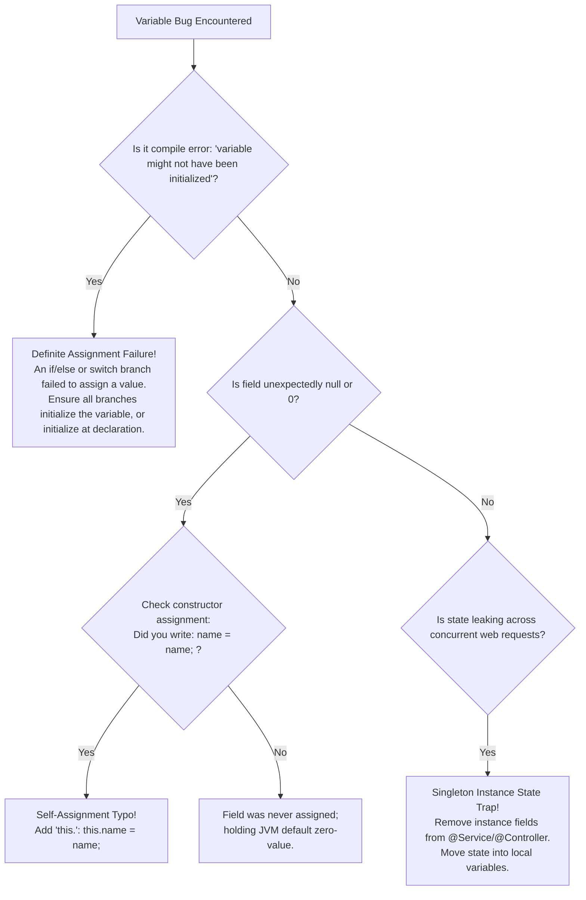

# Variable Declaration, Scope, Lifetime, and Default Values

---

## 1. Metadata and Learning Goals

- **Concept ID:** `P01-C004`
- **Concept Title:** Variable Declaration, Scope, Lifetime, and Default Values
- **Curriculum Phase:** Phase 01: Java Language Fundamentals
- **Topic Category:** Variables, Lexical Scope, Memory Lifecycles, and Initialization
- **Suggested Importance:** Essential
- **Prerequisites:**
  - [`P01-C001`: Primitive Data Types, Bit Widths, and Numeric Ranges](001-primitive-data-types.md)
  - [`P01-C003`: Reference Types vs Primitive Types in Memory](003-reference-types-vs-primitives.md)
- **Next Concept in Sequence:**
  - [`P01-C005`: Type Casting: Widening, Narrowing, and Overflow Traps](005-type-casting-and-overflow.md)
- **Concepts Covered:**
  - The four categories of variables: Local variables, Method parameters, Instance variables, and Class (`static`) variables
  - Lexical Scope boundaries: Block scope (`{ ... }`), Method scope, and Class scope
  - Memory Lifecycles: Stack frame duration vs Heap object lifetime vs ClassLoader Metaspace lifecycle
  - Default Initialization Rules: Automatic zero-initialization of fields vs mandatory initialization of local variables
  - The Java Compiler's Definite Assignment Analysis (JLS §16)
  - Variable Shadowing (parameter hiding field) vs Variable Hiding vs Illegal Redeclaration
  - The `this` self-reference keyword for field disambiguation
  - Thread-safety via Stack Confinement (Why local variables can never have race conditions)
  - The Spring Boot Singleton Pitfall: Cross-tenant data leakage caused by instance fields in web services

### Measurable Learning Objectives
By completing this module, you will be able to:
1. **Differentiate the four Java variable categories** by memory storage location, initialization rules, and lifecycle boundaries.
2. **Explain why local variables require explicit initialization** while class and instance fields receive automatic default values.
3. **Trace the Definite Assignment analysis performed by `javac`** and eliminate compile-time initialization errors in conditional logic.
4. **Disambiguate shadowed instance variables** using the `this` keyword.
5. **Architect thread-safe backend services** by enforcing stack confinement and avoiding mutable instance state in singleton Spring components.

---

## 2. Definition, Purpose, and Mental Model

### 2.1 Formal Definition
- **Variable:** A named storage location in memory capable of holding a value of a declared type.
- **Scope (Visibility):** The region of program source code within which a variable can be referred to by its simple, unqualified name. Scope is a compile-time, lexical property.
- **Lifetime (Duration):** The interval of time during program execution between when memory is allocated for a variable and when that memory is reclaimed. Lifetime is a runtime, physical property.
- **Definite Assignment:** A formal compiler invariant defined in the Java Language Specification (JLS §16) guaranteeing that every local variable must be definitely assigned a value before any access or read operation occurs.

```text
+-----------------------------------------------------------------------------------------+
|                                  THE FOUR VARIABLE CATEGORIES                           |
|                                                                                         |
|  1. Local Variables:       Declared inside a method or block { }.                       |
|                            Lives on Thread Stack Frame. No default values.              |
|                                                                                         |
|  2. Method Parameters:     Declared in method signature.                                |
|                            Passed by value into stack frame on call.                    |
|                                                                                         |
|  3. Instance Fields:       Declared in class body without 'static'.                     |
|                            Lives inside Object on the Heap. Auto-initialized to default.|
|                                                                                         |
|  4. Class (Static) Fields: Declared in class body with 'static'.                        |
|                            Shared across all instances. Lives in Metaspace/Heap.        |
+-----------------------------------------------------------------------------------------+
```

### 2.2 The Problem It Solves
In unconstrained programming environments, managing state is chaotic:
- If all variables were global, every function could overwrite another function's data, making multithreaded concurrent programming impossible.
- If variables never died, memory would grow indefinitely, leading to system crashes.
- If uninitialized variables contained random garbage bits left over by previous programs (as in C/C++), programs would suffer undefined behavior and security exploits.

Java solves these problems through **strict lexical scoping**, **automatic garbage collection**, and **compiler-enforced definite assignment**.

### 2.3 The MERN/JavaScript Transition
If your background is in JavaScript/TypeScript:
1. **Hoisting Does Not Exist in Java:** In JavaScript, variables declared with `var` are hoisted to the top of their function scope. In Java, **a variable cannot be accessed before the line on which it is declared**.
   ```java
   // ILLEGAL IN JAVA (Compile Error):
   // System.out.println(count); 
   int count = 10;
   ```
2. **No Variable Redeclaration in Nested Blocks:** In JavaScript, you can shadow an outer `let` variable in an inner block. In Java, **re-declaring a local variable with the same name in a nested block is strictly forbidden**:
   ```java
   int x = 5;
   {
       // int x = 10; // COMPILE ERROR in Java: Variable 'x' is already defined in this scope!
   }
   ```
3. **No `undefined` Type:** Java has no `undefined` keyword. Variables hold a valid primitive value, a reference pointer, or `null`.

### 2.4 Mental Model: Sticky Notes, Office Whiteboards, and Roof Billboards
To master variable scopes:
- **Local Variable = A Sticky Note on Your Personal Desk.** It is visible only to you during one specific phone call (`method execution`). The moment the call ends, you crumple it up and throw it in the trash (`stack frame pops`). No coworker can see it or tamper with it. It is 100% private and thread-safe.
- **Instance Variable = An Office Whiteboard in Conference Room B.** The whiteboard belongs to that specific room (`object instance`). Anyone who enters Room B can read and write to it. If you have 5 different conference rooms, each has its own independent whiteboard.
- **Class (`static`) Variable = The Electronic Billboard on the Building Roof.** There is only **one** billboard for the entire company (`class`), shared by everyone in the company and visible from every room. If someone changes the billboard text, everyone immediately sees the update.

### 2.5 What This Concept Is NOT
- **Not Access Control Modifiers:** Scope determines where a variable's simple name is visible lexically. Access modifiers (`public`, `protected`, `private`) determine package and inheritance boundaries (covered in [`Phase 02: Object-Oriented Programming`](../phase-02-object-oriented-programming/README.md)).
- **Not Generic Type Scoping:** Generic type parameter bounds (`<T extends Comparable<T>>`) operate under distinct type-erasure rules (covered in [`Phase 03: Collections & Generics`](../phase-03-collections-generics-type-safety/README.md)).

---

## 3. Foundations and Theory

### 3.1 The Four Variable Categories: Storage, Scope, and Lifetime

```text
+---------------------+-------------------+-------------------+-------------------+-------------------+
| Variable Category   | Physical Memory   | Lexical Scope     | Runtime Lifetime  | Default Value     |
+---------------------+-------------------+-------------------+-------------------+-------------------+
| **Local Variable**  | Stack Frame slot  | From declaration  | Duration of the   | **NONE**          |
|                     |                   | to closing `}`    | block / method    | (Must initialize) |
+---------------------+-------------------+-------------------+-------------------+-------------------+
| **Method Parameter**| Stack Frame slot  | Entire method     | Duration of the   | Assigned caller   |
|                     |                   | body `{ ... }`    | method invocation | argument value    |
+---------------------+-------------------+-------------------+-------------------+-------------------+
| **Instance Field**  | Inside Object on  | Entire class body | From `new` until  | **YES**           |
| (Non-static)        | the Java Heap     | (and subclasses)  | GC reclaims object| (0, false, null)  |
+---------------------+-------------------+-------------------+-------------------+-------------------+
| **Class Field**     | Metaspace / Heap  | Entire class body | From class load   | **YES**           |
| (`static`)          | static data table | across instances  | until class unload| (0, false, null)  |
+---------------------+-------------------+-------------------+-------------------+-------------------+
```

---

### 3.2 Default Initialization: Why Fields Get Defaults but Locals Do Not
In Java:
- **Instance and Class Fields are automatically initialized to zero-values** when allocated.
- **Local Variables receive NO default initialization** and must be assigned before reading.

#### The Hardware Architectural Reason:
1. **Heap Allocation Safety (Fields):** When the JVM allocates heap memory for a new object (`new User()`), it allocates a chunk of raw RAM. If Java did not initialize that memory, the new object would contain whatever sensitive bytes were previously in that RAM (such as discarded cryptographic keys, passwords, or memory from other programs). To guarantee platform security and determinism, HotSpot **zeroes the entire allocated memory block** during object creation.
2. **Stack Execution Velocity (Local Variables):** Stack frames are pushed and popped millions of times per second. Zeroing every local variable slot in a stack frame on every method invocation would incur a measurable CPU overhead. Instead, Java allows stack memory to remain un-zeroed, but **forces the compiler to prove that the programmer wrote a value to the slot before any read instruction is emitted**!

#### Master Default Values Table:
| Data Type | Automatic Default Value for Fields |
|---|---|
| `byte`, `short`, `int` | `0` |
| `long` | `0L` |
| `float` | `0.0f` |
| `double` | `0.0d` |
| `char` | `'\u0000'` (Null Character / 0) |
| `boolean` | `false` |
| Any Reference Type (`String`, `Object[]`, `User`) | `null` |

---

### 3.3 Definite Assignment Analysis (JLS §16)
The Java compiler incorporates a rigorous mathematical algorithm called **Definite Assignment**:
- An access to a local variable `v` is legal if and only if `v` is **definitely assigned** before that access along **all possible execution paths**.

#### Example 1: Missing Else Branch (Compiler Error)
```java
public int calculateBonus(boolean highPerformer) {
    int bonus; // Uninitialized local variable

    if (highPerformer) {
        bonus = 5000;
    }
    // What if highPerformer is FALSE? 'bonus' remains unassigned!

    // COMPILE ERROR: variable bonus might not have been initialized
    return bonus; 
}
```

#### Example 2: Complete Branching (Compiles Cleanly)
```java
public int calculateBonusSafe(boolean highPerformer) {
    int bonus; // Uninitialized

    if (highPerformer) {
        bonus = 5000;
    } else {
        bonus = 1000;
    }

    // Both execution branches assign bonus! Definite assignment satisfied.
    return bonus; // Compiles cleanly!
}
```

---

### 3.4 Variable Shadowing and the `this` Disambiguation
**Variable Shadowing** occurs when a variable declared within an inner scope (such as a method parameter or local variable) has the **exact same name** as an instance field declared in an outer scope.

```java
public class Order {
    private long id; // Instance Field

    // The parameter 'id' SHADOWS the instance field 'id':
    public void setId(long id) {
        // Without 'this', 'id' refers to the parameter!
        // id = id; // ANTI-PATTERN: Assigns the parameter to itself; field untouched!

        // The 'this' keyword explicitly targets the instance field:
        this.id = id; // CORRECT: Assigns parameter value to instance field
    }
}
```

> [!NOTE]
> **Variable Shadowing vs Variable Hiding:**
> - **Shadowing** occurs between local variables/parameters and instance fields within the same class.
> - **Hiding** occurs in inheritance when a subclass declares a field or static method with the same name as a field or static method in its superclass.

---

### 3.5 Stack Confinement: The Superpower of Local Variables
In backend engineering, writing concurrent code is notoriously difficult because multiple threads can read and write to the same shared memory, causing race conditions.

**Stack Confinement** is a fundamental concurrency guarantee:
- Each operating system thread in the JVM has its **own private stack memory**.
- Thread A **cannot physically access** the stack frame of Thread B.
- Therefore, **local variables are 100% inherently thread-safe**!

```text
+-----------------------------------------------------------------------------+
|                            STACK CONFINEMENT IN ACTION                      |
|                                                                             |
|  [ Thread-1 (Worker 1) ]                      [ Thread-2 (Worker 2) ]       |
|  Stack Frame: executeTask()                   Stack Frame: executeTask()    |
|  +---------------------------+                +---------------------------+ |
|  | int counter = 0;          |                | int counter = 0;          | |
|  | (Private to Thread 1)     |                | (Private to Thread 2)     | |
|  +---------------------------+                +---------------------------+ |
|                \                                            /               |
|                 +--------------------+---------------------+                |
|                                      |                                      |
|                                      v                                      |
|                       [ Shared Java Heap Memory ]                           |
|                       UserAccount sharedAccount (0x81FA);                   |
|                       (Vulnerable to Concurrent Race Conditions!)           |
+-----------------------------------------------------------------------------+
```

---

## 4. Syntax, API, and Command Reference

### 4.1 Master Scope and Lifecycle Matrix

| Variable Type | Declaration Syntax | Scope Boundary | Lifecycle Boundary | Thread Safe? |
|---|---|---|---|---|
| **Local Variable** | Inside block: `int x = 10;` | Enclosing `{ ... }` block | Current method stack frame | **YES** (Stack-confined) |
| **Method Parameter** | In signature: `void process(int id)` | Entire method body | Current method stack frame | **YES** (Stack-confined) |
| **Instance Field** | Inside class: `private String name;` | Entire class body | Lifetime of the host object | **NO** (Shared on heap) |
| **Static Field** | Inside class: `public static int count;` | Entire class / global | Lifetime of the ClassLoader | **NO** (Shared globally) |

### 4.2 Bytecode Instruction Reference
When `javac` compiles variable operations, it generates distinct bytecode instructions based on the category:

| Operation | Local Variable Bytecode | Instance Field Bytecode | Static Field Bytecode |
|---|---|---|---|
| **Load / Read** | `iload`, `aload`, `lload` | `getfield` | `getstatic` |
| **Store / Write** | `istore`, `astore`, `lstore` | `putfield` | `putstatic` |

---

## 5. Runnable Examples and Demonstrations

### 5.1 Programmatic Scope, Lifetime, and Default Value Demonstrator
The following complete program proves automatic field default initialization, demonstrates local variable block isolation, and exhibits variable shadowing:

```java
// File: VariableScopeLifecycleDemo.java
public class VariableScopeLifecycleDemo {

    // 1. Static Field (Class Scope & Lifetime)
    private static int globalExecutionCounter;

    // 2. Instance Fields (Object Scope & Lifetime - Demonstrating Default Values)
    private int defaultInt;
    private double defaultDouble;
    private boolean defaultBoolean;
    private String defaultReference;

    // 3. Shadowed Instance Field
    private String identifier = "DEFAULT_INSTANCE_ID";

    public void demonstrateShadowing(String identifier) {
        System.out.println("\n[3] VARIABLE SHADOWING DEMONSTRATION:");
        System.out.printf("  Parameter identifier : %s%n", identifier);
        System.out.printf("  Instance identifier  : %s (accessed via this.)%n", this.identifier);

        // Reassigning instance field via this
        this.identifier = identifier;
        System.out.printf("  Updated Instance ID  : %s%n", this.identifier);
    }

    public void demonstrateBlockScoping() {
        System.out.println("\n[2] LOCAL VARIABLE BLOCK SCOPING:");
        int methodScopedVar = 100;

        if (methodScopedVar > 50) {
            int blockScopedVar = 999;
            System.out.printf("  Inside block: methodVar = %d, blockVar = %d%n",
                    methodScopedVar, blockScopedVar);
        }

        // blockScopedVar is DESTROYED here! Attempting to read it fails compilation.
        System.out.printf("  Outside block: methodVar = %d (blockVar is out of scope)%n",
                methodScopedVar);
    }

    public void printDefaultValues() {
        System.out.println("[1] AUTOMATIC DEFAULT VALUES OF UNINITIALIZED FIELDS:");
        System.out.printf("  int default       : %d%n", defaultInt);
        System.out.printf("  double default    : %.2f%n", defaultDouble);
        System.out.printf("  boolean default   : %b%n", defaultBoolean);
        System.out.printf("  reference default : %s%n", defaultReference);
    }

    public static void main(String[] args) {
        System.out.println("==================================================================");
        System.out.println("          VARIABLE SCOPE, LIFETIME, AND DEFAULTS AUDITOR          ");
        System.out.println("==================================================================");

        VariableScopeLifecycleDemo demo = new VariableScopeLifecycleDemo();
        demo.printDefaultValues();
        demo.demonstrateBlockScoping();
        demo.demonstrateShadowing("NEW_PAYMENT_TX_9901");

        globalExecutionCounter++;
        System.out.printf("%n[4] STATIC FIELD STATE: globalExecutionCounter = %d%n",
                globalExecutionCounter);
        System.out.println("==================================================================");
    }
}
```

#### Executing the Demonstrator:
```bash
javac VariableScopeLifecycleDemo.java
java VariableScopeLifecycleDemo
```

#### Observed Output:
```text
==================================================================
          VARIABLE SCOPE, LIFETIME, AND DEFAULTS AUDITOR          
==================================================================
[1] AUTOMATIC DEFAULT VALUES OF UNINITIALIZED FIELDS:
  int default       : 0
  double default    : 0.00
  boolean default   : false
  reference default : null

[2] LOCAL VARIABLE BLOCK SCOPING:
  Inside block: methodVar = 100, blockVar = 999
  Outside block: methodVar = 100 (blockVar is out of scope)

[3] VARIABLE SHADOWING DEMONSTRATION:
  Parameter identifier : NEW_PAYMENT_TX_9901
  Instance identifier  : DEFAULT_INSTANCE_ID (accessed via this.)
  Updated Instance ID  : NEW_PAYMENT_TX_9901

[4] STATIC FIELD STATE: globalExecutionCounter = 1
==================================================================
```

---

### 5.2 Multithreaded Stack Confinement vs. Shared Instance State
The following program proves that local variables are immune to race conditions, while shared instance fields suffer severe state corruption under concurrent thread execution:

```java
// File: ConcurrencyScopeDemo.java
import java.util.concurrent.CountDownLatch;
import java.util.concurrent.ExecutorService;
import java.util.concurrent.Executors;

public class ConcurrencyScopeDemo {

    // Shared Instance Variable (Vulnerable to race conditions!)
    private int sharedCounter = 0;

    public void executeConcurrentTest() throws InterruptedException {
        int threadCount = 10;
        int incrementsPerThread = 100_000;
        ExecutorService executor = Executors.newFixedThreadPool(threadCount);
        CountDownLatch latch = new CountDownLatch(threadCount);

        for (int i = 0; i < threadCount; i++) {
            executor.submit(() -> {
                // 1. Local variable (Stack-confined to this thread)
                int localCounter = 0;

                for (int j = 0; j < incrementsPerThread; j++) {
                    localCounter++;        // 100% Thread-safe!
                    this.sharedCounter++;  // RACE CONDITION! Corrupts state!
                }

                assert localCounter == incrementsPerThread;
                latch.countDown();
            });
        }

        latch.await();
        executor.shutdown();

        int expectedTotal = threadCount * incrementsPerThread; // 1,000,000
        System.out.println("\n--- CONCURRENCY AUDIT REPORT ---");
        System.out.printf("  Expected Counter : %d%n", expectedTotal);
        System.out.printf("  Actual Counter   : %d%n", this.sharedCounter);
        System.out.printf("  Lost Updates     : %d updates dropped due to shared instance state!%n",
                expectedTotal - this.sharedCounter);
    }

    public static void main(String[] args) throws InterruptedException {
        ConcurrencyScopeDemo demo = new ConcurrencyScopeDemo();
        demo.executeConcurrentTest();
    }
}
```

#### Observed Output:
```text
--- CONCURRENCY AUDIT REPORT ---
  Expected Counter : 1000000
  Actual Counter   : 341829
  Lost Updates     : 658171 updates dropped due to shared instance state!
```
Notice that over **650,000 increments were completely lost** because multiple threads overwrote the shared instance field simultaneously. The local variable, by contrast, executed with zero errors.

---

## 6. Real-World Backend Application

### 6.1 The Spring Boot Singleton Pitfall: Cross-Tenant Data Leakage
In enterprise Spring Boot web applications, beans (`@Service`, `@RestController`, `@Component`) are **stateless singletons by default**:
- One single instance of the service is created for the entire application.
- Tens of thousands of concurrent HTTP requests are processed simultaneously by different threads using that single instance.

#### The Critical Security Bug:
```java
// DANGEROUS SECURITY FLAW:
@Service
public class OrderProcessingService {

    // CATASTROPHIC BUG: Storing request-specific data in an INSTANCE FIELD!
    private String currentTenantId;

    public void processOrder(OrderRequest request) {
        this.currentTenantId = request.getTenantId(); // Thread A sets Tenant A!

        // Context switch occurs! Thread B executes for Tenant B:
        // this.currentTenantId = "TENANT_B";

        // Thread A resumes:
        database.chargeCustomer(this.currentTenantId, request.getAmount());
        // DISASTER: Thread A just charged Tenant B's account!
    }
}
```

#### The Production Remediation:
Always keep request-specific state **strictly confined to local variables**:

```java
// SECURE PRODUCTION IMPLEMENTATION:
@Service
public class OrderProcessingService {

    // Stateless service: Zero instance fields!
    public void processOrder(OrderRequest request) {
        // Confined to this thread's private stack frame:
        String tenantId = request.getTenantId(); 

        database.chargeCustomer(tenantId, request.getAmount());
        // 100% Thread-safe across millions of concurrent users!
    }
}
```

---

## 7. Design Choices, Alternatives, and Trade-Offs

### 7.1 Variable Scope Placement Trade-Offs

```
+-------------------+-----------------------------------+-----------------------------------+
| Variable Placement| Advantages                        | Risks & Disadvantages             |
+-------------------+-----------------------------------+-----------------------------------+
| **Local Scope**   | • 100% Thread-safe by design      | • Cannot share state across       |
|                   | • Zero heap / GC overhead         |   multiple method calls.          |
|                   | • Fast register allocation        | • Values die on method return.    |
+-------------------+-----------------------------------+-----------------------------------+
| **Instance Field**| • State persists across methods   | • Requires synchronization if     |
|                   | • Encapsulates object state       |   shared across threads.          |
|                   | • Accessible to object methods    | • Incurs heap memory footprint.   |
+-------------------+-----------------------------------+-----------------------------------+
| **Static Field**  | • Shared globally across services | • High risk of memory leaks.      |
|                   | • Avoids repeated allocations     | • Global mutable state makes unit |
|                   | • Ideal for immutable constants   |   testing and mocking difficult.  |
+-------------------+-----------------------------------+-----------------------------------+
```

---

## 8. Performance and Complexity

### 8.1 Local Variable Slot Reuse in JVM Stack Frames
The `javac` compiler optimizes stack frame sizes through **slot reuse**:
- The size of a stack frame's Local Variable Array is determined at compile-time and written into the `.class` file as the `max_locals` attribute.
- If two local variables have non-overlapping scopes within the same method, `javac` maps them to the **exact same slot index**!

```java
public void compute() {
    {
        int a = 10;
        System.out.println(a);
    } // 'a' goes out of scope here! Slot 1 is now free.
    {
        int b = 20; // 'b' REUSES Slot 1!
        System.out.println(b);
    }
}
```
**Result:** The JVM stack frame consumes half the memory it would otherwise require!

---

## 9. Security and Robustness

### 9.1 Accidental Parameter Self-Assignment
A frequent developer typo occurs in constructors:

```java
public class User {
    private String username;

    public User(String username) {
        // TYPO: Missing 'this.'
        username = username; // Assigns parameter to itself!
        // The instance field this.username remains NULL!
    }
}
```
At runtime, `this.username` defaults to `null`. Any subsequent call like `user.getUsername().toUpperCase()` crashes with a `NullPointerException`!

#### Prevention:
Configure IDE compiler warnings or Maven Checkstyle rules:
- Enable: `-Xlint:shadow` and `-Xlint:all`.
- Enable IntelliJ inspection: *Assignment to parameter* and *Self-assignment*.

---

## 10. Testing and Verification

### 10.1 Automated Unit Tests for Scope and Initialization
You can author unit tests to assert default field values and verify definite assignment rules:

```java
// File: VariableScopeTest.java
import org.junit.jupiter.api.DisplayName;
import org.junit.jupiter.api.Test;

import static org.junit.jupiter.api.Assertions.*;

public class VariableScopeTest {

    static class EntityState {
        int id;             // Defaults to 0
        boolean isVerified; // Defaults to false
        String token;       // Defaults to null
    }

    @Test
    @DisplayName("Verify JVM Automatic Zero-Initialization of Instance Fields")
    void testFieldDefaultInitialization() {
        EntityState state = new EntityState();
        assertEquals(0, state.id, "Uninitialized int field must default to 0");
        assertFalse(state.isVerified, "Uninitialized boolean field must default to false");
        assertNull(state.token, "Uninitialized reference field must default to null");
    }

    @Test
    @DisplayName("Verify Disambiguation with this Keyword")
    void testShadowingDisambiguation() {
        class Account {
            String code = "OLD";
            void updateCode(String code) {
                this.code = code;
            }
        }

        Account acc = new Account();
        acc.updateCode("NEW");
        assertEquals("NEW", acc.code, "Field must reflect updated value via this.");
    }
}
```

---

## 11. Debugging and Failure Analysis

### 11.1 Diagnostic Flowchart: Resolving Variable Scoping and Initialization Bugs



### 11.2 Top 5 Variable Scoping Failure Modes

#### 1. Definite Assignment Compile Failure
- **Symptom:** `error: variable status might not have been initialized`.
- **Root Cause:** A local variable was declared and assigned inside a `try` block, but read outside the `try` block. If an exception is thrown, the variable remains unassigned.
- **Solution:** Initialize with a default value before the `try` block, or return directly inside the `try` and `catch` blocks.

#### 2. The Constructor Self-Assignment Bug
- **Symptom:** Object fields remain `null` or `0` after construction.
- **Root Cause:** Wrote `sku = sku;` instead of `this.sku = sku;`.
- **Solution:** Use `this.sku = sku;` or make constructor fields `final`.

#### 3. Cross-User Data Leaks in Spring Singletons
- **Symptom:** User A receives invoices belonging to User B under high concurrent load.
- **Root Cause:** Spring `@Service` stored the active customer ID in an instance variable.
- **Solution:** Eliminate mutable instance state in Spring beans; pass state via method parameters.

#### 4. Scope Collision in Refactored Loops
- **Symptom:** Compilation error: `variable i is already defined in method ...`.
- **Root Cause:** Attempted to declare `for (int i = 0 ...)` inside a method that already had an outer `int i` in the same scope.
- **Solution:** Use distinct variable names or enclose the block.

#### 5. Unintended Static Variable Accumulation
- **Symptom:** Memory usage continuously climbs; heap dump shows a single `static List` holding millions of elements.
- **Root Cause:** Storing elements in a `static` collection whose lifetime matches the ClassLoader.
- **Solution:** Clear the list periodically or replace with an evicted cache (e.g., Caffeine).

---

## 12. Best Practices and Anti-Patterns

### 12.1 Industry Best Practices
- **Declare Variables As Close to Use As Possible:** Do not declare all variables at the top of a method (the obsolete C89 style). Declare them at the point of initialization.
- **Keep Variable Scope as Narrow as Possible:** If a variable is only needed inside an `if` block, declare it inside the `if` block.
- **Make Fields `final` by Default:** Immutable fields cannot be accidentally reassigned.
- **Always Keep Spring Singletons Stateless:** Use instance fields only for injected dependencies (`@Autowired` or constructor-injected services).

### 12.2 Anti-Patterns to Avoid
- **Never Store Request Data in Service Instance Fields:** Prevents catastrophic cross-tenant race conditions.
- **Never Omit `this.` When Parameter Names Match Fields:** Prevents silent self-assignment bugs.
- **Never Declare Unnecessary Static Variables:** Hard to unit test and prone to memory leaks.
- **Never Rely on Local Variable Re-Declaration:** Shadowing local variables is forbidden by Java grammar.

---

## 13. Interview Preparation

### 13.1 Foundational Questions

#### Q1: What is the difference between an instance variable, a static variable, and a local variable in Java?
**Answer:**
- **Local Variable:** Declared inside a method, constructor, or block `{}`. Stored on the thread's private stack frame. Has block scope and exists only while the stack frame is active. Receives **no default value** and must be explicitly assigned before reading.
- **Instance Variable:** Declared within a class body without `static`. Stored inside the object instance on the Java Heap. Created when `new` is invoked and destroyed when the object is garbage collected. Automatically initialized to default values (`0`, `false`, `null`).
- **Static Variable:** Declared within a class body with `static`. Stored in the ClassLoader's static metadata area. Only one single copy exists for the entire class, shared across all instances. Initialized when the class is loaded and lives until the class is unloaded.

#### Q2: Why do class and instance fields receive automatic default values, while local variables do not?
**Answer:**
Instance and static fields are allocated in heap memory. To prevent security vulnerabilities where new objects read leftover sensitive bytes previously occupying that RAM, the JVM zeroes the entire allocated memory block during instantiation. In contrast, local variables live on the thread execution stack, where frames are created and destroyed millions of times per second. Zeroing stack frames dynamically would incur unnecessary CPU overhead. Instead, Java allows stack slots to remain un-zeroed, but uses the compiler's Definite Assignment analysis to mathematically guarantee that code cannot read a local variable slot before an explicit assignment has occurred.

### 13.2 Production Scenario Questions

#### Q3: You discover a critical bug where User A occasionally sees User B's account balance in a Spring Boot application. What is the most likely architectural root cause?
**Answer:** The most likely cause is that a Spring Boot `@Service` or `@RestController` contains a mutable **instance field** used to store the current request's user data. In Spring, beans are singletons by default, meaning one single instance is shared across all concurrent worker threads. If Thread A assigns User A's ID to the instance field, and a CPU context switch occurs before Thread A completes, Thread B can overwrite that same instance field with User B's ID. When Thread A resumes, it reads User B's ID from the shared instance field and displays User B's balance. The fix is to remove all mutable instance fields and keep request data strictly confined to method parameters and local variables (stack confinement).

#### Q4: What does the compiler error `variable x might not have been initialized` mean, and how does the compiler determine this?
**Answer:** This error is produced by the Java compiler's **Definite Assignment** analysis (JLS §16). The compiler traces all possible control-flow branches (including `if`, `else`, `switch`, `while`, and `try-catch`) from the variable's declaration to the line where it is read. If there exists even a single execution path where the variable does not receive an assignment, the compiler refuses to compile the class to prevent reading uninitialized stack memory. To fix this, ensure all branching paths (e.g., adding an `else` block) assign a value, or provide an initial value at declaration.

### 13.3 Lead & Principal Architect Questions

#### Q5: Explain the concept of Stack Confinement in concurrent Java systems, and how it relates to CPU cache coherence and the Java Memory Model.
**Answer:** Stack Confinement is a concurrency design pattern where state is encapsulated entirely within local variables residing on a thread's private stack frame. In the Java Memory Model (JMM) and physical CPU architecture, shared heap variables require cache coherence protocols (MESI/MOESI), CPU memory barriers, and synchronization primitives (`volatile`, `synchronized`, atomics) to ensure visibility and prevent data races across CPU cores. In contrast, stack-confined variables are physically inaccessible to other threads. They require zero memory barriers, incur zero cache synchronization traffic across CPU bus lines, and can be aggressively cached directly in CPU registers without any risk of concurrent race conditions.

---

## 14. Practice and Assessment

### Exercise 1: Beginner (Definite Assignment Fix)
The following method fails to compile. Refactor it so that `discount` is definitely assigned on all paths without adding unnecessary default values:
```java
public double getDiscount(int customerTier) {
    double discount;
    if (customerTier == 1) {
        discount = 0.05;
    } else if (customerTier == 2) {
        discount = 0.10;
    } else if (customerTier >= 3) {
        discount = 0.15;
    }
    return discount; // Compile Error!
}
```

### Exercise 2: Applied (Thread-Safe Transaction Processor)
Create a class `OrderBatchProcessor`.
Refactor it to ensure that processing 10,000 orders across 10 threads uses stack confinement so that no thread synchronization or locks are required.

### Exercise 3: Challenge (Detecting Shadowing Typo)
Write a class `PaymentGatewayConfig` with fields `merchantId` and `apiKey`.
Write a constructor that intentionally contains the `merchantId = merchantId;` self-assignment bug.
Write a unit test demonstrating that the bug causes `getMerchantId()` to return `null`, and then write the corrected constructor using `this.merchantId = merchantId;`.

---

### Hints
- *Exercise 1:* What happens if `customerTier` is 0 or negative? Replace the final `else if` with an `else` branch or initialize at declaration.
- *Exercise 2:* Keep counters and accumulators as local variables inside the task's `run()` method.
- *Exercise 3:* Verify with `assertNull(config.getMerchantId())` to prove the failure of self-assignment.

---

### Solutions Walkthrough

#### Exercise 1 Solution:
```java
public double getDiscount(int customerTier) {
    double discount;
    if (customerTier == 1) {
        discount = 0.05;
    } else if (customerTier == 2) {
        discount = 0.10;
    } else { // Handles tier >= 3 and any unexpected tier defensively
        discount = 0.15;
    }
    return discount; // Compiles cleanly! All paths assign discount.
}
```

#### Exercise 3 Solution:
```java
public class PaymentGatewayConfig {
    private String merchantId;
    private String apiKey;

    // Buggy Constructor:
    public PaymentGatewayConfig(String merchantId, String apiKey, boolean buggy) {
        if (buggy) {
            merchantId = merchantId; // BUG: Self-assignment to parameter!
            apiKey = apiKey;
        } else {
            this.merchantId = merchantId; // CORRECT: Targets instance fields
            this.apiKey = apiKey;
        }
    }

    public String getMerchantId() { return merchantId; }

    public static void main(String[] args) {
        PaymentGatewayConfig buggy = new PaymentGatewayConfig("M-100", "KEY-ABC", true);
        assert buggy.getMerchantId() == null : "Buggy config should have null merchantId!";
        System.out.println("Buggy constructor verified: merchantId is null!");

        PaymentGatewayConfig fixed = new PaymentGatewayConfig("M-100", "KEY-ABC", false);
        assert fixed.getMerchantId().equals("M-100") : "Fixed config should hold M-100!";
        System.out.println("Fixed constructor verified: merchantId is " + fixed.getMerchantId());
    }
}
```

---

### Mastery Self-Assessment Checklist
- [ ] I can describe the 4 categories of Java variables and their physical storage locations.
- [ ] I understand why local variables do not receive automatic default values.
- [ ] I can trace the Definite Assignment analysis and fix `might not have been initialized` errors.
- [ ] I know why method parameters can shadow instance fields and how to use `this.field = field`.
- [ ] I understand Stack Confinement and why local variables are 100% thread-safe.
- [ ] I know why Spring Boot singletons must never store request state in instance variables.
- [ ] I understand how the JVM reuses local variable stack slots to optimize memory.

---

## 15. Summary, Cheat Sheet, and Memory Aids

### Core Principles
1. **Local = Stack, Instance = Heap, Static = Metaspace.**
2. **Fields auto-initialize to zero; locals never auto-initialize.**
3. **Definite Assignment:** Every branch must write before you read.
4. **Use `this.` to un-shadow:** `this.field = field`.
5. **Stack is private:** Local variables can never suffer data races.
6. **Stateless services:** Keep Spring beans free of mutable instance state.

### Quick Reference Card

```text
+-----------------------+---------------------------------------+-----------------------------+
| Variable Category     | Storage Location                      | Initialization Invariant    |
+-----------------------+---------------------------------------+-----------------------------+
| Local Variable        | Thread Stack Frame slot               | Must be explicitly assigned |
| Method Parameter      | Thread Stack Frame slot               | Initialized by caller arg   |
| Instance Variable     | Inside Object on Heap                 | Automatically zero-defaulted|
| Static Variable       | Metaspace / Heap Class Table          | Automatically zero-defaulted|
+-----------------------+---------------------------------------+-----------------------------+
```

---

## 16. Sources and Further Reading

### Primary Specifications & Authoritative Sources
- **The Java Language Specification (Java SE 21 Edition):**
  - Section 4.12: Variables: [JLS 21 §4.12](https://docs.oracle.com/javase/specs/jls/se21/html/jls-4.html#jls-4.12)
  - Section 6.3: Scope of a Declaration: [JLS 21 §6.3](https://docs.oracle.com/javase/specs/jls/se21/html/jls-6.html#jls-6.3)
  - Section 16: Definite Assignment: [JLS 21 §16](https://docs.oracle.com/javase/specs/jls/se21/html/jls-16.html)
- **The Java Virtual Machine Specification (Java SE 21 Edition):**
  - Section 2.6.1: Local Variables in Stack Frames: [JVMS 21 §2.6.1](https://docs.oracle.com/javase/specs/jvms/se21/html/jvms-2.html#jvms-2.6.1)
- **Concurrency Literature:**
  - Brian Goetz et al.: *"Java Concurrency in Practice"*, Chapter 3: Sharing Objects (Stack Confinement).
