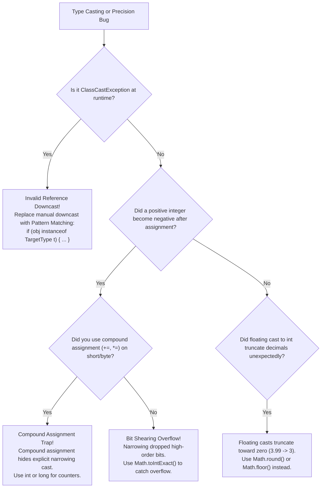

# Type Casting: Widening, Narrowing, and Overflow Traps

---

## 1. Metadata and Learning Goals

- **Concept ID:** `P01-C005`
- **Concept Title:** Type Casting: Widening, Narrowing, and Overflow Traps
- **Curriculum Phase:** Phase 01: Java Language Fundamentals
- **Topic Category:** Type System, Conversions, and Arithmetic Precision
- **Suggested Importance:** Essential
- **Prerequisites:**
  - [`P01-C001`: Primitive Data Types, Bit Widths, and Numeric Ranges](001-primitive-data-types.md)
  - [`P01-C002`: Floating-Point Precision, IEEE 754, and Rounding Hazards](002-floating-point-types-and-precision.md)
  - [`P01-C003`: Reference Types vs Primitive Types in Memory](003-reference-types-vs-primitives.md)
  - [`P01-C004`: Variable Declaration, Scope, Lifetime, and Default Values](004-variable-scopes-and-lifetimes.md)
- **Next Concept in Sequence:**
  - [`P01-C006`: Wrapper Classes, Autoboxing, and NullPointerExceptions](006-wrapper-classes-autoboxing.md)
- **Concepts Covered:**
  - Widening Primitive Conversions (JLS §5.1.2) and implicit promotion
  - The hidden precision loss when widening `int` to `float` and `long` to `double`
  - Narrowing Primitive Conversions (JLS §5.1.3) and explicit casting `(targetType) expr`
  - The Bit-Shearing mechanism (discarding high-order bits and Two's Complement sign flipping)
  - Floating-point to integer narrowing: Truncation toward zero and IEEE 754 clamping
  - The Compound Assignment Operator Trap (`+=`, `-=`) silently hiding narrowing overflows
  - Unsigned byte extraction via bitwise masking: `int val = rawByte & 0xFF;`
  - Reference Casting: Upcasting (safe/implicit) vs Downcasting (explicit/risky) and `ClassCastException`
  - Modern Pattern Matching for `instanceof` (JEP 394 in Java 16)
  - Safe narrowing with `Math.toIntExact()` to eliminate silent truncation vulnerabilities

### Measurable Learning Objectives
By completing this module, you will be able to:
1. **Trace the exact bit-level transformation** that occurs when casting a 32-bit `int` into an 8-bit `byte` ($300 \to 44$).
2. **Identify situations where widening conversions silently lose precision** without generating compiler errors or warnings.
3. **Diagnose and eliminate the Compound Assignment Overflow Bug** where `x += y` quietly corrupts state.
4. **Correctly process unsigned binary data** (e.g., raw IoT packets or network headers) using `& 0xFF` masking.
5. **Use Pattern Matching for `instanceof`** to eliminate redundant, dangerous manual reference downcasts.

---

## 2. Definition, Purpose, and Mental Model

### 2.1 Formal Definition
- **Type Conversion:** The process of transforming a value from its declared type into a compatible representation of another type.
- **Widening Conversion:** A conversion from a narrower data type to a wider data type (e.g., `int` $\to$ `long`, or subclass $\to$ superclass). In Java, widening conversions are **implicit**: the compiler performs them automatically without requiring an explicit cast operator because they cannot result in numeric magnitude overflow.
- **Narrowing Conversion:** A conversion from a wider data type to a narrower data type (e.g., `long` $\to$ `int`, `double` $\to$ `int`, or superclass $\to$ subclass). In Java, narrowing conversions **must be explicit**: they require the cast operator `(type) expr` because they risk permanent information loss (bit truncation, sign flipping, or runtime `ClassCastException`).

```text
+-----------------------------------------------------------------------------------------+
|                               THE PRIMITIVE CONVERSION HIERARCHY                        |
|                                                                                         |
|       byte  ----+                                                                       |
|                 v                                                                       |
|       short --> int ----> long ----> float ----> double                                 |
|                 ^                                                                       |
|       char  ----+                                                                       |
|                                                                                         |
|       [ ---------- Widening (Implicit / Automatic) -----------> ]                       |
|       [ <---------- Narrowing (Explicit Cast Required) -------- ]                       |
+-----------------------------------------------------------------------------------------+
```

### 2.2 The Problem It Solves
Computers deal with disparate physical data formats:
- Network sockets deliver raw 8-bit `byte` frames.
- Database IDs and timestamps are represented as 64-bit `long`s.
- Mathematical operations calculate fractional 64-bit `double` ratios.

A backend application must constantly move data between these formats:
- When passing a `short` to a method expecting an `int`, forcing developers to write manual casts everywhere would add intolerable boilerplate. Widening handles this automatically.
- Conversely, when packing a 64-bit timestamp into an 8-bit telemetry packet, allowing the compiler to truncate 56 bits silently would cause catastrophic data corruption. Java's mandatory explicit narrowing cast forces the engineer to declare: *"I acknowledge that this conversion may destroy high-order bits."*

### 2.3 The MERN/JavaScript Transition
In JavaScript/TypeScript:
- JavaScript features aggressive, implicit type coercion:
  ```javascript
  // JavaScript:
  let result = "100" - 10; // Evaluates to 90 (String converted to number!)
  let text = "100" + 10;   // Evaluates to "10010" (Number converted to string!)
  ```
- This implicit dynamism causes subtle bugs (e.g., accidental string concatenation).

In Java:
- **Type safety is enforced at compile time.** Java **never** coerces unrelated types implicitly.
- You cannot cast a `String` to an `int` using `(int) "42"` (Compilation Error!). String parsing requires explicit library methods (`Integer.parseInt("42")`).
- Primitive casting is strictly restricted to valid numeric conversions.

### 2.4 Mental Model: Water Pitchers and the Funnel
- **Widening is pouring a 1-liter bottle of water into an empty 5-liter bucket.** The water fits comfortably. Nothing spills on the floor. The operation is safe and automatic.
- **Narrowing is pouring a 5-liter bucket of water into a 1-liter bottle.** If the bucket contains more than 1 liter, water **violently overflows and is lost forever**. Java will not let you pour unless you explicitly place a funnel labeled `(1-Liter Bottle)` over the opening, acknowledging that you accept the spill.

### 2.5 What This Concept Is NOT
- **Not Parsing or String Conversion:** Casting `(int) "123"` does not compile. Converting a string to an integer requires `Integer.parseInt(str)`.
- **Not Object Cloning:** Downcasting `(User) object` does not create a new object; it merely changes the *type of the lens* through which the existing object in heap memory is viewed.

---

## 3. Foundations and Theory

### 3.1 Widening Primitive Conversions and the Silent Precision Trap
Java permits 19 widening primitive conversions (JLS §5.1.2) without an explicit cast:
- `byte` to `short`, `int`, `long`, `float`, or `double`
- `short` to `int`, `long`, `float`, or `double`
- `char` to `int`, `long`, `float`, or `double`
- `int` to `long`, `float`, or `double`
- `long` to `float` or `double`
- `float` to `double`

#### The Dangerous Fallacy: "Widening Never Loses Data"
Most developers assume widening conversions **never** lose information. 
**This is false!**

Widening from an integer type to a floating-point type (`int` to `float`, or `long` to `double`) can result in a **loss of least significant bits**:
- A 32-bit `int` uses all 31 magnitude bits for integer precision.
- A 32-bit `float` has only **24 bits of mantissa precision** ($23\text{ explicit} + 1\text{ implicit}$).
- If you cast an `int` with more than 24 significant bits to `float`, the lowest bits are discarded due to IEEE 754 rounding!

```java
int largeInt = 123_456_789;
float widenedFloat = largeInt; // Implicit widening! No compiler warning!
int roundTripped = (int) widenedFloat;

System.out.println("Original int    : " + largeInt);
System.out.println("Widened to float: " + widenedFloat);
System.out.println("Cast back to int: " + roundTripped);
// Output:
// Original int    : 123456789
// Widened to float: 1.23456792E8
// Cast back to int: 123456792  <-- LOST 3 DIGITS OF PRECISION!
```

> [!WARNING]
> **The Database ID Widening Hazard:**
> Never convert high-precision `long` database primary keys or transaction IDs into `float` or `double` for calculation or JSON serialization. A 64-bit `long` has 63 bits of integer precision, while `double` has only 53 bits of mantissa. Any `long` greater than $2^{53}$ ($9,007,199,254,740,992$) will suffer rounding errors, corrupting customer IDs!

---

### 3.2 The Binary Mathematics of Narrowing: Bit Shearing
When you narrow a wider integer type into a narrower integer type (e.g., `int` $\to$ `byte`, `long` $\to$ `short`), the CPU performs **Bit Shearing**:
1. It simply **discards the most significant bits** that do not fit into the target type.
2. It reinterprets the remaining bits using the target type's signed **Two's Complement** encoding.

#### Mathematical Trace: Why `(byte) 300 == 44`
Let's trace what happens when casting integer `300` to a `byte`:

```text
Step 1: Write 300 in 32-bit binary (int):
        00000000 00000000 00000001 00101100

Step 2: Narrow to byte (keep only the lowest 8 bits; discard top 24 bits):
        [DISCARDED TOP 24 BITS] | 00101100

Step 3: Evaluate remaining 8 bits:
        Bit Position:   7   6   5   4   3   2   1   0
        Weight:       -128 +64 +32 +16  +8  +4  +2  +1
        Bits:           0   0   1   0   1   1   0   0

        Value = 32 + 8 + 4 = 44!
```

#### Mathematical Trace: Why `(byte) 130 == -126` (Sign Flipping)
```text
Step 1: Write 130 in 32-bit binary (int):
        00000000 00000000 00000000 10000010

Step 2: Narrow to byte (keep only lowest 8 bits):
        10000010

Step 3: Evaluate in 8-bit Two's Complement:
        The Most Significant Bit (MSB) is 1 (Negative sign!).
        Value = (-128 * 1) + (2 * 1) = -128 + 2 = -126!
```

> [!IMPORTANT]
> **The Bit Shearing Formula:**
> For non-negative integers narrowed to $M$ bits, the resulting value is:
> $$\text{Raw Bits} = X \pmod{2^M}$$
> For a byte ($M = 8$, $2^8 = 256$): $300 \pmod{256} = \mathbf{44}$.

---

### 3.3 Narrowing Floating-Point to Integer: Truncation vs Clamping
When casting a floating-point number (`float` or `double`) to an integer (`int` or `long`), Java does **not** perform round-to-nearest rounding, nor does it perform bit shearing!

Instead, Java follows strict IEEE 754 conversion rules (JLS §5.1.3):
1. **Fractional Truncation Toward Zero:**
   - The decimal fraction is completely discarded (truncated toward zero).
   - `(int) 3.99` evaluates to `3`.
   - `(int) -3.99` evaluates to `-3`.
2. **Boundary Clamping (Saturation Arithmetic):**
   - If the floating-point value is greater than `Integer.MAX_VALUE` ($2.14 \times 10^9$), it **clamps to `Integer.MAX_VALUE`**! It does *not* wrap around to negative.
   - If the value is smaller than `Integer.MIN_VALUE`, it **clamps to `Integer.MIN_VALUE`**.
   - If the value is `NaN`, it **converts to `0`**!

```java
double massive = 1.0e12; // 1 Trillion
int clamped = (int) massive;
System.out.println(clamped); // Prints: 2147483647 (Clamped to Integer.MAX_VALUE!)

double notANum = Double.NaN;
int nanInt = (int) notANum;
System.out.println(nanInt);  // Prints: 0!
```

---

### 3.4 The Compound Assignment Operator Narrowing Trap
One of the most dangerous hidden bugs in the Java language specification is **Compound Assignment Narrowing** (JLS §15.26.2).

According to the specification:
An expression `E1 op= E2` is equivalent to:
$$E1 = (T)(E1 \text{ op } E2)$$
where $T$ is the declared type of $E1$.

**Notice the hidden explicit cast `(T)` injected by the compiler!**

```java
short balance = 32767; // Short.MAX_VALUE

// SCENARIO A: Standard Assignment
// balance = balance + 1; // COMPILE ERROR: Cannot convert int to short!

// SCENARIO B: Compound Assignment
balance += 1; // COMPILES WITH ZERO WARNINGS!
// Internally executed as: balance = (short)(balance + 1);
System.out.println(balance); // Prints: -32768 (CATASTROPHIC SILENT OVERFLOW!)
```

> [!CAUTION]
> **The Production Hazard:**
> Never use `+=` or `*=` on small primitive types (`short`, `byte`, `char`) in business logic. The compound assignment operator silently suppresses the compiler's type-checking, masking disastrous arithmetic overflows.

---

### 3.5 Unsigned Byte Decoding via Bitwise Masking
In network programming and binary protocols, data bytes represent values from $0$ to $255$ (unsigned). However, Java's `byte` is signed ($-128$ to $127$).

If you read byte `0xFF` (which represents decimal $255$ in the network protocol):
```java
byte networkByte = (byte) 0xFF; // In Java, this is -1!
int unpacked = networkByte;      // Sign extension! unpacked is now -1 (0xFFFFFFFF)!
```
When Java widens a negative `byte` to an `int`, it performs **Sign Extension**: it fills all top 24 bits with `1`s, turning your intended positive number $255$ into $-1$!

#### The Universal Solution: Bitwise AND with `0xFF`
```java
// Strip the sign-extended high 24 bits:
int correctUnsignedVal = networkByte & 0xFF; 
System.out.println(correctUnsignedVal); // Prints: 255 (CORRECT!)
```

```text
networkByte (-1)  : 11111111 11111111 11111111 11111111 (Sign-extended int)
& 0xFF            : 00000000 00000000 00000000 11111111
-----------------------------------------------------------------------------
Result (255)      : 00000000 00000000 00000000 11111111 (Pure positive 255!)
```

---

### 3.6 Reference Type Casting: Upcasting vs Downcasting
In object-oriented programming, reference casting navigates the class inheritance hierarchy:

```text
+-----------------------------------------------------------------------------+
|                        REFERENCE CASTING HIERARCHY                          |
|                                                                             |
|               [ Object ] (Root Superclass)                                  |
|                   ^                                                         |
|                   |  Upcasting (Widening): Always safe; implicit.           |
|                   |  Object obj = new PaymentEvent();                       |
|                   |                                                         |
|                   |  Downcasting (Narrowing): Risky; explicit checkcast.    |
|                   |  PaymentEvent event = (PaymentEvent) obj;               |
|                   v                                                         |
|           [ PaymentEvent ] (Specific Subclass)                              |
+-----------------------------------------------------------------------------+
```

#### Upcasting (Widening Reference Conversion):
- Converting a subtype reference to a supertype reference (`Object obj = new String("test");`).
- Always guaranteed to be safe by the compiler. No cast operator required.

#### Downcasting (Narrowing Reference Conversion):
- Converting a supertype reference to a subtype reference (`String str = (String) obj;`).
- Requires an explicit cast.
- The JVM executes the `checkcast` bytecode instruction at runtime. If the heap object is **not** an instance of the target type, the JVM immediately aborts with:
  `java.lang.ClassCastException`.

#### Modern Pattern Matching for `instanceof` (Java 16+ JEP 394):
In modern Java, you should never write a manual downcast. Use pattern matching to test and cast in a single safe operation:

```java
// LEGACY ANTI-PATTERN (Verbose & Error-prone):
if (obj instanceof PaymentEvent) {
    PaymentEvent pe = (PaymentEvent) obj; // Redundant manual cast!
    pe.processPayment();
}

// MODERN IDIOMATIC JAVA (JEP 394):
if (obj instanceof PaymentEvent pe) {
    // 'pe' is in scope, already safely cast!
    pe.processPayment();
}
```

---

## 4. Syntax, API, and Command Reference

### 4.1 Master Primitive Conversion Table

| From \ To | `byte` | `short` | `char` | `int` | `long` | `float` | `double` |
|---|---|---|---|---|---|---|---|
| **`byte`** | Identity | Implicit | Explicit | Implicit | Implicit | Implicit | Implicit |
| **`short`** | Explicit | Identity | Explicit | Implicit | Implicit | Implicit | Implicit |
| **`char`** | Explicit | Explicit | Identity | Implicit | Implicit | Implicit | Implicit |
| **`int`** | Explicit | Explicit | Explicit | Identity | Implicit | Implicit* | Implicit |
| **`long`** | Explicit | Explicit | Explicit | Explicit | Identity | Implicit* | Implicit* |
| **`float`** | Explicit | Explicit | Explicit | Explicit | Explicit | Identity | Implicit |
| **`double`** | Explicit | Explicit | Explicit | Explicit | Explicit | Explicit | Identity |

*\*Note: Marked conversions (`int` $\to$ `float`, `long` $\to$ `float`, `long` $\to$ `double`) are implicit, but may suffer silent loss of least significant bits due to limited mantissa bits.*

### 4.2 Standard Safe Casting Utility APIs (Java 8+)

```java
// 1. Safe Narrowing from long to int (Throws ArithmeticException on overflow)
int safeInt = Math.toIntExact(longValue);

// 2. Unsigned Conversions
long unsignedInt = Integer.toUnsignedLong(signedInt);
int unsignedByte = Byte.toUnsignedInt(signedByte); // Standard replacement for (b & 0xFF)
```

---

## 5. Runnable Examples and Demonstrations

### 5.1 Programmatic Type Casting & Bit-Shearing Inspector
The following complete program prints the binary bit transformations during primitive casting, demonstrates floating truncation, and exhibits safe narrowing:

```java
// File: TypeCastingInspector.java
public class TypeCastingInspector {

    public static void main(String[] args) {
        System.out.println("==================================================================");
        System.out.println("         TYPE CASTING & BIT-SHEARING BINARY INSPECTOR             ");
        System.out.println("==================================================================");

        // 1. Bit Shearing Demonstration: int to byte
        int originalInt = 300;
        byte narrowedByte = (byte) originalInt;

        System.out.println("[1] NARROWING INT (300) TO BYTE:");
        System.out.printf("  Original int (32-bit): %s (Decimal: %d)%n",
                toBinary32(originalInt), originalInt);
        System.out.printf("  Narrowed byte (8-bit): %s (Decimal: %d)%n",
                toBinary8(narrowedByte), narrowedByte);
        System.out.printf("  Bit Shearing Proof   : 300 %% 256 = %d%n", (originalInt % 256));

        // 2. Sign Bit Flip Demonstration: int to byte
        int signFlipper = 130;
        byte flippedByte = (byte) signFlipper;

        System.out.println("\n[2] SIGN FLIPPING ON NARROWING (130 TO BYTE):");
        System.out.printf("  Original int (32-bit): %s (Decimal: %d)%n",
                toBinary32(signFlipper), signFlipper);
        System.out.printf("  Narrowed byte (8-bit): %s (Decimal: %d - FLIPPED NEGATIVE!)%n",
                toBinary8(flippedByte), flippedByte);

        // 3. Floating-Point Truncation and Clamping
        System.out.println("\n[3] FLOATING-POINT TO INTEGER NARROWING (IEEE 754):");
        double floatVal = 99.999;
        int truncated = (int) floatVal;
        System.out.printf("  Truncation toward zero: (int) %.3f = %d (Fraction dropped)%n",
                floatVal, truncated);

        double massive = 1.0e15; // Exceeds Integer.MAX_VALUE
        int clamped = (int) massive;
        System.out.printf("  Clamping at boundary  : (int) 1.0e15 = %d (Clamped to MAX_INT)%n",
                clamped);

        // 4. Safe Narrowing with Math.toIntExact
        System.out.println("\n[4] SAFE NARROWING WITH Math.toIntExact():");
        long safeLong = 5000L;
        long overflowingLong = 3_000_000_000L;

        System.out.printf("  Math.toIntExact(%d) = %d (SUCCESS)%n", safeLong, Math.toIntExact(safeLong));
        try {
            Math.toIntExact(overflowingLong);
        } catch (ArithmeticException e) {
            System.out.printf("  Math.toIntExact(%d) = CAUGHT OVERFLOW! (%s)%n",
                    overflowingLong, e.getMessage());
        }

        System.out.println("==================================================================");
    }

    private static String toBinary32(int val) {
        String bits = String.format("%32s", Integer.toBinaryString(val)).replace(' ', '0');
        return String.join(" ", bits.substring(0, 8), bits.substring(8, 16),
                bits.substring(16, 24), bits.substring(24, 32));
    }

    private static String toBinary8(byte val) {
        String bits = String.format("%8s", Integer.toBinaryString(val & 0xFF)).replace(' ', '0');
        return bits;
    }
}
```

#### Executing the Inspector:
```bash
javac TypeCastingInspector.java
java TypeCastingInspector
```

#### Observed Output:
```text
==================================================================
         TYPE CASTING & BIT-SHEARING BINARY INSPECTOR             
==================================================================
[1] NARROWING INT (300) TO BYTE:
  Original int (32-bit): 00000000 00000000 00000001 00101100 (Decimal: 300)
  Narrowed byte (8-bit): 00101100 (Decimal: 44)
  Bit Shearing Proof   : 300 % 256 = 44

[2] SIGN FLIPPING ON NARROWING (130 TO BYTE):
  Original int (32-bit): 00000000 00000000 00000000 10000010 (Decimal: 130)
  Narrowed byte (8-bit): 10000010 (Decimal: -126 - FLIPPED NEGATIVE!)

[3] FLOATING-POINT TO INTEGER NARROWING (IEEE 754):
  Truncation toward zero: (int) 99.999 = 99 (Fraction dropped)
  Clamping at boundary  : (int) 1.0e15 = 2147483647 (Clamped to MAX_INT)

[4] SAFE NARROWING WITH Math.toIntExact():
  Math.toIntExact(5000) = 5000 (SUCCESS)
  Math.toIntExact(3000000000) = CAUGHT OVERFLOW! (integer overflow)
==================================================================
```

---

### 5.2 The Compound Assignment Silent Overflow Trap
The following demonstration exhibits how compound assignment operators silently suppress the compiler's narrowing protection:

```java
// File: CompoundAssignmentTrap.java
public class CompoundAssignmentTrap {

    public static void main(String[] args) {
        System.out.println("Auditing Compound Assignment Narrowing Behavior:");

        short accountBalance = 32760;
        int depositAmount = 20;

        // In pure addition, this line refuses to compile:
        // accountBalance = accountBalance + depositAmount; // Compile error!

        // With compound assignment, the compiler secretly injects: (short) (...)
        accountBalance += depositAmount; // Silently executes: (short)(32760 + 20)

        System.out.println("  Expected Balance : 32780");
        System.out.println("  Actual Balance   : " + accountBalance);

        if (accountBalance < 0) {
            System.out.println("  CRITICAL FAILURE: Balance flipped to NEGATIVE!");
            System.out.println("  Compound assignment silently destroyed data integrity.");
        }
    }
}
```

#### Observed Output:
```text
Auditing Compound Assignment Narrowing Behavior:
  Expected Balance : 32780
  Actual Balance   : -32756
  CRITICAL FAILURE: Balance flipped to NEGATIVE!
  Compound assignment silently destroyed data integrity.
```

---

## 6. Real-World Backend Application

### 6.1 IoT / FinTech Network Frame Deserialization
When parsing low-level binary protocols (e.g., FIX protocol, MQTT packet headers, Kafka custom wire frames):

```java
// File: NetworkPacketParser.java
import java.nio.ByteBuffer;

public class NetworkPacketParser {

    record PacketHeader(int magicByte, int payloadLength, boolean compressed) {}

    public static PacketHeader parseHeader(byte[] rawBytes) {
        ByteBuffer buf = ByteBuffer.wrap(rawBytes);

        // Byte 0: Magic byte (Unsigned 0..255)
        // BUGGY: int magic = buf.get(); // If byte is 0x80..0xFF, value is NEGATIVE!
        // FIXED: Use Byte.toUnsignedInt or & 0xFF:
        int magic = Byte.toUnsignedInt(buf.get());

        // Bytes 1..2: Payload length (Unsigned 16-bit short: 0..65535)
        // FIXED: Use Short.toUnsignedInt:
        int length = Short.toUnsignedInt(buf.getShort());

        // Byte 3: Flags
        boolean compressed = (buf.get() & 0x01) != 0;

        return new PacketHeader(magic, length, compressed);
    }

    public static void main(String[] args) {
        // Simulating incoming wire bytes: Magic=0xFE (254), Length=40000, Flags=1
        byte[] wireBytes = new byte[] {
            (byte) 0xFE,                    // Magic: 254
            (byte) 0x9C, (byte) 0x40,       // Length: 40,000 (0x9C40)
            (byte) 0x01                     // Compressed flag
        };

        PacketHeader header = parseHeader(wireBytes);
        System.out.printf("Decoded Network Packet Header:%n");
        System.out.printf("  Magic Byte     : %d (Expected: 254)%n", header.magicByte());
        System.out.printf("  Payload Length : %d (Expected: 40000)%n", header.payloadLength());
        System.out.printf("  Is Compressed  : %b%n", header.compressed());

        assert header.magicByte() == 254;
        assert header.payloadLength() == 40000;
    }
}
```

---

### 6.2 Polymorphic Message Dispatch with Pattern Matching
In enterprise Spring/Kafka consumer architectures, worker services process polymorphic message events:

```java
// Modern Java 16+ Pattern Matching Event Dispatcher:
public class EventDispatcher {

    interface SystemEvent {}
    record UserRegistered(String userId, String email) implements SystemEvent {}
    record PaymentProcessed(String transactionId, long amountCents) implements SystemEvent {}
    record AccountSuspended(String userId, String reason) implements SystemEvent {}

    public void dispatch(SystemEvent event) {
        // Java 16+ Pattern Matching instanceof eliminates manual downcasting:
        if (event instanceof UserRegistered reg) {
            System.out.println("Sending welcome email to: " + reg.email());
        } else if (event instanceof PaymentProcessed pay) {
            System.out.printf("Payment %s settled for $%.2f%n",
                    pay.transactionId(), pay.amountCents() / 100.0);
        } else if (event instanceof AccountSuspended sus) {
            System.out.printf("Revoking tokens for %s. Reason: %s%n",
                    sus.userId(), sus.reason());
        } else {
            throw new IllegalArgumentException("Unknown event type: " + event.getClass());
        }
    }
}
```

---

## 7. Design Choices, Alternatives, and Trade-Offs

### 7.1 Narrowing Strategies Compared

```
+------------------------+---------------------------------------+---------------------------------------+
| Approach               | Advantages                            | Disadvantages                         |
+------------------------+---------------------------------------+---------------------------------------+
| Raw Cast `(int) long`  | • Single-cycle CPU execution speed    | • **Zero safety**: Silently shears    |
|                        | • Zero object allocation              |   bits; corrupts state on overflow.   |
+------------------------+---------------------------------------+---------------------------------------+
| `Math.toIntExact(long)`| • 100% Guaranteed safety              | • Throws exception on overflow        |
|                        | • Detects overflow instantly          |   (requires error handling).          |
|                        | • High performance (single comparison)|                                       |
+------------------------+---------------------------------------+---------------------------------------+
| Defensive Boundary     | • Allows custom fallback handling     | • More boilerplate code.              |
| Check (`if > MAX`)     | • Prevents exceptions in hot paths    |                                       |
+------------------------+---------------------------------------+---------------------------------------+
```

---

## 8. Performance and Complexity

### 8.1 Hardware Instruction Cost of Casting
- **Primitive Widening / Sign Extension (`byte` $\to$ `int`, `int` $\to$ `long`):** Handled by single-cycle CPU instructions (`MOVSX` - Move with Sign Extension). Zero overhead.
- **Primitive Narrowing (`long` $\to$ `int`, `int` $\to$ `byte`):** Handled by standard register truncation or single-cycle bit masking (`MOVZX` - Move with Zero Extension).
- **Reference Downcasting (`(String) obj`):** HotSpot generates the `checkcast` instruction:
  - If the target type is a primary supertype or identical class, checkcast executes in **1 clock cycle** via HotSpot's single-word type cache.
  - If checking complex deep interface hierarchies, HotSpot falls back to scanning the Metaspace secondary supercache, which can take **5 to 15 clock cycles**.

---

## 9. Security and Robustness

### 9.1 Integer Truncation Privilege Escalation (CWE-197)
A critical security vulnerability occurs when security attributes, access permissions, or buffer lengths are narrowed from a wider integer to a smaller one:

```java
// INSECURE VULNERABILITY:
public boolean hasAdminPrivilege(long userPermissionBitmask) {
    // Permission bitmask: 0x1_0000_0000L (Bit 32 set for ADMIN)
    // BUG: Narrowed to 32-bit int! Bit 32 is completely DISCARDED!
    int mask32 = (int) userPermissionBitmask;

    // Checks bit 0 for ADMIN:
    return (mask32 & 0x01) != 0; // Truncation renders permissions meaningless!
}
```

**Rule:** Never cast security tokens, hash codes, or cryptographic bitmasks to smaller types.

---

## 10. Testing and Verification

### 10.1 Automated Unit Tests for Type Casting and Conversions
You can author exhaustive JUnit tests to verify bit-shearing math and safe conversion boundaries:

```java
// File: TypeCastingTest.java
import org.junit.jupiter.api.DisplayName;
import org.junit.jupiter.api.Test;

import static org.junit.jupiter.api.Assertions.*;

public class TypeCastingTest {

    @Test
    @DisplayName("Verify Exact Bit-Shearing Math on int to byte Narrowing")
    void testBitShearing() {
        assertEquals(44, (byte) 300, "300 % 256 must equal 44");
        assertEquals(-126, (byte) 130, "130 must flip to -126 in 8-bit Two's Complement");
        assertEquals(-1, (byte) 255, "255 (0xFF) must evaluate to -1 in signed byte");
    }

    @Test
    @DisplayName("Verify Math.toIntExact Throws on Long Overflow")
    void testSafeNarrowing() {
        assertDoesNotThrow(() -> Math.toIntExact(2147483647L));
        assertThrows(ArithmeticException.class, () -> Math.toIntExact(2147483648L));
    }

    @Test
    @DisplayName("Verify Unsigned Byte Decoding")
    void testUnsignedByteDecoding() {
        byte b = (byte) 0xFE; // Decimal -2 in signed byte
        int unsigned = Byte.toUnsignedInt(b);
        assertEquals(254, unsigned, "0xFE must decode to 254 unsigned");
    }
}
```

---

## 11. Debugging and Failure Analysis

### 11.1 Diagnostic Flowchart: Resolving Type Casting and Overflow Bugs



### 11.2 Top 5 Type Casting Failure Modes

#### 1. The Bit-Shearing Sign Flip
- **Symptom:** Casting positive integer `128` to `byte` prints `-128`.
- **Root Cause:** Bit 7 (the sign bit) was set, causing Two's Complement interpretation as negative.
- **Solution:** Use `int` or mask with `& 0xFF` if treating as unsigned.

#### 2. Silent Precision Loss in Large Numbers (`long` $\to$ `float`)
- **Symptom:** Two distinct user IDs compare as equal after floating-point conversion.
- **Root Cause:** Implicit widening from `long` to `float` dropped the least significant 39 bits of magnitude.
- **Solution:** Never convert unique identifiers or keys to floating-point types.

#### 3. Unchecked `(Type) obj` Downcast
- **Symptom:** `java.lang.ClassCastException: class java.lang.Long cannot be cast to class java.lang.String`.
- **Root Cause:** Manual downcast without verifying type with `instanceof`.
- **Solution:** Use Java 16+ Pattern Matching: `if (obj instanceof String s)`.

#### 4. Compound Assignment Overflow in Loops
- **Symptom:** Loop counter wraps around to negative, causing infinite loop.
- **Root Cause:** `byte b = 0; while (b < 150) b += 1;` wraps around from 127 to -128, never reaching 150!
- **Solution:** Use `int` for loop counters.

#### 5. Floating-Point Truncation in Financial Calculations
- **Symptom:** Cash register calculates tax of `$1.999` and casts to `int` cents: `(int) 1.999 = 1` cent (drops 99% of a cent!).
- **Root Cause:** Casting to integer truncates toward zero instead of rounding.
- **Solution:** Use `(int) Math.round(val)` or `BigDecimal.setScale(0, RoundingMode.HALF_UP)`.

---

## 12. Best Practices and Anti-Patterns

### 12.1 Industry Best Practices
- **Always Use `Math.toIntExact()` for Downcasting Longs:** Catch integer overflow immediately rather than silently corrupting data.
- **Use Pattern Matching for `instanceof`:** Eliminate manual, redundant downcasts.
- **Use `Byte.toUnsignedInt()` for Byte Protocols:** Avoid sign-extension bugs when processing binary wire formats.
- **Beware of Widening to Floats:** Keep database IDs in integer primitives (`long`).

### 12.2 Anti-Patterns to Avoid
- **Never Use Compound Assignment (`+=`) on `byte` or `short`:** Silently hides narrowing overflow.
- **Never Rely on Blind Downcasts:** Always guard with `instanceof`.
- **Never Cast Floating-Point to Integer for Monetary Rounding:** Truncation toward zero steals pennies.
- **Never Cast Security Bitmasks to Smaller Types:** Bit shearing destroys permission flags.

---

## 13. Interview Preparation

### 13.1 Foundational Questions

#### Q1: What is the difference between a widening primitive conversion and a narrowing primitive conversion?
**Answer:** A widening primitive conversion converts a narrower data type to a wider data type (e.g., `int` to `long`, `byte` to `int`). Widening is implicit (performed automatically by the compiler) because it cannot cause numeric magnitude overflow, although converting `int`/`long` to `float`/`double` can cause loss of least significant bits. A narrowing primitive conversion converts a wider type to a narrower type (e.g., `long` to `int`, `double` to `int`). Narrowing requires an explicit cast operator `(type) expr` because it can discard high-order bits, alter the sign bit, truncate floating-point fractions, or clamp boundaries.

#### Q2: What is the output of `(byte) 300` and `(byte) 130` in Java, and why?
**Answer:**
- `(byte) 300` evaluates to `44`. In 32-bit binary, 300 is `00000000 00000000 00000001 00101100`. Narrowing to an 8-bit `byte` discards the top 24 bits, leaving `00101100`. In Two's Complement, $32 + 8 + 4 = 44$ (which equals $300 \pmod{256}$).
- `(byte) 130` evaluates to `-126`. In 32-bit binary, 130 is `00000000 00000000 00000000 10000010`. Narrowing leaves `10000010`. Because bit 7 (the MSB) is `1`, the byte is interpreted as negative: $-128 + 2 = -126$.

### 13.2 Production Scenario Questions

#### Q3: Why does `short s = 32767; s = s + 1;` fail to compile, while `short s = 32767; s += 1;` compiles cleanly but corrupts state?
**Answer:**
In `s = s + 1;`, Java applies Binary Numeric Promotion: the operand `s` is promoted to `int`, producing an `int` result (`32768`). Assigning an `int` to a `short` is an explicit narrowing conversion, which fails to compile without a cast. 
In contrast, JLS §15.26.2 specifies that the compound assignment operator `s += 1` is automatically desugared by the compiler into `s = (short)(s + 1)`. The compiler silently injects the narrowing cast `(short)`, suppressing type-checking and allowing `32768` to wrap around into `-32768` without any compile-time warning or runtime error.

#### Q4: When reading a binary telemetry packet from an IoT device, a byte with hex value `0x90` is read into a Java `byte` and widened to an `int`, yielding `-112` instead of `144`. What happened, and how do you fix it?
**Answer:** In binary, `0x90` is `10010000`. Because the most significant bit is `1`, Java's signed `byte` interprets it as $-128 + 16 = -112$. When widened to an `int`, Java performs **Sign Extension**: it fills the top 24 bits with `1`s (`0xFFFFFF90`), maintaining the value $-112$. To treat the byte as an unsigned value from $0$ to $255$, mask out the sign-extended high-order bits using bitwise AND: `int unsignedVal = rawByte & 0xFF;` or use `Byte.toUnsignedInt(rawByte)`. Both yield `144`.

### 13.3 Lead & Principal Architect Questions

#### Q5: Explain the performance and architectural evolution of reference type casting in Java, comparing legacy `instanceof` + cast with Java 16+ Pattern Matching and JVM `checkcast` optimizations.
**Answer:** Historically, verifying and downcasting required two separate steps: an `instanceof` check followed by an explicit `(Target) obj` cast. At the bytecode level, this emitted two separate instructions: `instanceof` and `checkcast`. Both instructions traverse the class metadata hierarchy in Metaspace to verify type compatibility. HotSpot optimizes this using a 1-word secondary supercache; if the type matches the cached entry, checking costs 1 clock cycle, but cache misses require linear scans of the interface table (itable).
Pattern Matching for `instanceof` (JEP 394 in Java 16) simplifies source code and allows the JIT compiler to eliminate the redundant second type check. When `if (obj instanceof String s)` succeeds, the C2 compiler binds `s` to the already-verified register/slot, eliminating the `checkcast` instruction entirely. This improves readability, eliminates `ClassCastException` hazards, and reduces generated bytecode size.

---

## 14. Practice and Assessment

### Exercise 1: Beginner (Predicting Bit Shearing)
Without running a computer, calculate the exact decimal value of:
1. `(byte) 256`
2. `(byte) 257`
3. `(byte) -129`
4. `(int) 3.14159f`

### Exercise 2: Applied (Safe Integer Conversion Library)
Create a utility class `SafeConverter.java` that implements:
- `short toShortExact(int val)`: Returns the short or throws `ArithmeticException: short overflow`.
- `byte toByteExact(int val)`: Returns the byte or throws `ArithmeticException: byte overflow`.

### Exercise 3: Challenge (Unsigned 24-Bit Integer Unpacker)
In video streaming and audio DSP, samples are often packed as 24-bit unsigned integers across 3 consecutive bytes in big-endian order ($B_0, B_1, B_2$).
Write a method `int unpack24BitUnsigned(byte b0, byte b1, byte b2)` that correctly decodes a 24-bit integer into a positive 32-bit `int` without sign-extension corruption.

---

### Hints
- *Exercise 1:* Use modulo 256 arithmetic and Two's Complement sign bits. Remember float to int drops fractions.
- *Exercise 2:* Check `if (val < Short.MIN_VALUE || val > Short.MAX_VALUE) throw ...`.
- *Exercise 3:* Mask each byte with `0xFF` before shifting: `((b0 & 0xFF) << 16) | ((b1 & 0xFF) << 8) | (b2 & 0xFF)`.

---

### Solutions Walkthrough

#### Exercise 1 Solution:
1. `(byte) 256`: $256 \pmod{256} = \mathbf{0}$.
2. `(byte) 257`: $257 \pmod{256} = \mathbf{1}$.
3. `(byte) -129`: In 32 bits, `-129` is `...1111 01111111`. Lowest 8 bits are `01111111` ($+127$). Result = $\mathbf{127}$.
4. `(int) 3.14159f`: Fractional truncation toward zero yields $\mathbf{3}$.

#### Exercise 2 Solution:
```java
public class SafeConverter {
    public static short toShortExact(int val) {
        if (val < Short.MIN_VALUE || val > Short.MAX_VALUE) {
            throw new ArithmeticException("short overflow: " + val);
        }
        return (short) val;
    }

    public static byte toByteExact(int val) {
        if (val < Byte.MIN_VALUE || val > Byte.MAX_VALUE) {
            throw new ArithmeticException("byte overflow: " + val);
        }
        return (byte) val;
    }
}
```

#### Exercise 3 Solution:
```java
public class Unsigned24BitUnpacker {
    public static int unpack24BitUnsigned(byte b0, byte b1, byte b2) {
        return ((b0 & 0xFF) << 16) |
               ((b1 & 0xFF) << 8)  |
               (b2 & 0xFF);
    }

    public static void main(String[] args) {
        // Wire bytes for 16,777,215 (0xFFFFFF)
        byte b0 = (byte) 0xFF;
        byte b1 = (byte) 0xFF;
        byte b2 = (byte) 0xFF;

        int unpacked = unpack24BitUnsigned(b0, b1, b2);
        System.out.println("Unpacked 24-bit value: " + unpacked);
        assert unpacked == 16_777_215;
    }
}
```

---

### Mastery Self-Assessment Checklist
- [ ] I can trace the bit-shearing math when narrowing integers ($X \pmod{2^M}$).
- [ ] I understand why converting `int` to `float` or `long` to `double` can lose precision silently.
- [ ] I know why floating-point to integer casts truncate toward zero and clamp at boundaries.
- [ ] I can explain the Compound Assignment Overflow Trap (`+=` on `short`/`byte`).
- [ ] I know how to use `& 0xFF` and `Byte.toUnsignedInt()` to decode unsigned bytes.
- [ ] I can use Java 16+ Pattern Matching for `instanceof` to eliminate manual downcasting.
- [ ] I understand how `Math.toIntExact()` prevents integer overflow exploits.

---

## 15. Summary, Cheat Sheet, and Memory Aids

### Core Principles
1. **Widening is automatic; narrowing demands an explicit cast.**
2. **Narrowing shears bits:** High-order bits are discarded; sign flips if MSB becomes `1`.
3. **Float casts truncate toward zero:** `(int) 3.99 == 3`.
4. **Compound assignment hides casts:** `s += 1` secretly executes `s = (short)(s + 1)`.
5. **Always mask unsigned bytes:** Use `b & 0xFF` or `Byte.toUnsignedInt(b)`.
6. **Pattern match your downcasts:** Use `if (obj instanceof User u)`.

### Quick Reference Card

```text
+-----------------------+---------------------------------------+-----------------------------+
| Operation             | Unsafe / Flawed Pattern               | Safe / Production Pattern   |
+-----------------------+---------------------------------------+-----------------------------+
| Narrowing Long to Int | `int x = (int) longVal;`              | `int x = Math.toIntExact(l);`|
| Small Type Increment  | `shortCounter += 1;`                  | Use `int` for counters      |
| Unsigned Byte Read    | `int val = rawByte;`                  | `int val = rawByte & 0xFF;` |
| Reference Downcast    | `User u = (User) obj;`                | `if (obj instanceof User u)`|
| Float to Int Rounding | `int cents = (int) dollarFloat;`      | `Math.round(dollarFloat)`   |
+-----------------------+---------------------------------------+-----------------------------+
```

---

## 16. Sources and Further Reading

### Primary Specifications & Authoritative Sources
- **The Java Language Specification (Java SE 21 Edition):**
  - Section 5.1.2: Widening Primitive Conversion: [JLS 21 §5.1.2](https://docs.oracle.com/javase/specs/jls/se21/html/jls-5.html#jls-5.1.2)
  - Section 5.1.3: Narrowing Primitive Conversion: [JLS 21 §5.1.3](https://docs.oracle.com/javase/specs/jls/se21/html/jls-5.html#jls-5.1.3)
  - Section 15.26.2: Compound Assignment Operators: [JLS 21 §15.26.2](https://docs.oracle.com/javase/specs/jls/se21/html/jls-15.html#jls-15.26.2)
- **OpenJDK JEPs:**
  - JEP 394: Pattern Matching for `instanceof`: [OpenJDK JEP 394](https://openjdk.org/jeps/394)
- **Security Vulnerability Standards:**
  - CWE-197: Numeric Truncation Error: [MITRE CWE-197](https://cwe.mitre.org/data/definitions/197.html)
