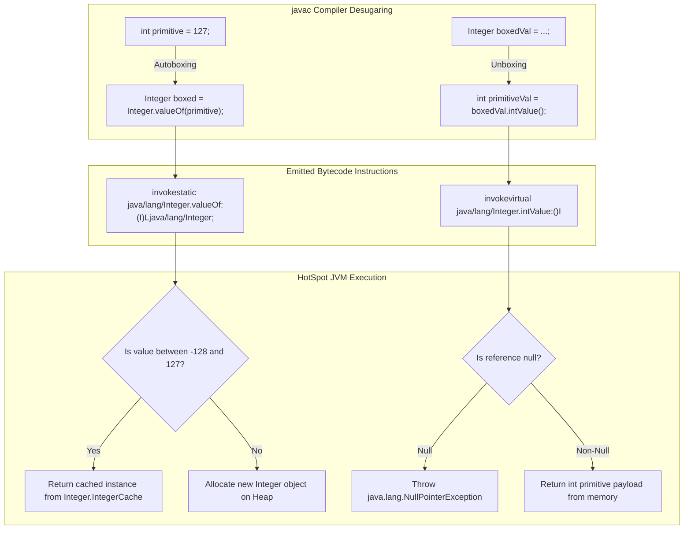
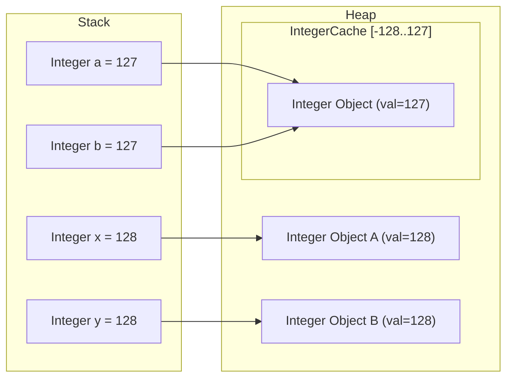
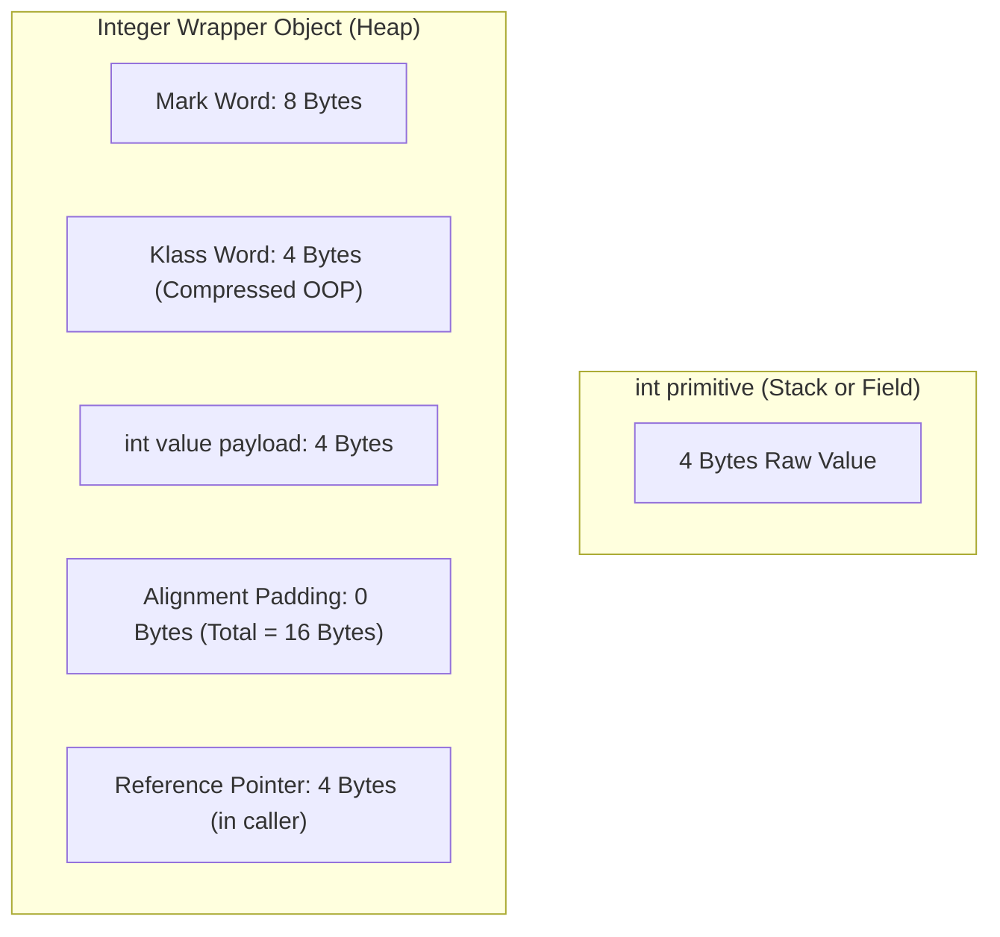

# P01-C006: Wrapper Classes, Autoboxing, and NullPointerExceptions

---

## 1. Title and Metadata

- **Concept ID:** `P01-C006`
- **Concept Title:** Wrapper Classes, Autoboxing, and NullPointerExceptions
- **Phase:** `Phase 01 — Java Language Fundamentals`
- **Module Sequence:** `06 of 15`
- **Prerequisites:**
  - [`P01-C001`: Primitive Data Types, Bit Widths, and Numeric Ranges](file:///home/prasanta/java_practice/curriculum/phase-01-java-language-fundamentals/001-primitive-data-types.md)
  - [`P01-C003`: Reference Types vs Primitive Types in Memory](file:///home/prasanta/java_practice/curriculum/phase-01-java-language-fundamentals/003-reference-types-vs-primitives.md)
  - [`P01-C005`: Type Casting: Widening, Narrowing, and Overflow Traps](file:///home/prasanta/java_practice/curriculum/phase-01-java-language-fundamentals/005-type-casting-and-overflow.md)
- **Estimated Reading / Study Time:** 50 minutes
- **Controlling Specifications:**
  - [Java Language Specification (JLS) §5.1.7: Boxing Conversion](https://docs.oracle.com/javase/specs/jls/se21/html/jls-5.html#jls-5.1.7)
  - [Java Language Specification (JLS) §5.1.8: Unboxing Conversion](https://docs.oracle.com/javase/specs/jls/se21/html/jls-5.html#jls-5.1.8)
  - [Java Language Specification (JLS) §15.25: Conditional Operator `? :`](https://docs.oracle.com/javase/specs/jls/se21/html/jls-15.html#jls-15.25)
  - [JEP 390: Warnings for Value-Based Classes](https://openjdk.org/jeps/390)
  - [JEP 401: Value Classes and Objects (Preview / Valhalla)](https://openjdk.org/jeps/401)
  - [JDK 21 `java.lang.Integer` API Specification](https://docs.oracle.com/en/java/javase/21/docs/api/java.base/java/lang/Integer.html)

---

## 2. Conceptual Foundation & First Principles

Java presents a dual type system:
1. **Primitive types** (`byte`, `short`, `int`, `long`, `float`, `double`, `char`, `boolean`), which store raw numeric and logical bits directly in execution stack frames or inside heap-allocated object fields.
2. **Reference types** (classes, interfaces, records, arrays), which exist as heap-allocated objects addressed by memory pointers.

In pure object-oriented design, everything is an object inheriting from a universal root (`java.lang.Object`). However, primitives exist in Java for raw computational throughput and mechanical sympathy with CPU registers and cache lines. 

This duality introduces a critical friction point: **Java generics and collection frameworks operate exclusively on reference types**. You cannot instantiate `List<int>`, `Map<String, double>`, or `CompletableFuture<long>` because type arguments must inherit from `java.lang.Object`. Furthermore, primitives cannot represent the absence of a value; an `int` field always evaluates to a concrete number ($0$ if uninitialized), making it incapable of distinguishing between "the user scored 0 points" and "the user has not taken the test yet" (SQL `NULL`).

To bridge this divide, Java provides eight **Wrapper Classes** in `java.lang`:

| Primitive Type | Wrapper Class | Direct Superclass | Implemented Interfaces | Value-Based Class? (JEP 390) |
|---|---|---|---|---|
| `byte` | `java.lang.Byte` | `java.lang.Number` | `Comparable<Byte>`, `Serializable` | Yes |
| `short` | `java.lang.Short` | `java.lang.Number` | `Comparable<Short>`, `Serializable` | Yes |
| `int` | `java.lang.Integer` | `java.lang.Number` | `Comparable<Integer>`, `Serializable` | Yes |
| `long` | `java.lang.Long` | `java.lang.Number` | `Comparable<Long>`, `Serializable` | Yes |
| `float` | `java.lang.Float` | `java.lang.Number` | `Comparable<Float>`, `Serializable` | Yes |
| `double` | `java.lang.Double` | `java.lang.Number` | `Comparable<Double>`, `Serializable` | Yes |
| `char` | `java.lang.Character` | `java.lang.Object` | `Comparable<Character>`, `Serializable` | Yes |
| `boolean` | `java.lang.Boolean` | `java.lang.Object` | `Comparable<Boolean>`, `Serializable` | Yes |

### Core Invariants of Wrapper Classes
1. **Immutability:** Every wrapper instance is strictly immutable. Its underlying primitive payload is stored in a `private final` field. Once constructed, its state cannot be modified.
2. **Finality:** All wrapper classes are declared `public final class`. They cannot be extended or subclassed.
3. **Value-Based Semantics (JEP 390):** Since Java 16, all wrapper classes are formally designated as **Value-Based Classes**. Constructors like `new Integer(42)` are deprecated for removal (`@Deprecated(since="9", forRemoval=true)`). Instances do not have accessible object identities; code must never synchronize on wrapper instances, compare them using reference identity (`==`), or rely on identity hash codes.

---

## 3. Architectural Flow & Memory Mechanics

### 3.1 Autoboxing and Unboxing Desugaring
Prior to Java 5, developers had to manually wrap and unwrap primitives:
```java
// Java 1.4 manual wrapping
Integer boxed = Integer.valueOf(42);
int unboxed = boxed.intValue();
```
With Java 5 (JSR 201), the Java compiler introduced **Autoboxing** and **Autounboxing** syntactic sugar. The JVM itself has **zero native bytecode instructions for boxing or unboxing**. The compiler desugars these operations at compile-time into static factory calls and virtual method invocations:



### 3.2 The Flyweight Flywheel: Wrapper Caches
To avoid excessive heap allocation of commonly used numbers, the JDK implements the Flyweight design pattern using static internal caches. When `Integer.valueOf(int i)` is invoked, it checks if `i` falls within the pre-allocated cache range:

```java
// Excerpt from java.lang.Integer source code (OpenJDK 21)
@IntrinsicCandidate
public static Integer valueOf(int i) {
    if (i >= IntegerCache.low && i <= IntegerCache.high)
        return IntegerCache.cache[i + (-IntegerCache.low)];
    return new Integer(i);
}
```

#### Cache Ranges Across All Wrappers:
1. `java.lang.Byte`: Caches all 256 values ($-128$ to $+127$). Fixed, non-configurable.
2. `java.lang.Short`: Caches values $-128$ to $+127$. Fixed, non-configurable.
3. `java.lang.Integer`: Caches values $-128$ to $+127$ by default. The upper bound can be tuned via JVM argument `-XX:AutoBoxCacheMax=<size>` or system property `-Djava.lang.Integer.IntegerCache.high=<size>`.
4. `java.lang.Long`: Caches values $-128$ to $+127$. Fixed, non-configurable.
5. `java.lang.Character`: Caches code units `0` to `127` (`\u0000` to `\u007F`, standard ASCII range). Fixed.
6. `java.lang.Boolean`: Two static singleton instances: `Boolean.TRUE` and `Boolean.FALSE`. Never allocates.
7. `java.lang.Float` and `java.lang.Double`: **No caching whatsoever**. Caching IEEE 754 floating-point numbers is mathematically impractical due to fractional densities and rounding.

### 3.3 The Infamous Identity Equality (`==`) Trap
Because `Integer.valueOf()` returns cached references for $[-128, 127]$ and allocates distinct heap objects outside that range, comparing boxed wrappers with `==` exhibits a severe behavioral discontinuity:



Comparing `a == b` evaluates pointer equality: both point to `cached127`, so `a == b` is `true`.  
Comparing `x == y` evaluates pointer equality: `obj128A` and `obj128B` reside at distinct heap addresses, so `x == y` is `false`!

---

## 4. Comprehensive Code Demonstration

Save and compile the following self-contained class to inspect wrapper caching, autounboxing mechanics, bytecode desugaring, and identity anomalies:

```java
package com.example.fundamentals;

import java.lang.reflect.Field;
import java.util.Objects;

/**
 * Demonstrates Wrapper class behaviors, IntegerCache mechanics,
 * autounboxing traps, and proper comparison semantics.
 */
public class WrapperMechanicsDemo {

    public static void main(String[] args) {
        System.out.println("=== 1. IntegerCache Boundary Verification ===");
        demonstrateIntegerCache();

        System.out.println("\n=== 2. Autoboxing & Unboxing Bytecode Equivalents ===");
        demonstrateDesugaring();

        System.out.println("\n=== 3. Unboxing NullPointerException Pitfalls ===");
        demonstrateUnboxingNpe();

        System.out.println("\n=== 4. Ternary Operator Autounboxing Trap ===");
        demonstrateTernaryTrap();

        System.out.println("\n=== 5. Proper Semantic Comparison ===");
        demonstrateProperComparison();
    }

    private static void demonstrateIntegerCache() {
        // Values within [-128, 127] hit the cache
        Integer a = 127;
        Integer b = 127;
        System.out.printf("Integer a = 127, b = 127 -> (a == b): %b (Same memory address)%n", (a == b));

        // Values >= 128 allocate new heap instances
        Integer x = 128;
        Integer y = 128;
        System.out.printf("Integer x = 128, y = 128 -> (x == y): %b (Distinct heap objects)%n", (x == y));
        System.out.printf("Integer x = 128, y = 128 -> x.equals(y): %b (Value equality)%n", x.equals(y));

        // Negative boundary
        Integer negA = -128;
        Integer negB = -128;
        Integer negC = -129;
        Integer negD = -129;
        System.out.printf("neg (-128 == -128): %b | neg (-129 == -129): %b%n", (negA == negB), (negC == negD));
    }

    private static void demonstrateDesugaring() {
        // Source syntax:
        Integer boxed = 42; 
        int unboxed = boxed;

        // Exact desugared compiler equivalent:
        Integer explicitBoxed = Integer.valueOf(42);
        int explicitUnboxed = explicitBoxed.intValue();

        System.out.println("Boxed value: " + boxed + " == Explicit: " + explicitBoxed);
        System.out.println("Unboxed primitive: " + unboxed + " == Explicit: " + explicitUnboxed);
    }

    private static void demonstrateUnboxingNpe() {
        Integer nullableCounter = null;

        try {
            // Attempting to evaluate an expression requiring an int unboxes nullableCounter
            int incremented = nullableCounter + 1; // Desugars to: nullableCounter.intValue() + 1
            System.out.println("Result: " + incremented);
        } catch (NullPointerException ex) {
            System.out.println("CAUGHT EXPECTED NPE on unboxing: " + ex.getClass().getName());
        }
    }

    private static void demonstrateTernaryTrap() {
        boolean condition = false;
        Integer nullWrapper = null;
        Integer nonNullWrapper = 100;

        try {
            // JLS §15.25: When mixing primitive int (0) and Integer (nullWrapper),
            // the whole expression's type becomes primitive int!
            // Thus, nullWrapper is unboxed even though condition was false!
            int result = condition ? 0 : nullWrapper;
            System.out.println("Ternary result: " + result);
        } catch (NullPointerException ex) {
            System.out.println("CAUGHT TERNARY NPE: Mixed int and Integer causes immediate unboxing of null!");
        }

        // Safe alternative: Keep both branches as Integer wrapper types
        Integer safeResult = condition ? Integer.valueOf(0) : nullWrapper;
        System.out.println("Safe Ternary Result: " + safeResult);
    }

    private static void demonstrateProperComparison() {
        Long id1 = 1000L;
        Long id2 = 1000L;

        // FLAGGED BY STATIC ANALYSIS: Identity comparison on boxed wrappers
        boolean badEquals = (id1 == id2);

        // CORRECT: Objects.equals() handles null-safety and semantic equivalence
        boolean goodEquals = Objects.equals(id1, id2);

        // CORRECT: Primitive unboxing comparison (requires non-null check)
        boolean primitiveEquals = (id1 != null && id2 != null) && (id1.longValue() == id2.longValue());

        System.out.printf("Comparing Long 1000L -> Bad (==): %b | Good (Objects.equals): %b | Primitive (longValue): %b%n",
                badEquals, goodEquals, primitiveEquals);
    }
}
```

### Execution Output:
```text
=== 1. IntegerCache Boundary Verification ===
Integer a = 127, b = 127 -> (a == b): true (Same memory address)
Integer x = 128, y = 128 -> (x == y): false (Distinct heap objects)
Integer x = 128, y = 128 -> x.equals(y): true (Value equality)
neg (-128 == -128): true | neg (-129 == -129): false

=== 2. Autoboxing & Unboxing Bytecode Equivalents ===
Boxed value: 42 == Explicit: 42
Unboxed primitive: 42 == Explicit: 42

=== 3. Unboxing NullPointerException Pitfalls ===
CAUGHT EXPECTED NPE on unboxing: java.lang.NullPointerException

=== 4. Ternary Operator Autounboxing Trap ===
CAUGHT TERNARY NPE: Mixed int and Integer causes immediate unboxing of null!
Safe Ternary Result: null

=== 5. Proper Semantic Comparison ===
Comparing Long 1000L -> Bad (==): false | Good (Objects.equals): true | Primitive (longValue): true
```

---

## 5. Real-World Backend Scenario: Database Entities and Financial Ledger

In Spring Boot and relational database engineering (JPA/Hibernate), choosing between primitive types and wrapper types in domain models directly impacts data integrity, query semantics, and exception safety.

### The Problem: SQL `NULL` vs Java Default Values
In SQL databases, numeric columns like `discount_percentage`, `account_balance`, or `external_reference_id` can be `NULL` to signify "unknown", "inapplicable", or "unassigned".
- If an entity models a nullable database column using a primitive `int`, Hibernate must assign a value when loading a row where that column is `NULL`. By default, Hibernate assigns `0` (or throws a `PropertyAccessException` in strict configurations). A discount of `0%` is fundamentally different from "no discount applied".
- If the entity models the column as `Integer discountPercentage`, it cleanly holds `null`. However, any business service calculating totals must guard against unboxing NPEs.

```java
package com.example.fundamentals;

import java.math.BigDecimal;
import java.util.Objects;
import java.util.Optional;

/**
 * Production Account Transaction Entity and Calculation Service.
 * Demonstrates safe handling of nullable database columns and
 * prevention of autounboxing NPEs.
 */
public class AccountTransactionService {

    public static class TransactionEntity {
        private Long id;
        private BigDecimal amount;
        // Nullable database column: NULL indicates no promotional discount
        private Integer promotionalDiscountPercent; 
        private boolean isAudited;

        public TransactionEntity(Long id, BigDecimal amount, Integer promotionalDiscountPercent) {
            this.id = id;
            this.amount = Objects.requireNonNull(amount, "amount must not be null");
            this.promotionalDiscountPercent = promotionalDiscountPercent;
        }

        public Long getId() { return id; }
        public BigDecimal getAmount() { return amount; }
        public Integer getPromotionalDiscountPercent() { return promotionalDiscountPercent; }
    }

    /**
     * VULNERABLE IMPLEMENTATION:
     * Causes intermittent NullPointerException when a transaction has no promotional discount.
     */
    public BigDecimal calculateSettlementVulnerable(TransactionEntity tx) {
        // VULNERABLE: Implicit unboxing of tx.getPromotionalDiscountPercent()
        // If discount is null, this throws NullPointerException!
        if (tx.getPromotionalDiscountPercent() > 0) { 
            BigDecimal factor = BigDecimal.valueOf(100 - tx.getPromotionalDiscountPercent())
                                          .divide(BigDecimal.valueOf(100));
            return tx.getAmount().multiply(factor);
        }
        return tx.getAmount();
    }

    /**
     * HARDENED PRODUCTION IMPLEMENTATION:
     * Explicit null defense, zero implicit unboxing without validation.
     */
    public BigDecimal calculateSettlementHardened(TransactionEntity tx) {
        Objects.requireNonNull(tx, "TransactionEntity must not be null");

        // Safely extract wrapper with explicit fallback or null guard
        Integer discount = tx.getPromotionalDiscountPercent();
        if (discount != null && discount.intValue() > 0) {
            BigDecimal factor = BigDecimal.valueOf(100 - discount.intValue())
                                          .divide(BigDecimal.valueOf(100));
            return tx.getAmount().multiply(factor);
        }

        return tx.getAmount();
    }

    public static void main(String[] args) {
        AccountTransactionService service = new AccountTransactionService();

        TransactionEntity regularTx = new TransactionEntity(1L, new BigDecimal("250.00"), 10);
        TransactionEntity noPromoTx = new TransactionEntity(2L, new BigDecimal("100.00"), null);

        System.out.println("Regular Tx Settlement: " + service.calculateSettlementHardened(regularTx));
        System.out.println("No-Promo Tx Settlement: " + service.calculateSettlementHardened(noPromoTx));

        try {
            service.calculateSettlementVulnerable(noPromoTx);
        } catch (NullPointerException npe) {
            System.err.println("Vulnerable service crashed as predicted: " + npe);
        }
    }
}
```

---

## 6. Edge Cases, Failure Modes & Pitfalls

### Pitfall 1: Map Lookups and Primitive Assignment
When querying a `java.util.Map<K, V>`, `map.get(key)` returns `null` if the key is not present. If the variable capturing the result is a primitive, the JVM immediately attempts autounboxing and throws an unhandled `NullPointerException`:

```java
Map<String, Integer> userPoints = new HashMap<>();
// Key "admin" does not exist in the map
int points = userPoints.get("admin"); // THROWS NullPointerException!
```
**Fix:** Use `Map.getOrDefault()` or capture into an `Integer` and check for null:
```java
int safePoints = userPoints.getOrDefault("admin", 0); // Completely safe
```

### Pitfall 2: The JLS §15.25 Ternary Conditional Numeric Promotion Trap
Consider this innocent-looking expression:
```java
boolean isActive = false;
Integer cachedVal = null;
Number num = isActive ? Integer.valueOf(1) : cachedVal; // Returns null (both branches reference types)

int primitiveVal = isActive ? 1 : cachedVal; 
// CRITICAL BUG: Because branch 1 is primitive 'int', branch 2 is coerced to 'int' via unboxing.
// Even though isActive is false, evaluating cachedVal executes cachedVal.intValue(), throwing NPE!
```

### Pitfall 3: High-Frequency Wrapper Allocation in Loops (GC Thrashing)
Accumulating sums using a wrapper object causes an allocation on **every single iteration**:
```java
// DISASTROUS GC PRESSURE:
Long sum = 0L;
for (long i = 0; i < 10_000_000L; i++) {
    sum += i; // Desugars to: sum = Long.valueOf(sum.longValue() + i);
}
```
In this loop, 10 million distinct `java.lang.Long` instances are allocated on the Young Generation heap. Each `Long` object is 24 bytes. That generates **240 Megabytes of garbage**, triggering frequent Young GC pauses and degrading throughput by up to 20x compared to primitive `long sum = 0L;`.

### Pitfall 4: Mutating Shared State in Pre-Java 9 via Reflection (The Caching Poison Trap)
Prior to the module system (Java 9+), malicious or misguided code could access the `private final int[] cache` of `IntegerCache` via reflection and mutate `IntegerCache.cache[132] = 42`. From that moment on, whenever any thread in the entire JVM executed `Integer.valueOf(4)`, it returned `42`, breaking standard math globally across the JVM!
In modern Java (Java 9+ with Strong Encapsulation), accessing `IntegerCache` via reflection is blocked by default with `InaccessibleObjectException`.

---

## 7. Performance, Memory & Concurrency Implications

### 7.1 Memory Footprint Comparison (64-bit JVM)
Recall the physical object anatomy on a 64-bit HotSpot JVM with Compressed OOPs enabled (`-XX:+UseCompressedOops`, default on heaps $< 32\text{ GB}$):



| Type | Raw Payload | JVM Object Header | Heap Allocation | Caller Reference Pointer | Total In-Memory Cost |
|---|---|---|---|---|---|
| `int` | 4 bytes | 0 bytes | 0 bytes | 0 bytes | **4 bytes** |
| `Integer` | 4 bytes | 12 bytes | 16 bytes | 4 bytes | **20 bytes** |
| `long` | 8 bytes | 0 bytes | 0 bytes | 0 bytes | **8 bytes** |
| `Long` | 8 bytes | 12 bytes + 4B pad | 24 bytes | 4 bytes | **28 bytes** |

**Memory Amplification Factor:** Storing an array of 1,000,000 numbers as `int[]` consumes $\approx 4\text{ MB}$. Storing them as `Integer[]` consumes $\approx 20\text{ MB}$ (5x more memory), plus destroys CPU L1/L2 cache prefetching because the references scatter across the heap.

### 7.2 Synchronization Prohibition (JEP 390)
Because wrapper instances are cached flyweights, synchronizing on a boxed primitive is an extreme concurrency antipattern:
```java
// CATASTROPHIC MULTITHREADING BUG:
Integer lock = 100;
synchronized (lock) {
    // Other completely unrelated threads across the JVM locking on Integer.valueOf(100)
    // will block each other!
}
```
Java 16+ emits a compiler warning when synchronizing on value-based classes. In future Java versions under Project Valhalla, synchronizing on a value class will throw an `IdentityException` or illegal monitor exception.

---

## 8. Antipatterns & Refactoring

### Antipattern 1: Using Constructors Instead of Factory Methods
```java
// ANTIPATTERN (Deprecated since Java 9, marked for removal in JEP 390):
Integer count = new Integer(42); // Always allocates a new heap object, bypassing cache

// REFACTORED:
Integer count = Integer.valueOf(42); // Returns cached instance from -128..127
// OR simply:
Integer count = 42; // javac uses Integer.valueOf()
```

### Antipattern 2: Comparing Wrapper Objects with `==`
```java
// ANTIPATTERN:
public boolean hasSameDepartment(Employee e1, Employee e2) {
    return e1.getDepartmentId() == e2.getDepartmentId(); // Long wrapper comparison
}
// Fails silently in production when department ID exceeds 127!

// REFACTORED:
public boolean hasSameDepartment(Employee e1, Employee e2) {
    return Objects.equals(e1.getDepartmentId(), e2.getDepartmentId());
}
```

### Antipattern 3: Null-Unsafe Map Reduction / Accumulation
```java
// ANTIPATTERN:
Map<String, Integer> inventory = getInventory();
int currentStock = inventory.get("SKU-999"); // Throws NPE if SKU-999 missing!

// REFACTORED:
int currentStock = inventory.getOrDefault("SKU-999", 0);
```

### Antipattern 4: Unnecessary Boxing in Streams
```java
// ANTIPATTERN: Unnecessary boxing into Stream<Integer>
int sum = list.stream()
              .map(Item::getPrice) // returns Integer
              .reduce(0, (a, b) -> a + b); // boxes and unboxes on every addition

// REFACTORED: Use primitive specialization IntStream
int sum = list.stream()
              .mapToInt(Item::getPrice) // returns IntStream
              .sum(); // executed entirely with primitive opcodes
```

---

## 9. Compilation & Bytecode Disassembly

Let us inspect the exact bytecode emitted by `javac` for autoboxing and unboxing.

### Source Code (`BoxingBytecode.java`):
```java
public class BoxingBytecode {
    public static int compute(Integer input) {
        int val = input;          // Unboxing
        Integer next = val + 1;   // Addition and Autoboxing
        return next;              // Unboxing for return
    }
}
```

### Disassembly (`javap -c -v BoxingBytecode`):
```text
public static int compute(java.lang.Integer);
  descriptor: (Ljava/lang/Integer;)I
  flags: (0x0009) ACC_PUBLIC, ACC_STATIC
  Code:
    stack=2, locals=3, args_size=1
       0: aload_0
       1: invokevirtual #7     // Method java/lang/Integer.intValue:()I
       4: istore_1
       5: iload_1
       6: iconst_1
       7: iadd
       8: invokestatic  #13    // Method java/lang/Integer.valueOf:(I)Ljava/lang/Integer;
      11: astore_2
      12: aload_2
      13: invokevirtual #7     // Method java/lang/Integer.intValue:()I
      16: ireturn
```

### Deep Dive into Opcodes:
- Line `1`: `invokevirtual #7`: The unboxing is accomplished via `Integer.intValue()`. Notice that `aload_0` placed `input` onto the stack. If `input` is `null`, `invokevirtual` immediately throws `java.lang.NullPointerException`.
- Line `7`: `iadd`: The addition is performed directly on primitive integers in CPU registers/operand stack.
- Line `8`: `invokestatic #13`: Autoboxing turns the primitive sum into an object via `Integer.valueOf:(I)Ljava/lang/Integer;`.
- Line `13`: `invokevirtual #7`: Unboxing occurs again because the method return type is primitive `int`.

---

## 10. Cross-Language & Historical Context (MERN/JavaScript vs Java)

| Dimension | Java (JVM) | JavaScript / Node.js (V8) |
|---|---|---|
| **Numeric Model** | Dual: 8 Primitives (`int`, `long`, etc.) vs 8 Reference Wrappers (`Integer`, `Long`). | Single: Every number is IEEE 754 64-bit float (`Number`), with separate `BigInt`. |
| **Object Wrapper** | Explicit classes (`java.lang.Integer`). Creating `new Integer(x)` was an explicit object allocation. | Primitives have wrapper objects (`new Number(5)`), but they are universally discouraged and rarely used. |
| **Autoboxing / Unboxing** | Compiler-driven desugaring to `valueOf()` and `intValue()`. | Implicitly wrapped temporarily when calling methods (e.g., `(5).toString()`), then discarded. |
| **Null / Absence Handling** | Primitives CANNOT be `null`. Only wrapper types can be `null`. | Any variable can hold `null` or `undefined`. |
| **Identity Comparison** | `==` tests memory address on wrappers (cached from -128..127, distinct otherwise). | `===` compares values for numbers. `5 === 5` is always `true`. |
| **Future Direction** | Project Valhalla introduces Value Objects to eliminate wrapper overhead while keeping type safety. | WebAssembly integration for raw primitive performance. |

---

## 11. Unit Testing & Verification Guide

Create this JUnit 5 test suite to verify wrapper equivalence, cache thresholds, and null safety:

```java
package com.example.fundamentals;

import org.junit.jupiter.api.DisplayName;
import org.junit.jupiter.api.Test;

import java.util.Objects;

import static org.junit.jupiter.api.Assertions.*;

public class WrapperClassTest {

    @Test
    @DisplayName("Verify IntegerCache -128 to 127 Identity Equality")
    void testIntegerCacheBounds() {
        Integer lowCachedA = -128;
        Integer lowCachedB = -128;
        assertSame(lowCachedA, lowCachedB, "-128 must be identity-equal (cached)");

        Integer highCachedA = 127;
        Integer highCachedB = 127;
        assertSame(highCachedA, highCachedB, "127 must be identity-equal (cached)");

        Integer outsideCacheA = 128;
        Integer outsideCacheB = 128;
        assertNotSame(outsideCacheA, outsideCacheB, "128 must be distinct heap instances");
        assertEquals(outsideCacheA, outsideCacheB, "128 must be semantically equal via .equals()");
    }

    @Test
    @DisplayName("Verify Autounboxing Throws NullPointerException on Null Reference")
    void testUnboxingNpe() {
        Integer nullInteger = null;

        assertThrows(NullPointerException.class, () -> {
            int primitive = nullInteger; // triggers unboxing
        }, "Implicit unboxing of null must throw NPE");
    }

    @Test
    @DisplayName("Verify Boolean Singletons Never Allocate")
    void testBooleanSingletons() {
        Boolean b1 = Boolean.valueOf("true");
        Boolean b2 = true;
        assertSame(Boolean.TRUE, b1);
        assertSame(b1, b2);
    }

    @Test
    @DisplayName("Verify Safe Object Comparison with Mixed Values")
    void testSafeObjectComparison() {
        Long idA = 5000L;
        Long idB = 5000L;
        Long nullId = null;

        assertFalse(idA == idB, "Identity comparison must fail for 5000L");
        assertTrue(Objects.equals(idA, idB), "Objects.equals must succeed");
        assertFalse(Objects.equals(idA, nullId), "Objects.equals must safely handle null without throwing");
    }
}
```

---

## 12. Security & Hardening Considerations

1. **Denial of Service via Memory Exhaustion:**
   Processing massive datasets using boxed types (`List<Long>`) consumes $3.5\times$ to $5\times$ more memory than primitive arrays (`long[]`). In high-concurrency backend services, this can trigger JVM heap exhaustion (`OutOfMemoryError: Java heap space`) or prolong Garbage Collection stop-the-world pauses, leading to HTTP request timeouts and cascading failures.
   - *Mitigation:* For performance-critical data pipelines, use primitive arrays or specialized high-performance collections (such as Eclipse Collections or Agrona).

2. **CWE-476: NULL Pointer Dereference via Unboxing:**
   Static analysis tools (SpotBugs, SonarQube, ErrorProne) enforce specific rules against implicit unboxing:
   - `NP_NULL_ON_SOME_PATH_FROM_RETURN_VALUE`: Dereferencing return value from map or method.
   - `BX_UNBOXED_AND_COERCED_FOR_TERNARY`: Ternary operator forcing unboxing.
   - *Mitigation:* Annotate DTOs and service boundaries with `@NonNull` and `@Nullable` annotations (JSR 305 / SpotBugs / Checker Framework).

---

## 13. Diagnostic, Troubleshooting & Triage Runbook

When diagnosing `NullPointerException` incidents in production stack traces:

### Step 1: Pinpoint the Bytecode Line in Stack Trace
```text
java.lang.NullPointerException: Cannot invoke "java.lang.Integer.intValue()" because "this.orderCount" is null
    at com.example.service.OrderService.calculateMetrics(OrderService.java:84)
```
*Modern Java (15+) Helpful NullPointerExceptions (JEP 358)* explicitly identify the exact method invocation: `Cannot invoke "java.lang.Integer.intValue()" because "..." is null`. This proves unequivocally that the failure is caused by **implicit autounboxing**, not a standard method call!

### Step 2: Search for Implicit Operators on Line 84
Look for mathematical operators (`+`, `-`, `*`, `/`, `%`, `++`, `--`), relational operators (`<`, `<=`, `>`, `>=`), or bitwise operators (`&`, `|`, `^`) applied to wrapper variables on that line.

### Step 3: Check for Ternary Expressions
Look for conditional operators `a ? b : c` where one branch is a primitive and the other is a wrapper.

---

## 14. Exercises & Practice Scenarios

### Exercise 1: Build a Null-Safe Primitive Unpacker Utility
Write a production utility class `SafeUnboxer` that safely unboxes numeric wrappers with default values.

#### Solution:
```java
package com.example.fundamentals;

public final class SafeUnboxer {
    private SafeUnboxer() {}

    public static int unbox(Integer value, int defaultValue) {
        return value != null ? value.intValue() : defaultValue;
    }

    public static long unbox(Long value, long defaultValue) {
        return value != null ? value.longValue() : defaultValue;
    }

    public static double unbox(Double value, double defaultValue) {
        return value != null ? value.doubleValue() : defaultValue;
    }

    public static boolean unbox(Boolean value, boolean defaultValue) {
        return value != null ? value.booleanValue() : defaultValue;
    }
}
```

### Exercise 2: Identify the Subtle Bug
Analyze this method and explain what happens when `input` contains values greater than `127`:
```java
public static boolean areDuplicates(Integer a, Integer b) {
    return a == b;
}
```
*Answer:* If `a` and `b` are both `100`, it returns `true`. If `a` and `b` are both `128`, it returns `false` because values above 127 are not cached, creating two distinct heap objects. The fix is `Objects.equals(a, b)`.

---

## 15. Technical Interview Questions & Evaluator Answers

### Q1: What is the output of `Integer a = 127; Integer b = 127; Integer c = 128; Integer d = 128; System.out.println((a == b) + " " + (c == d));` and why?
**Answer:** The output is `true false`.
Java caches boxed `Integer` instances in the range $[-128, 127]$ inside `IntegerCache`. When autoboxing assigns `127`, `Integer.valueOf(127)` returns the exact same cached object reference from memory, making `a == b` evaluate to `true`. When autoboxing assigns `128`, which is outside the default cache range, `Integer.valueOf(128)` instantiates two distinct `Integer` objects on the heap, making `c == d` evaluate to `false` because `==` checks reference identity, not semantic value.

### Q2: Why does `Integer.valueOf(int)` exist when we already had `new Integer(int)`? Why was the constructor deprecated?
**Answer:** `new Integer(int)` unconditionally allocates a new object on the heap, completely ignoring the internal `IntegerCache`. This wastes heap memory and burdens the garbage collector. `Integer.valueOf(int)` is a static factory method that leverages the flyweight pattern to reuse pre-allocated instances for $[-128, 127]$. In Java 9, the constructor was deprecated, and in Java 16 (JEP 390), it was deprecated for removal as wrapper classes were classified as Value-Based Classes to prepare for Project Valhalla.

### Q3: Explain why a `NullPointerException` occurs in `boolean flag = true; Integer val = null; int result = flag ? 1 : val;`.
**Answer:** According to JLS §15.25 (Conditional Operator), if the second and third operands have types `int` and `Integer`, the type of the conditional expression is determined by binary numeric promotion, which unboxes the `Integer` operand to `int`. In this specific code, the ternary expression desugars such that the unboxed `val.intValue()` is evaluated, or the compiler coerces the second branch. If `flag` is false, it directly executes `val.intValue()`, causing an immediate NPE. In expressions where one branch is primitive `int` and the other is `Integer`, the compiler introduces unboxing bytecode that throws an NPE whenever the wrapper reference is `null`.

---

## 16. References, Standards & Further Reading

1. **Java Language Specification (Java SE 21):**
   - [JLS §5.1.7 Boxing Conversion](https://docs.oracle.com/javase/specs/jls/se21/html/jls-5.html#jls-5.1.7)
   - [JLS §5.1.8 Unboxing Conversion](https://docs.oracle.com/javase/specs/jls/se21/html/jls-5.html#jls-5.1.8)
   - [JLS §15.25 Conditional Operator `? :`](https://docs.oracle.com/javase/specs/jls/se21/html/jls-15.html#jls-15.25)
2. **OpenJDK Enhancement Proposals (JEPs):**
   - [JEP 390: Warnings for Value-Based Classes](https://openjdk.org/jeps/390) (Java 16)
   - [JEP 358: Helpful NullPointerExceptions](https://openjdk.org/jeps/358) (Java 15)
   - [JEP 401: Value Classes and Objects (Preview)](https://openjdk.org/jeps/401) (Project Valhalla)
3. **Official API Documentation:**
   - [`java.lang.Integer` API Docs](https://docs.oracle.com/en/java/javase/21/docs/api/java.base/java/lang/Integer.html)
   - [`java.lang.Number` API Docs](https://docs.oracle.com/en/java/javase/21/docs/api/java.base/java/lang/Number.html)
