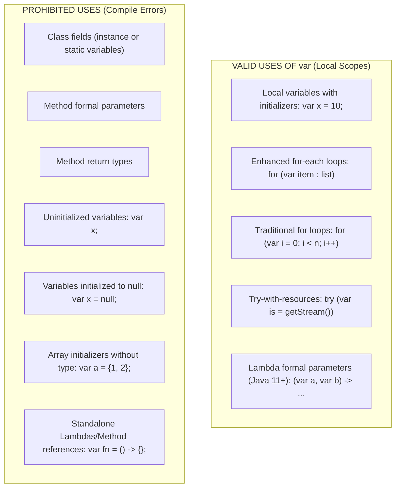

# P01-C007: Local Variable Type Inference (var) and Limitations

---

## 1. Title and Metadata

- **Concept ID:** `P01-C007`
- **Concept Title:** Local Variable Type Inference (var) and Limitations
- **Phase:** `Phase 01 — Java Language Fundamentals`
- **Module Sequence:** `07 of 15`
- **Prerequisites:**
  - [`P01-C003`: Reference Types vs Primitive Types in Memory](file:///home/prasanta/java_practice/curriculum/phase-01-java-language-fundamentals/003-reference-types-vs-primitives.md)
  - [`P01-C004`: Variable Declaration, Scope, Lifetime, and Default Values](file:///home/prasanta/java_practice/curriculum/phase-01-java-language-fundamentals/004-variable-scopes-and-lifetimes.md)
  - [`P01-C005`: Type Casting: Widening, Narrowing, and Overflow Traps](file:///home/prasanta/java_practice/curriculum/phase-01-java-language-fundamentals/005-type-casting-and-overflow.md)
  - [`P01-C006`: Wrapper Classes, Autoboxing, and NullPointerExceptions](file:///home/prasanta/java_practice/curriculum/phase-01-java-language-fundamentals/006-wrapper-classes-autoboxing.md)
- **Estimated Reading / Study Time:** 45 minutes
- **Controlling Specifications:**
  - [JEP 286: Local-Variable Type Inference](https://openjdk.org/jeps/286) (Java 10)
  - [JEP 323: Local-Variable Syntax for Lambda Parameters](https://openjdk.org/jeps/323) (Java 11)
  - [Java Language Specification (JLS) §14.4.1: Local Variable Declarations](https://docs.oracle.com/javase/specs/jls/se21/html/jls-14.html#jls-14.4.1)
  - [OpenJDK Style Guide: Local Variable Type Inference (Stuart Marks)](https://openjdk.org/projects/amber/guides/lvti-style-guide)

---

## 2. Conceptual Foundation & First Principles

Historically, Java required developers to write redundant type declarations on both sides of an assignment statement:
```java
// Pre-Java 10 redundant ceremonies
ByteArrayOutputStream outputStream = new ByteArrayOutputStream();
Map<String, List<TransactionPayload>> transactionsByUser = new HashMap<String, List<TransactionPayload>>();
```
This repetition adds visual clutter without providing new semantic information. In Java 10, **JEP 286 (Local-Variable Type Inference)** introduced the reserved type name `var`.

### What `var` Truly Is from First Principles
1. **Compile-Time Static Type Inference:** `var` is **NOT** dynamic typing. Java remains 100% strictly and statically typed. When you write `var name = "Alice";`, the `javac` compiler inspects the compile-time type of the right-hand initializer (`java.lang.String`) and stamps that exact type into the class file's bytecode and symbol tables.
2. **Contextual Reserved Type Name (Not a Keyword):** To preserve backward compatibility with legacy Java codebases, `var` was introduced as a *reserved type name*, not a reserved keyword. Code containing method names or variable names like `int var = 5;` or `void var() {}` remains valid legal Java. However, naming a class or interface `var` is disallowed.
3. **Zero Runtime Overhead:** At runtime, the JVM has no concept of `var`. The compiled `.class` file generated from `var name = "Alice";` is bit-for-bit identical to that generated from `String name = "Alice";`. There is zero reflection penalty, zero indirection, and zero execution overhead.
4. **Non-Reassignable to Different Types:** In dynamically typed languages (like JavaScript or Python), a variable can hold a string, then a number, then an object. In Java, because `var` establishes a static type, reassigning it to an incompatible type is a compile-time error:
```java
var count = 10;     // Inferred static type: int
count = "ten";      // COMPILE ERROR: incompatible types: java.lang.String cannot be converted to int
```

---

## 3. Architectural Flow & Scope Boundaries

### 3.1 Where `var` Is Allowed vs Prohibited
The Java compiler restricts type inference strictly to local lexical scopes where the initializer is immediately visible and the inferred type cannot leak across public API boundaries.



### 3.2 Why the Compiler Rejects `var` Outside Local Scope (Compiler Architecture)
1. **Public Contracts and Binary Compatibility:** If a class field or public method return type were declared with `var`, changing the implementation details of the initializer or return expression would silently alter the public binary interface (ABI). Downstream client libraries compiled against the class would suffer `NoSuchFieldError` or `NoSuchMethodError` at runtime without any compile-time change in their own code.
2. **Separation of Interface and Implementation:** Clean architecture requires classes to present explicit contracts (`List<T>`, `Reader`, `InputStream`) rather than leaking concrete internal representations (`ArrayList<T>`, `BufferedReader`, `FileInputStream`).
3. **Circular Type Inference in Compilers:** If field declarations supported `var`, two classes could reference each other's fields (`class A { var b = new B(); } class B { var a = new A(); }`), creating unsolvable circular dependency graphs in the compiler's semantic analysis phase. Restricting inference to local variables ensures type evaluation remains a simple, acyclic, single-pass operation.

---

## 4. Comprehensive Code Demonstration

Save and compile the following self-contained class to inspect permitted and prohibited `var` patterns, diamond operator traps, anonymous class type preservation, and compiler typing:

```java
package com.example.fundamentals;

import java.io.BufferedReader;
import java.io.ByteArrayInputStream;
import java.io.InputStreamReader;
import java.io.IOException;
import java.nio.charset.StandardCharsets;
import java.util.ArrayList;
import java.util.List;
import java.util.Map;

/**
 * Demonstrates the mechanics, capabilities, boundary rules,
 * and edge cases of Java Local Variable Type Inference (var).
 */
public class VarMechanicsDemo {

    // PROHIBITED: Instance and static fields cannot use var
    // private var instanceField = "Illegal"; // Compile error!
    // public static var staticField = 100;   // Compile error!

    public static void main(String[] args) throws IOException {
        System.out.println("=== 1. Valid Local Variable Inference ===");
        demonstrateValidInference();

        System.out.println("\n=== 2. Loop and Resource Constructs ===");
        demonstrateLoopsAndResources();

        System.out.println("\n=== 3. Generic Diamond Operator Trap ===");
        demonstrateDiamondTrap();

        System.out.println("\n=== 4. Non-Denotable Types (Anonymous Classes) ===");
        demonstrateAnonymousClassInference();

        System.out.println("\n=== 5. Final Local Variables with var ===");
        demonstrateFinalVar();
    }

    private static void demonstrateValidInference() {
        // Inferred as java.lang.String
        var message = "Local Variable Type Inference";
        
        // Inferred as int primitive (not Integer)
        var count = 42; 

        // Inferred as double primitive
        var ratio = 3.14159;

        // Inferred as java.util.ArrayList<java.lang.String>
        var names = new ArrayList<String>();
        names.add("Antigravity");

        System.out.println("message type: " + message.getClass().getName());
        System.out.println("names type: " + names.getClass().getName());
        System.out.println("count primitive value: " + count);
        System.out.println("ratio primitive value: " + ratio);
    }

    private static void demonstrateLoopsAndResources() throws IOException {
        var items = List.of("Kafka", "PostgreSQL", "Redis");

        // Enhanced for-loop with var
        System.out.print("Items: ");
        for (var item : items) { // item inferred as String
            System.out.print(item.toUpperCase() + " ");
        }
        System.out.println();

        // Traditional indexed for-loop with var
        System.out.print("Indices: ");
        for (var i = 0; i < items.size(); i++) { // i inferred as int
            System.out.print(i + ":" + items.get(i) + " ");
        }
        System.out.println();

        // Try-with-resources with var
        byte[] payload = "Streaming backend data".getBytes(StandardCharsets.UTF_8);
        try (var bais = new ByteArrayInputStream(payload);
             var reader = new BufferedReader(new InputStreamReader(bais, StandardCharsets.UTF_8))) {
            var line = reader.readLine(); // line inferred as String
            System.out.println("Read from stream via var: " + line);
        }
    }

    private static void demonstrateDiamondTrap() {
        // DANGER: Generic type parameter omitted on both sides!
        // javac infers ArrayList<Object>!
        var ambiguousList = new ArrayList<>();
        ambiguousList.add("String element");
        ambiguousList.add(100); // Completely legal because it holds Object!
        
        Object firstElement = ambiguousList.get(0);
        System.out.println("ambiguousList inferred type: ArrayList<Object>, element: " + firstElement);

        // CORRECT PATTERN: Specify explicit generic argument on right-hand side
        var concreteList = new ArrayList<String>();
        concreteList.add("Strictly Typed");
        // concreteList.add(100); // Compile error: incompatible types
        String strictFirst = concreteList.get(0); // No casting required!
        System.out.println("concreteList inferred type: ArrayList<String>, element: " + strictFirst);
    }

    private static void demonstrateAnonymousClassInference() {
        // With explicit typing (Object), count is inaccessible:
        // Object standardObj = new Object() { int count = 99; };
        // standardObj.count; // Compile error: cannot find symbol 'count'

        // With var, Java captures the NON-DENOTABLE anonymous subclass type!
        var specialObject = new Object() {
            String role = "ADMIN";
            int clearanceLevel = 5;

            void logDetails() {
                System.out.println("Role: " + role + ", Level: " + clearanceLevel);
            }
        };

        // Members on the anonymous class are directly accessible via var!
        System.out.println("Special object role: " + specialObject.role);
        System.out.println("Special object clearance: " + specialObject.clearanceLevel);
        specialObject.logDetails();
    }

    private static void demonstrateFinalVar() {
        // var can be combined with the 'final' keyword to enforce immutability
        final var immutableConfig = "PROD_EU_WEST_1";
        // immutableConfig = "PROD_US_EAST_1"; // Compile error: cannot assign a value to final variable

        System.out.println("Final var successfully declared: " + immutableConfig);
    }
}
```

### Execution Output:
```text
=== 1. Valid Local Variable Inference ===
message type: java.lang.String
names type: java.util.ArrayList
count primitive value: 42
ratio primitive value: 3.14159

=== 2. Loop and Resource Constructs ===
Items: KAFKA POSTGRESQL REDIS 
Indices: 0:Kafka 1:PostgreSQL 2:Redis 
Read from stream via var: Streaming backend data

=== 3. Generic Diamond Operator Trap ===
ambiguousList inferred type: ArrayList<Object>, element: String element
concreteList inferred type: ArrayList<String>, element: Strictly Typed

=== 4. Non-Denotable Types (Anonymous Classes) ===
Special object role: ADMIN
Special object clearance: 5
Role: ADMIN, Level: 5

=== 5. Final Local Variables with var ===
Final var successfully declared: PROD_EU_WEST_1
```

---

## 5. Real-World Backend Scenario: Microservice Request Pipeline

In high-throughput Spring Boot and enterprise microservices, orchestrating API requests often involves complex nested generic types (`Map<String, List<TransactionResponseDTO>>`). Writing these verbose types repeatedly clutters the core business logic.

```java
package com.example.fundamentals;

import java.time.Instant;
import java.util.*;

/**
 * Production Financial Audit Pipeline demonstrating clean var adoption
 * vs antipatterns that compromise code clarity.
 */
public class FinancialAuditPipeline {

    public record AuditRecord(String transactionId, double amount, Instant timestamp) {}

    public static class TransactionService {

        /**
         * CLEAN ADOPTION:
         * Using var eliminates visual noise when instantiating complex nested generic structures
         * where the right-hand constructor clearly documents the type.
         */
        public Map<String, List<AuditRecord>> processDailyTransactions(List<AuditRecord> rawRecords) {
            // Right-hand side makes the type immediately self-evident
            var auditIndex = new HashMap<String, List<AuditRecord>>();

            for (var record : rawRecords) {
                var partitionKey = record.amount() >= 10_000.0 ? "FLAGGED_HIGH_VALUE" : "STANDARD";
                
                // computeIfAbsent with var
                var partitionList = auditIndex.computeIfAbsent(partitionKey, k -> new ArrayList<>());
                partitionList.add(record);
            }

            return auditIndex;
        }

        /**
         * BAD PRACTICE (OBFUSCATION):
         * Using var when the right-hand side provides ZERO context on the returned type.
         */
        public void badPracticeObfuscation(FinancialAuditPipeline pipeline) {
            // WHAT TYPE IS THIS? String? StatusEnum? AuditResponseDTO? Future?
            // The reader is forced to jump to the method definition to find out.
            var result = pipeline.fetchInternalState(); 
        }

        /**
         * GOOD PRACTICE (SELF-DOCUMENTING):
         * When method return names are ambiguous, explicit typing or precise variable naming is mandatory.
         */
        public void goodPracticeClarity(FinancialAuditPipeline pipeline) {
            AuditStatusState internalState = pipeline.fetchInternalState();
            // OR if using var, use an informative variable name:
            var auditStatusState = pipeline.fetchInternalState();
        }
    }

    public enum AuditStatusState { HEALTHY, DEGRADED }

    public AuditStatusState fetchInternalState() {
        return AuditStatusState.HEALTHY;
    }

    public static void main(String[] args) {
        var service = new TransactionService();
        var records = List.of(
            new AuditRecord("TX-101", 12500.0, Instant.now()),
            new AuditRecord("TX-102", 45.50, Instant.now()),
            new AuditRecord("TX-103", 50000.0, Instant.now())
        );

        var processed = service.processDailyTransactions(records);
        processed.forEach((category, list) -> 
            System.out.println(category + " -> " + list.size() + " records")
        );
    }
}
```

---

## 6. Edge Cases, Failure Modes & Pitfalls

### Pitfall 1: The Generic Diamond Operator Pitfall (`var` + `<>`)
When combining `var` with the diamond operator (`<>`), the compiler has no target type to infer generic arguments from. Consequently, it infers `Object`:
```java
// SEVERE BUG:
var list = new ArrayList<>(); // Inferred type: ArrayList<Object>
list.add("String");
list.add(12345); // Compiles without error!

// Later in code:
String s = list.get(0); // COMPILE ERROR: incompatible types: Object cannot be converted to String
```
**Fix:** Always supply the explicit type argument on the right-hand side when using `var`:
```java
var list = new ArrayList<String>(); // Inferred type: ArrayList<String>
```

### Pitfall 2: Polymorphic Incompatibility (Concrete Implementation Binding)
In professional Java design, **programming to interfaces** is a foundational principle:
```java
List<String> items = new ArrayList<>(); // Interface type
items = new LinkedList<>();             // Legal: Can swap implementation easily
```
When you use `var`, the compiler infers the **concrete implementation type**, not the interface:
```java
var items = new ArrayList<String>(); // Inferred type: ArrayList<String>
items = new LinkedList<String>();     // COMPILE ERROR: LinkedList cannot be converted to ArrayList!
```
If a variable needs to be reassigned to a different implementation of the interface later in the same method, you **must** use explicit interface typing (`List<String> items`).

### Pitfall 3: Numeric Literal Default Inference
The compiler assigns default primitive types to numeric literals:
```java
var a = 1;       // int (32-bit)
var b = 1L;      // long (64-bit)
var c = 1.0;     // double (64-bit IEEE 754)
var d = 1.0f;    // float (32-bit IEEE 754)
var e = (byte)1; // byte (8-bit)
var f = (short)1;// short (16-bit)
```
Writing `var id = 100;` infers `int`. If a downstream method expects a `Long` or `long`, this will cause either a compile error or unexpected widening/boxing.

### Pitfall 4: Illegal Lambda and Method Reference Declarations
Lambdas and method references are poly expressions; they have no intrinsic type until a functional interface target type is supplied by context:
```java
// COMPILE ERRORS:
var runnable = () -> System.out.println("Hello");      // Error: cannot infer type for local variable
var comparator = String::compareToIgnoreCase;          // Error: cannot infer type for local variable

// FIX: Target type must be explicit:
Runnable runnable = () -> System.out.println("Hello");
Comparator<String> comparator = String::compareToIgnoreCase;
```

---

## 7. Performance, Memory & Concurrency Implications

1. **Zero Runtime Execution Cost:**
   `var` is resolved entirely within the semantic analysis phase of `javac`. The compiled bytecode contains identical local variable signatures, stack descriptors, and type attributes. There is zero runtime performance penalty or memory footprint difference between `var` and explicit types.

2. **Garbage Collection and Escape Analysis:**
   Because `var` preserves the concrete implementation type (e.g., `ArrayList` rather than `List`), the HotSpot JIT compiler can perform devirtualization and inline method calls (such as `ArrayList.get()`) without needing speculative class profiling. In certain tight microbenchmarks, concrete type binding can marginally accelerate JIT inlining decisions.

3. **Concurrency:**
   `var` variables adhere to the exact same thread-safety and stack-confinement rules as explicitly typed local variables (see [`P01-C004`](file:///home/prasanta/java_practice/curriculum/phase-01-java-language-fundamentals/004-variable-scopes-and-lifetimes.md)). Because local variables live exclusively on thread execution stacks, `var` references cannot cause race conditions unless their underlying heap objects are shared with other threads.

---

## 8. Antipatterns & Stuart Marks Style Guidelines

In 2018, OpenJDK Principal Engineer Stuart Marks published the authoritative **Style Guide for Local Variable Type Inference in Java**. The guidelines resolve the most common code quality antipatterns:

### Guideline 1: Choose Variable Names That Provide Useful Information
When removing the explicit type, the variable name must carry the semantic weight:
```java
// ANTIPATTERN (Meaningless name + var = Unreadable code):
var x = orderRepository.findPending(); 

// REFACTORED:
var pendingOrders = orderRepository.findPending();
```

### Guideline 2: Minimize the Scope of Local Variables
If a variable declared with `var` spans 100 lines of code, the reader forgets its type and purpose. Keep methods short (under 25 lines) so the declaration and usage fit on a single screen.

### Guideline 3: Consider `var` When the Initializer Provides Sufficient Context
```java
// EXCELLENT ADOPTION: Constructor or static factory with obvious type name:
var customer = new Customer();
var channel = SocketChannel.open();
var path = Paths.get("/var/log/syslog");

// POOR ADOPTION: Mystery factory method:
var value = processor.transform(); // Reader must guess what 'value' is
```

### Guideline 4: Do Not Compromise Clarity for the Sake of Brevity
If using `var` obscures whether a variable is a primitive `int`, a wrapper `Integer`, or a domain `UserId`, prefer explicit typing.

---

## 9. Compilation & Bytecode Disassembly

Let us disassemble a class containing both `var` and explicit types to prove they produce identical bytecode.

### Source Code (`VarBytecodeProof.java`):
```java
public class VarBytecodeProof {
    public static void testExplicit() {
        String message = "Verification";
        int number = 42;
        System.out.println(message + number);
    }

    public static void testInferred() {
        var message = "Verification";
        var number = 42;
        System.out.println(message + number);
    }
}
```

### Disassembly (`javap -c -v VarBytecodeProof`):
```text
  public static void testExplicit();
    descriptor: ()V
    flags: (0x0009) ACC_PUBLIC, ACC_STATIC
    Code:
      stack=2, locals=2, args_size=0
         0: ldc           #7      // String Verification
         2: astore_0
         3: bipush        42
         5: istore_1
         ...

  public static void testInferred();
    descriptor: ()V
    flags: (0x0009) ACC_PUBLIC, ACC_STATIC
    Code:
      stack=2, locals=2, args_size=0
         0: ldc           #7      // String Verification
         2: astore_0
         3: bipush        42
         5: istore_1
         ...
```
### Observation:
Notice that both methods emit identical bytecode instructions: `ldc #7` (load constant string), `astore_0` (store reference in slot 0), `bipush 42` (push integer 42), and `istore_1` (store integer in slot 1). In the LocalVariableTable attribute, both `message` entries have the identical descriptor `Ljava/lang/String;` and both `number` entries have descriptor `I`. The `var` construct has completely vanished.

---

## 10. Cross-Language & Historical Context (MERN/JavaScript vs Java)

| Feature | Java `var` (Java 10+) | JavaScript `var` (ES5) | JavaScript `let` / `const` (ES6) |
|---|---|---|---|
| **Typing System** | **Static compile-time inference**. Type cannot change. | **Dynamic typing**. Type is evaluated at runtime and can mutate freely. | **Dynamic typing**. Type is evaluated at runtime and can mutate freely. |
| **Reassignment to Different Type** | **Illegal** (Compile-time error). | **Permitted**. Variable can hold string, then number. | **Permitted** for `let`. |
| **Scoping Rules** | Block scope (`{ ... }`). | Function scope (hoisted to top of function). | Block scope (`{ ... }`). |
| **Hoisting / Temporal Dead Zone** | No hoisting. Definite assignment rules apply strictly. | Hoisted to top of scope with initial value `undefined`. | Hoisted into Temporal Dead Zone (TDZ); accessing before let throws `ReferenceError`. |
| **Allowed on Class Fields** | **No**. Fields require explicit types. | N/A (Object properties are dynamic). | Class fields can be declared without static types. |
| **Runtime Presence** | **None**. Erased during compilation into concrete bytecode types. | Retained dynamically in JavaScript runtime engine (V8). | Retained dynamically in JavaScript runtime engine (V8). |

---

## 11. Unit Testing & Verification Guide

Create this JUnit 5 test suite to verify that `var` preserves runtime types, enforces type constraints, and behaves identically to explicit types:

```java
package com.example.fundamentals;

import org.junit.jupiter.api.DisplayName;
import org.junit.jupiter.api.Test;

import java.util.ArrayList;
import java.util.List;

import static org.junit.jupiter.api.Assertions.*;

public class VarInferenceTest {

    @Test
    @DisplayName("Verify Inferred Types Match Exact Expected Classes")
    void testInferredTypes() {
        var str = "Java 21 LTS";
        var list = new ArrayList<String>();
        var number = 100L;

        assertEquals(String.class, str.getClass());
        assertEquals(ArrayList.class, list.getClass());
        // For boxed primitive comparison
        assertEquals(Long.class, ((Object) number).getClass());
    }

    @Test
    @DisplayName("Verify var with Anonymous Subclass Exposes Custom Methods")
    void testAnonymousClassTypePreservation() {
        var customObject = new Object() {
            int compute(int x) { return x * 2; }
        };

        // If customObject were typed as Object, this would not compile!
        int result = customObject.compute(21);
        assertEquals(42, result);
    }

    @Test
    @DisplayName("Verify Diamond Operator ArrayList Infers Object When Unparameterized")
    void testDiamondOperatorObjectInference() {
        var ambiguous = new ArrayList<>();
        ambiguous.add("Alpha");
        ambiguous.add(999);

        // First item is Object
        Object item = ambiguous.get(0);
        assertTrue(item instanceof String);
        assertEquals("Alpha", item);
    }
}
```

---

## 12. Security & Hardening Considerations

1. **Information Leakage via Anonymous Class Invocations:**
   When using `var` with anonymous classes, the compiler synthesizes a package-private inner class (`VarMechanicsDemo$1`). If this anonymous object is exposed across package boundaries (e.g., returned through reflection or serialized), it can break modular encapsulation and leak internal fields.
   - *Mitigation:* Restrict anonymous class `var` usage strictly to private, self-contained methods.

2. **Accidental Type Broadening in Secure Contexts:**
   Using `var` with generic collections can inadvertently broaden the accepted types (e.g., inferring `ArrayList<Object>` instead of `ArrayList<SecureToken>`), allowing untrusted or unexpected object types into collections.
   - *Mitigation:* Always enforce explicit type parameters on the right-hand constructor (`new ArrayList<SecureToken>()`).

---

## 13. Diagnostic, Troubleshooting & Triage Runbook

### Compiler Error Triage Table:
| Compiler Error Message | Underlying Root Cause | Corrective Action |
|---|---|---|
| `cannot infer type for local variable x (cannot use 'var' on variable without initializer)` | `var x;` was declared without an assignment. | Provide an immediate initializer: `var x = 0;`. |
| `variable initializer is 'null'` | `var x = null;` attempted. The null literal has the special `null` type which cannot be bound. | Provide an explicit type: `String x = null;` or cast: `var x = (String) null;`. |
| `array initializer needs an explicit target-type` | `var arr = { 1, 2, 3 };` attempted. Curly-brace array initializers require an explicit type. | Use full array construction syntax: `var arr = new int[]{ 1, 2, 3 };`. |
| `'var' is not allowed here` | `var` was placed on a class field, method parameter, or method return type. | Replace `var` with an explicit type signature (`String`, `int`, `void`). |

---

## 14. Exercises & Practice Scenarios

### Exercise 1: Identify and Fix the Compile Errors
Examine the following code snippet and identify all lines that will fail compilation:
```java
public class VarChallenge {
    var id = 101;                                    // Line 2
    public static void execute(var input) {          // Line 3
        var list;                                    // Line 4
        var data = null;                             // Line 5
        var values = { 1, 2, 3 };                    // Line 6
        var fn = (String s) -> s.length();           // Line 7
        var validList = new ArrayList<String>();     // Line 8
    }
}
```

#### Solution:
- **Line 2 Fails:** Class fields cannot use `var`. Fix: `private int id = 101;`
- **Line 3 Fails:** Method parameters cannot use `var`. Fix: `public static void execute(String input)`
- **Line 4 Fails:** Variable without initializer. Fix: `var list = new ArrayList<String>();`
- **Line 5 Fails:** Initializer is `null`. Fix: `String data = null;`
- **Line 6 Fails:** Array initializer needs explicit target type. Fix: `var values = new int[]{ 1, 2, 3 };`
- **Line 7 Fails:** Standalone lambda cannot infer target functional interface. Fix: `Function<String, Integer> fn = (String s) -> s.length();`
- **Line 8 Succeeds:** Perfectly valid local variable type inference.

---

## 15. Technical Interview Questions & Evaluator Answers

### Q1: Is `var` in Java equivalent to `var` in JavaScript or `auto` in C++?
**Answer:** 
- It is fundamentally **different from JavaScript's `var`**. JavaScript's `var` is dynamically typed, function-scoped, and hoisted; variables can be reassigned to values of completely different types at runtime.
- Java's `var` is almost **identical to C++'s `auto`**. Both perform compile-time static type deduction. The compiler deduces the exact type from the right-hand initializer and stamps it into the compiled output. The variable is permanently bound to that static type, and Java's type safety and performance remain completely uncompromised.

### Q2: Why did Java allow `var` for local variables but not for method parameters and return types?
**Answer:** 
Method signatures (parameters and return types) constitute the public API contracts of classes and modules. Java's design philosophy mandates that contracts must be explicit, stable, and easily understandable without reading internal implementation code. Allowing `var` in method signatures would:
1. Make public contracts vulnerable to accidental breaking changes whenever private internal implementations change.
2. Require multi-pass or circular compiler inference across compilation units, drastically slowing compilation times.
3. Impair developer readability when inspecting library APIs via IDEs or javadocs.

### Q3: How does `var` interact with anonymous classes in a way that regular explicit typing cannot?
**Answer:**
When an anonymous inner class defines new methods or fields not present in its superclass, standard explicit typing forces the variable to be declared as the superclass type (`Object` or an interface). This prevents the caller from invoking those custom methods because they are not declared on the reference type. With `var`, the compiler captures the **non-denotable anonymous class type** directly. This allows callers to invoke methods and access fields declared uniquely on that anonymous instance.

---

## 16. References, Standards & Further Reading

1. **JEPs (JDK Enhancement Proposals):**
   - [JEP 286: Local-Variable Type Inference](https://openjdk.org/jeps/286) (Java 10)
   - [JEP 323: Local-Variable Syntax for Lambda Parameters](https://openjdk.org/jeps/323) (Java 11)
2. **Language Specifications & Guides:**
   - [Java Language Specification (Java SE 21) §14.4.1 Local Variable Declarations](https://docs.oracle.com/javase/specs/jls/se21/html/jls-14.html#jls-14.4.1)
   - [Style Guidelines for Local Variable Type Inference in Java (Stuart Marks, OpenJDK)](https://openjdk.org/projects/amber/guides/lvti-style-guide)
3. **Core API Documentation:**
   - [Class `java.lang.Object`](https://docs.oracle.com/en/java/javase/21/docs/api/java.base/java/lang/Object.html)
