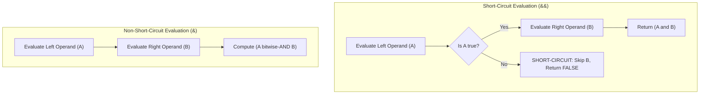
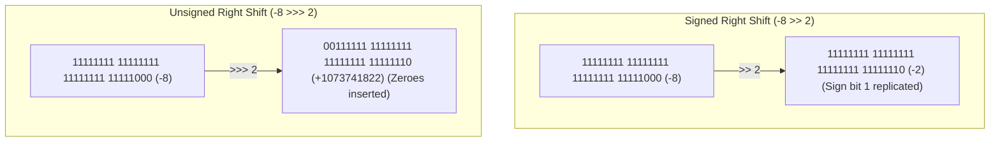

# P01-C008: Operators, Precedence, and Short-Circuit Evaluation

---

## 1. Title and Metadata

- **Concept ID:** `P01-C008`
- **Concept Title:** Operators, Precedence, and Short-Circuit Evaluation
- **Phase:** `Phase 01 — Java Language Fundamentals`
- **Module Sequence:** `08 of 15`
- **Prerequisites:**
  - [`P01-C001`: Primitive Data Types, Bit Widths, and Numeric Ranges](file:///home/prasanta/java_practice/curriculum/phase-01-java-language-fundamentals/001-primitive-data-types.md)
  - [`P01-C003`: Reference Types vs Primitive Types in Memory](file:///home/prasanta/java_practice/curriculum/phase-01-java-language-fundamentals/003-reference-types-vs-primitives.md)
  - [`P01-C005`: Type Casting: Widening, Narrowing, and Overflow Traps](file:///home/prasanta/java_practice/curriculum/phase-01-java-language-fundamentals/005-type-casting-and-overflow.md)
  - [`P01-C006`: Wrapper Classes, Autoboxing, and NullPointerExceptions](file:///home/prasanta/java_practice/curriculum/phase-01-java-language-fundamentals/006-wrapper-classes-autoboxing.md)
  - [`P01-C007`: Local Variable Type Inference (var) and Limitations](file:///home/prasanta/java_practice/curriculum/phase-01-java-language-fundamentals/007-local-variable-type-inference-var.md)
- **Estimated Reading / Study Time:** 50 minutes
- **Controlling Specifications:**
  - [Java Language Specification (JLS) §15.7: Evaluation Order](https://docs.oracle.com/javase/specs/jls/se21/html/jls-15.html#jls-15.7)
  - [Java Language Specification (JLS) §15.20: Relational Operators](https://docs.oracle.com/javase/specs/jls/se21/html/jls-15.html#jls-15.20)
  - [Java Language Specification (JLS) §15.22: Bitwise and Logical Operators](https://docs.oracle.com/javase/specs/jls/se21/html/jls-15.html#jls-15.22)
  - [Java Language Specification (JLS) §15.23: Conditional-And Operator `&&`](https://docs.oracle.com/javase/specs/jls/se21/html/jls-15.html#jls-15.23)
  - [Java Language Specification (JLS) §15.24: Conditional-Or Operator `||`](https://docs.oracle.com/javase/specs/jls/se21/html/jls-15.html#jls-15.24)
  - [Java Language Specification (JLS) §15.25: Conditional Operator `? :`](https://docs.oracle.com/javase/specs/jls/se21/html/jls-15.html#jls-15.25)

---

## 2. Conceptual Foundation & First Principles

In Java backend engineering, operators dictate how data transitions through CPU registers and memory. While simple mathematical calculations appear straightforward, fundamental misconceptions regarding **operator precedence**, **evaluation order**, and **short-circuit evaluation** cause severe production outages—such as crashing threads via `NullPointerException`, triggering unintended network/database roundtrips, or corrupting binary bitmasks.

### 2.1 The Two Invariants of Java Expression Evaluation
1. **Operator Precedence and Associativity:** Dictates how expressions are grouped into parse tree branches (e.g., `*` binds tighter than `+`).
2. **Strict Left-to-Right Evaluation Order (JLS §15.7):** Unlike C and C++, where operand evaluation order is undefined (leading to sequence-point bugs), **Java guarantees strictly that operands are evaluated from left to right**, regardless of operator precedence!
   - In `computeA() + computeB() * computeC()`, Java guarantees that `computeA()` executes first, followed by `computeB()`, followed by `computeC()`. Only after all three methods return their values does the multiplication of $B \times C$ occur, followed by the addition of $A$.

### 2.2 Short-Circuit vs Non-Short-Circuit Boolean Evaluation
Java provides two distinct sets of boolean logical operators:
- **Conditional Operators (Short-Circuit):** `&&` (Conditional-AND) and `||` (Conditional-OR).
  - In `A && B`: If `A` evaluates to `false`, `B` is **never evaluated**. The result is immediately `false`.
  - In `A || B`: If `A` evaluates to `true`, `B` is **never evaluated**. The result is immediately `true`.
- **Logical / Bitwise Operators (Non-Short-Circuit):** `&` (Logical AND) and `|` (Logical OR).
  - When applied to boolean expressions, `&` and `|` evaluate **both operands unconditionally**, regardless of the truth value of the left operand.



In backend systems, short-circuit evaluation is the primary defense mechanism against null pointer dereferencing:
```java
// SAFE: If user is null, user.hasPermission() is NEVER invoked
if (user != null && user.hasPermission("WRITE")) { ... }

// FATAL BUG: Both sides are evaluated; throws NullPointerException if user is null!
if (user != null & user.hasPermission("WRITE")) { ... }
```

---

## 3. Operator Precedence and Bitwise Mechanics

### 3.1 Canonical Operator Precedence Hierarchy (Highest to Lowest)

| Precedence Level | Operator Category | Operators | Associativity |
|---|---|---|---|
| **1 (Highest)** | Postfix | `expr++`, `expr--` | Left to Right |
| **2** | Unary | `++expr`, `--expr`, `+`, `-`, `~` (bitwise NOT), `!` (logical NOT) | **Right to Left** |
| **3** | Cast & Creation | `(type)`, `new` | **Right to Left** |
| **4** | Multiplicative | `*`, `/`, `%` | Left to Right |
| **5** | Additive | `+`, `-` | Left to Right |
| **6** | Shift | `<<` (left), `>>` (signed right), `>>>` (unsigned right) | Left to Right |
| **7** | Relational | `<`, `<=`, `>`, `>=`, `instanceof` | Left to Right |
| **8** | Equality | `==`, `!=` | Left to Right |
| **9** | Bitwise AND | `&` | Left to Right |
| **10** | Bitwise XOR | `^` | Left to Right |
| **11** | Bitwise OR | `\|` | Left to Right |
| **12** | Conditional AND | `&&` | Left to Right |
| **13** | Conditional OR | `\|\|` | Left to Right |
| **14** | Ternary Conditional | `? :` | **Right to Left** |
| **15 (Lowest)** | Assignment | `=`, `+=`, `-=`, `*=`, `/=`, `%=`, `&=`, `^=`, `\|=`, `<<=`, `>>=`, `>>>=` | **Right to Left** |

### 3.2 Bit-Shift Operators: Signed vs Unsigned Mechanics
Java provides three bit-shift operators acting on integer types (`int` and `long`):

1. **Signed Left Shift (`<<`):**
   - Shifts bits left, filling low-order bits with `0`. High-order bits shifted beyond the boundary are discarded.
   - Mathematically equivalent to multiplying by $2^k$ (ignoring overflow).
2. **Signed Arithmetic Right Shift (`>>`):**
   - Shifts bits right, preserving the sign bit (copies the most significant bit into vacated high-order positions).
   - For positive numbers, fills with `0`. For negative numbers, fills with `1` (sign-extension).
   - Mathematically equivalent to integer floor division $\lfloor x / 2^k \rfloor$.
3. **Unsigned Logical Right Shift (`>>>`):**
   - Shifts bits right, unconditionally filling vacated high-order positions with `0`, regardless of sign.
   - Negative numbers turn into large positive integers. Indispensable for cryptographic hashing, Bloom filters, and low-level protocol decoding.



#### The Shift Distance Masking Rule (JLS §15.19)
The CPU architecture cannot shift an operand by more positions than its physical bit width:
- For 32-bit `int`, the shift distance is masked with `0x1F` (binary `00011111`, decimal `31`): `x << 32` is identical to `x << (32 & 31)`, which is `x << 0` (a no-op)!
- For 64-bit `long`, the shift distance is masked with `0x3F` (decimal `63`): `x << 64` evaluates to `x << 0`.

---

## 4. Comprehensive Code Demonstration

Save and execute this self-contained class to inspect evaluation order guarantees, short-circuit protection, bitwise shift behaviors, and ternary precedence:

```java
package com.example.fundamentals;

/**
 * Demonstrates Java operator execution order, short-circuit mechanics,
 * bit-shifting differences, and bitmask flag operations.
 */
public class OperatorMechanicsDemo {

    public static void main(String[] args) {
        System.out.println("=== 1. JLS §15.7 Strict Left-to-Right Evaluation Order ===");
        demonstrateEvaluationOrder();

        System.out.println("\n=== 2. Short-Circuit vs Non-Short-Circuit Boolean Evaluation ===");
        demonstrateShortCircuit();

        System.out.println("\n=== 3. Bit-Shift Mechanics: Signed vs Unsigned ===");
        demonstrateBitShifts();

        System.out.println("\n=== 4. Shift Distance Masking Trap ===");
        demonstrateShiftMasking();

        System.out.println("\n=== 5. Production Bitmask Permission Flags ===");
        demonstrateBitmaskFlags();
    }

    private static void demonstrateEvaluationOrder() {
        // Precedence dictates that B() * C() is calculated before adding A().
        // However, JLS §15.7 mandates that operands are evaluated strictly LEFT-TO-RIGHT:
        // A() is invoked FIRST, then B(), then C()!
        int result = evaluate("A", 10) + evaluate("B", 5) * evaluate("C", 2);
        System.out.println("Final Result: " + result); // 10 + (5 * 2) = 20
    }

    private static int evaluate(String label, int value) {
        System.out.print("[" + label + " evaluated] ");
        return value;
    }

    private static void demonstrateShortCircuit() {
        String nullUser = null;

        // SHORT-CIRCUIT (&&): First operand is false; second operand is NEVER evaluated
        if (nullUser != null && nullUser.length() > 0) {
            System.out.println("User exists");
        } else {
            System.out.println("Short-circuit protected against NullPointerException successfully.");
        }

        // SIDE-EFFECT HAZARD:
        int counter = 0;
        boolean condition = false;
        if (condition && (++counter > 0)) {
            // Unreachable
        }
        System.out.println("Counter after short-circuit: " + counter + " (Increment skipped!)");

        if (condition & (++counter > 0)) {
            // Evaluates both sides
        }
        System.out.println("Counter after non-short-circuit (&): " + counter + " (Increment executed!)");
    }

    private static void demonstrateBitShifts() {
        int negativeVal = -8;

        int signedShift = negativeVal >> 2;
        int unsignedShift = negativeVal >>> 2;

        System.out.printf("Original: %d [Binary: %32s]%n", negativeVal, Integer.toBinaryString(negativeVal));
        System.out.printf("Signed >> 2: %d [Binary: %32s]%n", signedShift, Integer.toBinaryString(signedShift));
        System.out.printf("Unsigned >>> 2: %d [Binary: %32s]%n", unsignedShift, Integer.toBinaryString(unsignedShift));
    }

    private static void demonstrateShiftMasking() {
        int val = 1;
        // Shift by 32 positions on an int:
        // javac / CPU masks 32 & 0x1F = 0. It shifts by 0!
        int shiftedBy32 = val << 32;
        int shiftedBy33 = val << 33; // 33 & 31 = 1

        System.out.println("1 << 32 = " + shiftedBy32 + " (No-op! Masked to 0)");
        System.out.println("1 << 33 = " + shiftedBy33 + " (Masked to 1 << 1 = 2)");
    }

    private static void demonstrateBitmaskFlags() {
        // Bitmask definitions using 1 << n
        final int PERM_READ    = 1 << 0; // 0001 (1)
        final int PERM_WRITE   = 1 << 1; // 0010 (2)
        final int PERM_EXECUTE = 1 << 2; // 0100 (4)
        final int PERM_DELETE  = 1 << 3; // 1000 (8)

        int userPermissions = 0;

        // Set flags using Bitwise OR (|)
        userPermissions |= PERM_READ | PERM_WRITE;
        System.out.println("Permissions after grant READ+WRITE: " + Integer.toBinaryString(userPermissions));

        // Test flag using Bitwise AND (&)
        boolean canWrite = (userPermissions & PERM_WRITE) != 0;
        boolean canDelete = (userPermissions & PERM_DELETE) != 0;
        System.out.printf("Can Write: %b | Can Delete: %b%n", canWrite, canDelete);

        // Clear flag using Bitwise AND with NOT (& ~)
        userPermissions &= ~PERM_WRITE;
        System.out.println("Permissions after revoke WRITE: " + Integer.toBinaryString(userPermissions));
        System.out.println("Can Write now: " + ((userPermissions & PERM_WRITE) != 0));

        // Toggle flag using Bitwise XOR (^)
        userPermissions ^= PERM_EXECUTE; // Turn ON execute
        System.out.println("Permissions after toggle EXECUTE: " + Integer.toBinaryString(userPermissions));
    }
}
```

### Execution Output:
```text
=== 1. JLS §15.7 Strict Left-to-Right Evaluation Order ===
[A evaluated] [B evaluated] [C evaluated] Final Result: 20

=== 2. Short-Circuit vs Non-Short-Circuit Boolean Evaluation ===
Short-circuit protected against NullPointerException successfully.
Counter after short-circuit: 0 (Increment skipped!)
Counter after non-short-circuit (&): 1 (Increment executed!)

=== 3. Bit-Shift Mechanics: Signed vs Unsigned ===
Original: -8 [Binary: 11111111111111111111111111111000]
Signed >> 2: -2 [Binary: 11111111111111111111111111111110]
Unsigned >>> 2: 1073741822 [Binary:   111111111111111111111111111110]

=== 4. Shift Distance Masking Trap ===
1 << 32 = 1 (No-op! Masked to 0)
1 << 33 = 2 (Masked to 1 << 1 = 2)

=== 5. Production Bitmask Permission Flags ===
Permissions after grant READ+WRITE: 11
Can Write: true | Can Delete: false
Permissions after revoke WRITE: 1
Can Write now: false
Permissions after toggle EXECUTE: 101
```

---

## 5. Real-World Backend Scenario: High-Throughput Request Rate Limiter and Cache Gateway

In high-throughput API gateways and security microservices, requests must be authorized, checked against a multi-tier cache, and evaluated for rate limits. Misusing operators here leads directly to production latency degradation or catastrophic downtime:

```java
package com.example.fundamentals;

import java.util.concurrent.atomic.AtomicInteger;

/**
 * Production Gateway Authenticator demonstrating short-circuit cache fallbacks,
 * rate limiting guards, and bitmask security clearance.
 */
public class GatewayRequestProcessor {

    public static class SecurityContext {
        public static final int ROLE_GUEST      = 1 << 0;
        public static final int ROLE_USER       = 1 << 1;
        public static final int ROLE_ADMIN      = 1 << 2;
        public static final int ROLE_SUPERADMIN = 1 << 3;

        private final int roleMask;
        private final String authToken;

        public SecurityContext(int roleMask, String authToken) {
            this.roleMask = roleMask;
            this.authToken = authToken;
        }

        public int getRoleMask() { return roleMask; }
        public String getAuthToken() { return authToken; }
    }

    private final AtomicInteger remoteRpcCallCounter = new AtomicInteger(0);

    /**
     * VULNERABLE AUTHORIZATION CHECK:
     * Uses non-short-circuit bitwise operators (&) instead of conditional operators (&&).
     * If securityContext is null, or token is invalid, it STILL calls the expensive remote RPC!
     */
    public boolean authorizeVulnerable(SecurityContext ctx) {
        // FATAL: If ctx is null, this throws NullPointerException immediately.
        // Even if valid, ctx.getAuthToken() != null & verifyRemoteToken() forces remote RPC!
        return ctx != null & verifyRemoteToken(ctx.getAuthToken());
    }

    /**
     * RESILIENT PRODUCTION IMPLEMENTATION:
     * Leverages short-circuit evaluation to skip expensive remote checks whenever local checks fail.
     */
    public boolean authorizeResilient(SecurityContext ctx, int requiredRole) {
        // 1. Defend against null context
        // 2. Validate token presence locally
        // 3. Check bitmask role clearance in CPU registers (0 nanoseconds)
        // 4. ONLY if all local checks pass, execute expensive remote token verification RPC!
        return ctx != null 
            && ctx.getAuthToken() != null 
            && (ctx.getRoleMask() & requiredRole) != 0 
            && verifyRemoteToken(ctx.getAuthToken());
    }

    private boolean verifyRemoteToken(String token) {
        remoteRpcCallCounter.incrementAndGet();
        System.out.println("  [NETWORK RPC] Executing remote cryptographic token verification...");
        return "VALID_BEARER_TOKEN".equals(token);
    }

    public int getRemoteRpcCalls() {
        return remoteRpcCallCounter.get();
    }

    public static void main(String[] args) {
        var processor = new GatewayRequestProcessor();

        var unauthorizedContext = new SecurityContext(SecurityContext.ROLE_GUEST, "INVALID_TOKEN");
        var adminContext = new SecurityContext(SecurityContext.ROLE_ADMIN, "VALID_BEARER_TOKEN");

        System.out.println("Testing unauthorized request with insufficient role:");
        boolean result1 = processor.authorizeResilient(unauthorizedContext, SecurityContext.ROLE_ADMIN);
        System.out.println("Result: " + result1 + ", Remote RPCs triggered: " + processor.getRemoteRpcCalls());

        System.out.println("\nTesting valid admin request:");
        boolean result2 = processor.authorizeResilient(adminContext, SecurityContext.ROLE_ADMIN);
        System.out.println("Result: " + result2 + ", Remote RPCs triggered: " + processor.getRemoteRpcCalls());
    }
}
```

### Execution Output:
```text
Testing unauthorized request with insufficient role:
Result: false, Remote RPCs triggered: 0

Testing valid admin request:
  [NETWORK RPC] Executing remote cryptographic token verification...
Result: true, Remote RPCs triggered: 1
```

---

## 6. Edge Cases, Failure Modes & Pitfalls

### Pitfall 1: Modulo with Negative Operands
In Java, the `%` operator is the **remainder operator**, not the mathematical modulo operator:
$$r = a - (a / b) \times b$$
The sign of the result is determined **strictly by the sign of the dividend (left operand)**:
```java
int a = -7 % 3;  // Evaluates to -1, NOT +2!
int b = 7 % -3;  // Evaluates to +1!
int c = -7 % -3; // Evaluates to -1!
```
**Production Impact:** If indexing into an array circular ring buffer via `index = (index + 1) % array.length`, if `index` can ever be negative, this produces a negative index, immediately throwing `ArrayIndexOutOfBoundsException`!
**Fix:** Use `Math.floorMod(a, b)`:
```java
int safeIndex = Math.floorMod(-7, 3); // Evaluates correctly to 2
```

### Pitfall 2: Accidental Assignment in Boolean Expressions
Java avoids C's classic `if (x = 5)` bug for integers because Java requires a `boolean` inside `if (...)`. However, if the variable is already a `boolean`:
```java
boolean isEnabled = false;
if (isEnabled = true) { // CRITICAL BUG: Assignment (=) instead of equality (==)!
    // This block ALWAYS executes!
}
```
**Fix:** Invert comparison style or use simple boolean variables: `if (isEnabled)` rather than `if (isEnabled == true)`.

### Pitfall 3: Bitwise Precedence Trap
In C and Java, bitwise operators (`&`, `^`, `|`) have **lower precedence** than equality and relational operators (`==`, `!=`, `<`, `>`):
```java
int flags = 2; // binary 0010
int MASK = 2;

// BUG: (flags & MASK != 0) parses as flags & (MASK != 0)
// Because != has higher precedence than &, this evaluates:
// 1. (MASK != 0) -> true
// 2. flags & true -> COMPILE ERROR: bad operand types for binary operator '&'
```
**Fix:** Always wrap bitwise expressions in parentheses:
```java
if ((flags & MASK) != 0) { ... }
```

### Pitfall 4: Short-Circuiting Side Effects
Placing state mutations inside short-circuited expressions leads to fragile, order-dependent bugs:
```java
if (isPremiumUser() || registerTrialOffer(user)) { ... }
```
If `isPremiumUser()` returns `true`, `registerTrialOffer()` is **never executed**, leaving the user in an inconsistent state.

---

## 7. Performance, Memory & Concurrency Implications

1. **JIT Branch Prediction and Short-Circuiting:**
   In hot loops, `&&` and `||` compile down to conditional branch instructions (`ifeq`, `ifne`). If the left condition is unpredictable (50% true, 50% false), modern CPU branch predictors will suffer branch mispredictions (costing 15–20 CPU cycles per stall). In computational graphics, DSP, or game engines, engineers occasionally prefer bitwise `&` to eliminate branching entirely, trading an extra instruction evaluation for deterministic zero-branch execution. In enterprise backend code, however, short-circuiting is almost always preferred for safety and resource savings.

2. **Bitwise Bitmasking vs Memory Overhead:**
   Representing 32 boolean permission flags as 32 individual `boolean` fields inside an object consumes $32 \text{ bytes}$ (or 128 bytes depending on packing and alignment). Representing them as a single `int` bitmask consumes exactly **4 bytes**, fitting inside a single CPU register and eliminating cache thrashing.

3. **Concurrency:**
   Bitwise compound assignments (`flags |= PERM_WRITE;`) are **NOT atomic**. They compile to read-modify-write bytecode cycles (`iload`, `iconst`, `ior`, `istore`). Multiple threads modifying bit flags concurrently without synchronization or `AtomicInteger.updateAndGet()` will cause lost updates.

---

## 8. Antipatterns & Refactoring

### Antipattern 1: Checking Booleans with `== true` or `== false`
```java
// ANTIPATTERN:
if (account.isActive() == true) { ... }
if (account.isBlocked() == false) { ... }

// REFACTORED:
if (account.isActive()) { ... }
if (!account.isBlocked()) { ... }
```

### Antipattern 2: Chained Ternaries Without Parentheses
```java
// ANTIPATTERN (Unreadable mental gymnastics):
String status = age < 13 ? "CHILD" : age < 20 ? "TEEN" : age < 65 ? "ADULT" : "SENIOR";

// REFACTORED (Clear, exhaustive Switch Expression):
String status = switch (age) {
    case int a when a < 13 -> "CHILD";
    case int a when a < 20 -> "TEEN";
    case int a when a < 65 -> "ADULT";
    default -> "SENIOR";
};
```

### Antipattern 3: Using Raw Int Bitmasks in Modern Domain Code
```java
// ANTIPATTERN: Passing raw ints across API boundaries
public void updateRoles(int roleBitmask) { ... }

// REFACTORED: Use java.util.EnumSet (high-performance bitmask backed by a single long under the hood)
public void updateRoles(Set<UserRole> roles) {
    EnumSet<UserRole> roleSet = EnumSet.copyOf(roles);
}
```

---

## 9. Compilation & Bytecode Disassembly

Let us disassemble a class demonstrating short-circuit conditional branches (`&&`) versus non-short-circuit bitwise evaluation (`&`).

### Source Code (`OperatorBytecode.java`):
```java
public class OperatorBytecode {
    public static boolean testShortCircuit(boolean a, boolean b) {
        return a && b;
    }

    public static boolean testBitwise(boolean a, boolean b) {
        return a & b;
    }
}
```

### Disassembly (`javap -c OperatorBytecode`):
```text
  public static boolean testShortCircuit(boolean, boolean);
    Code:
       0: iload_0          // Load boolean 'a'
       1: ifeq          8  // If 'a' is 0 (false), JUMP DIRECTLY to offset 8 (SHORT-CIRCUIT!)
       4: iload_1          // Load boolean 'b'
       5: ifne          12 // If 'b' is not 0 (true), jump to offset 12
       8: iconst_0         // Push false (0)
       9: goto          13 // Return result
      12: iconst_1         // Push true (1)
      13: ireturn

  public static boolean testBitwise(boolean, boolean);
    Code:
       0: iload_0          // Load boolean 'a'
       1: iload_1          // Load boolean 'b' unconditionally
       2: iand             // Perform bitwise AND opcode
       3: ireturn
```

### Deep Bytecode Analysis:
1. `testShortCircuit`: Uses `ifeq 8` (branch if equal to zero/false). If `a` is false, execution skips loading `b` entirely and branches straight to instruction 8.
2. `testBitwise`: Executes `iload_0` then `iload_1` unconditionally, followed by the single arithmetic opcode `iand`. There are zero branches.

---

## 10. Cross-Language & Historical Context (MERN/JavaScript vs Java)

| Feature | Java (JVM) | JavaScript / Node.js (V8) |
|---|---|---|
| **Return Type of `&&` / `\|\|`** | **Strictly `boolean`**. `a && b` requires both operands to be `boolean` and evaluates to `boolean`. | **Value of the short-circuiting operand**. `null && "hello"` evaluates to `null`. `"hello" \|\| "default"` returns `"hello"`. |
| **Falsy Values** | Only the boolean literal `false`. $0$, `""`, and `null` are not falsy; they cannot be used in `if (...)`. | Multiple falsy values: `false`, `0`, `""`, `null`, `undefined`, `NaN`. |
| **Nullish Coalescing** | No built-in `??` operator. Use `Objects.requireNonNullElse(a, b)` or `Optional.ofNullable(a).orElse(b)`. | Built-in `??` operator (`a ?? b`). |
| **Shift Operators** | Operates on 32-bit `int` and 64-bit `long`. Distance is masked with $31$ or $63$. | Operates on 32-bit integers; JS converts doubles to 32-bit ints before shifting. |
| **Strict Evaluation Order** | JLS §15.7 strictly guarantees left-to-right operand evaluation. | Strictly left-to-right operand evaluation. |

---

## 11. Unit Testing & Verification Guide

Create this JUnit 5 test suite to verify operator behaviors, short-circuit invariants, and bitmask manipulations:

```java
package com.example.fundamentals;

import org.junit.jupiter.api.DisplayName;
import org.junit.jupiter.api.Test;

import java.util.concurrent.atomic.AtomicBoolean;

import static org.junit.jupiter.api.Assertions.*;

public class OperatorTest {

    @Test
    @DisplayName("Verify Short-Circuit Prevents Side-Effect Execution")
    void testShortCircuitSkipsSideEffect() {
        AtomicBoolean sideEffectTriggered = new AtomicBoolean(false);

        boolean result = false && triggerSideEffect(sideEffectTriggered);

        assertFalse(result);
        assertFalse(sideEffectTriggered.get(), "Right operand must not be evaluated when left is false");
    }

    @Test
    @DisplayName("Verify Non-Short-Circuit Forces Side-Effect Execution")
    void testNonShortCircuitExecutesSideEffect() {
        AtomicBoolean sideEffectTriggered = new AtomicBoolean(false);

        boolean result = false & triggerSideEffect(sideEffectTriggered);

        assertFalse(result);
        assertTrue(sideEffectTriggered.get(), "Right operand MUST be evaluated in non-short-circuit &");
    }

    @Test
    @DisplayName("Verify Bit-Shift Operations on Signed Integers")
    void testBitShifts() {
        assertEquals(-2, -8 >> 2, "Signed right shift must preserve sign bit");
        assertEquals(1073741822, -8 >>> 2, "Unsigned right shift must fill with zeroes");
        assertEquals(1, 1 << 32, "Shift distance must be masked to (32 & 31 = 0)");
    }

    @Test
    @DisplayName("Verify Math.floorMod vs Remainder Operator with Negative Numbers")
    void testModuloBehavior() {
        assertEquals(-1, -7 % 3, "Remainder operator must keep sign of dividend");
        assertEquals(2, Math.floorMod(-7, 3), "Math.floorMod must compute mathematical modulo");
    }

    private boolean triggerSideEffect(AtomicBoolean flag) {
        flag.set(true);
        return true;
    }
}
```

---

## 12. Security & Hardening Considerations

1. **Constant-Time Verification (Timing Attack Prevention):**
   When verifying cryptographic signatures, passwords, or HMAC authentication tokens, short-circuiting `==` or `String.equals()` is a critical security vulnerability:
   ```java
   // VULNERABLE TO TIMING ATTACKS:
   // Short-circuits on the first mismatched byte, leaking string length and content timing!
   public boolean verifyToken(String provided, String expected) {
       return provided.equals(expected); 
   }

   // SECURE: Constant-time comparison using MessageDigest
   public boolean verifyTokenSecure(byte[] provided, byte[] expected) {
       return java.security.MessageDigest.isEqual(provided, expected);
   }
   ```
   `MessageDigest.isEqual()` performs a bitwise OR accumulation across all bytes without early short-circuit termination, preventing side-channel timing analysis.

2. **Bitmask Privilege Escalation:**
   Failing to validate bitmask boundaries before applying bitwise shift operations (`1 << inputShift`) can result in undefined permissions if `inputShift >= 32` due to CPU shift distance masking.

---

## 13. Diagnostic, Troubleshooting & Triage Runbook

### Diagnostic Checklist for Operator Anomalies:
1. **Did a `NullPointerException` occur in a conditional statement?**
   - Check if `&` or `|` was accidentally used instead of `&&` or `||`.
   - Verify that the null check is on the **left-hand side** of the `&&` operator.
2. **Did a circular ring buffer throw `ArrayIndexOutOfBoundsException`?**
   - Check for negative index modulo: `int index = -1 % size;` -> `-1`.
   - Replace with `Math.floorMod(index, size)`.
3. **Did a bitmask check always return true or fail compilation?**
   - Verify parentheses: `if ((flags & MASK) != 0)` instead of `if (flags & MASK != 0)`.

---

## 14. Exercises & Practice Scenarios

### Exercise 1: Implement an Immutable Bitmask Permission Matrix
Write a class `AccessControl` that encapsulates an `int` bitmask with permissions: `READ (1)`, `WRITE (2)`, `DELETE (4)`. Provide methods `grant(int perm)`, `revoke(int perm)`, and `has(int perm)` that return new immutable instances.

#### Solution:
```java
package com.example.fundamentals;

public final class AccessControl {
    public static final int READ   = 1 << 0;
    public static final int WRITE  = 1 << 1;
    public static final int DELETE = 1 << 2;

    private final int mask;

    public AccessControl(int mask) {
        this.mask = mask;
    }

    public AccessControl grant(int permission) {
        return new AccessControl(this.mask | permission);
    }

    public AccessControl revoke(int permission) {
        return new AccessControl(this.mask & ~permission);
    }

    public boolean has(int permission) {
        return (this.mask & permission) == permission;
    }

    public int getMask() {
        return mask;
    }
}
```

### Exercise 2: Predict the Output
What does this method print and return?
```java
public static boolean test() {
    int x = 0;
    return (x++ == 0) || (x++ == 1);
}
```
*Answer:* It returns `true`. `x++ == 0` evaluates: `x` is currently 0, so `0 == 0` is `true`. `x` increments to 1. Because the first operand of `||` is `true`, the expression **short-circuits**. The right operand `(x++ == 1)` is never executed. The final value of `x` is 1, not 2.

---

## 15. Technical Interview Questions & Evaluator Answers

### Q1: What is the exact difference between `&&` and `&` when applied to boolean expressions?
**Answer:**
Both operators perform logical AND, but they differ in evaluation mechanics:
1. `&&` is the **conditional-AND (short-circuit)** operator. If the left operand evaluates to `false`, the right operand is completely skipped and not evaluated. At the bytecode level, it compiles into a conditional branch (`ifeq`).
2. `&` is the **logical AND (non-short-circuit)** operator. Both operands are unconditionally evaluated, even if the left operand is `false`. At the bytecode level, both sub-expressions are pushed to the stack and evaluated with the `iand` opcode without branching.

### Q2: What does `1 << 35` evaluate to in Java, and why?
**Answer:**
It evaluates to `8`.
According to JLS §15.19, when the left operand of a shift operator is a 32-bit `int`, the compiler and CPU mask the shift distance using `0x1F` (the lowest 5 bits, decimal 31). Therefore, `35 & 31 = 3`. The operation actually executed is `1 << 3`, which equals $2^3 = 8$.

### Q3: Why is `a = a + b` different from `a += b` when `a` is a `short` and `b` is an `int`?
**Answer:**
`a = a + b` performs binary numeric promotion, widening both operands to `int`. The resulting expression has type `int`. Assigning an `int` back to `short` requires an explicit narrowing cast: `a = (short)(a + b)`. Without this cast, `a = a + b` fails compilation.
In contrast, JLS §15.26.2 specifies that compound assignment expressions `E1 op= E2` automatically insert an implicit narrowing cast: `E1 = (T)(E1 op E2)`. Thus, `a += b` compiles cleanly without warning, silently truncating the high-order bits if the result overflows the 16-bit range of `short`.

---

## 16. References, Standards & Further Reading

1. **Java Language Specification (Java SE 21):**
   - [JLS §15.7 Evaluation Order](https://docs.oracle.com/javase/specs/jls/se21/html/jls-15.html#jls-15.7)
   - [JLS §15.19 Shift Operators](https://docs.oracle.com/javase/specs/jls/se21/html/jls-15.html#jls-15.19)
   - [JLS §15.22 Bitwise and Logical Operators](https://docs.oracle.com/javase/specs/jls/se21/html/jls-15.html#jls-15.22)
   - [JLS §15.23 Conditional-And Operator `&&`](https://docs.oracle.com/javase/specs/jls/se21/html/jls-15.html#jls-15.23)
   - [JLS §15.24 Conditional-Or Operator `||`](https://docs.oracle.com/javase/specs/jls/se21/html/jls-15.html#jls-15.24)
2. **Official API Documentation:**
   - [`java.lang.Math#floorMod(int, int)` API Docs](https://docs.oracle.com/en/java/javase/21/docs/api/java.base/java/lang/Math.html#floorMod(int,int))
   - [`java.security.MessageDigest#isEqual(byte[], byte[])`](https://docs.oracle.com/en/java/javase/21/docs/api/java.base/java/security/MessageDigest.html#isEqual(byte%5B%5D,byte%5B%5D))
