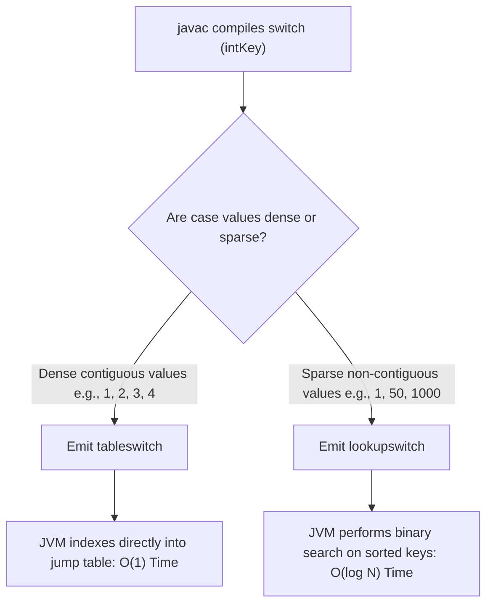
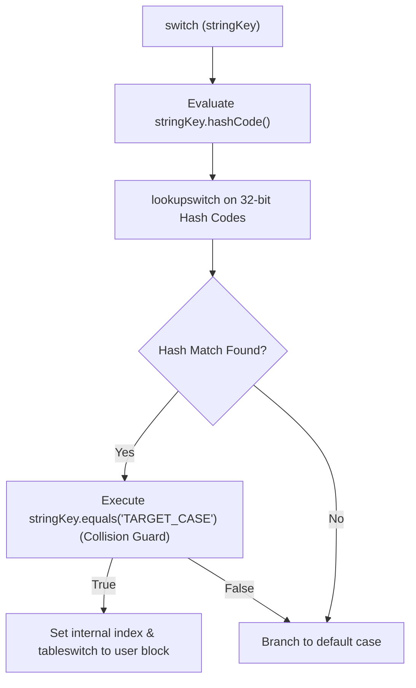

# P01-C009: Control Flow: Conditionals, Switch Statements, and Switch Expressions

---

## 1. Title and Metadata

- **Concept ID:** `P01-C009`
- **Concept Title:** Control Flow: Conditionals, Switch Statements, and Switch Expressions
- **Phase:** `Phase 01 — Java Language Fundamentals`
- **Module Sequence:** `09 of 15`
- **Prerequisites:**
  - [`P01-C001`: Primitive Data Types, Bit Widths, and Numeric Ranges](file:///home/prasanta/java_practice/curriculum/phase-01-java-language-fundamentals/001-primitive-data-types.md)
  - [`P01-C003`: Reference Types vs Primitive Types in Memory](file:///home/prasanta/java_practice/curriculum/phase-01-java-language-fundamentals/003-reference-types-vs-primitives.md)
  - [`P01-C007`: Local Variable Type Inference (var) and Limitations](file:///home/prasanta/java_practice/curriculum/phase-01-java-language-fundamentals/007-local-variable-type-inference-var.md)
  - [`P01-C008`: Operators, Precedence, and Short-Circuit Evaluation](file:///home/prasanta/java_practice/curriculum/phase-01-java-language-fundamentals/008-operators-and-short-circuit-evaluation.md)
- **Estimated Reading / Study Time:** 55 minutes
- **Controlling Specifications:**
  - [Java Language Specification (JLS) §14.9: The `if` Statement](https://docs.oracle.com/javase/specs/jls/se21/html/jls-14.html#jls-14.9)
  - [Java Language Specification (JLS) §14.11: The `switch` Statement](https://docs.oracle.com/javase/specs/jls/se21/html/jls-14.html#jls-14.11)
  - [Java Language Specification (JLS) §15.28: Switch Expressions](https://docs.oracle.com/javase/specs/jls/se21/html/jls-15.html#jls-15.28)
  - [JEP 361: Switch Expressions (Standard)](https://openjdk.org/jeps/361) (Java 14)
  - [JEP 441: Pattern Matching for switch (Standard)](https://openjdk.org/jeps/441) (Java 21 LTS)
  - [JEP 409: Sealed Classes](https://openjdk.org/jeps/409) (Java 17 LTS)

---

## 2. Conceptual Foundation & First Principles

Branching is the mechanism through which software executes alternative logic based on runtime state. In Java, control flow has evolved dramatically from legacy C-style statements to modern, type-safe, expression-oriented pattern matching:

1. **The `if-else` Statement:** The foundational conditional construct. Unlike JavaScript, Python, or C, Java strictly forbids truthy/falsy numeric coercion. The expression inside `if (expr)` must evaluate to a compile-time primitive `boolean` or boxed `java.lang.Boolean` (which undergoes autounboxing).
2. **The Traditional `switch` Statement (Java 1.0–13):** A multi-way branch statement inherited directly from C. Historically limited to primitive integers (`byte`, `short`, `char`, `int`), Enums (Java 5), and Strings (Java 7). Infamous for **fall-through execution**, requiring manual `break` statements.
3. **Switch Expressions (Java 14+ / JEP 361):** Re-architected switch as an expression that produces a value. Introduces arrow syntax (`->`), eliminates silent fall-through, permits multi-label matching (`case A, B ->`), and enforces compile-time **exhaustiveness**.
4. **Pattern Matching for Switch (Java 21 LTS / JEP 441):** Extends switch to inspect object types, cast them safely into pattern variables, evaluate boolean guard conditions (`when`), cleanly handle `null`, and verify complete coverage over sealed class hierarchies without requiring a boilerplate `default` branch.

---

## 3. Architectural Flow & Low-Level Mechanics

### 3.1 The Dangling Else Ambiguity
In nested `if-else` blocks without braces, the compiler resolves ambiguity using the lexical rule: **an `else` binds to the nearest preceding unbalanced `if`**:
```java
// MISLEADING INDENTATION:
if (isOnline) 
    if (isAdmin) 
        grantAccess(); 
else 
    denyAccess(); // BINDS TO (isAdmin), NOT (isOnline)!
```
If `isOnline` is `false`, `denyAccess()` is **never executed**! Enterprise engineering standards unconditionally enforce explicit curly braces `{}` for all conditional branches.

### 3.2 Bytecode Mechanics: `tableswitch` vs `lookupswitch`
At the JVM bytecode level, integer switches are compiled using two specialized opcodes:



1. **`tableswitch`:** Used when case constants are dense (contiguous or nearly contiguous). The bytecode creates an indexed jump table. The JVM subtracts the table's low-index from the target value and performs an **$O(1)$ direct array lookup** to find the target code offset.
2. **`lookupswitch`:** Used when case constants are sparse. The bytecode stores a sorted table of `(key, target_offset)` pairs. The JVM executes a binary search over the keys in **$O(\log N)$ time**.

### 3.3 How String Switching Actually Works Under the Hood
Java 7 added support for switching on `String`. Strings cannot be natively evaluated by JVM jump tables. The `javac` compiler desugars a string switch into a **two-tier architecture**:



1. It evaluates `stringKey.hashCode()` and performs a `lookupswitch` on the resulting integer hash.
2. Because different strings can produce identical 32-bit hash codes (Hash Collision), the generated bytecode invokes `String.equals()` inside the matched branch to verify identity.
3. Once verified, it executes a secondary `tableswitch` jumping to the developer's actual case logic.

### 3.4 Modern Switch Expressions: Arrow Syntax and `yield`
JEP 361 transformed switch from a purely procedural statement into a functional, value-producing expression:

```java
// Switch Statement (Procedural, fall-through prone, mutable variable)
String status;
switch (httpCode) {
    case 200:
        status = "OK";
        break; // Omission causes silent bug
    case 404:
        status = "NOT_FOUND";
        break;
    default:
        status = "UNKNOWN";
        break;
}

// Switch Expression (Functional, zero fall-through, immutable assignment, exhaustive)
String status = switch (httpCode) {
    case 200 -> "OK";
    case 404 -> "NOT_FOUND";
    default  -> "UNKNOWN";
};
```

When a case branch requires multiple statements, a code block `{ ... }` is used, and the value is returned using the `yield` keyword:
```java
String description = switch (code) {
    case 200 -> "OK";
    default  -> {
        logger.warn("Non-standard status received: {}", code);
        yield "UNEXPECTED"; // yield transfers value out of switch expression
    }
};
```

---

## 4. Comprehensive Code Demonstration

Save and execute this self-contained class demonstrating switch evolution from legacy statements to Java 21 LTS pattern matching:

```java
package com.example.fundamentals;

/**
 * Demonstrates the full lifecycle of Java control flow:
 * dangling else, tableswitch vs lookupswitch principles, modern switch expressions,
 * and Java 21 pattern matching with guards and sealed hierarchies.
 */
public class ControlFlowMechanicsDemo {

    // Sealed interface hierarchy for exhaustive domain modeling
    public sealed interface PaymentMethod permits CreditCard, BankTransfer, CryptoPayment {}
    
    public record CreditCard(String cardNumber, String cvv) implements PaymentMethod {}
    public record BankTransfer(String iban, String swiftCode) implements PaymentMethod {}
    public record CryptoPayment(String walletAddress, String network) implements PaymentMethod {}

    public static void main(String[] args) {
        System.out.println("=== 1. Dangling Else Resolution ===");
        demonstrateDanglingElse(true, false);

        System.out.println("\n=== 2. Modern Switch Expression with Arrow Syntax ===");
        demonstrateSwitchExpression(200);
        demonstrateSwitchExpression(500);

        System.out.println("\n=== 3. Java 21 Pattern Matching for Switch with Guards (when) ===");
        processPayment(new CreditCard("4111222233334444", "123"));
        processPayment(new BankTransfer("DE89370400440532013000", "DBEUMM21"));
        processPayment(new CryptoPayment("0x71C...B29", "ETHEREUM"));
        processPayment(null); // Direct null handling!
    }

    private static void demonstrateDanglingElse(boolean isOnline, boolean isAdmin) {
        // Safe, unambiguous block scoping
        if (isOnline) {
            if (isAdmin) {
                System.out.println("Access granted: Administrator online");
            } else {
                System.out.println("Access granted: Standard user online");
            }
        } else {
            System.out.println("Access denied: System offline");
        }
    }

    private static void demonstrateSwitchExpression(int httpStatusCode) {
        // Switch Expression assigning directly to final variable
        final String category = switch (httpStatusCode) {
            case 200, 201, 204 -> "SUCCESS";
            case 400, 401, 403, 404 -> "CLIENT_ERROR";
            case 500, 502, 503 -> {
                System.out.println("  [ALERT] Internal server error detected: " + httpStatusCode);
                yield "SERVER_ERROR";
            }
            default -> "UNKNOWN_STATUS";
        };

        System.out.printf("HTTP Code %d mapped to Category: %s%n", httpStatusCode, category);
    }

    private static void processPayment(PaymentMethod method) {
        // Java 21 LTS Pattern Matching for Switch
        // Exhaustive over sealed interface: NO 'default' branch needed!
        String auditLog = switch (method) {
            case null -> "Payment rejected: Method is null";
            case CreditCard cc when cc.cardNumber().startsWith("4") -> 
                "Processing Visa Credit Card: ****-" + cc.cardNumber().substring(12);
            case CreditCard cc -> 
                "Processing Generic Credit Card: ****-" + cc.cardNumber().substring(12);
            case BankTransfer bt when "DBEUMM21".equals(bt.swiftCode()) -> 
                "Processing Fast Domestic Wire to Deutsche Bank: " + bt.iban();
            case BankTransfer bt -> 
                "Processing Standard Wire: " + bt.iban();
            case CryptoPayment cp when "ETHEREUM".equalsIgnoreCase(cp.network()) -> 
                "Processing ERC-20 Transaction on: " + cp.walletAddress();
            case CryptoPayment cp -> 
                "Processing Generic Crypto Transaction on: " + cp.network();
        };

        System.out.println("Audit Result: " + auditLog);
    }
}
```

### Execution Output:
```text
=== 1. Dangling Else Resolution ===
Access granted: Standard user online

=== 2. Modern Switch Expression with Arrow Syntax ===
HTTP Code 200 mapped to Category: SUCCESS
  [ALERT] Internal server error detected: 500
HTTP Code 500 mapped to Category: SERVER_ERROR

=== 3. Java 21 Pattern Matching for Switch with Guards (when) ===
Audit Result: Processing Visa Credit Card: ****-4444
Audit Result: Processing Fast Domestic Wire to Deutsche Bank: DE89370400440532013000
Audit Result: Processing ERC-20 Transaction on: 0x71C...B29
Audit Result: Payment rejected: Method is null
```

---

## 5. Real-World Backend Scenario: FinTech Order Processing Engine

In distributed order processing systems, incoming financial orders arrive in diverse states (`PendingValidation`, `Approved`, `FraudAlert`, `Settled`). Handling state transitions with deep `if-else-if` blocks creates fragile, error-prone code where states can be overlooked.

By modeling states as sealed records and dispatching transitions via Java 21 pattern-matched switch expressions, the compiler guarantees that **no state can ever be omitted**:

```java
package com.example.fundamentals;

import java.math.BigDecimal;
import java.time.Instant;
import java.util.Objects;

/**
 * Production Order State Machine using Sealed Interfaces and Pattern-Matched Switch.
 */
public class OrderStateEngine {

    public sealed interface OrderState permits 
        OrderState.PendingValidation, 
        OrderState.Approved, 
        OrderState.FraudAlert, 
        OrderState.Settled {

        record PendingValidation(String orderId, BigDecimal amount, Instant submittedAt) implements OrderState {}
        record Approved(String orderId, BigDecimal amount, String approvedBy) implements OrderState {}
        record FraudAlert(String orderId, String reason, int riskScore) implements OrderState {}
        record Settled(String orderId, Instant settledAt, String ledgerId) implements OrderState {}
    }

    public enum Action { ROUTE_TO_LEDGER, ESCALATE_TO_SECURITY, DISPATCH_FOR_FULFILLMENT, RECHECK }

    /**
     * Determines immediate action via exhaustive pattern matching.
     * If an engineer adds a new state (e.g. 'Cancelled') to OrderState,
     * this switch fails compilation immediately until the new state is handled!
     */
    public Action evaluateNextAction(OrderState state) {
        Objects.requireNonNull(state, "OrderState must not be null");

        return switch (state) {
            case OrderState.PendingValidation pv when pv.amount().compareTo(new BigDecimal("100000")) > 0 -> {
                System.out.println("High-value order flagged for enhanced validation: " + pv.orderId());
                yield Action.ESCALATE_TO_SECURITY;
            }
            case OrderState.PendingValidation pv -> Action.RECHECK;
            case OrderState.Approved app -> Action.ROUTE_TO_LEDGER;
            case OrderState.FraudAlert fa when fa.riskScore() > 80 -> {
                System.err.println("Critical security alert on order " + fa.orderId() + ": " + fa.reason());
                yield Action.ESCALATE_TO_SECURITY;
            }
            case OrderState.FraudAlert fa -> Action.RECHECK;
            case OrderState.Settled s -> Action.DISPATCH_FOR_FULFILLMENT;
        };
    }

    public static void main(String[] args) {
        var engine = new OrderStateEngine();

        var normalPending = new OrderState.PendingValidation("ORD-001", new BigDecimal("500.00"), Instant.now());
        var highValuePending = new OrderState.PendingValidation("ORD-002", new BigDecimal("250000.00"), Instant.now());
        var fraud = new OrderState.FraudAlert("ORD-003", "IP Mismatch and Velocity Spike", 95);

        System.out.println("ORD-001 Action: " + engine.evaluateNextAction(normalPending));
        System.out.println("ORD-002 Action: " + engine.evaluateNextAction(highValuePending));
        System.out.println("ORD-003 Action: " + engine.evaluateNextAction(fraud));
    }
}
```

---

## 6. Edge Cases, Failure Modes & Pitfalls

### Pitfall 1: Silent Fall-Through in Traditional Switch Statements
In legacy colon syntax (`case 1:`), omitting `break` causes execution to cascade unconditionally into the next case:
```java
// SEVERE BUG:
int role = 1;
switch (role) {
    case 1:
        grantAdminAccess(); // Missing break!
    case 2:
        grantStandardAccess();
        break;
}
```
If `role` is `1`, both `grantAdminAccess()` and `grantStandardAccess()` execute.
**Mitigation:** Standardize entirely on Java 14+ arrow syntax (`case 1 -> grantAdminAccess();`), which structurally prohibits fall-through.

### Pitfall 2: Pre-Java 21 NullPointerExceptions on Switch Selectors
Prior to Java 21, evaluating a `switch` on a `null` reference threw an immediate, unpreventable `NullPointerException` before any `case` or `default` label was evaluated:
```java
String status = null;
switch (status) { // THROWS NullPointerException on entry!
    case "ACTIVE": ...
    default: ... // Default was NEVER reached on null!
}
```
**Java 21 Solution:** Use `case null -> ...;` to handle null selectors explicitly.

### Pitfall 3: Pattern Dominance Order (Compile Error)
In pattern matching switch statements, a broader pattern that matches a supertype **dominates** a narrower subtype pattern. If the broader pattern appears first, the narrower pattern is unreachable, resulting in a **compile-time error**:
```java
// COMPILE ERROR: Dominance Violation
switch (obj) {
    case CharSequence cs -> System.out.println("CharSequence: " + cs);
    case String s -> System.out.println("String: " + s); // ERROR: dominated by CharSequence!
}
```
**Fix:** Always order patterns from **most specific to least specific**:
```java
switch (obj) {
    case String s -> System.out.println("String: " + s);
    case CharSequence cs -> System.out.println("CharSequence: " + cs);
}
```

### Pitfall 4: Variable Scope Leakage in Colon-Style Switches
In colon-style switches, the entire switch block forms a single lexical scope. A variable declared in `case 1:` is visible in `case 2:`, but might not have been initialized:
```java
switch (val) {
    case 1:
        int x = 10;
        break;
    case 2:
        x = 20; // Reusing x without declaring it!
        break;
}
```
Arrow syntax (`->`) isolates each branch into its own distinct lexical scope, eliminating variable leakage.

---

## 7. Performance, Memory & Concurrency Implications

1. **Branch Table Jump Efficiency:**
   A dense switch compiled with `tableswitch` is drastically faster than an equivalent chain of `if-else-if` statements. An `if-else-if` chain evaluates $N$ conditions sequentially ($O(N)$ comparisons and branch predictions). A `tableswitch` computes an array offset in $O(1)$ constant time and branches directly to the target instruction via a single CPU jump.
2. **String Hash Code Collisions:**
   Because string switching relies on `String.hashCode()`, if an adversary supplies strings crafted to have identical hash codes (e.g., `"FB"` and `"Ea"` both have hash code `2236`), the JVM falls back to sequential `String.equals()` comparisons. While mathematically negligible for small switches, it demonstrates the necessity of the two-tier verification bytecode.
3. **Immutability and Thread Safety:**
   Traditional switches encourage declaring a mutable variable before the switch and mutating it inside cases (`status = ...;`). Switch expressions encourage assigning directly to a `final` local variable or returning immediately, supporting immutable, functional programming and preventing race conditions in concurrent pipelines.

---

## 8. Antipatterns & Refactoring

### Antipattern 1: Deep Nested `if-else` Chains Instead of Pattern Matching
```java
// ANTIPATTERN (Hard to read, repetitive casting, prone to nulls):
if (response instanceof SuccessResponse) {
    SuccessResponse sr = (SuccessResponse) response;
    handleSuccess(sr.data());
} else if (response instanceof ErrorResponse) {
    ErrorResponse er = (ErrorResponse) response;
    handleError(er.message());
} else if (response == null) {
    handleNull();
}

// REFACTORED (Java 21 Pattern Matching Switch):
switch (response) {
    case null -> handleNull();
    case SuccessResponse sr -> handleSuccess(sr.data());
    case ErrorResponse er -> handleError(er.message());
    default -> handleUnknown();
}
```

### Antipattern 2: Using Switch Statements with Missing `break`
```java
// ANTIPATTERN:
switch (logLevel) {
    case DEBUG: logger.debug("Debug");
    case INFO:  logger.info("Info"); break;
}

// REFACTORED:
switch (logLevel) {
    case DEBUG -> logger.debug("Debug");
    case INFO  -> logger.info("Info");
}
```

---

## 9. Compilation & Bytecode Disassembly

Let us compile and disassemble a class containing both a dense integer switch and a sparse integer switch to observe `tableswitch` versus `lookupswitch`.

### Source Code (`SwitchBytecodeProof.java`):
```java
public class SwitchBytecodeProof {
    public static int denseSwitch(int key) {
        return switch (key) {
            case 1 -> 100;
            case 2 -> 200;
            case 3 -> 300;
            default -> 0;
        };
    }

    public static int sparseSwitch(int key) {
        return switch (key) {
            case 1 -> 100;
            case 500 -> 200;
            case 10000 -> 300;
            default -> 0;
        };
    }
}
```

### Disassembly (`javap -c SwitchBytecodeProof`):
```text
  public static int denseSwitch(int);
    Code:
       0: iload_0
       1: tableswitch   { // 1 to 3
                     1: 28
                     2: 32
                     3: 36
               default: 40
          }
      28: bipush        100
      30: ireturn
      32: sipush        200
      35: ireturn
      36: sipush        300
      39: ireturn
      40: iconst_0
      41: ireturn

  public static int sparseSwitch(int);
    Code:
       0: iload_0
       1: lookupswitch  { // 3
                     1: 36
                   500: 40
                 10000: 44
               default: 48
          }
      36: bipush        100
      38: ireturn
      ...
```
### Observation:
- `denseSwitch` emits `tableswitch { 1 to 3 }`: The JVM allocates contiguous jump slots from 1 to 3, accessing the target offset via index offset arithmetic in $O(1)$ time.
- `sparseSwitch` emits `lookupswitch { 3 keys }`: Because case values are 1, 500, and 10000, creating an array of 10,000 slots would waste memory. The JVM emits sorted keys and performs a binary search in $O(\log N)$ time.

---

## 10. Cross-Language & Historical Context (MERN/JavaScript vs Java)

| Feature | Java (JVM) | JavaScript / Node.js (V8) |
|---|---|---|
| **Conditional Requirement** | Strictly `boolean`. No truthy/falsy coercion. `if (count)` is illegal. | Any type can be truthy or falsy ($0$, `""`, `null`, `undefined` coerce to false). |
| **Switch Expressions** | Native expression support since Java 14 (`String s = switch (x) { ... };`). | Statements only. Requires ternary chaining or object map lookups to emulate expressions. |
| **Pattern Matching** | Native type patterns, record deconstruction, and `when` guards (Java 21). | No native pattern matching in switch (must use `if-else` or external libraries). |
| **Exhaustiveness Checking** | Enforced by compiler for switch expressions and sealed hierarchies. | None. Missing cases silently evaluate nothing or fall through. |
| **Fall-Through Prevention** | Arrow syntax (`->`) structurally eliminates fall-through. | Standard `case:` always falls through unless manual `break;` is supplied. |
| **Null Selector Handling** | Java 21 allows explicit `case null -> ...`. | Treats `null` as a normal value matching `case null:` or `default:`. |

---

## 11. Unit Testing & Verification Guide

Create this JUnit 5 test suite to verify switch expressions, pattern matching dominance, guard behavior, and null safety:

```java
package com.example.fundamentals;

import org.junit.jupiter.api.DisplayName;
import org.junit.jupiter.api.Test;

import static org.junit.jupiter.api.Assertions.*;

public class ControlFlowTest {

    sealed interface Shape permits Circle, Rectangle {}
    record Circle(double radius) implements Shape {}
    record Rectangle(double width, double height) implements Shape {}

    private double calculateArea(Shape shape) {
        return switch (shape) {
            case null -> 0.0;
            case Circle c -> Math.PI * c.radius() * c.radius();
            case Rectangle r -> r.width() * r.height();
        };
    }

    @Test
    @DisplayName("Verify Sealed Hierarchy Exhaustive Switch Expression")
    void testSealedSwitchArea() {
        Shape circle = new Circle(2.0);
        Shape rect = new Rectangle(3.0, 4.0);

        assertEquals(Math.PI * 4.0, calculateArea(circle), 0.0001);
        assertEquals(12.0, calculateArea(rect), 0.0001);
        assertEquals(0.0, calculateArea(null), 0.0001);
    }

    @Test
    @DisplayName("Verify Guarded Pattern Matching with when Clause")
    void testGuardedPatternMatching() {
        Object input = "Antigravity";

        String result = switch (input) {
            case String s when s.length() > 5 -> "LONG_STRING";
            case String s -> "SHORT_STRING";
            default -> "OTHER";
        };

        assertEquals("LONG_STRING", result);
    }
}
```

---

## 12. Security & Hardening Considerations

1. **Exhaustive State Auditing in Security Policies:**
   When authorizing operations across user tiers (`ADMIN`, `OPERATOR`, `AUDITOR`), using an `if-else` chain without an explicit fallback `else` branch allows unhandled roles to execute unauthorized code paths. By utilizing switch expressions with sealed types, adding a new role immediately breaks the build until security rules are explicitly declared for that role.
2. **Preventing Bypass via Default Fall-Through:**
   In legacy colon switches, forgetting a `break` on an authentication check can cause execution to slide directly into privileged code blocks. Never use colon syntax in security-critical logic.

---

## 13. Diagnostic, Troubleshooting & Triage Runbook

### Error Triage Table:
| Compiler / Runtime Error | Root Cause | Fix |
|---|---|---|
| `the switch expression does not cover all possible input values` | Switch expression is missing a `default` branch or missing permitted subclasses of a sealed type. | Add missing cases or provide an explicit `default -> ...;`. |
| `this pattern is dominated by a previous pattern` | A supertype pattern (e.g., `Object` or `CharSequence`) appears before a subtype pattern (`String`). | Move the more specific subtype pattern higher up in the switch. |
| `NullPointerException: Cannot invoke ... because "<selector>" is null` | Switching on a null variable without a `case null` handler. | Add `case null -> ...;` to the switch expression. |
| `variable x might already have been assigned` | In colon-style switches, multiple cases attempt to initialize the same `final` variable. | Refactor to arrow syntax (`->`) switch expression. |

---

## 14. Exercises & Practice Scenarios

### Exercise 1: Build a Sealed HTTP Response Router
Design a sealed interface `HttpResponse` with subtypes:
- `Success(int statusCode, String payload)`
- `ClientError(int statusCode, String errorMessage)`
- `ServerError(int statusCode, Throwable cause)`
Write a method `renderResponse(HttpResponse response)` using Java 21 pattern matching switch that renders appropriate logging and status codes.

#### Solution:
```java
package com.example.fundamentals;

public final class ResponseRouter {

    public sealed interface HttpResponse permits Success, ClientError, ServerError {}

    public record Success(int statusCode, String payload) implements HttpResponse {}
    public record ClientError(int statusCode, String errorMessage) implements HttpResponse {}
    public record ServerError(int statusCode, Throwable cause) implements HttpResponse {}

    public static String renderResponse(HttpResponse response) {
        return switch (response) {
            case null -> "HTTP 500: Internal Null Response";
            case Success s -> "HTTP " + s.statusCode() + " OK: " + s.payload();
            case ClientError ce when ce.statusCode() == 404 -> "HTTP 404 NOT FOUND: " + ce.errorMessage();
            case ClientError ce -> "HTTP " + ce.statusCode() + " BAD REQUEST: " + ce.errorMessage();
            case ServerError se -> "HTTP " + se.statusCode() + " CRITICAL: " + se.cause().getMessage();
        };
    }
}
```

### Exercise 2: Identify the Bug in This Legacy Switch
What is printed when `grade = 'B'`?
```java
char grade = 'B';
switch (grade) {
    case 'A': System.out.print("Great ");
    case 'B': System.out.print("Good ");
    case 'C': System.out.print("Average ");
    default:  System.out.print("Done");
}
```
*Answer:* It prints `Good Average Done`. Because there are no `break` statements, execution falls through from `case 'B'` down through all subsequent branches.

---

## 15. Technical Interview Questions & Evaluator Answers

### Q1: What is the difference between `tableswitch` and `lookupswitch` in JVM bytecode?
**Answer:**
Both are JVM bytecode instructions for executing multi-branch switches on integer values:
1. `tableswitch` is generated when the switch case values are contiguous or densely clustered. It represents an indexed table where the JVM subtracts the minimum case value from the input to calculate a direct offset into the jump table in $O(1)$ constant time.
2. `lookupswitch` is generated when case values are sparse and non-contiguous. It contains a sorted table of key-target pairs. At runtime, the JVM performs a binary search over the sorted keys in $O(\log N)$ time.

### Q2: Why does Java 21 Pattern Matching for switch not require a `default` branch when switching over a sealed hierarchy?
**Answer:**
A `sealed` interface or class explicitly enumerates all its permitted direct subclasses via the `permits` clause. At compile time, the `javac` compiler inspects the hierarchy and checks whether every permitted subtype is covered in the switch expression. If all permitted subtypes are handled, the compiler mathematically proves that the expression is **exhaustive**. Adding an unreachable `default` branch would suppress the compiler's ability to alert developers if a new subtype is added to the sealed hierarchy in the future.

### Q3: How does Java 21 handle `null` inside a switch statement compared to earlier versions?
**Answer:**
Prior to Java 21, evaluating a switch on a `null` selector reference unconditionally threw a `NullPointerException` before evaluating any case label (even `default`). In Java 21 (JEP 441), `null` is a valid case label: developers can explicitly declare `case null -> ...;` or combine it with default: `case null, default -> ...;`. If a selector is `null` and no `case null` is defined, it throws an NPE as before, preserving backward compatibility.

---

## 16. References, Standards & Further Reading

1. **Java Language Specification (Java SE 21):**
   - [JLS §14.9 The `if` Statement](https://docs.oracle.com/javase/specs/jls/se21/html/jls-14.html#jls-14.9)
   - [JLS §14.11 The `switch` Statement](https://docs.oracle.com/javase/specs/jls/se21/html/jls-14.html#jls-14.11)
   - [JLS §15.28 Switch Expressions](https://docs.oracle.com/javase/specs/jls/se21/html/jls-15.html#jls-15.28)
2. **OpenJDK Enhancement Proposals (JEPs):**
   - [JEP 361: Switch Expressions (Standard)](https://openjdk.org/jeps/361) (Java 14)
   - [JEP 441: Pattern Matching for switch (Standard)](https://openjdk.org/jeps/441) (Java 21 LTS)
   - [JEP 409: Sealed Classes](https://openjdk.org/jeps/409) (Java 17 LTS)
3. **HotSpot Virtual Machine Specifications:**
   - [The Java Virtual Machine Specification: `tableswitch` and `lookupswitch`](https://docs.oracle.com/javase/specs/jvms/se21/html/jvms-6.html#jvms-6.5.tableswitch)
