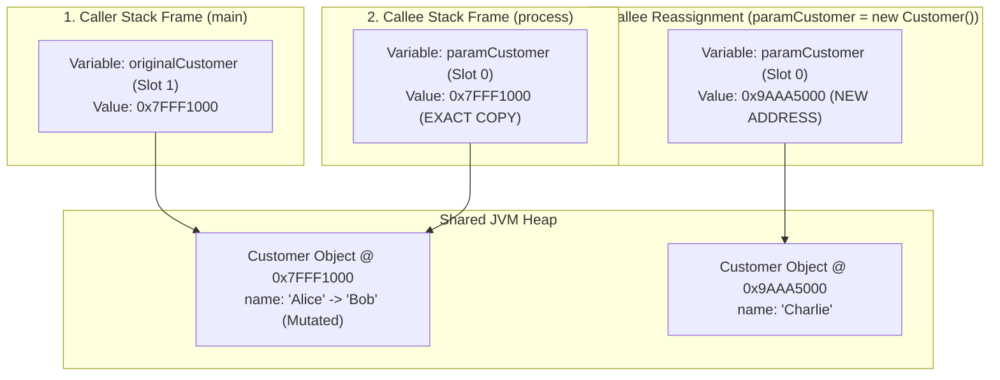

# P01-C012: Pass-by-Value Semantics in Java (Why References Are Passed by Value)

---

## 1. Title and Metadata

- **Concept ID:** `P01-C012`
- **Concept Title:** Pass-by-Value Semantics in Java (Why References Are Passed by Value)
- **Phase:** `Phase 01 — Java Language Fundamentals`
- **Module Sequence:** `12 of 15`
- **Prerequisites:**
  - [`P01-C001`: Primitive Data Types, Bit Widths, and Numeric Ranges](file:///home/prasanta/java_practice/curriculum/phase-01-java-language-fundamentals/001-primitive-data-types.md)
  - [`P01-C003`: Reference Types vs Primitive Types in Memory](file:///home/prasanta/java_practice/curriculum/phase-01-java-language-fundamentals/003-reference-types-vs-primitives.md)
  - [`P01-C004`: Variable Declaration, Scope, Lifetime, and Default Values](file:///home/prasanta/java_practice/curriculum/phase-01-java-language-fundamentals/004-variable-scopes-and-lifetimes.md)
  - [`P01-C011`: Methods: Signatures, Contracts, and Varargs](file:///home/prasanta/java_practice/curriculum/phase-01-java-language-fundamentals/011-methods-and-varargs.md)
- **Estimated Reading / Study Time:** 45 minutes
- **Controlling Specifications:**
  - [Java Language Specification (JLS) §4.3: Reference Types and Values](https://docs.oracle.com/javase/specs/jls/se21/html/jls-4.html#jls-4.3)
  - [Java Language Specification (JLS) §8.4.1: Formal Parameters](https://docs.oracle.com/javase/specs/jls/se21/html/jls-8.html#jls-8.4.1)
  - [Java Language Specification (JLS) §15.12.4.2: Evaluate Arguments](https://docs.oracle.com/javase/specs/jls/se21/html/jls-15.html#jls-15.12.4.2)
  - [The Java Virtual Machine Specification: §2.6 Frames & Local Variables](https://docs.oracle.com/javase/specs/jvms/se21/html/jvms-2.html#jvms-2.6)

---

## 2. Conceptual Foundation & First Principles

There is no topic in Java that generates more confusion or technical interview debates than argument passing. The confusion stems from a fundamental conflation between **the object itself** and **the variable holding the object's reference address**.

### The Absolute First Principle of Java:
> **Java is strictly, 100%, unconditionally PASS-BY-VALUE. Always. For every type.**

There is no pass-by-reference in Java. There are no language keywords or syntax (such as C++ `&` or C# `ref`/`out`) that allow a method to bind directly to a caller's variable storage location.

### 2.1 The Source of the Confusion
Developers often observe this code:
```java
void modifyUser(User user) {
    user.setName("Bob");
}
```
When `modifyUser(alice)` returns, `alice.getName()` returns `"Bob"`. Many developers prematurely conclude: *"See? Java passed the object by reference!"*

**This conclusion is factually incorrect from first principles.**
1. In Java, **an object variable never contains the object itself**. It contains a **reference value** (a 32-bit or 64-bit numerical pointer addressing the object's location on the JVM Heap).
2. When an object variable is passed as a method argument, **a copy of that reference value (memory address) is passed by value** into the callee's execution stack frame.
3. The caller's stack frame slot and the callee's stack frame slot are **two distinct physical memory locations** containing identical copies of the pointer.
4. When the callee invokes `user.setName("Bob")`, it follows its local copy of the pointer to the shared heap address and mutates the heap object.
5. However, if the callee reassigns `user = new User("Charlie")` or `user = null`, it only mutates its own local stack frame slot. **The caller's variable remains completely unchanged.**

---

## 3. Architectural Flow & JVM Stack/Heap Mechanics

### 3.1 Stack Frame Memory Layout During Method Invocation
Let us visualize the memory state before, during, and after calling `reassignAndMutate(customer)`:



### 3.2 The Three Canonical Proofs of Pass-by-Value

#### Proof 1: The Failed Swap Test
In a true pass-by-reference language (like C++), passing two variables to a swap method exchanges their values in the caller's scope. In Java, the swap fails completely:
```java
public static void swap(Customer c1, Customer c2) {
    Customer temp = c1;
    c1 = c2;
    c2 = temp;
    // Inside swap: c1 and c2 local slots are swapped.
}
// In caller: c1 and c2 STILL point to their original objects! Zero effect!
```

#### Proof 2: The Nullification Test
If Java were pass-by-reference, setting a parameter to `null` inside a method would set the caller's variable to `null`:
```java
public static void reset(Customer c) {
    c = null; // Overwrites the callee's local reference slot with 0x00000000
}
// In caller: The caller's variable STILL points to the Customer object!
```

#### Proof 3: Primitive Value Independence
Primitives make pass-by-value visually self-evident because there is no heap pointer involved:
```java
public static void increment(int n) {
    n = n + 1;
}
// In caller: int x = 10; increment(x); x is STILL 10.
```

---

## 4. Comprehensive Code Demonstration

Save and compile this self-contained class to inspect the mathematical and programmatic proofs of Java's pass-by-value semantics across primitives, object mutations, reassignments, and nullifications:

```java
package com.example.fundamentals;

/**
 * Programmatic proof of Java strictly pass-by-value semantics.
 * Demonstrates primitive immutability across stack frames,
 * pointer copying, reassignment isolation, and heap aliasing.
 */
public class PassByValueProofDemo {

    public static class Account {
        private String owner;
        private double balance;

        public Account(String owner, double balance) {
            this.owner = owner;
            this.balance = balance;
        }

        public String getOwner() { return owner; }
        public void setOwner(String owner) { this.owner = owner; }

        public double getBalance() { return balance; }
        public void setBalance(double balance) { this.balance = balance; }

        @Override
        public String toString() {
            return String.format("Account[owner='%s', balance=%.2f, identityHashCode=0x%x]",
                    owner, balance, System.identityHashCode(this));
        }
    }

    public static void main(String[] args) {
        System.out.println("=== 1. Proof on Primitives: Independent Stack Copies ===");
        demonstratePrimitivePassByValue();

        System.out.println("\n=== 2. Proof on References: Heap Mutation vs Reassignment ===");
        demonstrateReferencePassByValue();

        System.out.println("\n=== 3. Proof on References: The Canonical Swap Failure ===");
        demonstrateSwapFailure();

        System.out.println("\n=== 4. Proof on References: The Nullification Failure ===");
        demonstrateNullificationFailure();
    }

    private static void demonstratePrimitivePassByValue() {
        int originalValue = 100;
        System.out.println("Before modifyPrimitive: " + originalValue);
        modifyPrimitive(originalValue);
        System.out.println("After modifyPrimitive:  " + originalValue + " (Unchanged! Proof of stack copy)");
    }

    private static void modifyPrimitive(int val) {
        val = val + 500;
        System.out.println("  Inside modifyPrimitive: " + val);
    }

    private static void demonstrateReferencePassByValue() {
        Account acc = new Account("Alice", 1000.0);
        System.out.println("Initial Caller Object:  " + acc);

        // Mutating heap state through the copied reference pointer:
        deposit(acc, 500.0);
        System.out.println("After deposit (Mutated):" + acc);

        // Attempting to reassign the reference inside a method:
        attemptReassignment(acc);
        System.out.println("After attemptReassign:  " + acc + " (Owner STILL Alice! Reassignment failed!)");
    }

    private static void deposit(Account target, double amount) {
        // target holds an exact copy of the 64-bit reference address pointing to acc on the heap
        System.out.println("  Inside deposit: Pointer copy address matches caller -> " + target);
        target.setBalance(target.getBalance() + amount);
    }

    private static void attemptReassignment(Account target) {
        System.out.println("  Inside attemptReassign: Received copy of address -> " + target);
        // Overwriting the LOCAL variable slot 'target' with a brand new heap object
        target = new Account("Charlie (Imposter)", 999999.0);
        System.out.println("  Inside attemptReassign: Pointed local slot to new object -> " + target);
    }

    private static void demonstrateSwapFailure() {
        Account acc1 = new Account("Account-1", 100.0);
        Account acc2 = new Account("Account-2", 200.0);

        System.out.println("Before swap: acc1=" + acc1.getOwner() + ", acc2=" + acc2.getOwner());
        swap(acc1, acc2);
        System.out.println("After swap:  acc1=" + acc1.getOwner() + ", acc2=" + acc2.getOwner() +
                " (Zero effect in caller!)");
    }

    private static void swap(Account a, Account b) {
        Account temp = a;
        a = b;
        b = temp;
        System.out.println("  Inside swap: a=" + a.getOwner() + ", b=" + b.getOwner());
    }

    private static void demonstrateNullificationFailure() {
        Account acc = new Account("ImportantClient", 50000.0);
        System.out.println("Before nullify: " + acc);
        nullify(acc);
        System.out.println("After nullify:  " + acc + " (Non-null! Caller reference untouched)");
    }

    private static void nullify(Account a) {
        a = null; // Only sets local parameter variable 'a' to null
        System.out.println("  Inside nullify: Local slot set to " + a);
    }
}
```

### Execution Output:
```text
=== 1. Proof on Primitives: Independent Stack Copies ===
Before modifyPrimitive: 100
  Inside modifyPrimitive: 600
After modifyPrimitive:  100 (Unchanged! Proof of stack copy)

=== 2. Proof on References: Heap Mutation vs Reassignment ===
Initial Caller Object:  Account[owner='Alice', balance=1000.00, identityHashCode=0x682a0b4]
  Inside deposit: Pointer copy address matches caller -> Account[owner='Alice', balance=1000.00, identityHashCode=0x682a0b4]
After deposit (Mutated):Account[owner='Alice', balance=1500.00, identityHashCode=0x682a0b4]
  Inside attemptReassign: Received copy of address -> Account[owner='Alice', balance=1500.00, identityHashCode=0x682a0b4]
  Inside attemptReassign: Pointed local slot to new object -> Account[owner='Charlie (Imposter)', balance=999999.00, identityHashCode=0x214c265e]
After attemptReassign:  Account[owner='Alice', balance=1500.00, identityHashCode=0x682a0b4] (Owner STILL Alice! Reassignment failed!)

=== 3. Proof on References: The Canonical Swap Failure ===
Before swap: acc1=Account-1, acc2=Account-2
  Inside swap: a=Account-2, b=Account-1
After swap:  acc1=Account-1, acc2=Account-2 (Zero effect in caller!)

=== 4. Proof on References: The Nullification Failure ===
Before nullify: Account[owner='ImportantClient', balance=50000.00, identityHashCode=0x448139f0]
  Inside nullify: Local slot set to null
After nullify:  Account[owner='ImportantClient', balance=50000.00, identityHashCode=0x448139f0] (Non-null! Caller reference untouched)
```

---

## 5. Real-World Backend Scenario: Preventing Hidden Mutations in Order Validation

In complex enterprise architectures (e.g., Spring Boot microservices), data transfer objects (DTOs) and domain entities travel across validation layers, security filters, and enrichment pipelines.

### The Problem: Accidental In-Place Mutation via Copied References
Because references are copied by value, passing a mutable object to a downstream "validator" or "notifier" allows that downstream service to **accidentally or maliciously mutate the entity on the shared heap**, corrupting the caller's business state:

```java
package com.example.fundamentals;

import java.math.BigDecimal;
import java.util.List;
import java.util.ArrayList;

/**
 * Demonstrates the production danger of reference aliasing across service boundaries,
 * and how Immutable Records eliminate hidden mutation bugs.
 */
public class OrderValidationPipeline {

    // VULNERABLE MUTABLE DTO
    public static class MutableOrder {
        private String orderId;
        private BigDecimal totalAmount;
        private List<String> appliedDiscountCodes;

        public MutableOrder(String orderId, BigDecimal totalAmount, List<String> appliedDiscountCodes) {
            this.orderId = orderId;
            this.totalAmount = totalAmount;
            this.appliedDiscountCodes = appliedDiscountCodes;
        }

        public String getOrderId() { return orderId; }
        public BigDecimal getTotalAmount() { return totalAmount; }
        public void setTotalAmount(BigDecimal totalAmount) { this.totalAmount = totalAmount; }
        public List<String> getAppliedDiscountCodes() { return appliedDiscountCodes; }
    }

    /**
     * VULNERABLE SERVICE:
     * A downstream tax calculator silently mutates the shared heap object!
     */
    public static class RogueTaxCalculator {
        public void calculateAndEnrich(MutableOrder order) {
            // SILENT MUTATION: Replaces totalAmount on the caller's shared heap instance!
            order.setTotalAmount(order.getTotalAmount().multiply(new BigDecimal("1.20")));
            // SILENT MUTATION: Modifies caller's internal list!
            order.getAppliedDiscountCodes().add("AUTOTAX_APPLIED");
        }
    }

    /**
     * SECURE ARCHITECTURE:
     * Using Immutable Java Records and unmodifiable collections.
     * Prevents any downstream method from mutating the caller's data.
     */
    public record ImmutableOrder(String orderId, BigDecimal totalAmount, List<String> discountCodes) {
        public ImmutableOrder {
            // Defensive copying of collection
            discountCodes = List.copyOf(discountCodes);
        }
    }

    public static void main(String[] args) {
        // 1. VULNERABLE MUTABLE DEMONSTRATION
        List<String> discounts = new ArrayList<>();
        discounts.add("PROMO_SUMMER");
        MutableOrder mutableOrder = new MutableOrder("ORD-001", new BigDecimal("100.00"), discounts);

        System.out.println("Caller Amount BEFORE tax service: " + mutableOrder.getTotalAmount());
        new RogueTaxCalculator().calculateAndEnrich(mutableOrder);
        System.out.println("Caller Amount AFTER tax service:  " + mutableOrder.getTotalAmount() + 
                " (CORRUPTED! Mutated via reference pointer copy)");
        System.out.println("Caller Discounts: " + mutableOrder.getAppliedDiscountCodes());

        // 2. IMMUTABLE ARCHITECTURE DEMONSTRATION
        ImmutableOrder secureOrder = new ImmutableOrder("ORD-002", new BigDecimal("100.00"), discounts);
        System.out.println("\nSecure Order Created: " + secureOrder);
        // secureOrder.totalAmount = ... // COMPILE ERROR: Cannot assign to final field
        // secureOrder.discountCodes().add("HACK"); // THROWS UnsupportedOperationException at runtime!
    }
}
```

---

## 6. Edge Cases, Failure Modes & Pitfalls

### Pitfall 1: Expecting Reassignment to Propagate to Caller
A junior engineer writes a factory or parser method expecting to populate an object by reassignment:
```java
// SEVERE BUG:
public void parseUser(String json, User user) {
    user = jsonParser.read(json, User.class); // Assigns to local slot; caller sees ZERO change!
}

// FIX: Always return the created object from the method:
public User parseUser(String json) {
    return jsonParser.read(json, User.class);
}
```

### Pitfall 2: Mutating Boxed Wrappers (Immutable Traps)
Boxed primitive wrappers (`Integer`, `Long`, `Double`) are immutable classes. Calling `val++` does NOT mutate the wrapper on the heap; it unboxes, increments, boxes a new wrapper object, and reassigns the local parameter:
```java
public static void incrementWrapper(Integer val) {
    val++; // Desugars to: val = Integer.valueOf(val.intValue() + 1);
    // Only reassigns local parameter slot 'val'!
}
// In caller: Integer count = 10; incrementWrapper(count); count is STILL 10!
```

### Pitfall 3: Array Reassignment vs Element Mutation
An array is an object. Reassigning the array parameter does not affect the caller, but modifying an array slot **does mutate the shared array on the heap**:
```java
public static void processArray(int[] arr) {
    arr[0] = 999;           // MUTATES the caller's array element on the heap!
    arr = new int[]{ 5, 6 };// REASSIGNS local slot; caller sees NO change to array length or reference!
}
```

---

## 7. Performance, Memory & Concurrency Implications

1. **Stack Frame Creation Cost:**
   Passing an argument in Java involves copying a single word (4 bytes for Compressed OOPs / 32-bit types, or 8 bytes for 64-bit non-compressed types and `long`/`double`) onto the caller's operand stack and popping it into the callee's local variable array (`iload`/`istore` or `aload`/`astore`). This is a zero-heap-allocation, single-clock-cycle CPU register operation.
2. **True Pass-by-Reference vs Java Pass-by-Value Performance:**
   In languages with true pass-by-reference (C++ `const &`), passing a large 100-byte struct avoids copying the struct data by passing its address. **Java achieves the exact same performance naturally** because all objects live on the heap and only the tiny 4-byte/8-byte reference address is copied!
3. **Multithreaded Race Conditions via Reference Aliasing:**
   Because two threads calling methods with the same object reference both hold copies of the pointer addressing the exact same heap memory, concurrent mutations (`obj.setField(...)`) without synchronization cause race conditions, lost updates, and memory visibility failures (see Phase 12).

---

## 8. Antipatterns & Refactoring

### Antipattern 1: "Output Parameters" via Single-Element Arrays
Developers migrating from C/C++ or C# often attempt to emulate output parameters (`ref` / `out`) using clumsy single-element arrays:
```java
// ANTIPATTERN (C-style output parameter emulation):
public boolean fetchCustomer(String id, Customer[] resultHolder) {
    Customer c = repository.find(id);
    if (c != null) {
        resultHolder[0] = c; // Mutates slot 0 to return data
        return true;
    }
    return false;
}

// REFACTORED (Idiomatic Java Optional or Result Record):
public Optional<Customer> fetchCustomer(String id) {
    return Optional.ofNullable(repository.find(id));
}
```

### Antipattern 2: Reassigning Method Parameters
Reassigning method parameters within the method body causes confusion and bug-prone code:
```java
// ANTIPATTERN:
public double calculateDiscount(double price, int customerTier) {
    if (customerTier == 1) {
        price = price * 0.90; // Overwriting parameter variable!
    }
    return price;
}

// REFACTORED:
public double calculateDiscount(final double originalPrice, final int customerTier) {
    if (customerTier == 1) {
        return originalPrice * 0.90;
    }
    return originalPrice;
}
```

---

## 9. Compilation & Bytecode Disassembly

Let us disassemble a class demonstrating primitive pass-by-value versus reference pass-by-value to inspect JVM stack frame operations.

### Source Code (`PassByValueBytecode.java`):
```java
public class PassByValueBytecode {
    public static void testPrimitive(int x) {
        x = x + 1;
    }

    public static void testReference(StringBuilder sb) {
        sb.append("A"); // Mutation
        sb = null;      // Reassignment
    }
}
```

### Disassembly (`javap -c PassByValueBytecode`):
```text
  public static void testPrimitive(int);
    Code:
       0: iload_0         // Load local variable slot 0 (x)
       1: iconst_1        // Push constant 1
       2: iadd            // Add
       3: istore_0        // Store result BACK INTO slot 0 (Only affects this method frame!)
       4: return

  public static void testReference(java.lang.StringBuilder);
    Code:
       0: aload_0         // Load reference address from local slot 0
       1: ldc           #7 // String "A"
       3: invokevirtual #9 // Method java/lang/StringBuilder.append:(Ljava/lang/String;)
       6: pop
       7: aconst_null     // Push null reference
       8: astore_0        // Store null INTO local slot 0 (Only clears this method frame slot!)
       9: return
```
### Observation:
1. `testPrimitive`: `istore_0` writes the incremented value back into slot 0 of the *current method frame's local variable array*. When `return` executes, this frame is popped off the JVM thread stack and destroyed. The caller frame's local variable array was never touched.
2. `testReference`: `aload_0` loads the reference address to execute `append` on the shared heap. Line 8 executes `astore_0`, overwriting local slot 0 with `null`. When the method returns, only the local frame's pointer is erased; the `StringBuilder` on the heap remains intact with `"A"` appended.

---

## 10. Cross-Language & Historical Context (MERN/JavaScript vs Java)

| Feature | Java (JVM) | JavaScript / Node.js (V8) | C++ | C# (.NET) |
|---|---|---|---|---|
| **Calling Convention** | **Strictly Pass-by-Value**. | **Strictly Pass-by-Value** (Often called "Call-by-Sharing"). | **Both**: Default Pass-by-Value, optional Pass-by-Reference (`&`). | **Both**: Default Pass-by-Value, explicit Pass-by-Reference (`ref`, `out`). |
| **Object Parameter Value** | Copy of heap reference address. | Copy of heap reference address. | Copy of object struct (unless pointer `*` or ref `&` is used). | Copy of heap reference address (unless `ref` used). |
| **Parameter Reassignment** | Local only; zero caller effect. | Local only; zero caller effect. | Can reassign caller variable if declared `Type&`. | Can reassign caller variable if declared `ref Type`. |
| **Heap Object Mutation** | Allowed if object is mutable. | Allowed if object is mutable. | Allowed if non-const. | Allowed if object is mutable. |

---

## 11. Unit Testing & Verification Guide

Create this JUnit 5 test suite to verify pass-by-value guarantees, reassignment isolation, and heap mutation boundaries:

```java
package com.example.fundamentals;

import org.junit.jupiter.api.DisplayName;
import org.junit.jupiter.api.Test;

import java.util.ArrayList;
import java.util.List;

import static org.junit.jupiter.api.Assertions.*;

public class PassByValueTest {

    @Test
    @DisplayName("Verify Reassigning Object Reference Does Not Mutate Caller Variable")
    void testReassignmentIsolation() {
        String original = "OriginalString";
        attemptStringReassignment(original);
        assertEquals("OriginalString", original, "Caller variable must remain completely untouched");
    }

    private void attemptStringReassignment(String str) {
        str = "ModifiedInMethod";
    }

    @Test
    @DisplayName("Verify Mutating Heap Object Modifies Shared State")
    void testHeapMutationShared() {
        List<String> list = new ArrayList<>();
        list.add("First");

        mutateList(list);

        assertEquals(List.of("First", "Second"), list, "Heap mutation through copied pointer must be observed");
    }

    private void mutateList(List<String> target) {
        target.add("Second");
    }

    @Test
    @DisplayName("Verify Reassigning List Reference Leaves Caller Intact")
    void testListReassignmentIsolation() {
        List<String> originalList = new ArrayList<>(List.of("Alpha"));

        reassignList(originalList);

        assertEquals(List.of("Alpha"), originalList, "Caller list must not be replaced by new list instantiation");
    }

    private void reassignList(List<String> target) {
        target = new ArrayList<>(List.of("Omega", "Zeta"));
    }
}
```

---

## 12. Security & Hardening Considerations

1. **Defensive Copying of Ingress & Egress Data (CWE-374 / CWE-375):**
   When an object passes a mutable field (such as `java.util.Date` or a mutable collection) into a method, or returns a mutable field from a getter, both the caller and the callee hold copies of the pointer addressing the exact same heap memory. A malicious or flawed caller can mutate internal fields, bypassing validation rules.
   - *Mitigation:* Always clone or copy collections and mutable dates:
   ```java
   public List<SecurityRole> getRoles() {
       return List.copyOf(this.roles); // Returns immutable snapshot
   }
   ```
2. **Project Valhalla (Value Classes):**
   Future Java versions (JEP 401) introduce true identity-free Value Objects that are passed flatly on the stack/registers without heap pointer indirection, achieving C-like memory density while preserving Java's strict pass-by-value guarantees.

---

## 13. Diagnostic, Troubleshooting & Triage Runbook

### Triage Matrix for Parameter Mutation Anomalies:
| Observed Symptom | Underlying Root Cause | Corrective Action |
|---|---|---|
| Method executes, but caller variable remains `null` or unassigned. | Method tried to populate caller variable via parameter assignment (`param = new ...;`). | Change method to return the created instance: `return new ...;`. |
| Entity in service layer suddenly contains unexpected corrupted fields. | Reference aliasing: The entity was passed to a helper method that mutated a field directly on the shared heap. | Make domain model immutable using `record`, or create a defensive copy before passing. |
| `UnsupportedOperationException` when modifying a passed list. | The list was passed via `List.of()` or `Collections.unmodifiableList()`. | If mutation is required, make an explicit mutable copy: `new ArrayList<>(list)`. |

---

## 14. Exercises & Practice Scenarios

### Exercise 1: Build an Immutable Transaction Envelope
Create an immutable class `TransactionEnvelope` that wraps a transaction ID, a timestamp, and a `List<String>` of audit metadata. Ensure that neither caller nor callee can mutate the internal list after construction.

#### Solution:
```java
package com.example.fundamentals;

import java.time.Instant;
import java.util.List;
import java.util.Objects;

public final class TransactionEnvelope {
    private final String transactionId;
    private final Instant timestamp;
    private final List<String> metadata;

    public TransactionEnvelope(String transactionId, Instant timestamp, List<String> metadata) {
        this.transactionId = Objects.requireNonNull(transactionId, "transactionId must not be null");
        this.timestamp = Objects.requireNonNull(timestamp, "timestamp must not be null");
        // Defensive copy ensures caller cannot modify their local list to mutate internal state
        this.metadata = metadata != null ? List.copyOf(metadata) : List.of();
    }

    public String getTransactionId() { return transactionId; }
    public Instant getTimestamp() { return timestamp; }
    // List.copyOf already produces an unmodifiable list
    public List<String> getMetadata() { return metadata; }
}
```

### Exercise 2: Trace Stack Frame Values
What does this program print?
```java
public class TraceQuiz {
    public static void main(String[] args) {
        int[] arr = { 1, 2 };
        modify(arr);
        System.out.println(arr[0] + " " + arr[1]);
    }
    static void modify(int[] a) {
        a[0] = 10;
        a = new int[]{ 20, 30 };
        a[1] = 40;
    }
}
```
*Answer:* It prints `10 2`.
1. `a[0] = 10;` mutates the first element of the shared array on the heap.
2. `a = new int[]{ 20, 30 };` reassigns the local parameter `a` to a new array on the heap.
3. `a[1] = 40;` mutates the new array, not the caller's array.
4. In `main`, `arr[0]` is `10` and `arr[1]` is still `2`.

---

## 15. Technical Interview Questions & Evaluator Answers

### Q1: Is Java pass-by-value or pass-by-reference? Explain the exact technical mechanism.
**Answer:**
Java is strictly **pass-by-value** in all cases.
For primitive types, the actual binary value (e.g., the 32-bit integer) is copied from the caller's stack frame into the callee's stack frame.
For reference types, the **reference address (pointer)** pointing to the heap object is copied by value from the caller's stack frame into the callee's stack frame. Because both frames hold identical copies of the address, invoking methods that mutate internal state will modify the shared object on the heap. However, the reference variable itself is passed by value: reassigning the parameter variable inside the callee method only updates the callee's local stack frame slot and has zero effect on the caller's variable.

### Q2: Why is it impossible to write a generic `swap(a, b)` method in Java that swaps two object references?
**Answer:**
Because Java passes references by value. In order for a `swap(a, b)` method to exchange the caller's variables, it would require access to the memory addresses of the caller's variable slots on the stack (true pass-by-reference). In Java, `a` and `b` inside `swap` are purely local stack copies of the reference pointers. Reassigning `a = b` merely overwrites the callee's local stack slot, leaving the caller's variables pointing to their original objects.

### Q3: How does pass-by-value in Java differ from pass-by-value in C++?
**Answer:**
In C++, if you pass an object by value (`void process(Customer c)`), the **entire object struct is copied** in memory (calling its copy constructor). If `Customer` is 1 KB in size, 1 KB is copied onto the stack.
In Java, objects can never exist directly on the stack. An object variable is always a pointer. Therefore, passing an object "by value" in Java copies only the **4-byte or 8-byte pointer address**, never the object data itself. To duplicate object data in Java, one must explicitly invoke `.clone()` or a copy constructor.

---

## 16. References, Standards & Further Reading

1. **Java Language Specification (Java SE 21):**
   - [JLS §4.3 Reference Types and Values](https://docs.oracle.com/javase/specs/jls/se21/html/jls-4.html#jls-4.3)
   - [JLS §8.4.1 Formal Parameters](https://docs.oracle.com/javase/specs/jls/se21/html/jls-8.html#jls-8.4.1)
   - [JLS §15.12.4.2 Evaluate Arguments](https://docs.oracle.com/javase/specs/jls/se21/html/jls-15.html#jls-15.12.4.2)
2. **The Java Virtual Machine Specification:**
   - [JVMS §2.6 Frames and Local Variables](https://docs.oracle.com/javase/specs/jvms/se21/html/jvms-2.html#jvms-2.6)
3. **Primary Source Articles:**
   - [The Java Specialist's Newsletter: Java is Pass-by-Value, Dammit! (Dr. Heinz Kabutz)](https://www.javaspecialists.eu/)
