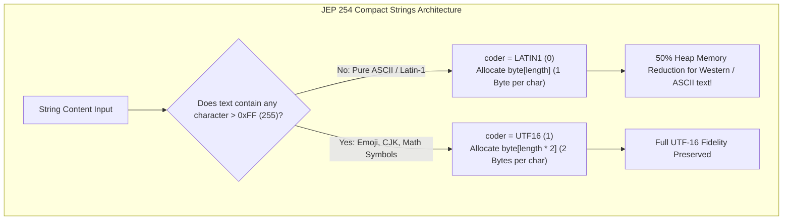

# P01-C013: String Immutability, String Pool, and Memory Optimization

---

## 1. Title and Metadata

- **Concept ID:** `P01-C013`
- **Concept Title:** String Immutability, String Pool, and Memory Optimization
- **Phase:** `Phase 01 — Java Language Fundamentals`
- **Module Sequence:** `13 of 15`
- **Prerequisites:**
  - [`P01-C001`: Primitive Data Types, Bit Widths, and Numeric Ranges](file:///home/prasanta/java_practice/curriculum/phase-01-java-language-fundamentals/001-primitive-data-types.md)
  - [`P01-C003`: Reference Types vs Primitive Types in Memory](file:///home/prasanta/java_practice/curriculum/phase-01-java-language-fundamentals/003-reference-types-vs-primitives.md)
  - [`P01-C004`: Variable Declaration, Scope, Lifetime, and Default Values](file:///home/prasanta/java_practice/curriculum/phase-01-java-language-fundamentals/004-variable-scopes-and-lifetimes.md)
  - [`P01-C006`: Wrapper Classes, Autoboxing, and NullPointerExceptions](file:///home/prasanta/java_practice/curriculum/phase-01-java-language-fundamentals/006-wrapper-classes-autoboxing.md)
  - [`P01-C012`: Pass-by-Value Semantics in Java (Why References Are Passed by Value)](file:///home/prasanta/java_practice/curriculum/phase-01-java-language-fundamentals/012-pass-by-value-semantics.md)
- **Estimated Reading / Study Time:** 55 minutes
- **Controlling Specifications:**
  - [Java Language Specification (JLS) §3.10.5: String Literals](https://docs.oracle.com/javase/specs/jls/se21/html/jls-3.html#jls-3.10.5)
  - [Java Language Specification (JLS) §4.3.3: The String Class](https://docs.oracle.com/javase/specs/jls/se21/html/jls-4.html#jls-4.3.3)
  - [Java Language Specification (JLS) §15.28: Constant Expressions & Compile-Time Folding](https://docs.oracle.com/javase/specs/jls/se21/html/jls-15.html#jls-15.28)
  - [JEP 254: Compact Strings](https://openjdk.org/jeps/254) (Java 9)
  - [JDK 21 `java.lang.String` API Specification](https://docs.oracle.com/en/java/javase/21/docs/api/java.base/java/lang/String.html)

---

## 2. Conceptual Foundation & First Principles

In Java backend engineering, strings represent over 30% to 50% of an application's total heap footprint. Understanding the internal physics of `java.lang.String`, its **immutability invariants**, and the **String Constant Pool (SCP)** is essential to building memory-efficient, secure, high-concurrency systems.

### 2.1 The Four Architectural Pillars of String Immutability
`java.lang.String` is declared `public final class String`. Its internal payload is marked `private final byte[] value`. Once constructed, its character sequence can never be altered. 

James Gosling (creator of Java) designed `String` to be immutable for four fundamental architectural reasons:

1. **Security & Class Loading Integrity:**
   Strings are ubiquitous in security parameters: file paths (`/etc/passwd`), database URLs, network sockets (`192.168.1.1`), and class names passed to ClassLoaders. If `String` were mutable, a malicious thread could pass a safe file path to a security permission check and then concurrently mutate the string's internal buffer before the file is actually opened—a catastrophic **Time-of-Check to Time-of-Use (TOCTOU)** vulnerability.
2. **String Constant Pool (SCP) / Flyweight Sharing:**
   If strings were mutable, pooling string literals would be mathematically impossible. If thread A changed its copy of `"admin"` to `"guest"`, thread B's variable holding `"admin"` would silently morph into `"guest"`. Immutability guarantees that shared pooled references can never be corrupted.
3. **Inherent Thread Safety:**
   Because String instances cannot be modified after construction, they are inherently thread-safe. They can be shared freely across concurrent threads without locks, synchronization barriers, or defensive copying.
4. **Cached Hash Code for High-Throughput Collections:**
   `String` is the most common key in `HashMap`, `ConcurrentHashMap`, and `HashSet`. Because its contents are immutable, `String` calculates its 32-bit hash code lazily once and permanently caches it in `private int hash`. Subsequent calls to `hashCode()` return the cached integer in $O(1)$ time without re-scanning characters.

---

## 3. Architectural Flow & Low-Level Memory Mechanics

### 3.1 Java 9+ Compact Strings (JEP 254)
Prior to Java 9, `String` stored characters as `private final char[] value`. Because Java characters are 16-bit UTF-16 code units, every single character consumed **2 full bytes**, even for standard ASCII / Latin-1 text (`A` consumed `0x0041`, wasting 8 bits of zeroes).

In Java 9, **JEP 254 (Compact Strings)** overhauled the internal layout:
```java
// OpenJDK 21 java.lang.String internal fields:
public final class String implements java.io.Serializable, Comparable<String>, CharSequence {
    @Stable
    private final byte[] value;
    private final byte coder; // 0 for LATIN1, 1 for UTF16
    private int hash;         // Default to 0, lazily cached
}
```



### 3.2 The String Constant Pool (SCP) and Memory Geography
The **String Constant Pool (SCP)** is a specialized memory table managed natively by the HotSpot JVM:

- **PermGen vs Main Heap Migration (Java 7+):**
  - In Java 6 and earlier, the SCP resided in **PermGen (Permanent Generation)**. PermGen had a fixed, non-expandable size; interning too many strings inevitably triggered `java.lang.OutOfMemoryError: PermGen space`.
  - In Java 7+, the SCP was relocated to the **Main Garbage-Collected Heap**. Interned strings are now subject to standard Young/Old generation Garbage Collection when they are no longer referenced.
- **The HotSpot C++ `StringTable`:**
  - Internally, HotSpot maintains the pool as a native hash table of fixed capacity (`StringTable`).
  - The default bucket size on modern 64-bit JDKs is 65,536 buckets (configurable via `-XX:StringTableSize=<size>`).

```mermaid
flowchart LR
    subgraph Stack
        s1["String s1 = 'hello'"]
        s2["String s2 = 'hello'"]
        s3["String s3 = new String('hello')"]
    end
    subgraph HeapMemory ["Shared JVM Heap"]
        subgraph SCP ["String Constant Pool (StringTable)"]
            poolHello["'hello' (byte[] = [h,e,l,l,o])"]
        end
        heapObj["Distinct String Object<br>(value points to SCP array)"]
    end

    s1 --> poolHello
    s2 --> poolHello
    s3 --> heapObj
    heapObj -.->|internal byte[]| poolHello
```

### 3.3 Compile-Time Constant Folding (JLS §15.28)
When the Java compiler encounters string concatenation involving **compile-time constant expressions** (literals or `final` variables initialized with constants), it evaluates and folds the concatenation at compile time:

```java
// Compile-time constant folding:
String s1 = "a" + "b" + "c"; // javac folds this into bytecode: ldc "abc"

final String prefix = "SERVICE_";
String key = prefix + "ORDERS"; // javac folds this into: ldc "SERVICE_ORDERS"
```
Because the concatenation is resolved by `javac`, **zero `StringBuilder` instances or runtime string objects are created**.

---

## 4. Comprehensive Code Demonstration

Save and compile this self-contained class to inspect String identity, the String Constant Pool, Compact Strings coder behavior, and `String.intern()` mechanics:

```java
package com.example.fundamentals;

import java.lang.reflect.Field;
import java.util.Objects;

/**
 * Demonstrates String immutability, String Constant Pool mechanics,
 * compile-time constant folding, and String.intern() behavior.
 */
public class StringPoolMechanicsDemo {

    public static void main(String[] args) {
        System.out.println("=== 1. Literal Equality vs new String() Allocation ===");
        demonstratePoolEquality();

        System.out.println("\n=== 2. Compile-Time Constant Folding ===");
        demonstrateConstantFolding();

        System.out.println("\n=== 3. String.intern() Mechanics ===");
        demonstrateStringIntern();

        System.out.println("\n=== 4. Hash Code Caching Verification ===");
        demonstrateHashCodeCaching();
    }

    private static void demonstratePoolEquality() {
        // String literals are automatically pooled in the SCP
        String literal1 = "antigravity";
        String literal2 = "antigravity";

        // Explicit new String() forces a separate heap object allocation
        String explicitHeap = new String("antigravity");

        System.out.printf("literal1 == literal2: %b (Same SCP instance)%n", (literal1 == literal2));
        System.out.printf("literal1 == explicitHeap: %b (Distinct heap instances)%n", (literal1 == explicitHeap));
        System.out.printf("literal1.equals(explicitHeap): %b (Semantic value equality)%n", 
                literal1.equals(explicitHeap));
    }

    private static void demonstrateConstantFolding() {
        String base = "hello world";

        // Literal concatenation folded at compile time by javac
        String folded = "hello " + "world";

        // Variable concatenation evaluated at runtime!
        String part = "world";
        String runtimeConcatenated = "hello " + part;

        System.out.printf("base == folded: %b (Folded at compile-time to identical SCP literal)%n", 
                (base == folded));
        System.out.printf("base == runtimeConcatenated: %b (Runtime allocation on heap)%n", 
                (base == runtimeConcatenated));
        System.out.printf("base.equals(runtimeConcatenated): %b (Semantic equality)%n", 
                base.equals(runtimeConcatenated));

        // Using final variable allows constant folding:
        final String finalPart = "world";
        String finalFolded = "hello " + finalPart;
        System.out.printf("base == finalFolded: %b (final variable permits compile-time folding)%n", 
                (base == finalFolded));
    }

    private static void demonstrateStringIntern() {
        // Create an unpooled string on the heap
        String heapString = new String(new char[]{'j', 'a', 'v', 'a', '2', '1'});

        // intern() checks the SCP: if absent, it registers the string; returns pooled reference
        String internedString = heapString.intern();
        String poolLiteral = "java21";

        System.out.printf("heapString == poolLiteral: %b (Distinct objects)%n", (heapString == poolLiteral));
        System.out.printf("internedString == poolLiteral: %b (Both point to identical SCP entry)%n", 
                (internedString == poolLiteral));
    }

    private static void demonstrateHashCodeCaching() {
        String test = "HighThroughputTradingEngine";

        // First call calculates hash via polynomial algorithm and caches in 'hash' field
        int hash1 = test.hashCode();

        // Subsequent call reads cached 'hash' field in O(1) time
        int hash2 = test.hashCode();

        System.out.printf("String '%s' hash: %d (hash1 == hash2: %b)%n", test, hash1, (hash1 == hash2));
    }
}
```

### Execution Output:
```text
=== 1. Literal Equality vs new String() Allocation ===
literal1 == literal2: true (Same SCP instance)
literal1 == explicitHeap: false (Distinct heap instances)
literal1.equals(explicitHeap): true (Semantic value equality)

=== 2. Compile-Time Constant Folding ===
base == folded: true (Folded at compile-time to identical SCP literal)
base == runtimeConcatenated: false (Runtime allocation on heap)
base.equals(runtimeConcatenated): true (Semantic equality)
base == finalFolded: true (final variable permits compile-time folding)

=== 3. String.intern() Mechanics ===
heapString == poolLiteral: false (Distinct objects)
internedString == poolLiteral: true (Both point to identical SCP entry)

=== 4. Hash Code Caching Verification ===
String 'HighThroughputTradingEngine' hash: -188360662 (hash1 == hash2: true)
```

---

## 5. Real-World Backend Scenario: High-Volume Multi-Tenant Cache Key Management

In high-throughput microservices and API gateways (e.g. Redis caching and HTTP authorization filters), cache keys and permission scopes are generated dynamically for millions of requests.

### The Problem: Memory Leaks via Blind `String.intern()`
Developers sometimes use `String.intern()` to deduplicate dynamic tenant cache keys (e.g., `String.format("tenant:%s:user:%s", tenantId, userId).intern()`). 
Because tenant and user IDs are unbounded, interning millions of dynamic strings floods the HotSpot native `StringTable` with millions of entries. This triggers severe **hash collisions in the C++ hashtable**, slows down class loading and literal resolution, and causes long stop-the-world Garbage Collection pauses.

```java
package com.example.fundamentals;

import java.util.concurrent.ConcurrentHashMap;
import java.util.Objects;

/**
 * Production Multi-Tenant Cache Key Deduplicator.
 * Contrasts dangerous String.intern() with a bounded ConcurrentHashMap deduplication cache.
 */
public class TenantCacheKeyManager {

    /**
     * VULNERABLE IMPLEMENTATION:
     * Calling intern() on unbounded user strings corrupts the JVM StringTable.
     */
    public String generateKeyVulnerable(String tenantId, String entityId) {
        // CATASTROPHIC IN PRODUCTION: Floods JVM StringTable with millions of dynamic strings!
        return ("TENANT_" + tenantId + "_ENTITY_" + entityId).intern();
    }

    /**
     * RESILIENT PRODUCTION IMPLEMENTATION:
     * Uses a bounded ConcurrentHashMap (or Caffeine cache) for deduplication,
     * protecting the JVM internal StringTable.
     */
    public static class BoundedStringPool {
        private final ConcurrentHashMap<String, String> pool = new ConcurrentHashMap<>(16384);
        private static final int MAX_POOL_CAPACITY = 50_000;

        public String deduplicate(String str) {
            Objects.requireNonNull(str, "str must not be null");

            // If pool exceeds safety threshold, bypass pooling to prevent OOM
            if (pool.size() >= MAX_POOL_CAPACITY) {
                return str;
            }

            // computeIfAbsent guarantees atomic deduplication without JVM StringTable pollution
            return pool.computeIfAbsent(str, s -> s);
        }

        public int size() {
            return pool.size();
        }
    }

    public static void main(String[] args) {
        var pool = new BoundedStringPool();

        // Simulate incoming duplicate cache keys across requests
        String key1 = pool.deduplicate("TENANT_CORP_A_ROLE_ADMIN");
        String key2 = pool.deduplicate(new String("TENANT_CORP_A_ROLE_ADMIN")); // Separate heap object

        System.out.println("Deduplicated key1 == key2: " + (key1 == key2) + " (References unified!)");
        System.out.println("Pool size: " + pool.size());
    }
}
```

---

## 6. Edge Cases, Failure Modes & Pitfalls

### Pitfall 1: Comparing Strings with `==` Instead of `.equals()`
Using `==` tests pointer identity, not character contents:
```java
String input = scanner.nextLine(); // Read "admin" from console or HTTP request
if (input == "admin") {            // SILENT BUG: Always evaluates to false!
    grantAccess();
}
```
**Fix:** Always use `.equals()` or `Objects.equals()`:
```java
if ("admin".equals(input)) { ... } // Yoda-condition also defends against input being null!
```

### Pitfall 2: `new String("literal")` Constructor Abuse
Calling `new String("literal")` creates **two objects**:
1. The string literal `"literal"` is placed in the String Constant Pool.
2. The `new String(...)` constructor allocates a redundant wrapper object on the general heap, pointing to the same underlying byte array.
Never use `new String("...")`.

### Pitfall 3: Substring Memory Leak (Historical Pre-Java 7u6 Trap vs Modern Semantics)
- In Java 1.0 to 6, `String.substring()` shared the original string's `char[]` array, merely updating an `offset` and `count`. If you extracted a 5-character token from a 100 MB log file string, the entire 100 MB character array remained pinned in memory!
- Since Java 7u6+, `String.substring()` always copies the underlying array (`Arrays.copyOfRange`), ensuring small substrings never leak large source buffers.

---

## 7. Performance, Memory & Concurrency Implications

1. **JEP 254 Memory Footprint Metrics:**
   On a 64-bit JVM with Compressed OOPs enabled:
   - An 8-character ASCII String (`"password"`):
     - `String` object header: 12 bytes + 4 bytes reference + 1 byte coder + 4 bytes hash + 3 bytes padding = 24 bytes.
     - `byte[8]` payload: 12 bytes header + 4 bytes length + 8 bytes data = 24 bytes.
     - Total = **48 bytes**.
     - In Java 8 (using `char[8]`), this required **64 bytes** ($25\%$ more memory).
2. **String Deduplication in G1 GC (`-XX:+UseStringDeduplication`):**
   The G1 Garbage Collector includes an automatic background deduplicator. During GC pauses, G1 inspects candidate String objects. If two distinct `String` objects on the heap have identical character content, G1 modifies one `String` to point its internal `value` array to the other `String`'s `value` array, freeing the duplicate byte array without modifying application code!

---

## 8. Antipatterns & Refactoring

### Antipattern 1: Modifying Strings in Loops Using `+=`
```java
// CATASTROPHIC ANTIPATTERN (O(N^2) time and memory):
String result = "";
for (int i = 0; i < 100_000; i++) {
    result += i; // Instantiates 100,000 StringBuilders and 100,000 Strings!
}

// REFACTORED (O(N) linear time and memory):
StringBuilder sb = new StringBuilder(100_000 * 6);
for (int i = 0; i < 100_000; i++) {
    sb.append(i);
}
String result = sb.toString();
```

### Antipattern 2: Using Plain Strings for Passwords
```java
// SECURITY ANTIPATTERN:
String password = request.getParameter("password");
// Because String is immutable, 'password' cannot be cleared from memory!
// It remains visible in heap dumps until Garbage Collected.

// REFACTORED: Use char[] array for sensitive credentials
char[] password = request.getPasswordChars();
// ... authenticate ...
Arrays.fill(password, '\0'); // Zero out sensitive credentials immediately after use!
```

---

## 9. Compilation & Bytecode Disassembly

Let us disassemble a class to observe how `javac` loads string constants from the constant pool via the `ldc` instruction.

### Source Code (`StringPoolBytecode.java`):
```java
public class StringPoolBytecode {
    public static void testPool() {
        String s1 = "ConstantLiteral";
        String s2 = "ConstantLiteral";
        String s3 = "Constant" + "Literal"; // Compile-time folding
    }
}
```

### Disassembly (`javap -c -v StringPoolBytecode`):
```text
Constant pool:
   #7 = String             #8             // ConstantLiteral
   #8 = Utf8               ConstantLiteral

  public static void testPool();
    descriptor: ()V
    flags: (0x0009) ACC_PUBLIC, ACC_STATIC
    Code:
      stack=1, locals=3, args_size=0
         0: ldc           #7      // String ConstantLiteral
         2: astore_0
         3: ldc           #7      // String ConstantLiteral (SAME POOL INDEX #7!)
         5: astore_1
         6: ldc           #7      // String ConstantLiteral (FOLDED TO SAME INDEX #7!)
         8: astore_2
         9: return
```
### Deep Bytecode Proof:
Notice that all three variables (`s1`, `s2`, and `s3`) execute `ldc #7` (load constant from pool entry 7). The compiler statically folded `"Constant" + "Literal"` into `"ConstantLiteral"` and referenced the exact same pool slot.

---

## 10. Cross-Language & Historical Context (MERN/JavaScript vs Java)

| Feature | Java (JVM) | JavaScript / Node.js (V8) |
|---|---|---|
| **Immutability** | Strictly immutable (`java.lang.String`). | Strictly immutable (`string` primitive). |
| **String Pool** | Explicit String Constant Pool (SCP) in Heap + `intern()`. | V8 internal internalized string table ("flattened strings"). |
| **Internal Encoding** | Compact Strings: Latin-1 (1 byte) or UTF-16 (2 bytes). | V8 OneByte (Latin-1) or TwoByte (UTF-16), plus sliced strings. |
| **Equality Check** | `==` checks pointer address; `.equals()` checks content. | `===` checks character content directly. |
| **Sensitive Data** | Encouraged to use `char[]` to zero memory. | Strings cannot be zeroed in JS; garbage collection controls lifetime. |

---

## 11. Unit Testing & Verification Guide

Create this JUnit 5 test suite to verify string interning, constant folding, and identity rules:

```java
package com.example.fundamentals;

import org.junit.jupiter.api.DisplayName;
import org.junit.jupiter.api.Test;

import static org.junit.jupiter.api.Assertions.*;

public class StringPoolTest {

    @Test
    @DisplayName("Verify String Literals Share Same Reference in SCP")
    void testLiteralReferenceEquality() {
        String a = "production";
        String b = "production";
        assertSame(a, b, "String literals must be identity-equal via SCP");
    }

    @Test
    @DisplayName("Verify Compile-Time Constant Folding Matches Literal")
    void testConstantFolding() {
        final String prefix = "ENV_";
        String combined = prefix + "PROD";
        String literal = "ENV_PROD";

        assertSame(literal, combined, "final variable concatenation must fold into identical SCP reference");
    }

    @Test
    @DisplayName("Verify Non-Final Variable Concatenation Allocates New Heap Object")
    void testRuntimeConcatenationHeapAllocation() {
        String prefix = "ENV_";
        String combined = prefix + "PROD";
        String literal = "ENV_PROD";

        assertNotSame(literal, combined, "Non-final variable concatenation must produce distinct heap object");
        assertEquals(literal, combined, "Values must remain semantically equal");
    }

    @Test
    @DisplayName("Verify String.intern() Unifies References with Pool")
    void testStringIntern() {
        String heapStr = new String("custom_token");
        String interned = heapStr.intern();
        String literal = "custom_token";

        assertNotSame(heapStr, literal);
        assertSame(literal, interned, "intern() must return the canonical SCP reference");
    }
}
```

---

## 12. Security & Hardening Considerations

1. **Defense Against String Constant Pool Exhaustion (DoS):**
   Never call `.intern()` on untrusted external client input (such as HTTP query parameters or JSON keys). An attacker sending millions of random strings can exhaust JVM heap memory or cause massive hash collisions in the JVM `StringTable`, degrading service throughput.
2. **Protecting Passwords and Keys in Memory:**
   Strings cannot be cleared or zeroed out because they are immutable. Sensitive data (passwords, cryptographic private keys, token secrets) should be processed using `char[]` or `byte[]` arrays, and immediately overwritten with zeroes via `Arrays.fill(array, (byte) 0)` after use.

---

## 13. Diagnostic, Troubleshooting & Triage Runbook

### Diagnostic Checklist for String Memory Issues:
1. **High Memory Usage by `byte[]` in Heap Dumps?**
   - Open heap dump in Eclipse MAT or VisualVM.
   - If `java.lang.String` dominates, enable G1 String Deduplication: `-XX:+UseG1GC -XX:+UseStringDeduplication`.
2. **Long GC Pauses Associated with String Interning?**
   - Inspect string table statistics via `jcmd <PID> VM.stringtable -verbose`.
   - If the average bucket length exceeds 10–20 entries, resize the table using `-XX:StringTableSize=<higher_prime_number>` (e.g. `-XX:StringTableSize=131072`).

---

## 14. Exercises & Practice Scenarios

### Exercise 1: Count Objects Created
How many `String` objects are created in heap memory by the following code?
```java
String s1 = "Java";
String s2 = "Java";
String s3 = new String("Java");
String s4 = new String("Java");
```
#### Solution:
- Line 1: `"Java"` literal is placed in the SCP (**1 object**). `s1` references it.
- Line 2: `"Java"` already exists in SCP; `s2` references the existing object (**0 new objects**).
- Line 3: `new String("Java")` creates a new `String` object on the general heap (**1 new object**).
- Line 4: `new String("Java")` creates another new `String` object on the general heap (**1 new object**).
- **Total Objects Created:** Exactly **3 objects** (1 in SCP, 2 on the general heap).

### Exercise 2: Predict the Output
What does this program print?
```java
public class StringQuiz {
    public static void main(String[] args) {
        String s1 = "abc";
        String s2 = "a" + "bc";
        String s3 = "a";
        String s4 = s3 + "bc";
        System.out.println((s1 == s2) + " " + (s1 == s4));
    }
}
```
*Answer:* It prints `true false`.
- `s1 == s2` is `true`: `"a" + "bc"` is a compile-time constant expression folded by `javac` into `"abc"`.
- `s1 == s4` is `false`: `s3` is a non-final variable. The concatenation `s3 + "bc"` is computed at runtime, creating a new `String` object on the heap.

---

## 15. Technical Interview Questions & Evaluator Answers

### Q1: Why is `String` immutable in Java? Explain at least three independent design reasons.
**Answer:**
1. **Security:** Strings represent critical parameters like file paths, URLs, database credentials, and network sockets. Immutability prevents Time-of-Check to Time-of-Use (TOCTOU) race condition attacks where a string is checked by security and subsequently mutated by another thread before execution.
2. **String Constant Pool (SCP):** Immutability allows the JVM to safely share identical string literals across multiple threads and classes without danger of cross-thread corruption.
3. **Thread Safety:** Immutable objects are inherently thread-safe without requiring locks, volatile fields, or defensive copies.
4. **Cached Hash Code:** Strings cache their `hashCode()` lazily. Because the string never changes, hash codes are calculated once, enabling ultra-fast $O(1)$ lookups in `HashMap`.

### Q2: What was the architectural motivation behind JEP 254 (Compact Strings) in Java 9?
**Answer:**
Historical heap dump analyses across thousands of production enterprise applications revealed that `String` instances typically occupy 30% to 50% of the entire Java heap, and over 80% of these strings contained only single-byte Latin-1/ASCII characters. In Java 8, `String` used a `char[]` array where each character consumed 2 bytes (UTF-16), wasting 1 byte of zeroes for every ASCII character. JEP 254 replaced `char[]` with `byte[]` plus a 1-byte `coder` flag. If the string contains only Latin-1 characters, it allocates only 1 byte per character, cutting the memory footprint of ASCII strings by **50%** with zero loss of character set fidelity.

### Q3: What is the difference between `String.equals()` and `==`? Why did the SCP move out of PermGen in Java 7?
**Answer:**
- `==` compares object reference addresses (identity equality); it returns `true` only if both variables point to the exact same memory address. `.equals()` compares character sequence values (semantic equality).
- Prior to Java 7, the SCP was located in PermGen. PermGen had a fixed, non-expandable size that was difficult to size and rarely garbage-collected. Calling `String.intern()` on high volumes of dynamic strings caused frequent `OutOfMemoryError: PermGen space` crashes. Relocating the SCP to the main garbage-collected heap in Java 7 allowed interned strings to be garbage collected when unreferenced, preventing PermGen exhaustion.

---

## 16. References, Standards & Further Reading

1. **Java Language Specification (Java SE 21):**
   - [JLS §3.10.5 String Literals](https://docs.oracle.com/javase/specs/jls/se21/html/jls-3.html#jls-3.10.5)
   - [JLS §4.3.3 The String Class](https://docs.oracle.com/javase/specs/jls/se21/html/jls-4.html#jls-4.3.3)
   - [JLS §15.28 Constant Expressions](https://docs.oracle.com/javase/specs/jls/se21/html/jls-15.html#jls-15.28)
2. **OpenJDK Enhancement Proposals (JEPs):**
   - [JEP 254: Compact Strings](https://openjdk.org/jeps/254) (Java 9)
3. **Official API Documentation:**
   - [`java.lang.String` API Specification](https://docs.oracle.com/en/java/javase/21/docs/api/java.base/java/lang/String.html)
