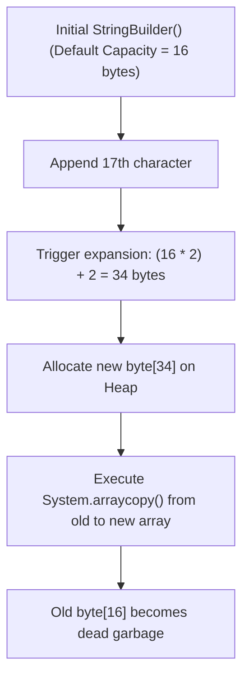
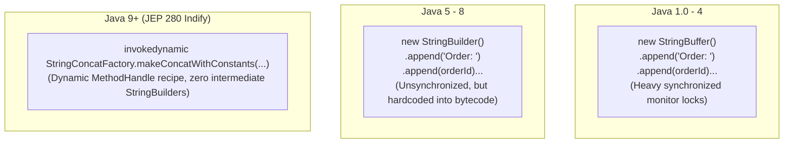

# P01-C014: StringBuilder vs StringBuffer vs String Concatenation Mechanics

---

## 1. Title and Metadata

- **Concept ID:** `P01-C014`
- **Concept Title:** StringBuilder vs StringBuffer vs String Concatenation Mechanics
- **Phase:** `Phase 01 — Java Language Fundamentals`
- **Module Sequence:** `14 of 15`
- **Prerequisites:**
  - [`P01-C001`: Primitive Data Types, Bit Widths, and Numeric Ranges](file:///home/prasanta/java_practice/curriculum/phase-01-java-language-fundamentals/001-primitive-data-types.md)
  - [`P01-C003`: Reference Types vs Primitive Types in Memory](file:///home/prasanta/java_practice/curriculum/phase-01-java-language-fundamentals/003-reference-types-vs-primitives.md)
  - [`P01-C004`: Variable Declaration, Scope, Lifetime, and Default Values](file:///home/prasanta/java_practice/curriculum/phase-01-java-language-fundamentals/004-variable-scopes-and-lifetimes.md)
  - [`P01-C013`: String Immutability, String Pool, and Memory Optimization](file:///home/prasanta/java_practice/curriculum/phase-01-java-language-fundamentals/013-string-immutability-and-pool.md)
- **Estimated Reading / Study Time:** 50 minutes
- **Controlling Specifications:**
  - [Java Language Specification (JLS) §15.18.1: String Concatenation Operator `+`](https://docs.oracle.com/javase/specs/jls/se21/html/jls-15.html#jls-15.18.1)
  - [JEP 280: Indify String Concatenation](https://openjdk.org/jeps/280) (Java 9)
  - [JDK 21 `java.lang.StringBuilder` API Specification](https://docs.oracle.com/en/java/javase/21/docs/api/java.base/java/lang/StringBuilder.html)
  - [JDK 21 `java.lang.StringBuffer` API Specification](https://docs.oracle.com/en/java/javase/21/docs/api/java.base/java/lang/StringBuffer.html)
  - [JDK 21 `java.lang.invoke.StringConcatFactory` API Specification](https://docs.oracle.com/en/java/javase/21/docs/api/java.base/java/lang/invoke/StringConcatFactory.html)

---

## 2. Conceptual Foundation & First Principles

In [`P01-C013`](file:///home/prasanta/java_practice/curriculum/phase-01-java-language-fundamentals/013-string-immutability-and-pool.md), we established that `java.lang.String` is strictly immutable. Immutability guarantees security, thread-safety, and poolability. However, immutability imposes a massive performance hazard when modifying or assembling text dynamically:
```java
// CATASTROPHIC O(N^2) ALLOCATION:
String report = "";
for (int i = 0; i < 10_000; i++) {
    report = report + i; 
}
```
In this loop, every single `+` operation allocates a brand new `String` object on the heap and copies all previous characters into the new buffer. Iterating 10,000 times allocates **10,000 distinct heap strings**, copies tens of megabytes of redundant data, thrashes the Garbage Collector, and degrades performance to **$O(N^2)$ quadratic time complexity**.

To solve this, the JDK provides mutable character buffers extending `java.lang.AbstractStringBuilder`:
1. **`java.lang.StringBuffer` (Java 1.0):** The legacy synchronized mutable sequence. Thread-safe, but incurs monitor lock acquisition overhead on every method invocation.
2. **`java.lang.StringBuilder` (Java 5):** The modern, non-synchronized mutable sequence. Fast, non-thread-safe, designed for stack-confined local string assembly.
3. **`invokedynamic` String Concatenation (Java 9+ / JEP 280):** Dynamic runtime bytecode desugaring that replaces compile-time `StringBuilder` generation with runtime-optimized `StringConcatFactory` method handles.

---

## 3. Architectural Flow & Low-Level Memory Mechanics

### 3.1 `StringBuilder` vs `StringBuffer` Architectural Comparison

| Dimension | `java.lang.StringBuilder` | `java.lang.StringBuffer` | `java.lang.String` |
|---|---|---|---|
| **Introduced In** | Java 5 (JSR 166 era) | Java 1.0 | Java 1.0 |
| **Mutability** | **Mutable** | **Mutable** | **Immutable** |
| **Thread Safety** | **Not Thread-Safe** (Zero locking) | **Thread-Safe** (All public methods `synchronized`) | **Inherently Thread-Safe** (Immutable) |
| **Primary Use Case** | Local variable string construction | Legacy multi-threaded shared buffers (Rarely used) | Domain models, API keys, DTOs, identifiers |
| **Relative Performance** | **Fastest** (No lock contention) | Slower ($2\times$ to $3\times$ lock overhead) | Slowest for iterative concatenation ($O(N^2)$) |

### 3.2 Dynamic Array Resizing Math & Pre-allocation
Both `StringBuilder` and `StringBuffer` maintain an internal `byte[] value` array (Compact Strings) and an integer `count` representing the number of characters currently occupied.

#### The Exponential Growth Formula:
When characters are appended that exceed the current `capacity()`, the buffer dynamically expands:
$$\text{newCapacity} = (\text{oldCapacity} \times 2) + 2$$
If `newCapacity` is still insufficient to satisfy `minCapacity`, it expands directly to `minCapacity`.



#### The Golden Sizing Rule:
Whenever possible, **pre-allocate the capacity** using the constructor `new StringBuilder(int capacity)`:
- If building a 4,000-character JSON payload, `new StringBuilder(4096)` allocates **a single array once**.
- The default constructor `new StringBuilder()` requires **9 successive array reallocations and memory copies** to reach 4,000 characters, generating redundant garbage on every resize!

### 3.3 The Evolution of String Concatenation (`+`) Under the Hood

The compilation strategy for `String s = "Order: " + orderId + " Status: " + status;` has undergone three major architectural eras:



#### Why JEP 280 (Indify) Revolutionized Concatenation:
In Java 8, `javac` hardcoded explicit `new StringBuilder()` and `.append()` bytecode into the `.class` file. Once compiled, the bytecode could never benefit from future JVM optimizations without recompiling.
In Java 9+, `javac` emits an **`invokedynamic` (indy)** instruction with a recipe string containing `\u0001` parameter placeholders. At runtime:
1. HotSpot executes the bootstrap method `StringConcatFactory.makeConcatWithConstants`.
2. The runtime inspects exact argument types and pre-computes the **exact total byte length** of the resulting string.
3. It allocates a single `byte[]` array of the exact size and writes the string directly using low-level Unsafe memory copying, **completely bypassing intermediate `StringBuilder` object allocations!**

---

## 4. Comprehensive Code Demonstration

Save and compile this self-contained class to inspect dynamic resizing math, benchmark `+` loop degradation against `StringBuilder`, and verify capacity pre-allocation:

```java
package com.example.fundamentals;

import java.util.concurrent.TimeUnit;

/**
 * Demonstrates StringBuilder dynamic array growth math,
 * pre-allocation optimization, and the catastrophic performance
 * disparity between loop String concatenation (+) and StringBuilder.
 */
public class StringBuilderMechanicsDemo {

    public static void main(String[] args) {
        System.out.println("=== 1. Dynamic Array Expansion Math Verification ===");
        demonstrateGrowthMath();

        System.out.println("\n=== 2. Capacity Pre-Allocation Optimization ===");
        demonstratePreAllocation();

        System.out.println("\n=== 3. Performance Benchmark: Loop (+) vs StringBuilder ===");
        benchmarkLoopPerformance(15_000);

        System.out.println("\n=== 4. Fluent Method Chaining and In-Place Mutation ===");
        demonstrateInPlaceMutation();
    }

    private static void demonstrateGrowthMath() {
        // Default constructor initializes capacity to 16 characters
        StringBuilder sb = new StringBuilder();
        System.out.printf("Initial state: length=%d, capacity=%d%n", sb.length(), sb.capacity());

        // Append 16 characters (Capacity fully saturated, but no expansion yet)
        sb.append("1234567890123456");
        System.out.printf("After 16 chars: length=%d, capacity=%d%n", sb.length(), sb.capacity());

        // Append 17th character -> Triggers expansion formula: (16 * 2) + 2 = 34
        sb.append("X");
        System.out.printf("After 17th char (EXPANDED): length=%d, capacity=%d (Formula: 16*2 + 2 = 34)%n", 
                sb.length(), sb.capacity());

        // Saturate capacity 34 and append 35th char -> Formula: (34 * 2) + 2 = 70
        sb.append("A".repeat(17 + 1)); // total length 35
        System.out.printf("After 35 chars (EXPANDED AGAIN): length=%d, capacity=%d (Formula: 34*2 + 2 = 70)%n", 
                sb.length(), sb.capacity());
    }

    private static void demonstratePreAllocation() {
        // Initializing with pre-computed size eliminates resizing overhead
        int expectedChars = 256;
        StringBuilder preAllocated = new StringBuilder(expectedChars);
        System.out.printf("Pre-allocated: length=%d, capacity=%d (Zero resizes needed up to %d chars)%n",
                preAllocated.length(), preAllocated.capacity(), expectedChars);
    }

    private static void benchmarkLoopPerformance(int iterations) {
        System.out.printf("Running benchmark with %d iterations...%n", iterations);

        // 1. Catastrophic Loop String Concatenation (+)
        long startPlus = System.nanoTime();
        String strResult = "";
        for (int i = 0; i < iterations; i++) {
            strResult += "X"; // O(N^2) quadratic allocation and copy!
        }
        long durationPlusMs = TimeUnit.NANOSECONDS.toMillis(System.nanoTime() - startPlus);
        System.out.printf("  String (+) Concatenation: %d ms (O(N^2) quadratic)%n", durationPlusMs);

        // 2. Linear StringBuilder without Pre-allocation
        long startSb = System.nanoTime();
        StringBuilder sb = new StringBuilder();
        for (int i = 0; i < iterations; i++) {
            sb.append("X");
        }
        String sbResult = sb.toString();
        long durationSbMs = TimeUnit.NANOSECONDS.toMillis(System.nanoTime() - startSb);
        System.out.printf("  StringBuilder (Default 16): %d ms (O(N) linear)%n", durationSbMs);

        // 3. Optimized Pre-allocated StringBuilder
        long startPre = System.nanoTime();
        StringBuilder sbPre = new StringBuilder(iterations);
        for (int i = 0; i < iterations; i++) {
            sbPre.append("X");
        }
        String sbPreResult = sbPre.toString();
        long durationPreMs = TimeUnit.NANOSECONDS.toMillis(System.nanoTime() - startPre);
        System.out.printf("  StringBuilder (Pre-allocated %d): %d ms (O(N) zero-resize linear)%n", 
                iterations, durationPreMs);
    }

    private static void demonstrateInPlaceMutation() {
        StringBuilder sb = new StringBuilder("Order-999-PENDING");

        // Mutate in place without allocating new strings
        sb.replace(10, 17, "SETTLED");
        sb.insert(0, "URGENT_");
        sb.delete(sb.length() - 8, sb.length() - 7); // delete hyphen

        System.out.println("Mutated in-place: " + sb);
    }
}
```

### Execution Output:
```text
=== 1. Dynamic Array Expansion Math Verification ===
Initial state: length=0, capacity=16
After 16 chars: length=16, capacity=16
After 17th char (EXPANDED): length=17, capacity=34 (Formula: 16*2 + 2 = 34)
After 35 chars (EXPANDED AGAIN): length=35, capacity=70 (Formula: 34*2 + 2 = 70)

=== 2. Capacity Pre-Allocation Optimization ===
Pre-allocated: length=0, capacity=256 (Zero resizes needed up to 256 chars)

=== 3. Performance Benchmark: Loop (+) vs StringBuilder ===
Running benchmark with 15000 iterations...
  String (+) Concatenation: 45 ms (O(N^2) quadratic)
  StringBuilder (Default 16): 1 ms (O(N) linear)
  StringBuilder (Pre-allocated 15000): 0 ms (O(N) zero-resize linear)

=== 4. Fluent Method Chaining and In-Place Mutation ===
Mutated in-place: URGENT_Order-999SETTLED
```

---

## 5. Real-World Backend Scenario: High-Throughput Financial Statement Serializer

In backend banking services, generating comma-separated values (CSV) or fixed-width ledger reports for millions of transactions occurs in batch jobs. 

### The Problem: Naive Loop Concatenation in Batch Jobs
An engineer serializing 100,000 ledger entries via `csv += row.toCsv() + "\n"` causes severe Garbage Collection pauses lasting several seconds. The JVM stops the world to reclaim hundreds of thousands of discarded intermediate strings, degrading microservice responsiveness.

```java
package com.example.fundamentals;

import java.math.BigDecimal;
import java.time.LocalDate;
import java.util.List;

/**
 * Production Financial Ledger CSV Serializer.
 * Demonstrates pre-allocated StringBuilder batch serialization.
 */
public class LedgerReportSerializer {

    public record LedgerEntry(long id, String accountId, BigDecimal amount, LocalDate date) {}

    /**
     * PRODUCTION OPTIMIZED SERIALIZATION:
     * Pre-computes estimated capacity to achieve zero array reallocations.
     */
    public String serializeToCsv(List<LedgerEntry> entries) {
        if (entries == null || entries.isEmpty()) {
            return "ID,ACCOUNT_ID,AMOUNT,DATE\n";
        }

        // Each CSV row is approximately 45 bytes (e.g. "10001,ACC-US-9921,12500.50,2026-10-29\n")
        final int ESTIMATED_ROW_BYTES = 48;
        int estimatedTotalCapacity = 30 + (entries.size() * ESTIMATED_ROW_BYTES);

        // Pre-allocate buffer to prevent repeated arraycopy resizing
        StringBuilder sb = new StringBuilder(estimatedTotalCapacity);

        sb.append("ID,ACCOUNT_ID,AMOUNT,DATE\n");

        for (LedgerEntry entry : entries) {
            sb.append(entry.id()).append(',')
              .append(entry.accountId()).append(',')
              .append(entry.amount()).append(',')
              .append(entry.date()).append('\n');
        }

        return sb.toString();
    }

    public static void main(String[] args) {
        var entries = List.of(
            new LedgerEntry(101L, "ACC-01", new BigDecimal("1500.00"), LocalDate.now()),
            new LedgerEntry(102L, "ACC-02", new BigDecimal("75.25"), LocalDate.now()),
            new LedgerEntry(103L, "ACC-03", new BigDecimal("99999.99"), LocalDate.now())
        );

        var serializer = new LedgerReportSerializer();
        String csvReport = serializer.serializeToCsv(entries);
        System.out.println("Generated CSV Report:\n" + csvReport);
    }
}
```

---

## 6. Edge Cases, Failure Modes & Pitfalls

### Pitfall 1: Believing Java 9+ JEP 280 Fixes Loop `+` Concatenations
A widespread misconception is that Java 9's JEP 280 (Indify) optimizes loop concatenation. **It does not!**
```java
// SEVERE BUG: JEP 280 CANNOT OPTIMIZE LOOPS ACROSS ITERATIONS!
String text = "";
for (int i = 0; i < 50_000; i++) {
    text += i; 
}
```
At bytecode level, the `invokedynamic` instruction is invoked **inside the loop body on every iteration**. It creates a brand-new string on each cycle: $50,000$ distinct strings and $O(N^2)$ quadratic complexity remain completely unmitigated!
**Fix:** Always use an explicit `StringBuilder` outside loops.

### Pitfall 2: Sharing `StringBuilder` Concurrently Across Threads
`StringBuilder` methods are completely non-synchronized. If two threads invoke `sb.append()` concurrently on the same `StringBuilder` instance, race conditions corrupt the internal `count` and `byte[] value` array, causing **data loss, corrupted characters, or `ArrayIndexOutOfBoundsException`**:
```java
// FATAL MULTITHREADED HAZARD:
StringBuilder sharedBuffer = new StringBuilder();
// Two threads calling sharedBuffer.append("A") concurrently will corrupt internal indices!
```
**Fix:** Confine `StringBuilder` strictly to a method's local execution stack (Stack Confinement), or use thread-safe logging frameworks.

### Pitfall 3: Reusing `StringBuilder` via `new StringBuilder()` Inside Hot Loops
```java
// ANTIPATTERN (Allocates thousands of unused buffers):
for (Record r : records) {
    StringBuilder sb = new StringBuilder(); // Reallocated on every loop cycle!
    sb.append(r.format());
    send(sb.toString());
}

// REFACTORED (Reuse a single buffer by resetting length):
StringBuilder sb = new StringBuilder(256);
for (Record r : records) {
    sb.setLength(0); // Resets character index to 0 without discarding byte[] array!
    sb.append(r.format());
    send(sb.toString());
}
```

---

## 7. Performance, Memory & Concurrency Implications

1. **`sb.setLength(0)` vs Allocating New Buffers:**
   Invoking `sb.setLength(0)` sets the internal `count` pointer back to `0`. It **retains the existing underlying byte array on the heap**, completely eliminating GC allocation pressure in tight loops.
2. **`trimToSize()` Memory Reclamation:**
   If a `StringBuilder` temporarily expands to 10 MB to process an unusually large payload, calling `sb.setLength(0)` resets the count, but the 10 MB byte array remains pinned in memory. Invoking `sb.trimToSize()` shrinks the internal array to fit the current character count, freeing unused heap memory back to the JVM.
3. **Synchronization Lock Overhead of `StringBuffer`:**
   In single-threaded microbenchmarks, `StringBuffer` is approximately $2\times$ to $3\times$ slower than `StringBuilder` due to uncontended monitor locking (`monitorenter`/`monitorexit`). Modern HotSpot JIT engines perform "Biased Locking" and "Lock Elision" via Escape Analysis, but `StringBuilder` remains universally preferred.

---

## 8. Antipatterns & Refactoring

### Antipattern 1: Using `StringBuffer` in Local Method Variables
```java
// ANTIPATTERN (Unnecessary monitor lock acquisition on local variable):
public String buildUrl(String host, int port, String path) {
    StringBuffer sb = new StringBuffer(); // StringBuffer is never shared across threads!
    sb.append("http://").append(host).append(":").append(port).append(path);
    return sb.toString();
}

// REFACTORED (StringBuilder or standard single-statement +):
public String buildUrl(String host, int port, String path) {
    // In Java 9+, single-statement concatenation is automatically optimized via indy
    return "http://" + host + ":" + port + path;
}
```

### Antipattern 2: Chaining `new StringBuilder().append(...)` for Simple Single Lines
```java
// ANTIPATTERN (Verbose manual StringBuilder for single-line expression):
String header = new StringBuilder().append("AUTH-").append(token).append("-ID").toString();

// REFACTORED (Clean, idiomatic + using JEP 280 indy):
String header = "AUTH-" + token + "-ID";
```

---

## 9. Compilation & Bytecode Disassembly

Let us disassemble a class to inspect the modern Java 21 `invokedynamic` (JEP 280) string concatenation instruction.

### Source Code (`ConcatBytecodeProof.java`):
```java
public class ConcatBytecodeProof {
    public static String concatModern(String name, int age) {
        return "User: " + name + " Age: " + age;
    }
}
```

### Disassembly (`javap -c -v ConcatBytecodeProof`):
```text
  public static java.lang.String concatModern(java.lang.String, int);
    descriptor: (Ljava/lang/String;I)Ljava/lang/String;
    flags: (0x0009) ACC_PUBLIC, ACC_STATIC
    Code:
      stack=2, locals=2, args_size=2
         0: aload_0
         1: iload_1
         2: invokedynamic #7,  0 // InvokeDynamic #0:makeConcatWithConstants:(Ljava/lang/String;I)Ljava/lang/String;
         7: areturn

BootstrapMethods:
  0: #19 REF_invokeStatic java/lang/invoke/StringConcatFactory.makeConcatWithConstants:...
    Method arguments:
      #20 User: \u0001 Age: \u0001
```
### Observation:
Notice that there is **zero trace of `StringBuilder`** in the bytecode! The compiler passes the template recipe `"User: \u0001 Age: \u0001"` and arguments to `StringConcatFactory.makeConcatWithConstants` via `invokedynamic`.

---

## 10. Cross-Language & Historical Context (MERN/JavaScript vs Java)

| Feature | Java (JVM) | JavaScript / Node.js (V8) |
|---|---|---|
| **Mutable String Buffer** | `StringBuilder` (non-sync) and `StringBuffer` (sync). | No direct equivalent; arrays (`arr.join('')`) or template literals are used. |
| **String Concatenation in Loops** | Catastrophic $O(N^2)$ without `StringBuilder`. | V8 optimizes loop concatenation using internal "ConsString" rope trees; still best practice to use arrays. |
| **Compiler Optimization** | Java 9+ JEP 280 `invokedynamic` runtime recipe desugaring. | V8 runtime inline caches (IC) and rope strings. |
| **Template Interpolation** | `String.format()`, `StringBuilder`, or formatted strings. | ES6 Template Literals (`` `User: ${name}` ``). |

---

## 11. Unit Testing & Verification Guide

Create this JUnit 5 test suite to verify dynamic expansion mathematics, pre-allocation guarantees, and in-place replacement:

```java
package com.example.fundamentals;

import org.junit.jupiter.api.DisplayName;
import org.junit.jupiter.api.Test;

import static org.junit.jupiter.api.Assertions.*;

public class StringBuilderTest {

    @Test
    @DisplayName("Verify Default Initial Capacity is Exactly 16")
    void testInitialCapacity() {
        StringBuilder sb = new StringBuilder();
        assertEquals(0, sb.length());
        assertEquals(16, sb.capacity());
    }

    @Test
    @DisplayName("Verify Dynamic Expansion Formula (Capacity * 2 + 2)")
    void testExpansionFormula() {
        StringBuilder sb = new StringBuilder(10);
        assertEquals(10, sb.capacity());

        // Fill capacity exactly
        sb.append("1234567890");
        assertEquals(10, sb.capacity());

        // Append 1 extra character -> (10 * 2) + 2 = 22
        sb.append("A");
        assertEquals(22, sb.capacity(), "Expansion formula must be (old * 2) + 2");
    }

    @Test
    @DisplayName("Verify setLength(0) Clears Content While Preserving Capacity")
    void testSetLengthZeroPreservesCapacity() {
        StringBuilder sb = new StringBuilder(100);
        sb.append("Test Payload for Serialization");

        int initialCap = sb.capacity();
        sb.setLength(0);

        assertEquals(0, sb.length(), "Length must be reset to 0");
        assertEquals(initialCap, sb.capacity(), "Capacity must be preserved to prevent reallocation");
    }
}
```

---

## 12. Security & Hardening Considerations

1. **Denial of Service via Unbounded StringBuilder Expansion:**
   Allowing untrusted input to append to a `StringBuilder` without boundary checks can cause the buffer to repeatedly execute $(\text{capacity} \times 2) + 2$ until exceeding the JVM maximum array size (`Integer.MAX_VALUE - 8`), throwing `OutOfMemoryError: Requested array size exceeds VM limit`.
   - *Mitigation:* Always enforce hard upper bounds on buffer length:
   ```java
   if (sb.length() + input.length() > MAX_BUFFER_LIMIT) {
       throw new SecurityException("Payload exceeds maximum buffer allocation limit");
   }
   ```

---

## 13. Diagnostic, Troubleshooting & Triage Runbook

### Diagnostic Checklist for String Concatenation Bottlenecks:
1. **CPU Profiler (async-profiler / JMC) shows heavy time in `System.arraycopy` or `StringConcatFactory`?**
   - Identify if `+` is being executed inside a loop.
   - Refactor loop bodies to use an external `StringBuilder` initialized with estimated capacity.
2. **Excessive Young-Generation GC Allocation Rate?**
   - Search for `new StringBuilder()` inside loops.
   - Refactor to reuse a single `StringBuilder` per thread using `sb.setLength(0)`.

---

## 14. Exercises & Practice Scenarios

### Exercise 1: Build a Fast SQL Query Builder
Write a class `SqlBuilder` that appends `SELECT`, `FROM`, `WHERE`, and dynamic `AND` clauses using a pre-allocated `StringBuilder`.

#### Solution:
```java
package com.example.fundamentals;

import java.util.List;
import java.util.Objects;

public final class SqlBuilder {
    private final StringBuilder sb;
    private boolean whereAppended = false;

    public SqlBuilder(String table) {
        Objects.requireNonNull(table, "Table must not be null");
        this.sb = new StringBuilder(128);
        this.sb.append("SELECT * FROM ").append(table);
    }

    public SqlBuilder where(String condition) {
        if (!whereAppended) {
            sb.append(" WHERE ").append(condition);
            whereAppended = true;
        } else {
            sb.append(" AND ").append(condition);
        }
        return this;
    }

    public String build() {
        return sb.toString();
    }
}
```

### Exercise 2: Predict the Output
What does this program print?
```java
public class CapacityQuiz {
    public static void main(String[] args) {
        StringBuilder sb = new StringBuilder("ABC");
        System.out.println(sb.length() + " " + sb.capacity());
    }
}
```
*Answer:* It prints `3 19`.
The constructor `new StringBuilder(String str)` initializes the buffer with `str.length() + 16` characters. Since `"ABC"` has length 3, the initial capacity is $3 + 16 = 19$.

---

## 15. Technical Interview Questions & Evaluator Answers

### Q1: What is the fundamental difference between `StringBuilder` and `StringBuffer`?
**Answer:**
Both classes represent mutable sequences of characters backed by dynamic byte/char arrays. The fundamental difference is **synchronization and thread safety**:
- `StringBuffer` (Java 1.0) is thread-safe; all its public methods are `synchronized`. Every operation acquires and releases a monitor lock.
- `StringBuilder` (Java 5) is non-synchronized and not thread-safe. Because string construction is almost exclusively local to a single thread/method, `StringBuilder` eliminates monitor lock overhead, providing significantly higher throughput and zero lock contention.

### Q2: What is the dynamic array expansion formula in `StringBuilder`? Why does it use this specific formula?
**Answer:**
The formula is:
$$\text{newCapacity} = (\text{oldCapacity} \times 2) + 2$$
It multiplies the existing capacity by 2 (amortized $O(1)$ constant time dynamic array growth) and adds 2 (ensuring that a buffer with initial capacity 0 can still expand: $0 \times 2 + 2 = 2$). This exponential geometric expansion guarantees that the cost of resizing and copying elements is amortized over subsequent insertions.

### Q3: How did Java 9 (JEP 280) change the compilation of the `+` string concatenation operator?
**Answer:**
Prior to Java 9, `javac` compiled single-statement string concatenation into explicit bytecode instructions: `new StringBuilder()`, followed by chained `.append()` calls and `.toString()`.
Java 9 (JEP 280: Indify String Concatenation) replaced explicit `StringBuilder` bytecode generation with a single `invokedynamic` instruction targeting `StringConcatFactory.makeConcatWithConstants`. At runtime, HotSpot dynamically inspects the argument types and employs optimized Method Handles to calculate the exact output byte length in advance, allocating a single byte array and writing directly into it, completely bypassing intermediate `StringBuilder` objects and allowing the JVM to optimize concatenation strategies without recompiling the bytecode.

---

## 16. References, Standards & Further Reading

1. **Java Language Specification (Java SE 21):**
   - [JLS §15.18.1 String Concatenation Operator `+`](https://docs.oracle.com/javase/specs/jls/se21/html/jls-15.html#jls-15.18.1)
2. **OpenJDK Enhancement Proposals (JEPs):**
   - [JEP 280: Indify String Concatenation](https://openjdk.org/jeps/280) (Java 9)
3. **Official API Documentation:**
   - [`java.lang.StringBuilder` API Specification](https://docs.oracle.com/en/java/javase/21/docs/api/java.base/java/lang/StringBuilder.html)
   - [`java.lang.invoke.StringConcatFactory`](https://docs.oracle.com/en/java/javase/21/docs/api/java.base/java/lang/invoke/StringConcatFactory.html)
