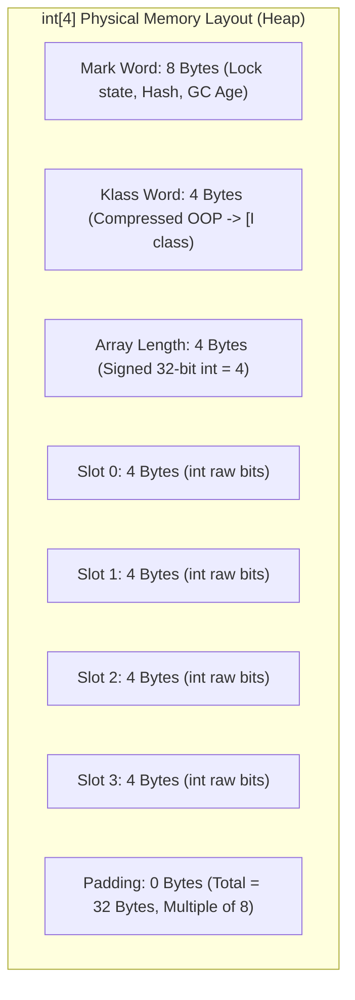
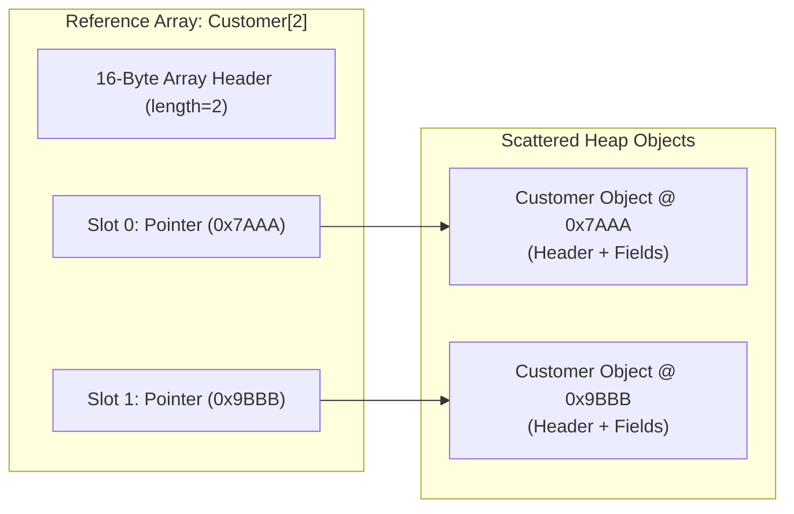
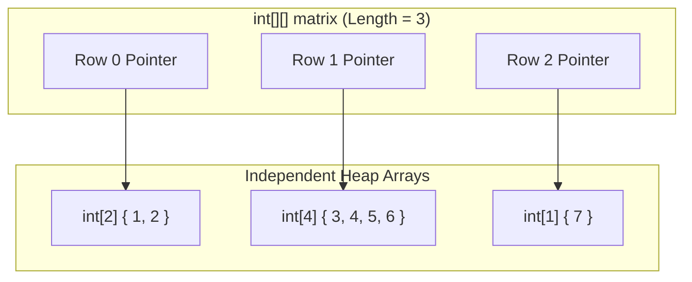

# P01-C015: Arrays: Memory Layout, Multi-Dimensional Arrays, and Arrays Utility

---

## 1. Title and Metadata

- **Concept ID:** `P01-C015`
- **Concept Title:** Arrays: Memory Layout, Multi-Dimensional Arrays, and Arrays Utility
- **Phase:** `Phase 01 — Java Language Fundamentals`
- **Module Sequence:** `15 of 15`
- **Prerequisites:**
  - [`P01-C001`: Primitive Data Types, Bit Widths, and Numeric Ranges](file:///home/prasanta/java_practice/curriculum/phase-01-java-language-fundamentals/001-primitive-data-types.md)
  - [`P01-C003`: Reference Types vs Primitive Types in Memory](file:///home/prasanta/java_practice/curriculum/phase-01-java-language-fundamentals/003-reference-types-vs-primitives.md)
  - [`P01-C004`: Variable Declaration, Scope, Lifetime, and Default Values](file:///home/prasanta/java_practice/curriculum/phase-01-java-language-fundamentals/004-variable-scopes-and-lifetimes.md)
  - [`P01-C005`: Type Casting: Widening, Narrowing, and Overflow Traps](file:///home/prasanta/java_practice/curriculum/phase-01-java-language-fundamentals/005-type-casting-and-overflow.md)
  - [`P01-C010`: Looping Constructs, Jump Statements, and Labels](file:///home/prasanta/java_practice/curriculum/phase-01-java-language-fundamentals/010-loops-and-iteration.md)
  - [`P01-C012`: Pass-by-Value Semantics in Java (Why References Are Passed by Value)](file:///home/prasanta/java_practice/curriculum/phase-01-java-language-fundamentals/012-pass-by-value-semantics.md)
- **Estimated Reading / Study Time:** 55 minutes
- **Controlling Specifications:**
  - [Java Language Specification (JLS) §10: Arrays](https://docs.oracle.com/javase/specs/jls/se21/html/jls-10.html)
  - [Java Language Specification (JLS) §10.6: Array Initializers](https://docs.oracle.com/javase/specs/jls/se21/html/jls-10.html#jls-10.6)
  - [Java Language Specification (JLS) §10.7: Array Members](https://docs.oracle.com/javase/specs/jls/se21/html/jls-10.html#jls-10.7)
  - [The Java Virtual Machine Specification: §6.5 Array Instructions (`newarray`, `anewarray`, `multianewarray`, `arraylength`)](https://docs.oracle.com/javase/specs/jvms/se21/html/jvms-6.html#jvms-6.5.newarray)
  - [JDK 21 `java.util.Arrays` API Specification](https://docs.oracle.com/en/java/javase/21/docs/api/java.base/java/util/Arrays.html)

---

## 2. Conceptual Foundation & First Principles

In Java, an array is a fundamental data structure holding a fixed number of values of a single uniform type. While arrays exist in almost every programming language, Java's implementation has unique, low-level architectural invariants:

1. **Arrays Are Objects:** In Java, **an array is always a heap-allocated object**, regardless of whether its component type is a primitive (`int[]`) or a reference (`String[]`). Every array class dynamically inherits directly from `java.lang.Object` and implements `java.lang.Cloneable` and `java.io.Serializable`.
2. **Fixed Physical Size:** Once allocated on the JVM Heap, an array's length is permanently fixed. It cannot grow or shrink. The field `array.length` is a `public final int` embedded directly into the object's physical memory header.
3. **Mandatory Zero-Default Initialization:** When an array is instantiated (`new int[10]`), the JVM allocates contiguous heap memory and guarantees that every slot is zero-initialized ($0$ for numeric primitives, `false` for booleans, `\u0000` for chars, `null` for reference types).
4. **Guaranteed Bounds Safety:** Java enforces strict memory safety. Attempting to access an index outside $[0, \text{length} - 1]$ throws an immediate `java.lang.ArrayIndexOutOfBoundsException`. Buffer overflows cannot overwrite adjacent memory regions.
5. **Array Covariance (The Historical Flaw):** In Java, arrays are **covariant**: if `Sub` is a subtype of `Super`, then `Sub[]` is treated as a subtype of `Super[]`. As demonstrated below, this allows runtime type violations caught only by `java.lang.ArrayStoreException`.

---

## 3. Architectural Flow & Physical Memory Layout

### 3.1 64-Bit HotSpot Object Header Layout
On a 64-bit HotSpot JVM with Compressed OOPs enabled (`-XX:+UseCompressedOops`), an array possesses a **16-byte object header** (4 bytes larger than standard objects because of the embedded array length field):



#### Total Memory Footprint Formula:
$$\text{Memory Size} = \text{align8}\Big(16 + (\text{length} \times \text{elementSize})\Big)$$
- An `int[100]` requires: $\text{align8}(16 + 100 \times 4) = \text{align8}(416) = \mathbf{416 \text{ Bytes}}$ of contiguous memory.
- A `byte[1024]` requires: $\text{align8}(16 + 1024 \times 1) = \text{align8}(1040) = \mathbf{1040 \text{ Bytes}}$.

### 3.2 Primitive Arrays vs Reference Arrays (Contiguity vs Pointer Graphs)
A critical distinction exists between primitive arrays and reference arrays:
- **Primitive Array (`int[]`):** Elements are packed **completely contiguously in raw memory**. The CPU prefetcher streams consecutive integers directly into L1/L2 cache lines with zero cache misses.
- **Reference Array (`String[]` or `Object[]`):** The array contains **only contiguous 4-byte or 8-byte pointer addresses**. The actual objects live scattered across disparate heap regions. Traversing a reference array incurs constant pointer indirection and CPU cache misses (the "Pointer Chase").



### 3.3 Multi-Dimensional Arrays: "Arrays of Arrays" (Ragged Arrays)
Java has **NO true contiguous multi-dimensional matrices** in memory (unlike C/C++ or Fortran). A 2D array `int[][]` is an array of object references, where each element points to an independent 1D `int[]` array on the heap.

This enables **Ragged / Jagged Arrays**, where each row has a different length:


---

## 4. Comprehensive Code Demonstration

Save and compile this self-contained class to inspect array memory mechanics, ragged array construction, array covariance hazards, and high-performance `java.util.Arrays` utility algorithms:

```java
package com.example.fundamentals;

import java.util.Arrays;

/**
 * Demonstrates Java array memory mechanics, ragged arrays,
 * array covariance traps (ArrayStoreException), and standard utility algorithms.
 */
public class ArrayMechanicsDemo {

    public static void main(String[] args) {
        System.out.println("=== 1. Zero-Initialization & Length Invariants ===");
        demonstrateZeroInitialization();

        System.out.println("\n=== 2. Ragged / Non-Rectangular Multi-Dimensional Arrays ===");
        demonstrateRaggedArrays();

        System.out.println("\n=== 3. Array Covariance & ArrayStoreException Trap ===");
        demonstrateCovarianceTrap();

        System.out.println("\n=== 4. High-Performance System.arraycopy & Utility Methods ===");
        demonstrateArrayUtilities();

        System.out.println("\n=== 5. Multi-Dimensional Equality and Hashing ===");
        demonstrateDeepEquality();
    }

    private static void demonstrateZeroInitialization() {
        int[] numbers = new int[4];
        String[] strings = new String[2];
        boolean[] flags = new boolean[2];

        System.out.println("int[] default values: " + Arrays.toString(numbers));
        System.out.println("String[] default values: " + Arrays.toString(strings));
        System.out.println("boolean[] default values: " + Arrays.toString(flags));
        System.out.println("numbers.length: " + numbers.length);
    }

    private static void demonstrateRaggedArrays() {
        // Allocate top-level array with 3 rows; leaves sub-arrays unallocated (null)
        int[][] ragged = new int[3][];

        ragged[0] = new int[] { 1, 2 };
        ragged[1] = new int[] { 10, 20, 30, 40 };
        ragged[2] = new int[] { 99 };

        System.out.println("Ragged Array Structure:");
        for (int i = 0; i < ragged.length; i++) {
            System.out.printf("  Row %d (length=%d): %s%n", i, ragged[i].length, Arrays.toString(ragged[i]));
        }
    }

    private static void demonstrateCovarianceTrap() {
        // String[] is a subtype of Object[]
        String[] stringArray = new String[2];
        Object[] objectArray = stringArray; // Legal at compile-time due to array covariance

        objectArray[0] = "Valid String"; // Succeeds
        System.out.println("objectArray[0] assigned safely: " + objectArray[0]);

        try {
            // Attempting to store an Integer into a backing String[] array:
            // Compiles cleanly because objectArray accepts Object, but crashes at runtime!
            objectArray[1] = Integer.valueOf(42); 
        } catch (ArrayStoreException ase) {
            System.out.println("CAUGHT EXPECTED ArrayStoreException: " + ase.getClass().getName());
            System.out.println("  The JVM verified the backing array component type is [Ljava.lang.String;!");
        }
    }

    private static void demonstrateArrayUtilities() {
        int[] source = { 50, 20, 10, 40, 30 };

        // 1. Dual-Pivot Quicksort
        Arrays.sort(source);
        System.out.println("Sorted Array: " + Arrays.toString(source));

        // 2. Binary Search (Requires sorted array!)
        int index30 = Arrays.binarySearch(source, 30);
        int indexMissing = Arrays.binarySearch(source, 25);
        System.out.printf("Binary Search for 30: index %d%n", index30);
        System.out.printf("Binary Search for 25 (Missing): insertion index %d (-(insertion)-1)%n", indexMissing);

        // 3. Fast native System.arraycopy
        int[] destination = new int[7];
        System.arraycopy(source, 0, destination, 2, source.length);
        System.out.println("After System.arraycopy into destination: " + Arrays.toString(destination));

        // 4. CopyOf range truncation/padding
        int[] truncated = Arrays.copyOf(source, 3);
        int[] expanded = Arrays.copyOf(source, 7);
        System.out.println("Truncated copyOf (3): " + Arrays.toString(truncated));
        System.out.println("Expanded copyOf (7):  " + Arrays.toString(expanded));
    }

    private static void demonstrateDeepEquality() {
        int[][] matrixA = { { 1, 2 }, { 3, 4 } };
        int[][] matrixB = { { 1, 2 }, { 3, 4 } };

        // Standard equals on arrays only checks reference identity (==)
        System.out.println("Standard equals: " + matrixA.equals(matrixB) + " (Compares array pointers)");
        System.out.println("Arrays.equals:   " + Arrays.equals(matrixA, matrixB) + " (Compares sub-array pointers)");

        // Deep equals recursively evaluates elements of sub-arrays
        System.out.println("Arrays.deepEquals: " + Arrays.deepEquals(matrixA, matrixB) + " (Semantic deep equality)");
        System.out.println("Arrays.deepToString: " + Arrays.deepToString(matrixA));
    }
}
```

### Execution Output:
```text
=== 1. Zero-Initialization & Length Invariants ===
int[] default values: [0, 0, 0, 0]
String[] default values: [null, null]
boolean[] default values: [false, false]
numbers.length: 4

=== 2. Ragged / Non-Rectangular Multi-Dimensional Arrays ===
Ragged Array Structure:
  Row 0 (length=2): [1, 2]
  Row 1 (length=4): [10, 20, 30, 40]
  Row 2 (length=1): [99]

=== 3. Array Covariance & ArrayStoreException Trap ===
objectArray[0] assigned safely: Valid String
CAUGHT EXPECTED ArrayStoreException: java.lang.ArrayStoreException
  The JVM verified the backing array component type is [Ljava.lang.String;!

=== 4. High-Performance System.arraycopy & Utility Methods ===
Sorted Array: [10, 20, 30, 40, 50]
Binary Search for 30: index 2
Binary Search for 25 (Missing): insertion index -3 (-(insertion)-1)
After System.arraycopy into destination: [0, 0, 10, 20, 30, 40, 50]
Truncated copyOf (3): [10, 20, 30]
Expanded copyOf (7):  [10, 20, 30, 40, 50, 0, 0]

=== 5. Multi-Dimensional Equality and Hashing ===
Standard equals: false (Compares array pointers)
Arrays.equals:   false (Compares sub-array pointers)
Arrays.deepEquals: true (Semantic deep equality)
Arrays.deepToString: [[1, 2], [3, 4]]
```

---

## 5. Real-World Backend Scenario: High-Frequency Trading Circular Ring Buffer

In low-latency systems (e.g., LMAX Disruptor architecture, high-frequency trading market data feeds), object allocation during message processing is strictly prohibited because Garbage Collection pauses cause catastrophic latency spikes.

A pre-allocated **Circular Array Ring Buffer** backed by an array and bitwise masking delivers deterministic zero-allocation sub-microsecond throughput:

```java
package com.example.fundamentals;

import java.util.Objects;

/**
 * Production Zero-Allocation Circular Ring Buffer for Low-Latency Event Processing.
 * Uses power-of-two array sizing to replace costly modulo (%) operations with bitwise AND (&).
 */
public class LowLatencyRingBuffer<T> {

    private final Object[] buffer;
    private final int mask;
    private long sequence = 0;

    @SuppressWarnings("unchecked")
    public LowLatencyRingBuffer(int powerOfTwoCapacity) {
        if (Integer.bitCount(powerOfTwoCapacity) != 1) {
            throw new IllegalArgumentException("Capacity must be a power of two to enable bitwise masking");
        }
        this.buffer = new Object[powerOfTwoCapacity];
        this.mask = powerOfTwoCapacity - 1; // e.g. 1024 - 1 = 1023 (0x3FF)
    }

    public synchronized void publish(T event) {
        Objects.requireNonNull(event, "Event must not be null");
        int slot = (int) (sequence & mask); // Zero-modulo fast calculation in CPU registers!
        buffer[slot] = event;
        sequence++;
    }

    @SuppressWarnings("unchecked")
    public synchronized T read(long readSequence) {
        int slot = (int) (readSequence & mask);
        return (T) buffer[slot];
    }

    public int capacity() {
        return buffer.length;
    }

    public static void main(String[] args) {
        // Pre-allocate ring buffer of 1024 slots
        LowLatencyRingBuffer<String> marketDataFeed = new LowLatencyRingBuffer<>(1024);

        System.out.println("Publishing market tick events into pre-allocated ring buffer...");
        for (int i = 0; i < 2000; i++) {
            marketDataFeed.publish("TICK_NASDAQ_AAPL_$" + (150.0 + (i * 0.01)));
        }

        // Read latest sequence
        long latestSeq = 1999;
        String latestTick = marketDataFeed.read(latestSeq);
        System.out.printf("Read latest event at sequence %d: %s%n", latestSeq, latestTick);
    }
}
```

---

## 6. Edge Cases, Failure Modes & Pitfalls

### Pitfall 1: Modifying a List Created via `Arrays.asList()`
Calling `Arrays.asList(arr)` returns an **adapter wrapper** (`java.util.Arrays$ArrayList`), NOT a `java.util.ArrayList`!
- The wrapper is backed directly by the original array: modifying elements in the list mutates the array, and vice versa!
- It is **fixed-size**: calling `.add()` or `.remove()` throws `java.lang.UnsupportedOperationException`!
```java
String[] arr = { "A", "B" };
List<String> list = Arrays.asList(arr);
list.add("C"); // CRITICAL BUG: Throws UnsupportedOperationException!
```
**Fix:** For mutable independent lists, use `new ArrayList<>(List.of(arr))` or `new ArrayList<>(Arrays.asList(arr))`.

### Pitfall 2: Shallow Copying of Reference Arrays via `.clone()`
Calling `.clone()` on an array duplicates the array object itself, but **does NOT duplicate the elements within it**:
```java
Customer[] original = { new Customer("Alice") };
Customer[] cloned = original.clone();
cloned[0].setName("Bob"); // MUTATES the original customer object on the heap!
```

### Pitfall 3: Array Covariance Runtime Failure
```java
Number[] numbers = new Integer[5];
numbers[0] = Double.valueOf(3.14); // Compiles! Throws ArrayStoreException at runtime!
```
Generics in Java were deliberately made **invariant** (`List<Integer>` is NOT a `List<Number>`) to eliminate this exact class of runtime bugs.

---

## 7. Performance, Memory & Concurrency Implications

1. **JIT Range Check Elimination (RCE):**
   In standard array iteration (`for (int i = 0; i < arr.length; i++) sum += arr[i];`), the HotSpot C2 compiler mathematically proves that index `i` is strictly bounded by $[0, \text{length})$. The JIT engine completely eliminates the CPU bounds check instruction from the loop body, allowing memory reads to execute at raw hardware bus speeds.
2. **Flattened 1D Array Optimization for 2D Math:**
   Because 2D arrays in Java are arrays of reference pointers, computing matrix multiplication on `double[N][N]` causes massive cache line evictions. High-performance numerical libraries (such as ND4J or Apache Commons Math) represent an $M \times N$ matrix as a **flattened 1D array** `double[M * N]`, accessing cell $(r, c)$ via:
   $$\text{index} = (r \times N) + c$$
   This guarantees 100% contiguous memory layout and maximizes CPU L1/L2 prefetching throughput.
3. **Hardware SIMD Vectorization via `System.arraycopy`:**
   `System.arraycopy()` is a HotSpot intrinsic backed by platform-specific assembly (`memmove`). On modern x86_64 CPUs, it utilizes 256-bit AVX or 512-bit AVX-512 SIMD vector registers to copy 32 or 64 bytes per clock cycle. Never write manual `for` loops to copy array elements.

---

## 8. Antipatterns & Refactoring

### Antipattern 1: Printing Arrays Using `.toString()`
```java
// ANTIPATTERN:
int[] data = { 1, 2, 3 };
System.out.println(data); // PRINTS OBSCURE CLASS/HASH: "[I@682a0b4"

// REFACTORED:
System.out.println(Arrays.toString(data)); // PRINTS: "[1, 2, 3]"
// For 2D arrays:
System.out.println(Arrays.deepToString(matrix));
```

### Antipattern 2: Manual Array Copying in Loops
```java
// ANTIPATTERN (Slow, misses SIMD hardware vectorization):
int[] dest = new int[src.length];
for (int i = 0; i < src.length; i++) {
    dest[i] = src[i];
}

// REFACTORED (Ultra-fast native memmove):
int[] dest = new int[src.length];
System.arraycopy(src, 0, dest, 0, src.length);
// OR:
int[] dest = Arrays.copyOf(src, src.length);
```

---

## 9. Compilation & Bytecode Disassembly

Let us compile and disassemble a class to inspect the four specialized array opcodes: `newarray`, `anewarray`, `iaload`, and `iastore`.

### Source Code (`ArrayBytecodeProof.java`):
```java
public class ArrayBytecodeProof {
    public static int processPrimitiveArray() {
        int[] arr = new int[2];
        arr[0] = 42;
        return arr[0];
    }

    public static Object[] processReferenceArray() {
        return new String[2];
    }
}
```

### Disassembly (`javap -c ArrayBytecodeProof`):
```text
  public static int processPrimitiveArray();
    Code:
       0: iconst_2
       1: newarray       int     // Opcode for PRIMITIVE arrays (type int = 10)
       3: astore_0
       4: aload_0
       5: iconst_0
       6: bipush        42
       8: iastore                // Store int into array slot
       9: aload_0
      10: iconst_0
      11: iaload                 // Load int from array slot
      12: ireturn

  public static java.lang.Object[] processReferenceArray();
    Code:
       0: iconst_2
       1: anewarray     #7       // class java/lang/String (Opcode for REFERENCE arrays)
       4: areturn
```
### Observation:
1. `newarray int`: Used exclusively for primitive arrays. The JVM takes an integer constant type code (e.g. `T_INT = 10`, `T_BYTE = 8`).
2. `anewarray #7`: Used for reference arrays. Takes a constant pool symbolic class reference (`String.class`).
3. `iastore` / `iaload`: Specialized high-performance opcodes operating directly on integer arrays with hardware boundary checks.

---

## 10. Cross-Language & Historical Context (MERN/JavaScript vs Java)

| Feature | Java (JVM) | JavaScript / Node.js (V8) | C / C++ |
|---|---|---|---|
| **Array Type** | Fixed size, strictly typed contiguous heap object. | Dynamic, variable-length `Array` object (can be sparse dictionary). | Fixed block of memory; decays to pointer. |
| **Component Types** | Homogeneous (strictly single type: `int[]`). | Heterogeneous (can mix numbers, strings, objects). | Homogeneous. |
| **Typed Arrays** | Built-in primitive arrays (`int[]`, `byte[]`). | Specialized `Int32Array`, `Uint8Array` (ArrayBuffer). | Native primitive arrays. |
| **Bounds Safety** | **Strict**: Throws `ArrayIndexOutOfBoundsException`. | **Permissive**: Accessing out of bounds returns `undefined`. | **None**: Buffer overflow / segmentation fault / security vulnerability. |
| **Multi-Dimensional** | Array-of-arrays (ragged). | Array-of-arrays (jagged). | True contiguous row-major matrices (`int[N][M]`). |

---

## 11. Unit Testing & Verification Guide

Create this JUnit 5 test suite to verify array bounds safety, covariance violations, binary search contracts, and deep equality:

```java
package com.example.fundamentals;

import org.junit.jupiter.api.DisplayName;
import org.junit.jupiter.api.Test;

import java.util.Arrays;

import static org.junit.jupiter.api.Assertions.*;

public class ArrayMechanicsTest {

    @Test
    @DisplayName("Verify Out of Bounds Index Access Throws ArrayIndexOutOfBoundsException")
    void testOutOfBounds() {
        int[] arr = new int[5];

        assertThrows(ArrayIndexOutOfBoundsException.class, () -> {
            int val = arr[5]; // Index 5 is invalid for size 5 (indices 0..4)
        });

        assertThrows(ArrayIndexOutOfBoundsException.class, () -> {
            int val = arr[-1]; // Negative indices are strictly invalid
        });
    }

    @Test
    @DisplayName("Verify Array Covariance Throws ArrayStoreException on Incompatible Store")
    void testArrayStoreException() {
        Object[] stringArr = new String[3];

        assertThrows(ArrayStoreException.class, () -> {
            stringArr[0] = Double.valueOf(99.9);
        });
    }

    @Test
    @DisplayName("Verify Arrays.binarySearch Returns Negative Insertion Point When Missing")
    void testBinarySearchMissing() {
        int[] sorted = { 10, 20, 30, 40, 50 };
        // Value 25 belongs between index 1 (20) and index 2 (30).
        // Insertion point is 2. Formula: -(insertion point) - 1 = -(2) - 1 = -3.
        int result = Arrays.binarySearch(sorted, 25);
        assertEquals(-3, result);
    }

    @Test
    @DisplayName("Verify Arrays.deepEquals Correctly Compares Nested Multi-Dimensional Arrays")
    void testDeepEquals() {
        int[][] m1 = { { 1, 2 }, { 3, 4 } };
        int[][] m2 = { { 1, 2 }, { 3, 4 } };
        int[][] m3 = { { 1, 2 }, { 3, 9 } };

        assertTrue(Arrays.deepEquals(m1, m2));
        assertFalse(Arrays.deepEquals(m1, m3));
    }
}
```

---

## 12. Security & Hardening Considerations

1. **Defensive Cloning of Internal Array Fields (CWE-374):**
   Arrays are always mutable. Storing an array received in a constructor directly, or returning an array from a getter, exposes private internal state to external mutation:
   ```java
   public final class SecurityKeyStore {
       private final byte[] masterKey;
       public SecurityKeyStore(byte[] masterKey) {
           // SECURE: Defensive copy prevents caller from tampering with key
           this.masterKey = masterKey != null ? masterKey.clone() : new byte[0];
       }
       public byte[] getMasterKey() {
           // SECURE: Return clone, not internal pointer
           return this.masterKey.clone();
       }
   }
   ```
2. **Denial of Service via Huge Array Allocation:**
   Allocating an array using client-controlled size (`new byte[clientRequestedSize]`) without sanity validation allows malicious actors to request $2\text{ GB}$ arrays, instantly crashing the JVM with `OutOfMemoryError: Java heap space`.

---

## 13. Diagnostic, Troubleshooting & Triage Runbook

### Array Diagnostic Triage Table:
| Exception / Symptom | Root Cause | Fix |
|---|---|---|
| `ArrayIndexOutOfBoundsException: Index 5 out of bounds for length 5` | Loop used `<=` instead of `<`: `for (int i = 0; i <= arr.length; i++)`. | Change loop termination to `i < arr.length`. |
| `ArrayStoreException: java.lang.Integer` | Stored an incompatible object into an array through a covariant reference (`Object[] arr = new String[2]; arr[0] = 1;`). | Ensure the stored type matches the backing array's physical component type. |
| `Binary search returns negative index unexpectedly` | `Arrays.binarySearch()` called on an unsorted array. | Invoke `Arrays.sort(arr)` before calling `binarySearch()`. |
| `UnsupportedOperationException` on `list.add()` | Attempted to mutate a list created by `Arrays.asList()`. | Wrap in an independent mutable ArrayList: `new ArrayList<>(Arrays.asList(...))`. |

---

## 14. Exercises & Practice Scenarios

### Exercise 1: In-Place Array Reversal
Write a utility method `reverseInPlace(int[] array)` that reverses an integer array in place without allocating a second array ($O(1)$ auxiliary space complexity).

#### Solution:
```java
package com.example.fundamentals;

import java.util.Objects;

public final class ArrayReverser {
    private ArrayReverser() {}

    public static void reverseInPlace(int[] array) {
        if (array == null || array.length <= 1) return;

        int left = 0;
        int right = array.length - 1;

        while (left < right) {
            int temp = array[left];
            array[left] = array[right];
            array[right] = temp;
            left++;
            right--;
        }
    }
}
```

### Exercise 2: Predict the Output
What does this program print?
```java
import java.util.Arrays;

public class ArrayQuiz {
    public static void main(String[] args) {
        int[] a = { 1, 2, 3 };
        int[] b = a.clone();
        System.out.println((a == b) + " " + Arrays.equals(a, b));
    }
}
```
*Answer:* It prints `false true`.
- `a == b` is `false`: `a.clone()` allocates a **new array object** on the heap, so they reside at distinct memory addresses.
- `Arrays.equals(a, b)` is `true`: Both arrays contain identical element values (`1, 2, 3`).

---

## 15. Technical Interview Questions & Evaluator Answers

### Q1: What is the physical memory layout of an `int[]` versus an `Integer[]` on a 64-bit HotSpot JVM?
**Answer:**
Both arrays possess a 16-byte object header (8-byte Mark Word, 4-byte Klass Word with Compressed OOPs, and a 4-byte signed `length` field).
- For `int[N]`: The payload consists of $N \times 4$ bytes of contiguous raw integer bits stored directly in the array object, padded to an 8-byte boundary. There is zero pointer indirection, and elements are loaded contiguously into CPU cache lines.
- For `Integer[N]`: The array payload consists only of $N \times 4$ bytes (or 8 bytes without Compressed OOPs) of **reference pointer addresses**. Each pointer addresses a completely separate `Integer` object on the heap (each consuming 16 to 24 bytes). Traversing `Integer[]` consumes roughly $5\times$ more memory and suffers frequent CPU cache misses.

### Q2: Why are Java arrays covariant, and why is this considered a historical design flaw?
**Answer:**
Java arrays are covariant (`Sub[]` is a subtype of `Super[]`) because in Java 1.0 (before generics were introduced in Java 5), covariance was necessary to write generic algorithms that operated on arrays of any type, such as `Arrays.sort(Object[] a)` or `System.arraycopy(Object src, ...)`.
It is considered a design flaw because it creates a hole in Java's compile-time static type safety:
```java
String[] strings = new String[2];
Object[] objects = strings; // Compiles cleanly!
objects[0] = Integer.valueOf(42); // Compiles cleanly, but crashes at runtime with ArrayStoreException!
```
To prevent heap pollution, the JVM must perform an expensive type check on **every single array store operation** at runtime. When Generics were introduced in Java 5, the designers made generic collections **invariant** (`List<String>` is NOT a `List<Object>`) to eliminate this flaw.

### Q3: What is the difference between `Arrays.equals()` and `Arrays.deepEquals()`?
**Answer:**
- `Arrays.equals()` performs a 1D comparison: for reference arrays, it checks if `Objects.equals(a[i], b[i])`. If the array contains nested sub-arrays (e.g. `int[][]`), it merely checks if the sub-array pointers point to the same memory address (`==`).
- `Arrays.deepEquals()` performs a recursive deep comparison: it checks if elements are themselves arrays (either primitive or reference arrays), recursively invoking the appropriate equality checks on all nested dimensions.

---

## 16. References, Standards & Further Reading

1. **Java Language Specification (Java SE 21):**
   - [JLS §10 Arrays](https://docs.oracle.com/javase/specs/jls/se21/html/jls-10.html)
   - [JLS §10.6 Array Initializers](https://docs.oracle.com/javase/specs/jls/se21/html/jls-10.html#jls-10.6)
   - [JLS §10.7 Array Members](https://docs.oracle.com/javase/specs/jls/se21/html/jls-10.html#jls-10.7)
2. **The Java Virtual Machine Specification:**
   - [JVMS §6.5 Array Instructions (`newarray`, `anewarray`, `multianewarray`, `arraylength`)](https://docs.oracle.com/javase/specs/jvms/se21/html/jvms-6.html#jvms-6.5.newarray)
3. **Official API Documentation:**
   - [`java.util.Arrays` API Specification](https://docs.oracle.com/en/java/javase/21/docs/api/java.base/java/util/Arrays.html)
   - [`java.lang.System#arraycopy`](https://docs.oracle.com/en/java/javase/21/docs/api/java.base/java/lang/System.html#arraycopy(java.lang.Object,int,java.lang.Object,int,int))
