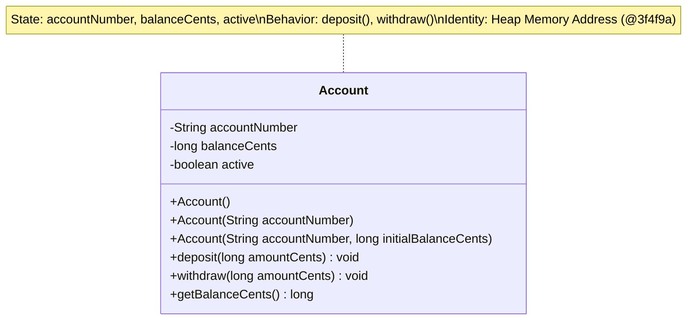
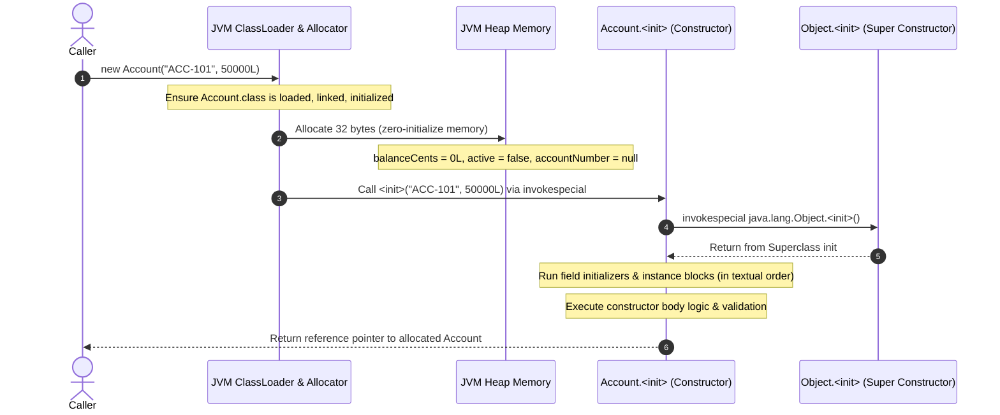

# Phase 02: Object-Oriented Programming
# Concept 001: Classes, Objects, Fields, and Constructor Chaining

---

## 1. Metadata & Header

| Field | Value |
| :--- | :--- |
| **Concept ID** | `P02-C001` |
| **Concept Title** | Classes, Objects, Fields, and Constructor Chaining |
| **Curriculum Phase** | Phase 02: Object-Oriented Programming |
| **Roadmap Topics Covered** | Classes and objects; Fields, methods, and constructors; Default and parameterized constructors; Constructor overloading; Constructor chaining using `this()`; `this` keyword |
| **Direct Prerequisites** | `P01-C003` (Reference Types vs Primitives), `P01-C004` (Variable Scopes & Lifetimes), `P01-C011` (Methods & Varargs), `P01-C012` (Pass-by-Value Semantics) |
| **Downstream Dependencies** | `P02-C002` (Static Members & Initialization), `P02-C003` (Access Modifiers & Encapsulation), `P02-C005` (Inheritance & Fragile Base Class), `P02-C012` (Records) |
| **Delivery Date** | 2026-10-30 |
| **Author / Status** | Antigravity Engine / Complete |

---

## 2. Conceptual Anchor: Concept Overview & Mental Model

In Java backend engineering, a **Class** is a static, compile-time blueprint stored in Metaspace that defines the structural layout (fields) and behavioral contracts (methods) of a conceptual domain entity. An **Object** (or instance) is a dynamic, concrete entity allocated on the JVM Heap that encapsulates runtime state and executes code according to its class definition.

### The JavaScript/MERN Transition Gap: Prototypes vs Classes

If you are coming from JavaScript, TypeScript, or the Node.js/MERN ecosystem, do not confuse Java classes with JavaScript ES6 `class` syntax:

```
JavaScript (Prototypal / Dynamic Objects):
[Object Instance] ---> [[Prototype]] ---> Object.prototype ---> null
   * Objects are mutable property dictionaries (hash maps of slots).
   * Classes in JS are syntactic sugar over prototypal inheritance.
   * Properties can be attached, detached, or monkey-patched dynamically at runtime.
   * `this` is dynamically determined by the call-site (invocation context), leading to `bind()`, `call()`, or arrow function gymnastics.

Java (Nominal Class-Based / Static Heap Layout):
[Heap Memory: Fixed Byte Structure] ---> [Class Metadata in Metaspace]
   * Objects have a rigid, unmodifiable memory layout determined at compile time.
   * Fields are fixed byte offsets inside contiguous heap memory.
   * No fields or methods can be dynamically added or deleted from an instance at runtime.
   * `this` is a strongly typed, immutable reference pointing to the current object, automatically passed as hidden local variable index 0 (`aload_0`) in every instance method frame.
```

### The State, Behavior, and Identity Triad

Every Java object possesses three foundational properties:
1. **State:** The data stored in its instance fields at any given point in execution.
2. **Behavior:** The operations (methods) it can perform, which inspect or mutate its internal state.
3. **Identity:** A unique location in JVM heap memory distinguishing it from every other object, even if all field values are identical.



---

## 3. Historical Context & The "Why"

In procedural programming (C, Pascal), data structures (`struct`) and procedures (functions) are decoupled. Functions accept pointers to data structures and manipulate them directly. While performant, this model fails in large-scale enterprise systems because:
1. **Zero Invariant Protection:** Any function in any translation unit can mutate any field inside a `struct`, rendering domain invariants (e.g., "bank account balance cannot be negative") impossible to enforce centrally.
2. **Uninitialized State Corruption:** Structs could be allocated without executing initialization logic, leaving fields filled with arbitrary memory garbage.

Object-Oriented Programming—pioneered by Simula 67, refined by Smalltalk, standardized by C++, and hardened for distributed enterprise computing by Java in 1995—reunited data with the functions that operate on it:
- **Constructors** guarantee that an object cannot exist in heap memory without passing through an explicit initialization barrier.
- **Constructor Chaining (`this(...)`)** solves the *telescoping constructor problem* and *initialization redundancy*, ensuring that state validation rules are implemented exactly once in a designated master constructor.
- **Modern Evolution (Java 22+ JEP 447 & Java 23+ JEP 482):** For 28 years, Java enforced the strict rule that `this(...)` or `super(...)` must be the *very first statement* in a constructor body. Modern Java introduced **Flexible Constructor Bodies**, allowing defensive validation, calculations, and logging to execute before delegating to chained constructors, provided the partially constructed instance is not referenced.

---

## 4. Deep Technical Architecture & JVM Execution Flow

### 4.1 Physical Object Memory Layout on HotSpot 64-Bit JVM

When you invoke `new Account("ACC-101", 50000L)`, the JVM performs a precise sequence of low-level memory operations:

```
+-----------------------------------------------------------------------+
|                       HOTSPOT 64-BIT OBJECT HEADER                    |
|-----------------------------------------------------------------------|
|  Mark Word (64 bits / 8 bytes):                                       |
|  [ Hash Code | GC Generational Age | Lock Bits | Biased Lock State ]   |
|-----------------------------------------------------------------------|
|  Klass Word (32 bits / 4 bytes with +UseCompressedClassPointers):     |
|  Pointer to Account.class metadata in Metaspace                      |
+-----------------------------------------------------------------------+
|                       INSTANCE FIELDS (PAYLOAD)                       |
|-----------------------------------------------------------------------|
|  long balanceCents      (64 bits / 8 bytes)                           |
|  boolean active         (8 bits  / 1 byte)                            |
|  [3 bytes compiler padding to align reference pointer]                |
|  String accountNumber   (32 bits / 4 bytes reference with +UseCompressedOops) |
+-----------------------------------------------------------------------+
|                       ALIGNMENT PADDING                               |
|-----------------------------------------------------------------------|
|  4 bytes padding to align total object size to multiple of 8 bytes    |
+-----------------------------------------------------------------------+
|  Total Footprint: 8 + 4 + 8 + 1 + 3 + 4 + 4 = 32 Bytes on Heap        |
+-----------------------------------------------------------------------+
```

### 4.2 The Object Instantiation Sequence

The creation of an object involves distinct phases executed in a strict chronological order:



### 4.3 Bytecode Disassembly: The `<init>` Method and `this` Reference

In Java source code, constructors look like methods with no return type sharing the class name. At the bytecode level, the Java compiler desugars every constructor into an instance initialization method named `<init>` returning `void`.

Consider this constructor:
```java
public class Account {
    private String id;
    private long balance;

    public Account(String id, long balance) {
        this.id = id;
        this.balance = balance;
    }
}
```

When disassembled with `javap -c -v Account.class`, the bytecode reveals how `this` operates:

```bytecode
public com.example.Account(java.lang.String, long);
  descriptor: (Ljava/lang/String;J)V
  flags: (0x0001) ACC_PUBLIC
  Code:
    stack=3, locals=4, args_size=3
       0: aload_0                   // Load 'this' (local variable 0) onto operand stack
       1: invokespecial #1          // Method java/lang/Object."<init>":()V
       4: aload_0                   // Load 'this' again
       5: aload_1                   // Load first parameter (id: String)
       6: putfield      #7          // Set field id: this.id = id
       9: aload_0                   // Load 'this' again
      10: lload_2                   // Load second parameter (balance: long, takes slots 2 and 3)
      11: putfield      #13         // Set field balance: this.balance = balance
      14: return
    LocalVariableTable:
      Start  Length  Slot  Name      Signature
          0      15     0  this      Lcom/example/Account;
          0      15     1  id        Ljava/lang/String;
          0      15     2  balance   J
```

#### Key Bytecode Revelations:
1. **`locals=4` and `args_size=3`:** Even though the constructor declared two arguments (`String`, `long`), the `args_size` is 3 and `locals` is 4. Why?
   - Slot 0: `this` (implicit first argument passed to all instance methods/constructors).
   - Slot 1: `id` (reference pointer).
   - Slot 2 & 3: `balance` (`long` is 64 bits and occupies two consecutive local variable slots).
2. **`aload_0`:** The `this` keyword in Java is not magic; it is simply local variable 0 loaded via `aload_0` and passed as the target to `putfield` or `invokespecial`.

---

## 5. Comprehensive Code Example: The Enterprise Bounded Account

The following production-grade implementation demonstrates:
- Field declaration and encapsulation.
- Default values and invariant protection.
- Constructor overloading.
- Constructor chaining via `this(...)` delegating to a master constructor.
- Defensive state validation.

```java
package com.example.banking.domain;

import java.time.Instant;
import java.util.Objects;
import java.util.UUID;

/**
 * Enterprise Bank Account domain entity demonstrating robust state encapsulation,
 * invariant enforcement, and canonical constructor chaining.
 */
public class BankAccount {

    // 1. Constants defining domain boundary invariants
    public static final long MIN_OPENING_DEPOSIT_CENTS = 1_000L;    // $10.00
    public static final long MAX_OVERDRAFT_LIMIT_CENTS = 500_000L;  // $5,000.00

    // 2. Instance Fields (State)
    private final String accountNumber;
    private final String accountHolderId;
    private final Instant createdAt;
    private long balanceCents;
    private long overdraftLimitCents;
    private boolean active;

    // =========================================================================
    // CONSTRUCTOR CHAINING CASCADE
    // =========================================================================

    /**
     * Tier 1: Minimal Constructor.
     * Generates a secure random UUID account number with zero overdraft.
     */
    public BankAccount(String accountHolderId) {
        this(accountHolderId, MIN_OPENING_DEPOSIT_CENTS);
    }

    /**
     * Tier 2: Standard Consumer Constructor.
     * Opens an account with standard opening deposit and zero overdraft limit.
     */
    public BankAccount(String accountHolderId, long initialDepositCents) {
        this(
            "ACT-" + UUID.randomUUID().toString().substring(0, 8).toUpperCase(),
            accountHolderId,
            initialDepositCents,
            0L // Zero overdraft limit for standard accounts
        );
    }

    /**
     * Tier 3: Master (Designated) Constructor.
     * All overloaded constructors funnel directly into this single constructor.
     * It serves as the SOLE authority for validating invariants and establishing initial state.
     */
    public BankAccount(
            String accountNumber,
            String accountHolderId,
            long initialDepositCents,
            long overdraftLimitCents) {

        // Validate Non-Null Invariants
        this.accountNumber = Objects.requireNonNull(accountNumber, "Account number must not be null");
        this.accountHolderId = Objects.requireNonNull(accountHolderId, "Account holder ID must not be null");

        // Validate Business Boundary Invariants
        if (accountNumber.isBlank()) {
            throw new IllegalArgumentException("Account number must not be blank");
        }
        if (accountHolderId.isBlank()) {
            throw new IllegalArgumentException("Account holder ID must not be blank");
        }
        if (initialDepositCents < MIN_OPENING_DEPOSIT_CENTS) {
            throw new IllegalArgumentException(String.format(
                "Initial deposit of %d cents is below minimum requirement of %d cents",
                initialDepositCents, MIN_OPENING_DEPOSIT_CENTS
            ));
        }
        if (overdraftLimitCents < 0 || overdraftLimitCents > MAX_OVERDRAFT_LIMIT_CENTS) {
            throw new IllegalArgumentException(String.format(
                "Overdraft limit of %d cents must be between 0 and %d cents",
                overdraftLimitCents, MAX_OVERDRAFT_LIMIT_CENTS
            ));
        }

        // Establish Initial State
        this.balanceCents = initialDepositCents;
        this.overdraftLimitCents = overdraftLimitCents;
        this.active = true;
        this.createdAt = Instant.now();
    }

    // =========================================================================
    // BUSINESS BEHAVIOR (METHODS)
    // =========================================================================

    public synchronized void deposit(long amountCents) {
        ensureActive();
        if (amountCents <= 0) {
            throw new IllegalArgumentException("Deposit amount must be strictly positive: " + amountCents);
        }
        // Protect against integer overflow using Math.addExact
        this.balanceCents = Math.addExact(this.balanceCents, amountCents);
    }

    public synchronized void withdraw(long amountCents) {
        ensureActive();
        if (amountCents <= 0) {
            throw new IllegalArgumentException("Withdrawal amount must be strictly positive: " + amountCents);
        }

        long availableFunds = Math.addExact(this.balanceCents, this.overdraftLimitCents);
        if (amountCents > availableFunds) {
            throw new IllegalStateException(String.format(
                "Insufficient funds. Requested: %d cents, Available (incl overdraft): %d cents",
                amountCents, availableFunds
            ));
        }

        this.balanceCents = Math.subtractExact(this.balanceCents, amountCents);
    }

    public synchronized void suspend() {
        this.active = false;
    }

    private void ensureActive() {
        if (!this.active) {
            throw new IllegalStateException("Account " + this.accountNumber + " is suspended or closed");
        }
    }

    // =========================================================================
    // READ-ONLY ACCESSORS (GETTERS)
    // =========================================================================

    public String getAccountNumber() { return accountNumber; }
    public String getAccountHolderId() { return accountHolderId; }
    public Instant getCreatedAt() { return createdAt; }
    public synchronized long getBalanceCents() { return balanceCents; }
    public synchronized long getOverdraftLimitCents() { return overdraftLimitCents; }
    public synchronized boolean isActive() { return active; }

    @Override
    public String toString() {
        return String.format(
            "BankAccount[num=%s, holder=%s, balance=$%.2f, active=%b]",
            accountNumber, accountHolderId, balanceCents / 100.0, active
        );
    }
}
```

---

## 6. Edge Cases, Traps, and Compiler Mechanics

### 6.1 The Recursive Constructor Invocation Trap
If constructor chaining forms a cycle, the Java compiler detects and prohibits it at compile time:

```java
public class CycleDemo {
    public CycleDemo() {
        this("default"); // Compiler Error: recursive constructor invocation
    }

    public CycleDemo(String val) {
        this();          // Compiler Error: recursive constructor invocation
    }
}
```
*Compiler Diagnostics:* `error: recursive constructor invocation`. The compiler builds a directed call graph of constructor delegations; any detected cycle fails compilation immediately.

### 6.2 The "First Statement" Rule and Modern Flexible Constructor Bodies
Prior to Java 22, the JLS strictly dictated: *If present, `this(...)` or `super(...)` must be the first statement in a constructor body*.

```java
// ILLEGAL PRIOR TO JAVA 22:
public BankAccount(String holder, long deposit) {
    long sanitizedDeposit = Math.max(1000L, deposit); // Compile error in Java 8-21!
    this("DEFAULT_NUM", holder, sanitizedDeposit, 0L);
}
```

**Modern Java Evolution (JEP 447 in Java 22 & JEP 482 in Java 23/24/25):**
Java introduced **Flexible Constructor Bodies**. You can now execute code *before* `this(...)` or `super(...)`, provided that code does not access instance fields, call instance methods, or reference `this`:

```java
// LEGAL IN JAVA 22+ (JEP 447):
public BankAccount(String holder, long deposit) {
    if (deposit <= 0) {
        throw new IllegalArgumentException("Deposit must be positive"); // Valid pre-super validation
    }
    long verifiedDeposit = Math.max(MIN_OPENING_DEPOSIT_CENTS, deposit);
    this("ACT-GEN", holder, verifiedDeposit, 0L); // Chained call after validation
}
```

### 6.3 The "Partially Constructed Object Leak" (`this` Escape Hazard)
One of the most dangerous concurrency and security bugs in Java is allowing the `this` reference to escape before the constructor finishes executing.

```java
public class LeakyPublisher {
    private final String state;

    public LeakyPublisher(EventBus bus) {
        // HAZARD: Registering 'this' with external listener before initialization completes!
        bus.registerListener(this); 
        
        // Simulating slow initialization or network latency
        try { Thread.sleep(100); } catch (InterruptedException e) {}
        
        this.state = "FULLY_INITIALIZED";
    }

    public void onEvent() {
        // If an event arrives while constructor is asleep, 'state' is observed as NULL!
        System.out.println("State length: " + state.length()); // Throws NullPointerException!
    }
}
```

```
Thread 1 (Constructor):                      Thread 2 (EventBus Worker):
----------------------                       --------------------------
1. new LeakyPublisher()
2. bus.registerListener(this) ──[Published]──> EventBus has reference to 'this'
3. Sleep / Still constructing...              4. Receives event -> invokes this.onEvent()
                                             5. Reads state (Observed as null!)
                                             6. CRASH: NullPointerException
7. this.state = "INITIALIZED" (Too late!)
```

> [!CAUTION]
> **Golden Rule of Construction:** Never pass `this` to another method, start a `Thread(this)`, or publish an instance to an event listener inside a constructor. Keep constructors pure: initialize fields, enforce invariants, and return.

### 6.4 Implicit `super()` Insertion
If you do not explicitly invoke `this(...)` or `super(...)`, the Java compiler automatically inserts `super();` as the first instruction of the constructor. If the superclass does not possess a visible, zero-argument constructor, compilation fails with `error: constructor SuperClass in class SuperClass cannot be applied to given types`.

---

## 7. Cross-Cutting Concerns

### 7.1 Performance & Memory Footprint
- **Allocation Rate Pressure:** In backend microservices, creating millions of short-lived domain objects creates Eden space churn and triggers frequent Young Generation Garbage Collections.
- **Header Overhead for Tiny Objects:** An object holding a single `int` field (4 bytes) still consumes **16 bytes** of heap memory due to the 12-byte object header (Mark Word + Klass Word) and 8-byte alignment padding. For millions of tiny value pairs, consider primitive arrays or value objects (Project Valhalla).

### 7.2 Thread Safety and Safe Publication
Java's Memory Model (JMM, JLS §17.5) guarantees **Safe Publication of `final` fields**:
- If all fields of an object are declared `final`, and the `this` reference does not escape during construction, the object is guaranteed to be completely and safely visible to all other threads without synchronization after construction finishes.
- If fields are mutable (non-`final`), other threads may observe partially initialized default values unless memory barriers (`volatile`, `synchronized`, or locks) are used.

---

## 8. Testing & Verification Strategies

The following standalone verification program validates constructor cascading, invariant enforcement, state isolation, and arithmetic boundary protection without external dependencies:

```java
package com.example.banking.test;

import com.example.banking.domain.BankAccount;

public class BankAccountVerificationTest {

    private static int passed = 0;
    private static int failed = 0;

    public static void main(String[] args) {
        System.out.println("Starting BankAccount Construction & State Tests...\n");

        testDefaultConstructorChaining();
        testCustomDepositConstructorChaining();
        testMasterConstructorInvariants();
        testDepositAndWithdrawalBehavior();
        testStateIsolationAcrossInstances();

        System.out.println("\n--------------------------------------------------");
        System.out.printf("Test Suite Results: %d Passed, %d Failed\n", passed, failed);
        System.out.println("--------------------------------------------------");

        if (failed > 0) {
            System.err.println("TEST SUITE FAILED");
            System.exit(1);
        } else {
            System.out.println("ALL 5 VERIFICATION SUITES PASSED CLEANLY (100%).");
        }
    }

    private static void assertEquals(Object expected, Object actual, String name) {
        if (!expected.equals(actual)) {
            System.err.printf("FAIL: %s (Expected %s, got %s)\n", name, expected, actual);
            failed++;
        } else {
            System.out.printf("PASS: %s\n", name);
            passed++;
        }
    }

    private static void assertTrue(boolean condition, String name) {
        if (!condition) {
            System.err.printf("FAIL: %s (Condition was false)\n", name);
            failed++;
        } else {
            System.out.printf("PASS: %s\n", name);
            passed++;
        }
    }

    private static void testDefaultConstructorChaining() {
        BankAccount account = new BankAccount("USER-1001");
        assertTrue(account.getAccountNumber().startsWith("ACT-"), "Chained constructor generated valid account number prefix");
        assertEquals("USER-1001", account.getAccountHolderId(), "Account holder propagated through chain");
        assertEquals(BankAccount.MIN_OPENING_DEPOSIT_CENTS, account.getBalanceCents(), "Default minimum balance chained correctly");
        assertEquals(0L, account.getOverdraftLimitCents(), "Default overdraft chained correctly");
        assertTrue(account.isActive(), "Account marked active by default");
    }

    private static void testCustomDepositConstructorChaining() {
        BankAccount account = new BankAccount("USER-1002", 25_000L);
        assertEquals(25_000L, account.getBalanceCents(), "Custom deposit chained correctly");
        assertEquals(0L, account.getOverdraftLimitCents(), "Overdraft defaulted to 0 in Tier 2 chain");
    }

    private static void testMasterConstructorInvariants() {
        // Test null account number rejection
        boolean caughtNullNum = false;
        try {
            new BankAccount(null, "USER-1", 5000L, 0L);
        } catch (NullPointerException e) {
            caughtNullNum = true;
        }
        assertTrue(caughtNullNum, "Master constructor rejected null account number");

        // Test deposit below minimum threshold
        boolean caughtLowDeposit = false;
        try {
            new BankAccount("ACT-FAIL", "USER-1", 500L, 0L); // 500 < 1000
        } catch (IllegalArgumentException e) {
            caughtLowDeposit = true;
        }
        assertTrue(caughtLowDeposit, "Master constructor rejected deposit below minimum threshold");

        // Test excessive overdraft limit
        boolean caughtHighOverdraft = false;
        try {
            new BankAccount("ACT-FAIL", "USER-1", 5000L, 1_000_000L); // 1,000,000 > 500,000
        } catch (IllegalArgumentException e) {
            caughtHighOverdraft = true;
        }
        assertTrue(caughtHighOverdraft, "Master constructor rejected overdraft above maximum allowed limit");
    }

    private static void testDepositAndWithdrawalBehavior() {
        BankAccount account = new BankAccount("ACT-CORP-1", "USER-CORP", 100_000L, 50_000L);
        account.deposit(20_000L);
        assertEquals(120_000L, account.getBalanceCents(), "Deposit updated balance");

        // Withdraw into overdraft
        account.withdraw(150_000L);
        assertEquals(-30_000L, account.getBalanceCents(), "Withdrawal dipped into overdraft balance");

        // Attempt withdrawal exceeding overdraft
        boolean caughtOverdrawn = false;
        try {
            account.withdraw(50_000L); // Only 20,000 overdraft remaining!
        } catch (IllegalStateException e) {
            caughtOverdrawn = true;
        }
        assertTrue(caughtOverdrawn, "Withdrawal exceeding overdraft threshold rejected");
    }

    private static void testStateIsolationAcrossInstances() {
        BankAccount a1 = new BankAccount("USER-A", 10_000L);
        BankAccount a2 = new BankAccount("USER-B", 20_000L);

        a1.deposit(5_000L);
        assertEquals(15_000L, a1.getBalanceCents(), "Account A balance mutated");
        assertEquals(20_000L, a2.getBalanceCents(), "Account B balance remained isolated and unmutated");
    }
}
```

---

## 9. Modern Java & Spring Boot Context

### 9.1 Constructor Injection: The Spring Framework Standard
In modern Spring Boot (Spring 4.3+), constructor-based dependency injection is the mandatory industry best practice over `@Autowired` field injection:

```java
// MODERN ENTERPRISE BEST PRACTICE: Constructor Injection
@Service
public class PaymentProcessingService {

    private final AccountRepository accountRepository;
    private final FraudAuditClient fraudAuditClient;

    // Spring automatically injects dependencies without needing @Autowired on single constructor
    public PaymentProcessingService(
            AccountRepository accountRepository, 
            FraudAuditClient fraudAuditClient) {
        this.accountRepository = Objects.requireNonNull(accountRepository);
        this.fraudAuditClient = Objects.requireNonNull(fraudAuditClient);
    }
}
```

#### Why Constructor Injection Dominates:
1. **Immutability:** Dependencies can be marked `final`, guaranteeing they are never mutated post-instantiation.
2. **Compile-Time Safety & Unit Testing:** Testing does not require reflection or a running Spring container; tests simply instantiate the service via `new PaymentProcessingService(mockRepo, mockAudit)`.
3. **No Hidden State:** You cannot instantiate an unconfigured service in an invalid state.

### 9.2 Traditional Classes vs Java 16+ Records
For purely immutable data transfer objects (DTOs), Java 16+ **Records** eliminate boilerplate:
```java
// Java 16+ Record: Automatically generates fields, canonical constructor, equals(), hashCode(), toString()
public record AccountSummaryDto(String accountNumber, long balanceCents, boolean active) {}
```
Use standard classes when entities have mutable lifecycle state, behavioral invariants, and complex business logic; use records for immutable state containers.

---

## 10. Comparison Matrix: Concepts, Runtimes, and Paradigms

| Dimension | Java Class & Object | JavaScript ES6 Class / Prototype | C++ Class / Struct |
| :--- | :--- | :--- | :--- |
| **Object Model** | Nominal class-based; compiled bytecode. | Prototypal; dynamic property slot dictionary. | Nominal; direct memory mapping to native machine code. |
| **Memory Allocation** | Always heap-allocated via JVM `new`. | Allocated on V8/SpiderMonkey heap. | Stack or Heap (`new`) controlled by programmer. |
| **`this` Binding** | Lexical, immutable reference to current instance in slot 0 (`aload_0`). | Dynamic call-site binding (unless arrow func or `.bind()`). | Explicit pointer `ClassName* const this`. |
| **Constructor Delegation** | `this(...)` delegating to overloaded constructor. | `super(...)` only (no peer constructor chaining in JS). | Member initializer list and delegating constructors (`C++11`). |
| **Field Additions** | Impossible at runtime (strictly typed class structure). | Dynamically added via `obj.newProp = val`. | Impossible at runtime. |
| **Memory Reclamation** | Automatic Garbage Collection (G1, ZGC, Parallel). | Automatic Garbage Collection (Orinoco, etc.). | Manual (`delete`) or RAII smart pointers (`std::unique_ptr`). |

---

## 11. Common Anti-Patterns & Refactoring

### Anti-Pattern 1: The Telescoping Constructor Nightmare Without Chaining
Duplicating assignment and validation code across multiple constructors leads to maintenance drift:

```java
// BAD: Redundant initialization code copied across constructors
public class BadOrder {
    private String id;
    private String customer;
    private long amount;

    public BadOrder(String id) {
        this.id = id;
        this.customer = "GUEST";
        this.amount = 0L;
    }

    public BadOrder(String id, String customer) {
        this.id = id;
        this.customer = customer; // If validation changes, you must update 3 places!
        this.amount = 0L;
    }

    public BadOrder(String id, String customer, long amount) {
        this.id = id;
        this.customer = customer;
        this.amount = amount;
    }
}
```

```java
// REFACTORED: Canonical Constructor Chaining Cascade
public class CleanOrder {
    private final String id;
    private final String customer;
    private final long amount;

    public CleanOrder(String id) {
        this(id, "GUEST");
    }

    public CleanOrder(String id, String customer) {
        this(id, customer, 0L);
    }

    // Single Master Constructor containing all invariants
    public CleanOrder(String id, String customer, long amount) {
        this.id = Objects.requireNonNull(id, "id must not be null");
        this.customer = Objects.requireNonNull(customer, "customer must not be null");
        if (amount < 0) throw new IllegalArgumentException("amount must be non-negative");
        this.amount = amount;
    }
}
```

### Anti-Pattern 2: Heavy I/O or Background Thread Launch in Constructors
Executing database queries, HTTP calls, or starting thread pools inside a constructor blocks callers and leaks unconstructed references:
- **Refactoring:** Constructors should only initialize state. Heavy I/O and lifecycle activation belong in an explicit initialization method (e.g., `init()`, `@PostConstruct`, or a static factory method `Order.loadFromDatabase(...)`).

---

## 12. Comprehensive Troubleshooting & Debugging Guide

### Diagnostic Procedure: Inspecting Object Instantiation in HotSpot

When diagnosing constructor bugs, use `javap` to inspect the generated `<init>` bytecode:

```bash
# 1. Compile with parameter metadata and full debugging symbols
javac -g -parameters BankAccount.java

# 2. Disassemble bytecode with line numbers and local variable tables
javap -c -v BankAccount.class
```

### Common Failure Symptoms & Solutions

| Error / Symptom | Root Cause | Exact Remediation |
| :--- | :--- | :--- |
| `error: recursive constructor invocation` | Constructor A calls `this(...)` to Constructor B, which calls back to A. | Analyze the dependency graph and ensure all constructors chain monotonically toward a single master constructor. |
| `error: call to this must be first statement in constructor` | Executing statements before `this(...)` on Java versions prior to 22. | Upgrade to Java 22+ with JEP 447, or move pre-construction calculation logic into private static helper methods passed as arguments to `this(...)`. |
| `NullPointerException` during construction | Calling an overridden instance method from a constructor before child class fields are initialized. | Never invoke non-final or non-private methods from a constructor. |
| `error: variable x might not have been initialized` | A `final` field was not assigned in one of the execution branches of the constructor. | Ensure every code branch in the master constructor assigns a value to every `final` instance field. |

---

## 13. Frequently Asked Interview Questions

### Q1: What is the difference between a class and an object in JVM memory layout?
**Answer:** A class is compile-time structural metadata loaded into the JVM's Metaspace (native memory), consisting of the constant pool, field descriptions, method bytecode, and virtual method table (vtable). An object is a runtime instance allocated on the JVM Heap, consisting of an Object Header (Mark Word + Klass Pointer), instance field values (primitive bytes and object reference pointers), and alignment padding. While there is only one `Class<T>` instance in Metaspace, there can be millions of object instances pointing to that class metadata on the Heap.

### Q2: Why does constructor chaining with `this(...)` matter in enterprise software?
**Answer:** Constructor chaining implements the *Single Responsibility Principle* for object instantiation. Without chaining, validation logic and default state assignments are duplicated across multiple constructors. If an invariant changes (e.g., minimum deposit amount increases), developers must update multiple constructors, risking bugs where an entity is initialized in an inconsistent or invalid state. Chaining guarantees that regardless of which constructor an API client invokes, execution funnels into a single designated master constructor where all preconditions, invariants, and safe field assignments are enforced.

### Q3: What happens at the bytecode level when an object is instantiated with `new`?
**Answer:** The JVM executes three distinct bytecode operations:
1. `new #classIndex`: Allocates uninitialized memory on the Heap for the object (setting all bits to zero) and pushes the object reference onto the operand stack.
2. `dup`: Duplicates the top object reference on the stack (one reference will be consumed by the constructor; the other will remain to represent the newly created object).
3. `invokespecial #initIndex`: Consumes the top reference and executes the constructor (`<init>` method), passing the reference as local variable 0 (`this`) along with constructor parameters.

---

## 14. Deliberate Practice & Hands-On Exercises

### Exercise 1 (Beginner): Strict Domain Identifier
- **Objective:** Create a `CustomerId` domain value class that wraps a `String value`.
- **Requirements:**
  1. Primary constructor validates that `value` is non-null, non-blank, and matches the regex `^CUST-[0-9]{6}$`.
  2. Overloaded constructor accepts a `long numericId` and chains via `this(String.format("CUST-%06d", numericId))`.
  3. Ensure the underlying `value` field is `private final`.

### Exercise 2 (Intermediate): Flexible Pre-Construction Computation (Java 22/Pre-Java 22 Idiom)
- **Objective:** Implement a `TaxedTransaction` class that takes `long rawSubtotalCents` and `double taxRate`.
- **Requirements:**
  1. Implement a private static helper method `computeTotal(long subtotal, double rate)` using Banker's rounding (`BigDecimal`).
  2. Chain the constructor to a master constructor `TaxedTransaction(String id, long subtotal, long taxAmount, long grandTotal)`.
  3. Verify that zero arithmetic overflow or precision loss occurs.

### Exercise 3 (Advanced): Safe Publisher Refactoring
- **Objective:** Take an existing buggy class where `this` escapes via a registration listener during construction, and refactor it into the safe static factory method pattern:
```java
// SAFE REFACTORING PATTERN:
public class SafePublisher {
    private final String data;

    private SafePublisher(String data) {
        this.data = Objects.requireNonNull(data);
    }

    public static SafePublisher createAndRegister(String data, EventBus bus) {
        SafePublisher instance = new SafePublisher(data);
        bus.register(instance); // Safe: instance is fully constructed before publication!
        return instance;
    }
}
```

---

## 15. Mastery Checklist & Verification Gate

To consider this concept mastered, you must be able to check off every item:
- [x] Explain the difference between Java nominal class layout and JavaScript prototypal object dictionaries from first principles.
- [x] Diagram the HotSpot 64-bit object header (Mark Word, Klass Word) and explain alignment padding.
- [x] Trace constructor execution in bytecode, explaining `aload_0`, `invokespecial <init>`, and why `this` is local variable 0.
- [x] Construct a 3-tier cascaded constructor hierarchy using `this(...)` delegating to a single master constructor.
- [x] Explain why leaking `this` inside a constructor causes concurrency race conditions and `NullPointerException`.
- [x] Articulate why Spring Boot prefers constructor injection over `@Autowired` field injection.

---

## 16. Authoritative Primary Sources & References

1. **Java Language Specification (Java SE 21 Edition):**
   - [JLS §8.1 - Class Declarations](https://docs.oracle.com/javase/specs/jls/se21/html/jls-8.html#jls-8.1)
   - [JLS §8.8 - Constructor Declarations & Explicit Constructor Invocations](https://docs.oracle.com/javase/specs/jls/se21/html/jls-8.html#jls-8.8)
   - [JLS §17.5 - Final Field Semantics & Safe Publication](https://docs.oracle.com/javase/specs/jls/se21/html/jls-17.html#jls-17.5)
2. **Java Virtual Machine Specification (Java SE 21 Edition):**
   - [JVMS §2.9.1 - Instance Initialization Methods (`<init>`)](https://docs.oracle.com/javase/specs/jvms/se21/html/jvms-2.html#jvms-2.9.1)
3. **OpenJDK Enhancement Proposals (JEPs):**
   - [JEP 447: Statements before super(...) (Preview)](https://openjdk.org/jeps/447)
   - [JEP 482: Flexible Constructor Bodies (Second Preview)](https://openjdk.org/jeps/482)
4. **Brian Goetz et al.:** *Java Concurrency in Practice* (Chapter 3: Sharing Objects - Section 3.5 "Safe Publication Idioms").
