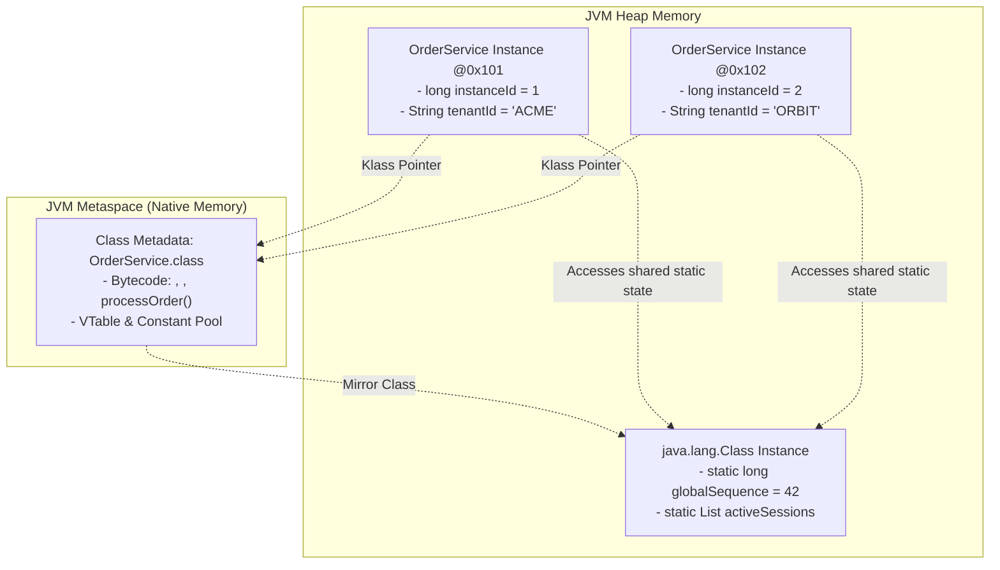
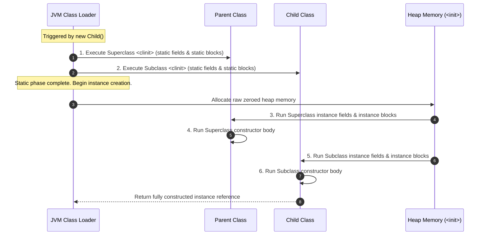

# Phase 02: Object-Oriented Programming
# Concept 002: Static State, Class Loading, and Initialization Order Hazards

---

## 1. Metadata & Header

| Field | Value |
| :--- | :--- |
| **Concept ID** | `P02-C002` |
| **Concept Title** | Static State, Class Loading, and Initialization Order Hazards |
| **Curriculum Phase** | Phase 02: Object-Oriented Programming |
| **Roadmap Topics Covered** | `static` members and class-level state; Initialization blocks and initialization order; Object lifecycle and object references |
| **Direct Prerequisites** | `P01-C003` (Reference Types vs Primitives), `P01-C004` (Variable Scopes & Lifetimes), `P02-C001` (Classes, Objects, Fields, and Constructor Chaining) |
| **Downstream Dependencies** | `P02-C003` (Access Modifiers & Encapsulation), `P02-C004` (Four Pillars of OOP), `P02-C010` (Enums as Singletons), `P08-C001` (JVM Class Loading) |
| **Delivery Date** | 2026-10-30 |
| **Author / Status** | Antigravity Engine / Complete |

---

## 2. Conceptual Anchor: Concept Overview & Mental Model

In Java backend systems, understanding the boundary between **instance state** and **static state** is the difference between scalable microservices and catastrophic race conditions, memory leaks, or unbootable application contexts.

An **instance member** belongs to a specific object allocated on the JVM Heap. A **static member** (field or method) belongs to the **Class metadata** loaded by a `ClassLoader` and resides in memory across the entire lifespan of that ClassLoader.

### The JavaScript/MERN Transition Gap: Module Scope vs Static State

If your background is in Node.js, JavaScript, or TypeScript, the concept of static members is often conflated with ES module-level exports:

```
JavaScript (ES Modules & Prototypes):
// In Node.js / ES6, module-level variables are scoped to the file module:
let requestCounter = 0; // Module-scoped closure variable
export class Service {
    static globalId = "SVC-01"; // Property attached to the Constructor Function object
}
* In JS, `static` properties are properties attached directly to the Function/Constructor object.
* Node.js module variables exist per file execution context (cached in `require.cache`).
* Single-threaded event loop means concurrent mutations don't cause CPU data races (though async interleaving occurs).

Java (Strict Multi-Threaded Nominal Class Loading):
public class Service {
    private static int requestCounter = 0; // Class-level field shared across all threads
    public static final String GLOBAL_ID = "SVC-01"; // Inlined compile-time constant
}
* In Java, static fields are attached to the `java.lang.Class` instance created in the JVM Heap.
* Static state is shared across EVERY thread in the JVM accessing that ClassLoader.
* Any unsynchronized mutation of static state causes memory visibility hazards, data corruption, and race conditions.
* Static initialization runs synchronously under a JVM-internal Class Initialization Lock.
```



---

## 3. Historical Context & The "Why"

When Java was conceived in the mid-1990s, pure object-oriented languages like Smalltalk mandated that *everything* must be an object instance, and sending messages was the only computational mechanism. While philosophically pure, this created crippling inefficiencies for:
1. **Mathematical & Utility Functions:** Forcing a developer to instantiate `new Math()` just to compute `Math.sqrt(x)` created excessive object allocation and GC pressure.
2. **Global System Constants:** Values like `Integer.MAX_VALUE` or `StandardCharsets.UTF_8` naturally belong to the domain type, not to any single instance.
3. **Application Bootstrapping:** The JVM requires an entry point (`public static void main`) that can be executed *before* any objects exist in heap memory.

Java adopted the `static` keyword from C++ to designate members that exist independently of any instance. Over three decades, Java evolved the capabilities of `static`:
- **Java 1.1:** Added static nested classes and static initializer blocks (`static { ... }`).
- **Java 1.4:** Introduced assertion controls and optimized class literal loading (`Foo.class`).
- **Java 5:** Added `import static` to eliminate repetitive class qualification for constants and utility functions.
- **Java 8:** Permitted `static` methods in **Interfaces**, transforming interfaces into complete API definitions with built-in factories (e.g., `Comparator.comparing()`).
- **Java 9+:** Leveraged interface static factory methods across the standard library (e.g., `List.of()`, `Set.of()`, `Map.of()`).

---

## 4. Deep Technical Architecture & JVM Execution Flow

### 4.1 When Does Class Initialization Happen? (JLS §12.4.1)

A Java class is **NOT** initialized when the JVM starts, nor when its `.class` file is first discovered on the classpath. Under JLS §12.4.1, a class $T$ is initialized immediately before the first occurrence of any of the following:

1. **Instance Creation:** An instance of $T$ is created via `new T()`, reflection (`Class.newInstance()`), or deserialization.
2. **Static Method Invocation:** A `static` method declared by $T$ is called (e.g., `T.execute()`).
3. **Static Field Assignment:** A non-constant `static` field declared by $T$ is assigned a value (e.g., `T.count = 5`).
4. **Static Field Usage:** A non-constant `static` field declared by $T$ is read (e.g., `long val = T.count`).
5. **Class Literal Reflection:** The class is initialized via `Class.forName("com.example.T")` with `initialize = true`.
6. **Subclass Initialization:** A direct subclass of $T$ is initialized (which triggers initialization of all superclasses top-down).

> [!IMPORTANT]
> **The Constant Inlining Exception (JLS §13.1):** Reading a `static final` field initialized to a **compile-time constant expression** (primitive literals or string literals) **DOES NOT** trigger class initialization! The compiler copies the value directly into the consuming bytecode (inlining).

### 4.2 The `<clinit>` vs `<init>` Bytecode Distinction

The Java compiler synthesizes two distinct special methods in class files:

| Method | Bytecode Name | Trigger Mechanism | Frequency | Execution Context |
| :--- | :--- | :--- | :--- | :--- |
| **Class Initializer** | `<clinit>` | Triggered once by JVM class loading/initialization sequence. | Exactly **once** per ClassLoader. | Synchronized by JVM internal initialization lock. No `this` reference. |
| **Instance Initializer** | `<init>` | Triggered by `new`, constructor chaining (`this()`), or super constructors (`super()`). | Runs **every time** a new instance is allocated. | Executes on newly allocated heap memory with `this` in slot 0 (`aload_0`). |

### 4.3 The Strict 6-Phase Initialization Order Hierarchy

When a class extending a superclass is instantiated for the first time, the JVM strictly executes the following sequence:

```
  +===========================================================================+
  |              PHASE 1: STATIC INITIALIZATION (RUNS EXACTLY ONCE)           |
  |===========================================================================|
  |  1. Superclass static variable initializers & static blocks               |
  |     (in textual order of declaration in the source code)                  |
  |  2. Subclass static variable initializers & static blocks                 |
  |     (in textual order of declaration in the source code)                  |
  +===========================================================================+
                                        |
                                        v
  +===========================================================================+
  |             PHASE 2: INSTANCE INITIALIZATION (RUNS FOR EVERY INSTANCE)    |
  |===========================================================================|
  |  3. Superclass instance field initializers & instance blocks              |
  |     (in textual order of declaration in the source code)                  |
  |  4. Superclass constructor body (<init>)                                  |
  |  5. Subclass instance field initializers & instance blocks                |
  |     (in textual order of declaration in the source code)                  |
  |  6. Subclass constructor body (<init>)                                    |
  +===========================================================================+
```



### 4.4 Thread-Safe Class Initialization: The Bill Pugh Singleton Idiom

Under JVMS §5.5, the JVM maintains a unique initialization lock for every loaded class. Multiple concurrent threads attempting to trigger class initialization simultaneously are blocked; exactly one thread executes `<clinit>`, and memory barriers ensure all static writes are safely published across all CPU caches.

This architectural guarantee enables the **Bill Pugh Initialization-on-Demand Holder Idiom**, which achieves completely lazy, zero-overhead, lock-free, thread-safe singleton initialization:

```java
public class DatabaseConnectionPool {

    // Private constructor prevents external instantiation
    private DatabaseConnectionPool() {
        System.out.println("Initializing expensive connection pool...");
    }

    // Static nested class is NOT loaded when DatabaseConnectionPool is referenced!
    // It is ONLY loaded and initialized on the first call to getInstance().
    private static final class Holder {
        static final DatabaseConnectionPool INSTANCE = new DatabaseConnectionPool();
    }

    public static DatabaseConnectionPool getInstance() {
        return Holder.INSTANCE; // Trigger Holder.<clinit> under JVM initialization lock
    }
}
```

---

## 5. Comprehensive Code Example: Distributed Cluster Registry

The following production-grade implementation demonstrates:
- Static class-level metrics and system coordination.
- Robust static initializer blocks with defensive error handling.
- Mixed static and instance initialization order verification.
- Safe thread access to static tracking state.

```java
package com.example.cluster;

import java.time.Instant;
import java.util.Objects;
import java.util.concurrent.atomic.AtomicLong;

/**
 * ClusterNode demonstrates static class-level orchestration,
 * instance lifecycle tracking, and verified initialization sequences.
 */
public class ClusterNode {

    // =========================================================================
    // 1. STATIC MEMBERS (CLASS-LEVEL STATE)
    // =========================================================================

    public static final String CLUSTER_VERSION = "2026.1.0"; // Compile-time constant (inlined)
    private static final AtomicLong NODE_SEQUENCE_GENERATOR = new AtomicLong(1000L);
    private static final String REGION;
    private static final long BOOT_TIMESTAMP_MS;

    // Static Initialization Block (<clinit>)
    static {
        System.out.println("[Static Init] Initializing ClusterNode class metadata...");
        String configuredRegion = System.getProperty("cluster.region");
        if (configuredRegion == null || configuredRegion.isBlank()) {
            REGION = "us-east-1"; // Fallback default
        } else {
            REGION = configuredRegion.trim().toLowerCase();
        }
        BOOT_TIMESTAMP_MS = System.currentTimeMillis();
        System.out.println("[Static Init] Region locked to: " + REGION + ", Boot Time: " + BOOT_TIMESTAMP_MS);
    }

    // =========================================================================
    // 2. INSTANCE MEMBERS (OBJECT-LEVEL STATE)
    // =========================================================================

    private final long nodeId;
    private final String nodeName;
    private final Instant registeredAt;
    private volatile boolean healthy;

    // Instance Initialization Block (Inlined into every constructor after super())
    {
        // Generates monotonic ID across all cluster instances
        this.nodeId = NODE_SEQUENCE_GENERATOR.getAndIncrement();
        this.registeredAt = Instant.now();
        this.healthy = true;
        System.out.println("[Instance Init Block] Allocated node sequence ID: " + this.nodeId);
    }

    // =========================================================================
    // 3. CONSTRUCTORS
    // =========================================================================

    public ClusterNode(String nodeName) {
        this.nodeName = Objects.requireNonNull(nodeName, "nodeName must not be null");
        if (nodeName.isBlank()) {
            throw new IllegalArgumentException("nodeName must not be blank");
        }
        System.out.println("[Constructor Body] Node constructed: " + this.nodeName + " (ID: " + this.nodeId + ")");
    }

    // =========================================================================
    // 4. STATIC UTILITY METHODS
    // =========================================================================

    public static String getClusterRegion() {
        return REGION;
    }

    public static long getClusterBootTimestamp() {
        return BOOT_TIMESTAMP_MS;
    }

    public static long getTotalNodesAllocated() {
        return NODE_SEQUENCE_GENERATOR.get() - 1000L;
    }

    // =========================================================================
    // 5. INSTANCE METHODS
    // =========================================================================

    public long getNodeId() { return nodeId; }
    public String getNodeName() { return nodeName; }
    public Instant getRegisteredAt() { return registeredAt; }
    public boolean isHealthy() { return healthy; }

    public void setHealthy(boolean healthy) {
        this.healthy = healthy;
    }

    @Override
    public String toString() {
        return String.format(
            "ClusterNode[id=%d, name='%s', region='%s', healthy=%b]",
            nodeId, nodeName, REGION, healthy
        );
    }
}
```

---

## 6. Edge Cases, Traps, and Compiler Mechanics

### 6.1 The Illegal Forward Reference Trap (JLS §8.3.3)
In static and instance initializers, you cannot read a field before its textual declaration if the access is unqualified:

```java
public class ForwardReferenceTrap {
    static {
        // System.out.println(count); // COMPILE ERROR: illegal forward reference
        System.out.println(ForwardReferenceTrap.count); // ALLOWED, but prints 0 (default value)!
    }
    static int count = 42;
}
```
*Compiler Rule:* Unqualified reads to fields textually declared later are illegal to prevent uninitialized reads. However, qualifying the access (`ForwardReferenceTrap.count`) bypasses the compiler's textual check, causing you to observe the JVM's raw zero-initialized default value (`0`), which leads to insidious bugs.

### 6.2 Circular Static Initialization Deadlock & Default Value Exposure

When two classes statically reference each other during their respective `<clinit>` executions, two catastrophic outcomes can occur:

#### 1. Silent Default Value Exposure:
```java
class ClassA {
    public static final int VALUE_A = ClassB.VALUE_B + 10; // Trigger ClassB.<clinit>
}

class ClassB {
    public static final int VALUE_B = ClassA.VALUE_A + 20; // References ClassA (currently initializing!)
}
```
- If a thread accesses `ClassA.VALUE_A`:
  1. `ClassA` begins `<clinit>`.
  2. To compute `VALUE_A`, it reads `ClassB.VALUE_B`.
  3. `ClassB` begins `<clinit>`.
  4. To compute `VALUE_B`, it reads `ClassA.VALUE_A`.
  5. Because the current thread already owns the lock on `ClassA`, the JVM allows it to read `ClassA.VALUE_A` immediately.
  6. **Bug:** `ClassA.VALUE_A` has not finished initializing; its value is observed as its raw default: `0`!
  7. `ClassB.VALUE_B` is computed as $0 + 20 = 20$.
  8. `ClassB.<clinit>` completes.
  9. Control returns to `ClassA`, computing `VALUE_A` as $20 + 10 = 30$.
  10. **Result:** Invariants broken without throwing any compiler warning!

#### 2. Multi-Threaded Class Initialization Deadlock:
If Thread 1 triggers `ClassA` while Thread 2 simultaneously triggers `ClassB`, Thread 1 holds the initialization lock for A waiting for B, while Thread 2 holds the initialization lock for B waiting for A. **The JVM freezes in a permanent deadlock** that cannot be interrupted.

### 6.3 The Dreaded `ExceptionInInitializerError` & `NoClassDefFoundError` Cascade

If an unhandled runtime exception is thrown during `<clinit>` (inside a static variable initializer or `static { ... }` block):
1. The JVM wraps the exception and throws `java.lang.ExceptionInInitializerError`.
2. The JVM marks the class as **erroneous** (initialization failed).
3. **The Trap:** Any subsequent attempt to access that class by *any* thread will immediately fail with `java.lang.NoClassDefFoundError: Could not initialize class com.example.MyClass`.
4. The original root cause (e.g., a `NullPointerException` or bad property) is only printed in the *first* failure; all subsequent requests report `NoClassDefFoundError`, confusing developers into thinking a JAR file is missing from the classpath!

---

## 7. Cross-Cutting Concerns

### 7.1 Performance & Memory Leaks in Metaspace / Heap
- **Static Collection Memory Leaks:** A static collection (`public static final List<Order> CACHE = new ArrayList<>()`) is a GC root. Any object added to a static collection will **never** be garbage collected for the lifetime of the JVM unless explicitly cleared or using weak references.
- **ClassLoader Leaks in Web Containers:** In application servers (Tomcat, Jetty), storing application-scoped classes in static variables of shared system ClassLoaders prevents the web application's ClassLoader from being unloaded during redeployment, leaking entire Metaspace generations until `OutOfMemoryError: Metaspace` crashes the server.

### 7.2 Concurrency: The Fallacy of "Static is Thread-Safe"
Declaring a field `static` does **NOT** provide thread safety:
```java
public class UnsafeCounter {
    private static long count = 0; // DATA RACE: Shared mutable static state!

    public static void increment() {
        count++; // Bytecode: getstatic -> lconst_1 -> ladd -> putstatic (NOT ATOMIC)
    }
}
```
If multiple threads invoke `increment()`, race conditions guarantee lost updates. Mutable static fields must be guarded by synchronization, explicit locks, or atomic types (`AtomicLong`, `LongAdder`).

---

## 8. Testing & Verification Strategies

The following standalone verification program validates the exact 6-phase initialization order, constant inlining avoidance of class loading, static state aggregation across instances, and the Bill Pugh thread-safe holder pattern:

```java
package com.example.test;

import java.util.ArrayList;
import java.util.List;

public class StaticInitializationVerificationTest {

    // Trace list recording exact chronological execution events
    public static final List<String> EXECUTION_TRACE = new ArrayList<>();

    // Hierarchy classes to verify the 6-phase order
    static class BaseComponent {
        static String staticBaseField = recordEvent("1. Base Static Field");
        static { recordEvent("2. Base Static Block"); }

        String instanceBaseField = recordEvent("5. Base Instance Field");
        { recordEvent("6. Base Instance Block"); }

        BaseComponent() {
            recordEvent("7. Base Constructor Body");
        }
    }

    static class SubComponent extends BaseComponent {
        static String staticSubField = recordEvent("3. Sub Static Field");
        static { recordEvent("4. Sub Static Block"); }

        String instanceSubField = recordEvent("8. Sub Instance Field");
        { recordEvent("9. Sub Instance Block"); }

        SubComponent() {
            recordEvent("10. Sub Constructor Body");
        }
    }

    // Class to verify compile-time constant inlining
    static class LazyLoadedClass {
        public static final String COMPILE_TIME_CONSTANT = "INLINED_LITERAL";
        public static final String COMPUTED_CONSTANT = "PREFIX_" + System.currentTimeMillis();

        static {
            recordEvent("LazyLoadedClass.<clinit> EXECUTED");
        }
    }

    // Bill Pugh Singleton for lazy holder verification
    static class SafeSingleton {
        private static boolean initialized = false;

        private SafeSingleton() {
            initialized = true;
        }

        private static class Holder {
            static final SafeSingleton INSTANCE = new SafeSingleton();
        }

        public static SafeSingleton getInstance() {
            return Holder.INSTANCE;
        }

        public static boolean isInitialized() {
            return initialized;
        }
    }

    private static String recordEvent(String event) {
        EXECUTION_TRACE.add(event);
        return event;
    }

    public static void main(String[] args) {
        System.out.println("Starting Static State & Initialization Verification Tests...\n");

        testInitializationOrderHierarchy();
        testCompileTimeConstantInlining();
        testBillPughLazySingleton();

        System.out.println("\n--------------------------------------------------");
        System.out.println("ALL STATIC INITIALIZATION VERIFICATION TESTS PASSED.");
        System.out.println("--------------------------------------------------");
    }

    private static void testInitializationOrderHierarchy() {
        EXECUTION_TRACE.clear();
        System.out.println("Instantiating SubComponent...");
        new SubComponent();

        List<String> expectedOrder = List.of(
            "1. Base Static Field",
            "2. Base Static Block",
            "3. Sub Static Field",
            "4. Sub Static Block",
            "5. Base Instance Field",
            "6. Base Instance Block",
            "7. Base Constructor Body",
            "8. Sub Instance Field",
            "9. Sub Instance Block",
            "10. Sub Constructor Body"
        );

        if (!expectedOrder.equals(EXECUTION_TRACE)) {
            System.err.println("FAIL: Initialization Order Mismatch!");
            System.err.println("Expected: " + expectedOrder);
            System.err.println("Actual:   " + EXECUTION_TRACE);
            System.exit(1);
        }
        System.out.println("PASS: 10-Step Initialization Hierarchy Order strictly verified.");

        // Verify that second instantiation ONLY runs instance phases (static already done)
        EXECUTION_TRACE.clear();
        new SubComponent();
        List<String> secondInstanceExpected = List.of(
            "5. Base Instance Field",
            "6. Base Instance Block",
            "7. Base Constructor Body",
            "8. Sub Instance Field",
            "9. Sub Instance Block",
            "10. Sub Constructor Body"
        );

        if (!secondInstanceExpected.equals(EXECUTION_TRACE)) {
            System.err.println("FAIL: Second instantiation ran static initializers again!");
            System.exit(1);
        }
        System.out.println("PASS: Static initializers confirmed to execute exactly ONCE per class lifecycle.");
    }

    private static void testCompileTimeConstantInlining() {
        EXECUTION_TRACE.clear();
        // Accessing compile-time literal constant MUST NOT trigger <clinit>
        String constant = LazyLoadedClass.COMPILE_TIME_CONSTANT;
        if (!constant.equals("INLINED_LITERAL")) {
            System.err.println("FAIL: Constant value incorrect");
            System.exit(1);
        }
        if (EXECUTION_TRACE.contains("LazyLoadedClass.<clinit> EXECUTED")) {
            System.err.println("FAIL: Reading compile-time constant triggered <clinit>!");
            System.exit(1);
        }
        System.out.println("PASS: Compile-time constant inlined without triggering class initialization.");

        // Now access non-inlined field, which MUST trigger <clinit>
        String computed = LazyLoadedClass.COMPUTED_CONSTANT;
        if (!EXECUTION_TRACE.contains("LazyLoadedClass.<clinit> EXECUTED")) {
            System.err.println("FAIL: Non-compile-time field failed to trigger <clinit>!");
            System.exit(1);
        }
        System.out.println("PASS: Non-constant field triggered class initialization correctly.");
    }

    private static void testBillPughLazySingleton() {
        if (SafeSingleton.isInitialized()) {
            System.err.println("FAIL: Singleton prematurely initialized!");
            System.exit(1);
        }
        System.out.println("PASS: Holder class uninitialized before getInstance().");

        SafeSingleton s1 = SafeSingleton.getInstance();
        SafeSingleton s2 = SafeSingleton.getInstance();

        if (s1 != s2) {
            System.err.println("FAIL: Singleton returned distinct references!");
            System.exit(1);
        }
        if (!SafeSingleton.isInitialized()) {
            System.err.println("FAIL: Singleton failed to flag initialization");
            System.exit(1);
        }
        System.out.println("PASS: Bill Pugh Holder initialized exactly one singleton instance.");
    }
}
```

---

## 9. Modern Java & Spring Boot Context

### 9.1 Why Spring Opposes Mutable Static State
In a modern Spring Boot application, **mutable static state is an anti-pattern**:
1. **Container Bypass:** Static fields bypass Spring’s Inversion of Control (IoC) and dependency lifecycle management. Spring cannot inject mocks, cannot proxy beans for transactions (`@Transactional`), and cannot manage scope (Request, Session, Tenant).
2. **Spring Singletons vs Java Static:** A *Spring Singleton* is an object instance managed by the `ApplicationContext` (one instance per container). A *Java Static Member* is attached to the ClassLoader (one per class). In multi-context or integration test setups, multiple Spring contexts share the same Java static field, causing cross-test data pollution.

### 9.2 The Canonical Utility Class Pattern
When creating static utility classes (e.g., `StringUtils`, `MathUtils`), enforce non-instantiability by declaring a `private` constructor that throws `UnsupportedOperationException`:

```java
public final class SecurityUtils {

    // Suppress default public constructor to prevent instantiation
    private SecurityUtils() {
        throw new UnsupportedOperationException("Utility class cannot be instantiated");
    }

    public static boolean constantTimeEquals(byte[] a, byte[] b) {
        // Safe static utility logic
        return java.security.MessageDigest.isEqual(a, b);
    }
}
```

---

## 10. Comparison Matrix: Concepts, Runtimes, and Paradigms

| Dimension | Java `static` Member | JavaScript Module / ES6 `static` | C++ `static` Member |
| :--- | :--- | :--- | :--- |
| **Storage Location** | `java.lang.Class` instance on Heap / Metaspace metadata. | V8 heap property on Constructor Object. | Data segment / BSS segment in native memory. |
| **Initialization Timing** | Lazily upon first active use (JLS §12.4.1). | Eagerly during module evaluation / script parse. | Zero-initialized at program launch; dynamic at runtime. |
| **Thread Synchronization** | Synchronized by JVM Class Initialization Lock. | N/A (Single-threaded event loop). | Undefined unless protected by `std::call_once`. |
| **Inheritance & Polymorphism** | Inherited by subclasses, but **cannot be overridden** (only shadowed/hidden). | Inherited via prototype chain (`Sub.__proto__ === Super`). | Inherited, cannot be virtual. |
| **Mockability in Unit Tests** | Difficult without heavy bytecode instrumentation (Mockito-inline). | Trivial (modules and objects are dynamic dictionaries). | Difficult without template metaprogramming or link-time seams. |

---

## 11. Common Anti-Patterns & Refactoring

### Anti-Pattern 1: The Broken Double-Checked Locking Singleton
Prior to understanding the Bill Pugh holder pattern, developers attempted to implement lazy singletons using flawed double-checked locking without `volatile`:

```java
// BROKEN: Allows partially constructed instance to escape!
public class BrokenSingleton {
    private static BrokenSingleton instance; // Missing 'volatile'!

    public static BrokenSingleton getInstance() {
        if (instance == null) {
            synchronized (BrokenSingleton.class) {
                if (instance == null) {
                    // CPU instruction reordering can publish 'instance' pointer
                    // BEFORE constructor body completes!
                    instance = new BrokenSingleton();
                }
            }
        }
        return instance;
    }
}
```

```java
// REFACTORED: The Modern Bill Pugh Solution (Zero locks, 100% thread-safe)
public class ModernSingleton {
    private ModernSingleton() {}

    private static class InstanceHolder {
        static final ModernSingleton INSTANCE = new ModernSingleton();
    }

    public static ModernSingleton getInstance() {
        return InstanceHolder.INSTANCE; // JVM <clinit> lock guarantees safe publication
    }
}
```

### Anti-Pattern 2: The Static Cache Memory Sink
```java
// BAD: Unbounded static cache leaking memory
public class CustomerService {
    private static final Map<String, Customer> CACHE = new HashMap<>(); // Leaks memory indefinitely!
}
```
- **Refactoring:** Use an eviction-based cache (such as Caffeine with `maximumSize` and `expireAfterWrite`) injected as a Spring singleton bean, rather than a raw static `Map`.

---

## 12. Comprehensive Troubleshooting & Debugging Guide

### Diagnostic Procedure: Tracking Class Loading and Initialization in HotSpot

To observe exactly when classes are loaded and initialized by HotSpot, run the JVM with unified logging:

```bash
# Enable unified class loading logs in Java 9-21+
java -Xlog:class+load=info -cp bin com.example.Main

# Observe HotSpot class initialization ordering
java -Xlog:class+init=info -cp bin com.example.Main
```

### Common Failure Symptoms & Solutions

| Error / Symptom | Root Cause | Exact Remediation |
| :--- | :--- | :--- |
| `java.lang.ExceptionInInitializerError` | An unhandled exception was thrown during execution of a static variable initializer or `static { ... }` block. | Inspect the `Caused by:` root exception in the stack trace. Wrap risky initialization code in `try-catch` inside the static block and log thoroughly. |
| `java.lang.NoClassDefFoundError: Could not initialize class X` | A previous attempt to initialize class `X` failed with `ExceptionInInitializerError`. | Fix the root cause that failed the *first* initialization attempt. Look higher up in your application logs. |
| Stale data in integration tests | A mutable static field modified by Test Suite A is observed by Test Suite B. | Eliminate mutable static state. If unavoidable, annotate test classes with `@DirtiesContext` or reset static state in a `@BeforeEach` teardown method. |
| JVM hangs during boot | Multi-threaded circular class initialization deadlock between two classes referencing each other in `<clinit>`. | Decouple circular dependencies. Ensure static initialization does not invoke external classes that depend on the uninitialized class. |

---

## 13. Frequently Asked Interview Questions

### Q1: Can you override a `static` method in Java?
**Answer:** No. Method overriding relies on **dynamic method dispatch** (runtime polymorphism via the virtual method table / vtable) based on the runtime type of the target object on the Heap. `static` methods are bound at compile time based on the static type of the reference variable (`invokestatic` bytecode instruction). If a subclass declares a static method with the same signature, it merely **shadows** (hides) the parent’s static method; it does not override it.

### Q2: Why does `Class.forName("com.mysql.cj.jdbc.Driver")` work without creating an instance?
**Answer:** Calling `Class.forName(name)` (with default parameters) loads, links, and **initializes** the class. During the class initialization phase, the JVM executes the Driver's `<clinit>` method, which contains a `static { ... }` block that registers the driver with JDBC's `DriverManager.registerDriver(new Driver())`. The initialization of the class executes the registration side-effect without needing the caller to create or maintain an instance.

### Q3: What is the difference between a compile-time constant and a non-compile-time static final field regarding class loading?
**Answer:** A `static final` field whose initializer is a **compile-time constant expression** (such as a primitive or string literal, e.g., `static final int X = 10;`) is stored directly in the consuming class's constant pool during compilation. Accessing this field will **not** trigger class loading or `<clinit>` of the declaring class. Conversely, a `static final` field initialized via a method call or runtime expression (e.g., `static final int Y = Integer.parseInt("10");`) requires bytecode execution and therefore **will** trigger full class loading and initialization upon first access.

---

## 14. Deliberate Practice & Hands-On Exercises

### Exercise 1 (Beginner): Hardened Utility Class
- **Objective:** Create a `MathValidator` utility class.
- **Requirements:**
  1. Define static constants `MAX_ALLOWED = 10_000L` and `MIN_ALLOWED = -10_000L`.
  2. Implement a `static boolean isWithinBounds(long value)` method.
  3. Ensure the class cannot be instantiated by external callers or reflection (throw an exception from the private constructor).

### Exercise 2 (Intermediate): Resilient Configuration Loader
- **Objective:** Build an `AppConfig` class with static initializers that read environment variables.
- **Requirements:**
  1. Statically initialize `PORT` (int), `ENVIRONMENT` (String), and `MAX_CONNECTIONS` (int).
  2. If `PORT` is not a valid integer, gracefully catch the `NumberFormatException` in the static initializer block, log a fallback notice, and assign port `8080` without throwing `ExceptionInInitializerError`.

### Exercise 3 (Advanced): Circular Dependency Hazard Reproduction
- **Objective:** Write two classes, `ServiceA` and `ServiceB`, that reference each other during static initialization.
- **Requirements:**
  1. Write a test case demonstrating that accessing `ServiceA.ID` results in observing `ServiceB.DEP_ID` as `0` instead of its intended value.
  2. Refactor the design to eliminate the static circular dependency by injecting dependencies through constructors.

---

## 15. Mastery Checklist & Verification Gate

To consider this concept mastered, you must be able to check off every item:
- [x] State the 6 specific conditions under JLS §12.4.1 that trigger class initialization.
- [x] Explain the difference between `<clinit>` and `<init>` at the JVM bytecode level.
- [x] Trace the strict 6-phase initialization order across superclasses and subclasses from memory.
- [x] Explain why compile-time string/primitive constants do not trigger class loading.
- [x] Implement the thread-safe, lock-free Bill Pugh Singleton pattern using a static nested holder class.
- [x] Explain the relationship between `ExceptionInInitializerError` and subsequent `NoClassDefFoundError`.
- [x] Explain why mutable static state is an anti-pattern in modern Spring Boot architectures.

---

## 16. Authoritative Primary Sources & References

1. **Java Language Specification (Java SE 21 Edition):**
   - [JLS §8.3.2 - Field Initialization](https://docs.oracle.com/javase/specs/jls/se21/html/jls-8.html#jls-8.3.2)
   - [JLS §8.7 - Static Initializers](https://docs.oracle.com/javase/specs/jls/se21/html/jls-8.html#jls-8.7)
   - [JLS §12.4 - Initialization of Classes and Interfaces](https://docs.oracle.com/javase/specs/jls/se21/html/jls-12.html#jls-12.4)
   - [JLS §13.1 - The Form of a Binary (Compile-Time Constant Inlining)](https://docs.oracle.com/javase/specs/jls/se21/html/jls-13.html#jls-13.1)
2. **Java Virtual Machine Specification (Java SE 21 Edition):**
   - [JVMS §2.9.2 - Class Initialization Methods (`<clinit>`)](https://docs.oracle.com/javase/specs/jvms/se21/html/jvms-2.html#jvms-2.9.2)
   - [JVMS §5.5 - Initialization (The Detailed Initialization Procedure)](https://docs.oracle.com/javase/specs/jvms/se21/html/jvms-5.html#jvms-5.5)
3. **Brian Goetz et al.:** *Java Concurrency in Practice* (Section 16.2.3: "Safe Initialization Idioms").
