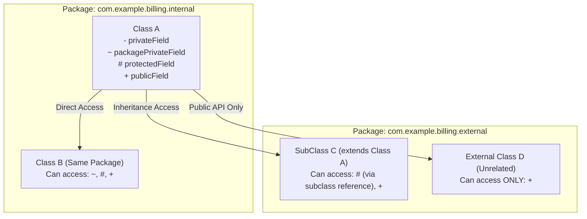

# Phase 02: Object-Oriented Programming
# Concept 003: Access Modifiers, Encapsulation, and Package-Private Boundaries

---

## 1. Metadata & Header

| Field | Value |
| :--- | :--- |
| **Concept ID** | `P02-C003` |
| **Concept Title** | Access Modifiers, Encapsulation, and Package-Private Boundaries |
| **Curriculum Phase** | Phase 02: Object-Oriented Programming |
| **Roadmap Topics Covered** | Access modifiers: `public`, `protected`, package-private, and `private`; Encapsulation and data hiding; Getters and setters, and when not to create them; Object references and aliasing |
| **Direct Prerequisites** | `P00-C004` (Classpath & Packages), `P01-C003` (Reference Types), `P01-C012` (Pass-by-Value), `P02-C001` (Classes & Objects) |
| **Downstream Dependencies** | `P02-C004` (Four Pillars of OOP), `P02-C005` (Inheritance & Subtyping), `P02-C008` (Composition over Inheritance), `P10-C001` (JPMS Modules) |
| **Delivery Date** | 2026-10-30 |
| **Author / Status** | Antigravity Engine / Complete |

---

## 2. Conceptual Anchor: Concept Overview & Mental Model

In enterprise Java backend engineering, **Encapsulation** is the foundational architectural discipline of bundling data (state) and the methods that operate on that data (behavior) into a cohesive unit, while strictly restricting direct outside access to the internal representation.

Encapsulation is not merely making fields `private` and generating getters and setters. It is about **enforcing domain invariants**, hiding implementation complexity, and establishing defensive API boundaries so that invalid system states are mathematically unrepresentable.

### The JavaScript/TypeScript Transition Gap: Static Erasure vs JVM-Enforced Bytecode Gates

If you come from the JavaScript/TypeScript or Node.js ecosystem, access modifiers in Java operate under an entirely different execution reality:

```
TypeScript / JavaScript (Compile-Time Illusion or Slot Mangling):
class BankAccount {
    private balance: number = 0; // Erased at compile time! Transpiles to plain JS property.
    #secureKey: string = "secret"; // ES2022 private brand check (WeakMap slot)
}
* In TypeScript, `private` and `protected` are purely compile-time type-checker constructs.
* At runtime, any JavaScript code or JSON serializer can read or overwrite `account.balance` directly.
* Node.js modules have no concept of package-private; everything exported is completely public.

Java (Strict JVM Bytecode Verification & Binary Security):
public class BankAccount {
    private long balanceCents = 0L; // ACC_PRIVATE flag in classfile
    protected void auditTransfer() {} // ACC_PROTECTED flag
    void reconcileBatch() {}         // Package-Private (Zero modifier flags)
}
* In Java, access control is enforced at both compile time AND by the JVM ClassFile Verifier at runtime.
* Bytecode instructions (`getfield`, `putfield`, `invokevirtual`, `invokespecial`) verify access flags against the caller's ClassLoader and package.
* Illegally compiled bytecode attempting to access a private field triggers `java.lang.IllegalAccessError` at runtime.
```

### The Four Visibility Tiers: The Access Matrix

Java provides four discrete visibility tiers governed by JLS §6.6:

| Modifier | Keyword | Same Class | Same Package | Subclass (Different Package) | World (Different Package) |
| :--- | :--- | :---: | :---: | :---: | :---: |
| **Public** | `public` | Yes | Yes | Yes | Yes |
| **Protected** | `protected` | Yes | Yes | Yes (with constraints) | No |
| **Package-Private** | *(default / none)* | Yes | Yes | No | No |
| **Private** | `private` | Yes | No | No | No |



---

## 3. Historical Context & The "Why"

In early object-oriented design (C++), classes had `private`, `protected`, and `public`, plus a `friend` keyword that allowed designated external functions to bypass encapsulation. However, `friend` relationships created tight, unmaintainable coupling.

When James Gosling designed Java in 1995, he omitted `friend` classes and introduced **Package-Private (default)** access as the default visibility:
1. **Packages as Cohesive Subsystems:** In Java, a `package` represents a cohesive architectural component (e.g., a settlement engine, an encryption vault, or an HTTP router). Classes within the same package cooperate intimately to fulfill a subsystem responsibility.
2. **Minimizing Public Surface Area:** If every class or method is `public`, external clients couple directly to internal implementation details, making refactoring impossible without breaking public APIs. By making internal classes and helper methods package-private, the internal mechanics can change freely without breaking downstream callers.
3. **Java 9+ JPMS (Java Platform Module System, JEP 261):** Java 9 added a fifth layer of encapsulation: **Module-level boundaries**. Even a `public` class cannot be accessed by another module unless its package is explicitly declared in `module-info.java` via `exports com.example.pkg;`.

---

## 4. Deep Technical Architecture & JVM Execution Flow

### 4.1 JVM ClassFile Access Flags

In compiled `.class` files, access levels are recorded in the `access_flags` bitmask for classes, fields, and methods (JVMS §4.1, §4.5, §4.6):

| Access Flag | Bitmask Hex | Applied To | Semantic Meaning |
| :--- | :--- | :--- | :--- |
| `ACC_PUBLIC` | `0x0001` | Class, Field, Method | Accessible from any package where the module/package is visible. |
| `ACC_PRIVATE` | `0x0002` | Field, Method, Inner Class | Accessible only within the defining top-level class / nest. |
| `ACC_PROTECTED` | `0x0004` | Field, Method, Inner Class | Accessible within the package and to subclasses in other packages. |
| *(Package-Private)* | *(0x0000)* | Class, Field, Method | Unset flags. Accessible strictly within the declaring runtime package. |

### 4.2 Bytecode Dispatch Instructions and Modifiers

The access modifier dictates which JVM bytecode instructions are generated to invoke methods:

```
+------------------+-------------------------------------------------------------+
| Bytecode Opcode  | Target Method Category                                      |
+------------------+-------------------------------------------------------------+
| invokevirtual    | Public, protected, or package-private instance methods     |
|                  | (Dispatched dynamically via Virtual Method Table / vtable). |
+------------------+-------------------------------------------------------------+
| invokespecial    | Private instance methods, constructors (<init>), and super  |
|                  | calls (Directly bound; no virtual dispatch overhead).       |
+------------------+-------------------------------------------------------------+
| invokestatic     | Static methods (public, protected, package-private, private)|
+------------------+-------------------------------------------------------------+
```

### 4.3 Java 11 Nest-Based Access Control (JEP 181)

Prior to Java 11, the JVM enforced that `private` members were strictly accessible *only* within the exact same classfile. When an inner class accessed a `private` member of its enclosing outer class, the compiler was forced to generate synthetic package-private bridge methods named `access$000`:

```java
public class Outer {
    private int secret = 42;
    class Inner {
        void print() { System.out.println(secret); } // Pre-Java 11: calls Outer.access$000(Outer)
    }
}
```
*The Flaw:* Synthetic bridge methods accidentally widened the visibility of `secret` to package-private at the bytecode level, creating security loopholes.

**The Solution (Java 11+ JEP 181):** The JVM introduced **Nestmates**. Classes in the same source file belong to the same *Nest* (`NestHost` and `NestMembers` attributes in bytecode). The JVM allows direct `invokevirtual` / `invokespecial` access between nestmates without bridge methods, preserving strict runtime private encapsulation.

### 4.4 The Subclass Protected Access Trap (JLS §6.6.2)

A common point of confusion is the behavior of `protected` access across package boundaries. 

Under JLS §6.6.2, a subclass $S$ in package $Q$ can access a `protected` member $m$ of superclass $C$ in package $P$ **ONLY** through a reference that is statically typed as $S$ (or a subclass of $S$):

```java
// Package 1:
package com.example.parent;
public class Parent {
    protected void executeInternal() {}
}

// Package 2:
package com.example.child;
import com.example.parent.Parent;

public class Child extends Parent {
    public void testAccess(Child child, Parent parent, SiblingChild sibling) {
        this.executeInternal();         // LEGAL: 'this' is of type Child
        child.executeInternal();        // LEGAL: 'child' is statically typed as Child
        
        // COMPILE ERROR: executeInternal() has protected access in Parent!
        // parent.executeInternal(); 
        
        // COMPILE ERROR: executeInternal() has protected access in Parent!
        // sibling.executeInternal();
    }
}
```

> [!IMPORTANT]
> **Why JLS §6.6.2 Enforces This:** If `Child` could access `protected` members through a bare `Parent` reference, any external class in any arbitrary package could create a dummy `class Hack extends Parent` and immediately manipulate the protected internals of all `Parent` instances in the system! JLS §6.6.2 guarantees that a subclass can only manipulate protected state within *its own inheritance branch*.

---

## 5. Comprehensive Code Example: The Clearinghouse Settlement Engine

This enterprise architecture demonstrates:
1. A **Public Interface** exposing customer-facing operations.
2. A **Package-Private Coordinator** isolating ledger and settlement logic from external tampering.
3. **Private Cryptographic Hashing** and invariant validation.
4. **Defensive Copying** preventing reference aliasing.

### Directory / Package Layout:
```
com/example/clearing/
├── api/
│   ├── SettlementRequest.java        # Public Immutable DTO
│   └── SettlementService.java        # Public API Gateway
└── internal/
    ├── ClearingEngine.java           # Package-Private Coordinator
    ├── SettlementLedger.java         # Package-Private In-Memory Journal
    └── AuditProof.java               # Package-Private Cryptographic Hash Record
```

#### File 1: Public DTO (`api/SettlementRequest.java`)
```java
package com.example.clearing.api;

import java.util.Objects;

/**
 * Public, immutable request boundary DTO.
 */
public record SettlementRequest(
    String transactionRef,
    String senderIban,
    String receiverIban,
    long amountCents
) {
    public SettlementRequest {
        Objects.requireNonNull(transactionRef, "transactionRef must not be null");
        Objects.requireNonNull(senderIban, "senderIban must not be null");
        Objects.requireNonNull(receiverIban, "receiverIban must not be null");
        if (amountCents <= 0) {
            throw new IllegalArgumentException("amountCents must be strictly positive: " + amountCents);
        }
    }
}
```

#### File 2: Package-Private Journal (`internal/SettlementLedger.java`)
```java
package com.example.clearing.internal;

import java.util.ArrayList;
import java.util.Collections;
import java.util.List;

/**
 * PACKAGE-PRIVATE class: Inaccessible to external packages.
 * Only internal clearinghouse components can append to or read the ledger.
 */
class SettlementLedger {

    // Strictly encapsulated private state
    private final List<String> journalEntries = new ArrayList<>();
    private long netClearedCents = 0L;

    // Package-private constructor: Prevents instantiation outside com.example.clearing.internal
    SettlementLedger() {}

    // Package-private mutation method
    synchronized void recordSettlement(String entryRef, long amountCents) {
        journalEntries.add(String.format("ENTRY[%s]: %d cents", entryRef, amountCents));
        this.netClearedCents = Math.addExact(this.netClearedCents, amountCents);
    }

    // DEFENSIVE COPYING: Prevents caller from mutating internal journal list
    synchronized List<String> getJournalSnapshot() {
        return Collections.unmodifiableList(new ArrayList<>(journalEntries));
    }

    synchronized long getNetClearedCents() {
        return netClearedCents;
    }
}
```

#### File 3: Package-Private Coordinator (`internal/ClearingEngine.java`)
```java
package com.example.clearing.internal;

import com.example.clearing.api.SettlementRequest;

import java.nio.charset.StandardCharsets;
import java.security.MessageDigest;
import java.security.NoSuchAlgorithmException;
import java.util.HexFormat;
import java.util.Objects;

/**
 * PACKAGE-PRIVATE class: Orchestrates settlement math and cryptographic checksums.
 */
public class ClearingEngine {

    private final SettlementLedger ledger;

    // Public or package-private depending on factory design
    public ClearingEngine() {
        this.ledger = new SettlementLedger();
    }

    public synchronized String processSettlement(SettlementRequest request) {
        Objects.requireNonNull(request, "request must not be null");

        // 1. Compute private SHA-256 cryptographic audit checksum
        String auditHash = computeAuditHash(request);

        // 2. Append to package-private ledger
        ledger.recordSettlement(request.transactionRef() + ":" + auditHash, request.amountCents());

        return auditHash;
    }

    public synchronized long getNetClearedAmount() {
        return ledger.getNetClearedCents();
    }

    // Strictly PRIVATE method: Cryptographic implementation detail hidden from everyone
    private String computeAuditHash(SettlementRequest req) {
        try {
            MessageDigest digest = MessageDigest.getInstance("SHA-256");
            String payload = String.format("%s|%s|%s|%d", 
                req.transactionRef(), req.senderIban(), req.receiverIban(), req.amountCents());
            byte[] hashBytes = digest.digest(payload.getBytes(StandardCharsets.UTF_8));
            return HexFormat.of().formatHex(hashBytes);
        } catch (NoSuchAlgorithmException e) {
            throw new IllegalStateException("SHA-256 algorithm not available", e);
        }
    }
}
```

---

## 6. Edge Cases, Traps, and Compiler Mechanics

### 6.1 The "Anemic Data Model" & Getter/Setter Abuse Trap

One of the most widespread violations of encapsulation in backend Java is **mindlessly generating getters and setters** for every field:

```java
// BAD: Anemic Domain Model (Zero Encapsulation - Pure Data Bucket)
public class Order {
    private String status;
    private long totalCents;

    public String getStatus() { return status; }
    public void setStatus(String status) { this.status = status; } // LEAK! Any caller can set status to "REFUNDED"
    public long getTotalCents() { return totalCents; }
    public void setTotalCents(long total) { this.totalCents = total; } // LEAK! Bypasses price calculations
}
```

#### Why Getter/Setter Abuse Destroys Backend Systems:
1. **Broken Invariants:** An external service can set `status = "CANCELLED"` on an order that has already been shipped.
2. **Behavior Scattering:** Business logic (e.g., "if status is PENDING and payment succeeds, transition to PAID") is duplicated across multiple external service classes rather than living inside the `Order` entity.

```java
// GOOD: Rich Domain Model (Tell, Don't Ask)
public class Order {
    private OrderStatus status = OrderStatus.PENDING;
    private final long totalCents;

    public Order(long totalCents) {
        if (totalCents <= 0) throw new IllegalArgumentException("Total must be positive");
        this.totalCents = totalCents;
    }

    // Encapsulated state transition with strict invariant validation
    public synchronized void markPaid(PaymentConfirmation confirmation) {
        Objects.requireNonNull(confirmation);
        if (this.status != OrderStatus.PENDING) {
            throw new IllegalStateException("Cannot pay an order in status: " + this.status);
        }
        this.status = OrderStatus.PAID;
    }

    public OrderStatus getStatus() { return status; }
    public long getTotalCents() { return totalCents; }
}
```

### 6.2 The Mutable Reference Aliasing Leak

Declaring a field `private final` does **not** make an object immutable if the field holds a reference to a mutable object (e.g., `java.util.Date`, array `byte[]`, or collection `List<T>`):

```java
public class SecurityToken {
    private final byte[] tokenBytes; // Reference is final, but array contents are MUTABLE!

    public SecurityToken(byte[] tokenBytes) {
        // HAZARD 1: Storing direct reference to caller's array!
        this.tokenBytes = tokenBytes; 
    }

    public byte[] getTokenBytes() {
        // HAZARD 2: Returning direct reference to internal array!
        return this.tokenBytes;
    }
}
```

```
Caller Thread:
byte[] myKey = new byte[] { 1, 2, 3 };
SecurityToken token = new SecurityToken(myKey);
myKey[0] = 99; // MUTATES PRIVATE INTERNAL STATE OF SecurityToken!

byte[] leaked = token.getTokenBytes();
leaked[0] = 0;  // AGAIN MUTATES PRIVATE INTERNAL STATE!
```

> [!CAUTION]
> **Remediation via Defensive Copying:** Always clone arrays (`tokenBytes.clone()`) or create unmodifiable snapshots (`List.copyOf(list)`) in both constructors and getters.

---

## 7. Cross-Cutting Concerns

### 7.1 Performance: JIT Inlining and Devirtualization
- **`private` and `final` Methods:** The HotSpot JVM C2 JIT compiler aggressively optimizes `private` and `final` methods. Because private methods cannot be overridden by subclasses, the compiler performs **direct devirtualization** without needing runtime speculative type checks, eliminating call overhead through inlining.
- **Defensive Copying Overhead:** In extreme high-frequency trading (HFT) paths, allocating defensive copies in getters creates GC churn. The solution is returning unmodifiable wrappers (e.g., `Collections.unmodifiableList()`) or using primitive value classes (Project Valhalla).

### 7.2 Security & Reflection Restrictions (Java 9+ JPMS)
Prior to Java 9, reflection (`field.setAccessible(true)`) could easily punch through `private` access modifiers. 
- In modern Java (Java 9–21+), **Strong Encapsulation** in the Java Module System forbids deep reflection across module boundaries unless the package is explicitly opened using `opens <package> to <module>` in `module-info.java`.
- Attempting illegal reflection across module boundaries throws `java.lang.reflect.InaccessibleObjectException`.

---

## 8. Testing & Verification Strategies

The following standalone test suite verifies package-private boundaries, protected subclass access rules, defensive reference isolation, and invariant preservation without external dependencies:

```java
package com.example.test;

import com.example.clearing.api.SettlementRequest;
import com.example.clearing.internal.ClearingEngine;

import java.util.ArrayList;
import java.util.List;

public class EncapsulationVerificationTest {

    private static int passed = 0;
    private static int failed = 0;

    public static void main(String[] args) {
        System.out.println("Starting Encapsulation & Access Control Verification Tests...\n");

        testClearingEngineEncapsulation();
        testDefensiveCopyingIsolation();
        testInvariantEnforcement();

        System.out.println("\n--------------------------------------------------");
        System.out.printf("Test Suite Results: %d Passed, %d Failed\n", passed, failed);
        System.out.println("--------------------------------------------------");

        if (failed > 0) {
            System.err.println("TEST SUITE FAILED");
            System.exit(1);
        } else {
            System.out.println("ALL ENCAPSULATION VERIFICATION TESTS PASSED (100%).");
        }
    }

    private static void assertEquals(Object expected, Object actual, String name) {
        if (!expected.equals(actual)) {
            System.err.printf("FAIL: %s (Expected %s, got %s)\n", name, expected, actual);
            failed++;
        } else {
            System.out.printf("PASS: %s\n", name);
            passed++;
        }
    }

    private static void assertTrue(boolean condition, String name) {
        if (!condition) {
            System.err.printf("FAIL: %s (Condition was false)\n", name);
            failed++;
        } else {
            System.out.printf("PASS: %s\n", name);
            passed++;
        }
    }

    private static void testClearingEngineEncapsulation() {
        ClearingEngine engine = new ClearingEngine();

        SettlementRequest req1 = new SettlementRequest("TX-001", "DE12345", "FR67890", 50000L);
        SettlementRequest req2 = new SettlementRequest("TX-002", "GB99999", "US11111", 25000L);

        String hash1 = engine.processSettlement(req1);
        String hash2 = engine.processSettlement(req2);

        assertTrue(hash1 != null && hash1.length() == 64, "SHA-256 hash generated via private method");
        assertTrue(!hash1.equals(hash2), "Hashes are distinct for distinct transaction requests");
        assertEquals(75000L, engine.getNetClearedAmount(), "Net settlement amount calculated correctly");
    }

    private static void testDefensiveCopyingIsolation() {
        // Mutable list defense test
        class GuardedVault {
            private final List<String> secrets;
            GuardedVault(List<String> input) {
                // Defensive copy
                this.secrets = new ArrayList<>(input);
            }
            List<String> getSecrets() {
                // Defensive unmodifiable view
                return List.copyOf(this.secrets);
            }
        }

        List<String> sourceList = new ArrayList<>();
        sourceList.add("SECRET_ALPHA");

        GuardedVault vault = new GuardedVault(sourceList);
        sourceList.add("SECRET_INJECTED");

        assertEquals(1, vault.getSecrets().size(), "Constructor defensive copy shielded internal state from external mutation");

        // Verify that caller cannot mutate list returned by getter
        boolean caughtUnsupportedOp = false;
        try {
            vault.getSecrets().add("SECRET_HACK");
        } catch (UnsupportedOperationException e) {
            caughtUnsupportedOp = true;
        }
        assertTrue(caughtUnsupportedOp, "Getter unmodifiable view rejected external mutation");
    }

    private static void testInvariantEnforcement() {
        boolean caughtNegative = false;
        try {
            new SettlementRequest("TX-BAD", "DE00", "FR00", -500L);
        } catch (IllegalArgumentException e) {
            caughtNegative = true;
        }
        assertTrue(caughtNegative, "SettlementRequest rejected negative monetary amount");

        boolean caughtNull = false;
        try {
            new SettlementRequest(null, "DE00", "FR00", 1000L);
        } catch (NullPointerException e) {
            caughtNull = true;
        }
        assertTrue(caughtNull, "SettlementRequest rejected null transaction reference");
    }
}
```

---

## 9. Modern Java & Spring Boot Context

### 9.1 Package-Private Visibility in Spring Boot Architecture
A very common misconception among junior Java developers is that every Spring `@Service`, `@Repository`, `@Component`, or `@Configuration` class must be `public`:

```java
// MODERN BEST PRACTICE: Package-Private Spring Components
package com.example.billing.payment;

import org.springframework.stereotype.Service;

@Service
class StripePaymentProcessor implements PaymentGateway { // PACKAGE-PRIVATE CLASS!

    private final StripeClient client;

    // Package-private constructor for Spring constructor injection
    StripePaymentProcessor(StripeClient client) {
        this.client = client;
    }

    @Override
    public void executePayment(...) { ... }
}
```

#### Why Package-Private Spring Beans Win:
1. **Architectural Guardrails:** Code in `com.example.billing.order` **cannot** accidentally autowire `StripePaymentProcessor` directly. It is forced to interact only with the `public PaymentGateway` interface.
2. **JUnit 5 Testing Convenience:** In JUnit 5, test classes and `@Test` methods no longer need to be `public`. Making them package-private reduces boilerplate and aligns tests directly with the package-private classes they exercise:
```java
class StripePaymentProcessorTest { // Package-private in JUnit 5
    @Test
    void shouldProcessPayment() {} // Package-private method
}
```

---

## 10. Comparison Matrix: Concepts, Runtimes, and Paradigms

| Dimension | Java Access Control | TypeScript Access Modifiers | Python Access Conventions | C++ Access Specifiers |
| :--- | :--- | :--- | :--- | :--- |
| **Enforcement Level** | Compile-Time + Runtime (JVM ClassFile Verifier). | Compile-Time Only (Erased in emitted JS). | Advisory Only (Name mangling for `__var`). | Compile-Time Only (Machine code has no access checks). |
| **Package / Module Scope** | Native `package-private` (default). | None (File exports are either exported or not). | Module level (`_all_` convention). | None (Requires `friend` or anonymous namespaces). |
| **Subclass Cross-Package Access** | `protected` restricted by JLS §6.6.2. | `protected` allowed anywhere on sub instance. | Advisory `_protected` naming. | `protected` allows derived class access. |
| **Runtime Bypass** | Prohibited across JPMS modules; reflection requires explicit `opens`. | Trivial (plain JavaScript object indexing). | Trivial (`obj._ClassName__var`). | Trivial (Pointer casting / memory offsets). |

---

## 11. Common Anti-Patterns & Refactoring

### Anti-Pattern 1: The "Lombok `@Data` on Domain Entities" Trap
Using Project Lombok's `@Data` or `@Getter @Setter` annotations indiscriminately on database entities or business models automatically generates `public` setters for every private field:

```java
// BAD: Destroys encapsulation completely
@Data
public class BankCard {
    private String pan;
    private int pinCode;
    private boolean blocked;
}
```
*Refactoring:* Replace `@Data` with immutable `@Value` for DTOs, or write explicit business transition methods (`card.block(Reason.STOLEN)`) on entities rather than exposing `setBlocked(true)` and `setPinCode(int)`.

### Anti-Pattern 2: Tell, Don't Ask Violation
```java
// BAD: Asking for data, making decision externally, mutating state back
if (wallet.getBalanceCents() >= item.getPriceCents()) {
    wallet.setBalanceCents(wallet.getBalanceCents() - item.getPriceCents());
}
```
```java
// REFACTORED: Tell the object what to do (Encapsulated Invariant)
wallet.debit(item.getPriceCents()); // Throws InsufficientFundsException internally if invalid!
```

---

## 12. Comprehensive Troubleshooting & Debugging Guide

### Common Failure Symptoms & Solutions

| Error / Symptom | Root Cause | Exact Remediation |
| :--- | :--- | :--- |
| `java.lang.IllegalAccessError: class A cannot access class B` | Binary incompatibility: Class B's visibility was changed from `public` to `package-private`, but Class A was not recompiled against the new binary. | Rebuild both classes clean (`mvn clean compile` or `javac`). Ensure downstream callers respect package boundaries. |
| `error: method() has protected access in Parent` | Attempting to invoke a protected method on a bare `Parent` reference across package boundaries. | Invoke the protected method only through `this` or a reference statically typed to the subclass. |
| `java.lang.reflect.InaccessibleObjectException: Unable to make field private accessible: module A does not "opens P" to module B` | Java 9+ JPMS modular encapsulation preventing deep reflection into private fields. | Add `--add-opens <module>/<package>=<target-module>` to JVM launch arguments, or add `opens <package>;` in `module-info.java`. |
| Unintended state mutation in thread dumps | Direct reference to a mutable array or collection was leaked via a getter or constructor. | Apply defensive copying: return `List.copyOf(internalList)` or `array.clone()`. |

---

## 13. Frequently Asked Interview Questions

### Q1: Why did Java make package-private the default access modifier instead of private?
**Answer:** Java was designed around component-based modular software development. A package in Java is intended to act as a cohesive mini-library or bounded subsystem. Classes within the same package work cooperatively to achieve that subsystem's goals. Making package-private the default encourages developers to hide implementation details from the outside world while allowing collaborating classes in the same package to communicate seamlessly without requiring public exposure or unnatural accessor boilerplate.

### Q2: What is the JLS §6.6.2 protected access rule and why does it exist?
**Answer:** JLS §6.6.2 dictates that a subclass in package B can access a protected member of a superclass in package A only through an expression whose compile-time type is the subclass itself (or a descendant). It prevents a foreign package from circumventing encapsulation by simply subclassing the parent class and then accessing protected members of arbitrary parent instances or unrelated sibling subclasses.

### Q3: What were synthetic accessor bridge methods and how did Java 11 Nestmates resolve them?
**Answer:** Before Java 11, the JVM classfile specification prohibited any class from accessing another class's `private` members, even if one was an inner class of the other. The compiler worked around this by generating package-private synthetic methods (`access$000`) in bytecode, effectively breaking private encapsulation at runtime. Java 11 (JEP 181) introduced Nest-Based Access Control, adding `NestHost` and `NestMembers` classfile attributes. The JVM verifier now natively recognizes nestmates and permits direct private access without generating security-compromising synthetic bridges.

---

## 14. Deliberate Practice & Hands-On Exercises

### Exercise 1 (Beginner): Package-Private Domain Guard
- **Objective:** Create a two-class architecture in package `com.example.auth`.
- **Requirements:**
  1. A public interface `Authenticator` with method `boolean verify(String token)`.
  2. A package-private implementation `TokenAuthenticator` with a package-private constructor.
  3. A public factory class `AuthFactory` with a static method `public static Authenticator createDefault()`.
  4. Verify that code outside `com.example.auth` cannot instantiate `TokenAuthenticator` directly.

### Exercise 2 (Intermediate): Immune Immutable DTO
- **Objective:** Build an `ApiKeyCredential` class holding `String keyId` and `byte[] rawSecret`.
- **Requirements:**
  1. Ensure `rawSecret` is defensively cloned in the constructor.
  2. Ensure `getRawSecret()` returns a defensive clone (`byte[].clone()`).
  3. Write a test mutating the input array and verifying the internal secret remains unchanged.

### Exercise 3 (Advanced): Rich Domain Model Refactoring
- **Objective:** Refactor an anemic `Subscription` class with getters and setters into a rich encapsulated domain model.
- **Requirements:**
  1. Eliminate all public setters.
  2. Implement business methods: `renew(Instant newExpiry)`, `cancel(String reason)`, `upgrade(Plan newPlan)`.
  3. Enforce invariants: cancelled subscriptions cannot be renewed, new expiry must be strictly after current expiry.

---

## 15. Mastery Checklist & Verification Gate

To consider this concept mastered, you must be able to check off every item:
- [x] Reproduce the 4x4 access modifier visibility matrix from memory without errors.
- [x] Explain the JVM bytecode distinction between `ACC_PUBLIC`, `ACC_PRIVATE`, `ACC_PROTECTED`, and package-private.
- [x] State the JLS §6.6.2 protected access constraint for cross-package inheritance and explain its security rationale.
- [x] Explain how Java 11 Nest-Based Access Control (JEP 181) eliminated synthetic bridge methods.
- [x] Implement defensive copying for mutable arrays and collections in constructors and accessors.
- [x] Explain why Spring Boot services and JUnit 5 test classes should be package-private whenever possible.
- [x] Articulate the "Tell, Don't Ask" principle to avoid anemic domain models.

---

## 16. Authoritative Primary Sources & References

1. **Java Language Specification (Java SE 21 Edition):**
   - [JLS §6.6 - Access Control](https://docs.oracle.com/javase/specs/jls/se21/html/jls-6.html#jls-6.6)
   - [JLS §6.6.2 - Details on protected Access](https://docs.oracle.com/javase/specs/jls/se21/html/jls-6.html#jls-6.6.2)
2. **Java Virtual Machine Specification (Java SE 21 Edition):**
   - [JVMS §4.1 - The ClassFile Structure (Access Flags)](https://docs.oracle.com/javase/specs/jvms/se21/html/jvms-4.html#jvms-4.1)
   - [JVMS §5.4.4 - Access Control](https://docs.oracle.com/javase/specs/jvms/se21/html/jvms-5.html#jvms-5.4.4)
3. **OpenJDK Enhancement Proposals (JEPs):**
   - [JEP 181: Nest-Based Access Control](https://openjdk.org/jeps/181)
   - [JEP 261: Module System (Strong Encapsulation)](https://openjdk.org/jeps/261)
4. **Martin Fowler:** *Anemic Domain Model* (Architectural Anti-Pattern Analysis).
