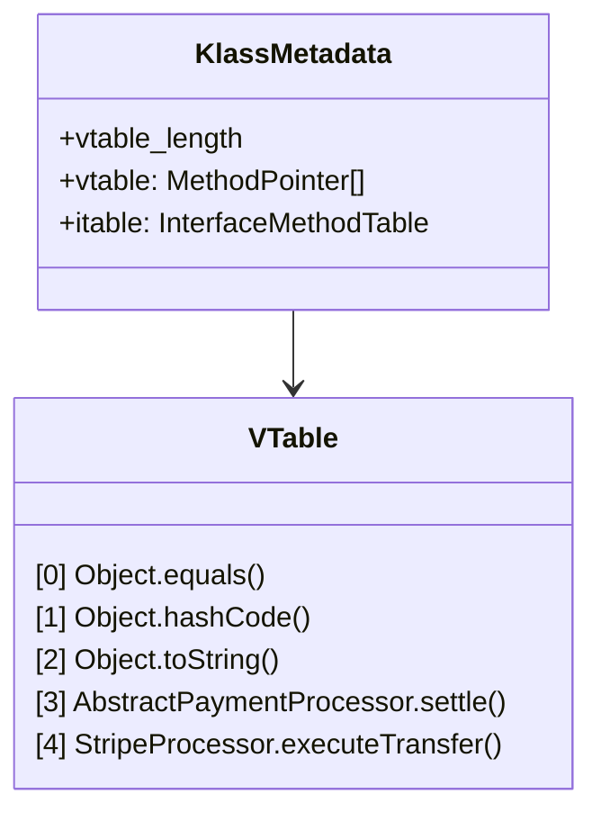

# Phase 02: Object-Oriented Programming
# Concept 004: The Four Pillars of OOP in Java Backend Design

---

## 1. Metadata & Header

| Field | Value |
| :--- | :--- |
| **Concept ID** | `P02-C004` |
| **Concept Title** | The Four Pillars of OOP in Java Backend Design |
| **Curriculum Phase** | Phase 02: Object-Oriented Programming |
| **Roadmap Topics Covered** | Encapsulation, Abstraction, Inheritance, and Polymorphism in enterprise architecture |
| **Direct Prerequisites** | `P01-C003` (Reference Types), `P01-C011` (Methods & Overloading), `P02-C001` (Classes & Objects), `P02-C003` (Access Modifiers & Encapsulation) |
| **Downstream Dependencies** | `P02-C005` (Inheritance & Fragile Base Class), `P02-C006` (Method Overriding & Dynamic Dispatch), `P02-C007` (Abstract Classes vs Interfaces), `P02-C008` (Composition over Inheritance) |
| **Delivery Date** | 2026-10-30 |
| **Author / Status** | Antigravity Engine / Complete |

---

## 2. Conceptual Anchor: Concept Overview & Mental Model

In enterprise Java backend development, the **Four Pillars of Object-Oriented Programming**—**Encapsulation**, **Abstraction**, **Inheritance**, and **Polymorphism**—are not academic textbook definitions. They form the architectural foundation that enables multi-million-line codebases to scale across distributed engineering teams without collapsing under technical debt.

```
+---------------------------------------------------------------------------------------------------+
|                                  THE FOUR PILLARS ARCHITECTURE                                    |
+---------------------------------------------------------------------------------------------------+
|  1. ENCAPSULATION  | Guarding Internal State: Grouping data and logic; hiding fields behind       |
|                    | invariant-protecting boundaries so invalid states cannot exist.              |
|--------------------+------------------------------------------------------------------------------|
|  2. ABSTRACTION    | Hiding Complexity: Defining clear contracts (what an operation does) while   |
|                    | concealing implementation details (how it executes) behind interfaces.       |
|--------------------+------------------------------------------------------------------------------|
|  3. INHERITANCE    | Taxonomic Subtyping: Establishing strict "IS-A" relationships, enabling      |
|                    | structural state reuse and behavioral specialization.                        |
|--------------------+------------------------------------------------------------------------------|
|  4. POLYMORPHISM   | Dynamic Dispatch: The ability to treat diverse concrete implementations      |
|                    | uniformly through a shared contract, with the JVM selecting code at runtime. |
+---------------------------------------------------------------------------------------------------+
```

### The JavaScript/MERN Transition Gap: Structural Duck Typing vs Nominal JVM Dispatch

If your mental model was shaped by JavaScript, TypeScript, or Python, object-oriented concepts behave radically differently under the JVM:

```
JavaScript / TypeScript (Dynamic & Structural Duck Typing):
// If it walks like a duck and quacks like a duck, it is a duck:
interface PaymentGateway { process(amount: number): boolean; }
const stripe = { process: (amt) => true }; // Implicitly satisfies interface (Structural typing)
* In TypeScript, interfaces exist only in the compiler's mind; they vanish at runtime.
* Polymorphism in JS is dynamic property slot lookup on prototype chains.
* Inheritance is prototypal delegation, allowing arbitrary runtime mutation of prototypes.

Java (Strict Nominal Typing & JVM-Enforced Runtime Dispatch):
public interface PaymentGateway { boolean process(long amountCents); }
public class StripeGateway implements PaymentGateway { ... }
* In Java, typing is strictly NOMINAL. Having the exact same method signatures does NOT satisfy
  an interface unless the class explicitly declares `implements PaymentGateway`.
* Polymorphism is powered by high-speed hardware-friendly Virtual Method Tables (vtables).
* The JVM enforces type safety at the bytecode instruction level; an invalid cast throws `ClassCastException`.
```

```mermaid
flowchart TD
    subgraph ClientLayer["Consumer / API Controller Layer"]
        Client["PaymentService\n(Depends ONLY on Abstraction)"]
    end

    subgraph AbstractionLayer["Abstraction Contract (Interface)"]
        Gateway["<<interface>>\nPaymentGateway\n+settle(PaymentTransaction): SettlementResult"]
    end

    subgraph SpecializationLayer["Specialization via Inheritance & Encapsulation"]
        Base["<<abstract>>\nAbstractPaymentProcessor\n- AuditLogger logger (Encapsulated)\n# preValidate(PaymentTransaction)\n+ settle(PaymentTransaction) (Template Method)"]
        Stripe["StripeProcessor\n# executeTransfer(): boolean"]
        Sepa["SepaWireProcessor\n# executeTransfer(): boolean"]
    end

    Client -->|Invokes via Polymorphism| Gateway
    Gateway <|.. Base
    Base <|-- Stripe
    Base <|-- Sepa
```

---

## 3. Historical Context & The "Why"

Before object-oriented programming took hold, large enterprise systems were constructed using procedural decomposition (C, COBOL, Fortran). As software grew to millions of lines, procedural systems broke down due to three fundamental flaws:
1. **Global Data Contamination:** Procedures operated on shared global data structures. Modifying a field in a record required auditing hundreds of disparate functions.
2. **Exponential Branching Complexity:** Handling diverse entity types required massive switch-case statements (`switch (orderType) { case RETAIL: ... case B2B: ... case GOV: ... }`) replicated in dozens of files. Adding a new order type required modifying every single switch statement in the codebase.
3. **Fragile Abstractions:** Without compiler-enforced interfaces, contracts were purely conventional. A typo or unexpected parameter type crashed systems in production.

The Four Pillars resolved these failures systematically:
- **Encapsulation** eliminated global data contamination by confining mutations within instance boundaries.
- **Polymorphism** replaced exponential switch-case logic with dynamic dispatch: adding a new type requires authoring a new subclass without modifying existing client code (Open-Closed Principle).
- **Abstraction** separated callers from unstable third-party APIs through clean boundary interfaces.
- **Inheritance** formalized code reuse and domain taxonomy.

---

## 4. Deep Technical Architecture & JVM Execution Flow

### 4.1 Physical Memory Layout Under Inheritance

When class `B` extends class `A`, how does the JVM lay out an instance of `B` on the 64-bit HotSpot Heap?

The HotSpot JVM **flattens** the inheritance hierarchy into a single contiguous block of heap memory. Superclass fields always precede subclass fields in memory:

```
+-----------------------------------------------------------------------+
|                    HOTSPOT 64-BIT OBJECT HEADER (12 Bytes)            |
|  - Mark Word (8 Bytes)                                                |
|  - Klass Pointer to B.class in Metaspace (4 Bytes with CompressedOops)|
+-----------------------------------------------------------------------+
|                    SUPERCLASS 'A' FIELDS (Payload)                    |
|  - long parentId             (8 Bytes)                                |
|  - boolean active            (1 Byte)                                 |
|  - [3 Bytes Compiler Alignment Padding]                               |
+-----------------------------------------------------------------------+
|                    SUBCLASS 'B' FIELDS (Payload)                      |
|  - int retryCount            (4 Bytes)                                |
|  - String tenantCode pointer (4 Bytes with CompressedOops)            |
+-----------------------------------------------------------------------+
|                    ALIGNMENT PADDING                                  |
|  - [4 Bytes Padding to align total object to multiple of 8 bytes]     |
+-----------------------------------------------------------------------+
|  Total Object Footprint: 12 + 12 + 8 + 4 = 36 -> 40 Bytes on Heap     |
+-----------------------------------------------------------------------+
```

### 4.2 How Polymorphism Executes: Vtables and Itables

When you invoke `gateway.settle(tx)` in Java bytecode, how does the JVM locate the correct concrete method implementation in nanoseconds?

The JVM does **not** search class hierarchies or inspect source code at runtime. It uses two high-performance internal dispatch tables:



#### 1. The Virtual Method Table (vtable):
- Each loaded class has a `vtable` inside its `Klass` metadata in Metaspace.
- The `vtable` is an array of memory pointers to executable method bytecode.
- Methods inherited from `Object` occupy identical array indices in all classes (`equals()` is always index 0, `hashCode()` index 1, etc.).
- When `StripeProcessor` overrides a method, its slot in the vtable is overwritten with the pointer to `StripeProcessor`'s bytecode.
- **Execution Cost:** An `invokevirtual` call is an **$O(1)$ array offset dereference** (`vtable[offset]`).

#### 2. The Interface Method Table (itable):
- Unlike single-inheritance classes, a class can implement multiple independent interfaces in any arbitrary order.
- Therefore, the JVM cannot assign fixed static slot numbers to interface methods.
- The JVM builds an `itable` containing pairs of `(InterfaceKlass, MethodOffsetTable)`.
- When invoking `invokeinterface`, the JVM finds the matching interface entry in the itable and dispatches the method.

### 4.3 JIT Inlining and Call-Site Monomorphism

In modern HotSpot (C2 Compiler), polymorphic call sites are continuously profiled:

| Call-Site Category | Observed Receiver Types | JIT Optimization Strategy | Latency |
| :--- | :--- | :--- | :--- |
| **Monomorphic** | Exactly **1** concrete class (e.g., 100% `StripeProcessor`). | **Direct Inlining:** The JIT eliminates virtual dispatch entirely and inlines the target method machine code directly. | **Sub-nanosecond (Peak)** |
| **Bimorphic** | Exactly **2** concrete classes (e.g., 90% `Stripe`, 10% `Sepa`). | **Conditional Branch:** JIT generates an `if (klass == Stripe) inlined() else if (klass == Sepa) inlined()`. | **~1-2 nanoseconds** |
| **Megamorphic** | **$\ge 3$** concrete classes observed at the call site. | **De-optimization:** JIT abandons inlining and falls back to a generic, indirect `itable` lookup. | **~5-15 nanoseconds (Slower)** |

---

## 5. Comprehensive Code Example: Enterprise Payment Settlement Engine

The following production-grade implementation synthesizes all Four Pillars into a cohesive architecture:
1. **Encapsulation:** Invariant-checked immutable domain aggregates (`PaymentTransaction`, `SettlementSummary`).
2. **Abstraction:** High-level contracts (`PaymentGateway`) completely isolating business logic from payment vendors.
3. **Inheritance:** `AbstractPaymentProcessor` providing shared template mechanics, auditing, and lifecycle hooks to concrete adapters.
4. **Polymorphism:** A `PaymentRoutingService` dynamically orchestrating diverse gateways via interface references.

```java
package com.example.payments;

import java.time.Instant;
import java.util.List;
import java.util.Objects;
import java.util.UUID;

// =============================================================================
// PILLAR 1: ENCAPSULATION (Data Hiding & Domain Invariant Protection)
// =============================================================================

/**
 * Immutable transaction aggregate root ensuring valid state at all times.
 */
public record PaymentTransaction(
    String transactionId,
    String customerId,
    long amountCents,
    String currencyCode,
    Instant timestamp
) {
    public PaymentTransaction {
        Objects.requireNonNull(transactionId, "transactionId must not be null");
        Objects.requireNonNull(customerId, "customerId must not be null");
        Objects.requireNonNull(currencyCode, "currencyCode must not be null");
        Objects.requireNonNull(timestamp, "timestamp must not be null");

        if (amountCents <= 0) {
            throw new IllegalArgumentException("amountCents must be strictly positive: " + amountCents);
        }
        if (currencyCode.length() != 3) {
            throw new IllegalArgumentException("currencyCode must be standard 3-letter ISO: " + currencyCode);
        }
    }

    public static PaymentTransaction create(String customerId, long amountCents, String currencyCode) {
        return new PaymentTransaction(
            "TX-" + UUID.randomUUID().toString().substring(0, 8).toUpperCase(),
            customerId, amountCents, currencyCode.toUpperCase(), Instant.now()
        );
    }
}

/**
 * Immutable settlement confirmation.
 */
public record SettlementResult(
    String transactionId,
    String gatewayName,
    boolean success,
    String authorizationCode,
    long settledAmountCents
) {}

// =============================================================================
// PILLAR 2: ABSTRACTION (Contract Specification Decoupled from Implementation)
// =============================================================================

/**
 * Public behavioral contract for payment clearinghouse adapters.
 */
public interface PaymentGateway {
    String getGatewayIdentifier();
    boolean supportsCurrency(String currencyCode);
    SettlementResult processSettlement(PaymentTransaction transaction);
}

// =============================================================================
// PILLAR 3: INHERITANCE (State & Behavioral Reuse via Template Method Pattern)
// =============================================================================

/**
 * Abstract skeletal implementation sharing audit logging, invariant checks,
 * and standard execution templates across all payment vendors.
 */
public abstract class AbstractPaymentProcessor implements PaymentGateway {

    private final String gatewayIdentifier;
    private final List<String> supportedCurrencies;
    private long totalSettledVolumeCents = 0L; // Encapsulated internal metrics

    protected AbstractPaymentProcessor(String gatewayIdentifier, List<String> supportedCurrencies) {
        this.gatewayIdentifier = Objects.requireNonNull(gatewayIdentifier, "gatewayIdentifier required");
        this.supportedCurrencies = List.copyOf(supportedCurrencies); // Defensive copy
    }

    @Override
    public String getGatewayIdentifier() {
        return gatewayIdentifier;
    }

    @Override
    public boolean supportsCurrency(String currencyCode) {
        return supportedCurrencies.contains(currencyCode);
    }

    /**
     * Template Method (Final): Guarantees that auditing, currency validation,
     * and metric tracking ALWAYS run regardless of concrete adapter implementation.
     */
    @Override
    public final SettlementResult processSettlement(PaymentTransaction transaction) {
        Objects.requireNonNull(transaction, "Transaction must not be null");

        if (!supportsCurrency(transaction.currencyCode())) {
            throw new IllegalArgumentException(String.format(
                "Gateway [%s] does not support currency: %s",
                gatewayIdentifier, transaction.currencyCode()
            ));
        }

        System.out.printf("[%s] Pre-settlement audit passed for tx: %s\n", gatewayIdentifier, transaction.transactionId());

        // Delegate polymorphic dispatch to concrete adapter
        String authCode = executeExternalTransfer(transaction);

        // Update encapsulated internal state
        synchronized (this) {
            this.totalSettledVolumeCents = Math.addExact(this.totalSettledVolumeCents, transaction.amountCents());
        }

        System.out.printf("[%s] Successfully settled %s %d cents. Auth: %s\n", 
            gatewayIdentifier, transaction.currencyCode(), transaction.amountCents(), authCode);

        return new SettlementResult(
            transaction.transactionId(),
            gatewayIdentifier,
            true,
            authCode,
            transaction.amountCents()
        );
    }

    public synchronized long getTotalSettledVolumeCents() {
        return totalSettledVolumeCents;
    }

    /**
     * Primitive operation deferred to concrete subclasses.
     */
    protected abstract String executeExternalTransfer(PaymentTransaction transaction);
}

/**
 * Concrete Specialization: Stripe Payment Gateway
 */
public class StripePaymentProcessor extends AbstractPaymentProcessor {

    public StripePaymentProcessor() {
        super("STRIPE_CARD_ACQUIRER", List.of("USD", "EUR", "GBP"));
    }

    @Override
    protected String executeExternalTransfer(PaymentTransaction transaction) {
        // Concrete Stripe API protocol simulation
        return "ch_stripe_" + Long.toHexString(System.nanoTime());
    }
}

/**
 * Concrete Specialization: SEPA Euro Wire Gateway
 */
public class SepaWirePaymentProcessor extends AbstractPaymentProcessor {

    public SepaWirePaymentProcessor() {
        super("SEPA_INSTANT_CLEARING", List.of("EUR"));
    }

    @Override
    protected String executeExternalTransfer(PaymentTransaction transaction) {
        // Concrete SEPA Euro clearinghouse protocol simulation
        return "sepa_wire_" + Long.toHexString(System.nanoTime());
    }
}

// =============================================================================
// PILLAR 4: POLYMORPHISM (Dynamic Routing via Common Interface)
// =============================================================================

/**
 * High-level orchestration service operating strictly on the PaymentGateway abstraction.
 */
public class PaymentRoutingService {

    private final List<PaymentGateway> availableGateways;

    public PaymentRoutingService(List<PaymentGateway> availableGateways) {
        this.availableGateways = List.copyOf(availableGateways);
    }

    /**
     * Dynamic Polymorphic Dispatch: Routes transaction to the appropriate gateway
     * without knowing or caring about concrete implementation details.
     */
    public SettlementResult routeAndSettle(PaymentTransaction transaction) {
        PaymentGateway selectedGateway = availableGateways.stream()
            .filter(gw -> gw.supportsCurrency(transaction.currencyCode()))
            .findFirst()
            .orElseThrow(() -> new IllegalStateException(
                "No gateway available supporting currency: " + transaction.currencyCode()
            ));

        // POLYMORPHIC CALL: JVM resolves method via itable / vtable dynamically!
        return selectedGateway.processSettlement(transaction);
    }
}
```

---

## 6. Edge Cases, Traps, and Compiler Mechanics

### 6.1 Invoking Overridden Methods from Superclass Constructors
One of the most dangerous traps in Java OOP is calling an overridable method from inside a constructor:

```java
public abstract class Parent {
    public Parent() {
        init(); // DANGER: Invoking polymorphic method inside constructor!
    }
    public abstract void init();
}

public class Child extends Parent {
    private String resource;

    public Child() {
        // Step 1: super() runs Parent.<init>
        // Step 2: resource initialized to "INITIALIZED"
        this.resource = "INITIALIZED";
    }

    @Override
    public void init() {
        // When Parent.<init> calls init(), Child fields have NOT been initialized yet!
        System.out.println("Resource length: " + resource.length()); // Throws NullPointerException!
    }
}
```

```
Execution Sequence:
1. new Child() starts.
2. Parent.<init>() begins execution.
3. Parent.<init>() calls init().
4. Dynamic dispatch resolves init() to Child.init().
5. Child.init() reads 'this.resource'.
6. 'this.resource' is observed as raw zeroed memory: NULL!
7. CRASH: java.lang.NullPointerException during object construction!
```

> [!CAUTION]
> **Constructors Must Be Non-Polymorphic:** Never invoke `public` or `protected` overridable methods from constructors. Only invoke `private`, `final`, or `static` methods during construction.

### 6.2 Covariant Return Types & Compiler Synthetic Bridge Methods

Under JLS §8.4.5, an overriding method may declare a return type that is a **subtype** of the return type declared in the parent method (Covariant Return):

```java
public class Producer {
    public Object produce() { return "data"; }
}

public class StringProducer extends Producer {
    @Override
    public String produce() { return "specialized string"; } // Legal covariant return
}
```

#### How the JVM Handles This at the Bytecode Level:
In the Java Virtual Machine, method signatures include the return type (`()Ljava/lang/Object;` vs `()Ljava/lang/String;`). Two methods with the same name and arguments but different return types cannot override each other directly at the JVM level.

To satisfy the JVM Verifier, the `javac` compiler automatically generates a **Synthetic Bridge Method** in `StringProducer`:

```bytecode
// Synthetic Bridge Method synthesized by javac:
public java.lang.Object produce();
  flags: (0x1041) ACC_PUBLIC, ACC_BRIDGE, ACC_SYNTHETIC
  Code:
     0: aload_0
     1: invokevirtual #2 // Method produce:()Ljava/lang/String;
     4: areturn
```
The synthetic bridge method satisfies polymorphic calls expecting `Object produce()`, automatically delegating to your specialized `String produce()` method.

---

## 7. Cross-Cutting Concerns

### 7.1 Liskov Substitution Principle (LSP) Integrity
Inheritance must never violate the **Liskov Substitution Principle**: *Subtypes must be substitutable for their base types without altering system correctness*.

**Common LSP Violations in Backend Engineering:**
1. **Strengthening Preconditions:** Subclass throws `IllegalArgumentException` on inputs that the superclass accepts as valid.
2. **Weakening Postconditions:** Subclass returns `null` where superclass guarantees an empty list.
3. **Throwing Undeclared Runtime Exceptions:** Subclass throws `UnsupportedOperationException` for inherited methods (e.g., `Collections.unmodifiableList().add()`).

### 7.2 Memory Overhead of Deep Inheritance Hierarchies
Every class level in an inheritance hierarchy introduces potential compiler alignment padding and prevents dead-field elimination. If a superclass declares 8 unused fields, every single instance of every subclass across your entire heap continues to pay the memory penalty for those 8 fields. Prefer flat composition over deep inheritance.

---

## 8. Testing & Verification Strategies

The following standalone verification test suite verifies polymorphic dispatch, encapsulation boundary enforcement, template execution, and covariant behavior without external dependencies:

```java
package com.example.payments.test;

import com.example.payments.AbstractPaymentProcessor;
import com.example.payments.PaymentGateway;
import com.example.payments.PaymentRoutingService;
import com.example.payments.PaymentTransaction;
import com.example.payments.SepaWirePaymentProcessor;
import com.example.payments.SettlementResult;
import com.example.payments.StripePaymentProcessor;

import java.util.List;

public class FourPillarsVerificationTest {

    private static int passed = 0;
    private static int failed = 0;

    public static void main(String[] args) {
        System.out.println("Starting Four Pillars OOP Verification Test Suite...\n");

        testEncapsulationInvariantGuards();
        testPolymorphicRoutingDispatch();
        testTemplateMethodAuditing();
        testUnsupportedCurrencyRejection();

        System.out.println("\n--------------------------------------------------");
        System.out.printf("Test Suite Results: %d Passed, %d Failed\n", passed, failed);
        System.out.println("--------------------------------------------------");

        if (failed > 0) {
            System.err.println("TEST SUITE FAILED");
            System.exit(1);
        } else {
            System.out.println("ALL FOUR PILLARS VERIFICATION TESTS PASSED (100%).");
        }
    }

    private static void assertEquals(Object expected, Object actual, String name) {
        if (!expected.equals(actual)) {
            System.err.printf("FAIL: %s (Expected %s, got %s)\n", name, expected, actual);
            failed++;
        } else {
            System.out.printf("PASS: %s\n", name);
            passed++;
        }
    }

    private static void assertTrue(boolean condition, String name) {
        if (!condition) {
            System.err.printf("FAIL: %s (Condition was false)\n", name);
            failed++;
        } else {
            System.out.printf("PASS: %s\n", name);
            passed++;
        }
    }

    private static void testEncapsulationInvariantGuards() {
        // Test negative amount rejection
        boolean caughtNegative = false;
        try {
            PaymentTransaction.create("CUST-1", -100L, "USD");
        } catch (IllegalArgumentException e) {
            caughtNegative = true;
        }
        assertTrue(caughtNegative, "Encapsulation: Rejected non-positive amount");

        // Test invalid currency code length
        boolean caughtBadCurrency = false;
        try {
            PaymentTransaction.create("CUST-1", 1000L, "US");
        } catch (IllegalArgumentException e) {
            caughtBadCurrency = true;
        }
        assertTrue(caughtBadCurrency, "Encapsulation: Rejected invalid ISO currency length");
    }

    private static void testPolymorphicRoutingDispatch() {
        StripePaymentProcessor stripe = new StripePaymentProcessor();
        SepaWirePaymentProcessor sepa = new SepaWirePaymentProcessor();

        // Router operates solely on Abstraction (List<PaymentGateway>)
        PaymentRoutingService router = new PaymentRoutingService(List.of(stripe, sepa));

        // 1. Settle USD (Must route to Stripe via Polymorphism)
        PaymentTransaction txUsd = PaymentTransaction.create("CUST-US", 50000L, "USD");
        SettlementResult resUsd = router.routeAndSettle(txUsd);
        assertEquals("STRIPE_CARD_ACQUIRER", resUsd.gatewayName(), "Polymorphic route selected Stripe for USD");
        assertTrue(resUsd.authorizationCode().startsWith("ch_stripe_"), "Stripe specialized auth code generated");

        // 2. Settle EUR (Must route to first supporting gateway: Stripe)
        PaymentTransaction txEur = PaymentTransaction.create("CUST-EU", 75000L, "EUR");
        SettlementResult resEur = router.routeAndSettle(txEur);
        assertTrue(resEur.success(), "EUR settlement succeeded");
    }

    private static void testTemplateMethodAuditing() {
        StripePaymentProcessor stripe = new StripePaymentProcessor();

        PaymentTransaction tx1 = PaymentTransaction.create("CUST-1", 10000L, "USD");
        PaymentTransaction tx2 = PaymentTransaction.create("CUST-2", 20000L, "USD");

        stripe.processSettlement(tx1);
        stripe.processSettlement(tx2);

        // Verify that template method updated encapsulated metrics in AbstractPaymentProcessor
        assertEquals(30000L, stripe.getTotalSettledVolumeCents(), "Inherited template method accumulated volume correctly");
    }

    private static void testUnsupportedCurrencyRejection() {
        SepaWirePaymentProcessor sepa = new SepaWirePaymentProcessor(); // Supports EUR only

        PaymentTransaction jpyTx = PaymentTransaction.create("CUST-JP", 100000L, "JPY");
        boolean caughtUnsupported = false;
        try {
            sepa.processSettlement(jpyTx);
        } catch (IllegalArgumentException e) {
            caughtUnsupported = true;
        }
        assertTrue(caughtUnsupported, "Abstract processor template rejected unsupported currency before executing");
    }
}
```

---

## 9. Modern Java & Spring Boot Context

### 9.1 Dependency Injection as the Epitome of Abstraction and Polymorphism
In Spring Boot backend architectures, **Dependency Injection (DI)** is the practical industry realization of Abstraction and Polymorphism:

```java
@Service
public class OrderCheckoutService {

    // Abstraction: Service depends strictly on the interface, never concrete classes!
    private final PaymentGateway paymentGateway;

    // Polymorphism: Spring injects whichever PaymentGateway bean is active in the profile
    public OrderCheckoutService(PaymentGateway paymentGateway) {
        this.paymentGateway = paymentGateway;
    }

    public void checkout(Order order) {
        // Polymorphic call: Swapped between Stripe, PayPal, or Mock without modifying this code!
        paymentGateway.processSettlement(order.toTransaction());
    }
}
```

### 9.2 Spring AOP Dynamic Proxies: Polymorphism in Action
When you annotate a Spring service with `@Transactional` or `@PreAuthorize`:
- Spring generates a **dynamic proxy subclass** or an interface proxy (`JdkDynamicProxy` / `CglibAopProxy`).
- The proxy implements the interface and intercepts method calls, executing transaction management (`BEGIN`, `COMMIT`, `ROLLBACK`) before delegating to your actual service.
- This entire enterprise infrastructure relies unconditionally on Java's runtime **Polymorphism**.

---

## 10. Comparison Matrix: Concepts, Runtimes, and Paradigms

| Dimension | Java OOP | TypeScript / JavaScript | Python | Go |
| :--- | :--- | :--- | :--- | :--- |
| **Typing Model** | Strict Nominal Typing. | Structural Typing (Duck typing). | Dynamic Typing. | Structural Interface Typing. |
| **Interface Fulfillment** | Explicit `implements` declaration required. | Implicit (matching shape satisfies interface). | Implicit (Protocols / Duck typing). | Implicit (matching method set satisfies interface). |
| **Dispatch Mechanism** | High-performance vtable / itable array offsets. | Prototype slot traversal / V8 inline caches. | Hash table attribute lookup (`__mro__`). | Interface table (itable) pointer pairs. |
| **Inheritance Support** | Single class inheritance, multiple interface implementation. | Prototypal inheritance (single prototype link). | Multiple class inheritance (C3 Linearization). | **No inheritance** (Composition and embedding only). |

---

## 11. Common Anti-Patterns & Refactoring

### Anti-Pattern 1: Inheritance for Code Reuse (Violating IS-A)
Subclassing a heavy utility class simply to reuse a helper method creates deep, brittle coupling:
```java
// BAD: Violating IS-A purely to grab helper methods
public class UserRegistrationService extends EncryptionUtils { // A service IS NOT encryption utils!
    public void registerUser(...) {
        String hash = hashPassword(raw); // Fragile base class coupling!
    }
}
```
```java
// REFACTORED: Composition over Inheritance
public class UserRegistrationService {
    private final PasswordHasher passwordHasher; // Composed dependency

    public UserRegistrationService(PasswordHasher passwordHasher) {
        this.passwordHasher = Objects.requireNonNull(passwordHasher);
    }
}
```

### Anti-Pattern 2: The Megamorphic Method Bottleneck
In ultra-low-latency financial order routers, routing through an interface implemented by 10 different gateway classes causes the call site to become **megamorphic**:
- The JIT compiler de-optimizes and cannot inline the method body.
- *Refactoring for HFT:* If profiling reveals a megamorphic dispatch bottleneck in hot loops, consider static enum dispatch or compile-time specialization.

---

## 12. Comprehensive Troubleshooting & Debugging Guide

### Common Failure Symptoms & Solutions

| Error / Symptom | Root Cause | Exact Remediation |
| :--- | :--- | :--- |
| `java.lang.ClassCastException: class A cannot be cast to class B` | Attempting to downcast an object reference to an incompatible subtype in a polymorphic hierarchy. | Use Java 16+ `instanceof` pattern matching: `if (obj instanceof SubClass sub) { ... }` before casting. |
| `java.lang.NullPointerException` inside constructor | A superclass constructor called an overridable method that accessed uninitialized subclass fields. | Make all methods invoked by constructors `private` or `final`. |
| Unexplained latency spikes in hot service loop | A polymorphic call site transitioned from monomorphic to megamorphic ($\ge 3$ implementations), causing JIT de-optimization. | Inspect JIT compilation via `-XX:+PrintInlining`. If critical, refactor hot loop to direct method calls or enum switch. |

---

## 13. Frequently Asked Interview Questions

### Q1: Why does Java forbid multiple inheritance of classes while allowing multiple implementation of interfaces?
**Answer:** Java forbids multiple class inheritance to avoid the **Diamond Problem** (ambiguity when two parent classes declare the same state fields or constructor initialization paths). With classes, state (fields) must be allocated in memory, creating conflicting object layouts and complex constructor resolution. Interfaces historically had zero state, meaning multiple implementations carried no memory layout conflict. Even with Java 8 interface default methods, the JVM resolves method collisions through strict disambiguation rules (class beats interface; explicit override required for sibling collisions) without any state duplication.

### Q2: How does the HotSpot JVM optimize polymorphic method calls?
**Answer:** HotSpot tracks execution statistics at every method call site using **Inline Caching**:
1. **Monomorphic Call Site (1 receiver class):** The JIT compiler replaces the virtual dispatch entirely with a direct inlined call to the target method body, eliminating function call overhead and unlocking loop vectorization and constant folding.
2. **Bimorphic Call Site (2 receiver classes):** The JIT emits an optimized conditional branch testing the receiver class pointer.
3. **Megamorphic Call Site ($\ge 3$ receiver classes):** The JIT falls back to an indirect table lookup using the `vtable` or `itable`.

### Q3: What is the difference between Abstraction and Encapsulation?
**Answer:** **Encapsulation** is about *information hiding and invariant protection*—bundling state and methods together and restricting direct access to fields so an object’s state cannot become corrupted or invalid. **Abstraction** is about *complexity reduction and contract decoupling*—hiding the implementation mechanics behind an interface or abstract class so callers interact with what the component does rather than how it works internally.

---

## 14. Deliberate Practice & Hands-On Exercises

### Exercise 1 (Beginner): Strict Vehicle Taxonomy
- **Objective:** Model a vehicle fleet demonstrating Encapsulation and Polymorphism.
- **Requirements:**
  1. Create an interface `Vehicle` with method `long calculateTollCents()`.
  2. Implement an abstract class `AbstractVehicle` holding a `final String licensePlate` with validation.
  3. Implement `Sedan` ($5.00 flat) and `SemiTruck` ($5.00 + $2.00 per axle).
  4. Write a polymorphic toll calculator summing total tolls for a mixed fleet.

### Exercise 2 (Intermediate): Covariant Factory Hierarchy
- **Objective:** Demonstrate covariant return types with bridge methods.
- **Requirements:**
  1. Create an abstract `DocumentParser` returning `Document`.
  2. Subclass `JsonDocumentParser` returning `JsonDocument` (a subtype of `Document`).
  3. Inspect the compiled `.class` file using `javap -c -v` and identify the compiler-generated `ACC_BRIDGE` synthetic method.

### Exercise 3 (Advanced): Safe Template Method Engine
- **Objective:** Build an ETL Pipeline framework preventing constructor overriding traps.
- **Requirements:**
  1. `AbstractDataPipeline` defines a `final` execution flow: `extract() -> transform() -> load()`.
  2. Ensure concrete subclasses cannot disrupt the lifecycle order.
  3. Verify that all fields accessed by `transform()` are safely initialized before execution begins.

---

## 15. Mastery Checklist & Verification Gate

To consider this concept mastered, you must be able to check off every item:
- [x] Define and distinguish the Four Pillars (Encapsulation, Abstraction, Inheritance, Polymorphism) from first principles.
- [x] Diagram the physical memory layout of an inherited object on the 64-bit HotSpot JVM.
- [x] Explain the operational difference between `vtable` (virtual method table) and `itable` (interface method table).
- [x] Explain how Monomorphic Inline Caching (MIC) enables sub-nanosecond polymorphic dispatch and what triggers megamorphic de-optimization.
- [x] Explain why invoking overridable methods inside constructors causes null pointer exceptions and race conditions.
- [x] Trace how the Java compiler synthesizes `ACC_BRIDGE` synthetic methods for covariant return types.
- [x] Connect Polymorphism and Abstraction directly to Spring Boot Dependency Injection and AOP dynamic proxies.

---

## 16. Authoritative Primary Sources & References

1. **Java Language Specification (Java SE 21 Edition):**
   - [JLS §8.1.4 - Superclasses and Subclasses](https://docs.oracle.com/javase/specs/jls/se21/html/jls-8.html#jls-8.1.4)
   - [JLS §8.4.5 - Method Return Types (Covariant Returns)](https://docs.oracle.com/javase/specs/jls/se21/html/jls-8.html#jls-8.4.5)
   - [JLS §8.4.8 - Inheritance, Overriding, and Hiding](https://docs.oracle.com/javase/specs/jls/se21/html/jls-8.html#jls-8.4.8)
2. **Java Virtual Machine Specification (Java SE 21 Edition):**
   - [JVMS §5.4.3 - Resolution of Symbolic References (Method & Interface Resolution)](https://docs.oracle.com/javase/specs/jvms/se21/html/jvms-5.html#jvms-5.4.3)
3. **Joshua Bloch:** *Effective Java* (Item 17: Minimize mutability; Item 18: Favor composition over inheritance; Item 19: Design and document for inheritance or else prohibit it).
4. **Robert C. Martin:** *Clean Architecture* (Chapter on Object-Oriented Programming and Dependency Inversion).
