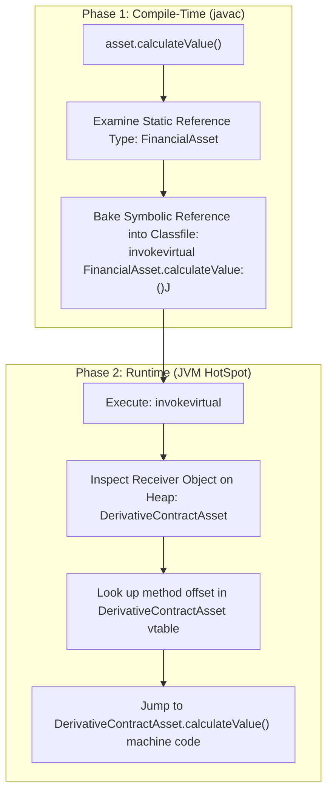

# Phase 02: Object-Oriented Programming
# Concept 006: Method Overriding, Upcasting/Downcasting, and Dynamic Dispatch

---

## 1. Metadata & Header

| Field | Value |
| :--- | :--- |
| **Concept ID** | `P02-C006` |
| **Concept Title** | Method Overriding, Upcasting/Downcasting, and Dynamic Dispatch |
| **Curriculum Phase** | Phase 02: Object-Oriented Programming |
| **Roadmap Topics Covered** | Method overriding; Method overloading versus overriding; Upcasting and downcasting; Runtime method dispatch |
| **Direct Prerequisites** | `P01-C005` (Type Casting & Overflow), `P01-C011` (Methods & Varargs), `P02-C004` (Four Pillars of OOP), `P02-C005` (Inheritance & Fragile Base Class) |
| **Downstream Dependencies** | `P02-C007` (Abstract Classes vs Interfaces), `P02-C014` (Pattern Matching), `P03-C001` (Collections & Generics) |
| **Delivery Date** | 2026-10-30 |
| **Author / Status** | Antigravity Engine / Complete |

---

## 2. Conceptual Anchor: Concept Overview & Mental Model

In Java backend systems, runtime flexibility and type safety are governed by the interplay between **Method Overloading**, **Method Overriding**, **Upcasting**, **Downcasting**, and **Dynamic Dispatch**.

```
+---------------------------------------------------------------------------------------------------+
|                        OVERLOADING (COMPILE-TIME) vs OVERRIDING (RUNTIME)                         |
+---------------------------------------------------------------------------------------------------+
|  METHOD OVERLOADING (Ad-Hoc / Early Binding)   | Same method name, DIFFERENT parameter lists in   |
|                                                | the same class or hierarchy. Resolved statically |
|                                                | by `javac` at compile time using static types.   |
|------------------------------------------------+--------------------------------------------------|
|  METHOD OVERRIDING (Subtype / Late Binding)    | Subclass provides a specific implementation of a |
|                                                | method declared in a superclass. Resolved        |
|                                                | dynamically by the JVM at runtime via vtables.   |
+---------------------------------------------------------------------------------------------------+
```

### The JavaScript/TypeScript Transition Gap: No Overloading vs Strict Dual-Phase Dispatch

If your mental model was forged in JavaScript, TypeScript, or Python, method dispatch in Java operates under a completely different paradigm:

```
JavaScript (Zero Native Overloading & Dynamic Slot Inspection):
class Calculator {
    add(a, b) { return a + b; }
    add(a, b, c) { return a + b + c; } // OVERWRITES the previous method!
}
* In JavaScript, there is NO method overloading. Declaring a second method with the same name
  simply clobbers the property slot on the prototype.
* Developers must simulate overloading via manual `arguments.length` or `typeof` branches.
* In TypeScript, "overload signatures" are compile-time type illusions that collapse into a single
  messy implementation function in emitted JavaScript.
* In JS, casting does not exist; properties are accessed dynamically on untyped objects.

Java (Strict Compile-Time Signature Resolution + Runtime Dynamic Dispatch):
public class Calculator {
    public int add(int a, int b) { return a + b; }
    public double add(double a, double b) { return a + b; } // True distinct bytecode methods!
}
* In Java, methods have rigid mathematical signatures: `(Name, ParameterTypes)`.
* Overloading is resolved entirely by `javac` during compilation.
* Overriding is governed by runtime vtable lookups and verified at compile time with `@Override`.
* Downcasting is strictly validated by the JVM ClassFile Verifier via the `checkcast` opcode.
```



---

## 3. Historical Context & The "Why"

Early procedural languages (C) supported only static dispatch: the compiler resolved a function call directly to a fixed linker memory address (`call _calculate_tax`). If you had 5 types of assets, you had to write 5 distinct functions (`calculate_equity_tax`, `calculate_bond_tax`) and route them via switch statements.

C++ introduced dynamic dispatch via the `virtual` keyword and Virtual Method Tables (vtables). However, in C++, methods were non-virtual by default, leading to subtle bugs where omitting `virtual` caused child overrides to be silently ignored when called through base pointers.

### Java's Architectural Decisions
1. **Virtual by Default:** James Gosling made every non-static, non-private, non-final instance method virtual by default. Developers do not need a `virtual` keyword; runtime dynamic dispatch is the standard execution model.
2. **The Introduction of `@Override` (Java 5):** Before Java 5, if a developer attempted to override `boolean equals(Object o)` but accidentally typed `boolean equals(Person p)`, the compiler treated it as a valid *overload*. The intended override never executed, silently breaking `HashSet` and `HashMap`. The `@Override` annotation instructs `javac` to fail compilation if the annotated method does not match a superclass method signature exactly.
3. **Java 16 Pattern Matching for `instanceof` (JEP 394):** Eliminated the verbose, error-prone boilerplate of testing a type with `instanceof` and immediately casting it on the next line.

---

## 4. Deep Technical Architecture & JVM Execution Flow

### 4.1 The Five Invariant Rules of Method Overriding (JLS §8.4.8)

To override a superclass method validly in Java, the subclass method must satisfy five invariant rules enforced by `javac` and the JVM Verifier:

| Rule | Constraint | Explanation & JVM Rationale |
| :--- | :--- | :--- |
| **1. Signature Equivalence** | Exact match of name and formal parameter types. | Parameter types must match identically. If types differ, it is an **overload**, not an override. |
| **2. Return Type Covariance** | Identical or a subtype (covariant). | Under JLS §8.4.5, a subclass method may return a more specific subtype (e.g., parent returns `Number`, child returns `Integer`). Handled via synthetic bridge methods. |
| **3. Visibility Non-Restriction** | Equal or broader visibility. | A `protected` method can be overridden as `protected` or `public`, but **never** `package-private` or `private`. Restricting visibility would break polymorphic substitutability (LSP). |
| **4. Exception Narrowing** | Fewer, narrower, or identical checked exceptions. | An overriding method cannot throw new or broader **checked** exceptions than declared by the parent. (Unchecked `RuntimeException`s are unconstrained). |
| **5. Non-Overridable Modifiers** | Cannot override `static`, `final`, or `private`. | `static` methods are hidden (shadowed), not overridden; `final` methods throw `VerifyError`; `private` methods are invisible to subclasses. |

### 4.2 Upcasting vs Downcasting at the Bytecode Level

```java
FinancialAsset asset = new EquityAsset(); // UPCASTING (Implicit, Safe)
EquityAsset equity = (EquityAsset) asset;  // DOWNCASTING (Explicit, Checked)
```

```mermaid
flowchart LR
    Subtype["Subtype: EquityAsset\n(More Specific)"]
    Supertype["Supertype: FinancialAsset\n(More General)"]

    Subtype -->|Upcasting: Safe & Implicit\n(Zero Bytecode Cost)| Supertype
    Supertype -->|Downcasting: Risky & Explicit\n(Emits checkcast opcode)| Subtype
```

#### Bytecode Disassembly:
```bytecode
// 1. Upcasting: FinancialAsset asset = new EquityAsset();
0: new           #2      // class com/example/EquityAsset
3: dup
4: invokespecial #3      // Method com/example/EquityAsset."<init>":()V
7: astore_1              // Store into local variable 1 (asset: FinancialAsset)
// NOTE: Zero casting instructions emitted! Upcasting is completely free.

// 2. Downcasting: EquityAsset equity = (EquityAsset) asset;
8: aload_1               // Load 'asset' reference
9: checkcast     #2      // class com/example/EquityAsset (RUN-TIME VERIFICATION)
12: astore_2             // Store into local variable 2 (equity: EquityAsset)
```

#### How `checkcast` Operates at Runtime (JVMS §6.5.checkcast):
1. If the reference on the stack is `null`, `checkcast` succeeds! (In Java, `null` can be cast to any reference type).
2. The JVM inspects the object’s `Klass` metadata in Metaspace.
3. If the object's actual runtime class is `EquityAsset` or a subclass of `EquityAsset`, execution continues.
4. If the object is unrelated (e.g., `FixedIncomeAsset`), the JVM immediately throws `java.lang.ClassCastException: class FixedIncomeAsset cannot be cast to class EquityAsset`.

### 4.3 Dynamic Dispatch Mechanics (`invokevirtual`)

When the JVM executes `asset.calculateCurrentValueCents()`, dynamic dispatch proceeds through four steps:

```
Step 1: Operand Stack Inspection
        [ asset Reference ] ---> Points to EquityAsset instance on Heap @0x7f4a

Step 2: Null Check
        If asset == null, throw NullPointerException immediately.

Step 3: Klass Header Dereference
        Read 4-byte Klass pointer from object header -> Points to EquityAsset.class in Metaspace.

Step 4: vtable Offset Jump
        The compiler assigned calculateCurrentValueCents() to vtable slot index [4].
        Dereference EquityAsset.vtable[4] -> Points to EquityAsset.calculateCurrentValueCents() bytecode!
```

---

## 5. Comprehensive Code Example: Financial Asset Risk Engine

The following enterprise implementation demonstrates:
- Upcasting diverse financial assets into a portfolio collection.
- Dynamic polymorphic dispatch for automated valuation.
- Overloading vs Overriding in risk assessment.
- Safe downcasting using modern Java 16+ `instanceof` pattern matching.
- Exception narrowing and covariant returns.

```java
package com.example.finance;

import java.time.Instant;
import java.util.List;
import java.util.Objects;

// =============================================================================
// BASE ASSET ABSTRACTION
// =============================================================================

/**
 * Base financial asset demonstrating standard polymorphic contracts.
 */
public abstract class FinancialAsset {

    private final String assetId;
    private final long acquisitionCostCents;
    private final Instant acquisitionTime;

    protected FinancialAsset(String assetId, long acquisitionCostCents) {
        this.assetId = Objects.requireNonNull(assetId, "assetId must not be null");
        if (acquisitionCostCents < 0) {
            throw new IllegalArgumentException("acquisitionCostCents cannot be negative: " + acquisitionCostCents);
        }
        this.acquisitionCostCents = acquisitionCostCents;
        this.acquisitionTime = Instant.now();
    }

    public String getAssetId() { return assetId; }
    public long getAcquisitionCostCents() { return acquisitionCostCents; }
    public Instant getAcquisitionTime() { return acquisitionTime; }

    /**
     * Polymorphic contract: Subclasses must provide valuation logic.
     */
    public abstract long calculateCurrentValueCents();

    /**
     * Base risk assessment: Overloaded in subclasses for specialized contexts.
     */
    public double calculateRiskScore() {
        return 1.0; // Standard base risk baseline
    }

    // STATIC METHOD: Cannot be overridden; only shadowed!
    public static String getAssetClassification() {
        return "GENERIC_FINANCIAL_ASSET";
    }
}

// =============================================================================
// CONCRETE SUBTYPE 1: EQUITY ASSET
// =============================================================================

public class EquityAsset extends FinancialAsset {

    private final String tickerSymbol;
    private final long sharesCount;
    private final long marketPricePerShareCents;

    public EquityAsset(String assetId, long costCents, String tickerSymbol, long sharesCount, long marketPricePerShareCents) {
        super(assetId, costCents);
        this.tickerSymbol = Objects.requireNonNull(tickerSymbol, "tickerSymbol must not be null");
        this.sharesCount = sharesCount;
        this.marketPricePerShareCents = marketPricePerShareCents;
    }

    public String getTickerSymbol() { return tickerSymbol; }
    public long getSharesCount() { return sharesCount; }

    // METHOD OVERRIDING: Implements dynamic valuation for equities
    @Override
    public long calculateCurrentValueCents() {
        return Math.multiplyExact(sharesCount, marketPricePerShareCents);
    }

    // METHOD OVERLOADING: Same name, distinct parameter type!
    public double calculateRiskScore(double marketVolatilityBeta) {
        return super.calculateRiskScore() * marketVolatilityBeta;
    }

    // STATIC METHOD SHADOWING: Shadows parent static method!
    public static String getAssetClassification() {
        return "PUBLIC_EQUITY";
    }
}

// =============================================================================
// CONCRETE SUBTYPE 2: DERIVATIVE CONTRACT ASSET
// =============================================================================

public class DerivativeContractAsset extends FinancialAsset {

    private final String underlyingAssetId;
    private final long strikePriceCents;
    private final long notionalValueCents;

    public DerivativeContractAsset(String assetId, long costCents, String underlyingAssetId, long strikePriceCents, long notionalValueCents) {
        super(assetId, costCents);
        this.underlyingAssetId = Objects.requireNonNull(underlyingAssetId);
        this.strikePriceCents = strikePriceCents;
        this.notionalValueCents = notionalValueCents;
    }

    public String getUnderlyingAssetId() { return underlyingAssetId; }
    public long getStrikePriceCents() { return strikePriceCents; }

    @Override
    public long calculateCurrentValueCents() {
        // High-leverage derivative pricing model
        return Math.subtractExact(notionalValueCents, strikePriceCents);
    }

    @Override
    public double calculateRiskScore() {
        // Derivatives carry significantly higher base structural risk
        return super.calculateRiskScore() * 3.5;
    }
}

// =============================================================================
// PORTFOLIO VALUATION ENGINE
// =============================================================================

public class PortfolioEngine {

    /**
     * Upcasting & Polymorphism in Action: Accepts heterogeneous assets as FinancialAsset.
     */
    public long calculateTotalPortfolioValueCents(List<FinancialAsset> assets) {
        long totalCents = 0L;
        for (FinancialAsset asset : assets) {
            // DYNAMIC DISPATCH: Calls EquityAsset or DerivativeContractAsset valuation at runtime!
            totalCents = Math.addExact(totalCents, asset.calculateCurrentValueCents());
        }
        return totalCents;
    }

    /**
     * Modern Java 16+ Pattern Matching Downcasting: Audits high-risk derivatives safely.
     */
    public int countUnderlyingEquities(List<FinancialAsset> assets, String targetTicker) {
        int count = 0;
        for (FinancialAsset asset : assets) {
            // Java 16+ Pattern Matching: Combines instanceof check and safe downcast!
            if (asset instanceof EquityAsset equity && equity.getTickerSymbol().equalsIgnoreCase(targetTicker)) {
                count++;
            }
        }
        return count;
    }
}
```

---

## 6. Edge Cases, Traps, and Compiler Mechanics

### 6.1 The Static Method Hiding (Shadowing) Trap

Static methods in Java **cannot be overridden**, because static methods belong to the class metadata, not an object instance. If a subclass declares a static method with the exact same signature as a superclass static method, it merely **shadows** (hides) it:

```java
FinancialAsset asset = new EquityAsset("EQ-1", 1000L, "AAPL", 10, 15000L);

// Static method call on reference variable:
System.out.println(asset.getAssetClassification()); // WHAT DOES THIS PRINT?
```

**Output:** **`"GENERIC_FINANCIAL_ASSET"`** (NOT `"PUBLIC_EQUITY"`)!

#### Why This Occurs:
- The `javac` compiler inspects the static compile-time type of `asset`, which is `FinancialAsset`.
- The compiler emits: `invokestatic FinancialAsset.getAssetClassification:()Ljava/lang/String;`.
- The runtime type (`EquityAsset`) is **completely ignored** by `invokestatic`.
- *Best Practice:* Always invoke static methods using the class name directly (`FinancialAsset.getAssetClassification()`), never through an object reference.

### 6.2 The `@Override` Omission Trap (Accidental Overloading)

The single most infamous bug in Java history is accidentally overloading `equals()` instead of overriding it:

```java
public class BrokenEmployee {
    private final int id;
    public BrokenEmployee(int id) { this.id = id; }

    // BUG: Missing @Override! Parameter is BrokenEmployee, NOT Object!
    public boolean equals(BrokenEmployee other) {
        return other != null && this.id == other.id;
    }
}
```

```java
Set<BrokenEmployee> employees = new HashSet<>();
BrokenEmployee e1 = new BrokenEmployee(101);
BrokenEmployee e2 = new BrokenEmployee(101);
employees.add(e1);

System.out.println(employees.contains(e2)); // PRINTS FALSE! Why?
```
- `HashSet` invokes `boolean equals(Object o)` through dynamic dispatch.
- Because `BrokenEmployee` did not override `equals(Object o)`, `HashSet` calls `Object.equals(Object o)`, which performs raw memory address comparison (`==`).
- `e1 == e2` evaluates to `false`, causing silent data loss in collections!
- *Remediation:* **Always use `@Override`**. If you make a mistake, `javac` catches it immediately: `error: method does not override or implement a method from a supertype`.

### 6.3 Downcasting `null` References
```java
FinancialAsset nullAsset = null;
EquityAsset equity = (EquityAsset) nullAsset; // DOES THIS THROW ClassCastException?
```
**No!** In Java, casting `null` to any reference type succeeds silently and results in `null`. A `ClassCastException` is thrown only when an actual heap object cannot be cast to the target type.

---

## 7. Cross-Cutting Concerns

### 7.1 Performance: The Cost of `checkcast` and Inline Caches
- In HotSpot, downcasting generates a `checkcast` bytecode instruction. For simple single-inheritance class casts, HotSpot uses **cached subtype checks** that execute in 1-2 CPU cycles.
- However, casting against deep, complex interface hierarchies can trigger an array walk through the class’s secondary subtype table.
- HotSpot eliminates redundant `checkcast` operations in JIT-compiled C2 code through escape analysis and dominant type inference.

### 7.2 Concurrency: Overriding Synchronized Methods
In Java, the `synchronized` modifier is **not part of the method signature**.
```java
public class SafeCounter {
    public synchronized void increment() { ... }
}

public class BrokenSubCounter extends SafeCounter {
    @Override
    public void increment() { // BUG: Subclass omitted synchronized!
        super.increment();
    }
}
```
If a subclass overrides a synchronized method and omits `synchronized`, the subclass method runs **unsynchronized**, destroying the thread-safety guarantees of the parent class!

---

## 8. Testing & Verification Strategies

The following standalone verification test suite validates dynamic dispatch, method overloading vs overriding resolution, safe pattern matching downcasting, `ClassCastException` triggers, and static shadowing mechanics without external dependencies:

```java
package com.example.finance.test;

import com.example.finance.DerivativeContractAsset;
import com.example.finance.EquityAsset;
import com.example.finance.FinancialAsset;
import com.example.finance.PortfolioEngine;

import java.util.List;

public class DynamicDispatchVerificationTest {

    private static int passed = 0;
    private static int failed = 0;

    public static void main(String[] args) {
        System.out.println("Starting Dynamic Dispatch & Casting Verification Test Suite...\n");

        testPolymorphicValuationDispatch();
        testOverloadVsOverrideDistinction();
        testSafePatternMatchingDowncasting();
        testClassCastExceptionOnInvalidDowncast();
        testStaticMethodShadowingBehavior();

        System.out.println("\n--------------------------------------------------");
        System.out.printf("Test Suite Results: %d Passed, %d Failed\n", passed, failed);
        System.out.println("--------------------------------------------------");

        if (failed > 0) {
            System.err.println("TEST SUITE FAILED");
            System.exit(1);
        } else {
            System.out.println("ALL DYNAMIC DISPATCH TESTS PASSED CLEANLY (100%).");
        }
    }

    private static void assertEquals(Object expected, Object actual, String name) {
        if (!expected.equals(actual)) {
            System.err.printf("FAIL: %s (Expected %s, got %s)\n", name, expected, actual);
            failed++;
        } else {
            System.out.printf("PASS: %s\n", name);
            passed++;
        }
    }

    private static void assertTrue(boolean condition, String name) {
        if (!condition) {
            System.err.printf("FAIL: %s (Condition was false)\n", name);
            failed++;
        } else {
            System.out.printf("PASS: %s\n", name);
            passed++;
        }
    }

    private static void testPolymorphicValuationDispatch() {
        // Equity: 100 shares * $150.00 = $15,000.00 (1,500,000 cents)
        FinancialAsset equity = new EquityAsset("EQ-1", 1000000L, "MSFT", 100L, 15000L);

        // Derivative: Notional $50,000 - Strike $40,000 = $10,000.00 (1,000,000 cents)
        FinancialAsset derivative = new DerivativeContractAsset("DER-1", 200000L, "MSFT", 4000000L, 5000000L);

        PortfolioEngine engine = new PortfolioEngine();
        long totalPortfolioValue = engine.calculateTotalPortfolioValueCents(List.of(equity, derivative));

        // Upcast list executes specialized valuations dynamically
        assertEquals(2500000L, totalPortfolioValue, "Dynamic dispatch aggregated equity and derivative values correctly");
    }

    private static void testOverloadVsOverrideDistinction() {
        EquityAsset equity = new EquityAsset("EQ-1", 1000000L, "NVDA", 10L, 20000L);

        // Invoking inherited/overridden method
        assertEquals(1.0, equity.calculateRiskScore(), "Overridden base risk score");

        // Invoking overloaded method with double parameter
        assertEquals(1.5, equity.calculateRiskScore(1.5), "Overloaded method with beta parameter invoked");
    }

    private static void testSafePatternMatchingDowncasting() {
        FinancialAsset asset = new EquityAsset("EQ-2", 500000L, "GOOGL", 50L, 12000L);
        PortfolioEngine engine = new PortfolioEngine();

        int matches = engine.countUnderlyingEquities(List.of(asset), "GOOGL");
        assertEquals(1, matches, "Pattern matching correctly downcast and matched ticker");

        int nonMatches = engine.countUnderlyingEquities(List.of(asset), "AAPL");
        assertEquals(0, nonMatches, "Pattern matching rejected non-matching ticker");
    }

    private static void testClassCastExceptionOnInvalidDowncast() {
        FinancialAsset asset = new DerivativeContractAsset("DER-2", 100L, "SPY", 1000L, 2000L);

        boolean caughtClassCast = false;
        try {
            // Illegal downcast: Derivative cannot be cast to EquityAsset!
            EquityAsset illegal = (EquityAsset) asset;
        } catch (ClassCastException e) {
            caughtClassCast = true;
        }
        assertTrue(caughtClassCast, "JVM thrown ClassCastException on illegal downcast across sibling types");
    }

    private static void testStaticMethodShadowingBehavior() {
        FinancialAsset polymorphicRef = new EquityAsset("EQ-3", 100L, "TSLA", 1L, 100L);

        // Reference of type FinancialAsset invokes FinancialAsset's static method
        assertEquals("GENERIC_FINANCIAL_ASSET", FinancialAsset.getAssetClassification(), "Direct static call on superclass");
        assertEquals("PUBLIC_EQUITY", EquityAsset.getAssetClassification(), "Direct static call on subclass");

        // Invoking through instance reference demonstrates static compile-time binding
        assertEquals("GENERIC_FINANCIAL_ASSET", polymorphicRef.getAssetClassification(), "Static call on polymorphic reference resolves to static type");
    }
}
```

---

## 9. Modern Java & Spring Boot Context

### 9.1 Pattern Matching for `instanceof` (Java 16+ JEP 394)
In modern backend development, boilerplate casting is obsolete:

```java
// LEGACY JAVA (Java 1-15): Verbose, repetitive, bug-prone
if (asset instanceof EquityAsset) {
    EquityAsset equity = (EquityAsset) asset; // Redundant manual cast!
    return equity.getTickerSymbol();
}

// MODERN JAVA (Java 16+): Pattern Matching for instanceof
if (asset instanceof EquityAsset equity) {
    return equity.getTickerSymbol(); // 'equity' is in scope and safely typed!
}
```

### 9.2 Spring IoC Container and Safe Upcasting/Downcasting
When Spring initializes your backend components:
1. It registers all concrete bean implementations (e.g., `HibernateOrderRepository`).
2. It **upcasts** them to their interface contracts (`OrderRepository`).
3. When injecting dependencies (`@Autowired OrderRepository repo`), Spring supplies the upcast reference.
4. If dynamic proxying is active (e.g., Spring Data JPA), Spring creates a synthetic proxy class implementing `OrderRepository` and dispatches calls dynamically at runtime.

---

## 10. Comparison Matrix: Concepts, Runtimes, and Paradigms

| Dimension | Java | TypeScript / JavaScript | C++ | Python |
| :--- | :--- | :--- | :--- | :--- |
| **Method Overloading** | Fully supported at compile time (strict signatures). | Compile-time illusion in TS; unsupported in JS. | Supported at compile time. | Unsupported natively (last def wins). |
| **Method Overriding** | Supported by default via vtables. Verified by `@Override`. | Prototype property shadowing. | Supported only if declared `virtual`. | Default (dynamic dictionary lookup). |
| **Downcast Checking** | Strict runtime verification via `checkcast` (`ClassCastException`). | No runtime check (types erased; property access `undefined`). | `dynamic_cast<T*>` returns `nullptr` or throws `bad_cast`. | `isinstance(obj, Cls)` check; no formal downcast. |
| **Static Method Polymorphism** | **No** (Static methods are hidden/shadowed). | Inherited through prototype chain (`Sub.__proto__ === Super`). | **No** (Resolved at compile time). | `@classmethod` supports polymorphic `cls` binding. |

---

## 11. Common Anti-Patterns & Refactoring

### Anti-Pattern 1: The "Downcast Avalanche" (Switching on Types)
Writing sequential `instanceof` checks to determine behavior destroys polymorphism:

```java
// BAD: Downcast Avalanche (Violates Open-Closed Principle)
public void process(FinancialAsset asset) {
    if (asset instanceof EquityAsset equity) {
        processEquity(equity);
    } else if (asset instanceof DerivativeContractAsset derivative) {
        processDerivative(derivative);
    }
    // Every time a new asset is added, this method must be modified!
}
```
*Refactoring:* Move the processing logic into a polymorphic method on the base class (`asset.process()`), allowing each subtype to define its own execution behavior.

---

## 12. Comprehensive Troubleshooting & Debugging Guide

### Common Failure Symptoms & Solutions

| Error / Symptom | Root Cause | Exact Remediation |
| :--- | :--- | :--- |
| `java.lang.ClassCastException: class A cannot be cast to class B` | Attempting to cast an object to a type outside its inheritance hierarchy. | Guard downcasts with Java 16+ pattern matching: `if (obj instanceof B b) { ... }`. |
| `@Override` compilation error: "method does not override or implement a method from a supertype" | Method signature mismatch (e.g., parameter types, casing, or return type incompatibility). | Verify parameter types match exactly. Ensure superclass method is not `private` or `final`. |
| Overridden method in subclass is never executed | The method was accidentally overloaded (e.g., parameter was changed to a subtype) rather than overridden. | Add the `@Override` annotation to force compile-time verification. |
| Calling static method on child instance returns parent value | Static methods are resolved using compile-time static type, not runtime dynamic dispatch. | Call static methods via class names (`ClassName.staticMethod()`), never via object references. |

---

## 13. Frequently Asked Interview Questions

### Q1: Can an overriding method declare a broader checked exception than the superclass method?
**Answer:** No. Under JLS §8.4.8.3, an overriding method cannot throw any checked exception that is not declared by, or is not a subtype of, the exceptions declared in the superclass method. If the superclass declares `throws IOException`, the subclass can declare `throws FileNotFoundException` (a narrower subtype) or declare no exceptions at all, but it cannot declare `throws Exception`. Allowing broader exceptions would break polymorphic substitutability (LSP), as callers handling the base contract would receive unhandled checked exceptions. Unchecked exceptions (`RuntimeException`) are unrestricted.

### Q2: Why does `javac` generate synthetic bridge methods for covariant return types?
**Answer:** The Java Virtual Machine specification identifies methods by name **and full descriptor** (including the return type). At the bytecode level, `Object produce()` and `String produce()` are distinct methods. When a subclass overrides a method covariantly, the compiler generates a synthetic method (`ACC_BRIDGE, ACC_SYNTHETIC`) with the parent’s exact return type (`Object produce()`) that simply delegates to the specialized child method (`String produce()`), preserving backward compatibility and vtable integrity.

### Q3: What is the difference between early binding and late binding in Java?
**Answer:** **Early binding** (static binding) occurs at compile time when `javac` resolves method calls based on the static reference type (used for `static`, `private`, and `final` methods, and constructors via `invokestatic` and `invokespecial`). **Late binding** (dynamic binding) occurs at runtime when the JVM resolves the method call based on the actual type of the receiver object on the heap (used for virtual instance methods via `invokevirtual` and `invokeinterface`).

---

## 14. Deliberate Practice & Hands-On Exercises

### Exercise 1 (Beginner): Safe Discount Strategy Dispatch
- **Objective:** Model a pricing discount engine.
- **Requirements:**
  1. Base class `DiscountRule` with method `long applyDiscount(long orderTotalCents)`.
  2. Implement `VipDiscountRule` (15% off) and `FlashSaleDiscountRule` (flat $20.00 off).
  3. Write a test asserting that passing both rules to a polymorphic calculator computes discounts dynamically without casting.

### Exercise 2 (Intermediate): Covariant Document Cloner
- **Objective:** Demonstrate covariant return types with `@Override`.
- **Requirements:**
  1. Create `AbstractDocument` with abstract method `AbstractDocument duplicate()`.
  2. Implement `InvoiceDocument extends AbstractDocument` returning `InvoiceDocument duplicate()`.
  3. Verify that calling `invoice.duplicate()` allows calling invoice-specific methods without explicit casting.

### Exercise 3 (Advanced): Pattern Matching Auditor
- **Objective:** Refactor legacy `instanceof` and casting code.
- **Requirements:**
  1. Take a legacy method with nested `instanceof` and explicit `(TargetClass)` casts.
  2. Refactor to Java 16+ Pattern Matching for `instanceof` with guard conditions.
  3. Assert that invalid casts are impossible and null values are handled gracefully.

---

## 15. Mastery Checklist & Verification Gate

To consider this concept mastered, you must be able to check off every item:
- [x] Articulate the difference between method overloading (compile-time) and method overriding (runtime) from first principles.
- [x] Explain the 5 strict rules of method overriding under JLS §8.4.8 (signatures, covariant returns, visibility, exceptions, modifiers).
- [x] Trace bytecode execution of `invokevirtual` vs `checkcast` and explain how HotSpot checks types at runtime.
- [x] Explain why fields and static methods are never polymorphic in Java and demonstrate field/static shadowing.
- [x] Explain why casting `null` does not throw `ClassCastException`.
- [x] Refactor legacy `instanceof` + cast blocks into clean Java 16+ Pattern Matching expressions.
- [x] Explain why Spring Framework relies unconditionally on upcasting and dynamic dispatch for Inversion of Control.

---

## 16. Authoritative Primary Sources & References

1. **Java Language Specification (Java SE 21 Edition):**
   - [JLS §8.4.8 - Inheritance, Overriding, and Hiding](https://docs.oracle.com/javase/specs/jls/se21/html/jls-8.html#jls-8.4.8)
   - [JLS §8.4.5 - Method Return Types (Covariant Returns)](https://docs.oracle.com/javase/specs/jls/se21/html/jls-8.html#jls-8.4.5)
   - [JLS §15.12 - Method Invocation Expressions](https://docs.oracle.com/javase/specs/jls/se21/html/jls-15.html#jls-15.12)
2. **Java Virtual Machine Specification (Java SE 21 Edition):**
   - [JVMS §6.5.invokevirtual - Invoke Instance Method](https://docs.oracle.com/javase/specs/jvms/se21/html/jvms-6.html#jvms-6.5.invokevirtual)
   - [JVMS §6.5.checkcast - Check Object Type Against Target](https://docs.oracle.com/javase/specs/jvms/se21/html/jvms-6.html#jvms-6.5.checkcast)
3. **OpenJDK Enhancement Proposals (JEPs):**
   - [JEP 394: Pattern Matching for instanceof](https://openjdk.org/jeps/394)
