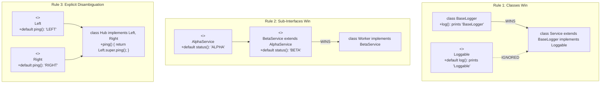

# Phase 02: Object-Oriented Programming
# Concept 007: Abstract Classes vs Interfaces: Contracts and Default Methods

---

## 1. Metadata & Header

| Field | Value |
| :--- | :--- |
| **Concept ID** | `P02-C007` |
| **Concept Title** | Abstract Classes vs Interfaces: Contracts and Default Methods |
| **Curriculum Phase** | Phase 02: Object-Oriented Programming |
| **Roadmap Topics Covered** | Abstract classes and abstract methods; Interfaces and implementation contracts; Multiple interface implementation; Interface default and static methods; Interface inheritance; Abstract classes versus interfaces |
| **Direct Prerequisites** | `P02-C004` (Four Pillars of OOP), `P02-C005` (Inheritance & Subtyping), `P02-C006` (Method Overriding & Dynamic Dispatch) |
| **Downstream Dependencies** | `P02-C008` (Composition over Inheritance), `P02-C013` (Sealed Interfaces), `P06-C001` (Functional Interfaces) |
| **Delivery Date** | 2026-10-30 |
| **Author / Status** | Antigravity Engine / Complete |

---

## 2. Conceptual Anchor: Concept Overview & Mental Model

In Java enterprise architecture, choosing between an **Abstract Class** and an **Interface** is a foundational architectural decision that dictates how a codebase evolves over years of operational maintenance:

```
+---------------------------------------------------------------------------------------------------+
|                              ABSTRACT CLASSES vs INTERFACES TAXONOMY                              |
+---------------------------------------------------------------------------------------------------+
|  ABSTRACT CLASS (`abstract class`)  | Structural Skeletal Foundation ("IS-A"): Encapsulates state |
|                                      | (instance fields), constructors, and template algorithms.   |
|                                      | A class can extend at most ONE abstract class.             |
|--------------------------------------+------------------------------------------------------------|
|  INTERFACE (`interface`)            | Pure Behavioral Capability ("CAN-DO"): Defines what a      |
|                                      | component can do, without carrying instance state. A class |
|                                      | can implement UNLIMITED interfaces.                        |
+---------------------------------------------------------------------------------------------------+
```

### The JavaScript/TypeScript Transition Gap: Erased Types vs Runtime-Enforced Interfaces

If your background is in TypeScript or modern Node.js, interfaces in Java operate under an entirely different runtime model:

```
TypeScript (Pure Compile-Time Type Shapes):
interface MessageSender {
    send(msg: string): void;
}
* In TypeScript, interfaces do NOT exist at runtime. They are completely erased during transpilation.
* You cannot inspect `obj instanceof MessageSender` at runtime without writing custom type guards.
* Interfaces cannot contain executable default methods or static utility methods in emitted JS.

Java (Runtime-Enforced Bytecode Entities):
public interface MessageSender {
    void send(String msg);
    default void sendBatch(List<String> msgs) { ... } // Executable runtime default method
    static MessageSender createDefault() { ... }       // Executable runtime static factory
}
* In Java, an interface produces a real `.class` binary containing bytecode and metadata.
* `obj instanceof MessageSender` is evaluated directly by the JVM via `instanceof` / `checkcast`.
* The JVM enforces multiple interface implementation contracts via Interface Method Tables (itables).
```

```mermaid
flowchart TD
    subgraph CapabilityContracts["Interface Layer: Capabilities (CAN-DO)"]
        Sendable["<<interface>>\nSendable\n+send(Message): void"]
        Auditable["<<interface>>\nAuditable\n+getAuditId(): String\n+default logAudit(): void"]
        Flushable["<<interface>>\nFlushable\n+flush(): void"]
    end

    subgraph SkeletalImplementation["Abstract Class Layer: State & Skeletal Mechanics (IS-A)"]
        AbstractBroker["<<abstract>>\nAbstractMessageBroker\n- String brokerUri (State)\n- AtomicLong sequence (State)\n# preValidate(Message)\n+ send(Message) (Template Method)"]
    end

    subgraph ConcreteAdapters["Concrete Delivery Layer"]
        Kafka["KafkaMessageBroker\n(extends AbstractMessageBroker\nimplements Sendable, Auditable, Flushable)"]
        RabbitMQ["RabbitMqMessageBroker\n(extends AbstractMessageBroker\nimplements Sendable, Auditable)"]
    end

    Sendable <|.. AbstractBroker
    Auditable <|.. AbstractBroker
    AbstractBroker <|-- Kafka
    AbstractBroker <|-- RabbitMQ
    Flushable <|.. Kafka
```

---

## 3. Historical Context & The "Why"

To understand why modern Java interfaces look the way they do, we must examine their 30-year evolutionary journey:

### 1. The Classical Era (Java 1.0 – 7): The Strict Interface and the Skeletal Companion
Historically, interfaces were 100% pure abstractions:
- Only `public abstract` methods.
- Only `public static final` constants.
- **The Pain Point:** Adding a new method to an existing interface was a **catastrophic breaking change**. If the JDK authors added a single method (like `stream()`) to `java.util.Collection`, every existing collection library on earth (Hibernate, Guava, Apache Commons) would immediately fail to compile!
- To provide default behavior, library designers had to create paired **Skeletal Abstract Classes** (e.g., `Collection` $\to$ `AbstractCollection`, `List` $\to$ `AbstractList`, `Map` $\to$ `AbstractMap`).

### 2. The Modern Era (Java 8 JEP 126): Default and Static Methods
In 2014, Java 8 introduced lambda expressions and the Stream API. To make `stream()` and `forEach()` available on all existing collections without breaking binary backward compatibility, Java added:
- **`default` methods:** Interface methods with executable bytecode bodies. Subclasses inherit these implementations unless they choose to override them.
- **`static` methods:** Interface-scoped utility and factory methods (e.g., `Comparator.comparing()`).

### 3. The Refinement Era (Java 9+): Private Interface Methods
Java 9 permitted `private` and `private static` methods inside interfaces. This enabled developers to extract shared helper logic between multiple `default` methods without exposing internal implementation details as part of the public interface contract.

---

## 4. Deep Technical Architecture & JVM Execution Flow

### 4.1 Classfile Representation of Interfaces

In compiled bytecode (JVMS §4.1):
1. **`access_flags`:** An interface `.class` file has both `ACC_INTERFACE (0x0200)` and `ACC_ABSTRACT (0x0400)` set.
2. **Default Method Descriptor:** A `default` method in an interface is simply a non-abstract instance method flagged with `ACC_PUBLIC (0x0001)` that contains a standard JVM `Code` attribute!
3. **Implicit Modifiers:**
   - Interface fields are implicitly `public static final`.
   - Abstract interface methods are implicitly `public abstract`.

### 4.2 Dispatch Mechanics: `invokevirtual` vs `invokeinterface`

| Instruction | Target Type | Resolution Mechanism | Performance Characteristics |
| :--- | :--- | :--- | :--- |
| **`invokevirtual`** | Class methods (concrete or abstract). | Virtual Method Table (`vtable`): Fixed $O(1)$ array offset dereference. | Highly predictable; optimized via Monomorphic Inline Caching. |
| **`invokeinterface`** | Interface methods (abstract or default). | Interface Method Table (`itable`): Secondary search table lookup. | Historically slower than `vtable`; modern HotSpot JIT optimizes monomorphic call sites to identical sub-nanosecond speeds. |

### 4.3 The Three Rules of Default Method Conflict Resolution (JLS §9.4.1.2)

When a class inherits multiple default methods with identical signatures, the Java compiler enforces three strict disambiguation rules:

```
  +===========================================================================+
  |              RULE 1: CLASSES WIN OVER INTERFACES                          |
  |===========================================================================|
  |  A method declaration in any superclass or abstract superclass ALWAYS     |
  |  takes precedence over ANY default method in ANY interface.               |
  +===========================================================================+
                                        | (If no class method exists)
                                        v
  +===========================================================================+
  |              RULE 2: SUB-INTERFACES WIN OVER SUPER-INTERFACES             |
  |===========================================================================|
  |  If Interface B extends Interface A, and both declare default void log(), |
  |  the more specific sub-interface B ALWAYS wins.                           |
  +===========================================================================+
                                        | (If interfaces are unrelated siblings)
                                        v
  +===========================================================================+
  |              RULE 3: EXPLICIT DISAMBIGUATION MANDATORY                    |
  |===========================================================================|
  |  If unrelated interfaces X and Y declare conflicting default methods,     |
  |  the implementing class MUST override the method and explicitly           |
  |  resolve the conflict using: `X.super.method()` or `Y.super.method()`.   |
  +===========================================================================+
```



---

## 5. Comprehensive Code Example: High-Reliability Event Broker

The following enterprise architecture demonstrates:
1. **Interface Contract:** Core message-sending capability, with `default` batch handling, `static` factory initialization, and `private` payload sanitization.
2. **Abstract Class (Skeletal Implementation):** Encapsulates broker connection state, URI validation, and monotonic transaction sequence tracking.
3. **Multiple Interface Implementation with Rule 3 Disambiguation:** Resolving conflicting compliance tracking methods across unrelated interfaces.

```java
package com.example.broker;

import java.time.Instant;
import java.util.List;
import java.util.Objects;
import java.util.concurrent.atomic.AtomicLong;

// =============================================================================
// PILLAR A: CAPABILITY INTERFACES
// =============================================================================

public interface MessageBroker {

    // 1. Abstract behavioral contract
    String send(String topic, String payload);

    // 2. Default method: Provides out-of-the-box batch processing
    default int sendBatch(String topic, List<String> payloads) {
        Objects.requireNonNull(payloads, "payloads must not be null");
        int successCount = 0;
        for (String payload : payloads) {
            String sanitized = sanitizePayload(payload); // Calls private interface method
            send(topic, sanitized);
            successCount++;
        }
        return successCount;
    }

    // 3. Static Factory Method
    static MessageBroker createLoopbackBroker() {
        return new MessageBroker() {
            @Override
            public String send(String topic, String payload) {
                return "LOOPBACK_SENT:" + topic;
            }
        };
    }

    // 4. Private interface helper method (Java 9+)
    private String sanitizePayload(String raw) {
        return raw == null ? "" : raw.trim();
    }
}

public interface AuditJournal {
    default String recordAudit(String eventId) {
        return "AUDIT_JOURNAL[" + eventId + "]";
    }
}

public interface ComplianceTracker {
    default String recordAudit(String eventId) {
        return "COMPLIANCE_TRACKER[" + eventId + "]";
    }
}

// =============================================================================
// PILLAR B: SKELETAL ABSTRACT CLASS (STATE & TEMPLATE METHOD)
// =============================================================================

/**
 * Skeletal base class managing broker connection state and sequence tracking.
 */
public abstract class AbstractMessageBroker implements MessageBroker, AuditJournal, ComplianceTracker {

    private final String brokerUri;
    private final AtomicLong globalSequenceNumber = new AtomicLong(1000L);
    private boolean connected;

    protected AbstractMessageBroker(String brokerUri) {
        this.brokerUri = Objects.requireNonNull(brokerUri, "brokerUri must not be null");
        if (!brokerUri.startsWith("tcp://") && !brokerUri.startsWith("ssl://")) {
            throw new IllegalArgumentException("Invalid broker URI protocol: " + brokerUri);
        }
        this.connected = false;
    }

    public synchronized void connect() {
        this.connected = true;
    }

    public synchronized void disconnect() {
        this.connected = false;
    }

    public synchronized boolean isConnected() {
        return connected;
    }

    public String getBrokerUri() {
        return brokerUri;
    }

    protected long generateNextSequence() {
        return globalSequenceNumber.getAndIncrement();
    }

    // =========================================================================
    // RULE 3 DISAMBIGUATION: Resolving AuditJournal vs ComplianceTracker conflict
    // =========================================================================
    @Override
    public String recordAudit(String eventId) {
        // Explicitly choose which default implementation to invoke, or synthesize both!
        String auditPart = AuditJournal.super.recordAudit(eventId);
        String compliancePart = ComplianceTracker.super.recordAudit(eventId);
        return auditPart + " & " + compliancePart;
    }

    /**
     * Final Template Method: Enforces connection precondition before delegating to subclass.
     */
    @Override
    public final String send(String topic, String payload) {
        if (!isConnected()) {
            throw new IllegalStateException("Cannot send message: Broker is disconnected (" + brokerUri + ")");
        }
        long seq = generateNextSequence();
        String receipt = executeWireSend(seq, topic, payload);
        recordAudit("SEQ-" + seq);
        return receipt;
    }

    /**
     * Primitive hook deferred to concrete vendor adapters.
     */
    protected abstract String executeWireSend(long sequence, String topic, String payload);
}

// =============================================================================
// PILLAR C: CONCRETE SPECIALIZATIONS
// =============================================================================

public class KafkaMessageBroker extends AbstractMessageBroker {

    public KafkaMessageBroker(String clusterBootstrapServers) {
        super(clusterBootstrapServers);
    }

    @Override
    protected String executeWireSend(long sequence, String topic, String payload) {
        return String.format("KAFKA_ACK[seq=%d, topic=%s, partition=0]", sequence, topic);
    }
}
```

---

## 6. Edge Cases, Traps, and Compiler Mechanics

### 6.1 The Interface State Trap: Default Methods Cannot Have State!
A frequent mistake by junior developers transitioning from Python or C++ is attempting to store instance variables in an interface:

```java
public interface LeakyInterface {
    // String name; // COMPILE ERROR: = required; implicitly public static final!
    default void setName(String name) {
        // There is NO instance state in an interface to assign to!
    }
}
```
*Architectural Reality:* Interfaces define behavior, not state. If your domain abstraction requires instance fields (e.g., `boolean connected`, `long balance`), you **must** use an abstract class.

### 6.2 The `java.lang.Object` Method Collision Trap

Can you provide a default implementation of `equals()`, `hashCode()`, or `toString()` in an interface?

```java
public interface SmartEntity {
    // COMPILE ERROR: default method equals in interface SmartEntity overrides a member of java.lang.Object
    default boolean equals(Object o) {
        return true; 
    }
}
```

#### Why JLS §9.4 Prohibits This:
Under **Rule 1 (Classes Win)**, `java.lang.Object` is the superclass of every class in Java. Any concrete class implementing `SmartEntity` already inherits `Object.equals()`. Since classes always win over interfaces, the interface default method would **never be executed**. To prevent confusing dead code, the JLS explicitly bans default methods matching `Object` signatures.

### 6.3 Incompatible Return Types in Multiple Interface Inheritance
If two interfaces declare methods with the same name and parameter types, but incompatible return types, a class cannot implement both:

```java
interface ServiceAlpha { int getPriority(); }
interface ServiceBeta  { String getPriority(); }

// COMPILE ERROR: types ServiceAlpha and ServiceBeta are incompatible;
// both define getPriority(), but with unrelated return types
class CollisionWorker implements ServiceAlpha, ServiceBeta {}
```

---

## 7. Cross-Cutting Concerns

### 7.1 Security: Binary Compatibility vs Source Incompatibility
- **Binary Compatibility:** Adding a `default` method to an existing interface is 100% binary compatible. Existing compiled JARs will link and run without modification on newer runtimes.
- **Source Incompatibility:** If a client class already implements `InterfaceA` and `InterfaceB`, and the author of `InterfaceB` subsequently adds a `default void check()` that clashes with an existing `default void check()` in `InterfaceA`, recompiling the client project will fail with a compiler collision error (Rule 3).

### 7.2 Memory Footprint: Pure Interfaces vs Skeletal Classes
- Implementing 10 interfaces adds **zero bytes** of field overhead to an object’s heap payload.
- Extending an abstract class carrying 5 fields permanently increases the heap footprint of every instance of every subclass across the entire JVM.

---

## 8. Testing & Verification Strategies

The following standalone verification program validates the Three Rules of Default Method Conflict Resolution, interface static factories, and abstract template execution without external dependencies:

```java
package com.example.test;

import com.example.broker.AbstractMessageBroker;
import com.example.broker.KafkaMessageBroker;
import com.example.broker.MessageBroker;

import java.util.List;

public class AbstractVsInterfaceVerificationTest {

    private static int passed = 0;
    private static int failed = 0;

    // Rule 1 Classes Win test hierarchy
    interface GreeterInterface {
        default String greet() { return "INTERFACE_GREET"; }
    }
    static class BaseGreeter {
        public String greet() { return "CLASS_GREET"; }
    }
    static class ResolvingGreeter extends BaseGreeter implements GreeterInterface {}

    // Rule 2 Sub-Interfaces Win test hierarchy
    interface SuperGreeter {
        default String ping() { return "SUPER_PING"; }
    }
    interface SubGreeter extends SuperGreeter {
        @Override
        default String ping() { return "SUB_PING"; }
    }
    static class SubGreeterImpl implements SubGreeter {}

    public static void main(String[] args) {
        System.out.println("Starting Abstract Classes vs Interfaces Verification Tests...\n");

        testRule1ClassesWin();
        testRule2SubInterfacesWin();
        testRule3ExplicitDisambiguation();
        testMessageBrokerTemplateAndBatching();
        testStaticInterfaceFactory();

        System.out.println("\n--------------------------------------------------");
        System.out.printf("Test Suite Results: %d Passed, %d Failed\n", passed, failed);
        System.out.println("--------------------------------------------------");

        if (failed > 0) {
            System.err.println("TEST SUITE FAILED");
            System.exit(1);
        } else {
            System.out.println("ALL ABSTRACT VS INTERFACE TESTS PASSED CLEANLY (100%).");
        }
    }

    private static void assertEquals(Object expected, Object actual, String name) {
        if (!expected.equals(actual)) {
            System.err.printf("FAIL: %s (Expected %s, got %s)\n", name, expected, actual);
            failed++;
        } else {
            System.out.printf("PASS: %s\n", name);
            passed++;
        }
    }

    private static void assertTrue(boolean condition, String name) {
        if (!condition) {
            System.err.printf("FAIL: %s (Condition was false)\n", name);
            failed++;
        } else {
            System.out.printf("PASS: %s\n", name);
            passed++;
        }
    }

    private static void testRule1ClassesWin() {
        ResolvingGreeter greeter = new ResolvingGreeter();
        // BaseGreeter.greet() must win over GreeterInterface.greet()
        assertEquals("CLASS_GREET", greeter.greet(), "Rule 1: Superclass method wins over interface default method");
    }

    private static void testRule2SubInterfacesWin() {
        SubGreeterImpl impl = new SubGreeterImpl();
        // SubGreeter.ping() must win over SuperGreeter.ping()
        assertEquals("SUB_PING", impl.ping(), "Rule 2: Sub-interface default method wins over super-interface");
    }

    private static void testRule3ExplicitDisambiguation() {
        KafkaMessageBroker kafka = new KafkaMessageBroker("ssl://kafka-cluster:9092");
        String auditResult = kafka.recordAudit("EVENT-101");

        // Verifies explicit call to AuditJournal.super and ComplianceTracker.super
        assertTrue(auditResult.contains("AUDIT_JOURNAL[EVENT-101]"), "Audit journal part recorded");
        assertTrue(auditResult.contains("COMPLIANCE_TRACKER[EVENT-101]"), "Compliance tracker part recorded");
    }

    private static void testMessageBrokerTemplateAndBatching() {
        KafkaMessageBroker kafka = new KafkaMessageBroker("tcp://localhost:9092");

        // Attempting to send before connect() must throw IllegalStateException
        boolean caughtDisconnected = false;
        try {
            kafka.send("orders", "PAYLOAD_1");
        } catch (IllegalStateException e) {
            caughtDisconnected = true;
        }
        assertTrue(caughtDisconnected, "Template method guarded against disconnected send");

        // Connect and test template dispatch + default batch execution
        kafka.connect();
        String receipt = kafka.send("orders", "ORDER_DATA");
        assertTrue(receipt.startsWith("KAFKA_ACK[seq=1000"), "Wire send executed with sequence 1000");

        // Test default sendBatch method from interface
        int batchCount = kafka.sendBatch("orders", List.of("MSG_A", "MSG_B", "MSG_C"));
        assertEquals(3, batchCount, "Default interface method sendBatch processed 3 items");
    }

    private static void testStaticInterfaceFactory() {
        MessageBroker loopback = MessageBroker.createLoopbackBroker();
        String response = loopback.send("telemetry", "PING");
        assertEquals("LOOPBACK_SENT:telemetry", response, "Static interface factory created working broker");
    }
}
```

---

## 9. Modern Java & Spring Boot Context

### 9.1 Modern Interface Defaults in Spring Framework 5 & 6
Historically, Spring provided abstract adapter classes with empty method bodies so developers wouldn't have to implement 20 interface methods (e.g., `WebMvcConfigurerAdapter`).
- In Spring 5/6, `WebMvcConfigurerAdapter` was completely **deprecated and removed**.
- Why? `WebMvcConfigurer` was refactored into an interface where all methods are `default`! Developers now implement `WebMvcConfigurer` directly, overriding only the exact callbacks they need.

### 9.2 Spring Data Repositories: Interface-Driven Persistence
Spring Data JPA's `JpaRepository` is the ultimate demonstration of Java interfaces:
```java
public interface UserRepository extends JpaRepository<User, Long> {
    // Abstract query method generated dynamically at runtime via dynamic proxies:
    Optional<User> findByEmail(String email);

    // Default method containing real business logic right inside the repository:
    default User getActiveUserOrThrow(Long id) {
        return findById(id)
            .filter(User::isActive)
            .orElseThrow(() -> new EntityNotFoundException("Active user not found: " + id));
    }
}
```

---

## 10. Comparison Matrix: Concepts, Runtimes, and Paradigms

| Dimension | Java Interface | Java Abstract Class | TypeScript Interface | C++ Abstract Base Class |
| :--- | :--- | :--- | :--- | :--- |
| **Instance Fields** | **Zero** (Constants only). | Supported (Full state carrier). | Erased (Type definitions only). | Supported (Full state carrier). |
| **Constructors** | **None**. | Supported (Chained via `super()`). | None. | Supported. |
| **Inheritance Multiplicity**| Unlimited (`implements A, B, C`).| Single only (`extends Base`). | Unlimited (`implements A, B`). | Unlimited (Multiple inheritance). |
| **Default Method Support** | `default` keyword (Java 8+). | Concrete methods. | None in emitted code. | Concrete non-pure virtual methods. |
| **Instantiation** | Cannot be instantiated directly. | Cannot be instantiated directly. | Cannot be instantiated. | Cannot be instantiated. |

---

## 11. Common Anti-Patterns & Refactoring

### Anti-Pattern 1: The "Constant Interface" Anti-Pattern (Effective Java Item 22)
Implementing an interface solely to import constant values into the namespace without qualification:
```java
// BAD: Antipattern polluting public API with implementation details
public interface PhysicalConstants {
    double AVOGADRO_NUMBER = 6.02214076e23;
}
public class PhysicsEngine implements PhysicalConstants { ... } // LEAKS CONSTANTS INTO PUBLIC API!
```
*Refactoring:* Place constants in a non-instantiable utility class (`public final class PhysicalConstants { private PhysicalConstants() {} ... }`) and use `import static`.

### Anti-Pattern 2: The "God Default Method" Trap
Writing massive 500-line business logic routines inside an interface default method.
*Refactoring:* Default methods should be lightweight forwarding logic or defensive parameter sanitization. Complex stateful orchestration belongs in an abstract template class or a composed service bean.

---

## 12. Comprehensive Troubleshooting & Debugging Guide

### Common Failure Symptoms & Solutions

| Error / Symptom | Root Cause | Exact Remediation |
| :--- | :--- | :--- |
| `error: types X and Y are incompatible; both define m()` | Two unrelated interfaces declare conflicting default methods with identical signatures. | Override the method in the implementing class and disambiguate explicitly: `X.super.m();`. |
| `error: default method equals in interface I overrides a member of java.lang.Object` | Attempted to define a default method matching `equals()`, `hashCode()`, or `toString()`. | Remove the default method. Interfaces cannot override `java.lang.Object` methods (Classes always win rule). |
| `java.lang.AbstractMethodError` at runtime | A newer interface version was compiled with an abstract method, but the runtime classpath loaded an old binary implementation that lacked it. | Ensure all runtime dependencies and implementation JARs match compiled versions, or make the new interface method `default`. |

---

## 13. Frequently Asked Interview Questions

### Q1: When should you use an Abstract Class over an Interface in modern Java?
**Answer:** In modern Java (Java 8–21+), interfaces can have `default`, `static`, and `private` methods, blurring the historical boundary. However, an **Abstract Class** remains mandatory when:
1. **State Encapsulation:** The abstraction requires non-static instance fields (`private long id;`) to maintain mutable state. Interfaces can only hold `public static final` constants.
2. **Constructor Initialization:** The base type requires constructor logic (`super(id, uri)`) to enforce invariant validation before subclasses initialize.
3. **Non-Public API Encapsulation:** The base type needs `protected` or `package-private` methods to coordinate between collaborating components. Interface methods (except private helpers) are strictly `public`.

### Q2: What are the three rules of default method resolution in Java?
**Answer:**
1. **Rule 1 (Classes Win):** Any method declared in a superclass or abstract superclass always beats any interface default method.
2. **Rule 2 (Sub-Interfaces Win):** A default method in a more specific sub-interface overrides a default method in a higher super-interface.
3. **Rule 3 (Explicit Disambiguation):** If two unrelated interfaces declare the same default signature, the compiler reports a conflict. The implementing class must override the method and explicitly call `TargetInterface.super.method()`.

### Q3: Why does `invokeinterface` exist separately from `invokevirtual`?
**Answer:** `invokevirtual` relies on single-inheritance Virtual Method Tables (`vtable`), where every inherited method is assigned a static array offset fixed at compile time. Because a class can implement multiple independent interfaces in any arbitrary order, an interface method cannot be given a fixed static slot across all implementing classes. `invokeinterface` uses an Interface Method Table (`itable`) or polymorphic inline caching to dynamically search and resolve the method offset for the specific implementing class.

---

## 14. Deliberate Practice & Hands-On Exercises

### Exercise 1 (Beginner): Multi-Interface Capability Synthesis
- **Objective:** Model an industrial robotics subsystem.
- **Requirements:**
  1. Create interface `Movable` with `default void move(int x, int y)`.
  2. Create interface `PowerConsumer` with `default void reportPower()`.
  3. Implement `RobotArm` implementing both interfaces.
  4. Verify that `RobotArm` can invoke both default methods cleanly.

### Exercise 2 (Intermediate): Rule 3 Disambiguation Drill
- **Objective:** Resolve a diamond collision between two payment interfaces.
- **Requirements:**
  1. Create `CreditCardProcessor` with `default String getGatewayName() { return "CC"; }`.
  2. Create `CryptoProcessor` with `default String getGatewayName() { return "CRYPTO"; }`.
  3. Implement `HybridPaymentGateway` implementing both.
  4. Write the disambiguation logic combining both names into `"HYBRID[CC+CRYPTO]"`.

### Exercise 3 (Advanced): Skeletal DAO Framework
- **Objective:** Build a skeletal repository pattern combining an interface and an abstract class.
- **Requirements:**
  1. Interface `Repository<T, ID>` with `findById(ID)`, `save(T)`, and `default T findOrThrow(ID)`.
  2. Abstract class `AbstractCachedRepository<T, ID>` holding a `private final Map<ID, T> cache` and managing cache hits.
  3. Implement `SqlUserRepository` extending the abstract class and implementing database access.

---

## 15. Mastery Checklist & Verification Gate

To consider this concept mastered, you must be able to check off every item:
- [x] State the foundational difference between abstract classes ("IS-A" + state carrier) and interfaces ("CAN-DO" + capability).
- [x] Explain why Java 8 introduced `default` methods (binary backward compatibility for streams).
- [x] Recite and apply the Three Rules of Default Method Conflict Resolution from memory.
- [x] Explain why interfaces cannot declare default implementations for `equals()`, `hashCode()`, or `toString()`.
- [x] Contrast `invokeinterface` and `invokevirtual` dispatch mechanisms at the JVM level.
- [x] Leverage `private` interface methods (Java 9+) to deduplicate default method helper logic.
- [x] Explain how Spring Data JPA and Spring WebMvc exploit interfaces with default methods.

---

## 16. Authoritative Primary Sources & References

1. **Java Language Specification (Java SE 21 Edition):**
   - [JLS §9.1 - Interface Declarations](https://docs.oracle.com/javase/specs/jls/se21/html/jls-9.html#jls-9.1)
   - [JLS §9.4 - Method Declarations in Interfaces (Default, Static, and Private)](https://docs.oracle.com/javase/specs/jls/se21/html/jls-9.html#jls-9.4)
   - [JLS §9.4.1.2 - Requirements in Overriding Default Methods](https://docs.oracle.com/javase/specs/jls/se21/html/jls-9.html#jls-9.4.1.2)
2. **Java Virtual Machine Specification (Java SE 21 Edition):**
   - [JVMS §6.5.invokeinterface - Invoke Interface Method](https://docs.oracle.com/javase/specs/jvms/se21/html/jvms-6.html#jvms-6.5.invokeinterface)
3. **Joshua Bloch:** *Effective Java* (Item 20: Prefer interfaces to abstract classes; Item 21: Design interfaces for posterity; Item 22: Use interfaces only to define types).
4. **OpenJDK Enhancement Proposals (JEPs):**
   - [JEP 126: Lambda Expressions & Default Methods](https://openjdk.org/jeps/126)
