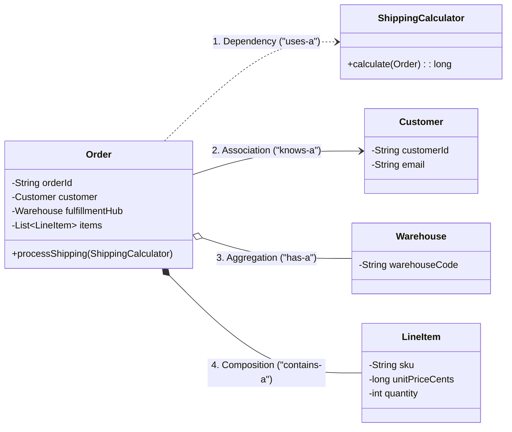
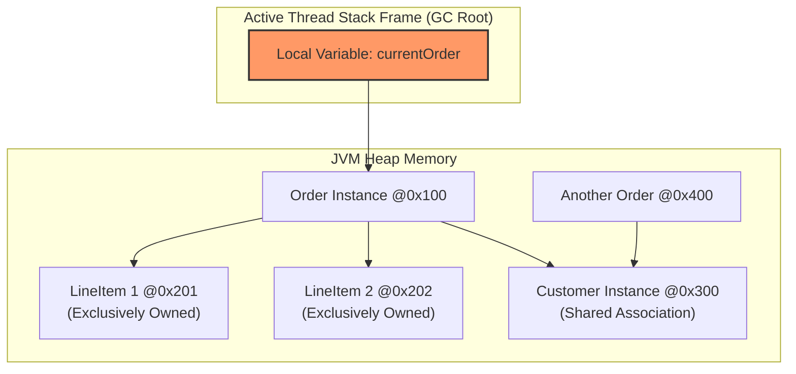

# Phase 02: Object-Oriented Programming
# Concept 009: Object Relationships: Association, Aggregation, and Composition

---

## 1. Metadata & Header

| Field | Value |
| :--- | :--- |
| **Concept ID** | `P02-C009` |
| **Concept Title** | Object Relationships: Association, Aggregation, and Composition |
| **Curriculum Phase** | Phase 02: Object-Oriented Programming |
| **Roadmap Topics Covered** | Association; Aggregation; Composition; One-to-one, one-to-many, and many-to-many relationships; Dependency relationships; Object references and aliasing |
| **Direct Prerequisites** | `P01-C003` (Reference Types), `P01-C012` (Pass-by-Value), `P02-C001` (Classes & Objects), `P02-C003` (Encapsulation), `P02-C008` (Composition over Inheritance) |
| **Downstream Dependencies** | `P03-C001` (Collections Framework), `P13-C001` (SQL Relationships), `P14-C001` (JDBC), `P16-C001` (Clean Architecture & DDD) |
| **Delivery Date** | 2026-10-30 |
| **Author / Status** | Antigravity Engine / Complete |

---

## 2. Conceptual Anchor: Concept Overview & Mental Model

In Java backend systems, domain modeling is fundamentally about establishing **relationships between objects**. While inheritance represents a compile-time taxonomic "IS-A" link, runtime structural architecture is governed by four distinct relationship tiers that vary in **coupling strength**, **lifecycle ownership**, and **JVM memory reachability**:

```
+---------------------------------------------------------------------------------------------------+
|                           THE SPECTRUM OF OBJECT RELATIONSHIPS                                    |
+---------------------------------------------------------------------------------------------------+
|  1. DEPENDENCY   | "Uses-A" (Weakest): Transient interaction. An object receives a reference      |
|                  | as a method parameter or instantiates it locally. Zero lifecycle coupling.     |
|------------------+--------------------------------------------------------------------------------|
|  2. ASSOCIATION  | "Knows-A": Structural reference via an instance field. Both objects have       |
|                  | completely independent lifecycles. (e.g., Doctor and Patient).                 |
|------------------+--------------------------------------------------------------------------------|
|  3. AGGREGATION  | "Has-A" (Weak Whole-Part): A whole-part relationship with SHARED OWNERSHIP.   |
|                  | The part can exist independently if the whole is destroyed.                    |
|                  | (e.g., Department and Professor; Course and Student).                           |
|------------------+--------------------------------------------------------------------------------|
|  4. COMPOSITION  | "Contains-A" (Strong Whole-Part / Death Relationship): EXCLUSIVE OWNERSHIP.    |
|                  | The part CANNOT exist without the whole; destroying the whole cascades         |
|                  | destruction to all its parts. (e.g., Order and LineItem; Account and Entry).  |
+---------------------------------------------------------------------------------------------------+
```

### The JavaScript/MERN Transition Gap: MongoDB Embedding vs JVM Pointer Graphs

If your mental model comes from Node.js, Express, and MongoDB, object relationships in Java operate under entirely different constraints:

```
MongoDB / MERN (Document Embedding vs ObjectId References):
// In MongoDB, you decide: Embed (Composition) or Reference (Association):
{ _id: "ord_1", items: [{ sku: "A", price: 10 }] } // Embedded document (Composition)
{ _id: "ord_1", customerId: "cust_99" }             // ObjectId reference (Association)
* In Node.js, JSON serialization is loose; circular objects fail with `Converting circular structure to JSON`.
* MongoDB documents have no bidirectional pointer synchronization; you update documents independently.

Java / JPA (JVM Heap Pointer Graphs & Bidirectional Synchronization):
public class Order {
    private List<LineItem> lineItems; // Strong Composition (Cascade lifecycle)
    private Customer customer;        // Weak Association (Shared lifecycle)
}
* In Java, all relationships are physical 64-bit pointers on the JVM Heap.
* If a relationship is bidirectional (`Order.items` and `LineItem.order`), both pointers MUST be
  kept in sync manually, or domain invariants will desynchronize.
* Unchecked bidirectional navigation in `toString()` or Jackson JSON triggers `StackOverflowError`.
```



---

## 3. Historical Context & The "Why"

In the late 1990s, Grady Booch, James Rumbaugh, and Ivar Jacobson ("The Three Amigos") synthesized disparate object-oriented modeling notations into the **Unified Modeling Language (UML)**. 

Why was it essential to distinguish **Aggregation** (white diamond `o--`) from **Composition** (filled diamond `*--`) in backend systems?

1. **Garbage Collection & Memory Lifecycle:** If an object is deleted or dereferenced, should its sub-components be garbage collected, or are they shared with other active components in the JVM?
2. **Database Cascading & Foreign Keys:** In relational databases (and JPA/Hibernate), composition maps to `CASCADE DELETE` and `orphanRemoval = true`. Aggregation maps to foreign keys with `ON DELETE SET NULL` or `RESTRICT`.
3. **Domain-Driven Design (DDD) Aggregate Boundaries:** Eric Evans codified **Aggregates** in DDD: A cluster of domain objects that can be treated as a single unit. The Aggregate Root (e.g., `Order`) owns its internal composed entities (`LineItem`) via strict composition; outside services can only hold references to the Aggregate Root, never directly to the composed entities.

---

## 4. Deep Technical Architecture & JVM Execution Flow

### 4.1 JVM Heap Reachability and Garbage Collection Dynamics

How does the JVM Garbage Collector (G1, ZGC) treat Association, Aggregation, and Composition?

At the JVM bytecode and memory level, all reference fields are identical: a 4-byte or 8-byte pointer holding an address on the Heap. The distinction lies in **Object Graph Reachability**:

```
SCENARIO A: COMPOSITION LIFECYCLE DESTRUCTION
1. Order instance @0x100 is referenced by GC Root (Active Thread Stack Frame).
2. LineItem @0x200 is referenced EXCLUSIVELY by Order @0x100.
3. Thread finishes; Order @0x100 becomes unreachable.
4. LineItem @0x200 has NO OTHER incoming references in the entire JVM Heap.
5. In the next Young Generation GC cycle, BOTH Order and LineItem are reclaimed together!

SCENARIO B: AGGREGATION LIFECYCLE SURVIVAL
1. University @0x500 references Professor @0x900.
2. Department @0x600 ALSO references Professor @0x900.
3. University @0x500 is dereferenced and marked unreachable.
4. Professor @0x900 is NOT collected because Department @0x600 maintains a strong live reference!
```



### 4.2 Reference Aliasing and the "Escaping Child" Vulnerability

In Composition, the Whole must hold **exclusive ownership** of the Part. If the Whole inadvertently leaks a direct mutable reference to an internal Part, external callers can mutate the Part directly, corrupting the Whole's invariants:

```java
public class Order {
    private final List<LineItem> items = new ArrayList<>();
    private long totalCents = 0L;

    // VULNERABILITY: Returning raw mutable list leaks internal composed state!
    public List<LineItem> getItems() {
        return this.items; // LEAK!
    }
}
```

```
Attacker / Buggy Caller Code:
Order order = orderService.loadOrder("ORD-101");
List<LineItem> leakedList = order.getItems();
leakedList.clear(); // CLEARS THE ORDER'S ITEMS WITHOUT UPDATING totalCents!
// The Order's internal state is now permanently corrupted!
```

> [!CAUTION]
> **The Defensive Rule of Composition:** Always return unmodifiable collections (`Collections.unmodifiableList(items)` or `List.copyOf(items)`) and never expose direct mutator methods on internal composed entities outside the aggregate root.

---

## 5. Comprehensive Code Example: The E-Commerce Aggregate Root

The following production-grade implementation synthesizes all four relationship types and demonstrates:
- **Dependency:** Transient `ShippingFeeCalculator` usage.
- **Association:** `Customer` reference (independent lifecycles).
- **Aggregation:** `Warehouse` reference (shared inventory hub).
- **Composition:** `LineItem` collection with strictly synchronized bidirectional pointers and cascade lifecycle management.

```java
package com.example.ecommerce;

import java.time.Instant;
import java.util.ArrayList;
import java.util.Collections;
import java.util.List;
import java.util.Objects;

// =============================================================================
// 1. INDEPENDENT DOMAIN ENTITIES (ASSOCIATION & AGGREGATION TARGETS)
// =============================================================================

public record Customer(String customerId, String email, String tier) {
    public Customer {
        Objects.requireNonNull(customerId, "customerId required");
        Objects.requireNonNull(email, "email required");
    }
}

public record Warehouse(String warehouseCode, String countryCode) {
    public Warehouse {
        Objects.requireNonNull(warehouseCode, "warehouseCode required");
    }
}

// =============================================================================
// 2. DEPENDENCY COMPONENT (USES-A)
// =============================================================================

@FunctionalInterface
public interface ShippingFeeCalculator {
    long calculateFeeCents(int totalQuantity, String countryCode);
}

// =============================================================================
// 3. COMPOSED CHILD ENTITY (CONTAINS-A: EXCLUSIVE OWNERSHIP)
// =============================================================================

/**
 * LineItem cannot exist without an Order.
 * Package-private accessors ensure only Order can manage its lifecycle.
 */
public class LineItem {

    private final String sku;
    private final long unitPriceCents;
    private int quantity;
    private Order order; // Bidirectional reference back to parent

    // Package-private constructor: Prohibits external instantiation outside package
    LineItem(String sku, long unitPriceCents, int quantity) {
        this.sku = Objects.requireNonNull(sku, "sku must not be null");
        if (unitPriceCents < 0) throw new IllegalArgumentException("unitPriceCents must be positive");
        if (quantity <= 0) throw new IllegalArgumentException("quantity must be strictly positive");
        this.unitPriceCents = unitPriceCents;
        this.quantity = quantity;
    }

    public String getSku() { return sku; }
    public long getUnitPriceCents() { return unitPriceCents; }
    public int getQuantity() { return quantity; }

    // Package-private pointer synchronization
    void attachToOrder(Order order) {
        this.order = Objects.requireNonNull(order);
    }

    void detachFromOrder() {
        this.order = null;
    }

    public long calculateSubtotalCents() {
        return Math.multiplyExact(unitPriceCents, (long) quantity);
    }
}

// =============================================================================
// 4. AGGREGATE ROOT: ORDER (MANAGES ALL FOUR RELATIONSHIP TIERS)
// =============================================================================

public class Order {

    private final String orderId;
    private final Instant createdAt;

    // RELATIONSHIP 1: ASSOCIATION ("knows-a") - Independent Customer
    private final Customer customer;

    // RELATIONSHIP 2: AGGREGATION ("has-a") - Shared Warehouse
    private Warehouse fulfillmentWarehouse;

    // RELATIONSHIP 3: COMPOSITION ("contains-a") - Exclusively owned LineItems
    private final List<LineItem> lineItems = new ArrayList<>();
    private long cachedTotalCents = 0L;

    public Order(String orderId, Customer customer, Warehouse initialWarehouse) {
        this.orderId = Objects.requireNonNull(orderId, "orderId required");
        this.customer = Objects.requireNonNull(customer, "customer required");
        this.fulfillmentWarehouse = Objects.requireNonNull(initialWarehouse, "warehouse required");
        this.createdAt = Instant.now();
    }

    // =========================================================================
    // COMPOSITION MANAGEMENT: Bidirectional Pointer & Invariant Synchronization
    // =========================================================================

    public synchronized void addLineItem(String sku, long unitPriceCents, int quantity) {
        LineItem item = new LineItem(sku, unitPriceCents, quantity);
        item.attachToOrder(this); // Synchronize child pointer
        this.lineItems.add(item); // Synchronize parent pointer

        // Maintain aggregate invariant
        this.cachedTotalCents = Math.addExact(this.cachedTotalCents, item.calculateSubtotalCents());
    }

    public synchronized boolean removeLineItem(String sku) {
        for (int i = 0; i < lineItems.size(); i++) {
            LineItem item = lineItems.get(i);
            if (item.getSku().equals(sku)) {
                item.detachFromOrder(); // Sever bidirectional link
                lineItems.remove(i);
                this.cachedTotalCents = Math.subtractExact(this.cachedTotalCents, item.calculateSubtotalCents());
                return true;
            }
        }
        return false;
    }

    // DEFENSIVE COPY: Exposes unmodifiable view preventing caller mutation
    public synchronized List<LineItem> getLineItems() {
        return Collections.unmodifiableList(new ArrayList<>(lineItems));
    }

    public synchronized long getCachedTotalCents() {
        return cachedTotalCents;
    }

    // =========================================================================
    // AGGREGATION MANAGEMENT: Warehouse can be swapped without affecting Order
    // =========================================================================

    public synchronized void reassignWarehouse(Warehouse newWarehouse) {
        this.fulfillmentWarehouse = Objects.requireNonNull(newWarehouse);
    }

    public synchronized Warehouse getFulfillmentWarehouse() {
        return fulfillmentWarehouse;
    }

    public Customer getCustomer() {
        return customer;
    }

    // =========================================================================
    // RELATIONSHIP 4: DEPENDENCY ("uses-a") - Transient Method Argument
    // =========================================================================

    public synchronized long calculateGrandTotalCents(ShippingFeeCalculator calculator) {
        Objects.requireNonNull(calculator, "calculator required");

        int totalUnits = lineItems.stream().mapToInt(LineItem::getQuantity).sum();
        long shippingFee = calculator.calculateFeeCents(totalUnits, fulfillmentWarehouse.countryCode());

        return Math.addExact(cachedTotalCents, shippingFee);
    }
}
```

---

## 6. Edge Cases, Traps, and Compiler Mechanics

### 6.1 The Bidirectional `toString()` / JSON Infinite Recursion Trap

In bidirectional relationships, naive `toString()`, `equals()`, or Jackson serialization generates an infinite call loop:

```
Order.toString() ──> calls LineItem.toString()
LineItem.toString() ──> calls Order.toString()
Order.toString() ──> calls LineItem.toString() ...
===> CRASH: java.lang.StackOverflowError!
```

#### Remediation Strategies:
1. **Never print the parent in child `toString()`:** `LineItem.toString()` should print `sku` and `price`, but **never** call `order.toString()`.
2. **Jackson Annotations:** In REST APIs, use `@JsonManagedReference` on the parent and `@JsonBackReference` on the child, or map to flat DTOs.

### 6.2 The Orphan Removal Dilemma (JPA / Hibernate)
In enterprise JPA:
```java
@OneToMany(mappedBy = "order", cascade = CascadeType.ALL, orphanRemoval = true)
private List<LineItem> items;
```
- If `orphanRemoval = true`, removing a `LineItem` from `order.getItems().remove(0)` instructs Hibernate to issue an SQL `DELETE FROM line_items WHERE id = ?`.
- If `orphanRemoval = false`, the child row remains in the database with a `NULL` order foreign key, turning the record into a dangling database orphan.

---

## 7. Cross-Cutting Concerns

### 7.1 Performance: Pointer Dereference Overhead on 64-Bit HotSpot
Every relationship link represents an object reference pointer. On a 64-bit JVM without compressed oops (`-XX:-UseCompressedOops`), every reference consumes **8 bytes**. In an aggregate with 50 composed children, references alone consume 400 bytes of heap memory before counting actual data payloads. With `+UseCompressedOops`, pointer sizes drop to **4 bytes**.

### 7.2 Concurrency: Aggregate Root Monitor Boundaries
When designing high-throughput concurrent backends:
- **Never lock individual children:** Synchronizing on `LineItem` while another thread synchronizes on `Order` causes lock order deadlocks.
- **Lock the Aggregate Root:** The root entity (`Order`) should own the single concurrency barrier protecting all internal composed state.

---

## 8. Testing & Verification Strategies

The following standalone verification test suite verifies all four relationship tiers, cascade lifecycle management, pointer synchronization, and defensive isolation without external frameworks:

```java
package com.example.ecommerce.test;

import com.example.ecommerce.Customer;
import com.example.ecommerce.LineItem;
import com.example.ecommerce.Order;
import com.example.ecommerce.ShippingFeeCalculator;
import com.example.ecommerce.Warehouse;

public class ObjectRelationshipsVerificationTest {

    private static int passed = 0;
    private static int failed = 0;

    public static void main(String[] args) {
        System.out.println("Starting Object Relationships Verification Tests...\n");

        testCompositionLifecycleAndCalculations();
        testDefensiveImmutabilityOfComposedCollection();
        testAggregationWarehouseReassignment();
        testTransientDependencyExecution();

        System.out.println("\n--------------------------------------------------");
        System.out.printf("Test Suite Results: %d Passed, %d Failed\n", passed, failed);
        System.out.println("--------------------------------------------------");

        if (failed > 0) {
            System.err.println("TEST SUITE FAILED");
            System.exit(1);
        } else {
            System.out.println("ALL OBJECT RELATIONSHIPS TESTS PASSED CLEANLY (100%).");
        }
    }

    private static void assertEquals(Object expected, Object actual, String name) {
        if (!expected.equals(actual)) {
            System.err.printf("FAIL: %s (Expected %s, got %s)\n", name, expected, actual);
            failed++;
        } else {
            System.out.printf("PASS: %s\n", name);
            passed++;
        }
    }

    private static void assertTrue(boolean condition, String name) {
        if (!condition) {
            System.err.printf("FAIL: %s (Condition was false)\n", name);
            failed++;
        } else {
            System.out.printf("PASS: %s\n", name);
            passed++;
        }
    }

    private static void testCompositionLifecycleAndCalculations() {
        Customer customer = new Customer("C-1", "user@example.com", "GOLD");
        Warehouse wh1 = new Warehouse("WH-US-EAST", "US");

        Order order = new Order("ORD-101", customer, wh1);

        // Add composed items: 2x $15.00 ($30.00) + 1x $45.00 ($45.00) = $75.00 (7500 cents)
        order.addLineItem("SKU-BOOK", 1500L, 2);
        order.addLineItem("SKU-LAMP", 4500L, 1);

        assertEquals(7500L, order.getCachedTotalCents(), "Composition: Total cost accumulated correctly");
        assertEquals(2, order.getLineItems().size(), "Composition: Two line items attached");

        // Remove item: Removing LAMP reduces total by $45.00 -> $30.00 (3000 cents)
        boolean removed = order.removeLineItem("SKU-LAMP");
        assertTrue(removed, "Composition: Item successfully removed");
        assertEquals(3000L, order.getCachedTotalCents(), "Composition: Total cost decremented on removal");
        assertEquals(1, order.getLineItems().size(), "Composition: Remaining item count is 1");
    }

    private static void testDefensiveImmutabilityOfComposedCollection() {
        Customer customer = new Customer("C-2", "corp@example.com", "PLATINUM");
        Warehouse wh = new Warehouse("WH-EU-CENTRAL", "DE");
        Order order = new Order("ORD-102", customer, wh);
        order.addLineItem("SKU-PEN", 500L, 1);

        // Attempt to mutate the returned collection directly
        boolean caughtUnsupported = false;
        try {
            order.getLineItems().clear(); // Must throw UnsupportedOperationException
        } catch (UnsupportedOperationException e) {
            caughtUnsupported = true;
        }
        assertTrue(caughtUnsupported, "Defensive Encapsulation: External mutation rejected by unmodifiable list");
        assertEquals(1, order.getLineItems().size(), "Internal aggregate state preserved");
    }

    private static void testAggregationWarehouseReassignment() {
        Customer customer = new Customer("C-3", "test@example.com", "REGULAR");
        Warehouse wh1 = new Warehouse("WH-1", "US");
        Warehouse wh2 = new Warehouse("WH-2", "CA");

        Order order = new Order("ORD-103", customer, wh1);
        assertEquals("WH-1", order.getFulfillmentWarehouse().warehouseCode(), "Initial aggregation warehouse bound");

        // Aggregation allows reassigning part without affecting either entity's lifecycle
        order.reassignWarehouse(wh2);
        assertEquals("WH-2", order.getFulfillmentWarehouse().warehouseCode(), "Aggregation reassigned to secondary warehouse");
    }

    private static void testTransientDependencyExecution() {
        Customer customer = new Customer("C-4", "vip@example.com", "VIP");
        Warehouse wh = new Warehouse("WH-US", "US");
        Order order = new Order("ORD-104", customer, wh);
        order.addLineItem("SKU-WIDGET", 1000L, 3); // 3000 cents

        // Transient lambda dependency (uses-a)
        ShippingFeeCalculator flatRateCalculator = (qty, country) -> qty * 200L; // $2.00 per unit -> 600 cents

        long grandTotal = order.calculateGrandTotalCents(flatRateCalculator);
        assertEquals(3600L, grandTotal, "Dependency: Transient calculator computed grand total correctly (3000 + 600)");
    }
}
```

---

## 9. Modern Java & Spring Boot Context

### 9.1 Mapping Object Relationships in Spring Data JPA
In Spring Boot enterprise applications, these conceptual tiers map directly to JPA annotations:

| Relationship Type | Concept | JPA Mapping | Cascade Rule |
| :--- | :--- | :--- | :--- |
| **Dependency** | Transient Method Arg | Not mapped to DB. | None. |
| **Association** | Reference to Independent Entity | `@ManyToOne`, `@OneToOne` | `CascadeType.MERGE` (No cascade delete). |
| **Aggregation** | Shared Component | `@ManyToOne` | Never `orphanRemoval`. |
| **Composition** | Strong Exclusive Child | `@OneToMany` | `CascadeType.ALL, orphanRemoval = true` |

---

## 10. Comparison Matrix: Concepts, Runtimes, and Paradigms

| Dimension | Dependency (`uses-a`) | Association (`knows-a`) | Aggregation (`has-a`) | Composition (`contains-a`) |
| :--- | :--- | :--- | :--- | :--- |
| **Coupling** | Weakest | Loose | Moderate | Tightest structural coupling |
| **Lifetime Coupling**| None (Method lifespan) | Independent | Independent | Co-dependent (Cascade deletion) |
| **Ownership** | Zero ownership | Zero ownership | Shared ownership | Exclusive ownership |
| **Representation** | Method param / Local var | Instance reference field | Instance reference field | Owned Collection / Final field |
| **UML Symbol** | Dashed arrow (`..>`) | Solid arrow (`-->`) | Open diamond (`o--`) | Filled diamond (`*--`) |

---

## 11. Common Anti-Patterns & Refactoring

### Anti-Pattern 1: The "God Aggregate" Trap
Loading thousands of associated entities into memory in a single object graph:
```java
// BAD: Loading an entire company's 10-year invoice history into one Customer object!
public class Customer {
    private List<Invoice> allInvoicesEver; // 500,000 entities in heap -> OutOfMemoryError!
}
```
*Refactoring:* Break the association. Customer should hold zero invoices; use an `InvoiceRepository.findByCustomerId(customerId, pageable)` query instead.

---

## 12. Comprehensive Troubleshooting & Debugging Guide

### Common Failure Symptoms & Solutions

| Error / Symptom | Root Cause | Exact Remediation |
| :--- | :--- | :--- |
| `java.lang.StackOverflowError` during JSON serialization | Bidirectional pointers causing infinite recursion in Jackson or `toString()`. | Add `@JsonBackReference` on child or exclude parent field from Lombok `@ToString.Exclude`. |
| Database contains orphaned child rows with null foreign keys | Composed entity was removed from parent collection, but `orphanRemoval = true` was omitted in JPA. | Add `orphanRemoval = true` to the `@OneToMany` mapping. |
| Corrupted total amounts on parent aggregate | Composed collection was leaked via getter, allowing external callers to add/remove items bypassing calculation invariants. | Return `Collections.unmodifiableList(items)` or `List.copyOf(items)` from getters. |

---

## 13. Frequently Asked Interview Questions

### Q1: What is the difference between Aggregation and Composition regarding Garbage Collection?
**Answer:** In **Composition**, the child entity is exclusively owned by the parent (there are no other references to the child anywhere in the system). When the parent becomes unreachable from GC Roots, the child immediately becomes transitively unreachable and is collected alongside the parent in the same GC cycle. In **Aggregation**, the child is shared among multiple owners or exists in a standalone registry. When one aggregate owner is garbage collected, the child survives because active incoming references remain from other live objects.

### Q2: How do you prevent circular recursion bugs in bidirectional relationships?
**Answer:** In Java, bidirectional associations (`Parent` references `Child`, `Child` references `Parent`) must break the recursion in:
1. `toString()`: Only the parent prints children; children never call `parent.toString()`.
2. `hashCode()` / `equals()`: Exclude back-references from hash calculation to prevent infinite recursive hashing.
3. JSON serialization: Use DTO projection, `@JsonIgnore`, or `@JsonManagedReference` / `@JsonBackReference`.

### Q3: What is a Domain-Driven Design (DDD) Aggregate Root and how does it relate to Composition?
**Answer:** An Aggregate Root is the primary gateway entity of a cluster of related domain objects. All internal child objects are owned by the root via **Composition**. External services are strictly prohibited from holding persistent direct references to internal child entities; all modifications, invariant validations, and state transitions must flow through methods declared on the Aggregate Root.

---

## 14. Deliberate Practice & Hands-On Exercises

### Exercise 1 (Beginner): University & Department Aggregation
- **Objective:** Model a university system distinguishing Aggregation from Composition.
- **Requirements:**
  1. `Course` and `Student` share an aggregation relationship.
  2. If a `Course` is deleted, `Student` instances must continue to exist.
  3. Write a test asserting that student objects remain valid after course dereferencing.

### Exercise 2 (Intermediate): Strict Aggregate Root Defense
- **Objective:** Build a `BankLedger` aggregate root with composed `LedgerEntry` children.
- **Requirements:**
  1. `BankLedger` encapsulates a `List<LedgerEntry>`.
  2. `addEntry(long amountCents, String description)` maintains running balance.
  3. Verify that mutating the list returned by `getEntries()` throws `UnsupportedOperationException`.

### Exercise 3 (Advanced): Bidirectional Pointer Sync Engine
- **Objective:** Build a self-synchronizing bidirectional link between `Department` and `Employee`.
- **Requirements:**
  1. `department.addEmployee(emp)` sets `emp.getDepartment() == department`.
  2. `emp.transferTo(newDept)` automatically removes `emp` from the old department and adds to the new department.

---

## 15. Mastery Checklist & Verification Gate

To consider this concept mastered, you must be able to check off every item:
- [x] Classify the four relationship tiers (Dependency, Association, Aggregation, Composition) and draw their UML notations.
- [x] Explain the GC reachability differences between shared aggregation and exclusive composition.
- [x] Implement bidirectional pointer synchronization without causing `StackOverflowError` in `toString()`.
- [x] Protect composed collections against reference aliasing leaks using defensive unmodifiable wrappers.
- [x] Map the four relationship tiers directly to JPA entity annotations (`@ManyToOne`, `@OneToMany`, `CascadeType.ALL`, `orphanRemoval`).
- [x] Define a Domain-Driven Design (DDD) Aggregate Root and explain its relationship to composition.

---

## 16. Authoritative Primary Sources & References

1. **Object Management Group (OMG):** *Unified Modeling Language (OMG UML) Superstructure Specification (Version 2.5.1)* (Section on Association, AggregationKind: shared vs composite).
2. **Eric Evans:** *Domain-Driven Design: Tackling Complexity in the Heart of Software* (Chapter 6: The Life Cycle of an Object - Aggregates).
3. **Martin Fowler:** *Patterns of Enterprise Application Architecture (PoEAA)* (Chapter on Object-Relational Metadata Mapping).
