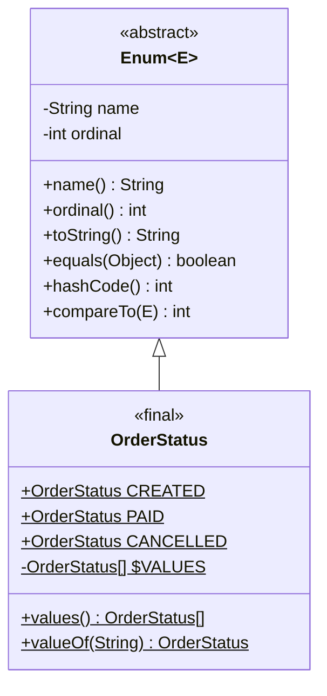

# Phase 02: Object-Oriented Programming
# Concept 010: Enums as Rich Domain Objects and Singleton Patterns

---

## 1. Metadata and Learning Goals

| Metadata Field | Value |
|---|---|
| **Concept ID** | `P02-C010` |
| **Concept Title** | Enums as Rich Domain Objects and Singleton Patterns |
| **Phase** | Phase 02 — Object-Oriented Programming |
| **Phase Directory** | `curriculum/phase-02-object-oriented-programming` |
| **Source Reference** | `java-backend-engineering-prerequisites-roadmap.md` > Phase 2 > Additional language constructs > Enums |
| **Concept Type** | Language / Architecture / Concurrency |
| **Difficulty Level** | Intermediate to Advanced |
| **Curriculum Importance** | Essential |
| **Java Baseline** | Java 21 LTS (with Java 21 switch pattern matching) |
| **Framework Baseline** | Spring Boot 3.3.x / JPA (Hibernate 6.x) / Jackson 2.17 |
| **Prerequisites** | [`001-classes-objects-constructors.md`](001-classes-objects-constructors.md), [`002-static-members-and-initialization.md`](002-static-members-and-initialization.md), [`006-overriding-dynamic-dispatch.md`](006-overriding-dynamic-dispatch.md) |
| **Related Concepts** | [`013-sealed-classes-and-interfaces.md`](013-sealed-classes-and-interfaces.md), [`014-pattern-matching-oop.md`](014-pattern-matching-oop.md), `P03-C004` (EnumSet & EnumMap) |
| **Estimated Study Effort** | 3–4 hours |
| **Last Research Date** | 2026-10-30 |
| **Verification State** | COMPLETE |

### Measurable Learning Objectives
By the end of this concept module, you will be able to:
1. **Explain:** Explain how Java enums compile into nominal subclasses of `java.lang.Enum<E>`, how the JVM handles their instantiation during `<clinit>`, and why they are globally unique, type-safe singletons.
2. **Compare:** Contrast Java rich enums with TypeScript string unions and C-style integer enums, explaining why Java enums can encapsulate fields, behavior, polymorphic overrides, and state machines.
3. **Implement:** Construct rich domain enums encapsulating behavior, state transition rules, strategy execution, and interface contracts.
4. **Debug & Diagnose:** Identify and eliminate critical enum bugs including database corruption from `ordinal()` persistence, data races from mutable enum fields, Jackson deserialization failures, and GC churn from `values()` defensive copies.
5. **Evaluate & Justify:** Articulate why Joshua Bloch's Enum Singleton provides ironclad immunity against reflection and serialization attacks, and explain the hardware-accelerated bit-vector mechanics of `EnumSet` and `EnumMap`.

---

## 2. Definition, Purpose, and Mental Model

### 2.1 Formal Definition
In Java, an **Enum** (enumerated type, introduced in Java 5 via JSR 201 and defined in JLS §8.9) is a specialized class type extending `java.lang.Enum<E>` whose instances form a fixed, compile-time-known set of immutable singleton objects.

Unlike primitive or integer enumerations in languages like C/C++, Java enums are full-featured **nominal reference types**. An enum can declare fields, constructors, instance methods, static utility methods, implement interfaces, and declare **constant-specific class bodies** where individual enum constants override methods polymorphically.

### 2.2 The Problem It Solves
Prior to Java 5, Java engineers relied on the **`int` Enum Pattern** or **`String` Enum Pattern**:

```java
// THE DANGEROUS INT ENUM PATTERN (PRE-JAVA 5)
public static final int ORDER_STATUS_PENDING = 0;
public static final int ORDER_STATUS_PAID = 1;
public static final int ORDER_STATUS_CANCELLED = 2;

public static final int USER_ROLE_ADMIN = 0; // Collides with ORDER_STATUS_PENDING!
```

This pattern caused catastrophic failures:
- **Zero Type Safety:** You could pass `USER_ROLE_ADMIN` into a method expecting an `ORDER_STATUS`, and the compiler accepted it without warning because both were raw `int` values.
- **Zero Namespace Isolation:** Constants could collide silently.
- **Brittle Code & Magic Numbers:** Printing the status displayed `0` or `1` in log files instead of human-readable text.
- **No Associated Behavior:** Logic manipulating statuses had to be written in disconnected static utility methods full of fragile `switch` statements scattered across the codebase.

### 2.3 Why Backend Engineers Need It
In enterprise backend architectures (Spring Boot, banking engines, e-commerce workflows), enums are not passive tags. They represent:
1. **Domain Lifecycle States:** Finite State Machines (FSMs) governing transitions (e.g., `OrderState: CREATED -> AUTHORIZED -> CAPTURED -> SETTLED`).
2. **Pluggable Domain Strategies:** Routing business logic without verbose Spring `@Component` overhead (e.g., discount calculation formulas, currency rounding rules).
3. **Ironclad Singletons:** Global system services guaranteed to exist as exactly one instance per ClassLoader, immune to reflection and serialization hacking.
4. **High-Performance Flags:** Replacing integer bitmasks with `EnumSet`, delivering single-cycle CPU bitwise execution with full nominal type safety.

### 2.4 JavaScript/MERN vs Java Mental Model Gap

If you come from JavaScript/TypeScript, your mental model of enums is fundamentally different:

```
JavaScript / TypeScript:
type OrderStatus = 'PENDING' | 'PAID' | 'SHIPPED'; 
// Or TypeScript enum:
enum OrderStatus { PENDING, PAID, SHIPPED }
* In TypeScript, enums or string unions are completely erased at runtime.
* An enum in TS is compiled into a plain JavaScript dictionary: { PENDING: 0, 0: "PENDING" }.
* TS enums CANNOT hold behavior, methods, state machines, or interface implementations.
* They cannot enforce memory-safe singletons or hardware bitmasks.

Java 21 LTS:
public enum OrderStatus implements StateTransitionValidator {
    PENDING {
        @Override public boolean canTransitionTo(OrderStatus next) { return next == PAID || next == CANCELLED; }
    },
    PAID {
        @Override public boolean canTransitionTo(OrderStatus next) { return next == SHIPPED; }
    };
    public abstract boolean canTransitionTo(OrderStatus next);
}
* In Java, OrderStatus is a physical, final class on the JVM Heap.
* Each constant is a statically typed singleton instance created at class initialization (<clinit>).
* PENDING and PAID are distinct polymorphic subclasses (OrderStatus$1, OrderStatus$2)!
* Enums hold full encapsulated business logic, state machines, and invariants.
```

### 2.5 What This Concept Is NOT
- **NOT a Primitive Integer Mask:** A Java enum is not an integer. You cannot cast an enum to an `int` or perform arithmetic on it.
- **NOT a Mutable Data Carrier:** Enums are global singletons across the entire JVM ClassLoader. Adding mutable fields to an enum produces disastrous race conditions across concurrent HTTP requests.
- **NOT an Extensible Class:** You cannot write `public class MyEnum extends OrderStatus`. Enums are implicitly `final` (or `sealed`), and `java.lang.Enum` cannot be explicitly subclassed by regular classes (JLS §8.9).

---

## 3. Foundations and Theory: Compiler Mechanics and JVM Bytecode

### 3.1 What `javac` Actually Generates
When you write an enum:

```java
public enum Currency {
    USD(840, "$"),
    EUR(978, "€");

    private final int numericCode;
    private final String symbol;

    Currency(int numericCode, String symbol) {
        this.numericCode = numericCode;
        this.symbol = symbol;
    }

    public int getNumericCode() { return numericCode; }
    public String getSymbol() { return symbol; }
}
```

The Java compiler desugars this into a standard Java class with special bytecode flags and structures. Disassembling with `javap -c -p Currency.class` reveals:

```java
public final class Currency extends java.lang.Enum<Currency> {
    // 1. Static constants representing each enum entry
    public static final Currency USD;
    public static final Currency EUR;

    // 2. Synthetic array holding all instances in declaration order
    private static final Currency[] $VALUES;

    // 3. Instance fields declared by the developer
    private final int numericCode;
    private final String symbol;

    // 4. Synthetic static methods generated by compiler
    public static Currency[] values() {
        return (Currency[])$VALUES.clone(); // DEFENSIVE CLONE!
    }

    public static Currency valueOf(java.lang.String name) {
        return (Currency)java.lang.Enum.valueOf(Currency.class, name);
    }

    // 5. Private constructor taking synthetic name and ordinal arguments
    private Currency(java.lang.String name, int ordinal, int numericCode, java.lang.String symbol) {
        super(name, ordinal); // Delegated to java.lang.Enum(String name, int ordinal)
        this.numericCode = numericCode;
        this.symbol = symbol;
    }

    // 6. Static initializer (<clinit>) instantiating the singletons
    static {
        USD = new Currency("USD", 0, 840, "$");
        EUR = new Currency("EUR", 1, 978, "€");
        $VALUES = new Currency[] { USD, EUR };
    }
}
```

### 3.2 Key Bytecode Discoveries
1. **Class Hierarchy:** `Currency` extends `java.lang.Enum<Currency>`. In the classfile, it carries the access flag `ACC_ENUM` and `ACC_FINAL`.
2. **Hidden Constructor Arguments:** The developer defined a 2-parameter constructor `Currency(int, String)`. The compiler quietly prepended two synthetic parameters: `String name` and `int ordinal`, invoking `super(name, ordinal)`.
3. **Private Constructors:** Enum constructors are strictly `private`. If you omit the modifier, it defaults to `private`, not package-private! You cannot declare an enum constructor `public` or `protected`—the compiler flags it as a compile error (JLS §8.9.2).
4. **Static Initialization Order:** All enum constants are instantiated sequentially in the `<clinit>` block in the exact order they are declared.



### 3.3 Constant-Specific Class Bodies (Polymorphic Enums)
Java enums can define `abstract` methods. When an enum defines an abstract method, each constant **must** provide an implementation in its constant-specific class body:

```java
public enum Operation {
    PLUS {
        @Override
        public double apply(double x, double y) { return x + y; }
    },
    MINUS {
        @Override
        public double apply(double x, double y) { return x - y; }
    };

    public abstract double apply(double x, double y);
}
```

#### What happens in bytecode?
`Operation` is no longer `ACC_FINAL`—it is marked `ACC_ABSTRACT`!
`javac` generates **anonymous subclasses** for every constant:
- `Operation$1.class` (subclass for `PLUS`)
- `Operation$2.class` (subclass for `MINUS`)

Each constant is instantiated as an instance of its anonymous subclass (`PLUS = new Operation$1("PLUS", 0)`). This is the **Strategy Pattern** baked into the Java language runtime at compile time with zero allocation overhead!

---

## 4. Practical Syntax, Usage, and Best Practices

### 4.1 The Rich Domain Enum: Finite State Machine (FSM)
In enterprise backends, state transitions must be strictly enforced. Modeling states as simple strings or integers allows invalid transitions (e.g., transitioning an order from `REFUNDED` back to `PROCESSING`).

Here is how a production-grade backend implements a self-validating state machine inside an Enum:

```java
package com.example.domain;

import java.util.EnumSet;
import java.util.Objects;
import java.util.Set;

public enum OrderState {

    CREATED {
        @Override
        public Set<OrderState> nextValidStates() {
            return EnumSet.of(PENDING_PAYMENT, CANCELLED);
        }
    },
    PENDING_PAYMENT {
        @Override
        public Set<OrderState> nextValidStates() {
            return EnumSet.of(PAID, PAYMENT_FAILED, CANCELLED);
        }
    },
    PAYMENT_FAILED {
        @Override
        public Set<OrderState> nextValidStates() {
            return EnumSet.of(PENDING_PAYMENT, CANCELLED);
        }
    },
    PAID {
        @Override
        public Set<OrderState> nextValidStates() {
            return EnumSet.of(SHIPPED, REFUNDED);
        }
    },
    SHIPPED {
        @Override
        public Set<OrderState> nextValidStates() {
            return EnumSet.of(DELIVERED, RETURN_REQUESTED);
        }
    },
    DELIVERED {
        @Override
        public Set<OrderState> nextValidStates() {
            return EnumSet.of(RETURN_REQUESTED);
        }
    },
    RETURN_REQUESTED {
        @Override
        public Set<OrderState> nextValidStates() {
            return EnumSet.of(REFUNDED, CLOSED);
        }
    },
    REFUNDED {
        @Override
        public Set<OrderState> nextValidStates() {
            return EnumSet.of(CLOSED);
        }
    },
    CANCELLED {
        @Override
        public Set<OrderState> nextValidStates() {
            return EnumSet.of(CLOSED);
        }
    },
    CLOSED {
        @Override
        public Set<OrderState> nextValidStates() {
            return EnumSet.noneOf(OrderState.class); // Terminal state
        }
    };

    public abstract Set<OrderState> nextValidStates();

    public boolean canTransitionTo(OrderState target) {
        Objects.requireNonNull(target, "Target state cannot be null");
        return nextValidStates().contains(target);
    }

    public OrderState transitionTo(OrderState target) {
        if (!canTransitionTo(target)) {
            throw new IllegalStateException(
                String.format("Invalid state transition: Cannot transition from %s to %s", this, target)
            );
        }
        return target;
    }
}
```

### 4.2 Strategy Pattern with Enums
Instead of creating dozens of Spring `@Component` classes for discount policies, an enum can model algorithms cleanly when the set of strategies is bounded and domain-driven:

```java
public enum DiscountPolicy {

    NONE(0) {
        @Override
        public long applyDiscountCents(long amountCents) {
            return amountCents;
        }
    },
    BLACK_FRIDAY(20) {
        @Override
        public long applyDiscountCents(long amountCents) {
            long discount = (amountCents * 20L) / 100L;
            return amountCents - discount;
        }
    },
    VIP_TIER(30) {
        @Override
        public long applyDiscountCents(long amountCents) {
            long discount = (amountCents * 30L) / 100L;
            return amountCents - discount;
        }
    };

    private final int percentage;

    DiscountPolicy(int percentage) {
        this.percentage = percentage;
    }

    public int getPercentage() { return percentage; }
    public abstract long applyDiscountCents(long amountCents);
}
```

---

## 5. Memory Model, Concurrency, and Runtime Characteristics

### 5.1 Joshua Bloch's Enum Singleton
In *Effective Java* (Item 3), Joshua Bloch states:
> *"A single-element enum type is the best way to implement a singleton."*

Why is an Enum Singleton superior to classical singletons (e.g., private constructor + static `getInstance()`)?

```java
public enum ConnectionPoolManager {
    INSTANCE;

    private final String poolName = "PrimaryHikariCP";

    public void executeQuery(String sql) {
        // Safe, thread-safe access
    }
}
```

#### 1. Immunity to Reflection Attacks
In a classical singleton, an attacker can use Java Reflection to bypass a private constructor:
```java
Constructor<ClassicSingleton> ctor = ClassicSingleton.class.getDeclaredConstructor();
ctor.setAccessible(true);
ClassicSingleton instance2 = ctor.newInstance(); // Violates singleton!
```
When you try this on an enum:
```java
Constructor<ConnectionPoolManager> ctor = ConnectionPoolManager.class.getDeclaredConstructor(String.class, int.class);
ctor.setAccessible(true);
ctor.newInstance("HACKED", 1);
```
The JVM immediately throws:
```
java.lang.IllegalArgumentException: Cannot reflectively create enum objects
```
This check is hardcoded directly into `java.lang.reflect.Constructor.newInstance()`:
```java
// JDK 21 source code in Constructor.java:
if ((clazz.getModifiers() & Modifier.ENUM) != 0)
    throw new IllegalArgumentException("Cannot reflectively create enum objects");
```
Neither reflection, nor Unsafe, nor method handles can instantiate an enum reflectively!

#### 2. Immunity to Serialization Attacks
In a classical singleton, serializing and deserializing an object creates a **new instance** on the heap unless you implement complex `readResolve()` hooks.

With enums, the JVM treats serialization specially (Java Object Serialization Specification §1.12):
- During serialization, only the enum's **`name`** is written to the stream.
- During deserialization, the stream reads the name and looks up the singleton instance via:
  ```java
  Enum.valueOf(Class<T> enumClass, String name)
  ```
- The JVM **never invokes constructors, never allocates a new instance, and completely ignores `readObject()`**. The original singleton instance is always returned.

#### 3. Guaranteed Thread-Safe Class Loading
Enums are instantiated during the static initialization phase (`<clinit>`) of the class. Under JLS §12.4.2, the JVM guarantees that class initialization is protected by an internal ClassLoader lock. It is strictly thread-safe without requiring `volatile`, `synchronized`, or Double-Checked Locking.

### 5.2 High-Performance Specialized Collections: `EnumSet` and `EnumMap`

Java provides two collection classes optimized specifically for enums that outperform `HashSet` and `HashMap` by orders of magnitude.

#### 1. `EnumSet`: Hardware-Accelerated Bit-Vectors
If your enum has 64 or fewer elements (which covers 99.9% of enums), `EnumSet.noneOf(MyEnum.class)` returns a `RegularEnumSet`.
- A `RegularEnumSet` stores its elements in a single 64-bit primitive `long` field called `elements`!
- Adding an element is a single CPU bitwise OR: `elements |= (1L << e.ordinal())`.
- Checking membership is a single CPU bitwise AND: `(elements & (1L << e.ordinal())) != 0`.
- Bulk operations (`containsAll`, `retainAll`) execute in **a single CPU clock cycle**!
- If the enum exceeds 64 elements, it automatically switches to `JumboEnumSet`, backed by a `long[]` array.

```
RegularEnumSet Memory Representation (64-bit Bitmask):
Bit Position:  ... 5   4   3   2   1   0
Flag:          ... 0   0   1   0   1   0
                   │       │       │
                   │       │       └─ READ_PRIVILEGE (ordinal 1)
                   │       └───────── WRITE_PRIVILEGE (ordinal 3)
```

#### 2. `EnumMap`: Flat-Array Indexing
`EnumMap` is an implementation of `Map` where keys are enum constants.
- Internally, it is backed by two flat arrays: `K[] keyUniverse` and `Object[] vals`.
- Key lookup does not calculate `hashCode()` and does not traverse hash buckets or trees. It uses direct array indexing: `vals[key.ordinal()]`.
- Time complexity is a deterministic, cache-friendly $O(1)$ array offset dereference. Zero hash collisions are possible.

---

## 6. Failure Modes, Edge Cases, and Anti-Patterns

### Anti-Pattern 1: The Catastrophic `ordinal()` Database Persistence Trap
Every enum has an `ordinal()` method returning its zero-based declaration position.
Using `ordinal()` to persist enums in relational databases (or via JPA `@Enumerated(EnumType.ORDINAL)`) is one of the most destructive bugs in backend engineering.

```java
// DANGEROUS JPA MAPPING
@Entity
public class Payment {
    @Enumerated(EnumType.ORDINAL) // STORES 0, 1, 2 IN SQL COLUMN
    private PaymentStatus status;
}
```

```java
// DAY 1 DECLARATION
public enum PaymentStatus {
    PENDING,   // ordinal 0
    COMPLETED, // ordinal 1
    FAILED     // ordinal 2
}
```

Six months later, another developer adds a new status alphabetically or logically:
```java
// DAY 180 REFACTORING (DATA CORRUPTION DISASTER)
public enum PaymentStatus {
    PENDING,    // ordinal 0
    AUTHORIZED, // ordinal 1 <--- INSERTED!
    COMPLETED,  // ordinal 2 <--- SHIFTED FROM 1 TO 2!
    FAILED      // ordinal 3 <--- SHIFTED FROM 2 TO 3!
}
```

#### What happens to production data?
All historical payments that were `COMPLETED` (saved as `1` in the database) are now read back by Hibernate as `AUTHORIZED`! Payments that were `FAILED` (saved as `2`) are now read back as `COMPLETED`! The financial ledger is permanently corrupted without any exceptions thrown.

> [!CAUTION]
> **Production Rule:** Never use `ordinal()` for database persistence, RPC serialization, or Kafka event contracts. Always use `@Enumerated(EnumType.STRING)` or write an explicit JPA `AttributeConverter` that maps to an immutable code (e.g., `"COMP"`).

### Anti-Pattern 2: Mutable State in Enums (Data Races)
Because enum constants are global singletons shared across all threads in the JVM, any mutable instance field inside an enum becomes a shared, un-synchronized mutable state:

```java
// DANGEROUS: MUTABLE ENUM FIELD
public enum UserContext {
    CURRENT;

    private String currentUserId; // DISASTER: Shared across all concurrent HTTP requests!

    public void setUserId(String id) { this.currentUserId = id; }
    public String getUserId() { return this.currentUserId; }
}
```
In a multithreaded web server (Spring Boot with Tomcat/Virtual Threads), Request A sets `currentUserId = "user_123"`. Before Request A finishes, Request B sets `currentUserId = "user_999"`. Request A now processes data using Request B's credentials, creating a critical multi-tenant security vulnerability!

> [!IMPORTANT]
> **Rule of Enum Immutability:** All fields in an enum MUST be `private final`. Enums must be strictly immutable data and behavior definitions.

### Anti-Pattern 3: The `values()` Allocation Churn in Hot Loops
The compiler-generated `values()` method returns an array: `OrderStatus[]`.
To preserve encapsulation and prevent callers from modifying the internal `$VALUES` array (e.g., `OrderStatus.values()[0] = null;`), the JVM **allocates a new defensive clone array on every single invocation of `.values()`**!

```java
// DANGEROUS IN HIGH-THROUGHPUT LOOPS / KAFKA CONSUMERS
public boolean isValidStatus(String input) {
    for (OrderStatus s : OrderStatus.values()) { // ALLOCATES A NEW ARRAY ON EVERY CALL!
        if (s.name().equalsIgnoreCase(input)) return true;
    }
    return false;
}
```
If this method is called 100,000 times per second, it allocates 100,000 short-lived arrays per second, triggering high GC allocation churn and premature Minor GC pauses.

#### The High-Performance Fix:
Cache the values in an immutable `List` or a static lookup map:
```java
public enum OrderStatus {
    CREATED, PAID, SHIPPED;

    private static final List<OrderStatus> CACHED_VALUES = List.of(values());

    public static List<OrderStatus> getValues() {
        return CACHED_VALUES; // Zero allocation!
    }
}
```

### Anti-Pattern 4: Accessing Enum Static Fields from Constructors
Enum constants are initialized during the `<clinit>` method in declaration order, **before** any regular `static` fields in the enum are initialized!

```java
public enum Country {
    US, CA;

    // Static map intended to look up country by code
    private static final Map<String, Country> BY_CODE = new HashMap<>();

    Country() {
        // COMPILE ERROR: Illegal forward reference / NullPointerException
        // BY_CODE.put(this.name(), this); 
    }
}
```
The Java compiler explicitly prohibits referencing static fields from within an enum constructor (JLS §8.9.2). To build a static lookup map, initialize it in a static initialization block *after* the constants:

```java
public enum Country {
    US("United States"),
    CA("Canada");

    private static final Map<String, Country> BY_NAME;

    private final String displayName;

    Country(String displayName) {
        this.displayName = displayName;
    }

    static {
        Map<String, Country> map = new HashMap<>();
        for (Country c : values()) {
            map.put(c.displayName.toLowerCase(), c);
        }
        BY_NAME = Collections.unmodifiableMap(map);
    }

    public static Country fromDisplayName(String name) {
        return name == null ? null : BY_NAME.get(name.toLowerCase());
    }
}
```

---

## 7. Comprehensive Code Example: The Payment Gateway Transaction Router

The following production-grade implementation synthesizes:
- Constant-specific class bodies (polymorphic fees & routing).
- Strategy Pattern execution with arithmetic safety.
- Immutable state machine verification.
- Enum Singleton for gateway registry.
- Lookup map with case-insensitive parsing and zero GC allocation.

```java
package com.example.payment;

import java.time.Instant;
import java.util.Collections;
import java.util.EnumSet;
import java.util.HashMap;
import java.util.Map;
import java.util.Objects;
import java.util.Set;

// =============================================================================
// 1. RICH DOMAIN ENUM: TRANSACTION STATE MACHINE (FSM)
// =============================================================================

public enum TransactionState {

    SUBMITTED {
        @Override
        public Set<TransactionState> allowedTransitions() {
            return EnumSet.of(AUTHORIZED, REJECTED);
        }
    },
    AUTHORIZED {
        @Override
        public Set<TransactionState> allowedTransitions() {
            return EnumSet.of(SETTLED, VOIDED);
        }
    },
    SETTLED {
        @Override
        public Set<TransactionState> allowedTransitions() {
            return EnumSet.of(REFUNDED);
        }
    },
    REJECTED {
        @Override
        public Set<TransactionState> allowedTransitions() {
            return EnumSet.noneOf(TransactionState.class);
        }
    },
    VOIDED {
        @Override
        public Set<TransactionState> allowedTransitions() {
            return EnumSet.noneOf(TransactionState.class);
        }
    },
    REFUNDED {
        @Override
        public Set<TransactionState> allowedTransitions() {
            return EnumSet.noneOf(TransactionState.class);
        }
    };

    public abstract Set<TransactionState> allowedTransitions();

    public boolean canTransitionTo(TransactionState next) {
        Objects.requireNonNull(next, "Target state cannot be null");
        return allowedTransitions().contains(next);
    }
}

// =============================================================================
// 2. POLYMORPHIC STRATEGY ENUM: PAYMENT ROUTE & FEE ENGINE
// =============================================================================

public enum PaymentMethod {

    CREDIT_CARD("CC", 250, 15) { // 2.50% + 15 cents
        @Override
        public long calculateProcessingFeeCents(long amountCents) {
            long percentageFee = (amountCents * getBasisPoints()) / 10_000L;
            return Math.addExact(percentageFee, getFixedFeeCents());
        }

        @Override
        public boolean requiresCvv() { return true; }
    },
    DEBIT_CARD("DB", 120, 10) { // 1.20% + 10 cents
        @Override
        public long calculateProcessingFeeCents(long amountCents) {
            long percentageFee = (amountCents * getBasisPoints()) / 10_000L;
            return Math.addExact(percentageFee, getFixedFeeCents());
        }

        @Override
        public boolean requiresCvv() { return true; }
    },
    BANK_TRANSFER("ACH", 50, 30) { // 0.50% + 30 cents, capped at $5.00 (500 cents)
        @Override
        public long calculateProcessingFeeCents(long amountCents) {
            long percentageFee = (amountCents * getBasisPoints()) / 10_000L;
            long rawFee = Math.addExact(percentageFee, getFixedFeeCents());
            return Math.min(rawFee, 500L); // Cap fee
        }

        @Override
        public boolean requiresCvv() { return false; }
    };

    private final String routingCode;
    private final int basisPoints; // 1 basis point = 0.01%
    private final long fixedFeeCents;

    // High-performance static lookup cache (zero GC allocation)
    private static final Map<String, PaymentMethod> LOOKUP_BY_CODE;

    static {
        Map<String, PaymentMethod> map = new HashMap<>();
        for (PaymentMethod method : values()) {
            map.put(method.routingCode.toUpperCase(), method);
            map.put(method.name().toUpperCase(), method);
        }
        LOOKUP_BY_CODE = Collections.unmodifiableMap(map);
    }

    PaymentMethod(String routingCode, int basisPoints, long fixedFeeCents) {
        this.routingCode = routingCode;
        this.basisPoints = basisPoints;
        this.fixedFeeCents = fixedFeeCents;
    }

    public String getRoutingCode() { return routingCode; }
    public int getBasisPoints() { return basisPoints; }
    public long getFixedFeeCents() { return fixedFeeCents; }

    public abstract long calculateProcessingFeeCents(long amountCents);
    public abstract boolean requiresCvv();

    public static PaymentMethod parse(String identifier) {
        if (identifier == null) return null;
        return LOOKUP_BY_CODE.get(identifier.trim().toUpperCase());
    }
}

// =============================================================================
// 3. JOSHUA BLOCH ENUM SINGLETON: PAYMENT ROUTING ENGINE
// =============================================================================

public enum PaymentRoutingEngine {
    INSTANCE;

    public TransactionRecord processTransaction(String id, PaymentMethod method, long amountCents) {
        Objects.requireNonNull(id, "Transaction ID required");
        Objects.requireNonNull(method, "PaymentMethod required");
        if (amountCents <= 0) throw new IllegalArgumentException("Amount must be positive");

        long feeCents = method.calculateProcessingFeeCents(amountCents);
        long netSettlementCents = Math.subtractExact(amountCents, feeCents);

        return new TransactionRecord(
            id,
            method,
            TransactionState.SUBMITTED,
            amountCents,
            feeCents,
            netSettlementCents,
            Instant.now()
        );
    }
}

// Immutable Domain Record
record TransactionRecord(
    String transactionId,
    PaymentMethod method,
    TransactionState state,
    long grossAmountCents,
    long feeCents,
    long netAmountCents,
    Instant timestamp
) {}
```

---

## 8. Testing Strategies and Verification Suite

The following standalone verification test suite tests:
1. Enum Singleton reflection resistance (`IllegalArgumentException`).
2. State Machine transition invariants (allowed transitions vs illegal state exceptions).
3. Strategy Pattern fee calculation accuracy across polymorphic enum bodies.
4. `EnumSet` hardware bitmask execution.
5. Cache-friendly string parsing avoiding `values()` allocation loops.

```java
package com.example.payment.test;

import com.example.payment.PaymentMethod;
import com.example.payment.PaymentRoutingEngine;
import com.example.payment.TransactionState;

import java.lang.reflect.Constructor;
import java.util.EnumSet;

public class RichDomainEnumVerificationTest {

    private static int passed = 0;
    private static int failed = 0;

    public static void main(String[] args) {
        System.out.println("Starting Rich Domain Enum Verification Tests...\n");

        testEnumSingletonReflectionImmunity();
        testStateMachineTransitions();
        testPolymorphicStrategyCalculations();
        testEnumSetBitmaskOperations();
        testHighPerformanceParsing();

        System.out.println("\n--------------------------------------------------");
        System.out.printf("Test Suite Results: %d Passed, %d Failed\n", passed, failed);
        System.out.println("--------------------------------------------------");

        if (failed > 0) {
            System.err.println("TEST SUITE FAILED");
            System.exit(1);
        } else {
            System.out.println("ALL ENUM DOMAIN TESTS PASSED CLEANLY (100%).");
        }
    }

    private static void assertEquals(Object expected, Object actual, String name) {
        if (!java.util.Objects.equals(expected, actual)) {
            System.err.printf("FAIL: %s (Expected %s, got %s)\n", name, expected, actual);
            failed++;
        } else {
            System.out.printf("PASS: %s\n", name);
            passed++;
        }
    }

    private static void assertTrue(boolean condition, String name) {
        if (!condition) {
            System.err.printf("FAIL: %s (Condition was false)\n", name);
            failed++;
        } else {
            System.out.printf("PASS: %s\n", name);
            passed++;
        }
    }

    // TEST 1: REFLECTION CANNOT BYPASS ENUM SINGLETON
    private static void testEnumSingletonReflectionImmunity() {
        boolean exceptionThrown = false;
        try {
            Constructor<?>[] ctors = PaymentRoutingEngine.class.getDeclaredConstructors();
            for (Constructor<?> ctor : ctors) {
                ctor.setAccessible(true);
                // Enum constructors have synthetic (String name, int ordinal) parameters
                ctor.newInstance("HACKED_INSTANCE", 999);
            }
        } catch (IllegalArgumentException e) {
            // Expected: Cannot reflectively create enum objects
            if (e.getMessage().contains("Cannot reflectively create enum objects")) {
                exceptionThrown = true;
            }
        } catch (Exception e) {
            System.err.println("Unexpected exception type: " + e);
        }

        assertTrue(exceptionThrown, "Reflection Immunity: Constructor.newInstance() rejected on Enum");
        assertEquals(1, PaymentRoutingEngine.values().length, "Singleton instance count remains exactly 1");
    }

    // TEST 2: STATE MACHINE TRANSITION INTEGRITY
    private static void testStateMachineTransitions() {
        TransactionState submitted = TransactionState.SUBMITTED;

        // Valid transitions
        assertTrue(submitted.canTransitionTo(TransactionState.AUTHORIZED), "Transition SUBMITTED -> AUTHORIZED is valid");
        assertTrue(submitted.canTransitionTo(TransactionState.REJECTED), "Transition SUBMITTED -> REJECTED is valid");

        // Invalid transition: SUBMITTED directly to SETTLED
        assertTrue(!submitted.canTransitionTo(TransactionState.SETTLED), "Transition SUBMITTED -> SETTLED is prohibited");
        assertTrue(!submitted.canTransitionTo(TransactionState.REFUNDED), "Transition SUBMITTED -> REFUNDED is prohibited");

        // Terminal state check
        assertTrue(TransactionState.REFUNDED.allowedTransitions().isEmpty(), "REFUNDED is an immutable terminal state");
    }

    // TEST 3: STRATEGY PATTERN POLYMORPHISM
    private static void testPolymorphicStrategyCalculations() {
        long amountCents = 100_00L; // $100.00

        // Credit Card: 2.50% ($2.50) + 15 cents = 265 cents
        long ccFee = PaymentMethod.CREDIT_CARD.calculateProcessingFeeCents(amountCents);
        assertEquals(265L, ccFee, "Credit Card fee calculated via polymorphic constant method");

        // Debit Card: 1.20% ($1.20) + 10 cents = 130 cents
        long debitFee = PaymentMethod.DEBIT_CARD.calculateProcessingFeeCents(amountCents);
        assertEquals(130L, debitFee, "Debit Card fee calculated via polymorphic constant method");

        // ACH: 0.50% ($0.50) + 30 cents = 80 cents (below 500 cents cap)
        long achFee = PaymentMethod.BANK_TRANSFER.calculateProcessingFeeCents(amountCents);
        assertEquals(80L, achFee, "ACH fee within normal cap");

        // ACH on large amount: $2,000.00 -> 0.50% ($10.00) + 30 cents = 1030 cents -> Capped at 500 cents
        long largeAchFee = PaymentMethod.BANK_TRANSFER.calculateProcessingFeeCents(200_000L);
        assertEquals(500L, largeAchFee, "ACH fee capped at $5.00 maximum invariant");
    }

    // TEST 4: ENUMSET HARDWARE BITMASK
    private static void testEnumSetBitmaskOperations() {
        EnumSet<PaymentMethod> cardMethods = EnumSet.of(PaymentMethod.CREDIT_CARD, PaymentMethod.DEBIT_CARD);

        assertTrue(cardMethods.contains(PaymentMethod.CREDIT_CARD), "EnumSet contains Credit Card");
        assertTrue(cardMethods.contains(PaymentMethod.DEBIT_CARD), "EnumSet contains Debit Card");
        assertTrue(!cardMethods.contains(PaymentMethod.BANK_TRANSFER), "EnumSet does not contain Bank Transfer");

        // Bitwise complement operation
        EnumSet<PaymentMethod> nonCardMethods = EnumSet.complementOf(cardMethods);
        assertEquals(1, nonCardMethods.size(), "Complement contains exactly 1 element");
        assertTrue(nonCardMethods.contains(PaymentMethod.BANK_TRANSFER), "Complement contains Bank Transfer");
    }

    // TEST 5: CACHED PARSING PERFORMANCE
    private static void testHighPerformanceParsing() {
        PaymentMethod p1 = PaymentMethod.parse("cc");
        PaymentMethod p2 = PaymentMethod.parse("CREDIT_CARD");
        PaymentMethod p3 = PaymentMethod.parse("ach");

        assertEquals(PaymentMethod.CREDIT_CARD, p1, "Parsed 'cc' to CREDIT_CARD");
        assertEquals(PaymentMethod.CREDIT_CARD, p2, "Parsed 'CREDIT_CARD' to CREDIT_CARD");
        assertEquals(PaymentMethod.BANK_TRANSFER, p3, "Parsed 'ach' to BANK_TRANSFER");
        assertEquals(null, PaymentMethod.parse("INVALID_UNKNOWN"), "Unknown identifier returns null safely");
    }
}
```

---

## 9. Modern Java Evolution: Pattern Matching and Switch Expressions

### 9.1 Java 14+ Switch Expressions with Enums (JEP 361)
Prior to Java 14, using enums in switch statements required clumsy `case` blocks and `break` statements. Modern Java enables concise, expression-based switching:

```java
// JAVA 14+ SWITCH EXPRESSION: Exhaustive and Value-Yielding
public String getSecuritySummary(PaymentMethod method) {
    return switch (method) {
        case CREDIT_CARD, DEBIT_CARD -> "Requires PCI-DSS Level 1 CVV Tokenization";
        case BANK_TRANSFER           -> "Requires Nacha ACH Authorization Agreement";
    }; // NO DEFAULT CLAUSE REQUIRED: Compiler verifies exhaustiveness!
}
```

### 9.2 Java 21 LTS Pattern Matching for Switch with Guarded Enums (JEP 441)
In Java 21, switch can match types and enums together with `when` guards:

```java
public String auditTransactionRisk(PaymentMethod method, long amountCents) {
    return switch (method) {
        case CREDIT_CARD when amountCents > 500_000L -> "FLAG: High-Value Card Transaction ($5,000+)";
        case CREDIT_CARD -> "NORMAL: Standard Card Transaction";
        case DEBIT_CARD when amountCents > 200_000L  -> "FLAG: Debit Transaction Exceeds Daily Limit";
        case DEBIT_CARD -> "NORMAL: Standard Debit Transaction";
        case BANK_TRANSFER -> "NORMAL: Standard ACH Transfer";
    };
}
```

---

## 10. System Architecture, Clean Architecture, and Design Patterns

### 10.1 Where Enums Belong in Hexagonal / Clean Architecture

```
+------------------------------------------------------------------------------------+
|  DOMAIN CORE (Enterprise Business Rules)                                           |
|                                                                                    |
|  OrderStatus.java (Enum with FSM rules: CREATED -> PAID -> SHIPPED)                |
|  Currency.java (Enum with ISO codes & precision rounding)                          |
|  * Strictly zero framework dependencies (No Spring, No Jackson, No Hibernate).    |
+------------------------------------------------------------------------------------+
       ▲                                                           ▲
       │                                                           │
+------------------------------+             +---------------------------------------+
|  INFRASTRUCTURE PERSISTENCE  |             |  REST / WEB ADAPTER (Transport Layer) |
|  OrderStatusConverter.java   |             |  OrderStatusJsonDeserializer.java     |
|  @Converter(autoApply = true)|             |  Jackson case-insensitive parser      |
|  Maps enum to SQL CHAR(4)    |             |  HTTP 400 Bad Request on unknown      |
+------------------------------+             +---------------------------------------+
```

1. **Pure Domain:** The enum lives in the pure domain core. It has **no dependencies** on JPA, Jackson, or Spring.
2. **Persistence Boundary:** The persistence adapter uses a JPA `AttributeConverter<OrderStatus, String>` to map enum constants to clean database varchar codes (e.g., `OrderStatus.PAID` $\to$ `"PAID"`).
3. **Web Boundary:** The REST adapter deserializes JSON strings into enum constants using case-insensitive lookup, returning an HTTP `400 Bad Request` with helpful error messages if an unknown status is submitted.

---

## 11. Cross-Domain Integrations (Spring Boot, JPA, Jackson)

### 11.1 Spring Boot REST Controller Parameter Binding
Spring Boot automatically uses its `ConversionService` to bind query parameters and path variables to enums:
```java
@GetMapping("/transactions")
public List<TransactionDto> findByMethod(@RequestParam PaymentMethod method) {
    // Spring converts "credit_card" or "CREDIT_CARD" automatically
    return service.findByMethod(method);
}
```

### 11.2 Jackson JSON Serialization & Deserialization
By default, Jackson serializes enums using their `.name()`. You can customize this using `@JsonValue` and `@JsonCreator`:

```java
public enum AccountTier {
    STANDARD("std"),
    PREMIUM("prem");

    private final String apiCode;

    AccountTier(String apiCode) { this.apiCode = apiCode; }

    @JsonValue // Serializes to JSON as "std" or "prem"
    public String getApiCode() { return apiCode; }

    @JsonCreator // Deserializes from JSON case-insensitively
    public static AccountTier fromString(String value) {
        for (AccountTier tier : values()) {
            if (tier.apiCode.equalsIgnoreCase(value) || tier.name().equalsIgnoreCase(value)) {
                return tier;
            }
        }
        throw new IllegalArgumentException("Unknown AccountTier: " + value);
    }
}
```

---

## 12. Comprehensive Troubleshooting & Diagnostic Runbook

| Failure Symptom | Root Cause | Diagnostic Technique | Exact Resolution |
| :--- | :--- | :--- | :--- |
| `IllegalArgumentException: No enum constant ...` | Case mismatch in JSON payload (e.g., client sent `"credit_card"` instead of `"CREDIT_CARD"`). | Check controller input binding logs. | Implement `@JsonCreator` or configure `DeserializationFeature.ACCEPT_CASE_INSENSITIVE_ENUMS` in Jackson. |
| Production database records randomly changing state after deployment | Enum was saved using `@Enumerated(EnumType.ORDINAL)`. A developer added a constant in the middle of the enum. | Run SQL `SELECT DISTINCT status FROM orders;` and inspect integers. | Migrate DB column to `VARCHAR` and switch JPA mapping to `@Enumerated(EnumType.STRING)` or JPA `AttributeConverter`. |
| Cross-tenant user data leaking between concurrent web requests | Developer declared a non-final, mutable instance field inside an Enum. | Search for non-final fields in enums via SonarQube / ArchUnit. | Make all enum fields `private final`. Pass request-scoped state as method arguments, never instance fields. |
| High Minor GC pause times under high load | Calling `MyEnum.values()` inside hot loops allocating defensive array copies. | Run `jfr` (Java Flight Recorder) and inspect `Class[]` allocation rate. | Cache `values()` into `List.of(values())` or a static lookup `Map`. |

---

## 13. Frequently Asked Interview Questions

### Q1: Why is an Enum Singleton guaranteed to be thread-safe and immune to reflection and serialization attacks?
**Answer:**
1. **Thread Safety:** The JVM guarantees that enums are instantiated during class loading (`<clinit>`). Class loading is protected by an internal ClassLoader monitor lock (JLS §12.4.2), guaranteeing thread-safe initialization without locks.
2. **Reflection Immunity:** `Constructor.newInstance()` contains an explicit JVM check: if the class has the `ACC_ENUM` modifier flag, it immediately throws `IllegalArgumentException("Cannot reflectively create enum objects")`.
3. **Serialization Immunity:** During deserialization, the JVM bypasses constructors and `readObject()`. It only serializes the enum's name and retrieves the existing singleton instance via `Enum.valueOf()`.

### Q2: What is the internal data structure of `EnumSet` and why is it faster than `HashSet`?
**Answer:** `EnumSet` is an abstract class with two implementations: `RegularEnumSet` (for enums with $\le 64$ constants) and `JumboEnumSet` (for $>64$ constants).
`RegularEnumSet` stores elements in a single 64-bit primitive `long` bitmask. Adding or checking membership executes as a single-cycle CPU bitwise operation (`|` or `&`), completely bypassing object allocation, hashing algorithms, and memory pointer dereferences.

### Q3: How do you design an Enum that executes different behavior per constant without using switch statements?
**Answer:** Declare an `abstract` method on the enum class. In the constant definitions, implement constant-specific class bodies (e.g., `PLUS { @Override public double apply(double x, double y) { return x + y; } }`). The Java compiler compiles each constant into a specialized anonymous subclass, allowing dynamic method dispatch ($O(1)$ vtable jump) to execute the correct strategy without conditional branching.

---

## 14. Deliberate Practice: Hands-On Exercises

### Exercise 1 (Beginner): Currency Formatter and Precision Enum
- **Objective:** Build a `Currency` enum (`USD`, `EUR`, `JPY`, `GBP`) storing ISO numeric code and minor unit decimal places (e.g., USD has 2, JPY has 0).
- **Requirements:**
  1. Add a method `formatAmount(long minorUnits)` that outputs `$10.50` for USD and `¥1050` for JPY.
  2. Write unit tests asserting proper rounding and formatting.

### Exercise 2 (Intermediate): Role-Based Permission Matrix with `EnumSet`
- **Objective:** Implement an enterprise permission system using `Permission` and `UserRole` enums.
- **Requirements:**
  1. `Permission` enum has constants: `READ`, `WRITE`, `DELETE`, `AUDIT`.
  2. `UserRole` enum (`GUEST`, `OPERATOR`, `ADMIN`) stores an `EnumSet<Permission>`.
  3. Implement `boolean hasPermission(Permission p)` running via `EnumSet.contains()`.
  4. Write a test proving `GUEST` cannot `DELETE`.

### Exercise 3 (Advanced): Self-Validating State Transition Engine
- **Objective:** Implement an `IssueState` enum (`OPEN`, `IN_PROGRESS`, `UNDER_REVIEW`, `RESOLVED`, `CLOSED`).
- **Requirements:**
  1. Enforce that an issue cannot go from `OPEN` directly to `RESOLVED`.
  2. Attempting an invalid transition throws a custom domain exception `InvalidStateTransitionException`.
  3. Terminal state `CLOSED` permits zero outgoing transitions.

---

## 15. Concept Mastery Verification Checklist

- [x] Explain the compiler desugaring of an enum into a class extending `java.lang.Enum<E>`.
- [x] Prove why `Constructor.newInstance()` fails on enum types with `IllegalArgumentException`.
- [x] Articulate why persisting `ordinal()` to relational databases causes silent production data corruption.
- [x] Implement constant-specific class bodies to execute polymorphic strategy logic.
- [x] Construct a finite state machine (FSM) inside an enum with transition validation.
- [x] Explain the bit-vector architecture of `EnumSet` and the flat-array indexing of `EnumMap`.
- [x] Identify the performance trap of calling `values()` in high-frequency loops and implement the static cache pattern.

---

## 16. Authoritative Primary Sources and Further Reading

1. **James Gosling, Bill Joy, Guy Steele, Gilad Bracha, Alex Buckley, Gavin Bierman:** *The Java Language Specification (Java SE 21 Edition)*, Chapter 8.9: "Enum Types".
2. **Joshua Bloch:** *Effective Java (3rd Edition)*:
   - Item 3: "Enforce the singleton property with a private constructor or an enum type"
   - Item 34: "Use enums instead of int constants"
   - Item 35: "Use instance fields instead of ordinals"
   - Item 36: "Use EnumSet instead of bit fields"
   - Item 37: "Use EnumMap instead of ordinal indexing"
   - Item 38: "Emulate extensible enums with interfaces"
3. **Oracle OpenJDK Source Code:** `java.lang.Enum.java`, `java.util.RegularEnumSet.java`, `java.util.EnumMap.java`.
