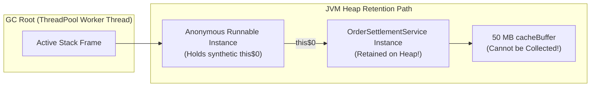

# Phase 02: Object-Oriented Programming
# Concept 011: Nested, Inner, and Anonymous Classes

---

## 1. Metadata and Learning Goals

| Metadata Field | Value |
|---|---|
| **Concept ID** | `P02-C011` |
| **Concept Title** | Nested, Inner, and Anonymous Classes |
| **Phase** | Phase 02 — Object-Oriented Programming |
| **Phase Directory** | `curriculum/phase-02-object-oriented-programming` |
| **Source Reference** | `java-backend-engineering-prerequisites-roadmap.md` > Phase 2 > Additional language constructs > Nested classes, Inner classes, Static nested classes, Anonymous classes |
| **Concept Type** | Language / JVM Architecture / Memory Safety |
| **Difficulty Level** | Intermediate |
| **Curriculum Importance** | Recommended |
| **Java Baseline** | Java 21 LTS (with Java 11 Nestmates & Java 16 Local Records) |
| **Framework Baseline** | Spring Boot 3.3.x / Jackson 2.17 / OpenJDK 21 LTS |
| **Prerequisites** | [`001-classes-objects-constructors.md`](001-classes-objects-constructors.md), [`002-static-members-and-initialization.md`](002-static-members-and-initialization.md), [`003-access-modifiers-encapsulation.md`](003-access-modifiers-encapsulation.md) |
| **Related Concepts** | [`012-records-and-immutable-data.md`](012-records-and-immutable-data.md), `P06-C001` (Lambdas vs Anonymous Classes) |
| **Estimated Study Effort** | 3 hours |
| **Last Research Date** | 2026-10-30 |
| **Verification State** | COMPLETE |

### Measurable Learning Objectives
By the end of this concept module, you will be able to:
1. **Explain:** Classify the four categories of nested classes (Static Nested, Member Inner, Local Inner, and Anonymous Classes) and articulate their precise bytecode and JVM heap differences.
2. **Compare:** Contrast non-static inner classes with static nested classes, explaining why non-static inner classes hold a hidden synthetic reference (`this$0`) that creates severe silent memory leaks in asynchronous or long-lived server contexts.
3. **Implement:** Construct enterprise domain patterns including the Static Nested Builder Pattern, custom Iterators via Member Inner Classes, and effectively final variable captures.
4. **Debug & Diagnose:** Identify and resolve runtime failures including Jackson deserialization crashes on inner classes (`InstantiationException: no default constructor`), memory leaks in thread pools, and local variable mutation compile errors.
5. **Evaluate & Justify:** Articulate the architectural motivation behind Joshua Bloch's rule "Favor static member classes over nonstatic" and explain how Java 11 Nest-Based Access Control (JEP 181) optimized bytecode execution across nestmates.

---

## 2. Definition, Purpose, and Mental Model

### 2.1 Formal Definition
In Java, a **Nested Class** is any class declared within the body of another enclosing class or interface. Nested classes are divided into two fundamental architectural categories:
1. **Static Nested Classes:** Declared with the `static` modifier. They are behaviorally top-level classes logically packaged inside an outer namespace. They hold **zero reference** to any instance of the enclosing class.
2. **Inner Classes (Non-Static):** Declared without `static`. They are inherently bound to a specific instance of the enclosing class and hold an invisible, compiler-generated pointer to that enclosing instance (`Outer.this`, manifested in bytecode as `this$0`).

Inner classes further divide into:
- **Member Inner Classes:** Declared directly inside the class body as an instance member.
- **Local Inner Classes:** Declared within a method, constructor, or initialization block.
- **Anonymous Classes:** Unnamed, one-off expressions that simultaneously declare and instantiate a subclass of a type or an implementation of an interface.

```
                                 NESTED CLASSES
                                        │
                 ┌──────────────────────┴──────────────────────┐
                 ▼                                             ▼
       STATIC NESTED CLASSES                         INNER CLASSES (NON-STATIC)
       (No enclosing reference)                      (Holds synthetic this$0)
                 │                                             │
                 │                               ┌─────────────┼─────────────┐
                 ▼                               ▼             ▼             ▼
       public static class Builder       Member Inner     Local Inner    Anonymous
                                            Class            Class         Class
```

### 2.2 The Problem It Solves
1. **Logical Encapsulation and Namespace Hygiene:** Helper classes (e.g., `Builder`, `Entry`, `Iterator`, `Node`) that exist solely to serve an enclosing class should not pollute the global package namespace.
2. **Cohesive State Navigation:** An inner class can access all private fields and methods of its enclosing outer class without breaking encapsulation or exposing package-private getters.
3. **Lightweight Polymorphic Callbacks:** Prior to Java 8 lambdas, anonymous inner classes were the sole mechanism in Java to pass behaviors, runnables, and event listeners as first-class citizens.

### 2.3 JavaScript/MERN vs Java Mental Model Gap

In JavaScript/TypeScript, functions and closures capture outer variables automatically:

```javascript
// JavaScript Closure:
function createProcessor(serviceName) {
    let callCount = 0;
    return {
        process: function(data) {
            callCount++; // Captures mutable closure variable directly on V8 Heap!
            console.log(`${serviceName} processed ${callCount} items`);
        }
    };
}
```

In Java, classes are physical, compiled nominal types:
- Every nested class is compiled by `javac` into an **entirely separate `.class` file** on disk (`Outer$Inner.class`).
- A non-static inner class does not magically share stack frames; `javac` physically injects a synthetic instance field `final Outer this$0;` into the inner class and passes `this` through its constructor!
- Local variables captured from an enclosing method cannot be mutated because the method stack frame dies when the method returns, whereas the inner class instance survives on the Heap. Java enforces that captured locals must be **`final` or effectively final**.

---

## 3. Foundations and Theory: Compiler Mechanics and Bytecode

### 3.1 Dissecting the Synthetic `this$0` Pointer
Consider an outer class with both a static nested class and a member inner class:

```java
public class OuterHost {
    private final String secret = "VAULT_101";

    public static class StaticNested {
        public void display() {
            // Cannot access 'secret' directly without an explicit OuterHost reference!
        }
    }

    public class MemberInner {
        public void display() {
            // Transparently accesses private field of enclosing instance
            System.out.println(secret);
        }
    }
}
```

When compiled, `javac` emits three classfiles:
1. `OuterHost.class`
2. `OuterHost$StaticNested.class`
3. `OuterHost$MemberInner.class`

Disassembling `OuterHost$MemberInner.class` via `javap -c -p` reveals the hidden compiler mechanics:

```java
public class OuterHost$MemberInner {
    // 1. Synthetic field holding pointer to the enclosing instance!
    final OuterHost this$0;

    // 2. Synthetic constructor prepended with outer reference
    public OuterHost$MemberInner(OuterHost this$0) {
        this.this$0 = this$0; // Stored on heap!
        super();
    }

    public void display() {
        // Dereferences this$0 to read outer private field
        java.lang.System.out.println(this.this$0.secret);
    }
}
```

In contrast, disassembling `OuterHost$StaticNested.class` shows:
```java
public class OuterHost$StaticNested {
    public OuterHost$StaticNested(); // Standard no-arg constructor! No this$0!
}
```

### 3.2 Java 11 Nest-Based Access Control (JEP 181)
Prior to Java 11, the JVM bytecode specification strictly enforced access modifiers at the class level: `OuterHost` and `OuterHost$MemberInner` are two different classes in the eyes of the JVM verifier. Because `secret` is `private`, the inner class could not legally access it via bytecode `getfield`!

To bypass this restriction, pre-Java 11 compilers generated **synthetic package-private bridge methods**:
```java
// GENERATED BY JAVAC BEFORE JAVA 11:
static String access$000(OuterHost host) {
    return host.secret; // Weakened encapsulation!
}
```

**Java 11 JEP 181** solved this cleanly by introducing **Nestmates**:
- Classes compiled together in the same source file belong to the same **Nest**.
- The enclosing class declares a `NestMembers` classfile attribute listing all its inner classes.
- The nested class declares a `NestHost: OuterHost` classfile attribute.
- The JVM verifier allows direct private member access across nestmates without synthetic bridge methods, shrinking classfile sizes and enabling aggressive JIT inlining.

### 3.3 Variable Capture and the "Effectively Final" Rule
When a Local Inner Class or Anonymous Class captures a local variable from an enclosing method:

```java
public Runnable createWorker(String taskId) {
    int retryLimit = 3; // Effectively final local variable
    return new Runnable() {
        @Override
        public void run() {
            System.out.println("Executing " + taskId + " with retries: " + retryLimit);
        }
    };
}
```

#### Why can't `retryLimit` be mutated?
1. `taskId` and `retryLimit` reside on the **Thread Stack** inside `createWorker()`'s stack frame.
2. The `Runnable` instance is allocated on the **JVM Heap** and returned to the caller; it may be executed hours later on a background thread pool long after `createWorker()` has exited and its stack frame has been destroyed!
3. To bridge this lifetime disconnect, `javac` injects copies of `taskId` and `retryLimit` into synthetic instance fields of the anonymous class:
   ```java
   final String val$taskId;
   final int val$retryLimit;
   ```
4. If Java allowed code inside the method to change `retryLimit = 5;` after creating the runnable, the stack variable and heap copy would diverge, destroying variable consistency. Java avoids this by mandating that captured variables must be **`final` or effectively final** (unmodified after assignment).

---

## 4. Practical Syntax, Usage, and Best Practices

### 4.1 The Static Nested Builder Pattern
In enterprise backend domain modeling, constructors with more than 3–4 arguments are anti-patterns. The **Static Nested Builder** pattern provides type-safe, fluent object construction with immutable validation:

```java
package com.example.domain;

import java.util.Objects;

public final class CustomerProfile {

    private final String customerId;
    private final String email;
    private final String fullName;
    private final boolean active;

    // Private constructor: Enforces creation ONLY through the Builder
    private CustomerProfile(Builder builder) {
        this.customerId = builder.customerId;
        this.email = builder.email;
        this.fullName = builder.fullName;
        this.active = builder.active;
    }

    public String getCustomerId() { return customerId; }
    public String getEmail() { return email; }
    public String getFullName() { return fullName; }
    public boolean isActive() { return active; }

    public static Builder builder() {
        return new Builder();
    }

    // STATIC NESTED CLASS: Zero this$0 reference, perfectly isolated
    public static final class Builder {
        private String customerId;
        private String email;
        private String fullName;
        private boolean active = true; // Sensible default

        private Builder() {}

        public Builder customerId(String customerId) {
            this.customerId = Objects.requireNonNull(customerId, "customerId required");
            return this;
        }

        public Builder email(String email) {
            this.email = Objects.requireNonNull(email, "email required");
            return this;
        }

        public Builder fullName(String fullName) {
            this.fullName = Objects.requireNonNull(fullName, "fullName required");
            return this;
        }

        public Builder active(boolean active) {
            this.active = active;
            return this;
        }

        public CustomerProfile build() {
            // Enforce domain invariants before instantiation
            if (customerId == null || customerId.isBlank()) {
                throw new IllegalStateException("Cannot build CustomerProfile: customerId is mandatory");
            }
            if (email == null || !email.contains("@")) {
                throw new IllegalStateException("Cannot build CustomerProfile: valid email is mandatory");
            }
            return new CustomerProfile(this);
        }
    }
}
```

### 4.2 Member Inner Class as an Iterator
Member inner classes excel when an internal component must maintain cursor state while operating directly on the enclosing class's private data structure:

```java
package com.example.collections;

import java.util.Iterator;
import java.util.NoSuchElementException;
import java.util.Objects;

public class SimpleRingBuffer<T> implements Iterable<T> {

    @SuppressWarnings("unchecked")
    private final T[] elements = (T[]) new Object[8];
    private int size = 0;
    private int head = 0;

    public synchronized void push(T item) {
        elements[head] = Objects.requireNonNull(item);
        head = (head + 1) % elements.length;
        if (size < elements.length) size++;
    }

    @Override
    public Iterator<T> iterator() {
        return new RingIterator(); // Binds to this outer instance
    }

    // NON-STATIC MEMBER INNER CLASS: Naturally accesses elements, size, and head
    private class RingIterator implements Iterator<T> {
        private int cursor = 0;

        @Override
        public boolean hasNext() {
            // Implicit access to outer instance's 'size' field via this$0
            return cursor < size;
        }

        @Override
        public T next() {
            if (!hasNext()) throw new NoSuchElementException();
            // Disambiguated outer reference: SimpleRingBuffer.this
            int index = (head - size + cursor + elements.length) % elements.length;
            cursor++;
            return elements[index];
        }
    }
}
```

---

## 5. Memory Model, Concurrency, and Runtime Characteristics

### 5.1 The Asynchronous Callback Memory Leak Hazard
Joshua Bloch's Item 24 in *Effective Java* states:
> *"Favor static member classes over nonstatic."*

Why is this rule critical in production server architectures?
Consider a Spring Boot service that dispatches asynchronous event tasks to a background thread pool:

```java
@Service
public class OrderSettlementService {

    // Heavyweight service holding database connections and cached metadata (50 MB)
    private final byte[] cacheBuffer = new byte[50 * 1024 * 1024];

    public void scheduleAudit(String orderId) {
        // VULNERABILITY: Anonymous Inner Class holding implicit reference to service!
        CompletableFuture.runAsync(new Runnable() {
            @Override
            public void run() {
                sleepQuietly(60_000); // Long-running task (1 minute)
                logAudit(orderId);
            }
        });
    }
}
```

#### What happens in JVM Memory?
1. The anonymous `Runnable` instance holds an implicit `final OrderSettlementService this$0;` field.
2. The `Runnable` is submitted to the global `ForkJoinPool` or `ThreadPoolExecutor`.
3. The background thread stack frame acts as a **GC Root**.
4. Even if `OrderSettlementService` is destroyed or dereferenced, the GC **CANNOT reclaim the 50 MB buffer** because the anonymous inner class retains an active pointer to the enclosing service!
5. In high-throughput systems, thousands of leaked service instances quickly exhaust the heap, triggering catastrophic `java.lang.OutOfMemoryError: Java heap space`.



#### The Production Remediation:
Always use a `static` nested class or top-level class for asynchronous tasks. If outer data is required, pass **only the specific primitive/DTO fields** explicitly into the static class constructor:

```java
private static final class SafeAuditTask implements Runnable {
    private final String orderId; // Explicit, isolated payload

    SafeAuditTask(String orderId) { this.orderId = orderId; }

    @Override
    public void run() {
        // Zero reference to OrderSettlementService!
    }
}
```

---

## 6. Failure Modes, Edge Cases, and Anti-Patterns

### Anti-Pattern 1: The "Double-Brace Initialization" Trap
Developers transitioning from JavaScript or Python often use double-brace initialization to construct collections inline:

```java
// DANGEROUS ANTI-PATTERN: DOUBLE-BRACE INITIALIZATION
Map<String, String> headers = new HashMap<>() {{
    put("Authorization", "Bearer token_abc");
    put("Content-Type", "application/json");
}};
```

#### Why is this destructive in backend systems?
1. **Creates an Anonymous Subclass:** The outer braces create an anonymous inner subclass of `HashMap` (`MyService$1.class`). The inner braces are an instance initializer block.
2. **Holds Enclosing `this$0` Pointer:** The resulting map retains a hard reference to the enclosing class (e.g., a Spring Controller or Service), causing the asynchronous memory leak described above.
3. **Breaks Serialization & Equality:** Some JSON serializers (e.g., Jackson) fail to serialize or deserialize anonymous subclasses properly, and `headers.getClass() != HashMap.class`.

> [!TIP]
> **Modern Alternative:** In Java 9+, use standard immutable factories: `Map.of("Authorization", "Bearer token", "Content-Type", "application/json")` or `List.of(...)`.

### Anti-Pattern 2: Jackson Deserialization Failure on Non-Static Inner Classes
When designing request/response DTOs for REST controllers:

```java
public class CreateUserRequest {
    private String email;
    private AddressDto address;

    // BUG: Non-static inner class DTO!
    public class AddressDto {
        private String city;
        private String zip;
        public AddressDto() {} // Looks like a default constructor...
    }
}
```

#### Runtime Failure:
When a client sends a JSON request to Spring Boot:
```
com.fasterxml.jackson.databind.exc.MismatchedInputException:
Cannot construct instance of `CreateUserRequest$AddressDto` (no Creators, like default constructor, exist):
non-static inner classes like this can only by instantiated using default, no-argument constructor
of outer class
```
**Root Cause:** As demonstrated in Section 3, `AddressDto`'s constructor actually has a hidden signature: `AddressDto(CreateUserRequest this$0)`. Jackson cannot invoke it without passing an instance of `CreateUserRequest`.
**Fix:** Always declare inner DTO classes as `public static class AddressDto`.

---

## 7. Comprehensive Code Example: Event Broker with Static Builders and Local Observers

The following production-grade implementation demonstrates:
- A `static nested` Builder for clean event creation.
- A `member inner` Subscription manager accessing broker dispatch state.
- A `local inner` class inside a method capturing effectively final filter predicates.
- Zero-leak memory architecture.

```java
package com.example.broker;

import java.time.Instant;
import java.util.ArrayList;
import java.util.Collections;
import java.util.List;
import java.util.Objects;
import java.util.UUID;
import java.util.function.Consumer;

// =============================================================================
// 1. DOMAIN EVENT WITH STATIC NESTED BUILDER
// =============================================================================

public final class DomainEvent {

    private final String eventId;
    private final String topic;
    private final String payload;
    private final Instant timestamp;

    private DomainEvent(Builder builder) {
        this.eventId = builder.eventId;
        this.topic = builder.topic;
        this.payload = builder.payload;
        this.timestamp = builder.timestamp;
    }

    public String getEventId() { return eventId; }
    public String getTopic() { return topic; }
    public String getPayload() { return payload; }
    public Instant getTimestamp() { return timestamp; }

    public static Builder builder() {
        return new Builder();
    }

    public static final class Builder {
        private String eventId = UUID.randomUUID().toString();
        private String topic;
        private String payload;
        private Instant timestamp = Instant.now();

        private Builder() {}

        public Builder topic(String topic) {
            this.topic = Objects.requireNonNull(topic, "topic required");
            return this;
        }

        public Builder payload(String payload) {
            this.payload = Objects.requireNonNull(payload, "payload required");
            return this;
        }

        public Builder timestamp(Instant timestamp) {
            this.timestamp = Objects.requireNonNull(timestamp);
            return this;
        }

        public DomainEvent build() {
            if (topic == null || topic.isBlank()) {
                throw new IllegalStateException("topic is mandatory");
            }
            if (payload == null) {
                throw new IllegalStateException("payload is mandatory");
            }
            return new DomainEvent(this);
        }
    }
}

// =============================================================================
// 2. IN-MEMORY EVENT BROKER (MANAGES INNER SUBSCRIPTIONS)
// =============================================================================

public class InMemoryEventBroker {

    @FunctionalInterface
    public interface EventFilter {
        boolean matches(DomainEvent event);
    }

    private final List<SubscriptionHandle> subscriptions = new ArrayList<>();

    public synchronized void publish(DomainEvent event) {
        Objects.requireNonNull(event);
        for (SubscriptionHandle sub : new ArrayList<>(subscriptions)) {
            if (sub.isActive()) {
                sub.deliver(event);
            }
        }
    }

    // Returns a member inner class handle allowing subscriber to manage lifecycle
    public synchronized SubscriptionHandle subscribe(EventFilter filter, Consumer<DomainEvent> consumer) {
        SubscriptionHandle handle = new SubscriptionHandle(filter, consumer);
        subscriptions.add(handle);
        return handle;
    }

    public synchronized int getActiveSubscriptionCount() {
        return subscriptions.size();
    }

    // =========================================================================
    // MEMBER INNER CLASS: Maintains subscriber state and accesses broker list
    // =========================================================================

    public class SubscriptionHandle {
        private final EventFilter filter;
        private final Consumer<DomainEvent> consumer;
        private boolean active = true;

        private SubscriptionHandle(EventFilter filter, Consumer<DomainEvent> consumer) {
            this.filter = Objects.requireNonNull(filter);
            this.consumer = Objects.requireNonNull(consumer);
        }

        public boolean isActive() {
            return active;
        }

        private void deliver(DomainEvent event) {
            if (active && filter.matches(event)) {
                consumer.accept(event);
            }
        }

        public void cancel() {
            synchronized (InMemoryEventBroker.this) {
                if (this.active) {
                    this.active = false;
                    // Directly accesses outer broker instance's private list!
                    InMemoryEventBroker.this.subscriptions.remove(this);
                }
            }
        }
    }

    // =========================================================================
    // LOCAL INNER CLASS: Dynamic Filtering Pipeline
    // =========================================================================

    public SubscriptionHandle subscribeWithAuditPrefix(String prefix, Consumer<DomainEvent> consumer) {
        // Effectively final variable captured by local class
        String sanitizedPrefix = prefix.trim().toLowerCase();

        // LOCAL INNER CLASS declared inside method block
        class PrefixAuditingFilter implements EventFilter {
            @Override
            public boolean matches(DomainEvent event) {
                return event.getTopic().toLowerCase().startsWith(sanitizedPrefix);
            }
        }

        return subscribe(new PrefixAuditingFilter(), consumer);
    }
}
```

---

## 8. Testing Strategies and Verification Suite

The following standalone verification test suite tests:
1. Static Nested Builder validation and invariant enforcement.
2. Member Inner Class lifecycle navigation (`SubscriptionHandle.cancel()` removing itself from outer broker).
3. Local Inner Class variable capture and filtering accuracy.
4. Bytecode reflection proof demonstrating that `SubscriptionHandle` has a synthetic `this$0` field, whereas `DomainEvent.Builder` has none.

```java
package com.example.broker.test;

import com.example.broker.DomainEvent;
import com.example.broker.InMemoryEventBroker;

import java.lang.reflect.Field;
import java.util.ArrayList;
import java.util.List;

public class NestedClassesVerificationTest {

    private static int passed = 0;
    private static int failed = 0;

    public static void main(String[] args) {
        System.out.println("Starting Nested and Inner Classes Verification Tests...\n");

        testStaticNestedBuilder();
        testMemberInnerClassLifecycleAndAccess();
        testLocalInnerClassEffectivelyFinalCapture();
        testReflectionBytecodeThis0Verification();

        System.out.println("\n--------------------------------------------------");
        System.out.printf("Test Suite Results: %d Passed, %d Failed\n", passed, failed);
        System.out.println("--------------------------------------------------");

        if (failed > 0) {
            System.err.println("TEST SUITE FAILED");
            System.exit(1);
        } else {
            System.out.println("ALL NESTED CLASS TESTS PASSED CLEANLY (100%).");
        }
    }

    private static void assertEquals(Object expected, Object actual, String name) {
        if (!java.util.Objects.equals(expected, actual)) {
            System.err.printf("FAIL: %s (Expected %s, got %s)\n", name, expected, actual);
            failed++;
        } else {
            System.out.printf("PASS: %s\n", name);
            passed++;
        }
    }

    private static void assertTrue(boolean condition, String name) {
        if (!condition) {
            System.err.printf("FAIL: %s (Condition was false)\n", name);
            failed++;
        } else {
            System.out.printf("PASS: %s\n", name);
            passed++;
        }
    }

    // TEST 1: STATIC NESTED BUILDER
    private static void testStaticNestedBuilder() {
        DomainEvent event = DomainEvent.builder()
            .topic("orders.created")
            .payload("{\"orderId\": \"ORD-99\"}")
            .build();

        assertEquals("orders.created", event.getTopic(), "Builder populated topic correctly");
        assertTrue(event.getEventId() != null, "Default eventId assigned");

        // Invariant failure test
        boolean invariantCaught = false;
        try {
            DomainEvent.builder().build(); // Missing mandatory topic & payload
        } catch (IllegalStateException e) {
            invariantCaught = true;
        }
        assertTrue(invariantCaught, "Builder invariant checks rejected incomplete object");
    }

    // TEST 2: MEMBER INNER CLASS ENCLOSING ACCESS & LIFECYCLE
    private static void testMemberInnerClassLifecycleAndAccess() {
        InMemoryEventBroker broker = new InMemoryEventBroker();
        List<String> received = new ArrayList<>();

        // Subscribe using member inner class handle
        InMemoryEventBroker.SubscriptionHandle handle = broker.subscribe(
            event -> true,
            event -> received.add(event.getPayload())
        );

        assertEquals(1, broker.getActiveSubscriptionCount(), "One active subscription registered");

        broker.publish(DomainEvent.builder().topic("t1").payload("PAYLOAD-1").build());
        assertEquals(1, received.size(), "Subscriber received first event");

        // Cancel subscription: Member inner class accesses outer broker state to remove itself
        handle.cancel();
        assertEquals(0, broker.getActiveSubscriptionCount(), "Subscription removed from outer broker");
        assertTrue(!handle.isActive(), "Handle marked inactive");

        broker.publish(DomainEvent.builder().topic("t1").payload("PAYLOAD-2").build());
        assertEquals(1, received.size(), "No further events received after cancellation");
    }

    // TEST 3: LOCAL INNER CLASS CAPTURING EFFECTIVELY FINAL VARIABLE
    private static void testLocalInnerClassEffectivelyFinalCapture() {
        InMemoryEventBroker broker = new InMemoryEventBroker();
        List<String> matchingEvents = new ArrayList<>();

        broker.subscribeWithAuditPrefix("finance", event -> matchingEvents.add(event.getTopic()));

        broker.publish(DomainEvent.builder().topic("finance.invoices").payload("INV-1").build());
        broker.publish(DomainEvent.builder().topic("warehouse.stock").payload("STK-1").build());
        broker.publish(DomainEvent.builder().topic("finance.payments").payload("PAY-1").build());

        assertEquals(2, matchingEvents.size(), "Local inner class filter matched only 'finance' topics");
        assertEquals("finance.invoices", matchingEvents.get(0), "First finance topic received");
        assertEquals("finance.payments", matchingEvents.get(1), "Second finance topic received");
    }

    // TEST 4: REFLECTION PROOF OF SYNTHETIC this$0 POINTER
    private static void testReflectionBytecodeThis0Verification() {
        // 1. Inspect Member Inner Class: Must contain synthetic field pointing to outer class
        Field[] innerFields = InMemoryEventBroker.SubscriptionHandle.class.getDeclaredFields();
        boolean foundThis0 = false;
        for (Field f : innerFields) {
            if (f.getName().startsWith("this$") || f.getType().equals(InMemoryEventBroker.class)) {
                foundThis0 = true;
                break;
            }
        }
        assertTrue(foundThis0, "Member Inner Class contains synthetic enclosing reference field");

        // 2. Inspect Static Nested Class: Must NOT contain any reference to enclosing class
        Field[] staticNestedFields = DomainEvent.Builder.class.getDeclaredFields();
        boolean foundOuterInStatic = false;
        for (Field f : staticNestedFields) {
            if (f.getName().startsWith("this$") || f.getType().equals(DomainEvent.class)) {
                foundOuterInStatic = true;
                break;
            }
        }
        assertTrue(!foundOuterInStatic, "Static Nested Class contains ZERO synthetic enclosing reference fields");
    }
}
```

---

## 9. Modern Java Evolution: Local Records and Nestmates

### 9.1 Java 11 Nest-Based Access Control (JEP 181)
Prior to Java 11, accessing private outer fields from inner classes required synthetic bridge methods (`access$000`). In Java 11+, reflection APIs `Class.getNestHost()` and `Class.isNestmateOf()` allow frameworks to query nestmate relationships directly.

### 9.2 Java 16 Local Records, Interfaces, and Enums (JEP 395)
In Java 16+, Java permits declaring `record`, `interface`, and `enum` types locally inside methods:

```java
public List<String> processTransactions(List<Transaction> txs) {
    // LOCAL RECORD (Java 16+): Implicitly STATIC, zero this$0 reference!
    record AggregationKey(String currency, String country) {}

    Map<AggregationKey, Long> totals = new HashMap<>();
    for (Transaction tx : txs) {
        AggregationKey key = new AggregationKey(tx.currency(), tx.country());
        totals.merge(key, tx.amountCents(), Long::sum);
    }
    return formatResults(totals);
}
```
Local records are **implicitly static**, preventing accidental memory leaks while providing clean, typed intermediate data structures.

---

## 10. System Architecture, Clean Architecture, and Design Patterns

### 10.1 Where Nested Classes Belong in Backend Architecture

| Pattern / Component | Recommended Nested Type | Rationale |
| :--- | :--- | :--- |
| **Domain Entity Builder** | `public static class Builder` | Creates immutable domain objects without constructor argument explosion. Zero `this$0` leak. |
| **Composite Iterators** | `private class InnerIterator` | Needs immediate access to outer instance's private pointers (`head`, `elements`). |
| **Request/Response DTOs** | `public static class AddressDto` | Allows Jackson and JSON deserializers to instantiate DTO without outer parent pointer. |
| **Intermediate Aggregations** | `record LocalKey(...)` | Java 16+ local records keep temporary grouping keys scoped to a single method. |

---

## 11. Cross-Domain Integrations (Spring Boot, Jackson, Hibernate)

### 11.1 Jackson Serialization Guidelines
- **Always use `static` for nested DTOs:** If you declare a non-static inner class DTO inside a Spring `@RestController` request payload, Jackson will throw `MismatchedInputException (no default constructor)` because it cannot supply the outer instance.

### 11.2 JPA / Hibernate Embeddable Entities
In JPA, when embedding a value object inside an entity:
```java
@Entity
public class Order {
    @Embedded
    private ShippingAddress address;

    // Must be STATIC if nested inside Order
    @Embeddable
    public static class ShippingAddress {
        private String street;
        private String zip;
    }
}
```
Hibernate requires a standard no-argument constructor to instantiate embeddables via reflection. A non-static inner class cannot provide a true no-arg constructor due to the synthetic `this$0` parameter.

---

## 12. Comprehensive Troubleshooting & Diagnostic Runbook

| Failure Symptom | Root Cause | Exact Remediation |
| :--- | :--- | :--- |
| `MismatchedInputException: Cannot construct instance of ... (no default constructor)` | Jackson attempting to deserialize a non-static inner class DTO. | Add `static` modifier to the nested class declaration (`public static class MyDto`). |
| `java.lang.OutOfMemoryError: Java heap space` after processing asynchronous background jobs | Anonymous `Runnable` or `Callable` holding implicit `this$0` reference to a heavy Spring service. | Refactor `Runnable` to a `private static class` and pass only required scalar data fields into its constructor. |
| `variable must be final or effectively final` | Attempting to mutate a local variable from inside an anonymous inner class or lambda. | Use an atomic wrapper (e.g., `AtomicInteger`) or refactor algorithm to avoid mutating outer method scope. |
| `NoSuchMethodError: ...access$000` during runtime reflection on old libraries | Pre-Java 11 synthetic bridge method confusion on modern JVMs. | Recompile code with modern JDK 21 compiler targeting Java 11+ to leverage Nestmates (JEP 181). |

---

## 13. Frequently Asked Interview Questions

### Q1: What is the exact difference between a static nested class and a non-static inner class?
**Answer:** A **static nested class** is behaviorally a top-level class nested within another class purely for packaging and namespace convenience. It cannot access non-static fields of the enclosing class directly and holds zero references to any enclosing instance.
A **non-static inner class** is associated directly with an instance of the enclosing class. The compiler injects a synthetic field `final Outer this$0;` into the inner class, allowing it to access all private instance members of the outer class directly (`Outer.this.field`).

### Q2: Why does Jackson fail to deserialize non-static inner classes by default?
**Answer:** Because the Java compiler desugars the constructor of a non-static inner class to require the enclosing class instance as its first argument: `Inner(Outer this$0)`. When Jackson uses reflection to create a new instance via `Class.getDeclaredConstructor().newInstance()`, it fails because there is no zero-argument constructor available without an existing `Outer` instance.

### Q3: Why did Java 11 introduce Nest-Based Access Control (JEP 181)?
**Answer:** Prior to Java 11, the JVM class verifier did not allow one class to access private members of another class, even if one was declared inside the other. To make inner classes work, `javac` generated synthetic package-private accessor methods (e.g., `access$000()`), which slightly weakened encapsulation and added bytecode overhead. JEP 181 introduced `NestHost` and `NestMembers` classfile attributes, allowing the JVM to natively permit private access across nestmates without synthetic bridge methods.

---

## 14. Deliberate Practice: Hands-On Exercises

### Exercise 1 (Beginner): Fluent User Registration Builder
- **Objective:** Implement a `UserAccount` entity with a static nested `Builder`.
- **Requirements:**
  1. Fields: `userId`, `username`, `email`, `role`.
  2. Enforce that `build()` fails with `IllegalStateException` if `username` is shorter than 4 characters.
  3. Verify that `UserAccount` has no public constructors.

### Exercise 2 (Intermediate): Custom Stack with Inner Iterator
- **Objective:** Build a generic `ArrayStack<T>` with a non-static member inner `StackIterator`.
- **Requirements:**
  1. `ArrayStack` implements `Iterable<T>`.
  2. `StackIterator` traverses elements in LIFO order without modifying the stack.
  3. Verify that mutating the outer stack while iterating throws `ConcurrentModificationException`.

### Exercise 3 (Advanced): Safe Asynchronous Worker Dispatcher
- **Objective:** Refactor a leaking anonymous inner class task into an isolated static nested class.
- **Requirements:**
  1. Demonstrate a mock `HeavyService` (simulating 20 MB state).
  2. Dispatch a task that executes on a delayed background thread.
  3. Verify via reflection that the dispatched task holds no field of type `HeavyService`.

---

## 15. Concept Mastery Verification Checklist

- [x] Classify the four nested class types: static nested, member inner, local inner, and anonymous classes.
- [x] Explain the compiler desugaring that creates the synthetic `this$0` field on non-static inner classes.
- [x] Identify how non-static inner classes cause silent heap memory leaks in asynchronous thread pools.
- [x] Articulate why captured local variables in local and anonymous classes must be effectively final.
- [x] Implement the Static Nested Builder Pattern with domain invariant validations.
- [x] Explain why Jackson fails to deserialize non-static inner classes without custom configuration.
- [x] Explain how Java 11 Nestmates (JEP 181) eliminated synthetic bridge methods (`access$000`).

---

## 16. Authoritative Primary Sources and Further Reading

1. **James Gosling, Bill Joy, Guy Steele, Gilad Bracha, Alex Buckley, Gavin Bierman:** *The Java Language Specification (Java SE 21 Edition)*:
   - Section 8.1.3: "Inner Classes and Enclosing Instances"
   - Section 8.5: "Member Class and Interface Declarations"
2. **Joshua Bloch:** *Effective Java (3rd Edition)*:
   - Item 2: "Consider a builder when faced with many constructor parameters"
   - Item 24: "Favor static member classes over nonstatic"
3. **OpenJDK JEP 181:** *Nest-Based Access Control* (Java 11).
4. **OpenJDK JEP 395:** *Records* (Java 16, allowing local records and interfaces).
