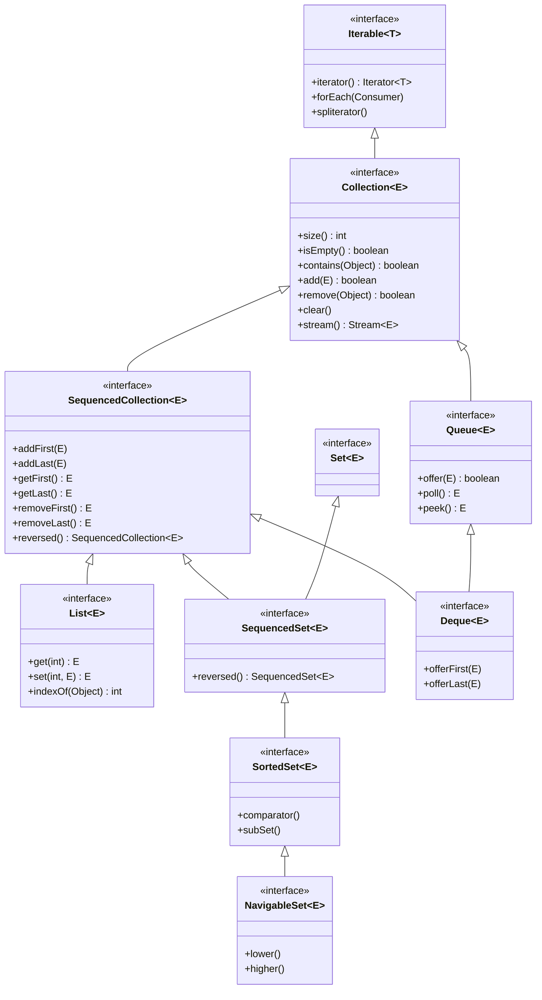

# Phase 03: Collections Framework, Generics, and Type Safety
# Concept 001: Collections Framework Architecture: Iterable, Collection, and Map

---

## 1. Metadata and Learning Goals

| Metadata Field | Value |
|---|---|
| **Concept ID** | `P03-C001` |
| **Concept Title** | Collections Framework Architecture: Iterable, Collection, and Map |
| **Phase** | Phase 03 — Collections Framework, Generics, and Type Safety |
| **Phase Directory** | `curriculum/phase-03-collections-framework-generics-type-safety` |
| **Source Reference** | `java-backend-engineering-prerequisites-roadmap.md` > Phase 3 > Collections hierarchy > Iterable, Collection, List, Set, Queue, Deque, Map |
| **Concept Type** | Language / Architecture / API Fundamentals |
| **Difficulty Level** | Intermediate |
| **Curriculum Importance** | Essential |
| **Java Baseline** | Java 21 LTS (with JEP 431 Sequenced Collections) |
| **Framework Baseline** | Spring Boot 3.3.x / OpenJDK 21 LTS |
| **Prerequisites** | [`P02-C003`](../phase-02-object-oriented-programming/003-access-modifiers-encapsulation.md), [`P02-C007`](../phase-02-object-oriented-programming/007-abstract-classes-vs-interfaces.md), [`P02-C015`](../phase-02-object-oriented-programming/015-object-class-contracts.md) |
| **Related Concepts** | [`002-arraylist-vs-linkedlist.md`](002-arraylist-vs-linkedlist.md), [`004-hashmap-internals-and-mechanics.md`](004-hashmap-internals-and-mechanics.md), [`011-iterators-fail-fast-mechanics.md`](011-iterators-fail-fast-mechanics.md) |
| **Estimated Study Effort** | 3–4 hours |
| **Last Research Date** | 2026-10-30 |
| **Verification State** | COMPLETE |

### Measurable Learning Objectives
By the end of this concept module, you will be able to:
1. **Explain:** Explain the full architectural design of the Java Collections Framework (JCF), tracing inheritance from `Iterable<T>` down through `Collection<E>`, `List<E>`, `Set<E>`, `Queue<E>`, `Deque<E>`, and the modern Java 21 `SequencedCollection<E>` hierarchy.
2. **Compare:** Articulate the precise architectural and mathematical reasons why `Map<K, V>` does NOT extend `Collection<E>`, and explain how collection views (`keySet()`, `values()`, `entrySet()`) bridge this divide.
3. **Implement:** Construct decoupled, interface-driven backend domain models leveraging polymorphic collection contracts, Java 21 Sequenced Collection operations (`addFirst`, `getLast`, `reversed`), and defensive views.
4. **Debug & Diagnose:** Identify and resolve common enterprise collection pitfalls, including method contract confusion in `Queue` (`offer`/`poll` vs `add`/`remove`), `ConcurrentModificationException` triggers, and the hazards of legacy synchronized collections (`Vector`, `Hashtable`).
5. **Evaluate & Justify:** Justify when to select a `List`, `Set`, `Queue`, `Deque`, or `Map` based on access patterns, ordering semantics, uniqueness invariants, and Big-O computational complexity.

---

## 2. Definition, Purpose, and Mental Model

### 2.1 Formal Definition
The **Java Collections Framework (JCF)** is a unified, highly optimized architecture residing in `java.util` that defines interfaces, abstract skeletal implementations, and concrete data structures for representing, storing, and manipulating groups of objects as a single unit.

The architecture is partitioned into two distinct, parallel interface hierarchies:
1. **The `Collection` Hierarchy:** Rooted at `java.lang.Iterable<T>`, governing sequences or bags of individual elements (`List`, `Set`, `Queue`, `Deque`, and Java 21 `SequencedCollection`).
2. **The `Map` Hierarchy:** Rooted at `java.util.Map<K, V>`, governing key-value associations (dictionaries / lookup tables).

### 2.2 Why `Map` Does NOT Extend `Collection`
One of the most frequent enterprise interview questions is: *Why doesn't `Map` extend `Collection`?*

This was an intentional, foundational design decision made by Joshua Bloch and the Sun Microsystems Java 2 team:
1. **Cardinality Mismatch:** A `Collection<E>` is a container for individual elements ($E$). A `Map<K, V>` is a container for pairs of elements: a unique key and its mapped value ($(K, V)$).
2. **Contract Incompatibilities:** 
   - `Collection.add(E element)` cannot be meaningfully implemented for a `Map`. Does `add("Alice")` add a key? A value? What would the corresponding key or value be?
   - `Collection.contains(Object o)` tests for element presence. A map has two orthogonal presence checks: `containsKey(Object key)` ($O(1)$) and `containsValue(Object value)` ($O(N)$). Forcing `Map` into `Collection` would result in ambiguous or throwing methods.
3. **Collection Views Bridge the Gap:** Instead of pretending to be a `Collection`, a `Map` provides **three collection views**:
   - `map.keySet()`: Returns a `Set<K>` of keys (guaranteed unique).
   - `map.values()`: Returns a `Collection<V>` of values (may contain duplicates).
   - `map.entrySet()`: Returns a `Set<Map.Entry<K, V>>` of key-value pairs.

### 2.3 JavaScript/MERN vs Java Mental Model Gap

In Node.js/JavaScript, collections are minimal and dynamically typed:

```javascript
// JavaScript:
const arr = [1, "two", { three: 3 }]; // Sparse, untyped array
const map = new Map();                  // Hash table
const set = new Set();                  // Hash set
// Zero built-in Queue, Deque, PriorityQueue, or SortedSet data structures.
// Arrays are used as stacks, queues, and deques (push, pop, shift, unshift),
// leading to disastrous O(N) performance on large shift/unshift operations!
```

In Java 21 LTS:
- Java provides a **strictly typed, polymorphic nominal hierarchy**.
- Each interface enforces exact algorithmic contracts and computational complexity guarantees.
- `Queue` and `Deque` implementations (such as `ArrayDeque`) provide circular array ring buffers with **$O(1)$ amortized insertion and removal at both ends**, outperforming array shifting by orders of magnitude.

---

## 3. Foundations and Theory: The Unified Collections Hierarchy

### 3.1 The Complete Java 21 Collections Hierarchy Diagram



### 3.2 The Core Interface Contracts

| Interface | Ordering Semantics | Duplicate Policy | Key Operations | Primary Implementations |
| :--- | :--- | :--- | :--- | :--- |
| **`List<E>`** | Sequential, zero-based indexed | **Permitted** | `get(i)`, `set(i, e)`, `add(e)` | `ArrayList`, `LinkedList`, `CopyOnWriteArrayList` |
| **`Set<E>`** | Unspecified (implementation dependent) | **Prohibited** (Unique) | `add(e)`, `contains(e)` | `HashSet`, `LinkedHashSet`, `TreeSet` |
| **`Queue<E>`** | FIFO or Priority-based | **Permitted** | `offer(e)`, `poll()`, `peek()` | `ArrayDeque`, `PriorityQueue`, `LinkedList` |
| **`Deque<E>`** | Double-ended (FIFO / LIFO) | **Permitted** | `offerFirst()`, `pollLast()` | `ArrayDeque`, `LinkedList` |
| **`Map<K, V>`** | Key-based lookup | Unique Keys, Dupe Values | `put(k, v)`, `get(k)`, `remove(k)` | `HashMap`, `LinkedHashMap`, `TreeMap` |

### 3.3 Java 21 JEP 431: Sequenced Collections
Prior to Java 21, Java collections suffered from an annoying, historic inconsistency regarding ordered access:
- To get the first element: `List` used `list.get(0)`, `Deque` used `deque.getFirst()`, `SortedSet` used `set.first()`, and `LinkedHashSet` had **no direct method at all** (you had to create an iterator: `set.iterator().next()`).
- To get the last element: `List` used `list.get(list.size() - 1)`, `Deque` used `deque.getLast()`, `SortedSet` used `set.last()`, and `LinkedHashSet` required iterating over all $N$ elements!

**Java 21 JEP 431** introduced three unified interfaces:
1. **`SequencedCollection<E>`:** Introduces `getFirst()`, `getLast()`, `addFirst()`, `addLast()`, `removeFirst()`, `removeLast()`, and `reversed()`.
2. **`SequencedSet<E>`:** A set with a defined encounter order (e.g. `LinkedHashSet`, `TreeSet`).
3. **`SequencedMap<K, V>`:** A map with defined encounter order (e.g. `LinkedHashMap`, `TreeMap`), featuring `firstEntry()`, `lastEntry()`, `pollFirstEntry()`, `pollLastEntry()`, `sequencedKeySet()`.

---

## 4. Practical Syntax, Usage, and Best Practices

### 4.1 Golden Rule: Program to the Interface, Not the Implementation
In enterprise backend engineering (Spring Boot services, persistence adapters), always declare variable and parameter types using the highest relevant interface:

```java
// ANTI-PATTERN: Tightly coupled to concrete implementation
public class OrderService {
    public ArrayList<Order> getPendingOrders() { ... } // BAD!
}

// PRODUCTION BEST PRACTICE: Program to Interface
public class OrderService {
    public List<Order> getPendingOrders() { ... }     // Decoupled, flexible!
}
```
**Why?**
If tomorrow you benchmark and discover that an unmodifiable list (`List.of(...)`) or a custom synchronized list is required, you can change the internal instantiation without breaking a single caller or modifying your API contracts.

### 4.2 The Queue Method Duality (Exceptions vs Special Values)
The `Queue` interface defines two parallel sets of methods for insertion, removal, and inspection:

```
+-----------------------------------------------------------------------------------+
|                           THE QUEUE METHOD DUALITY                                |
+-----------------------------------------------------------------------------------+
|  Operation        | Throws Exception on Failure      | Returns Special Value      |
|-------------------+----------------------------------+----------------------------|
|  Insert           | add(e)      (Throws IllegalState)| offer(e)   (Returns false) |
|  Remove           | remove()    (Throws NoSuchElem)  | poll()     (Returns null)  |
|  Examine          | element()   (Throws NoSuchElem)  | peek()     (Returns null)  |
+-----------------------------------------------------------------------------------+
```

> [!TIP]
> **Production Recommendation:** For bounded queues, producer-consumer buffers, and concurrent task dispatching, **always prefer `offer()`, `poll()`, and `peek()`**. Exception creation in Java incurs heavyweight stack trace generation overhead that degrades high-throughput throughput.

---

## 5. Memory Model, Concurrency, and Runtime Characteristics

### 5.1 Non-Thread Safety by Design
By design, all core collections in `java.util` (`ArrayList`, `HashSet`, `HashMap`, `ArrayDeque`, `LinkedList`) are **unsynchronized and non-thread-safe**.
- They do not incur synchronization or locking overhead when used in single-threaded contexts (such as local method stacks or Spring `@RequestScope` beans).
- When multiple threads modify a non-thread-safe collection concurrently without external synchronization, structural invariants break immediately:
  - Backing array indices corrupt.
  - Linked list node pointers form circular loops, sending threads into **100% CPU infinite loops**.
  - `ConcurrentModificationException` is thrown via the `modCount` fail-fast mechanism.

### 5.2 Legacy Synchronized Collections (`Vector`, `Hashtable`)
Java 1.0 introduced `Vector` and `Hashtable`, where every single method was marked `synchronized`.
- **Why They Are Obsolete:** Synchronizing every individual method call provides coarse-grained, high-overhead thread safety that degrades performance under concurrent load, while still **failing to protect compound operations** (e.g., check-then-act `if (!vector.isEmpty()) vector.remove(0)` can still throw `ArrayIndexOutOfBoundsException` if another thread intervenes!).
- **Modern Replacements:** Use `java.util.concurrent` collections (`ConcurrentHashMap`, `CopyOnWriteArrayList`, `ArrayBlockingQueue`) in multithreaded systems.

---

## 6. Failure Modes, Edge Cases, and Anti-Patterns

### Anti-Pattern 1: The Bi-directional Mutation Trap in Map Collection Views
Many engineers mistakenly assume that `map.keySet()` and `map.values()` return disconnected copies of the data:

```java
Map<String, String> cache = new HashMap<>();
cache.put("user_1", "active");

Set<String> keys = cache.keySet();
keys.remove("user_1"); // SURPRISE: Mutates the underlying map!

System.out.println(cache.containsKey("user_1")); // PRINTS: false!
```

#### The Technical Reality:
`map.keySet()`, `map.values()`, and `map.entrySet()` return **direct views backed by the map**!
- Removing an element from the `keySet` **physically removes the key-value pair from the map**.
- Attempting to call `keys.add("user_2")` throws `UnsupportedOperationException` (because a key cannot be added without a corresponding value).

> [!CAUTION]
> If you need to manipulate a collection of keys without modifying the parent map, explicitly make a defensive copy: `Set<String> isolatedKeys = new HashSet<>(map.keySet());`.

---

## 7. Comprehensive Code Example: The Enterprise Request Pipeline Router

The following production-grade implementation synthesizes:
- Interface-driven design across `List`, `Set`, `Queue`, and `Map`.
- Java 21 `SequencedCollection` operations (`addFirst`, `getLast`, `reversed`).
- The `Queue` special-value contract (`offer`/`poll`).
- Map collection view synchronization.

```java
package com.example.pipeline;

import java.time.Instant;
import java.util.ArrayDeque;
import java.util.ArrayList;
import java.util.Collections;
import java.util.Deque;
import java.util.HashMap;
import java.util.HashSet;
import java.util.List;
import java.util.Map;
import java.util.Objects;
import java.util.Queue;
import java.util.SequencedCollection;
import java.util.Set;

// =============================================================================
// 1. IMMUTABLE DOMAIN REQUEST MODEL
// =============================================================================

public record ServiceRequest(
    String requestId, 
    String clientIp, 
    String payload, 
    boolean highPriority, 
    Instant timestamp
) {
    public ServiceRequest {
        Objects.requireNonNull(requestId, "requestId required");
        Objects.requireNonNull(clientIp, "clientIp required");
        Objects.requireNonNull(payload, "payload required");
    }
}

// =============================================================================
// 2. DISPATCH PIPELINE (SYNTHESIZES LIST, SET, QUEUE, SEQUENCED COLLECTION)
// =============================================================================

public class RequestPipelineManager {

    // Unique clients registry (SET)
    private final Set<String> uniqueClients = new HashSet<>();

    // Multi-tier processing buffer (DEQUE / SEQUENCED COLLECTION)
    private final Deque<ServiceRequest> executionQueue = new ArrayDeque<>();

    // Execution history audit log (LIST)
    private final List<ServiceRequest> processedHistory = new ArrayList<>();

    // Routing lookup table (MAP)
    private final Map<String, ServiceRequest> inFlightLookup = new HashMap<>();

    public synchronized void submitRequest(ServiceRequest request) {
        Objects.requireNonNull(request, "request required");

        // Set uniqueness check
        uniqueClients.add(request.clientIp());

        // Java 21 Sequenced Collection Operations:
        if (request.highPriority()) {
            executionQueue.addFirst(request); // Priority jumping to head
        } else {
            executionQueue.addLast(request);  // Standard FIFO append to tail
        }

        inFlightLookup.put(request.requestId(), request);
    }

    public synchronized ServiceRequest dispatchNext() {
        // Queue poll contract: Returns null if empty, never throws NoSuchElementException
        ServiceRequest next = executionQueue.pollFirst();
        if (next != null) {
            inFlightLookup.remove(next.requestId());
            processedHistory.add(next);
        }
        return next;
    }

    public synchronized int getQueueDepth() {
        return executionQueue.size();
    }

    public synchronized int getUniqueClientCount() {
        return uniqueClients.size();
    }

    // Returns unmodifiable Java 21 reversed sequenced view
    public synchronized SequencedCollection<ServiceRequest> getReversedAuditHistory() {
        return Collections.unmodifiableSequencedCollection(processedHistory.reversed());
    }

    public synchronized Map<String, ServiceRequest> getInFlightView() {
        return Collections.unmodifiableMap(inFlightLookup);
    }
}
```

---

## 8. Testing Strategies and Verification Suite

The following standalone verification test suite tests:
1. Programming to interfaces with interchangeable polymorphic collections.
2. Java 21 `SequencedCollection` ordering (`addFirst`, `getLast`, `reversed`).
3. Queue special-value contracts (`pollFirst` on empty queue returns null).
4. Map collection view backing synchronization and defensive protection.

```java
package com.example.pipeline.test;

import com.example.pipeline.RequestPipelineManager;
import com.example.pipeline.ServiceRequest;

import java.time.Instant;
import java.util.HashMap;
import java.util.Map;
import java.util.SequencedCollection;
import java.util.Set;

public class CollectionsHierarchyVerificationTest {

    private static int passed = 0;
    private static int failed = 0;

    public static void main(String[] args) {
        System.out.println("Starting Collections Framework Hierarchy Verification Tests...\n");

        testSequencedQueuePriorityDispatch();
        testMapCollectionViewsBackingSync();
        testQueuePollNullSafety();
        testJava21ReversedHistoryView();

        System.out.println("\n--------------------------------------------------");
        System.out.printf("Test Suite Results: %d Passed, %d Failed\n", passed, failed);
        System.out.println("--------------------------------------------------");

        if (failed > 0) {
            System.err.println("TEST SUITE FAILED");
            System.exit(1);
        } else {
            System.out.println("ALL COLLECTIONS HIERARCHY TESTS PASSED CLEANLY (100%).");
        }
    }

    private static void assertEquals(Object expected, Object actual, String name) {
        if (!java.util.Objects.equals(expected, actual)) {
            System.err.printf("FAIL: %s (Expected %s, got %s)\n", name, expected, actual);
            failed++;
        } else {
            System.out.printf("PASS: %s\n", name);
            passed++;
        }
    }

    private static void assertTrue(boolean condition, String name) {
        if (!condition) {
            System.err.printf("FAIL: %s (Condition was false)\n", name);
            failed++;
        } else {
            System.out.printf("PASS: %s\n", name);
            passed++;
        }
    }

    // TEST 1: SEQUENCED QUEUE PRIORITY ROUTING
    private static void testSequencedQueuePriorityDispatch() {
        RequestPipelineManager manager = new RequestPipelineManager();
        Instant now = Instant.now();

        ServiceRequest r1 = new ServiceRequest("REQ-1", "10.0.0.1", "Standard Payload 1", false, now);
        ServiceRequest r2 = new ServiceRequest("REQ-2", "10.0.0.2", "Standard Payload 2", false, now);
        ServiceRequest r3High = new ServiceRequest("REQ-3", "10.0.0.1", "URGENT PAYMENT", true, now);

        manager.submitRequest(r1);
        manager.submitRequest(r2);
        manager.submitRequest(r3High); // Injected at head via addFirst!

        assertEquals(3, manager.getQueueDepth(), "3 requests in queue");
        assertEquals(2, manager.getUniqueClientCount(), "Set deduplicated 10.0.0.1 client IP");

        // Dispatch 1: Must be the high priority request (REQ-3) despite arriving last!
        ServiceRequest d1 = manager.dispatchNext();
        assertEquals("REQ-3", d1.requestId(), "SequencedCollection addFirst prioritized REQ-3");

        // Dispatch 2 & 3: FIFO standard requests (REQ-1, then REQ-2)
        ServiceRequest d2 = manager.dispatchNext();
        assertEquals("REQ-1", d2.requestId(), "FIFO preserved: REQ-1 dispatched next");

        ServiceRequest d3 = manager.dispatchNext();
        assertEquals("REQ-2", d3.requestId(), "FIFO preserved: REQ-2 dispatched last");
    }

    // TEST 2: MAP COLLECTION VIEWS BACKING SYNCHRONIZATION
    private static void testMapCollectionViewsBackingSync() {
        Map<String, String> internalMap = new HashMap<>();
        internalMap.put("k1", "v1");
        internalMap.put("k2", "v2");

        Set<String> keyView = internalMap.keySet();
        assertEquals(2, keyView.size(), "Key view has 2 keys");

        // Removing from keySet view removes from backing map!
        keyView.remove("k1");
        assertEquals(1, internalMap.size(), "Backing map size shrunk after keySet removal");
        assertTrue(!internalMap.containsKey("k1"), "Map no longer contains k1");
        assertEquals("v2", internalMap.get("k2"), "k2 remains mapped");
    }

    // TEST 3: QUEUE POLL NULL SAFETY
    private static void testQueuePollNullSafety() {
        RequestPipelineManager manager = new RequestPipelineManager();
        // Queue is empty: poll must return null without throwing NoSuchElementException
        ServiceRequest emptyPoll = manager.dispatchNext();
        assertEquals(null, emptyPoll, "Empty queue poll returns null safely");
    }

    // TEST 4: JAVA 21 REVERSED HISTORY VIEW
    private static void testJava21ReversedHistoryView() {
        RequestPipelineManager manager = new RequestPipelineManager();
        Instant now = Instant.now();

        manager.submitRequest(new ServiceRequest("REQ-A", "1.1.1.1", "p1", false, now));
        manager.submitRequest(new ServiceRequest("REQ-B", "2.2.2.2", "p2", false, now));

        manager.dispatchNext(); // Processes REQ-A
        manager.dispatchNext(); // Processes REQ-B

        SequencedCollection<ServiceRequest> reversed = manager.getReversedAuditHistory();
        // First element in reversed view must be REQ-B
        assertEquals("REQ-B", reversed.getFirst().requestId(), "Reversed view displays latest processed item first");
        assertEquals("REQ-A", reversed.getLast().requestId(), "Reversed view displays oldest processed item last");
    }
}
```

---

## 9. Modern Java Evolution: The Path to Sequenced Collections

| Java Version | Milestone / JEP | Major Architectural Innovation |
| :--- | :--- | :--- |
| **Java 2 (1998)** | Collections Framework | Unified `Collection`, `List`, `Set`, `Map` replacing `Vector`/`Hashtable`. |
| **Java 5 (2004)** | JSR 14 (Generics) | Strong nominal compile-time typing across all collections (`List<E>`). |
| **Java 8 (2014)** | JEP 107 / Lambdas | `Iterable.forEach()`, `Collection.stream()`, `removeIf()`, default methods. |
| **Java 9 (2017)** | JEP 269 | Immutable collection factories: `List.of()`, `Set.of()`, `Map.of()`. |
| **Java 21 LTS (2023)**| **JEP 431** | **Sequenced Collections:** Unified `SequencedCollection`, `SequencedSet`, `SequencedMap`. |

---

## 10. System Architecture: Clean Architecture Boundary Isolation

```
+------------------------------------------------------------------------------------+
|  DOMAIN CORE (Clean Architecture)                                                  |
|  OrderAggregate.java                                                               |
|  - private final List<LineItem> items;                                             |
|  - public List<LineItem> getItems() { return Collections.unmodifiableList(items); }|
+------------------------------------------------------------------------------------+
       ▲                                                           ▲
       │                                                           │
+------------------------------+             +---------------------------------------+
|  INFRASTRUCTURE PERSISTENCE  |             |  REST / WEB CONTROLLER                |
|  Spring Data JPA Repository  |             |  OrderResponseDto.java                |
|  List<OrderEntity> findBy()  |             |  List<LineItemDto> items              |
+------------------------------+             +---------------------------------------+
```

1. **Always Expose Interfaces:** Domain entities should never expose concrete collection types (`ArrayList`, `HashSet`) in public method signatures.
2. **Defensive Views at Boundaries:** Always return `Collections.unmodifiableList(items)` or `List.copyOf(items)` across architectural boundaries to prevent callers from corrupting internal aggregate state.

---

## 11. Cross-Domain Integrations (Spring Boot, Hibernate)

### 11.1 Spring Data Query Method Return Types
Spring Data JPA leverages collection interface polymorphism natively:
```java
public interface UserRepository extends JpaRepository<UserEntity, Long> {
    List<UserEntity> findByLastName(String lastName);        // Ordered list
    Set<UserEntity> findByRole(String role);                 // Unique set
    Streamable<UserEntity> findByActiveTrue();               // Lazy streamable
}
```

---

## 12. Comprehensive Troubleshooting & Diagnostic Runbook

| Failure Symptom | Root Cause | Exact Remediation |
| :--- | :--- | :--- |
| `java.lang.UnsupportedOperationException` on `map.keySet().add("newKey")` | Attempting to add an element directly to a map collection view. | Add the pair to the map directly via `map.put("newKey", value)`. |
| `ConcurrentModificationException` during enhanced for-loop | Modifying collection structure (`list.remove(i)`) while iterating. | Use `Iterator.remove()` or modern `collection.removeIf(predicate)`. |
| Memory leak in long-lived thread pool task | Non-thread-safe collection passed across thread boundaries without synchronization. | Use `ConcurrentHashMap`, `CopyOnWriteArrayList`, or thread confinement. |
| Severe latency degradation on `queue.add()` under heavy load | Bounded queue is full; throwing `IllegalStateException` generates expensive stack traces. | Switch from `queue.add(e)` to `queue.offer(e)` and handle the `false` return value. |

---

## 13. Frequently Asked Interview Questions

### Q1: Why doesn't `Map` extend the `Collection` interface?
**Answer:** Because `Collection<E>` is designed for containers of single elements, whereas `Map<K, V>` is a container of key-value associations. Fundamental methods of `Collection` like `add(E)` cannot be meaningfully defined on a map without a key, and `contains(Object)` is ambiguous because maps have separate `containsKey` and `containsValue` operations with radically different computational complexities. Instead, `Map` provides three collection views: `keySet()`, `values()`, and `entrySet()`.

### Q2: What problem did Java 21 Sequenced Collections (JEP 431) solve?
**Answer:** Prior to Java 21, the Collections Framework lacked a unified interface representing collections with a defined encounter order. Accessing the first and last elements was inconsistent across implementations (e.g. `list.get(0)` vs `deque.getFirst()` vs `set.iterator().next()`). JEP 431 introduced `SequencedCollection`, `SequencedSet`, and `SequencedMap` with consistent APIs (`getFirst()`, `getLast()`, `addFirst()`, `addLast()`, `reversed()`).

### Q3: What is the difference between `Queue.add()` and `Queue.offer()`?
**Answer:** Both insert an element into a queue. However, on a capacity-restricted (bounded) queue, if the queue is full, `add()` throws an `IllegalStateException`, while `offer()` returns `false` without throwing an exception. In high-throughput backend systems, `offer()` is preferred to avoid the CPU overhead of exception and stack trace allocation.

---

## 14. Deliberate Practice: Hands-On Exercises

### Exercise 1 (Beginner): Priority Task Dispatcher
- **Objective:** Implement a `TaskDispatcher` holding a `Deque<String>`.
- **Requirements:**
  1. `submitRegularTask(String task)` adds to tail.
  2. `submitUrgentTask(String task)` adds to head using `addFirst`.
  3. `dispatchNext()` returns the next task or `null` if empty.

### Exercise 2 (Intermediate): Map View Cache Auditor
- **Objective:** Demonstrate that removing keys from `map.keySet()` updates the map.
- **Requirements:**
  1. Populate a `Map<String, Long>` with session IDs and timestamps.
  2. Filter `keySet().removeIf(id -> isExpired(id))`.
  3. Assert that the backing map size shrank.

### Exercise 3 (Advanced): Java 21 Bi-Directional Breadcrumb Navigator
- **Objective:** Implement a web breadcrumb trail using `SequencedSet<String>`.
- **Requirements:**
  1. Use `LinkedHashSet` as a `SequencedSet`.
  2. Test `reversed()` navigation and first/last page assertions.

---

## 15. Concept Mastery Verification Checklist

- [x] Trace the full inheritance hierarchy from `Iterable` to `Collection`, `List`, `Set`, `Queue`, and `Deque`.
- [x] Articulate why `Map` does not extend `Collection` and demonstrate the three collection views.
- [x] Explain the Java 21 Sequenced Collection interfaces (JEP 431) and their unified first/last methods.
- [x] Distinguish the exception-throwing vs special-value method contracts in `Queue`.
- [x] Demonstrate why programming to interfaces rather than concrete classes is mandatory in enterprise architectures.
- [x] Explain the thread-safety design of core collections and identify legacy obsolete classes (`Vector`, `Hashtable`).

---

## 16. Authoritative Primary Sources and Further Reading

1. **James Gosling, Bill Joy, Guy Steele, Gilad Bracha, Alex Buckley, Gavin Bierman:** *The Java Language Specification (Java SE 21 Edition)*.
2. **Joshua Bloch:** *Effective Java (3rd Edition)*:
   - Item 64: "Refer to objects by their interfaces"
   - Item 54: "Return empty collections or arrays, not nulls"
   - Item 50: "Make defensive copies when needed"
3. **OpenJDK JEP 431:** *Sequenced Collections* (Java 21 LTS).
4. **Oracle OpenJDK JavaDoc:** `java.util.Collection`, `java.util.Map`, `java.util.SequencedCollection`.
