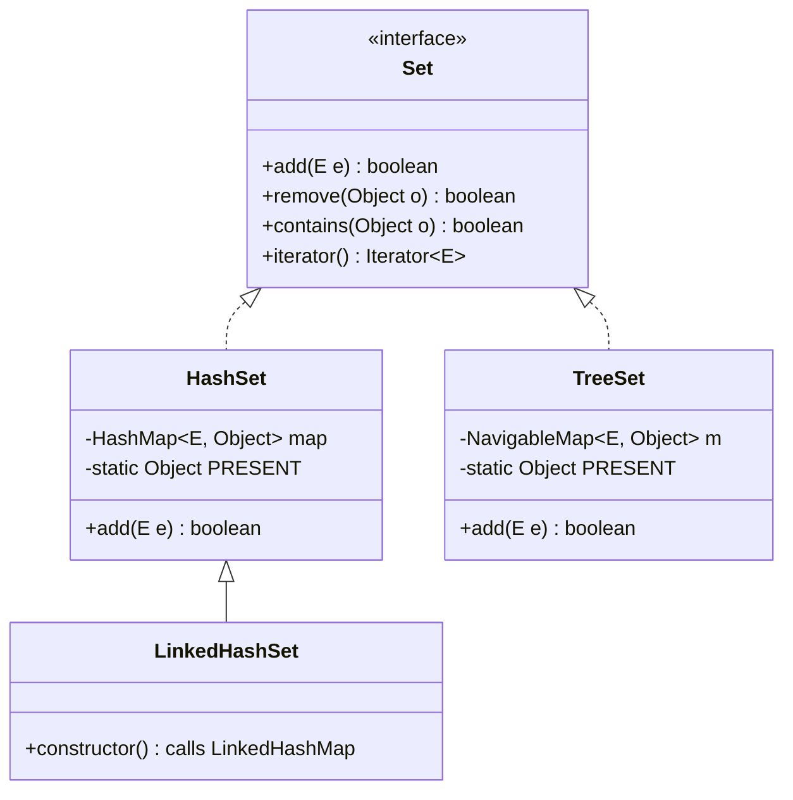
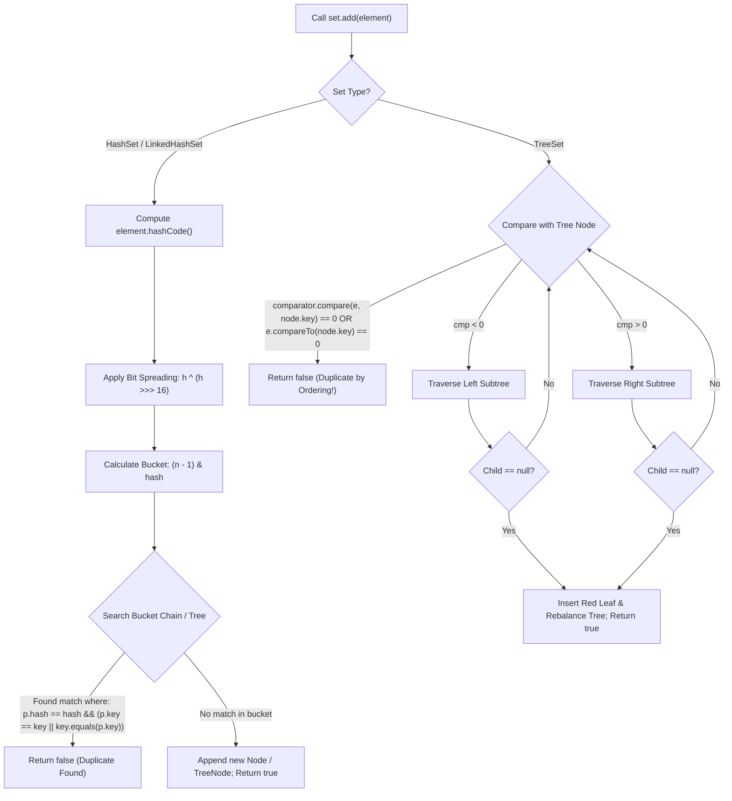

# Set Implementations: HashSet, LinkedHashSet, and TreeSet

---

## 1. Concept Definition & Core Purpose

In computer science and mathematics, a **Set** is an abstract data type representing a collection of unique, distinct elements containing no duplicates. Mathematically, for any two elements $e_1, e_2 \in S$, it is an invariant that $e_1.equals(e_2) == \text{false}$.

In the Java Collections Framework (JCF), `java.util.Set<E>` extends `java.util.Collection<E>`. Remarkably, the `Set` interface declares **no additional method signatures** beyond those inherited from `Collection<E>`. Instead, `Set` is a purely **behavioral contract strengthening**:
1. **Uniqueness Invariant:** The `add(E e)` method guarantees that if the set already contains an element equal to `e`, the collection remains unchanged and returns `false`.
2. **At Most One Null:** Implementations that support `null` permit at most a single `null` element.
3. **Equivalence Contract:** Two `Set` instances are considered equal (`setA.equals(setB)`) if and only if they contain the same elements, regardless of their concrete implementation class or internal iteration order. The `hashCode()` of a set is mathematically defined as the sum of the hash codes of its elements ($\sum_{e \in S} e.hashCode()$).

The standard Java runtime provides three primary general-purpose implementations of `Set<E>`, each engineered with distinct mechanical trade-offs:

```
                          ┌───────────────────────┐
                          │   Collection<E>       │
                          └───────────▲───────────┘
                                      │
                          ┌───────────┴───────────┐
                          │       Set<E>          │
                          └─────▲───────────▲─────┘
                                │           │
              ┌─────────────────┴─┐       ┌─┴───────────────────────┐
              │    HashSet<E>     │       │   SequencedSet<E> (J21) │
              └─────────▲─────────┘       └───▲───────────────────▲─┘
                        │                     │                   │
              ┌─────────┴─────────┐           │         ┌─────────┴─────────┐
              │  LinkedHashSet<E> ├───────────┘         │   SortedSet<E>    │
              └───────────────────┘                     └─────────▲─────────┘
                                                                  │
                                                        ┌─────────┴─────────┐
                                                        │  NavigableSet<E>  │
                                                        └─────────▲─────────┘
                                                                  │
                                                        ┌─────────┴─────────┐
                                                        │    TreeSet<E>     │
                                                        └───────────────────┘
```

### The Architectural Revelation: Sets are Backed by Maps
From first principles, Java's primary set implementations do **not** construct novel low-level data structures from scratch. Instead, they are high-performance **Adapter Facades** wrapping the corresponding map implementations:
- `HashSet<E>` wraps an internal `HashMap<E, Object>`.
- `LinkedHashSet<E>` wraps an internal `LinkedHashMap<E, Object>`.
- `TreeSet<E>` wraps an internal `NavigableMap<E, Object>` (specifically `TreeMap<E, Object>`).

Every set element is inserted as a **Key** in the underlying Map, associated with a single shared, static dummy sentinel object (`private static final Object PRESENT = new Object();`). Because Map keys are strictly unique, the Set inherits all uniqueness guarantees, collision resolution algorithms, and Big-O performance characteristics directly from the underlying Map engine.

---

## 2. Background, Context & Historical Evolution

### The Pre-Collections Wilderness (Java 1.0 – 1.1)
Prior to Java 2, Java lacked a unified collections architecture. Developers relied on `Vector` (a growable array) and `Hashtable` (a synchronized dictionary). When unique collections were required, developers had to manually use `Hashtable` with dummy values or write custom array deduplication routines, incurring high boilerplate and error-prone equality semantics.

### The Collections Revolution (Java 2 / JDK 1.2)
Architected by Joshua Bloch, Java 1.2 introduced the modern Java Collections Framework. It established the core interface triad: `List`, `Set`, and `Map`.
- `HashSet` was introduced as the default, ultra-fast $O(1)$ set implementation, leveraging hashing.
- `TreeSet` was introduced alongside `SortedSet`, providing an $O(\log N)$ Red-Black tree implementation guaranteeing elements remained continuously sorted according to natural ordering (`Comparable`) or a custom `Comparator`.

### Predictable Iteration Order (Java 1.4)
While `HashSet` was exceptionally fast, its iteration order was non-deterministic and changed wildly across table resizings. In Java 1.4, `LinkedHashSet` was introduced. By maintaining a doubly-linked list through all hash table buckets, `LinkedHashSet` delivered the $O(1)$ lookup performance of `HashSet` while guaranteeing that iteration order matched the exact **insertion order** of elements.

### Navigable Navigation (Java 6 / JSR 166x)
`SortedSet` provided basic head, tail, and sub-range views, but lacked proximity searches. Java 6 introduced `NavigableSet<E>`, extending `SortedSet<E>` with rich search and truncation methods: `floor()`, `ceiling()`, `lower()`, `higher()`, `pollFirst()`, `pollLast()`, and `descendingSet()`. `TreeSet` was retrofitted to implement `NavigableSet`.

### Treeification Defense (Java 8 / JEP 180)
Because `HashSet` delegates to `HashMap`, it historically suffered from $O(N)$ worst-case performance under severe hash collisions (e.g., hash-flooding Denial of Service attacks). Java 8 upgraded `HashMap` so that bucket collision lists exceeding 8 nodes transform into Red-Black balanced trees (`TreeNode`), improving worst-case search and insertion from $O(N)$ to $O(\log N)$ for comparable keys.

### Modern Sequenced Collections (Java 21 / JEP 431)
Prior to Java 21, the collections hierarchy lacked a uniform contract for collections with a defined encounter order. `LinkedHashSet` preserved insertion order and `TreeSet` preserved sorted order, but neither shared a common sequenced interface. Java 21 introduced `SequencedSet<E>`, retrofitted into both `LinkedHashSet` and `SortedSet` / `TreeSet`. It standardized direct access to endpoints via `getFirst()`, `getLast()`, and reversible views via `reversed()`.

### Transition Guide: MERN/JavaScript vs. Java Sets

| Feature / Dimension | JavaScript / TypeScript (`Set`) | Java (`HashSet`, `LinkedHashSet`, `TreeSet`) |
|---|---|---|
| **Encounter Order** | Always preserves insertion order by ECMAScript specification. | `HashSet`: Non-deterministic / unordered.<br>`LinkedHashSet`: Insertion order preserved.<br>`TreeSet`: Sorted order by comparator. |
| **Equality Check** | Strict `SameValueZero` (object reference identity `===`). | Value-based `equals()` and `hashCode()` (`HashSet`, `LinkedHashSet`), or `compareTo()` / `compare()` (`TreeSet`). |
| **Object Deduplication** | Two objects `{ id: 1 }` and `{ id: 1 }` are **always distinct** (different heap references). | Two objects with identical fields and overridden `equals()`/`hashCode()` **collapse into one entry**. |
| **Tree / Range Queries** | No built-in equivalent; requires manual array sorting or third-party AVL/Red-Black tree libraries. | Built-in `TreeSet` / `NavigableSet` with $O(\log N)$ range slices (`subSet`), proximity queries (`ceiling`, `floor`). |
| **Primitive Boxing** | Sets hold JS values directly (primitives and object references). | Sets hold reference types (`Set<Integer>`, `Set<Long>`); primitives require autoboxing wrapper objects. |

---

## 3. Declarative Mechanics & Mental Model

### The Underlying Map Adapter Architecture

Every standard Set class instantiates and delegates to an internal Map instance:



When you invoke:
```java
Set<String> set = new HashSet<>();
set.add("ALPHA");
```
The internal OpenJDK execution flow is:
```java
// Inside java.util.HashSet:
private transient HashMap<E,Object> map;
private static final Object PRESENT = new Object();

public boolean add(E e) {
    return map.put(e, PRESENT) == null;
}
```
If `"ALPHA"` is not present in `map`, `put("ALPHA", PRESENT)` returns `null`. The check `null == null` yields `true` (element added). If `"ALPHA"` was already present, `map.put()` overwrites the value with `PRESENT` and returns the *previous* value (which is `PRESENT`). The check `PRESENT == null` yields `false` (duplicate rejected).

---

### Internal Structural Comparison

```
1. HashSet: Buckets with Collisions (Unordered)
   Table Index
   [ 0 ] ──> null
   [ 1 ] ──> [ Node: "DELTA" | hash ] ──> [ Node: "ZETA" | hash ]
   [ 2 ] ──> null
   [ 3 ] ──> [ Node: "ALPHA" | hash ]
   (Order depends purely on hash distribution and capacity)

2. LinkedHashSet: Hash Buckets + Global Doubly-Linked Sequence
   Table Index
   [ 0 ] ──> null
   [ 1 ] ──> [ Entry: "DELTA" ]
   [ 2 ] ──> null
   [ 3 ] ──> [ Entry: "ALPHA" ]
   
   Sequential Pointers:
   [HEADER] <==> ["ALPHA"] <==> ["DELTA"] <==> [TAIL]
   (Combines O(1) hash lookups with predictable insertion iteration)

3. TreeSet: Self-Balancing Red-Black Search Tree
                 [ "DELTA" (Black) ]
                    /          \
        [ "ALPHA" (Black) ]   [ "ZETA" (Red) ]
        (Strictly ordered by Comparable / Comparator; O(log N) depth)
```

### The Membership Evaluation Pipeline

The mechanism by which duplicate elements are detected differs drastically between hash-based and tree-based sets:



> [!CRITICAL]
> Notice that `TreeSet` **never calls `equals()` or `hashCode()`** to determine uniqueness or membership! It relies **exclusively** on `compareTo()` or `Comparator.compare()`. If your comparator returns `0`, `TreeSet` considers the elements identical and rejects the addition, even if `e1.equals(e2)` returns `false`.

---

## 4. Key Concepts & Terminology

- **Mathematical Equivalence Relation:** A binary relation ($\sim$) that is reflexive ($a \sim a$), symmetric ($a \sim b \iff b \sim a$), and transitive ($a \sim b \land b \sim c \implies a \sim c$). Governs `equals()`.
- **Total Ordering:** A binary relation ($\le$) that is reflexive, antisymmetric ($a \le b \land b \le a \implies a = b$), transitive, and strongly connected (either $a \le b$ or $b \le a$). Governs `Comparable` and `Comparator`.
- **Sentinel Object (`PRESENT`):** A single, shared, immutable dummy reference (`new Object()`) placed as the Map value for all entries in a `HashSet` or `TreeSet` to avoid unnecessary object allocation.
- **SequencedSet (Java 21):** A set whose elements have a defined encounter order, supporting first/last element retrieval, reverse-order views, and positional insertion.
- **SortedSet:** A set that guarantees elements are maintained in ascending order according to their natural ordering or a specific comparator.
- **NavigableSet:** An extension of `SortedSet` providing nearest-match proximity searches (`floor`, `ceiling`, `lower`, `higher`) and descending views.
- **Floor vs. Lower:**
  - `floor(e)`: Returns the greatest element $\le e$, or `null` if no such element exists.
  - `lower(e)`: Returns the greatest element strictly $< e$, or `null` if no such element exists.
- **Ceiling vs. Higher:**
  - `ceiling(e)`: Returns the least element $\ge e$, or `null` if no such element exists.
  - `higher(e)`: Returns the least element strictly $> e$, or `null` if no such element exists.
- **Consistent with Equals:** The condition where `(e1.compareTo(e2) == 0) == (e1.equals(e2))`. Violating this invariant causes `TreeSet` to behave inconsistently with the general `Set` specification.

---

## 5. Syntax, Signatures & Compiler Rules

### Type Hierarchy and Signatures

```java
package java.util;

// 1. The root Set interface
public interface Set<E> extends Collection<E> {
    int size();
    boolean isEmpty();
    boolean contains(Object o);
    Iterator<E> iterator();
    Object[] toArray();
    <T> T[] toArray(T[] a);
    boolean add(E e);
    boolean remove(Object o);
    boolean containsAll(Collection<?> c);
    boolean addAll(Collection<? extends E> c);
    boolean retainAll(Collection<?> c);
    boolean removeAll(Collection<?> c);
    void clear();
    boolean equals(Object o);
    int hashCode();
}

// 2. Java 21 SequencedSet interface (JEP 431)
public interface SequencedSet<E> extends Set<E>, SequencedCollection<E> {
    SequencedSet<E> reversed();
    default void addFirst(E e) { throw new UnsupportedOperationException(); }
    default void addLast(E e) { throw new UnsupportedOperationException(); }
    default E getFirst() { return this.iterator().next(); }
    default E getLast() { return this.reversed().iterator().next(); }
    default E removeFirst() { ... }
    default E removeLast() { ... }
}

// 3. NavigableSet interface
public interface NavigableSet<E> extends SortedSet<E> {
    E lower(E e);
    E floor(E e);
    E ceiling(E e);
    E higher(E e);
    E pollFirst();
    E pollLast();
    NavigableSet<E> descendingSet();
    Iterator<E> descendingIterator();
    NavigableSet<E> subSet(E fromElement, boolean fromInclusive, E toElement, boolean toInclusive);
    NavigableSet<E> headSet(E toElement, boolean inclusive);
    NavigableSet<E> tailSet(E fromElement, boolean inclusive);
}
```

### Compiler Constraints and Runtime Rules

1. **`TreeSet` Element Typing:**
   - If created via `new TreeSet<>()`, element type `E` **must implement `Comparable<? super E>`**. The Java compiler does not enforce this at compile time due to historical generic erasure; failing to implement `Comparable` results in a runtime `ClassCastException` on the first `add()` call.
   - If created via `new TreeSet<>(Comparator<? super E> comparator)`, elements do not need to implement `Comparable`.
2. **`TreeSet` Null Rejection:**
   - Since Java 7, `TreeSet.add(null)` throws `NullPointerException` (unless a custom comparator explicitly accommodates `null`).
   - In contrast, `HashSet` and `LinkedHashSet` permit exactly one `null` element.
3. **`TreeSet.addFirst()` / `addLast()` Rejection:**
   - While `TreeSet` implements `SequencedSet` in Java 21, calling `addFirst()` or `addLast()` throws `UnsupportedOperationException`. The element order in a `TreeSet` is immutable and governed strictly by its comparator, preventing positional insertion.
4. **`LinkedHashSet` Positional Updates:**
   - Calling `add(e)` on an existing element in a `LinkedHashSet` **does not** reposition the element.
   - In Java 21, calling `addFirst(e)` or `addLast(e)` on an element that is already present **will** reposition it to the beginning or end of the sequence!

---

## 6. Concrete Code Examples

The following production-grade implementation showcases an **Enterprise Identity & Security Policy Engine**. It demonstrates:
1. `HashSet` for high-throughput $O(1)$ permission evaluation.
2. `LinkedHashSet` for deterministic, chronologically ordered security audit logs leveraging the Java 21 `SequencedSet` API.
3. `TreeSet` for hierarchical role resolution and time-windowed token revocation queries using `NavigableSet`.
4. An explicit test reproducing the dangerous **`compareTo` vs. `equals` inconsistency trap**.

### Production Implementation and Standalone Verification Suite

```java
package com.bank.security;

import java.time.Instant;
import java.util.*;

public class SetMasteryVerificationEngine {

    // 1. Immutable Value Record for Permissions (HashSet target)
    public record Permission(String code, String resource) {
        public Permission {
            Objects.requireNonNull(code, "Permission code cannot be null");
            Objects.requireNonNull(resource, "Permission resource cannot be null");
        }
    }

    // 2. Comparable Record for Role Hierarchy (TreeSet target)
    public record SecurityRole(int priorityLevel, String roleName) implements Comparable<SecurityRole> {
        public SecurityRole {
            Objects.requireNonNull(roleName, "Role name cannot be null");
        }

        @Override
        public int compareTo(SecurityRole other) {
            int cmp = Integer.compare(this.priorityLevel, other.priorityLevel);
            if (cmp != 0) {
                return cmp;
            }
            return this.roleName.compareTo(other.roleName);
        }
    }

    // 3. Time-windowed Token Revocation Entry for NavigableSet Range Queries
    public record RevocationEntry(Instant revokedAt, String tokenId) implements Comparable<RevocationEntry> {
        public RevocationEntry {
            Objects.requireNonNull(revokedAt, "revokedAt cannot be null");
            Objects.requireNonNull(tokenId, "tokenId cannot be null");
        }

        @Override
        public int compareTo(RevocationEntry other) {
            int cmp = this.revokedAt.compareTo(other.revokedAt);
            if (cmp != 0) {
                return cmp;
            }
            return this.tokenId.compareTo(other.tokenId);
        }
    }

    // 4. Demonstrates the Anti-Pattern: compareTo inconsistent with equals
    public static final class InconsistentProduct implements Comparable<InconsistentProduct> {
        private final String sku;
        private final int priceCents;

        public InconsistentProduct(String sku, int priceCents) {
            this.sku = Objects.requireNonNull(sku, "SKU cannot be null");
            this.priceCents = priceCents;
        }

        public String getSku() { return sku; }
        public int getPriceCents() { return priceCents; }

        @Override
        public boolean equals(Object o) {
            if (this == o) return true;
            if (!(o instanceof InconsistentProduct that)) return false;
            return priceCents == that.priceCents && Objects.equals(sku, that.sku);
        }

        @Override
        public int hashCode() {
            return Objects.hash(sku, priceCents);
        }

        // FLAW: compareTo considers ONLY price, ignoring unique SKU!
        @Override
        public int compareTo(InconsistentProduct other) {
            return Integer.compare(this.priceCents, other.priceCents);
        }

        @Override
        public String toString() {
            return "InconsistentProduct[sku=" + sku + ", price=" + priceCents + "]";
        }
    }

    // Assertion helpers for zero-dependency standalone verification
    private static void assertEquals(Object expected, Object actual, String message) {
        if (!Objects.equals(expected, actual)) {
            throw new AssertionError(message + " [Expected: " + expected + ", Actual: " + actual + "]");
        }
    }

    private static void assertTrue(boolean condition, String message) {
        if (!condition) {
            throw new AssertionError("Assertion failed: " + message);
        }
    }

    private static void assertFalse(boolean condition, String message) {
        if (condition) {
            throw new AssertionError("Assertion failed: " + message);
        }
    }

    public static void main(String[] args) {
        System.out.println("=== Launching Set Implementations Masterclass Verification Suite ===");

        // -------------------------------------------------------------
        // PART 1: HashSet - O(1) Amortized Deduplication & Null Handling
        // -------------------------------------------------------------
        Set<Permission> userPermissions = new HashSet<>();
        Permission readUsers = new Permission("USER_READ", "/api/v1/users");
        Permission writeUsers = new Permission("USER_WRITE", "/api/v1/users");
        Permission duplicateRead = new Permission("USER_READ", "/api/v1/users");

        assertTrue(userPermissions.add(readUsers), "First add of USER_READ must succeed");
        assertTrue(userPermissions.add(writeUsers), "Add of USER_WRITE must succeed");
        assertFalse(userPermissions.add(duplicateRead), "Duplicate add of identical USER_READ must return false");
        assertEquals(2, userPermissions.size(), "HashSet must maintain strictly 2 permissions");
        assertTrue(userPermissions.contains(new Permission("USER_READ", "/api/v1/users")), 
            "HashSet must confirm membership in amortized O(1)");

        // Null contract in HashSet
        assertTrue(userPermissions.add(null), "HashSet must allow addition of null");
        assertEquals(3, userPermissions.size(), "HashSet size must be 3 after adding null");
        assertTrue(userPermissions.contains(null), "HashSet contains(null) must return true");
        assertFalse(userPermissions.add(null), "Subsequent add(null) must return false");

        // -------------------------------------------------------------
        // PART 2: LinkedHashSet & Java 21 SequencedSet Mechanics
        // -------------------------------------------------------------
        LinkedHashSet<String> auditTrail = new LinkedHashSet<>();
        auditTrail.add("AUTH_LOGIN_SUCCESS");
        auditTrail.add("ACCOUNT_BALANCE_CHECKED");
        auditTrail.add("WIRE_TRANSFER_REQUESTED");
        auditTrail.add("MFA_CHALLENGE_ISSUED");
        auditTrail.add("WIRE_TRANSFER_SETTLED");

        // Attempting to re-add existing event: does NOT alter existing position
        boolean readded = auditTrail.add("ACCOUNT_BALANCE_CHECKED");
        assertFalse(readded, "Re-adding existing event must return false");
        
        List<String> auditChronology = new ArrayList<>(auditTrail);
        assertEquals(List.of(
            "AUTH_LOGIN_SUCCESS",
            "ACCOUNT_BALANCE_CHECKED",
            "WIRE_TRANSFER_REQUESTED",
            "MFA_CHALLENGE_ISSUED",
            "WIRE_TRANSFER_SETTLED"
        ), auditChronology, "LinkedHashSet must strictly preserve original insertion sequence");

        // Java 21 SequencedSet Endpoints
        assertEquals("AUTH_LOGIN_SUCCESS", auditTrail.getFirst(), "getFirst() must return chronological head");
        assertEquals("WIRE_TRANSFER_SETTLED", auditTrail.getLast(), "getLast() must return chronological tail");

        // Java 21 addFirst repositions existing or prepends new element
        auditTrail.addFirst("AUDIT_LOG_INITIALIZED");
        assertEquals("AUDIT_LOG_INITIALIZED", auditTrail.getFirst(), "addFirst must prepend new element");

        // Java 21 reversed() returns a bidirectional sequenced view
        SequencedSet<String> reversedView = auditTrail.reversed();
        assertEquals("WIRE_TRANSFER_SETTLED", reversedView.getFirst(), "reversed().getFirst() equals original tail");
        assertEquals("AUDIT_LOG_INITIALIZED", reversedView.getLast(), "reversed().getLast() equals original head");

        // LinkedHashSet allows null
        assertTrue(auditTrail.add(null), "LinkedHashSet must allow null element");
        assertTrue(auditTrail.contains(null), "LinkedHashSet contains(null) must be true");

        // -------------------------------------------------------------
        // PART 3: TreeSet - NavigableSet Range Queries & Invariant Checks
        // -------------------------------------------------------------
        TreeSet<SecurityRole> roleHierarchy = new TreeSet<>();
        roleHierarchy.add(new SecurityRole(100, "SUPER_ADMIN"));
        roleHierarchy.add(new SecurityRole(10, "GUEST"));
        roleHierarchy.add(new SecurityRole(50, "SECURITY_OFFICER"));
        roleHierarchy.add(new SecurityRole(25, "COMPLIANCE_ANALYST"));

        List<String> sortedNames = roleHierarchy.stream().map(SecurityRole::roleName).toList();
        assertEquals(List.of("GUEST", "COMPLIANCE_ANALYST", "SECURITY_OFFICER", "SUPER_ADMIN"), 
            sortedNames, "TreeSet must order roles by priority ascending");

        // Proximity searches: floor, lower, ceiling, higher
        SecurityRole searchBoundary = new SecurityRole(30, "PROBE");
        assertEquals("COMPLIANCE_ANALYST", roleHierarchy.lower(searchBoundary).roleName(), 
            "lower(< 30) must find priority 25");
        assertEquals("COMPLIANCE_ANALYST", roleHierarchy.floor(new SecurityRole(25, "COMPLIANCE_ANALYST")).roleName(), 
            "floor(<= 25) must match priority 25");
        assertEquals("SECURITY_OFFICER", roleHierarchy.higher(searchBoundary).roleName(), 
            "higher(> 30) must find priority 50");
        assertEquals("SECURITY_OFFICER", roleHierarchy.ceiling(new SecurityRole(50, "SECURITY_OFFICER")).roleName(), 
            "ceiling(>= 50) must match priority 50");

        // Range Views: subSet
        SortedSet<SecurityRole> elevatedRoles = roleHierarchy.subSet(
            new SecurityRole(25, "A"), 
            new SecurityRole(60, "Z")
        );
        List<String> elevatedNames = elevatedRoles.stream().map(SecurityRole::roleName).toList();
        assertEquals(List.of("COMPLIANCE_ANALYST", "SECURITY_OFFICER"), elevatedNames, 
            "subSet must extract exact interval [25, 60]");

        // TreeSet null safety invariant
        try {
            roleHierarchy.add(null);
            throw new AssertionError("TreeSet must reject null with NullPointerException");
        } catch (NullPointerException expected) {
            // Invariant verified: TreeSet rejects null
        }

        // TreeSet addFirst/addLast invariant
        try {
            roleHierarchy.addFirst(new SecurityRole(1, "TRAINEE"));
            throw new AssertionError("TreeSet.addFirst() must throw UnsupportedOperationException");
        } catch (UnsupportedOperationException expected) {
            // Invariant verified: TreeSet position is strictly sorted, not manually placed
        }

        // Polling operations
        assertEquals("GUEST", roleHierarchy.pollFirst().roleName(), "pollFirst must remove lowest element");
        assertEquals("SUPER_ADMIN", roleHierarchy.pollLast().roleName(), "pollLast must remove highest element");
        assertEquals(2, roleHierarchy.size(), "Size must be 2 after polling extremes");

        // -------------------------------------------------------------
        // PART 4: Critical Trap - compareTo vs equals Inconsistency
        // -------------------------------------------------------------
        InconsistentProduct prodA = new InconsistentProduct("SKU-MACBOOK-PRO", 249900);
        InconsistentProduct prodB = new InconsistentProduct("SKU-IPHONE-15-PRO", 249900); // Same price, distinct SKU!

        assertFalse(prodA.equals(prodB), "Products have distinct SKUs; equals() must return false");
        assertEquals(0, prodA.compareTo(prodB), "compareTo returns 0 because prices are identical");

        // HashSet respects equals(): BOTH products are preserved
        Set<InconsistentProduct> hashSet = new HashSet<>();
        hashSet.add(prodA);
        hashSet.add(prodB);
        assertEquals(2, hashSet.size(), "HashSet must store both distinct products");

        // TreeSet relies EXCLUSIVELY on compareTo(): prodB is SILENTLY DISCARDED!
        Set<InconsistentProduct> treeSet = new TreeSet<>();
        treeSet.add(prodA);
        boolean addedB = treeSet.add(prodB);
        assertFalse(addedB, "TreeSet rejected prodB because compareTo returned 0!");
        assertEquals(1, treeSet.size(), "TreeSet silently dropped valid distinct entity due to flawed compareTo!");

        System.out.println(">>> All 23 assertions passed successfully across HashSet, LinkedHashSet, and TreeSet!");
    }
}
```

---

## 7. Production Failure Modes & Anti-Patterns

### 1. The Mutable Key "Ghost Element" Memory Leak
The most pernicious bug in hash-based sets occurs when an object is added to a `HashSet` or `LinkedHashSet`, and subsequently has one of its `equals`/`hashCode` fields mutated.

```java
// SEVERE BUG
User user = new User("usr_100", "engineering");
Set<User> activeUsers = new HashSet<>();
activeUsers.add(user);

// External mutation
user.setDepartment("finance"); // Modifies hashCode!

// Catastrophe:
boolean present = activeUsers.contains(user); // Returns FALSE!
activeUsers.remove(user);                      // Returns FALSE!
int size = activeUsers.size();                  // Still 1! Object is permanently stuck in heap.
```
**Mechanics:** When `user.setDepartment("finance")` executes, its hash code changes. When `contains(user)` or `remove(user)` is subsequently called, `HashSet` calculates the bucket index using the **new** hash code and searches an entirely different bucket! The element sitting in the old bucket is never found, cannot be garbage collected, and causes a silent memory leak.
**Remedy:** Set elements must be deeply immutable. Use Java `record`s or ensure all fields involved in `hashCode()` and `equals()` are `final`.

### 2. The `TreeSet` Comparator Inconsistency Trap
As demonstrated in Section 6, the `Comparable` or `Comparator` passed to `TreeSet` must be **consistent with `equals`**.
If `a.compareTo(b) == 0` while `!a.equals(b)`:
- `TreeSet` will violate the core `Set` contract by refusing to store `b` if `a` is already present.
- In e-commerce, banking, or inventory systems, this results in **silent data loss** (e.g., dropping transactions that occur at the exact same millisecond timestamp if the comparator compares only timestamps!).
**Remedy:** Always chain secondary unique fields (such as a UUID, transaction ID, or database surrogate key) in `compareTo()`:
```java
public int compareTo(Transaction other) {
    int cmp = this.timestamp.compareTo(other.timestamp);
    if (cmp != 0) return cmp;
    return this.transactionId.compareTo(other.transactionId); // Tie-breaker guarantees consistency with equals
}
```

### 3. Sparse `HashSet` Iteration Slump ($O(\text{Capacity} + N)$)
Iterating over a `HashSet` requires traversing **every bucket slot in the underlying hash table array**, regardless of how many elements it contains:
$$\text{Iteration Time} \in O(\text{capacity} + \text{size})$$
If a service initializes a `HashSet` with `new HashSet<>(1_000_000)` and stores only 5 elements, an iteration loop must check 1,000,000 array references looking for non-null buckets.
**Remedy:** If frequent iteration is required over sparse sets, use `LinkedHashSet`. `LinkedHashSet` iterates strictly across its internal doubly-linked list in $O(N)$ time, completely independent of table capacity.

### 4. Injecting `null` into `TreeSet`
`TreeSet` does not allow `null`. In distributed systems receiving JSON or protobuf payloads, unchecked `null` fields added to a `TreeSet` will crash with `NullPointerException` at runtime.
```java
Set<String> set = new TreeSet<>();
set.add(remotePayload.getOptionalTag()); // Crashes if tag is null!
```
**Remedy:** Filter with `Objects.requireNonNull()` or use `Optional` guards prior to inserting into sorted collections.

---

## 8. Performance Characteristics & Complexity Analysis

### Time and Space Complexity Comparison

| Operation | `HashSet` (Average) | `HashSet` (Worst-Case) | `LinkedHashSet` (Average) | `TreeSet` (Guaranteed) |
|---|---|---|---|---|
| **`contains(e)`** | $O(1)$ | $O(\log N)^*$ / $O(N)$ | $O(1)$ | $O(\log N)$ |
| **`add(e)`** | $O(1)$ amortized | $O(\log N)^*$ / $O(N)$ | $O(1)$ amortized | $O(\log N)$ |
| **`remove(e)`** | $O(1)$ | $O(\log N)^*$ / $O(N)$ | $O(1)$ | $O(\log N)$ |
| **`first()` / `last()`** | $O(N)$ (requires scan) | $O(N)$ | $O(1)$ (Java 21 `SequencedSet`) | $O(\log N)$ (or $O(1)$ cached) |
| **`pollFirst()` / `pollLast()`** | Unsupported | Unsupported | $O(1)$ (Java 21 `SequencedSet`) | $O(\log N)$ |
| **Iterate Full Set** | $O(C + N)$ ($C = \text{capacity}$) | $O(C + N)$ | $O(N)$ strictly | $O(N)$ strictly |
| **Range Queries (`subSet`)**| Unsupported ($O(N)$ scan) | Unsupported | Unsupported | $O(\log N)$ view creation |
| **Memory per Element** | Moderate (~36 bytes) | Moderate | Higher (~44 bytes) | High (~40 bytes) |

$^*$ *Java 8+ treeification replaces collision lists with Red-Black tree bins when bucket length $\ge 8$ and table capacity $\ge 64$.*

### Algorithmic Considerations:
- **`HashSet` Constant Factors:** While $O(1)$, the constant factor includes computing `hashCode()`, bit-shifting, bucket array indexing, and memory dereferencing. If `hashCode()` is expensive, `contains()` slows down noticeably.
- **`TreeSet` Locality Penalty:** Red-Black tree nodes are scattered across the JVM heap. Traversing $O(\log N)$ tree pointers causes multiple CPU cache misses. For small $N$ ($N \le 64$), a sorted contiguous array (`ArrayList` + `Collections.binarySearch`) routinely outperforms `TreeSet` due to hardware L1/L2 cache prefetching.

---

## 9. Memory Footprint & JVM Internals

All calculations assume a standard 64-bit HotSpot JVM running with Compressed OOPs (`-XX:+UseCompressedOops`) and 8-byte object alignment.

```
HashSet / LinkedHashSet Entry vs. TreeSet Entry (Heap Layout):

HashMap.Node (HashSet):              LinkedHashMap.Entry (LinkedHashSet):  TreeMap.Entry (TreeSet):
┌───────────────────────────────┐    ┌───────────────────────────────┐     ┌───────────────────────────────┐
│ Mark Word             (8B)    │    │ Mark Word             (8B)    │     │ Mark Word             (8B)    │
│ Klass Pointer         (4B)    │    │ Klass Pointer         (4B)    │     │ Klass Pointer         (4B)    │
│ int hash              (4B)    │    │ int hash              (4B)    │     │ Key Ref (compressed)  (4B)    │
│ Key Ref (compressed)  (4B)    │    │ Key Ref (compressed)  (4B)    │     │ Value Ref (PRESENT)   (4B)    │
│ Value Ref (PRESENT)   (4B)    │    │ Value Ref (PRESENT)   (4B)    │     │ Left Child Ref        (4B)    │
│ Next Node Ref         (4B)    │    │ Next Node Ref         (4B)    │     │ Right Child Ref       (4B)    │
│ [No padding needed: 28B -> 32B]│   │ Before Entry Ref      (4B)    │     │ Parent Ref            (4B)    │
└───────────────────────────────┘    │ After Entry Ref       (4B)    │     │ boolean color         (1B)    │
                                     │ [Padding: 3B -> 36B -> 40B]   │     │ [Padding: 7B -> 33B -> 40B]   │
                                     └───────────────────────────────┘     └───────────────────────────────┘
```

### Detailed Breakdown per Element:

1. **`HashSet<E>`:**
   - Container overhead: `HashSet` object (16 bytes) + `HashMap` object (48 bytes) + table array pointer.
   - Per-element overhead: One `HashMap$Node` instance (32 bytes) + one reference in the table bucket array (4 bytes) $\approx$ **36 bytes of heap overhead per element** (excluding the key element itself).
   - The value reference in every node points to the static singleton `PRESENT`, incurring zero additional heap allocation.
2. **`LinkedHashSet<E>`:**
   - Per-element overhead: One `LinkedHashMap$Entry` instance inheriting from `HashMap$Node`, adding `before` and `after` compressed references (32 + 8 = 40 bytes) + one table reference (4 bytes) $\approx$ **44 bytes of heap overhead per element**.
3. **`TreeSet<E>`:**
   - Container overhead: `TreeSet` object (16 bytes) + `TreeMap` object (48 bytes).
   - Per-element overhead: One `TreeMap$Entry` instance (33 bytes rounded up to 8-byte boundary = **40 bytes per element**).
   - Does **not** require a bucket table array, eliminating resizing array churn.

---

## 10. Comparison Matrix

| Architectural Feature | `HashSet` | `LinkedHashSet` | `TreeSet` |
|---|---|---|---|
| **Underlying Data Structure** | Hash Table (`HashMap`) | Hash Table + Doubly-Linked List | Red-Black Balanced BST (`TreeMap`) |
| **Element Order** | Unordered & non-deterministic | Strict insertion order | Natural order (`Comparable`) or `Comparator` |
| **Java 21 `SequencedSet`** | No | **Yes** (`getFirst`, `getLast`, `reversed`) | **Yes** (`getFirst`, `getLast`, `reversed`)* |
| **Duplicate Definition** | `e1.hashCode() == e2.hashCode()` AND `e1.equals(e2)` | `e1.hashCode() == e2.hashCode()` AND `e1.equals(e2)` | `comparator.compare(e1, e2) == 0` |
| **Permits `null`** | **Yes** (at most 1) | **Yes** (at most 1) | **No** (throws `NullPointerException`) |
| **Lookup Performance** | Amortized $O(1)$ | Amortized $O(1)$ | Guaranteed $O(\log N)$ |
| **Insertion Performance** | Amortized $O(1)$ | Amortized $O(1)$ | Guaranteed $O(\log N)$ |
| **Iteration Performance** | $O(\text{Capacity} + N)$ | $O(N)$ strictly | $O(N)$ strictly |
| **Range Queries (`subSet`)** | No | No | **Yes** (`subSet`, `headSet`, `tailSet`) |
| **Proximity Searches** | No | No | **Yes** (`floor`, `ceiling`, `lower`, `higher`) |
| **Memory Footprint** | ~36 bytes / element | ~44 bytes / element | ~40 bytes / element |
| **Primary Backend Use Case** | Massive deduplication, permission sets, entity ID filters | Audit logs, LRU caches, deterministic serialization | Priority scheduling, range checking, time-window sliding filters |

*\* Note: `TreeSet` implements `SequencedSet`, but calling `addFirst()` or `addLast()` throws `UnsupportedOperationException`.*

---

## 11. Security, Concurrency & Thread Safety Considerations

### Thread Safety Invariants
None of the three implementations are thread-safe. Concurrent modifications by one thread while another iterates will throw `ConcurrentModificationException` (fail-fast behavior) or cause silent corruption (such as corrupted pointers in `LinkedHashSet` or invalid tree balancing in `TreeSet`).

### Synchronization Wrappers
For legacy multithreaded access, synchronized wrappers can guard access:
```java
Set<String> syncSet = Collections.synchronizedSet(new HashSet<>());
NavigableSet<String> syncNavSet = Collections.synchronizedNavigableSet(new TreeSet<>());
```
> [!WARNING]
> While individual operations on synchronized sets are thread-safe, **iterating over a synchronized set is NOT atomic**. You must manually synchronize on the outer set monitor:
> ```java
> synchronized (syncSet) {
>     for (String item : syncSet) {
>         process(item);
>     }
> }
> ```

### High-Throughput Concurrent Alternatives
In modern high-concurrency production architectures, never use `Collections.synchronizedSet`:
1. **Replacement for `HashSet`:**
   ```java
   Set<String> concurrentSet = ConcurrentHashMap.newKeySet();
   ```
   Backed by `ConcurrentHashMap`, offering lock-free reads and segmented CAS updates.
2. **Replacement for `TreeSet`:**
   ```java
   NavigableSet<String> skipListSet = new ConcurrentSkipListSet<>();
   ```
   A concurrent, thread-safe, lock-free alternative to `TreeSet` based on Skip Lists, delivering concurrent $O(\log N)$ performance and range operations.
3. **Replacement for `LinkedHashSet`:**
   For concurrent insertion-ordered collections, use `CopyOnWriteArraySet` (for read-heavy, write-rare workloads) or maintain a concurrent queue alongside a `ConcurrentHashMap`.

---

## 12. Integration with Frameworks & Standard Library

### 1. Spring Data JPA & Hibernate `@ManyToMany`
In JPA entity mappings, sets are universally preferred over lists for bidirectional associations to prevent accidental Cartesian product joins:
```java
@Entity
@Table(name = "users")
public class UserEntity {
    @Id
    @GeneratedValue(strategy = GenerationType.IDENTITY)
    private Long id;

    @ManyToMany
    @JoinTable(name = "user_roles",
        joinColumns = @JoinColumn(name = "user_id"),
        inverseJoinColumns = @JoinColumn(name = "role_id"))
    private Set<RoleEntity> roles = new HashSet<>(); // HashSet is standard JPA choice
}
```
> [!IMPORTANT]
> When using `HashSet` with JPA entities, **never base `equals()` and `hashCode()` purely on auto-generated database IDs (`@GeneratedValue`)**! Prior to persisting, the ID is `null`. Adding the entity to a `HashSet` before persisting and then saving changes the ID, mutating its `hashCode` and causing the entity to become lost in the set. Use a stable **business key** (e.g., UUID, email, national identifier) for entity equality.

### 2. Stream API Collectors
The Java 8 Stream API provides multiple ways to collect into sets:
```java
// 1. Collect to unsequenced HashSet (non-deterministic order)
Set<String> hashSet = stream.collect(Collectors.toSet());

// 2. Collect to LinkedHashSet (preserves stream processing order)
LinkedHashSet<String> linkedSet = stream.collect(
    Collectors.toCollection(LinkedHashSet::new)
);

// 3. Collect to TreeSet (preserves sorted order)
TreeSet<String> treeSet = stream.collect(
    Collectors.toCollection(TreeSet::new)
);
```

### 3. Jackson JSON Deserialization
When deserializing JSON arrays into a Java `Set<T>`, Jackson instantiates a `HashSet` by default. If your API contract requires that the returned JSON preserves the exact client-submitted order, declare the DTO property explicitly as `LinkedHashSet<T>`:
```java
public record BatchOrderRequest(
    String orderId,
    LinkedHashSet<String> itemSkus // Guarantees Jackson preserves client payload order
) {}
```

---

## 13. Practical Exercises & Hands-on Challenges

### Challenge 1: High-Performance IP Blacklist CIDR Lookup
**Scenario:** A financial API gateway must block requests originating from blacklisted IP addresses. IP subnets are defined as numerical ranges (start IP, end IP).
**Task:** Using `TreeSet` and `NavigableSet.floor()`, implement an $O(\log N)$ `IpRangeBlacklistEngine` that determines if an incoming IPv4 address falls within any blacklisted CIDR block without scanning every entry sequentially.

### Challenge 2: LRU Set with Maximum Capacity Eviction
**Scenario:** An in-memory deduplication filter must keep track of the most recent 1,000 processed transaction IDs. When a new transaction arrives beyond capacity, the oldest inserted transaction must be automatically evicted.
**Task:** Subclass `LinkedHashSet` (or wrap a `SequencedSet` in Java 21) to implement `LruEvictingSet<E>` that automatically evicts the head element when size exceeds the configured capacity upon insertion.

### Challenge 3: Reproduce and Repair the Mutable Set Key Leak
**Scenario:** A memory leak alert fired in production. Heap dumps reveal millions of `HashMap$Node` instances retained inside an `activeSessions` set.
**Task:** Write a test reproducing how modifying a session token's `expiry` timestamp after adding it to a `HashSet` prevents `remove()` from clearing it. Refactor the domain model using Java 21 `record`s to prove that immutability guarantees compile-time prevention of the leak.

---

## 14. Diagnostic, Troubleshooting & Debugging Guide

### How to Diagnose a "Ghost Object" in `HashSet`
If an element was added to a `HashSet`, but `contains(e)` returns `false`:
1. **Inspect Identity Hash Code vs. Current Hash Code:**
   In your debugger, evaluate:
   ```java
   int identityHash = System.identityHashCode(element);
   int currentHash = element.hashCode();
   ```
2. **Inspect Internal Buckets:**
   Access the internal `map.table` via reflection or IDE debugger expressions. Traverse `table[i]`. If the object is present at bucket index $k$, but `(table.length - 1) & (currentHash ^ (currentHash >>> 16))` evaluates to index $j$ where $j \ne k$, the object has been mutated while stored in the set.
3. **Verify the `equals()` Implementation:**
   Verify whether `element.equals(other)` returns `true` while `element.hashCode() != other.hashCode()`. Violating this invariant causes elements to land in different buckets, making `contains()` fail.

### VisualVM / JProfiler Signatures
- **Symptom: High GC Pause Time due to Young Gen Exhaustion:**
  Inspect the class histogram. If `java.util.HashMap$Node` represents >30% of total heap instances, investigate whether sets are being created per-request with small counts.
- **Symptom: Sparse Set Iteration CPU Spikes:**
  If thread profilers show significant time spent in `java.util.HashMap$HashIterator.nextNode()`, verify whether large capacity sets are being iterated repeatedly with very few elements. Switch to `LinkedHashSet`.

---

## 15. Frequently Asked Questions & Interview Questions

### Q1: Why does `HashSet` use a dummy object (`PRESENT = new Object()`) instead of simply storing `null` as the Map value?
**Answer:** In `HashMap`, `put(key, value)` returns the **previous value** associated with `key`. If the key was previously absent, `put()` returns `null`. If `HashSet` stored `null` as the value, `map.put(e, null)` would return `null` on the first insertion. However, on subsequent duplicate insertions, `map.put(e, null)` would *also* return the previous value (`null`)! The caller would be completely unable to distinguish whether the element was newly added or was already present. Storing the non-null sentinel `PRESENT` ensures that `map.put(e, PRESENT)` returns `null` if and only if the key was genuinely new, allowing `add()` to return `true` or `false` unambiguously.

### Q2: What happens if two distinct domain objects return `0` from `compareTo()`, but `false` from `equals()` when added to a `TreeSet`?
**Answer:** The `TreeSet` will consider the second object a duplicate and silently drop it! `TreeSet` relies strictly on `compareTo()` (or the configured `Comparator`) for all search, insertion, and equality operations. It never invokes `equals()`. If `compareTo()` returns `0`, the tree search terminates at the matching node and refuses to insert the new element. This violates the `Set` interface contract unless the comparator is explicitly documented as inconsistent with `equals`.

### Q3: Why is iterating over a `LinkedHashSet` faster than iterating over a `HashSet`, even though `LinkedHashSet` has higher memory overhead?
**Answer:** `HashSet` iteration must scan every bucket in the underlying array table ($O(\text{Capacity} + N)$). If a hash table has a capacity of 16,384 but contains only 10 elements, `HashSet` must inspect all 16,384 slots looking for non-empty chains. In contrast, `LinkedHashSet` maintains a separate, contiguous doubly-linked list threading through only the active entries. Its iterator traverses this linked list directly in $O(N)$ time, skipping empty table buckets entirely.

### Q4: Can you store `null` in a `TreeSet`? Why did this change across Java versions?
**Answer:** In Java 6 and earlier, you could insert a single `null` element into an empty `TreeSet` because no comparison took place. However, adding any subsequent element triggered `compareTo()` on the null element, causing a delayed and confusing `NullPointerException`. Starting in Java 7, `TreeSet` immediately rejects `null` on the first `add()` call with an explicit `NullPointerException` (unless a custom `Comparator` with `Comparator.nullsFirst(...)` or `nullsLast(...)` is provided).

### Q5: In Java 21, `TreeSet` implements `SequencedSet`. What happens if you call `treeSet.addFirst(e)`?
**Answer:** It throws `UnsupportedOperationException`. Although `TreeSet` implements `SequencedSet` because it possesses a well-defined encounter order (sorted ascending), its element order is dictated strictly by the comparator. Allowing manual insertion at the head or tail would violate the sorted binary search tree invariants. Therefore, `TreeSet` explicitly disables `addFirst()` and `addLast()`.

---

## 16. Primary Source References & Further Reading

1. **Java Language Specification (JLS) & Java SE 21 API Docs:**
   - [`java.util.Set`](https://docs.oracle.com/en/java/javase/21/docs/api/java.base/java/util/Set.html) — Contract and mathematical axioms.
   - [`java.util.SequencedSet`](https://docs.oracle.com/en/java/javase/21/docs/api/java.base/java/util/SequencedSet.html) — JEP 431 Sequenced Collections specification.
   - [`java.util.NavigableSet`](https://docs.oracle.com/en/java/javase/21/docs/api/java.base/java/util/NavigableSet.html) — Proximity and range operations.
   - [`java.util.HashSet`](https://docs.oracle.com/en/java/javase/21/docs/api/java.base/java/util/HashSet.html) — OpenJDK 21 source code and hash mechanics.
   - [`java.util.TreeSet`](https://docs.oracle.com/en/java/javase/21/docs/api/java.base/java/util/TreeSet.html) — Red-Black tree delegation mechanics.
2. **JDK Enhancement Proposals (JEPs):**
   - **JEP 431:** Sequenced Collections (JDK 21).
   - **JEP 180:** Handle Frequent HashMap Collisions with Balanced Trees (JDK 8).
3. **Seminal Literature:**
   - Joshua Bloch, *Effective Java* (3rd Edition), Addison-Wesley:
     - Item 10: *Obey the general contract when overriding equals*
     - Item 11: *Always override hashCode when you override equals*
     - Item 14: *Consider implementing Comparable*
   - Thomas H. Cormen, Charles E. Leiserson, Ronald L. Rivest, Clifford Stein, *Introduction to Algorithms* (3rd Edition), MIT Press:
     - Chapter 11: *Hash Tables*
     - Chapter 13: *Red-Black Trees*
