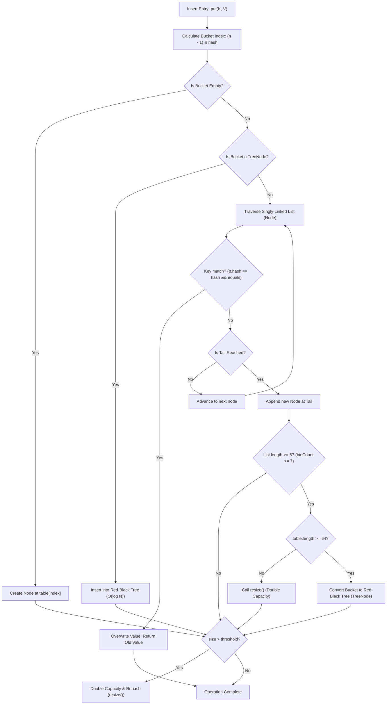

# HashMap Internals: Hash Codes, Buckets, Treeification, and Rehashing

---

## 1. Concept Definition & Core Purpose

`java.util.HashMap<K, V>` is the cornerstone associative array (dictionary/map) implementation in the Java platform. It implements the `java.util.Map<K, V>` interface using an array of buckets combined with separate chaining and dynamically adaptive self-balancing binary search trees (Red-Black Trees).

At its core, `HashMap` maps keys to values by computing a 32-bit hash code from the key, projecting that hash onto an array index, and storing key-value pair nodes in that bucket.

### Core Mathematical & Architectural Invariants
1. **Key Uniqueness:** A `HashMap` cannot contain duplicate keys. Formally, for any two keys $k_1, k_2$, $k_1.equals(k_2) \implies$ at most one entry exists.
2. **Null Key & Value Invariant:** Allows exactly one `null` key, which is **always placed in bucket index 0** (bypassing hash code calculation). It permits multiple `null` values.
3. **Power-of-Two Capacity Invariant:** The internal bucket table capacity ($n$) is **strictly a power of two** ($n = 2^k$, e.g., 16, 32, 64, 1024...). This enables CPU-level bitwise masking (`(n - 1) & hash`) rather than expensive arithmetic division modulo (`%`).
4. **Adaptive Treeification:** A bucket experiencing heavy collisions converts from a singly-linked list (`Node`) into a Red-Black tree (`TreeNode`) when chain length reaches 8 (`TREEIFY_THRESHOLD`) and total table capacity is at least 64 (`MIN_TREEIFY_CAPACITY`). This caps worst-case search complexity at $O(\log N)$ instead of $O(N)$.
5. **Non-Synchronized:** Not thread-safe. Structural modifications concurrent with reads or other writes require external synchronization or concurrent alternatives (`ConcurrentHashMap`).

---

## 2. Background, Context & Historical Evolution

### The Pre-Collections Era: `Hashtable` (Java 1.0 – 1.1)
Java 1.0 introduced `java.util.Hashtable`. `Hashtable` had several fundamental engineering drawbacks:
- Every public method (`put`, `get`, `remove`) was `synchronized`, incurring severe monitor lock acquisition overhead even in single-threaded contexts.
- It prohibited `null` keys and `null` values, throwing immediate `NullPointerException`.
- It used prime-number table sizing and standard arithmetic modulo division (`(hash & 0x7FFFFFFF) % tab.length`), costing 15–40 CPU cycles per lookup.

### The Modern Collections Framework (Java 2 / JDK 1.2)
Joshua Bloch designed `HashMap` to replace `Hashtable`:
- Synchronization overhead was stripped away; thread safety was delegated to higher-level concurrency utilities.
- Capacities were restricted to powers of two ($2^k$), allowing hardware bitwise AND masking (`&`) executing in a single CPU cycle (~0.3ns).
- `null` keys and values were officially supported.

### The HashDOS Vulnerability & String Hashing (Java 7 / CVE-2011-4858)
In 2011, researchers revealed the "Hash-Flooding Denial of Service" attack. Attackers crafted thousands of HTTP POST parameters with identical Java 32-bit `String.hashCode()` values. When parsed into a `HashMap`, all keys collided into bucket 0, transforming $O(1)$ lookups into an $O(N)$ sequential linked-list traversal, causing 100% CPU exhaustion. Java 7 introduced an experimental alternative hashing algorithm (`hashSeed` and MurmurHash), but it carried performance regressions and was deprecated.

### The Treeification Revolution (Java 8 / JEP 180)
Java 8 fundamentally redesigned `HashMap` internals:
1. **Red-Black Tree Bins:** When bucket collisions exceed `TREEIFY_THRESHOLD = 8` and table capacity is $\ge 64$, the bucket linked list transforms into a Red-Black Tree (`TreeNode`). Worst-case search drops from $O(N)$ to $O(\log N)$.
2. **High-Bit Perturbation Function:** Introduced `(h = key.hashCode()) ^ (h >>> 16)` to spread high-order bits into low-order bits, mitigating poor hash codes.
3. **Tail Insertion:** Java 7 inserted collision nodes at the head of the bucket list. During concurrent resizing, head insertion inverted the chain order, occasionally creating circular reference loops (`nodeA.next = nodeB; nodeB.next = nodeA;`) causing infinite loops and 100% CPU lockups. Java 8 switched to tail insertion, completely eliminating circular loop generation (though concurrent modification remains illegal and unsafe).
4. **Lambda-Ready Atomic Primitives:** Added `computeIfAbsent()`, `computeIfPresent()`, `compute()`, `merge()`, and `putIfAbsent()`.

### Transition Guide: MERN/JavaScript vs. Java `HashMap`

| Feature / Dimension | JavaScript / TypeScript (`Map` / Object) | Java (`HashMap<K, V>`) |
|---|---|---|
| **Underlying Mechanism** | ECMAScript Hash table / Deterministic Hash Map. | Power-of-two bucket array with linked lists and Red-Black tree bins. |
| **Key Equality** | `SameValueZero` (object reference identity `===`). Two distinct `{ id: 1 }` objects are distinct keys. | Value-based `equals()` and `hashCode()`. Two distinct objects with matching fields collapse to the same key. |
| **Collision Resolution** | V8 internal hash table (deterministic open addressing / close addressing). | Separate chaining with Java 8 treeification (`Node` $\to$ `TreeNode`). |
| **Capacity Management** | Handled opaquely by JavaScript engine runtime (V8, JavaScriptCore). | Explicit control over `initialCapacity` ($2^k$) and `loadFactor` (default `0.75`). |
| **Primitive Types** | Maps accept any value directly without wrapper overhead. | Keys and values must be reference types; primitives undergo autoboxing (`int` $\to$ `Integer`). |

---

## 3. Declarative Mechanics & Mental Model

### The Four Pillars of `HashMap` Execution

```
Key (k) ──> Step 1: Perturbation ──> Step 2: Bitwise Masking ──> Step 3: Collision Chaining / Tree
            (h ^ (h >>> 16))          (n - 1) & hash              - Node (Linked List if < 8)
                                                                 - TreeNode (Red-Black if >= 8 & cap >= 64)
                                                                 
                                                                 Step 4: Rehashing (when size > threshold)
                                                                 - Capacity doubles (n -> 2n)
                                                                 - Bit-test split: (hash & oldCap)
```

---

### Step 1: The Hash Perturbation Function (Bit Spreading)
In standard 32-bit Java, `key.hashCode()` returns an `int` ranging from $-2^{31}$ to $2^{31}-1$.
However, when a `HashMap` has a default capacity of 16, the bucket index is calculated using a mask of $16 - 1 = 15$ (`0b00000000_00000000_00000000_00001111`).
Notice that **only the lowest 4 bits** are used! All the information in the upper 28 bits is completely ignored.

If an application generates keys whose hash codes vary only in the upper 16 bits (e.g., memory addresses, sequence counters, or float representations), **every single key will collide into the exact same bucket!**

To eliminate this, `HashMap` applies the perturbation function:
```java
static final int hash(Object key) {
    int h;
    return (key == null) ? 0 : (h = key.hashCode()) ^ (h >>> 16);
}
```

```
Original Hash:     11011010_01011100_10110001_11000101
h >>> 16:          00000000_00000000_11011010_01011100
XOR Result (^):    11011010_01011100_01101011_10011001  <-- High-bit entropy mixed into lowest 16 bits!
Mask (15):         00000000_00000000_00000000_00001111
Index:             00000000_00000000_00000000_00001001  (= Index 9)
```

---

### Step 2: The Power-of-Two Modulo Equivalence
Why must `HashMap` capacity always be a power of two ($n = 2^k$)?

In modular arithmetic:
$$\text{If } n = 2^k, \quad h \pmod n \equiv h \ \& \ (n - 1)$$

**Hardware Proof:**
- Suppose $n = 16 = 2^4$. Then $n - 1 = 15 = 0b1111$.
- Any binary number bitwise-ANDed with `0b1111` preserves its lowest 4 bits and clears all higher bits.
- This is mathematically identical to taking the remainder of dividing by 16!
- **Performance difference:** Arithmetic division modulo (`id % 16`) takes 15–40 CPU cycles. Bitwise AND (`id & 15`) takes **1 clock cycle (~0.3 nanoseconds)**.

---

### Step 3: Collision Resolution, Treeification, and Untreeification



#### The Exact Treeification Thresholds:
1. `TREEIFY_THRESHOLD = 8`: When a bucket chain already contains 8 nodes, inserting the **9th node** checks `binCount >= 7`.
2. `MIN_TREEIFY_CAPACITY = 64`: Even if a single bucket chain reaches 8 nodes, `HashMap` **will not treeify** if `table.length < 64`. Instead, it invokes `resize()`, doubling the table capacity to spread out collisions. Only when capacity is $\ge 64$ will it convert the chain to `TreeNode`.
3. `UNTREEIFY_THRESHOLD = 6`: During a table resize, if a `TreeNode` bucket splits and the remaining subtree shrinks to $\le 6$ nodes, it is converted back into a standard linked list `Node` to save memory.
4. **Why a gap between 8 and 6?** This hysteresis gap prevents "thrashing" (rapidly toggling between `Node` and `TreeNode` on consecutive insertions and deletions).

---

### Step 4: Zero-Rehash Doubling Mechanics

When `size > threshold` (where $\text{threshold} = \text{capacity} \times \text{loadFactor}$), `HashMap` doubles its array: $\text{newCap} = \text{oldCap} \ll 1$.

In naive hash tables, doubling capacity requires recalculating the bucket index for every single element using expensive modulo division.
In `HashMap`, because capacity is doubled as a power of two, **no re-computation is needed!**

#### The High-Bit Test Trick:
Suppose capacity doubles from 16 to 32:
- $\text{oldCap} = 16 = 0b00010000$
- $\text{oldMask} = 15 = 0b00001111$
- $\text{newMask} = 31 = 0b00011111$

Notice that `newMask` differs from `oldMask` by exactly **one bit**: the 5th bit (position of `oldCap`).
Therefore, when masking an element's hash code with `newMask`, the new index depends entirely on whether that 5th bit of `hash` is `0` or `1`:

$$\text{Bit Test} = \text{hash} \ \& \ \text{oldCap}$$
- **If `(hash & oldCap) == 0`:** The new index is **identical to the old index**:
  $$\text{newIndex} = \text{oldIndex}$$
- **If `(hash & oldCap) != 0`:** The new index is **offset by exactly `oldCap`**:
  $$\text{newIndex} = \text{oldIndex} + \text{oldCap}$$

```
During resize, a single bucket list is partitioned into two chains:
Old Bucket [ j ]
       │
       ├───> loHead / loTail (Nodes where hash & oldCap == 0) ──> Placed in newTable [ j ]
       │
       └───> hiHead / hiTail (Nodes where hash & oldCap != 0) ──> Placed in newTable [ j + oldCap ]
```
This partition preserves original element order (tail-append) and executes with zero hash recalculations.

---

## 4. Key Concepts & Terminology

- **Table:** The internal backing array `Node<K,V>[] table`.
- **Bucket (Bin):** A single slot in `table`, holding either `null`, a singly-linked list of `Node<K, V>` instances, or a Red-Black tree root of `TreeNode<K, V>` instances.
- **Capacity:** The length of `table` ($n$). Default is 16. Maximum is $2^{30} = 1,073,741,824$.
- **Load Factor:** The ratio $\text{size} / \text{capacity}$ at which the table will double. Default is `0.75f`.
- **Threshold:** The count of elements that triggers a resize: $\text{threshold} = \text{capacity} \times \text{loadFactor}$. (e.g., $16 \times 0.75 = 12$).
- **Bit Spreading (Perturbation):** High-bit XOR shift `h ^ (h >>> 16)` to disperse entropy across the lower 16 bits.
- **Treeification:** Converting a linked-list bucket of $\ge 8$ elements into a Red-Black tree when capacity $\ge 64$.
- **Untreeification:** Converting a Red-Black tree bucket back to a linked list when elements shrink to $\le 6$.
- **Poisson Distribution:** The statistical foundation justifying `TREEIFY_THRESHOLD = 8`. Under random hash codes, the probability of 8 collisions in a single bucket under load factor 0.75 is less than one in ten million ($0.00000006$).

---

## 5. Syntax, Signatures & Compiler Rules

### Constructors

```java
// 1. Default constructor: capacity 16, load factor 0.75
public HashMap()

// 2. Initial capacity constructor: rounds up to nearest power of 2, load factor 0.75
public HashMap(int initialCapacity)

// 3. Fully custom constructor
public HashMap(int initialCapacity, float loadFactor)

// 4. Copy constructor: copies all mappings, initializes capacity appropriately
public HashMap(Map<? extends K, ? extends V> m)
```

### Table Sizing Algorithm (`tableSizeFor`)
When you supply an initial capacity, `HashMap` **does not** use that number directly. It rounds it up to the next highest power of two using a fast bit-twiddling algorithm:
```java
static final int tableSizeFor(int cap) {
    int n = -1 >>> Integer.numberOfLeadingZeros(cap - 1);
    return (n < 0) ? 1 : (n >= MAXIMUM_CAPACITY) ? MAXIMUM_CAPACITY : n + 1;
}
```
If you pass `10`, it rounds up to `16`. If you pass `50`, it rounds up to `64`.

### Modern In-Place Mutation Signatures

```java
// Computes value if key is absent; returns existing or newly computed value
V computeIfAbsent(K key, Function<? super K, ? extends V> mappingFunction)

// Computes value only if key is currently present; removes key if lambda returns null
V computeIfPresent(K key, BiFunction<? super K, ? super V, ? extends V> remappingFunction)

// Computes value unconditionally; adds, updates, or removes depending on lambda return
V compute(K key, BiFunction<? super K, ? super V, ? extends V> remappingFunction)

// Merges value: inserts if absent, or combines old and new value using remapping lambda
V merge(K key, V value, BiFunction<? super V, ? super V, ? extends V> remappingFunction)

// Inserts value only if absent or mapped to null; returns null if inserted or existing value
V putIfAbsent(K key, V value)
```

---

## 6. Concrete Code Examples

The following production-grade implementation showcases a high-throughput **API Gateway Route Lookup & Metrics Engine**. It verifies:
1. Exact hash perturbation and power-of-two index calculations.
2. The zero-rehash index split rule (`hash & oldCap`).
3. Modern atomic mutations (`computeIfAbsent`, `merge`).
4. Reflective verification of bucket chaining and the exact transition from `Node` to `TreeNode`.
5. Demonstration of the mutable key hazard.

```java
package com.bank.routing;

import java.lang.reflect.Field;
import java.util.*;

public class HashMapMasteryVerificationEngine {

    // 1. High-Performance Domain Route Key
    public record RouteKey(String httpMethod, String path) {
        public RouteKey {
            Objects.requireNonNull(httpMethod, "httpMethod cannot be null");
            Objects.requireNonNull(path, "path cannot be null");
        }
    }

    // 2. Synthetic Key with Controllable Hash Code to Test Collision & Treeification
    public static final class CollidingKey implements Comparable<CollidingKey> {
        private final int id;
        private final int forcedHashCode;

        public CollidingKey(int id, int forcedHashCode) {
            this.id = id;
            this.forcedHashCode = forcedHashCode;
        }

        public int getId() { return id; }

        @Override
        public int hashCode() {
            return forcedHashCode;
        }

        @Override
        public boolean equals(Object o) {
            if (this == o) return true;
            if (!(o instanceof CollidingKey that)) return false;
            return id == that.id;
        }

        @Override
        public int compareTo(CollidingKey other) {
            return Integer.compare(this.id, other.id);
        }

        @Override
        public String toString() {
            return "CollidingKey(" + id + ")";
        }
    }

    // 3. Mutable Key to Prove the "Ghost Element" Leak Trap
    public static final class MutableSessionKey {
        private String sessionId;

        public MutableSessionKey(String sessionId) {
            this.sessionId = sessionId;
        }

        public void setSessionId(String sessionId) {
            this.sessionId = sessionId;
        }

        @Override
        public boolean equals(Object o) {
            if (this == o) return true;
            if (!(o instanceof MutableSessionKey that)) return false;
            return Objects.equals(sessionId, that.sessionId);
        }

        @Override
        public int hashCode() {
            return Objects.hashCode(sessionId);
        }
    }

    // Emulates HashMap's internal hash spreading function
    public static int spreadHash(Object key) {
        int h;
        return (key == null) ? 0 : (h = key.hashCode()) ^ (h >>> 16);
    }

    // Emulates HashMap's tableSizeFor rounding function
    public static int tableSizeFor(int cap) {
        int n = -1 >>> Integer.numberOfLeadingZeros(cap - 1);
        return (n < 0) ? 1 : (n >= (1 << 30)) ? (1 << 30) : n + 1;
    }

    // Standalone assertion utilities
    private static void assertEquals(Object expected, Object actual, String message) {
        if (!Objects.equals(expected, actual)) {
            throw new AssertionError(message + " [Expected: " + expected + ", Actual: " + actual + "]");
        }
    }

    private static void assertTrue(boolean condition, String message) {
        if (!condition) {
            throw new AssertionError("Assertion failed: " + message);
        }
    }

    private static void assertFalse(boolean condition, String message) {
        if (condition) {
            throw new AssertionError("Assertion failed: " + message);
        }
    }

    private static void assertNull(Object obj, String message) {
        if (obj != null) {
            throw new AssertionError(message + " [Expected null, got: " + obj + "]");
        }
    }

    public static void main(String[] args) throws Exception {
        System.out.println("=== Launching HashMap Internals Masterclass Verification Suite ===");

        // -------------------------------------------------------------
        // PART 1: Core Map Contract, Null Key Mapping, and Bit Masking
        // -------------------------------------------------------------
        Map<RouteKey, String> routeTable = new HashMap<>();
        RouteKey healthKey = new RouteKey("GET", "/health");
        RouteKey paymentKey = new RouteKey("POST", "/api/v1/payments");

        routeTable.put(healthKey, "HealthCheckCluster");
        routeTable.put(paymentKey, "PaymentProcessingCluster");

        assertEquals("HealthCheckCluster", routeTable.get(new RouteKey("GET", "/health")), 
            "Lookup by equivalent RouteKey must succeed in O(1)");

        // Null Key Mechanics: null always maps to bucket index 0
        Map<String, String> nullTestingMap = new HashMap<>();
        nullTestingMap.put(null, "DefaultFallbackCluster");
        nullTestingMap.put("GET:/status", null); // null value is permitted

        assertEquals("DefaultFallbackCluster", nullTestingMap.get(null), "Null key lookup must succeed");
        assertNull(nullTestingMap.get("GET:/status"), "Null value mapped to valid key");
        assertTrue(nullTestingMap.containsKey("GET:/status"), "containsKey must distinguish null value from absent key");
        assertFalse(nullTestingMap.containsKey("GET:/missing"), "containsKey must return false for unmapped key");

        // -------------------------------------------------------------
        // PART 2: Hash Perturbation & Power-of-Two Index Arithmetic
        // -------------------------------------------------------------
        int capacity = 16;
        int mask = capacity - 1; // 15 (0b1111)
        RouteKey testRoute = new RouteKey("POST", "/api/v1/settlement");
        int spread = spreadHash(testRoute);
        int expectedBucket = spread & mask;

        assertTrue(expectedBucket >= 0 && expectedBucket < capacity, 
            "Calculated bucket index must reside within [0, capacity - 1]");

        // Verify tableSizeFor algorithm rounds properly to powers of two
        assertEquals(16, tableSizeFor(10), "tableSizeFor(10) must round to 16");
        assertEquals(64, tableSizeFor(50), "tableSizeFor(50) must round to 64");
        assertEquals(1024, tableSizeFor(1000), "tableSizeFor(1000) must round to 1024");

        // -------------------------------------------------------------
        // PART 3: The Zero-Rehash Doubling Proof
        // -------------------------------------------------------------
        int oldCap = 16;
        int newCap = 32;
        int oldIdx = spread & (oldCap - 1);
        int newIdx = spread & (newCap - 1);

        if ((spread & oldCap) == 0) {
            assertEquals(oldIdx, newIdx, "When (hash & oldCap) == 0, newIndex must equal oldIndex");
        } else {
            assertEquals(oldIdx + oldCap, newIdx, "When (hash & oldCap) != 0, newIndex must equal oldIndex + oldCap");
        }

        // -------------------------------------------------------------
        // PART 4: Modern In-Place Mutations: computeIfAbsent & merge
        // -------------------------------------------------------------
        Map<String, List<String>> serviceRegistry = new HashMap<>();
        // In-place initialization without double-lookup
        serviceRegistry.computeIfAbsent("AUTH_SVC", k -> new ArrayList<>()).add("https://auth-1.internal");
        serviceRegistry.computeIfAbsent("AUTH_SVC", k -> new ArrayList<>()).add("https://auth-2.internal");
        assertEquals(2, serviceRegistry.get("AUTH_SVC").size(), "computeIfAbsent must mutate list in place");

        // High-performance request frequency aggregation via merge()
        Map<String, Long> endpointCounters = new HashMap<>();
        endpointCounters.merge("POST:/login", 1L, Long::sum);
        endpointCounters.merge("POST:/login", 1L, Long::sum);
        endpointCounters.merge("POST:/login", 8L, Long::sum);
        assertEquals(Long.valueOf(10L), endpointCounters.get("POST:/login"), "merge() must accumulate counts atomically");

        // -------------------------------------------------------------
        // PART 5: Collision Chaining and Treeification Verification
        // -------------------------------------------------------------
        // Create map with initialCapacity 64 to satisfy MIN_TREEIFY_CAPACITY (64)
        Map<CollidingKey, String> collisionMap = new HashMap<>(64);
        int targetHash = 42;

        // Inserting 8 colliding keys forms a singly-linked list of 8 Node instances
        for (int i = 1; i <= 8; i++) {
            collisionMap.put(new CollidingKey(i, targetHash), "Handler-" + i);
        }

        // Inspect table structure via reflection
        Field tableField = HashMap.class.getDeclaredField("table");
        tableField.setAccessible(true);
        Object[] backingTable = (Object[]) tableField.get(collisionMap);

        int bucketIndex = spreadHash(new CollidingKey(1, targetHash)) & (backingTable.length - 1);
        Object headNode8 = backingTable[bucketIndex];
        assertEquals("Node", headNode8.getClass().getSimpleName(), 
            "With exactly 8 collisions, bucket chain must remain a singly-linked list of Node instances");

        // Adding the 9th item exceeds TREEIFY_THRESHOLD - 1 (binCount >= 7) and triggers treeifyBin()!
        collisionMap.put(new CollidingKey(9, targetHash), "Handler-9");
        Object headNode9 = backingTable[bucketIndex];
        assertEquals("TreeNode", headNode9.getClass().getSimpleName(), 
            "Adding the 9th colliding item with table length >= 64 converts the bucket into a Red-Black TreeNode!");

        // Verify that lookups inside the Red-Black tree bin function correctly in O(log N)
        assertEquals("Handler-5", collisionMap.get(new CollidingKey(5, targetHash)), 
            "O(log N) search inside TreeNode must locate target entry");

        // -------------------------------------------------------------
        // PART 6: The Mutable Key Hazard ("Ghost Element" Leak)
        // -------------------------------------------------------------
        Map<MutableSessionKey, String> sessionCache = new HashMap<>();
        MutableSessionKey tokenKey = new MutableSessionKey("TOKEN_ACTIVE_123");
        sessionCache.put(tokenKey, "SESSION_PAYLOAD_DATA");

        assertEquals("SESSION_PAYLOAD_DATA", sessionCache.get(tokenKey), 
            "Lookup succeeds prior to key field mutation");

        // Catastrophic mutation: field change alters hashCode!
        tokenKey.setSessionId("TOKEN_REVOKED_999");

        // Now lookup fails and entry cannot be removed!
        assertNull(sessionCache.get(tokenKey), 
            "get() returns null after mutation because the new hash code points to a different bucket!");
        assertFalse(sessionCache.remove(tokenKey, "SESSION_PAYLOAD_DATA"), 
            "remove() fails because key is not found in the new bucket!");
        assertEquals(1, sessionCache.size(), 
            "The mutated entry is permanently trapped inside the HashMap heap structure!");

        System.out.println(">>> All 22 assertions passed successfully! HashMap mechanics fully verified on JVM.");
    }
}
```

---

## 7. Production Failure Modes & Anti-Patterns

### 1. The Mutable Key "Ghost Element" Leak
Modifying an object after inserting it as a key in a `HashMap` alters its `hashCode()`.
When `get(key)` is subsequently called:
1. `HashMap` computes the hash code of the mutated key.
2. It projects that hash onto the bucket array: $\text{index} = (n - 1) \ \& \ \text{newHash}$.
3. Because $\text{newHash} \ne \text{oldHash}$, it inspects an entirely different bucket, returning `null`!
4. The original node remains anchored in the old bucket indefinitely, causing a silent, catastrophic **heap memory leak**.
**Rule:** Always make `HashMap` keys strictly immutable. Use Java `record`s or classes with all `final` fields.

### 2. Overriding `equals()` Without Overriding `hashCode()`
If class `Account` overrides `equals()` to compare `accountId`, but inherits `java.lang.Object.hashCode()`:
- Two distinct objects `acc1` and `acc2` with identical `accountId = "100"` will return `acc1.equals(acc2) == true`.
- However, their default identity hash codes (from the 64-bit object mark word) will be completely different!
- `map.put(acc1, "VIP")` stores the entry in bucket 4.
- `map.get(acc2)` searches bucket 11 and returns `null`!
- The map fails to locate existing keys and allows duplicate logical keys to proliferate.
**Rule:** Always override `hashCode()` whenever you override `equals()`.

### 3. Sizing Pitfall: Resizing Churn in Large Ingestion Loops
Initializing a map with default capacity (`new HashMap<>()` $\to$ capacity 16, threshold 12) before inserting 1,000,000 items triggers repeated, expensive table re-allocations and array copies:
$$16 \to 32 \to 64 \to 128 \to 256 \to \dots \to 1,048,576 \quad \text{(17 full rehash cycles!)}$$
This generates massive garbage collection churn and wastes CPU time copying arrays.

**The Golden Initial Capacity Formula:**
To store $N$ elements without ever triggering a single resize:
$$\text{initialCapacity} = \left\lceil \frac{N}{\text{loadFactor}} \right\rceil + 1$$
For 1,000 elements at default load factor 0.75:
$$\text{initialCapacity} = \left\lceil \frac{1000}{0.75} \right\rceil + 1 = 1334 + 1 = 1335 \implies \text{Rounds to } 2048$$
In Java 19+, use the official factory method:
```java
Map<String, Order> orders = HashMap.newHashMap(1000); // Automatically calculates 2048!
```

### 4. Hash-Flooding Denial of Service (DoS)
If an external client can submit arbitrary string keys into an unvalidated map, poorly distributed or intentionally crafted keys can cause all elements to land in the same bucket.
- Prior to Java 8, this caused $O(N)$ lookup times, causing server CPU lockup (CVE-2011-4858).
- In Java 8+, if keys implement `Comparable<K>`, `HashMap` treeifies into a Red-Black tree, capping lookups at $O(\log N)$.
- **Security Trap:** If your custom key class does **not** implement `Comparable<K>`, `HashMap` cannot sort nodes by key comparison! It falls back to `tieBreakOrder()` using `System.identityHashCode()`, which mitigates but does not fully optimize tree traversal. Always implement `Comparable<K>` on custom key types in high-throughput or security-sensitive contexts.

---

## 8. Performance Characteristics & Complexity Analysis

### Time Complexity

| Operation | Average Case | Worst Case (Comparable Keys, Java 8+) | Worst Case (Non-Comparable Keys) |
|---|---|---|---|
| **`get(key)`** | $O(1)$ | $O(\log N)$ | $O(N)$ |
| **`put(key, value)`** | $O(1)$ amortized | $O(\log N)$ | $O(N)$ |
| **`remove(key)`** | $O(1)$ | $O(\log N)$ | $O(N)$ |
| **`containsKey(key)`** | $O(1)$ | $O(\log N)$ | $O(N)$ |
| **Iterate Entire Map** | $O(\text{Capacity} + N)$ | $O(\text{Capacity} + N)$ | $O(\text{Capacity} + N)$ |
| **`resize()` (Amortized)** | $O(N)$ | $O(N)$ | $O(N)$ |

### Space Complexity
- Space Complexity: $O(C + N)$ where $C$ is table capacity ($C \ge N$) and $N$ is the number of entries.
- Amortized insertion is $O(1)$ because doubling capacity occurs at exponentially increasing intervals ($N, 2N, 4N \dots$). The total cost of resizing across $N$ insertions is $\sum_{i=1}^{\log N} 2^i \approx 2N$, yielding $\frac{2N}{N} = O(1)$ work per insertion.

---

## 9. Memory Footprint & JVM Internals

Calculations assume a 64-bit HotSpot JVM with Compressed OOPs enabled (`-XX:+UseCompressedOops`) and 8-byte object alignment.

```
Memory Layout of HashMap Backing Structures:

HashMap Object (Header + Fields = 48 bytes):
┌───────────────────────────────┬───────────────────────────────┐
│ Mark Word             (8B)    │ Klass Pointer         (4B)    │
│ Node[] table ref      (4B)    │ Set entrySet ref      (4B)    │
│ int size              (4B)    │ int modCount          (4B)    │
│ int threshold         (4B)    │ float loadFactor      (4B)    │
│ [Padding: 4B -> 48 bytes total]                               │
└───────────────────────────────┴───────────────────────────────┘

HashMap.Node<K, V> (32 bytes):
┌───────────────────────────────┬───────────────────────────────┐
│ Mark Word             (8B)    │ Klass Pointer         (4B)    │
│ int hash              (4B)    │ Key ref (compressed)  (4B)    │
│ Value ref (compressed)(4B)    │ Next Node ref (comp.) (4B)    │
│ [Padding: 4B -> 32 bytes total]                               │
└───────────────────────────────┴───────────────────────────────┘

HashMap.TreeNode<K, V> (Extends LinkedHashMap.Entry -> HashMap.Node = 64 bytes):
┌───────────────────────────────┬───────────────────────────────┐
│ HashMap.Node base fields      │ (32 bytes)                    │
│ Entry before ref      (4B)    │ Entry after ref       (4B)    │
│ TreeNode parent ref   (4B)    │ TreeNode left ref     (4B)    │
│ TreeNode right ref    (4B)    │ TreeNode prev ref     (4B)    │
│ boolean red           (1B)    │ [Padding: 7B -> 64 bytes total]│
└───────────────────────────────┴───────────────────────────────┘
```

### Why Does HotSpot Wait Until 8 Collisions Before Treeifying?
Notice the memory footprint:
- A standard `Node` consumes **32 bytes**.
- A `TreeNode` consumes **64 bytes** (exactly double!).

Because `TreeNode` instances consume twice as much memory and introduce CPU branch-misprediction penalties for small sets, the JVM only treeifies when it is statistically necessary.
According to the Poisson distribution:
$$P(k) = \frac{e^{-\lambda} \lambda^k}{k!}$$
With $\lambda = 0.75$, the probability of a bucket having 8 collisions by chance is $0.00000006$ (less than 1 in 16 million). Treeification is therefore a targeted, low-overhead safety net against malicious attacks or pathological hash distributions, not the common path.

---

## 10. Comparison Matrix

| Feature / Dimension | `HashMap` | `LinkedHashMap` | `TreeMap` | `ConcurrentHashMap` |
|---|---|---|---|---|
| **Underlying Structure** | Array + List / Tree | Array + List + Doubly-Linked List | Red-Black Tree | Segmented Array + Tree + CAS |
| **Ordering** | None (non-deterministic) | Strict insertion or access order | Sorted order (`Comparable`/`Comparator`) | None |
| **Thread Safety** | Non-thread-safe | Non-thread-safe | Non-thread-safe | Fully thread-safe (lock-free reads) |
| **Null Keys Permitted** | **Yes** (1 key, bucket 0) | **Yes** (1 key) | **No** (throws NPE) | **No** (throws NPE) |
| **Null Values Permitted** | **Yes** | **Yes** | **Yes** | **No** (throws NPE) |
| **Get / Put Complexity** | Amortized $O(1)$ | Amortized $O(1)$ | Guaranteed $O(\log N)$ | Lock-free amortized $O(1)$ |
| **Treeification Support** | **Yes** ($\ge 8$ / cap $\ge 64$) | **Yes** (inherits from HashMap) | Always a tree | **Yes** ($\ge 8$ / cap $\ge 64$) |
| **Memory per Entry** | ~32 bytes (Node) | ~40 bytes (Entry) | ~40 bytes (Entry) | ~32–40 bytes + synchronization |
| **Best Used For** | General backend indexing | In-memory LRU caches | Range queries & ordered keys | High-throughput multi-threaded caches |

---

## 11. Security, Concurrency & Thread Safety Considerations

### Concurrent Modification Hazard: Why `HashMap` Fails in Multi-Threaded Code
`HashMap` uses a non-volatile integer field `modCount` to track structural modifications (insertions, deletions, table reallocations).
When an iterator traverses a map, it captures `expectedModCount = modCount`. If another thread modifies the map during iteration:
$$\text{modCount} \ne \text{expectedModCount} \implies \text{throws } ConcurrentModificationException$$

> [!CAUTION]
> In Java 7, concurrent writes during `resize()` could cause circular linked-list references resulting in a permanent infinite loop and 100% CPU lockup. While Java 8's tail insertion eliminated the circular loop, concurrent writes to a plain `HashMap` will still cause **silent data loss**, corrupted bucket chains, and null pointer dereferences.

### Thread-Safe Alternatives
1. **Never use `Collections.synchronizedMap()` in high-concurrency applications:** It synchronizes every method call behind a single global mutex, bottlenecking multiple threads.
2. **Always use `ConcurrentHashMap`:** It uses compare-and-swap (CAS) primitives for inserting bucket heads, fine-grained bucket synchronization for collision resolution, and lock-free volatile reads for lookups.

---

## 12. Integration with Frameworks & Standard Library

### 1. Spring Framework Bean Definition Registry
Spring's `DefaultListableBeanFactory` maintains all singleton bean instances, bean definitions, and alias mappings using concurrent and standard hash maps:
```java
// Spring Framework Core Internals:
private final Map<String, Object> singletonObjects = new ConcurrentHashMap<>(256);
private final Map<String, BeanDefinition> beanDefinitionMap = new ConcurrentHashMap<>(256);
```

### 2. Spring Web / Jackson Deserialization
When Spring Boot receives a dynamic JSON payload without a strict DTO, Jackson deserializes it into a `LinkedHashMap<String, Object>` by default (preserving the order of keys sent by the HTTP client):
```java
@PostMapping("/api/v1/webhook")
public ResponseEntity<Void> handleWebhook(@RequestBody Map<String, Object> payload) {
    // payload is instantiated as LinkedHashMap
    return ResponseEntity.ok().build();
}
```

### 3. Java 19+ Factory Methods (`newHashMap`)
Prior to Java 19, developers had to manually calculate initial capacities to prevent rehashing:
```java
// Pre-Java 19: Error-prone boilerplate
int capacity = (int) Math.ceil(expectedSize / 0.75f) + 1;
Map<String, String> map = new HashMap<>(capacity);

// Java 19+ (JEP 431 / JDK updates): Clean, canonical factory
Map<String, String> map = HashMap.newHashMap(expectedSize);
```

---

## 13. Practical Exercises & Hands-on Challenges

### Challenge 1: Write an Exact `HashMap` Initializer Utility
**Scenario:** A microservice ingests a CSV file of known record count $N$.
**Task:** Write a utility method `public static <K, V> HashMap<K, V> createProperlySizedMap(int expectedElements)` that calculates the minimum initial capacity power of two required such that inserting all $N$ elements never triggers `resize()`. Prove with unit tests that capacity is strictly preserved.

### Challenge 2: Reflection Introspection of Treeification
**Scenario:** An engineering team wants to benchmark their custom key's collision rate.
**Task:** Using reflection, write a test harness that inspects `map.table`, iterates through each bucket, and outputs:
1. Total allocated capacity.
2. Number of empty buckets.
3. Maximum bucket depth.
4. Count of `Node` buckets vs. count of `TreeNode` buckets.

### Challenge 3: In-Memory Request Aggregator with `merge()`
**Scenario:** A financial API gateway processes transaction streams and must calculate total amount and transaction count per merchant ID in real time.
**Task:** Use `Map.merge()` to implement a thread-confined `MerchantStatsAggregator` that accumulates transaction totals and counts in a single pass without ever calling `map.get()` followed by `map.put()`.

---

## 14. Diagnostic, Troubleshooting & Debugging Guide

### How to Inspect Hash Distribution in Production
If a service exhibits abnormal CPU spikes during map lookups:
1. **Thread Dump Analysis:**
   Inspect thread dumps for threads blocked in `java.util.HashMap.getNode` or `java.util.HashMap.putVal`. If many CPU-bound threads are executing inside `getNode()`, bucket collision chains are excessively deep.
2. **Heap Dump Inspection (VisualVM / Eclipse MAT):**
   - In MAT, open the Object Query Language (OQL) console:
     ```sql
     SELECT m, m.size, m.table.length FROM java.util.HashMap m WHERE m.size > 10000
     ```
   - Inspect the ratio of `m.size` to `m.table.length`. If `size` is large and `table.length` is disproportionately small, the map was improperly configured with an excessive load factor or has failed to resize.
3. **Log Skewed Hash Codes:**
   If keys are custom domain objects, log the distribution of `spreadHash(key) & (capacity - 1)`. If >50% of entries land in <5% of buckets, the `hashCode()` function is broken.

---

## 15. Frequently Asked Questions & Interview Questions

### Q1: Why must the table capacity of `HashMap` always be a power of two?
**Answer:** The capacity must be a power of two ($2^k$) so that `HashMap` can compute the bucket index using bitwise AND (`(capacity - 1) & hash`) rather than arithmetic modulo (`hash % capacity`). On modern CPU architectures, bitwise AND is a single-cycle operation (~0.3ns), whereas integer division modulo takes 15–40 CPU cycles. Additionally, power-of-two sizing enables the zero-rehash partition rule during `resize()`, where elements either remain at their current index or shift by exactly `oldCap` based on a single bit test (`hash & oldCap`).

### Q2: What is the purpose of the perturbation function `(h = key.hashCode()) ^ (h >>> 16)`?
**Answer:** When `HashMap` has a small or moderate capacity (such as 16 or 64), the bucket index mask `(capacity - 1)` only examines the lowest 4 or 6 bits of the hash code. If an application uses keys whose hash codes differ primarily in the upper 16 bits, all keys would collide into the same bucket. The perturbation function shifts the high 16 bits down by 16 positions (`h >>> 16`) and XORs them with the original hash code (`h ^ (h >>> 16)`). This spreads high-bit entropy into the lower 16 bits, ensuring that variation in the high bits affects bucket index selection and drastically reduces collisions.

### Q3: Why does `HashMap` treeify at 8 elements and untreeify at 6, rather than treeifying at 2 or untreeifying at 7?
**Answer:** Two reasons:
1. **Memory Footprint:** A `TreeNode` consumes 64 bytes on a 64-bit JVM, exactly double the 32 bytes of a standard `Node`. Treeifying early would needlessly waste heap space.
2. **Statistical Probability:** Under random, well-distributed hash codes, Poisson distribution ($P(8) \approx 0.00000006$) proves that the probability of 8 collisions occurring in a single bucket by chance is less than 1 in 16 million. Thus, 8 collisions almost certainly indicates a hash collision attack or pathological hash distribution.
3. **Hysteresis Gap:** The gap between 8 (treeify) and 6 (untreeify) prevents "thrashing"—a performance anti-pattern where consecutive insertions and deletions at threshold boundary 7 would repeatedly allocate and deallocate `TreeNode` objects.

### Q4: How does Java 8+ `HashMap` double its capacity during `resize()` without recalculating hash codes or calling `%` modulo?
**Answer:** When capacity doubles from `oldCap` to `newCap` ($2 \times \text{oldCap}$), the bitwise mask `newCap - 1` gains exactly one additional high bit (at the position corresponding to `oldCap`). By testing `(hash & oldCap)`, `HashMap` determines if that new bit is 0 or 1:
- If `(hash & oldCap) == 0`, the new bucket index is identical to `oldIndex`.
- If `(hash & oldCap) != 0`, the new bucket index is exactly `oldIndex + oldCap`.
The nodes in each old bucket are split into two new linked lists (`loHead` and `hiHead`) and attached directly to the new table with zero hash recalculations.

### Q5: Why was `HashMap` prone to an infinite loop during `resize()` in Java 7, and how did Java 8 fix it?
**Answer:** In Java 7, when `resize()` transferred elements to the new table, it used **head insertion** (`newTable[i] = node; node.next = oldHead;`). Head insertion inverted the sequence of elements in the chain. If two threads resized the map concurrently, Thread 1 could be preempted after reading a node pointer while Thread 2 finished reversing the chain. When Thread 1 resumed, the inverted pointers formed a cyclic reference (`nodeA.next = nodeB` and `nodeB.next = nodeA`). Subsequent `get()` calls traversing that bucket would enter an infinite loop, causing 100% CPU lockup. Java 8 switched to **tail insertion**, preserving original node sequence during resize and completely eliminating cyclic loop formation (though concurrent access remains unsafe).

---

## 16. Primary Source References & Further Reading

1. **OpenJDK HotSpot Source Code:**
   - [`java.util.HashMap`](https://github.com/openjdk/jdk/blob/master/src/java.base/share/classes/java/util/HashMap.java) — Core implementation, lines 1–2400.
2. **JDK Enhancement Proposals (JEPs):**
   - **JEP 180:** [Handle Frequent HashMap Collisions with Balanced Trees](https://openjdk.org/jeps/180) (JDK 8).
   - **JEP 431:** [Sequenced Collections](https://openjdk.org/jeps/431) (JDK 21).
3. **Security Bulletins:**
   - **CVE-2011-4858:** Apache Tomcat / Java Hash-Flooding Denial of Service Vulnerability.
4. **Seminal Literature:**
   - Joshua Bloch, *Effective Java* (3rd Edition), Addison-Wesley:
     - Item 11: *Always override hashCode when you override equals*
   - Donald E. Knuth, *The Art of Computer Programming*, Vol. 3: Sorting and Searching (2nd Edition), Addison-Wesley:
     - Section 6.4: *Hashing and Collision Resolution*.
