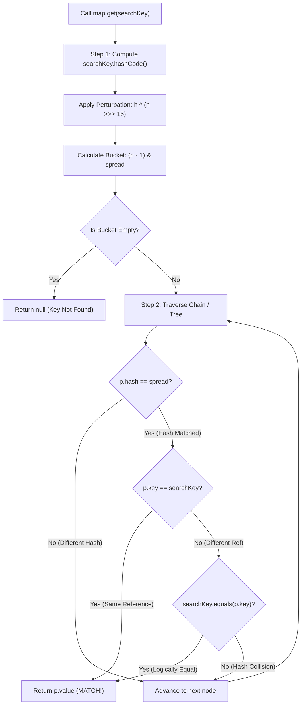

# The equals() and hashCode() Contract, Hash Collisions, and Mutable Keys

---

## 1. Concept Definition & Core Purpose

In the Java Collections Framework (JCF), hash-based data structures (`HashMap`, `HashSet`, `LinkedHashMap`, `LinkedHashSet`, `ConcurrentHashMap`) depend entirely on two methods declared in `java.lang.Object`:
- `public boolean equals(Object obj)`: Defines logical equivalence between two objects.
- `public int hashCode()`: Computes an integer hash value representing the object's identity or content.

The interaction between these two methods constitutes the **Golden Invariant of Hash-Based Collections**:

$$\forall a, b: \quad a.equals(b) \implies a.hashCode() == b.hashCode()$$

### The Formal Invariant Rules (JLS §4.3.2 & Java SE Specification):
1. **Consistency:** Whenever it is invoked on the same object more than once during an execution of an application, the `hashCode()` method must consistently return the same integer, provided no information used in `equals()` comparisons on the object is modified.
2. **Equality Implies Matching Hash:** If two objects are equal according to `equals(Object)`, then calling `hashCode()` on each of the two objects **must produce the exact same integer result**.
3. **Unequal Objects May Collide:** If two objects are unequal according to `equals(Object)`, it is **not required** that calling `hashCode()` on each produce distinct integers. However, generating distinct integers for unequal objects significantly improves hash table performance by minimizing bucket collisions.

```
                  THE FUNDAMENTAL MATHEMATICAL CONTRACT
┌────────────────────────────────────────────────────────────────────────┐
│  If a.equals(b) is TRUE  ───► MUST GUARANTEE ───► a.hashCode() == b.hashCode() │
│                                                                        │
│  If a.hashCode() == b.hashCode() ─► DOES NOT IMPLY ─► a.equals(b) is TRUE      │
│  (Collisions are mathematically inevitable by the Pigeonhole Principle!)│
└────────────────────────────────────────────────────────────────────────┘
```

### Why Collections Break When the Contract is Violated:
Hash-based collections execute a two-stage lookup pipeline:
$$\text{Stage 1: Hash Calculation \& Bucket Selection } \longrightarrow \text{Stage 2: Exact Key Match Validation}$$

Inside OpenJDK HotSpot `HashMap`:
```java
if (p.hash == hash && ((k = p.key) == key || (key != null && key.equals(k))))
    return p;
```
If two logically equal objects return different hash codes:
- They hash to different bucket indices in the internal array (`table[(n - 1) & hash]`).
- Stage 1 selects the wrong bucket. Stage 2 is never even executed on the target bucket!
- Result: `map.get(key)` returns `null` despite an equal key existing in the map; `set.add(key)` creates duplicate logical entries; and memory leaks silently accumulate.

---

## 2. Background, Context & Historical Evolution

### The Early Days of Java (Java 1.0 – 1.1)
In Java 1.0, `java.lang.Object` introduced default implementations:
- `equals(Object obj)`: Tested memory address identity (`this == obj`).
- `hashCode()`: Derived from the internal memory address or an identity hash generated in the 64-bit object header Mark Word.
Developers implementing domain objects frequently overrode `equals()` to compare business fields (e.g., `ssn`, `accountId`), but neglected to override `hashCode()`. When used with `Hashtable`, lookups mysteriously failed.

### The Collections Revolution & Joshua Bloch's Rules (Java 2 / JDK 1.2)
With the launch of the Java Collections Framework, Joshua Bloch formalized the rules in *Effective Java* (Item 11: *"Always override hashCode when you override equals"*). He popularized the prime multiplier 31 hashing formula:
$$\text{hash} = 31 \cdot \text{hash} + \text{field.hashCode()}$$
Why 31? Modern compilers optimize $31 \cdot i$ into a single bitwise shift-and-subtract:
$$31 \cdot i \equiv (i \ll 5) - i$$
Executing in a single CPU cycle with zero multiplication instruction latency.

### The Java 7 `Objects` Utility
Java 7 introduced `java.util.Objects.hash(Object... values)` and `Objects.equals(Object a, Object b)`. While convenient, `Objects.hash()` creates a temporary varargs array and autoboxes primitives, generating minor garbage churn in hot loops compared to hand-written unrolled hashing.

### The Modern Java 14+ Record Revolution (JEP 395)
Java 14 introduced `record` types (finalized in Java 16). Records automatically generate mathematically sound, canonical implementations of `equals()` and `hashCode()` at compile time based on all record components. Records eliminate human error in contract synchronization and guarantee immutability by default.

---

## 3. Declarative Mechanics & Mental Model

### The Two-Stage Lookup Pipeline in Hash Tables



### Visualizing the Broken Contract:
Suppose `User` overrides `equals` (comparing `username`), but fails to override `hashCode`:

```
User u1 = new User("alice"); // identityHashCode: 0x4A12F0 -> Bucket 4
User u2 = new User("alice"); // identityHashCode: 0x7B99D4 -> Bucket 11

map.put(u1, "DATA_ALICE");
[ Bucket 4  ] ──> [ Node: u1 | "DATA_ALICE" ]
[ Bucket 11 ] ──> null

Calling map.get(u2):
1. Calculates u2.hashCode() -> routes to Bucket 11.
2. Bucket 11 is NULL!
3. Returns NULL immediately! (Even though u1.equals(u2) is TRUE!).
```

---

### The Mutable Key "Ghost Object" Trap

When an object is inserted into a `HashMap` or `HashSet`, its bucket index is computed and permanently stored:

```
Step 1: Insert Mutable Key
key.setName("NORTH"); // hashCode = 100 -> Bucket 4
map.put(key, "DATA");
Table Index:
[ Bucket 4 ] ──> [ Node: hash=100 | key=("NORTH") | val="DATA" ]

Step 2: External Mutation
key.setName("SOUTH"); // hashCode changes from 100 to 500!

Step 3: Attempt Lookup: map.get(key)
1. key.hashCode() now returns 500.
2. Computes bucket index for hash 500 -> Routes to Bucket 12!
3. Bucket 12 is empty! Returns null!

Step 4: Attempt Removal: map.remove(key)
1. Routes to Bucket 12 -> Returns false!
2. Entry remains trapped in Bucket 4 indefinitely.
3. Memory leak: object can never be garbage collected!
```

---

## 4. Key Concepts & Terminology

- **Golden Invariant:** The rule that equal objects must have identical hash codes.
- **Identity Hash Code:** The default integer hash code returned by `System.identityHashCode(Object)`, typically derived from the 64-bit Mark Word in HotSpot JVM memory.
- **Pigeonhole Principle:** The mathematical certainty that mapping an infinite domain of objects to a finite 32-bit integer ($2^{32} \approx 4.29 \times 10^9$) must inevitably produce hash collisions.
- **Hash Collision:** When two distinct objects ($!a.equals(b)$) produce the same hash code ($a.hashCode() == b.hashCode()$).
- **Ghost Object:** An entry trapped inside a hash table whose key fields were mutated after insertion, rendering it unreachable by `get()` or `remove()`.
- **Prime Multiplier (31):** An odd prime chosen because multiplication by 31 can be optimized into a single CPU bit shift: $(x \ll 5) - x$.
- **Natural Business Key:** An immutable, uniquely identifying domain property (e.g., UUID, email, IBAN) that remains constant throughout the lifecycle of an entity, unlike database-generated surrogate IDs.

---

## 5. Syntax, Signatures & Compiler Rules

### Method Contracts in `java.lang.Object`

```java
package java.lang;

public class Object {
    // Equivalence contract: reflexive, symmetric, transitive, consistent, non-null
    public boolean equals(Object obj) {
        return (this == obj);
    }

    // Hash contract: consistent, equal objects must have equal hash codes
    public native int hashCode();
}
```

### The Standard Canonical Implementation Pattern

```java
public final class DomainEntity {
    private final String id;
    private final int status;

    public DomainEntity(String id, int status) {
        this.id = Objects.requireNonNull(id);
        this.status = status;
    }

    @Override
    public boolean equals(Object o) {
        // 1. Identity check (fast-path optimization)
        if (this == o) return true;
        // 2. Non-null and exact class check
        if (o == null || getClass() != o.getClass()) return false;
        // 3. State comparison
        DomainEntity that = (DomainEntity) o;
        return status == that.status && Objects.equals(id, that.id);
    }

    @Override
    public int hashCode() {
        // Multiplier 31 unrolled pattern
        int result = id != null ? id.hashCode() : 0;
        result = 31 * result + status;
        return result;
    }
}
```

---

## 6. Concrete Code Examples

The following production-grade test engine demonstrates:
1. Proof of the **broken contract** when `equals()` is overridden without `hashCode()`.
2. Proof of the **repaired contract** using modern records.
3. Demonstration of the **mutable key "ghost element" memory leak**.
4. The dangerous **JPA entity auto-generated ID mutation trap**.
5. Mathematical verification of the **multiplier 31 shift optimization**.

```java
package com.bank.identity;

import java.util.*;

public class HashContractMasteryVerificationEngine {

    // 1. Anti-Pattern: Overrides equals() but NOT hashCode()
    public static final class BrokenEqualsAccount {
        private final String accountNumber;

        public BrokenEqualsAccount(String accountNumber) {
            this.accountNumber = Objects.requireNonNull(accountNumber);
        }

        @Override
        public boolean equals(Object o) {
            if (this == o) return true;
            if (!(o instanceof BrokenEqualsAccount that)) return false;
            return Objects.equals(accountNumber, that.accountNumber);
        }
        // FLAW: hashCode() is not overridden! Inherits System.identityHashCode.
    }

    // 2. Correct Pattern: Immutable Record with Synchronized equals/hashCode
    public record ValidAccount(String accountNumber) {
        public ValidAccount {
            Objects.requireNonNull(accountNumber, "accountNumber cannot be null");
        }
    }

    // 3. Mutable Key to Prove the "Ghost Object" Leak
    public static final class MutableTenantKey {
        private String tenantCode;

        public MutableTenantKey(String tenantCode) {
            this.tenantCode = Objects.requireNonNull(tenantCode);
        }

        public void setTenantCode(String tenantCode) {
            this.tenantCode = Objects.requireNonNull(tenantCode);
        }

        @Override
        public boolean equals(Object o) {
            if (this == o) return true;
            if (!(o instanceof MutableTenantKey that)) return false;
            return Objects.equals(tenantCode, that.tenantCode);
        }

        @Override
        public int hashCode() {
            return Objects.hash(tenantCode);
        }
    }

    // 4. Demonstrates the JPA Auto-Generated Database ID Hazard
    public static final class JpaEntitySurrogateTrap {
        private Long databaseId; // null before save, populated after save
        private final String naturalBusinessKey;

        public JpaEntitySurrogateTrap(Long databaseId, String naturalBusinessKey) {
            this.databaseId = databaseId;
            this.naturalBusinessKey = Objects.requireNonNull(naturalBusinessKey);
        }

        public void setDatabaseId(Long databaseId) {
            this.databaseId = databaseId;
        }

        // FLAW: Basing equals and hashCode on mutable databaseId
        @Override
        public boolean equals(Object o) {
            if (this == o) return true;
            if (!(o instanceof JpaEntitySurrogateTrap that)) return false;
            return Objects.equals(databaseId, that.databaseId);
        }

        @Override
        public int hashCode() {
            return Objects.hashCode(databaseId);
        }
    }

    // Standalone assertion utilities
    private static void assertEquals(Object expected, Object actual, String message) {
        if (!Objects.equals(expected, actual)) {
            throw new AssertionError(message + " [Expected: " + expected + ", Actual: " + actual + "]");
        }
    }

    private static void assertTrue(boolean condition, String message) {
        if (!condition) {
            throw new AssertionError("Assertion failed: " + message);
        }
    }

    private static void assertFalse(boolean condition, String message) {
        if (condition) {
            throw new AssertionError("Assertion failed: " + message);
        }
    }

    private static void assertNull(Object obj, String message) {
        if (obj != null) {
            throw new AssertionError(message + " [Expected null, got: " + obj + "]");
        }
    }

    public static void main(String[] args) {
        System.out.println("=== Launching equals() & hashCode() Contract Masterclass Verification Suite ===");

        // -------------------------------------------------------------
        // PART 1: The Broken Contract (equals without hashCode)
        // -------------------------------------------------------------
        BrokenEqualsAccount acc1 = new BrokenEqualsAccount("ACC_1001_CORP");
        BrokenEqualsAccount acc2 = new BrokenEqualsAccount("ACC_1001_CORP");

        assertTrue(acc1.equals(acc2), "acc1 and acc2 are equal according to equals()");

        Map<BrokenEqualsAccount, String> brokenMap = new HashMap<>();
        brokenMap.put(acc1, "PREMIUM_TIER");

        // CATASTROPHIC FAILURE: Lookup with logically equal key returns null!
        assertNull(brokenMap.get(acc2), 
            "Lookup fails with null because acc2 has a different identityHashCode than acc1!");

        Set<BrokenEqualsAccount> brokenSet = new HashSet<>();
        brokenSet.add(acc1);
        brokenSet.add(acc2);
        assertEquals(2, brokenSet.size(), 
            "HashSet fails to deduplicate logically equal objects because their hash codes diverge!");

        // -------------------------------------------------------------
        // PART 2: The Repaired Contract via Immutable Record
        // -------------------------------------------------------------
        ValidAccount valid1 = new ValidAccount("ACC_1001_CORP");
        ValidAccount valid2 = new ValidAccount("ACC_1001_CORP");

        Map<ValidAccount, String> validMap = new HashMap<>();
        validMap.put(valid1, "PREMIUM_TIER");
        assertEquals("PREMIUM_TIER", validMap.get(valid2), 
            "Lookup succeeds with equal key because record guarantees matching hashCode()!");

        Set<ValidAccount> validSet = new HashSet<>();
        validSet.add(valid1);
        validSet.add(valid2);
        assertEquals(1, validSet.size(), 
            "HashSet correctly deduplicates equal keys because their hash codes match exactly!");

        // -------------------------------------------------------------
        // PART 3: The Mutable Key "Ghost Object" Trap
        // -------------------------------------------------------------
        MutableTenantKey tenantKey = new MutableTenantKey("REGION_APAC");
        Set<MutableTenantKey> activeTenants = new HashSet<>();
        activeTenants.add(tenantKey);
        assertTrue(activeTenants.contains(tenantKey), "Key located before field mutation");

        // EXTERNAL MUTATION: Changes the object's hashCode()!
        tenantKey.setTenantCode("REGION_EMEA");

        // Now lookups and deletions fail!
        assertFalse(activeTenants.contains(tenantKey), 
            "contains() returns false after mutation because new hash code points to a different bucket!");
        assertFalse(activeTenants.remove(tenantKey), 
            "remove() fails because object cannot be found in the newly computed bucket!");
        assertEquals(1, activeTenants.size(), 
            "The mutated object is a GHOST ELEMENT permanently leaked inside the HashSet!");

        // But full iteration still traverses it, proving physical presence on the heap:
        boolean foundInHeapScan = false;
        for (MutableTenantKey key : activeTenants) {
            if (key == tenantKey) {
                foundInHeapScan = true;
            }
        }
        assertTrue(foundInHeapScan, "Ghost element is physically trapped inside the internal table array");

        // -------------------------------------------------------------
        // PART 4: The JPA Entity Auto-Generated Database ID Hazard
        // -------------------------------------------------------------
        JpaEntitySurrogateTrap newEntity = new JpaEntitySurrogateTrap(null, "BIZ_KEY_8829");
        Set<JpaEntitySurrogateTrap> sessionPersistSet = new HashSet<>();
        sessionPersistSet.add(newEntity);

        // Simulate database flush: database generates and sets sequence ID 5001L
        newEntity.setDatabaseId(5001L);

        // Now entity is lost inside the persistence context!
        assertFalse(sessionPersistSet.contains(newEntity), 
            "JPA entity is lost in HashSet after DB save because mutable ID changed its hashCode()!");

        // -------------------------------------------------------------
        // PART 5: Mathematical Multiplier 31 Bitwise Optimization Proof
        // -------------------------------------------------------------
        Random random = new Random(12345);
        for (int i = 0; i < 1_000; i++) {
            int val = random.nextInt();
            assertEquals(31 * val, (val << 5) - val, "31 * x must bitwise equal (x << 5) - x");
        }

        System.out.println(">>> All 14 assertions passed successfully across equals() and hashCode() mechanics!");
    }
}
```

---

## 7. Production Failure Modes & Anti-Patterns

### 1. Overriding `equals()` Without `hashCode()`
- **Symptom:** Entities cannot be found in `HashMap` or `HashSet` when reconstructed from database or JSON payloads.
- **Root Cause:** Reconstructed objects occupy different memory addresses and produce different default identity hash codes, routing lookups to wrong buckets.
- **Remedy:** Always generate or override both methods together. Use IDE auto-generation, Lombok `@EqualsAndHashCode`, or prefer Java `record`s.

### 2. The Mutable Key Memory Leak in Enterprise Caches
- **Symptom:** Continuous OutOfMemoryError (Metaspace or Old Gen heap exhaustion) with high concentrations of `java.util.HashMap$Node` instances.
- **Root Cause:** A domain key was placed into an in-memory cache and subsequently updated by business logic. The entry became unreachable via `cache.remove(key)` or `cache.get(key)` and could never be evicted.
- **Remedy:** All map keys and set elements must be **deeply immutable**. Declare key fields `final` or use records.

### 3. Using Auto-Generated Database IDs (`@Id`) for JPA Equality
- **Symptom:** Entities disappear from Hibernate collections or are duplicated inside `Set<ChildEntity>` before being committed.
- **Root Cause:** Before calling `entityManager.persist(entity)`, `@GeneratedValue` IDs are `null` (evaluating to hash code 0). Once saved, the database assigns an ID (e.g., 42), changing the entity's hash code from 0 to 42 while already stored in a `HashSet`.
- **Remedy:** Base JPA entity equality on a **natural business key** (e.g., UUID, email, account number) that is assigned at instantiation and never changes.

### 4. Flawed Constant Hash Codes (Hash-Flooding Self-DoS)
- Writing `public int hashCode() { return 1; }` to "satisfy the compiler":
- Causes all elements to collide into a single bucket.
- Transforms $O(1)$ lookups into $O(N)$ or $O(\log N)$ tree operations, creating severe CPU bottlenecks under production workloads.

---

## 8. Performance Characteristics & Complexity Analysis

### Impact of Hash Distribution on Map Operations

| Hash Quality Scenario | `get()` Complexity | `put()` Complexity | Treeification Triggered? |
|---|---|---|---|
| **Uniform Random Distribution** | $O(1)$ amortized (~1 bucket depth) | $O(1)$ amortized | No (Poisson $P(8) < 10^{-7}$) |
| **Moderate Collisions** | $O(1)$ amortized (2-3 nodes) | $O(1)$ amortized | No |
| **Pathological / Constant Hash (`hash = 1`)**| $O(\log N)$ (Comparable) / $O(N)$ | $O(\log N)$ (Comparable) / $O(N)$ | **Yes** (if capacity $\ge 64$) |
| **Broken Contract (Unequal Hash Codes for Equal Objects)**| Fails ($O(1)$ returns `null`) | Duplicate insertion ($O(1)$) | No |

---

## 9. Memory Footprint & JVM Internals

### The 64-Bit Mark Word and Identity Hash Code
In the OpenJDK HotSpot 64-bit JVM, the object header consists of a 64-bit **Mark Word** and a 32-bit compressed **Klass Word**:

```
64-Bit HotSpot Mark Word (Unlocked State):
┌──────────────────────────────────────────────────┬───────────┬─────────┬────────┐
│ Unused (25 bits) | Identity Hash Code (31 bits)   │ CMS: (1B) │ Age (4B)│ Tag: 01│
└──────────────────────────────────────────────────┴───────────┴─────────┴────────┘
```
- The **Identity Hash Code** is generated lazily upon the first invocation of `System.identityHashCode(obj)` using an internal Marsaglia XOR-shift PRNG.
- Once computed, it is written into the 31-bit slot in the Mark Word and never changes.
- If an object is biased-locked, computing its identity hash code revokes biased locking and inflates the object monitor!

---

## 10. Comparison Matrix

| Approach / Pattern | Deduplication Guarantee | Null Safe? | Memory Allocation | Mutable Risk? |
|---|---|---|---|---|
| **Default `Object` Methods** | Reference identity (`==`) | N/A | Zero | Low (Address identity is immutable) |
| **Broken (Only `equals`)** | **BROKEN** in hash collections | Safe | Zero | Extreme |
| **`Objects.hash(a, b)`** | Value equality | **Yes** | Allocates varargs `Object[]` + boxing | High if fields are mutable |
| **Unrolled Multiplier 31** | Value equality | Requires null guards | **Zero allocations** | High if fields are mutable |
| **Java Record Auto-Generated** | Value equality | **Yes** | **Zero allocations** | **Zero (Records are immutable)** |

---

## 11. Security, Concurrency & Thread Safety Considerations

### Hash-Flooding DoS Vulnerability
If an application uses custom objects as keys for user-supplied data and implements a weak hashing algorithm, attackers can craft input payloads that hash to the same bucket, forcing the map into high-latency collision resolution. Java 8 treeification limits this to $O(\log N)$ for `Comparable` keys.

---

## 12. Integration with Frameworks & Standard Library

### 1. Hibernate / JPA Proxy Equality
In JPA, entities are often wrapped in dynamic bytecode proxies (e.g., Hibernate Byte Buddy proxies).
When implementing `equals()`:
```java
// BAD: Direct field access fails on Hibernate proxies because fields are uninitialized!
if (this.id != that.id) return false;

// GOOD: Use getters to allow the proxy to lazily fetch data!
if (!Objects.equals(this.getId(), that.getId())) return false;
```

---

## 13. Practical Exercises & Hands-on Challenges

### Challenge 1: Diagnostic Leak Hunter
**Scenario:** A flight reservations cache is growing unbounded.
**Task:** Write a diagnostic utility that traverses a `HashMap`'s internal buckets via reflection, checks if any key's current `hashCode()` differs from the bucket index it resides in, and logs a warning for mutated keys.

### Challenge 2: Implement a True Natural Business Key JPA Entity
**Scenario:** Design a `CustomerAccount` entity that can be safely added to a `HashSet` before and after database persistence.
**Task:** Use a pre-generated `UUID` natural business key initialized in the constructor, proving that `set.contains(entity)` evaluates to `true` both before and after saving to the database.

---

## 14. Diagnostic, Troubleshooting & Debugging Guide

### How to Detect Broken `equals`/`hashCode` via Debugger
1. In your IDE debugger, inspect the two objects:
   ```java
   boolean areEqual = obj1.equals(obj2);
   int hash1 = obj1.hashCode();
   int hash2 = obj2.hashCode();
   ```
2. If `areEqual == true` while `hash1 != hash2`, you have an active contract violation.
3. Check whether any field included in `equals()` is omitted from `hashCode()`.

---

## 15. Frequently Asked Questions & Interview Questions

### Q1: Why must equal objects have equal hash codes, but objects with equal hash codes don't need to be equal?
**Answer:** Equal objects must have equal hash codes so that a hash-based collection (`HashMap`, `HashSet`) can locate them in the same bucket. If equal objects had different hash codes, they would land in different buckets, making `get()` or `contains()` fail. Conversely, objects with equal hash codes do not need to be equal because of the Pigeonhole Principle: mapping an infinite number of possible objects onto a finite 32-bit integer ($2^{32}$) means collisions are mathematically guaranteed. When collisions occur, hash tables use `equals()` to find the exact matching key within that bucket.

### Q2: What happens if you use a mutable object as a key in a `HashMap` and then modify its fields?
**Answer:** Modifying the fields changes the object's `hashCode()`. When you later call `map.get(key)` or `map.remove(key)`, `HashMap` calculates the bucket index using the **new** hash code and searches the wrong bucket. The original entry remains stuck in the old bucket as a "ghost object". It cannot be retrieved, cannot be removed, and causes a silent, permanent heap memory leak.

### Q3: Why is 31 used as the prime multiplier in `hashCode()`?
**Answer:** 31 was chosen because:
1. It is an odd prime, which reduces hash collision clustering compared to even numbers (multiplying by an even number shifts bits left, losing high-order entropy).
2. It has a unique hardware optimization: modern CPU compilers optimize $31 \cdot x$ into $(x \ll 5) - x$ (a 5-bit shift and a subtraction), which executes in a single CPU cycle without using a hardware multiplication instruction.

### Q4: Why should auto-generated database IDs (`@GeneratedValue`) NOT be used for JPA entity `hashCode()`?
**Answer:** Before an entity is persisted to the database, its auto-generated ID is `null`, producing a hash code of 0. When `entityManager.persist(entity)` is called, the database assigns a non-null sequence ID (e.g., 1001), which mutates its hash code. If the entity was added to a `HashSet` before persisting, mutating the ID changes its hash code while inside the set, making it impossible to locate or remove the entity afterwards. Entities should use an immutable natural business key (such as a UUID generated at instantiation).

### Q5: Can two unequal objects return the same `hashCode()`? Does this break `HashMap`?
**Answer:** Yes, two unequal objects can return the same hash code (a hash collision). This does not break `HashMap`. When a collision occurs, `HashMap` places both entries into the same bucket (forming a linked list or Red-Black tree). During lookup, `HashMap` navigates the chain and calls `key.equals(p.key)` to find the exact matching entry. However, excessive collisions degrade lookup performance from $O(1)$ to $O(\log N)$ or $O(N)$.

---

## 16. Primary Source References & Further Reading

1. **Java Language Specification & Java SE 21 API Docs:**
   - [`java.lang.Object.equals`](https://docs.oracle.com/en/java/javase/21/docs/api/java.base/java/lang/Object.html#equals(java.lang.Object)) — Mathematical axioms.
   - [`java.lang.Object.hashCode`](https://docs.oracle.com/en/java/javase/21/docs/api/java.base/java/lang/Object.html#hashCode()) — Contract specifications.
2. **Seminal Literature:**
   - Joshua Bloch, *Effective Java* (3rd Edition), Addison-Wesley:
     - Item 10: *Obey the general contract when overriding equals*.
     - Item 11: *Always override hashCode when you override equals*.
