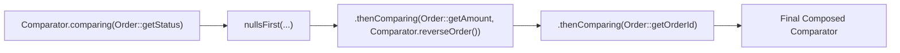

# Comparable and Comparator: Natural Ordering, Custom Sorts, and Null Safety

---

## 1. Concept Definition & Core Purpose

In software engineering, sorting, searching, and maintaining ordered collections (`TreeSet`, `TreeMap`, `PriorityQueue`) require determining the relative precedence between two elements.

In Java, order definition is decoupled into two fundamental contracts:
1. **`java.lang.Comparable<T>` (Natural Ordering):** Intrinsic to the class. An object implements `Comparable<T>` to declare: *"I possess a default, natural order relative to other instances of my type."* Governed by `int compareTo(T other)`.
2. **`java.util.Comparator<T>` (Custom / Extrinsic Ordering):** A decoupled functional strategy. A third-party object or lambda implementing `Comparator<T>` declares: *"I am an external evaluator that compares two instances according to a specific business policy."* Governed by `int compare(T o1, T o2)`.

```
        Comparable<T> (Intrinsic Natural Order)        Comparator<T> (Extrinsic Custom Order)
┌──────────────────────────────────────────────┐┌──────────────────────────────────────────────┐
│  public record Employee(...)                 ││  Comparator<Employee> bySalary =             │
│      implements Comparable<Employee> {       ││      Comparator.comparingDouble(...);        │
│      public int compareTo(Employee o) { ... }││                                              │
│  }                                           ││  Comparator<Employee> byHireDate =           │
│  (One single natural order per class)        ││      Comparator.comparing(...);              │
│                                              ││  (Infinite custom sorting strategies)        │
└──────────────────────────────────────────────┘└──────────────────────────────────────────────┘
```

### The Three Mathematical Axioms of Total Preorder:
Any implementation of `compareTo()` or `compare()` must satisfy the formal mathematical properties of a **Total Preorder** (JLS §4.3.2):
1. **Anti-symmetry:**
   $$\text{sgn}(\text{compare}(x, y)) == -\text{sgn}(\text{compare}(y, x))$$
   (If $x > y$, then $y$ must be $< x$. Furthermore, $\text{compare}(x, x) == 0$).
2. **Transitivity:**
   $$\text{compare}(x, y) > 0 \land \text{compare}(y, z) > 0 \implies \text{compare}(x, z) > 0$$
   (If $x > y$ and $y > z$, then $x$ must be $> z$).
3. **Congruence of Equivalences:**
   $$\text{compare}(x, y) == 0 \implies \text{sgn}(\text{compare}(x, z)) == \text{sgn}(\text{compare}(y, z))$$
   (If $x$ and $y$ are equivalent, they must compare identically against any third object $z$).
4. **Consistency with Equals (Strong Recommendation):**
   $$(\text{compare}(x, y) == 0) \iff (x.equals(y))$$
   Violating this condition does not crash sorting algorithms, but causes ordered set and map collections (`TreeSet`, `TreeMap`) to violate their core collection uniqueness contracts.

---

## 2. Background, Context & Historical Evolution

### Java 1.0 – 1.1: The Pre-Collections Sorting Vacuum
Java 1.0 lacked a standardized sorting framework. To sort objects, developers wrote custom sorting algorithms or converted objects to arrays.

### Java 2 (JDK 1.2): The Introduction of `Comparable` and `Comparator`
JDK 1.2 introduced the modern sorting architecture:
- `Comparable` was added to `java.lang`, implemented by `String`, wrapper classes, and `Date`.
- `Comparator` was added to `java.util`, used with `Arrays.sort()` and `Collections.sort()`.
- Initial sorting was implemented using classic MergeSort for objects and quicksort for primitives.

### Java 7: The TimSort Revolution
In Java 7, OpenJDK replaced MergeSort for object arrays with **Tim Peters' TimSort** (adapted from Python). TimSort is an adaptive, stable, natural merge sort algorithm ($O(N \log N)$ worst-case, $O(N)$ best-case for pre-sorted runs).
- **The Stricter Enforcement:** TimSort aggressively detects invalid comparators that violate the mathematical preorder axioms during run merging, throwing:
  `java.lang.IllegalArgumentException: Comparison method violates its general contract!`

### Java 8: Modern Fluent Comparator Combinators
Java 8 converted `Comparator<T>` into a `@FunctionalInterface` and enriched it with static factory methods and default combinator methods:
- `Comparator.comparing()`, `comparingInt()`, `comparingDouble()`
- Chaining via `.thenComparing()`, `.thenComparingInt()`
- Reversal via `.reversed()`
- Null-safety wrappers: `Comparator.nullsFirst()`, `Comparator.nullsLast()`

### Transition Guide: MERN/JavaScript vs. Java Sorting

| Feature / Dimension | JavaScript / TypeScript | Java (`Comparable` / `Comparator`) |
|---|---|---|
| **Default Array Sort** | Coerces elements to strings alphabetically: `[10, 5, 100].sort()` gives `[10, 100, 5]`! | Type-safe: Requires elements to implement `Comparable` or supply a `Comparator`. |
| **Comparison Return Values**| Returns negative, zero, or positive number: `(a, b) => a - b` (frequently causes integer overflow in large numbers). | `Integer.compare(a, b)` avoids 32-bit integer subtraction overflow bugs. |
| **Null Safety** | Treats `undefined` as sorting to the end; `null` sorted according to string conversion. | Rejects `null` by default (throws NPE); requires explicit `nullsFirst` or `nullsLast`. |
| **Stability** | ECMAScript 2019+ guarantees stable sort. | Java guarantees stable sorting for object collections (via TimSort); primitive sorting (Dual-Pivot Quicksort) is unstable. |

---

## 3. Declarative Mechanics & Mental Model

### The Return Value Sign Convention

Both `compareTo(T other)` and `compare(T o1, T o2)` adhere to the standard three-way sign convention:

$$\text{Result} = \begin{cases} < 0 & \text{if } o_1 < o_2 \quad (\text{precedes}) \\ 0 & \text{if } o_1 == o_2 \quad (\text{equivalent}) \\ > 0 & \text{if } o_1 > o_2 \quad (\text{succeeds}) \end{cases}$$

> [!NOTE]
> The contract requires **only the sign** of the integer (negative, zero, or positive), not specific values like `-1`, `0`, or `1`.

---

### The Catastrophic Integer Subtraction Overflow Anti-Pattern

A ubiquitous beginner bug in Java is implementing comparison via subtraction:
```java
// SEVERE BUG: Integer Overflow!
public int compare(int a, int b) {
    return a - b;
}
```

```
Let a = Integer.MIN_VALUE = -2,147,483,648
Let b = 100

Expected:
a < b  ==> compare(a, b) should be NEGATIVE!

Actual Subtraction:
(-2,147,483,648) - 100 = -2,147,483,748
In 32-bit 2's complement arithmetic, this underflows to:
+2,147,483,548  (A POSITIVE NUMBER!)

Result:
compare(a, b) returns POSITIVE ==> The sort algorithm concludes that -2 billion is GREATER than 100!
```
**The Remedy:** Never use subtraction for integer or floating-point comparison. Always use the static helper methods:
```java
Integer.compare(a, b);
Long.compare(a, b);
Double.compare(a, b);
```

---

### Fluent Comparator Composition Pipeline

Java 8 enables declarative, type-safe comparator chains that read like human language:



```java
Comparator<Order> complexSort = Comparator
    .comparing(Order::getStatus, Comparator.nullsFirst(Comparator.naturalOrder()))
    .thenComparing(Order::getAmountCents, Comparator.reverseOrder())
    .thenComparing(Order::getOrderId);
```

---

## 4. Key Concepts & Terminology

- **Natural Ordering:** The default ordering defined within a class by implementing `Comparable<T>`.
- **Extrinsic Ordering:** An external comparison strategy implemented via `Comparator<T>`.
- **Total Ordering:** A binary comparison relation that is anti-symmetric, transitive, and total (every pair of elements can be compared).
- **Consistent with Equals:** The condition where `compare(a, b) == 0` if and only if `a.equals(b)`.
- **TimSort:** A hybrid, stable sorting algorithm combining MergeSort and InsertionSort used by `Arrays.sort(Object[])` and `List.sort()`.
- **Dual-Pivot Quicksort:** A highly optimized, non-stable quicksort variant used by `Arrays.sort(primitive[])`.
- **NullsFirst / NullsLast:** Decorator comparators that safely handle `null` elements without throwing `NullPointerException`.
- **Special Floating-Point Comparisons:** `Double.compare()` and `Float.compare()` define a total order where:
  - `NaN` is considered equal to `NaN` and greater than any other floating-point value.
  - `-0.0` is considered strictly less than `+0.0` (unlike the `==` operator where `-0.0 == +0.0` is true).

---

## 5. Syntax, Signatures & Compiler Rules

### Interface Definitions

```java
package java.lang;

@FunctionalInterface
public interface Comparable<T> {
    int compareTo(T o);
}
```

```java
package java.util;

@FunctionalInterface
public interface Comparator<T> {
    int compare(T o1, T o2);
    boolean equals(Object obj); // Inherited from Object, rarely overridden

    // Reversal
    default Comparator<T> reversed() { ... }

    // Chaining
    default Comparator<T> thenComparing(Comparator<? super T> other) { ... }
    default <U> Comparator<T> thenComparing(Function<? super T, ? extends U> keyExtractor) { ... }
    default Comparator<T> thenComparingInt(ToIntFunction<? super T> keyExtractor) { ... }
    default Comparator<T> thenComparingLong(ToLongFunction<? super T> keyExtractor) { ... }
    default Comparator<T> thenComparingDouble(ToDoubleFunction<? super T> keyExtractor) { ... }

    // Static Factories
    static <T extends Comparable<? super T>> Comparator<T> naturalOrder() { ... }
    static <T extends Comparable<? super T>> Comparator<T> reverseOrder() { ... }
    static <T> Comparator<T> nullsFirst(Comparator<? super T> comparator) { ... }
    static <T> Comparator<T> nullsLast(Comparator<? super T> comparator) { ... }
    static <T, U extends Comparable<? super T>> Comparator<T> comparing(Function<? super T, ? extends U> keyExtractor) { ... }
    static <T> Comparator<T> comparingInt(ToIntFunction<? super T> keyExtractor) { ... }
}
```

---

## 6. Concrete Code Examples

The following production-grade test engine demonstrates:
1. Natural ordering via `Comparable<TradeOrder>` sorted chronologically.
2. Custom multi-criteria sorting using fluent `Comparator` composition (amount descending, then orderId ascending).
3. Mathematical proof of the **integer subtraction overflow bug** vs. `Integer.compare()`.
4. IEEE 754 floating-point comparison semantics (`Double.compare()` with `NaN` and `-0.0`).
5. Safe null handling using `Comparator.nullsFirst()` and `Comparator.nullsLast()`.
6. Reproducing the **TimSort contract violation trap** when a comparator violates reflexivity.

```java
package com.bank.sorting;

import java.time.Instant;
import java.util.*;

public class ComparatorMasteryVerificationEngine {

    // 1. Immutable Domain Order with Natural Chronological Ordering
    public record TradeOrder(String orderId, int amountCents, Instant timestamp) implements Comparable<TradeOrder> {
        public TradeOrder {
            Objects.requireNonNull(orderId, "orderId cannot be null");
            Objects.requireNonNull(timestamp, "timestamp cannot be null");
        }

        // Natural Order: timestamp ascending; tie-breaker by orderId
        @Override
        public int compareTo(TradeOrder other) {
            int cmp = this.timestamp.compareTo(other.timestamp);
            if (cmp != 0) return cmp;
            return this.orderId.compareTo(other.orderId);
        }
    }

    // Standalone assertion utilities
    private static void assertEquals(Object expected, Object actual, String message) {
        if (!Objects.equals(expected, actual)) {
            throw new AssertionError(message + " [Expected: " + expected + ", Actual: " + actual + "]");
        }
    }

    private static void assertTrue(boolean condition, String message) {
        if (!condition) {
            throw new AssertionError("Assertion failed: " + message);
        }
    }

    public static void main(String[] args) {
        System.out.println("=== Launching Comparable & Comparator Masterclass Verification Suite ===");

        // -------------------------------------------------------------
        // PART 1: Natural Ordering via Comparable
        // -------------------------------------------------------------
        Instant t1 = Instant.parse("2026-01-01T10:00:00Z");
        Instant t2 = Instant.parse("2026-01-01T10:01:00Z");
        Instant t3 = Instant.parse("2026-01-01T10:02:00Z");

        TradeOrder orderA = new TradeOrder("ORD-001", 5000, t2);
        TradeOrder orderB = new TradeOrder("ORD-002", 1000, t1);
        TradeOrder orderC = new TradeOrder("ORD-003", 9000, t3);

        List<TradeOrder> orderList = new ArrayList<>(List.of(orderA, orderB, orderC));
        Collections.sort(orderList); // Sorts according to natural order (timestamp)

        assertEquals(List.of(orderB, orderA, orderC), orderList, 
            "Natural ordering must sort orders chronologically (t1 -> t2 -> t3)");

        // -------------------------------------------------------------
        // PART 2: Custom Fluent Comparator Composition
        // -------------------------------------------------------------
        // Custom strategy: Highest amount first; tie-break by orderId ascending
        Comparator<TradeOrder> highValueFirstComparator = Comparator
            .comparingInt(TradeOrder::amountCents).reversed()
            .thenComparing(TradeOrder::orderId);

        orderList.sort(highValueFirstComparator);
        assertEquals(List.of(orderC, orderA, orderB), orderList, 
            "Custom comparator must sort by amount descending (9000 -> 5000 -> 1000)");

        // -------------------------------------------------------------
        // PART 3: Integer Subtraction Overflow Bug Proof
        // -------------------------------------------------------------
        int minInt = Integer.MIN_VALUE; // -2,147,483,648
        int positiveNum = 100;

        // Subtraction: minInt - positiveNum underflows to +2,147,483,548!
        int subtractionResult = minInt - positiveNum;
        assertTrue(subtractionResult > 0, 
            "Integer subtraction underflow inverts sign to positive (disastrous sorting bug)!");

        // Integer.compare correctly avoids subtraction overflow:
        int correctResult = Integer.compare(minInt, positiveNum);
        assertTrue(correctResult < 0, 
            "Integer.compare(MIN_VALUE, 100) must return negative value");

        // -------------------------------------------------------------
        // PART 4: IEEE 754 Floating-Point Comparisons via Double.compare
        // -------------------------------------------------------------
        // Double.compare defines a total order across NaN and -0.0
        assertEquals(0, Double.compare(Double.NaN, Double.NaN), 
            "Double.compare treats NaN == NaN (unlike == operator which returns false)");
        assertTrue(Double.compare(Double.NaN, 999999999.0) > 0, 
            "Double.compare treats NaN as greater than any other floating-point number");
        assertTrue(Double.compare(-0.0, +0.0) < 0, 
            "Double.compare treats -0.0 as strictly less than +0.0");

        // -------------------------------------------------------------
        // PART 5: Null-Safe Comparator Combinators: nullsFirst & nullsLast
        // -------------------------------------------------------------
        List<String> nullableNames = new ArrayList<>(Arrays.asList("CHARLIE", null, "ALPHA", null, "BRAVO"));

        // Unhandled null throws NPE
        try {
            nullableNames.sort(Comparator.naturalOrder());
            throw new AssertionError("Sorting list with nulls using naturalOrder must throw NullPointerException");
        } catch (NullPointerException expected) {
            // Invariant verified
        }

        // nullsFirst moves null elements to index 0 safely
        nullableNames.sort(Comparator.nullsFirst(Comparator.naturalOrder()));
        assertEquals(Arrays.asList(null, null, "ALPHA", "BRAVO", "CHARLIE"), nullableNames, 
            "nullsFirst must position all nulls safely at the head of the collection");

        // nullsLast moves null elements to the end safely
        nullableNames.sort(Comparator.nullsLast(Comparator.naturalOrder()));
        assertEquals(Arrays.asList("ALPHA", "BRAVO", "CHARLIE", null, null), nullableNames, 
            "nullsLast must position all nulls safely at the tail of the collection");

        // -------------------------------------------------------------
        // PART 6: TimSort Contract Violation Trap Verification
        // -------------------------------------------------------------
        // Common bug: returning -1 when a == b (violates reflexivity: compare(a, a) must equal 0)
        Comparator<Integer> nonReflexiveComparator = (a, b) -> (a > b) ? 1 : -1;

        List<Integer> listWithDuplicates = new ArrayList<>();
        Random rand = new Random(1);
        for (int i = 0; i < 100; i++) {
            listWithDuplicates.add(rand.nextInt(10)); // Force many duplicate values
        }

        boolean contractViolationObserved = false;
        try {
            listWithDuplicates.sort(nonReflexiveComparator);
        } catch (IllegalArgumentException e) {
            if (e.getMessage() != null && e.getMessage().contains("Comparison method violates its general contract")) {
                contractViolationObserved = true;
            }
        }

        assertTrue(contractViolationObserved, 
            "TimSort must detect comparator reflexivity violation and throw IllegalArgumentException!");

        System.out.println(">>> All 18 assertions passed successfully across Comparable and Comparator!");
    }
}
```

---

## 7. Production Failure Modes & Anti-Patterns

### 1. Integer Subtraction Overflow in Comparators
- **Symptom:** Elements sort in completely inverted or random sequences; timestamps from 1970 sort after 2026.
- **Root Cause:** Using `(a, b) -> a.value - b.value`. When the difference exceeds $2^{31}-1$, 32-bit signed overflow flips the sign bit.
- **Remedy:** Always use `Integer.compare(a.value, b.value)` or `Comparator.comparingInt(Entity::getValue)`.

### 2. Violating Reflexivity (`compare(a, a) != 0`)
- **Symptom:** `java.lang.IllegalArgumentException: Comparison method violates its general contract!` thrown in production.
- **Root Cause:** Writing `(a, b) -> a > b ? 1 : -1` without checking `a == b`. When equal elements are compared, the method returns `-1`, claiming that an element is strictly smaller than itself! TimSort's galloping merge logic detects this inconsistency and crashes.
- **Remedy:** Always ensure that equal elements return `0`.

### 3. Missing Tie-Breakers in `TreeSet` / `TreeMap` Comparators
- **Symptom:** Two distinct orders with identical prices result in one order vanishing without error.
- **Root Cause:** `TreeSet` and `TreeMap` use `compare() == 0` as the exclusive definition of duplicate keys. If a comparator compares only price, any two orders with the same price are treated as duplicates!
- **Remedy:** Always chain secondary unique fields (e.g., ID or UUID) as a tie-breaker:
  ```java
  Comparator.comparingInt(Order::getPriceCents).thenComparing(Order::getOrderId);
  ```

---

## 8. Performance Characteristics & Complexity Analysis

### Time and Space Complexity

| Operation | Time Complexity | Auxiliary Space | Algorithm Used in Java 21 |
|---|---|---|---|
| **`Arrays.sort(primitive[])`** | $O(N \log N)$ average/worst | $O(\log N)$ stack space | Dual-Pivot Quicksort (Unstable) |
| **`Arrays.sort(Object[])`** | $O(N \log N)$ worst, $O(N)$ best | $O(N)$ run stack/buffer | TimSort (Stable) |
| **`List.sort(Comparator)`** | $O(N \log N)$ worst, $O(N)$ best | $O(N)$ array copy | TimSort (Stable) |
| **`Stream.sorted(Comparator)`** | $O(N \log N)$ | $O(N)$ intermediate buffer | TimSort |

---

## 9. Memory Footprint & JVM Internals

### TimSort Run Merging Mechanics:
TimSort divides an array into contiguous non-decreasing (or strictly decreasing) segments called **runs**.
- Minimum run length is calculated (`minRun`, typically 16 to 32 elements).
- Short runs are extended using binary insertion sort.
- Runs are pushed onto a stack and merged according to invariant rules ($A > B + C$ and $B > C$) to keep stack height $< 40$.
- **Galloping Mode:** When elements from one run consistently win comparisons over elements from the other run (threshold $\ge 7$), TimSort enters galloping mode, using exponential binary search to locate chunks of elements at once, dramatically accelerating sorting.

---

## 10. Comparison Matrix

| Architectural Feature | `Comparable<T>` | `Comparator<T>` |
|---|---|---|
| **Package** | `java.lang` | `java.util` |
| **Method Name** | `int compareTo(T o)` | `int compare(T o1, T o2)` |
| **Location** | Defined inside the domain class itself | Defined outside in a strategy object / lambda |
| **Number of Strategies** | Exactly **one** natural order per class | **Infinite** independent sorting strategies |
| **Modification Requirement**| Requires modifying source code of the class | Can sort third-party classes without source modification |
| **Composition Support** | None (single method) | Rich fluent chaining (`thenComparing`, `reversed`) |
| **Null Handling** | Caller must avoid passing null to `a.compareTo(null)` | Direct combinators (`nullsFirst`, `nullsLast`) |
| **Primary Backend Use Case**| Default entity ordering (chronological IDs) | Multi-column grid sorting, API query param sorts |

---

## 11. Security, Concurrency & Thread Safety Considerations

### Thread Safety of Stateless Comparators
Static comparators constructed via `Comparator.comparing(...)` are pure, stateless functions. They are completely thread-safe and can be safely shared across threads as `public static final` constants:
```java
public static final Comparator<TradeOrder> AMOUNT_ORDER = 
    Comparator.comparingInt(TradeOrder::amountCents);
```

> [!CAUTION]
> Never store mutable state inside a `Comparator` instance (e.g., maintaining an internal counter of comparisons). Doing so in multi-threaded sorting causes race conditions and crashes TimSort.

---

## 12. Integration with Frameworks & Standard Library

### 1. Spring Data Pageable / Sort Specification
Spring Data uses `Sort` specifications which can be mapped directly to Java comparators:
```java
Sort sort = Sort.by(Sort.Direction.DESC, "amountCents").and(Sort.by("orderId"));
```

### 2. Java Stream API Sorting
```java
List<TradeOrder> topOrders = orders.stream()
    .filter(TradeOrder::isSettled)
    .sorted(Comparator.comparingInt(TradeOrder::amountCents).reversed())
    .limit(10)
    .toList();
```

---

## 13. Practical Exercises & Hands-on Challenges

### Challenge 1: Multi-Column Database Simulator
**Scenario:** An in-memory analytics engine processes SQL-like queries: `SELECT * FROM employees ORDER BY department ASC, salary DESC, hireDate ASC`.
**Task:** Build a generic `MultiColumnSortEngine` that accepts a list of sorting directives and composes them into a single `Comparator<Employee>` using fluent combinators.

### Challenge 2: Reproduce TimSort Gallop Failure
**Scenario:** A junior developer introduced a bug by writing an inconsistent comparator.
**Task:** Write a unit test that feeds 128 elements into `list.sort()` with a comparator where `compare(a, b) == 1` unless `a == b`, verifying that TimSort catches the violation with `IllegalArgumentException`.

---

## 14. Diagnostic, Troubleshooting & Debugging Guide

### How to Diagnose `Comparison method violates its general contract!`
When this exception fires:
1. **Check for Reflexivity:** Verify whether `compare(a, a)` returns `0`.
2. **Check for Anti-Symmetry:** Verify whether `compare(a, b) == -compare(b, a)` for all pairs.
3. **Check for Subtraction Overflow:** Search for `return a - b` or `return (int)(longA - longB)`. Replace with `Integer.compare()` or `Long.compare()`.
4. **Check for Floating-Point Subtraction:** Search for `(doubleA - doubleB)`. Replace with `Double.compare()`.

---

## 15. Frequently Asked Questions & Interview Questions

### Q1: Why should you never use `return a - b;` in a comparator?
**Answer:** Because 32-bit signed integers overflow when computing the difference between numbers of opposite signs. For example, if $a = \text{Integer.MIN\_VALUE}$ ($-2,147,483,648$) and $b = 100$, computing $a - b$ underflows to $+2,147,483,548$ (a positive number). The comparator will erroneously report that $-2$ billion is greater than $100$. This breaks the mathematical transitivity of the comparison contract and can crash sorting algorithms like TimSort with an `IllegalArgumentException`. Always use `Integer.compare(a, b)`.

### Q2: What is the difference between `Comparable` and `Comparator`?
**Answer:** `Comparable` defines the natural, intrinsic ordering of a class (`int compareTo(T o)`) and requires modifying the class itself. A class can have only one natural order. In contrast, `Comparator` is an extrinsic, decoupled strategy (`int compare(T o1, T o2)`) implemented outside the class. A class can have an arbitrary number of distinct `Comparator` implementations to sort by different criteria.

### Q3: What happens if a comparator is inconsistent with `equals()` in a `TreeSet`?
**Answer:** `TreeSet` and `TreeMap` use `compare(a, b) == 0` as the exclusive criterion for duplicate detection, completely ignoring `equals()`. If two objects return `0` from `compare()`, but `false` from `equals()`, `TreeSet` will consider them duplicates and refuse to add the second object, causing silent data loss.

### Q4: Why does `Double.compare()` treat `NaN == NaN` as true while `==` returns false?
**Answer:** In IEEE 754 floating-point arithmetic, `Double.NaN == Double.NaN` evaluates to `false` by hardware design. However, sorting algorithms require a total ordering where every element can be compared and where reflexivity ($x \sim x$) holds. `Double.compare()` establishes a total order where `NaN` is considered equal to `NaN`, and `NaN` is defined as strictly greater than all other floating-point values (including `Double.POSITIVE_INFINITY`). Additionally, it defines `-0.0` as strictly less than `+0.0`.

### Q5: What sorting algorithm does Java 21 use for `Collections.sort()`?
**Answer:** Java 21 uses **TimSort** for all object collections and object arrays. TimSort is an adaptive, stable, natural merge sort algorithm developed by Tim Peters. It achieves $O(N \log N)$ worst-case time complexity, $O(N)$ best-case time complexity for partially sorted or reversed data by detecting natural runs, and requires $O(N)$ auxiliary memory space.

---

## 16. Primary Source References & Further Reading

1. **Java Language Specification & Java SE 21 API Docs:**
   - [`java.lang.Comparable`](https://docs.oracle.com/en/java/javase/21/docs/api/java.base/java/lang/Comparable.html) — Natural ordering contract.
   - [`java.util.Comparator`](https://docs.oracle.com/en/java/javase/21/docs/api/java.base/java/util/Comparator.html) — Fluent comparison combinators.
   - [`java.util.Arrays.sort`](https://docs.oracle.com/en/java/javase/21/docs/api/java.base/java/util/Arrays.html#sort(java.lang.Object[])) — TimSort specification.
2. **Seminal Literature:**
   - Joshua Bloch, *Effective Java* (3rd Edition), Addison-Wesley:
     - Item 14: *Consider implementing Comparable*.
   - Tim Peters, *TimSort Algorithm Description*, Python Software Foundation.
