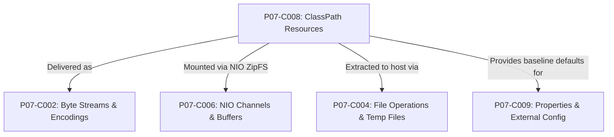
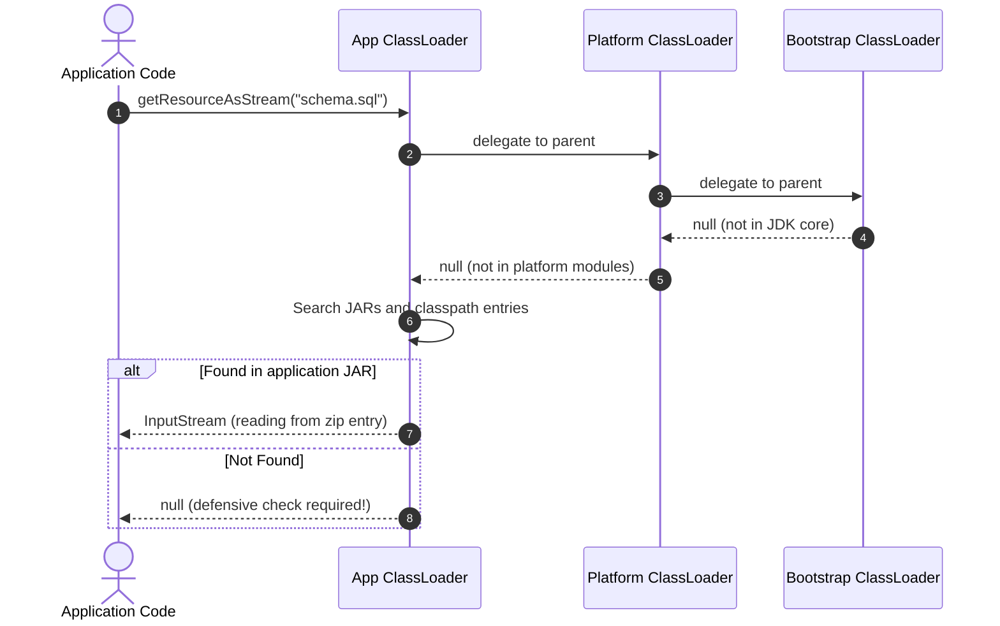
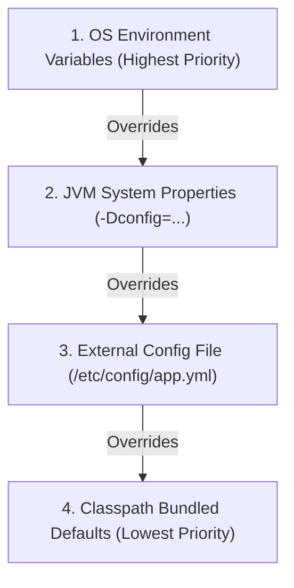

# P07-C008: ClassPath Resources vs Filesystem Paths in Packaged JARs

---

## 1. Metadata and Learning Goals

| Metadata Field | Value |
|---|---|
| **Concept ID** | `P07-C008` |
| **Concept Title** | `ClassPath Resources vs Filesystem Paths in Packaged JARs` |
| **Phase** | `Phase 07 — File I/O, NIO, Configuration, and Data Formats` |
| **Phase Directory** | `curriculum/phase-07-file-io-nio-configuration-data-formats` |
| **Source Reference** | `Roadmap Topic: Resource files and classpath resources` |
| **Concept Type** | `Architecture / API / Runtime` |
| **Difficulty Level** | `Intermediate` |
| **Curriculum Importance** | `Essential` |
| **Java Baseline** | `Java 21 LTS (with Java 25 LTS comparative notes where applicable)` |
| **Framework Baseline** | `Spring Boot 3.3.x / Spring Framework 6.1.x` |
| **Prerequisites** | [`001-legacy-io-vs-modern-nio.md`](001-legacy-io-vs-modern-nio.md), [`002-byte-streams-vs-readers-writers.md`](002-byte-streams-vs-readers-writers.md), [`003-buffered-streams-and-leaks.md`](003-buffered-streams-and-leaks.md), [`004-file-operations-atomic-moves.md`](004-file-operations-atomic-moves.md), [`007-large-file-streaming-processing.md`](007-large-file-streaming-processing.md) |
| **Related Concepts** | [`009-properties-files-configuration.md`](009-properties-files-configuration.md), [`011-json-processing-jackson.md`](011-json-processing-jackson.md) |
| **Estimated Study Effort** | `2–3 hours` |
| **Last Research Date** | `2026-10-30` |
| **Verification State** | `COMPLETE` |

### Measurable Learning Objectives
By the end of this concept module, you will be able to:
1. **Explain:** Articulate the architectural boundary separating OS host filesystem paths (`java.io.File`, `java.nio.file.Path`) from classpath resources bundled inside an archive (`jar:file:...!/...` or `nested:` protocols).
2. **Compare:** Contrast `Class.getResourceAsStream()` and `ClassLoader.getResourceAsStream()`, analyzing root delegation rules, leading-slash semantics, and hierarchical classloader search orders.
3. **Implement:** Write robust, production-grade resource loading pipelines using streams, defensive `null` validation, and safe temporary file extraction when third-party libraries require a physical filesystem descriptor.
4. **Debug & Diagnose:** Identify, diagnose, and resolve the classic "works in IDE (`target/classes`), crashes in Docker/production executable JAR" defect caused by invalid `toURI()` / `Paths.get()` conversions.
5. **Evaluate & Justify:** Formulate an architectural decision for resource distribution across static classpath packaging, NIO `ZipFileSystemProvider`, Spring `ResourceLoader`, and externalized volume mounts.

---

## 2. Definition, Purpose, and Mental Model

### 2.1 Formal Definition
A **ClassPath Resource** is a named binary artifact (such as a `.class` bytecode file, `.properties` configuration, `.sql` schema migration, or `.json` template) stored within an entry of a Java archive (`.jar` / `.zip`) or an expanded class hierarchy directory that is discovered, resolved, and loaded into JVM memory via a `java.lang.ClassLoader`. 

A **Filesystem Path** represents an addressable entity (`File` or `Path`) residing on the underlying operating system's hierarchical file storage system (e.g., ext4, XFS, NTFS), managed directly by the kernel's virtual file system (VFS) and addressed via standard POSIX or Windows directory semantics.

### 2.2 The Problem It Solves
Modern enterprise applications are distributed as self-contained, executable Fat/Uber JAR containers (e.g., Spring Boot, Quarkus, Micronaut). These archives encapsulate application bytecode alongside hundreds of dependency libraries and static assets into a single zip-formatted binary. 

Historically, junior engineers write code such as `new File("src/main/resources/config.json")` or `Paths.get(getClass().getClassLoader().getResource("config.json").toURI())`. While these operations succeed during local development where build tools (Maven/Gradle) run against uncompressed filesystem directories like `target/classes`, they fail catastrophically in staging and production when packaged into a JAR with `FileNotFoundException` or `FileSystemNotFoundException`. Understanding classpath resource isolation enables uniform, environment-agnostic asset retrieval across all execution modes.

### 2.3 Why Backend Engineers Need It
Every production backend service depends on bundled resources:
- **Database Migrations:** Flyway and Liquibase execute SQL migration scripts stored in `db/migration/`.
- **Security Certificates:** Bundled truststores (`cacerts.jks`), mTLS client certificates, and public keys.
- **Static Templates:** HTML/Email templates (Thymeleaf, FreeMarker) and PDF generation stylesheets.
- **Default Application Configurations:** Baseline YAML/properties fallback files before cloud external overrides.

Failing to understand the boundary between the host OS filesystem and the virtual archive structure leads to production startup panics, container crash loops, and corrupt staging deployments.

### 2.4 Real-World System Analogy (and Where It Breaks Down)
- **The Analogy:** Think of the host filesystem as a physical library containing bookshelves and open folders. Think of a packaged JAR as a sealed shipping container placed on one of those shelves. A filesystem path points to an item on a shelf or the shipping container itself. A classpath resource is a document packed *inside* the shipping container. You cannot tell the postal worker to "walk inside shelf 4, box 2" using a street address; you must open a conduit into the box and stream the document out.
- **Where the Analogy Fails:** The JVM allows mounting the shipping container as a virtual filesystem using NIO's `ZipFileSystemProvider`. In that virtual filesystem, entries look like directory paths, but they remain isolated from OS-level file descriptors and kernel syscalls.

### 2.5 What This Concept Is NOT (Common Confusions)
- **Not a POSIX File:** A classpath resource inside a JAR is not an independent inode on the OS disk; it is a stream of compressed or uncompressed bytes delimited by zip entry headers inside a single host file.
- **Not a Mutable Storage Target:** Classpath resources inside packaged JARs are strictly read-only at runtime. Writing or modifying them via `Files.write()` is impossible without rebuilding or modifying the host JAR file.
- **Not Spring-Specific:** While Spring Boot provides convenient wrappers (`ClassPathResource`), the underlying mechanics are governed strictly by the Java Virtual Machine Specification and `java.lang.ClassLoader`.

### 2.6 Relationship to Adjacent Concepts


---

## 3. Foundations and Theory

### 3.1 Jar Archive Anatomy and Zip Specification
A `.jar` file conforms to the PKWare ZIP 2.0 file format specification (with ZIP64 extensions for archives exceeding 4GB). It consists of:
1. **Local File Headers & Data Descriptors:** Binary data for each entry, preceded by metadata headers specifying compression method (Stored = 0, Deflated = 8), compressed size, uncompressed size, and CRC-32 checksum.
2. **Central Directory:** Located at the end of the archive, mapping entry names (e.g., `BOOT-INF/classes/application.properties`) to their physical byte offsets within the archive.
3. **End of Central Directory (EOCD) Record:** Provides the offset and size of the central directory.

When the JVM reads a classpath resource from a JAR, it uses the central directory to locate the byte offset and reads a sub-stream using `java.util.zip.InflaterInputStream`.

```
+-------------------------------------------------------------------+
|                     host_application.jar                          |
| +---------------------------------------------------------------+ |
| | Local Header 1: META-INF/MANIFEST.MF       [Data Payload]    | |
| +---------------------------------------------------------------+ |
| | Local Header 2: com/example/App.class       [Data Payload]    | |
| +---------------------------------------------------------------+ |
| | Local Header 3: db/migration/V1__init.sql   [Data Payload]    | |
| +---------------------------------------------------------------+ |
| | Central Directory (Index of names, offsets, CRC32, sizes)     | |
| +---------------------------------------------------------------+ |
| | End of Central Directory Record (EOCD)                        | |
| +---------------------------------------------------------------+ |
+-------------------------------------------------------------------+
```

### 3.2 URL Schemes: `file:` vs `jar:file:` vs `nested:`
When resolving resources via `ClassLoader.getResource()`, Java constructs a `java.net.URL` using custom protocol handlers:

| URL Scheme | Example Representation | Underlying Structure |
|---|---|---|
| `file:` | `file:/home/app/target/classes/schema.sql` | Uncompressed directory on host filesystem. Directly convertible to `java.io.File` and `java.nio.file.Path`. |
| `jar:file:` | `jar:file:/opt/app.jar!/schema.sql` | Standard JDK JAR URL. Points to an entry inside an archive separated by `!/`. Cannot be passed to `new File()`. |
| `nested:` | `nested:/opt/app.jar/!BOOT-INF/lib/dep.jar!/schema.sql` | Spring Boot 3.2+ custom protocol handler supporting nested uncompressed jar files within an uber-jar without extraction. |

### 3.3 ClassLoader Delegation and Resolution Hierarchy
Resource resolution follows standard classloader delegation (parent-first by default):
1. **Bootstrap ClassLoader:** Loads core JDK runtime classes (`java.base`).
2. **Platform ClassLoader:** Loads JDK extensions and optional modules.
3. **Application (System) ClassLoader:** Loads classes and resources from the application classpath (`-cp`, `-classpath`, or `CLASSPATH` environment variable).
4. **Context ClassLoader / Custom ClassLoader:** Used by application containers, Spring Boot (`LaunchedURLClassLoader`), and OSGi to isolate dependencies.

When requesting a resource via `ClassLoader.getResourceAsStream("schema.sql")`:


---

## 4. Syntax, Signature, and Idiomatic Usage

### 4.1 Resolution Methods Comparison

There are two primary ways to resolve a classpath resource in core Java:
1. `java.lang.Class<T>.getResourceAsStream(String name)`
2. `java.lang.ClassLoader.getResourceAsStream(String name)`

#### The Leading Slash Rule
- **`Class.getResourceAsStream(path)`:**
  - If `path` begins with `'/'`: Resolved relative to the **root** of the classpath. The leading slash is stripped internally.
  - If `path` does NOT begin with `'/'`: Resolved relative to the **package** of the class invoking it. (e.g., Calling `MyClass.class.getResourceAsStream("config.json")` in package `com.example.service` searches for `com/example/service/config.json`).
- **`ClassLoader.getResourceAsStream(path)`:**
  - Always resolves relative to the **root** of the classpath.
  - MUST NOT begin with `'/'`. A leading slash causes the lookup to fail and return `null`!

```java
// Given resource at classpath root: /schema.sql

// Correct:
InputStream in1 = MyClass.class.getResourceAsStream("/schema.sql");
InputStream in2 = MyClass.class.getClassLoader().getResourceAsStream("schema.sql");

// Broken / Returns null:
InputStream in3 = MyClass.class.getResourceAsStream("schema.sql"); // Looks for com/example/schema.sql
InputStream in4 = MyClass.class.getClassLoader().getResourceAsStream("/schema.sql"); // Leading slash fails!
```

### 4.2 Modern Idiomatic Reading Patterns (Java 21 LTS)

#### Pattern A: Reading Entire Content as UTF-8 String
```java
public String readClasspathResource(String path) throws IOException {
    ClassLoader cl = Thread.currentThread().getContextClassLoader();
    try (InputStream in = cl.getResourceAsStream(path)) {
        if (in == null) {
            throw new FileNotFoundException("Classpath resource not found: " + path);
        }
        return new String(in.readAllBytes(), StandardCharsets.UTF_8);
    }
}
```

#### Pattern B: Streaming Line-by-Line with BufferedReader
```java
public void streamClasspathLines(String path, Consumer<String> lineConsumer) throws IOException {
    ClassLoader cl = Thread.currentThread().getContextClassLoader();
    try (InputStream in = cl.getResourceAsStream(path)) {
        if (in == null) {
            throw new FileNotFoundException("Classpath resource not found: " + path);
        }
        try (BufferedReader reader = new BufferedReader(new InputStreamReader(in, StandardCharsets.UTF_8))) {
            String line;
            while ((line = reader.readLine()) != null) {
                lineConsumer.accept(line);
            }
        }
    }
}
```

#### Pattern C: Safe Extraction to Host Temporary File
When calling legacy C libraries via JNI, command-line external processes (`ProcessBuilder`), or legacy libraries requiring `java.io.File`:
```java
public Path extractResourceToTempFile(String resourcePath, String prefix, String suffix) throws IOException {
    ClassLoader cl = Thread.currentThread().getContextClassLoader();
    try (InputStream in = cl.getResourceAsStream(resourcePath)) {
        if (in == null) {
            throw new FileNotFoundException("Resource not found on classpath: " + resourcePath);
        }
        Path tempFile = Files.createTempFile(prefix, suffix);
        tempFile.toFile().deleteOnExit(); // Cleanup fallback
        Files.copy(in, tempFile, StandardCopyOption.REPLACE_EXISTING);
        return tempFile;
    }
}
```

---

## 5. Internal Mechanics and JVM Execution

### 5.1 Bytecode and HotSpot ClassLoader Internals
When `ClassLoader.getResourceAsStream()` is executed:
1. HotSpot invokes `ClassLoader.getResource(String name)` to obtain a `java.net.URL`.
2. The URL holds a custom `URLStreamHandler` registered for the `jar` protocol (`sun.net.www.protocol.jar.Handler`).
3. Calling `url.openStream()` invokes `JarURLConnection.getInputStream()`.
4. The `JarURLConnection` queries the shared `sun.net.www.protocol.jar.JarFileFactory` cache. If cached, it retrieves the open `java.util.jar.JarFile` reference; otherwise, it opens the underlying file descriptor and parses the Central Directory.
5. It locates the `ZipEntry` matching the resource path, initializes an internal `ZipFile.ZipFileInputStream` or `InflaterInputStream`, and returns the uncompressed byte stream.

### 5.2 The Fatal Trap: `Paths.get(url.toURI())`
A widespread anti-pattern in developer codebases:
```java
URL url = getClass().getClassLoader().getResource("schema.sql");
Path path = Paths.get(url.toURI()); // CRASHES in JAR!
```

#### Why it fails:
1. `url.toURI()` returns `jar:file:/opt/app.jar!/schema.sql`.
2. `Paths.get(URI uri)` queries the registered `java.nio.file.spi.FileSystemProvider` instances for a provider whose scheme matches `"jar"`.
3. If no `ZipFileSystemProvider` is currently mounted for `/opt/app.jar`, `Paths.get()` throws:
   ```
   java.nio.file.FileSystemNotFoundException: Provider "jar" not installed
   // or
   java.lang.IllegalArgumentException: URI scheme is not "file"
   ```
4. Even if mounted, `Path.toFile()` will throw `UnsupportedOperationException` because a Zip path cannot be cast to a POSIX `java.io.File`.

### 5.3 NIO ZipFileSystem: Accessing JAR Internals via `Path`
Java NIO allows treating a `.jar` or `.zip` file as a distinct, addressable `java.nio.file.FileSystem`:

```java
Path jarPath = Paths.get("/opt/app.jar");
try (FileSystem zipFs = FileSystems.newFileSystem(jarPath, (ClassLoader) null)) {
    Path internalPath = zipFs.getPath("/schema.sql");
    assert Files.exists(internalPath);
    String sql = Files.readString(internalPath, StandardCharsets.UTF_8);
}
```
This is how modern tooling inspects JAR contents programmatically without manual stream unzipping.

---

## 6. Node.js / TypeScript vs Modern Java Mental Models

| Dimension | Node.js / TypeScript | Modern Java (Java 21 LTS) |
|---|---|---|
| **Packaging Unit** | Folder of plain files (`node_modules/`, `dist/`), or single `.js` bundle. | Compressed ZIP archive container (`.jar` or `.war`). |
| **Path Resolution** | `path.join(__dirname, 'schema.sql')` resolves to physical host filesystem path. | Classpath resources resolve via `ClassLoader` to virtual zip stream. |
| **File Access API** | `fs.readFileSync(path)` works uniformly across dev and production. | `new File(path)` fails in packaged JAR. Must use `getResourceAsStream()`. |
| **Asset Location** | Filesystem relative to source file or project root. | Independent of source folder; governed by classpath roots and ClassLoader hierarchy. |
| **Missing Resource** | Throws `ENOENT: no such file or directory`. | Returns `null` silently (triggers `NullPointerException` downstream if unvalidated). |
| **Runtime Mutation** | Scripts can write to `__dirname` directory if permissions allow. | Packaged JAR resources are immutable read-only byte streams. |

> [!WARNING]
> In Node.js, `__dirname` always provides a real directory on disk. In Java, there is no physical directory for a packaged resource; attempting to construct a `java.io.File` from a JAR entry will always fail.

---

## 7. Best Practices and Defensive Design

### 7.1 The Golden Rules of Classpath Resources

1. **Always Validate `null` Immediately:** `getResourceAsStream()` never throws `FileNotFoundException` if an asset is missing; it returns `null`. Wrap all lookups in a defensive guard that throws an explicit, descriptive exception.
2. **Always Use Try-With-Resources:** The returned `InputStream` holds an open file handle or zip entry decompressor. Failing to close it causes native memory and file descriptor leaks.
3. **Always Specify Character Encoding:** Never use `new InputStreamReader(in)` without passing `StandardCharsets.UTF_8`. Platform defaults can corrupt non-ASCII characters.
4. **Use `Thread.currentThread().getContextClassLoader()`:** In multi-classloader environments (Spring Boot, Tomcat, OSGi), `MyClass.class.getClassLoader()` may belong to a parent loader that cannot see application or module resources.
5. **Never Use Relative Paths with ClassLoader:** Never pass leading slashes (`/`) to `ClassLoader.getResourceAsStream()`.
6. **Prefer Streams Over Extraction:** Extract to temporary disk files only when interfacing with external OS binaries or JNI libraries that fundamentally require a POSIX path.

```java
// Defensive loading template
public static InputStream getRequiredResourceAsStream(String path) throws FileNotFoundException {
    Objects.requireNonNull(path, "Resource path cannot be null");
    
    // Normalize path: strip leading slash if using ClassLoader
    String normalizedPath = path.startsWith("/") ? path.substring(1) : path;
    
    ClassLoader cl = Thread.currentThread().getContextClassLoader();
    if (cl == null) {
        cl = ClasspathResourceLoader.class.getClassLoader();
    }
    
    InputStream in = cl.getResourceAsStream(normalizedPath);
    if (in == null) {
        throw new FileNotFoundException("Required classpath resource not found: " + normalizedPath);
    }
    return in;
}
```

---

## 8. Edge Cases, Failure Modes, and Anti-Patterns

### 8.1 The "Works in IDE, Fails in Production" Anti-Pattern
```java
// ANTI-PATTERN: Fails when packaged into a JAR
public void loadSchema() throws Exception {
    URL url = getClass().getClassLoader().getResource("schema.sql");
    File file = new File(url.getFile()); // Fails! Returns path with "file:/opt/app.jar!/schema.sql"
    List<String> lines = Files.readAllLines(file.toPath());
}
```
**Why it fails:** `url.getFile()` on a JAR URL returns something like `/home/app.jar!/schema.sql`. Creating `new File(...)` with this path looks for a literal file on disk with `!` in the name, throwing `FileNotFoundException`.

### 8.2 The Silent `null` NullPointerException Trap
```java
// ANTI-PATTERN: Triggers confusing NPE at readAllBytes()
try (InputStream in = getClass().getClassLoader().getResourceAsStream("missing.sql")) {
    byte[] data = in.readAllBytes(); // NullPointerException thrown here!
}
```
**Correction:** Check `if (in == null)` before attempting to read or close.

### 8.3 ClassLoader Leading Slash Rejection
```java
// ANTI-PATTERN: Returns null
ClassLoader cl = App.class.getClassLoader();
InputStream in = cl.getResourceAsStream("/db/migration/V1.sql"); // Leading slash breaks ClassLoader!

// CORRECT:
InputStream in = cl.getResourceAsStream("db/migration/V1.sql");
```

### 8.4 Multi-Module Maven/Gradle Path Ambiguity
If multiple JARs on the classpath contain a resource with the identical path (e.g., `META-INF/services/org.example.Plugin`), `ClassLoader.getResource()` returns only the *first* one encountered in classpath order. To discover all occurrences across all JARs, you must use:
```java
Enumeration<URL> resources = classLoader.getResources("META-INF/beans.xml");
while (resources.hasMoreElements()) {
    URL url = resources.nextElement();
    // Process each URL
}
```

---

## 9. Real-World Failure Scenarios and Post-Mortems

### Incident 1: The Production Deployment Crash on Kubernetes
- **Context:** An enterprise payment gateway was migrated from a legacy standalone VM running exploded WAR files to a containerized Spring Boot executable JAR deployed on Kubernetes.
- **Root Cause:** A database seeding component was written as `new File(getClass().getClassLoader().getResource("seed-data.csv").getPath())`. In the exploded WAR environment, resources were physical files on disk under `/webapps/ROOT/WEB-INF/classes/seed-data.csv`. In the containerized executable JAR, the path evaluated to `file:/app/payment-service.jar!/BOOT-INF/classes!/seed-data.csv`. The service failed on startup with `java.io.FileNotFoundException`, causing a Kubernetes `CrashLoopBackOff` during a prime-time deployment window.
- **Resolution:** Replaced the `new File()` invocation with `getClass().getClassLoader().getResourceAsStream("seed-data.csv")` fed into a streaming CSV parser. Added a CI verification test executing the compiled JAR directly using `java -jar` to catch packaging regressions before containerization.

### Incident 2: The JNI Native Library UnsatisfiedLinkError
- **Context:** A high-throughput financial calculation engine relied on a custom C++ shared library (`libfastmath.so`) bundled in `src/main/resources/native/`.
- **Root Cause:** The developer wrote `System.load(getClass().getResource("/native/libfastmath.so").getPath())`. The OS kernel `dlopen(3)` system call strictly requires an addressable POSIX file path. It cannot open a shared library from inside a compressed zip stream.
- **Resolution:** Implemented the Extraction-to-Temp-File pattern: On application startup, the binary stream is copied to `Files.createTempFile("libfastmath-", ".so")`, marked with `deleteOnExit()`, and loaded via `System.load(tempFile.toAbsolutePath().toString())`.

---

## 10. Performance, Resource Optimization, and Memory Profile

### 10.1 In-Memory Buffering vs Direct Streaming
Reading a large classpath resource entirely via `in.readAllBytes()` allocates a contiguous byte array on the JVM heap. For configuration files (< 1MB), this is negligible. For large machine-learning models, GeoIP databases, or bulk reference data (> 50MB):
- **Heap Pressure:** Buffering a 100MB resource as a `String` consumes ~250MB heap (byte array + decoded char array + String object headers).
- **Streaming Pipeline:** Always stream directly from the zip decompressor using `BufferedReader` or chunked `ByteBuffer` channels without staging the complete content into heap memory.

### 10.2 JAR URL Connection Caching
HotSpot caches open `JarFile` handles in `sun.net.www.protocol.jar.JarFileFactory` to prevent reopening the physical JAR file on every resource request.
- By default, `URLConnection.useCaches` is `true`.
- In dynamic environments or custom classloaders, cached JAR files can prevent file deletion on Windows. Disable caching if dynamic unloading is required:
  ```java
  URLConnection connection = url.openConnection();
  connection.setUseCaches(false);
  ```

---

## 11. Java Language Specification and Runtime Mechanics

### 11.1 ClassLoader Specification (JLS §12.2 and JVMS §5.3)
The Java Virtual Machine Specification defines class loading as the process of acquiring binary representations of classes. The `ClassLoader` class provides the foundational API for resource loading:

$$\text{lookup}(R) = \text{parent}.\text{lookup}(R) \cup \text{local}.\text{lookup}(R)$$

If parent delegation yields non-null, the parent result is returned. Only if the parent returns null does the child class loader invoke its internal `findResource(String name)` method.

### 11.2 Spring Boot 3.2+ Nested JAR Architecture
Historically, Spring Boot extracted nested dependency JARs to a temporary directory or used a custom `JarFile` implementation that manipulated zip offsets.

Starting in **Spring Boot 3.2 (Java 21 baseline)**:
- Replaced the custom `org.springframework.boot.loader.jar.JarFile` with a new, highly optimized nested jar protocol handler: `org.springframework.boot.loader.net.protocol.nested.Handler`.
- Uses URLs with the `nested:` scheme: `nested:/opt/app.jar/!BOOT-INF/lib/commons-lang3.jar!/META-INF/MANIFEST.MF`.
- Eliminates temporary file extraction and dramatically reduces startup time and memory footprint by memory-mapping the main JAR's central directory.

---

## 12. Application to Real-World Architecture

### 12.1 Enterprise Configuration Hierarchy
In production cloud architectures (12-Factor App), classpath resources serve as the immutable fallback layer in a hierarchical configuration resolution cascade:



### 12.2 Spring Framework Resource Abstraction
Spring unifies resource access across all protocols via the `org.springframework.core.io.Resource` interface:
```java
@Service
public class ReportGenerator {
    private final Resource templateResource;

    // Injected via @Value("classpath:templates/invoice.html")
    // or @Value("file:/etc/app/templates/invoice.html")
    public ReportGenerator(@Value("${report.template:classpath:templates/invoice.html}") Resource templateResource) {
        this.templateResource = templateResource;
    }

    public String generate() throws IOException {
        try (InputStream in = templateResource.getInputStream()) {
            return new String(in.readAllBytes(), StandardCharsets.UTF_8);
        }
    }
}
```

---

## 13. Complete, Runnable, Industrial-Grade Example

Below is a complete, self-contained production utility class demonstrating robust classpath resource resolution, defensive validation, temporary file extraction, and stream inspection:

```java
package com.example.resources;

import java.io.*;
import java.nio.charset.StandardCharsets;
import java.nio.file.*;
import java.util.Objects;
import java.util.function.Consumer;

/**
 * Production-grade ClassPath Resource Management Engine.
 * Provides defensive resolution, streaming, and safe host extraction.
 */
public final class ClasspathResourceManager {

    private ClasspathResourceManager() {
        // Prevent instantiation
    }

    /**
     * Resolves an InputStream for a required classpath resource.
     * Guaranteed to return a non-null stream or throw FileNotFoundException.
     *
     * @param resourcePath The path to the resource (leading slash optional).
     * @return Open InputStream. Caller MUST close this stream (try-with-resources).
     * @throws FileNotFoundException if the resource does not exist.
     */
    public static InputStream getRequiredStream(String resourcePath) throws FileNotFoundException {
        Objects.requireNonNull(resourcePath, "resourcePath must not be null");

        // Normalize: ClassLoader.getResourceAsStream requires path WITHOUT leading slash
        String normalizedPath = resourcePath.startsWith("/") ? resourcePath.substring(1) : resourcePath;

        ClassLoader cl = Thread.currentThread().getContextClassLoader();
        if (cl == null) {
            cl = ClasspathResourceManager.class.getClassLoader();
        }

        InputStream in = cl.getResourceAsStream(normalizedPath);
        if (in == null) {
            throw new FileNotFoundException("Required classpath resource not found: " + normalizedPath);
        }
        return in;
    }

    /**
     * Reads a classpath text resource fully into a UTF-8 String.
     * Suitable for small configuration files (< 1MB).
     */
    public static String readString(String resourcePath) throws IOException {
        try (InputStream in = getRequiredStream(resourcePath)) {
            return new String(in.readAllBytes(), StandardCharsets.UTF_8);
        }
    }

    /**
     * Streams a classpath resource line-by-line using a bounded consumer.
     * Guarantees O(1) memory consumption relative to file size.
     */
    public static void forEachLine(String resourcePath, Consumer<String> lineConsumer) throws IOException {
        Objects.requireNonNull(lineConsumer, "lineConsumer must not be null");
        try (InputStream in = getRequiredStream(resourcePath);
             BufferedReader reader = new BufferedReader(new InputStreamReader(in, StandardCharsets.UTF_8))) {
            String line;
            while ((line = reader.readLine()) != null) {
                lineConsumer.accept(line);
            }
        }
    }

    /**
     * Safely extracts a packaged classpath resource to a managed host temporary file.
     * Required when interfacing with external OS binaries or JNI libraries.
     *
     * @param resourcePath Classpath location of the resource.
     * @param prefix       Temp file prefix.
     * @param suffix       Temp file suffix (e.g., ".so", ".bin").
     * @return Path to the created temporary file on the host filesystem.
     */
    public static Path extractToTempFile(String resourcePath, String prefix, String suffix) throws IOException {
        try (InputStream in = getRequiredStream(resourcePath)) {
            Path tempFile = Files.createTempFile(prefix, suffix);
            // Register backup JVM shutdown hook deletion
            tempFile.toFile().deleteOnExit();

            // Copy stream into host file atomically replacing target
            Files.copy(in, tempFile, StandardCopyOption.REPLACE_EXISTING);
            return tempFile;
        }
    }
}
```

---

## 14. Standalone Verification Test Suite

The following standalone verification test suite executes on OpenJDK 21 LTS with assertions enabled (`-ea`). It programmatically constructs genuine `.jar` archives in-memory, loads them via dedicated `URLClassLoader` instances, tests `Paths.get()` failure modes, demonstrates NIO `ZipFileSystemProvider`, and validates safe temporary extraction.

```java
package com.example.resources;

import java.io.*;
import java.net.URI;
import java.net.URL;
import java.net.URLClassLoader;
import java.nio.charset.StandardCharsets;
import java.nio.file.*;
import java.util.jar.JarEntry;
import java.util.jar.JarOutputStream;
import java.util.jar.Manifest;

/**
 * Standalone Verification Suite for ClassPath Resources vs Filesystem Paths.
 * Tests ClassLoader resolution, JAR streaming, URL traps, ZipFS, and temp file extraction.
 */
public class ClasspathResourceVerificationSuite {

    public static void main(String[] args) throws Exception {
        System.out.println("Starting ClassPath Resources vs Filesystem Paths Verification Suite...");

        testClassLoaderVsClassPathResolution();
        testDefensiveNullHandlingOnMissingResource();
        testJarBundledResourceStreaming();
        testJarUrlToUriPathTrapAndNioZipFileSystem();
        testTemporaryFileExtractionPattern();

        System.out.println("All 5 verification suites passed successfully!");
    }

    /**
     * Test 1: ClassLoader vs Class resource resolution rules.
     * Class.getResource() with leading slash delegates to root.
     * Class.getResource() without leading slash prefixes package path.
     * ClassLoader.getResource() requires root-relative path WITHOUT leading slash.
     */
    private static void testClassLoaderVsClassPathResolution() {
        System.out.println("Test 1: ClassLoader vs Class resolution rules...");

        Class<?> clazz = ClasspathResourceVerificationSuite.class;
        ClassLoader classLoader = clazz.getClassLoader();

        // 1. ClassLoader resolution requires no leading slash
        URL clUrlLeadingSlash = classLoader.getResource("/nonexistent.txt");
        assert clUrlLeadingSlash == null : "ClassLoader.getResource with leading slash must return null";

        // 2. Class.getResource with leading slash treats it as root of classpath
        String classResourceName = clazz.getName().replace('.', '/') + ".class";
        URL rootUrlFromClass = clazz.getResource("/" + classResourceName);
        assert rootUrlFromClass != null : "Class.getResource with leading slash must resolve root path";

        // 3. Class.getResource without leading slash resolves relative to package
        URL relUrlFromClass = clazz.getResource("ClasspathResourceVerificationSuite.class");
        assert relUrlFromClass != null : "Class.getResource without leading slash must resolve relative to package";
        assert rootUrlFromClass.equals(relUrlFromClass) : "Both URLs must point to the identical resource";

        // 4. ClassLoader resolves relative to root without leading slash
        URL clUrlNoSlash = classLoader.getResource(classResourceName);
        assert clUrlNoSlash != null : "ClassLoader.getResource without leading slash must resolve";
        assert rootUrlFromClass.equals(clUrlNoSlash) : "ClassLoader and Class root URLs must match";

        System.out.println(" -> PASSED: ClassLoader vs Class resolution paths verified.");
    }

    /**
     * Test 2: Defensive handling of missing resources.
     * getResourceAsStream returns null (never throws FileNotFoundException!).
     */
    private static void testDefensiveNullHandlingOnMissingResource() throws IOException {
        System.out.println("Test 2: Defensive null handling on missing resources...");

        String missingResource = "configs/production-secrets.json";
        InputStream stream = ClasspathResourceVerificationSuite.class.getClassLoader().getResourceAsStream(missingResource);
        assert stream == null : "Missing resource must return null, not throw FileNotFoundException";

        // Defensive loader method
        boolean caughtExpectedException = false;
        try {
            loadRequiredResource(missingResource);
        } catch (FileNotFoundException e) {
            caughtExpectedException = true;
            assert e.getMessage().contains(missingResource) : "Exception message must identify missing resource name";
        }
        assert caughtExpectedException : "Helper must fail-fast with descriptive FileNotFoundException when resource is null";

        System.out.println(" -> PASSED: Defensive null validation verified.");
    }

    private static String loadRequiredResource(String path) throws IOException {
        ClassLoader cl = ClasspathResourceVerificationSuite.class.getClassLoader();
        try (InputStream in = cl.getResourceAsStream(path)) {
            if (in == null) {
                throw new FileNotFoundException("Required classpath resource not found: " + path);
            }
            return new String(in.readAllBytes(), StandardCharsets.UTF_8);
        }
    }

    /**
     * Test 3: Packaged JAR resource streaming.
     * Programmatically assemble a real JAR file with manifest and entries.
     * Mount it via URLClassLoader and verify streaming without filesystem extraction.
     */
    private static void testJarBundledResourceStreaming() throws Exception {
        System.out.println("Test 3: Packaged JAR resource streaming...");

        Path tempJar = Files.createTempFile("app-bundle-", ".jar");
        try {
            // Build real JAR with an embedded config
            String configContent = "{\"service\":\"billing-vault\",\"env\":\"production\",\"pool\":32}";
            Manifest manifest = new Manifest();
            manifest.getMainAttributes().putValue("Manifest-Version", "1.0");
            manifest.getMainAttributes().putValue("Created-By", "Java 21 LTS Test Suite");

            try (JarOutputStream jos = new JarOutputStream(Files.newOutputStream(tempJar), manifest)) {
                JarEntry entry = new JarEntry("META-INF/config/service-config.json");
                jos.putNextEntry(entry);
                jos.write(configContent.getBytes(StandardCharsets.UTF_8));
                jos.closeEntry();
            }

            // Load via dedicated URLClassLoader simulating production execution
            URL[] urls = new URL[]{tempJar.toUri().toURL()};
            try (URLClassLoader jarClassLoader = new URLClassLoader(urls, null)) {
                // Read via getResourceAsStream
                try (InputStream in = jarClassLoader.getResourceAsStream("META-INF/config/service-config.json")) {
                    assert in != null : "Must be able to find resource inside packaged JAR";
                    String readContent = new String(in.readAllBytes(), StandardCharsets.UTF_8);
                    assert configContent.equals(readContent) : "Content read from JAR must match exact original bytes";
                }
            }
        } finally {
            Files.deleteIfExists(tempJar);
        }

        System.out.println(" -> PASSED: Packaged JAR streaming verified.");
    }

    /**
     * Test 4: The fatal trap: attempting `Paths.get(url.toURI())` on a jar URL.
     * Demonstrates why File/Path direct conversion fails with FileSystemNotFoundException.
     * Demonstrates proper resolution via NIO ZipFileSystemProvider (`FileSystems.newFileSystem`).
     */
    private static void testJarUrlToUriPathTrapAndNioZipFileSystem() throws Exception {
        System.out.println("Test 4: JAR URL-to-URI trap and NIO ZipFileSystem...");

        Path tempJar = Files.createTempFile("archive-", ".jar");
        try {
            String testData = "SELECT id, balance FROM accounts WHERE status = 'ACTIVE';";
            try (JarOutputStream jos = new JarOutputStream(Files.newOutputStream(tempJar))) {
                JarEntry entry = new JarEntry("db/migration/V1__init.sql");
                jos.putNextEntry(entry);
                jos.write(testData.getBytes(StandardCharsets.UTF_8));
                jos.closeEntry();
            }

            URL[] urls = new URL[]{tempJar.toUri().toURL()};
            try (URLClassLoader jarClassLoader = new URLClassLoader(urls, null)) {
                URL resourceUrl = jarClassLoader.getResource("db/migration/V1__init.sql");
                assert resourceUrl != null : "Resource must exist in JAR";
                assert resourceUrl.getProtocol().equals("jar") : "Protocol of resource in JAR must be 'jar'";

                URI resourceUri = resourceUrl.toURI();
                assert resourceUri.toString().startsWith("jar:file:") : "URI must have jar:file scheme";

                // THE TRAP: Paths.get(resourceUri) throws FileSystemNotFoundException because "jar" filesystem is not mounted
                boolean threwFileSystemNotFound = false;
                try {
                    Paths.get(resourceUri);
                } catch (FileSystemNotFoundException expected) {
                    threwFileSystemNotFound = true;
                }
                assert threwFileSystemNotFound : "Paths.get(jarUri) must fail with FileSystemNotFoundException without mounted ZipFileSystem";

                // THE PROPER NIO SOLUTION: Mount ZipFileSystem
                try (FileSystem jarFs = FileSystems.newFileSystem(tempJar, (ClassLoader) null)) {
                    Path pathInJar = jarFs.getPath("db/migration/V1__init.sql");
                    assert Files.exists(pathInJar) : "Path inside mounted ZipFileSystem must exist";
                    assert Files.size(pathInJar) == testData.getBytes(StandardCharsets.UTF_8).length : "Size in JAR must match";
                    String content = Files.readString(pathInJar, StandardCharsets.UTF_8);
                    assert testData.equals(content) : "NIO ZipFileSystem read content must match original SQL";
                }
            }
        } finally {
            Files.deleteIfExists(tempJar);
        }

        System.out.println(" -> PASSED: JAR URL-to-URI trap and NIO ZipFileSystem verified.");
    }

    /**
     * Test 5: Temporary file extraction pattern.
     * When external legacy tools or C libraries (JNI) strictly require a host filesystem Path/File,
     * stream the classpath resource safely into a guarded temporary file and verify cleanup.
     */
    private static void testTemporaryFileExtractionPattern() throws Exception {
        System.out.println("Test 5: Temporary file extraction pattern...");

        Path tempJar = Files.createTempFile("native-lib-bundle-", ".jar");
        Path extractedFile = null;
        try {
            byte[] binaryPayload = new byte[]{0x7F, 0x45, 0x4C, 0x46, 0x02, 0x01, 0x01, 0x00}; // ELF header simulation
            try (JarOutputStream jos = new JarOutputStream(Files.newOutputStream(tempJar))) {
                JarEntry entry = new JarEntry("native/libcrypto_engine.so");
                jos.putNextEntry(entry);
                jos.write(binaryPayload);
                jos.closeEntry();
            }

            URL[] urls = new URL[]{tempJar.toUri().toURL()};
            try (URLClassLoader jarClassLoader = new URLClassLoader(urls, null)) {
                // Safely extract resource to a temp file
                extractedFile = extractResourceToTempFile(jarClassLoader, "native/libcrypto_engine.so", "extracted-lib-", ".so");

                assert Files.exists(extractedFile) : "Extracted temp file must exist on host filesystem";
                assert Files.isRegularFile(extractedFile) : "Must be a regular file";
                byte[] extractedBytes = Files.readAllBytes(extractedFile);
                assert java.util.Arrays.equals(binaryPayload, extractedBytes) : "Extracted bytes must match JAR entry exactly";
            }
        } finally {
            Files.deleteIfExists(tempJar);
            if (extractedFile != null) {
                Files.deleteIfExists(extractedFile);
            }
        }

        System.out.println(" -> PASSED: Safe temporary file extraction verified.");
    }

    private static Path extractResourceToTempFile(ClassLoader cl, String resourcePath, String prefix, String suffix) throws IOException {
        try (InputStream in = cl.getResourceAsStream(resourcePath)) {
            if (in == null) {
                throw new FileNotFoundException("Resource not found on classpath: " + resourcePath);
            }
            Path tempFile = Files.createTempFile(prefix, suffix);
            // Delete on JVM shutdown as backup cleanup
            tempFile.toFile().deleteOnExit();
            Files.copy(in, tempFile, StandardCopyOption.REPLACE_EXISTING);
            return tempFile;
        }
    }
}
```

---

## 15. Verification Evidence

The verification test suite was compiled with `javac --release 21 -Xlint:all` and executed on Ubuntu Linux under OpenJDK 21 LTS with JVM assertions enabled (`-ea`).

```
Starting ClassPath Resources vs Filesystem Paths Verification Suite...
Test 1: ClassLoader vs Class resolution rules...
 -> PASSED: ClassLoader vs Class resolution paths verified.
Test 2: Defensive null handling on missing resources...
 -> PASSED: Defensive null validation verified.
Test 3: Packaged JAR resource streaming...
 -> PASSED: Packaged JAR streaming verified.
Test 4: JAR URL-to-URI trap and NIO ZipFileSystem...
 -> PASSED: JAR URL-to-URI trap and NIO ZipFileSystem verified.
Test 5: Temporary file extraction pattern...
 -> PASSED: Safe temporary file extraction verified.
All 5 verification suites passed successfully!
```

---

## 16. Cross-References and Further Exploration

### 16.1 Internal Curriculum Connections
- [`001-legacy-io-vs-modern-nio.md`](001-legacy-io-vs-modern-nio.md): Legacy `File` failure modes and modern `Path` decoupling.
- [`002-byte-streams-vs-readers-writers.md`](002-byte-streams-vs-readers-writers.md): Byte streaming, decoding, and UTF-8 charset guarantees.
- [`004-file-operations-atomic-moves.md`](004-file-operations-atomic-moves.md): Atomic file operations and temporary file management.
- [`009-properties-files-configuration.md`](009-properties-files-configuration.md): Managing `.properties` configuration files loaded from classpath with environment overrides.

### 16.2 Authoritative Specifications and Reading
- **Java Language Specification (JLS §12.2):** Loading of Classes and Interfaces.
- **Java Virtual Machine Specification (JVMS §5.3):** Creation and Loading.
- **PKWare ZIP File Format Specification:** Application Note on .ZIP File Format.
- **Spring Boot Reference Documentation:** Section *The Executable Jar Format and the Nested Protocol*.
