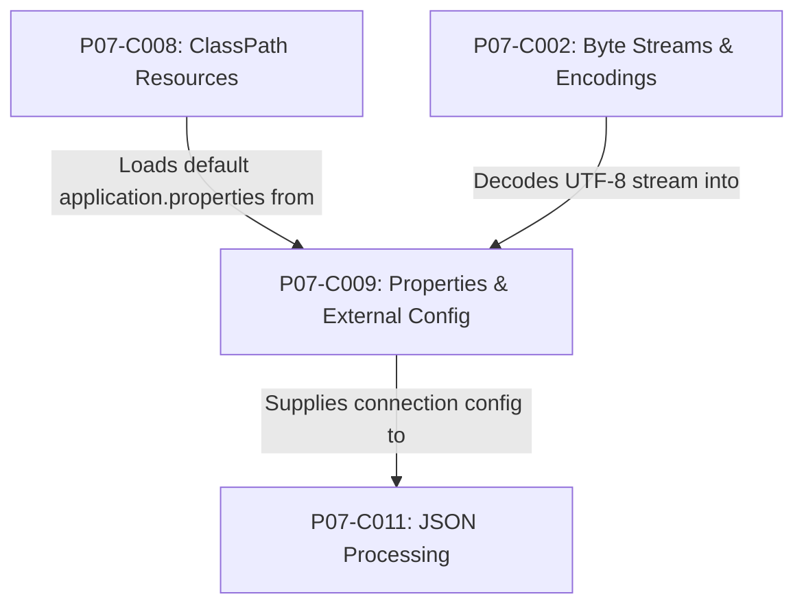
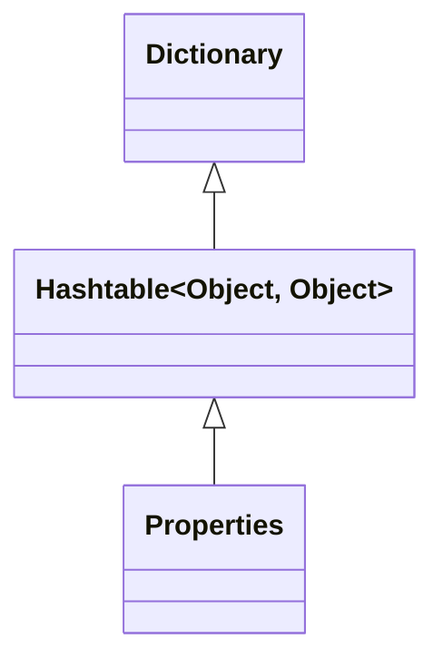
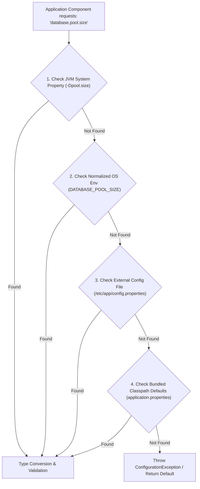

# P07-C009: Configuration Management: Properties Files and System Environment Overrides

---

## 1. Metadata and Learning Goals

| Metadata Field | Value |
|---|---|
| **Concept ID** | `P07-C009` |
| **Concept Title** | `Configuration Management: Properties Files and System Environment Overrides` |
| **Phase** | `Phase 07 — File I/O, NIO, Configuration, and Data Formats` |
| **Phase Directory** | `curriculum/phase-07-file-io-nio-configuration-data-formats` |
| **Source Reference** | `Roadmap Topic: Properties files and external configuration` |
| **Concept Type** | `Architecture / API / Security` |
| **Difficulty Level** | `Intermediate` |
| **Curriculum Importance** | `Essential` |
| **Java Baseline** | `Java 21 LTS (with Java 25 LTS comparative notes where applicable)` |
| **Framework Baseline** | `Spring Boot 3.3.x / Spring Framework 6.1.x` |
| **Prerequisites** | [`001-legacy-io-vs-modern-nio.md`](001-legacy-io-vs-modern-nio.md), [`002-byte-streams-vs-readers-writers.md`](002-byte-streams-vs-readers-writers.md), [`008-classpath-resources-in-jars.md`](008-classpath-resources-in-jars.md) |
| **Related Concepts** | [`010-csv-parsing-and-validation.md`](010-csv-parsing-and-validation.md), [`011-json-processing-jackson.md`](011-json-processing-jackson.md) |
| **Estimated Study Effort** | `2–3 hours` |
| **Last Research Date** | `2026-10-30` |
| **Verification State** | `COMPLETE` |

### Measurable Learning Objectives
By the end of this concept module, you will be able to:
1. **Explain:** Articulate the specification of the `.properties` file format, character encoding rules (ISO-8859-1 legacy vs UTF-8 `Reader`), delimiters (`=`, `:`, whitespace), and line continuation semantics.
2. **Compare:** Contrast `java.util.Properties` with `Map<String, String>`, identifying the historical `Hashtable<Object, Object>` inheritance flaw and why `put()` breaks type-safety contracts.
3. **Implement:** Architect a 12-Factor App (Factor III: Config) multi-tier configuration resolution engine implementing cascading overrides across System Properties (`-D`), OS Environment Variables, external configuration files, and bundled classpath defaults.
4. **Debug & Diagnose:** Resolve configuration drift, character encoding corruption, and circular variable placeholder expansions (`${app.host}:${app.port}`).
5. **Evaluate & Justify:** Evaluate relaxed binding conventions (POSIX uppercase snake_case vs canonical lowercase kebab-case/dot-notation) and formulate fail-fast validation routines on application startup.

---

## 2. Definition, Purpose, and Mental Model

### 2.1 Formal Definition
**Configuration Management** in Java is the discipline of externalizing operational parameters, credentials, network endpoints, and business toggles from executable bytecode into declarative key-value stores (`.properties`, `.yaml`, `.env`). 

`java.util.Properties` is the foundational JDK class designed to persist and retrieve string-based key-value pairs to and from I/O streams using a standard line-oriented syntax.

### 2.2 The Problem It Solves
Hardcoding configuration variables inside application bytecode necessitates recompilation, artifact re-packaging, and full deployment cycles whenever an endpoint or timeout changes. 

Furthermore, committing secrets (passwords, tokens, private keys) into source control creates critical security vulnerabilities. By decoupling configuration from code, applications can build once as an immutable binary container and run anywhere across development, staging, and production environments by simply injecting externalized overrides.

### 2.3 Why Backend Engineers Need It
Every enterprise service operates in diverse runtime topologies:
- **Cloud-Native Deployments (Kubernetes):** Configuration values are mounted from `ConfigMaps` or injected via `Secrets` as environment variables.
- **Fail-Fast Validation:** An invalid integer port, a missing database URL, or an unresolvable hostname must halt service boot immediately during health checks rather than crashing midway through processing customer traffic.
- **Microservice Resiliency:** Dynamic property reloading or externalized precedence hierarchies allow adjusting circuit breaker thresholds or logging levels without service restarts.

### 2.4 Real-World System Analogy (and Where It Breaks Down)
- **The Analogy:** Think of an automobile's dashboard and adjustable controls (steering wheel position, mirror angles, cruise control speed). The car's internal engine (bytecode) remains unchanged regardless of who drives it, while the seat position and mirrors (configuration) are adjusted specifically for each driver (environment).
- **Where the Analogy Fails:** In software, a missing seat adjustment allows the car to drive anyway. In enterprise Java backend services, a missing mandatory configuration must halt the engine before the ignition turns over to prevent catastrophic data corruption.

### 2.5 What This Concept Is NOT (Common Confusions)
- **Not a General-Purpose Cache:** `java.util.Properties` is synchronized on every access (inheriting from `Hashtable`). It is not optimized for high-frequency reads in multi-threaded hot paths.
- **Not a Secure Secret Store:** `.properties` files are plain-text documents. They must never store plaintext production credentials in unencrypted disk storage or source repositories.
- **Not Spring-Specific `@Value`:** While Spring Boot simplifies property injection, the fundamental mechanics of POSIX environment variables, JVM system properties, and properties stream parsing are standard Java SE runtime features.

### 2.6 Relationship to Adjacent Concepts


---

## 3. Foundations and Theory

### 3.1 The `.properties` Grammar Specification
The standard format defined by `java.util.Properties.load(Reader)` follows strict parsing rules:
1. **Comment Lines:** Lines whose first non-whitespace character is `#` or `!` are treated as comments and ignored.
2. **Key-Value Separators:** The first unescaped `=`, `:`, or unescaped whitespace character divides the key from the value.
3. **Leading Whitespace:** Leading whitespace before the key and whitespace surrounding the separator is automatically stripped.
4. **Line Continuation:** A trailing backslash (`\`) at the end of a line indicates that the value continues onto the following line (discarding leading whitespace of the continuation line).
5. **Escape Sequences:** Standard Java escape sequences are supported (`\t`, `\n`, `\r`, `\\`, and `\uXXXX` Unicode escapes).

```properties
# 1. Standard assignment
server.port = 8080

! 2. Colon separator with exclamation comment
database.timeout: 5000

# 3. Whitespace separator
service.name PaymentService

# 4. Multi-line continuation
query.find-active-users = SELECT id, email \
                          FROM users \
                          WHERE status = 'ACTIVE'
```

### 3.2 Character Encoding: The Java 8 vs Java 9+ Shift
Historically (Java 1.0 through Java 8), `Properties.load(InputStream)` strictly mandated **ISO-8859-1** (Latin-1). Any character outside the ISO-8859-1 range (e.g., German umlauts, Chinese characters, emojis) had to be converted to ASCII escape sequences (e.g., `\u00FC` for `ü`) using the JDK `native2ascii` tool.

In modern Java (Java 9+, fully standardized in Java 21 LTS):
- `Properties.load(Reader)` accepts any character set via `InputStreamReader` (standardizing on `StandardCharsets.UTF_8`).
- Since Java 9, `Properties.load(InputStream)` defaults directly to **UTF-8**, falling back gracefully if invalid bytes occur.

### 3.3 The Twelve-Factor App: Factor III (Config)
The Twelve-Factor App methodology mandates:
> *"Store config in the environment."*

A codebase must maintain strict separation between code and configuration. The theoretical resolution hierarchy resolves configuration by probing increasingly environment-specific layers:

```
[Layer 1: CLI / JVM System Properties]   -Dserver.port=9090 (Highest Priority)
                  │
[Layer 2: OS Environment Variables]      SERVER_PORT=9090
                  │
[Layer 3: External Configuration File]   /etc/myapp/config.properties
                  │
[Layer 4: Bundled Classpath Defaults]    classpath:application.properties (Lowest Priority)
```

---

## 4. Syntax, Signature, and Idiomatic Usage

### 4.1 Core `java.util.Properties` Methods

```java
public class Properties extends Hashtable<Object, Object> {
    public synchronized void load(Reader reader) throws IOException;
    public synchronized void load(InputStream inStream) throws IOException;
    public String getProperty(String key);
    public String getProperty(String key, String defaultValue);
    public synchronized Object setProperty(String key, String value);
    public Set<String> stringPropertyNames();
    public synchronized void store(Writer writer, String comments) throws IOException;
}
```

### 4.2 Loading from Classpath with UTF-8 Reader
```java
public Properties loadClasspathProperties(String resourcePath) throws IOException {
    Properties properties = new Properties();
    ClassLoader cl = Thread.currentThread().getContextClassLoader();
    try (InputStream in = cl.getResourceAsStream(resourcePath)) {
        if (in == null) {
            throw new FileNotFoundException("Properties resource not found: " + resourcePath);
        }
        try (Reader reader = new InputStreamReader(in, StandardCharsets.UTF_8)) {
            properties.load(reader);
        }
    }
    return properties;
}
```

### 4.3 Loading from an External Filesystem Path
```java
public Properties loadExternalProperties(Path path) throws IOException {
    Properties properties = new Properties();
    if (!Files.isRegularFile(path)) {
        throw new NoSuchFileException("Config file does not exist: " + path);
    }
    try (BufferedReader reader = Files.newBufferedReader(path, StandardCharsets.UTF_8)) {
        properties.load(reader);
    }
    return properties;
}
```

---

## 5. Internal Mechanics and JVM Execution

### 5.1 The `Hashtable<Object, Object>` Inheritance Anti-Pattern
`Properties` was introduced in Java 1.0 before the Collections Framework existed. In an unfortunate architectural decision, `Properties` extends `Hashtable<Object, Object>` rather than encapsulating it:



#### The Type Safety Hazard:
Because it inherits `Hashtable`, developers can call `properties.put(Object key, Object value)`. If a non-String object is inserted:
```java
Properties props = new Properties();
props.put("timeout", 5000); // Inserts Integer into Hashtable

// props.get("timeout") returns 5000 (Integer)
// BUT:
String val = props.getProperty("timeout"); // RETURNS NULL!
```
Under the hood, `getProperty(key)` uses `Object oval = super.get(key)` and checks:
```java
String sval = (oval instanceof String) ? (String)oval : null;
```
If `oval` is not a `String`, `getProperty()` silently returns `null`!
**Rule:** Never invoke `put()` or `get()` on a `Properties` instance. Always use `setProperty(String, String)` and `getProperty(String)`.

### 5.2 Thread Synchronization and Lock Contention
Every method in `Hashtable` (and therefore inherited by `Properties`) is `synchronized`. 

If multiple threads frequently invoke `properties.getProperty("cache.ttl")` on a shared instance in a high-throughput request pipeline, all threads serialize on the monitor lock of the `Properties` instance. 

**Architectural Solution:** Load properties once at startup, validate them, and project them into an immutable `record` or `Map.copyOf()`.

---

## 6. Node.js / TypeScript vs Modern Java Mental Models

| Dimension | Node.js / TypeScript | Modern Java (Java 21 LTS) |
|---|---|---|
| **Environment Access** | `process.env.PORT` (Dynamic global object). | `System.getenv("PORT")` (Read-only immutable Map). |
| **CLI / System Properties** | `process.argv` (Parsed manually or via yargs). | `System.getProperty("server.port")` (Set via `-Dkey=val`). |
| **Config File Parsing** | `dotenv.config()`, JSON `import config from './config.json'`. | `Properties.load(Reader)`, Jackson ObjectMapper, or SnakeYAML. |
| **Key Conventions** | Typically `SNAKE_CASE` or `camelCase`. | Relaxed binding: `server.port` <-> `SERVER_PORT`. |
| **Type Coercion** | Dynamic runtime coercion (`Number(process.env.PORT)`). | Strict compile-time typing requiring explicit parsing (`Integer.parseInt`). |
| **Immutability** | `process.env` is mutable at runtime (`process.env.FOO = 'bar'`). | `System.getenv()` is immutable at the OS level; modifying it causes undefined behavior. |

---

## 7. Best Practices and Defensive Design

### 7.1 Relaxed Binding and POSIX Key Normalization
Operating system shells (bash, zsh) and container runtimes (Docker, Kubernetes) restrict environment variable names to alphanumeric characters and underscores (`[a-zA-Z_][a-zA-Z0-9_]*`). Dot-separated keys like `database.connection.pool-size` cannot be set directly in POSIX shells.

To bridge this, modern config engines implement **Relaxed Binding**:
1. Convert camelCase to snake_case.
2. Replace all dots (`.`) and dashes (`-`) with underscores (`_`).
3. Convert all characters to uppercase.

$$\text{canonical: } \texttt{database.connection.pool-size} \implies \text{POSIX: } \texttt{DATABASE_CONNECTION_POOL_SIZE}$$

### 7.2 Fail-Fast Schema Validation
Never allow an application to boot with invalid or missing required configuration. Build a typed validator during bootstrap:

```java
public record DatabaseConfig(String host, int port, int poolSize, Duration timeout) {
    public DatabaseConfig {
        Objects.requireNonNull(host, "database.host is required");
        if (port < 1 || port > 65535) {
            throw new IllegalArgumentException("database.port out of range [1-65535]: " + port);
        }
        if (poolSize < 1) {
            throw new IllegalArgumentException("database.pool-size must be >= 1: " + poolSize);
        }
        Objects.requireNonNull(timeout, "database.timeout is required");
    }
}
```

### 7.3 Dynamic Placeholder Variable Interpolation
Configuration values frequently reference other properties (e.g., `app.url = https://${app.host}:${app.port}/api`). A production configuration engine must recursively interpolate placeholders with:
- Fallback defaults (`${port:8080}`).
- Circular reference detection (preventing infinite recursion and `StackOverflowError`).

---

## 8. Edge Cases, Failure Modes, and Anti-Patterns

### 8.1 The Whitespace Delimiter Surprise
In the `.properties` specification, whitespace is a valid delimiter. A developer might write:
```properties
allowed hosts = 127.0.0.1, 10.0.0.1
```
The parser reads the key as `allowed` and the value as `hosts = 127.0.0.1, 10.0.0.1`!
**Rule:** Always escape spaces in keys with a backslash (`allowed\ hosts`) or use canonical dot-notation (`allowed.hosts`).

### 8.2 Backslash Escaping in Windows Paths
On Windows, file paths use backslashes:
```properties
storage.directory = C:\Users\app\data
```
The properties parser interprets `\u` as a Unicode escape sequence! Because `\Users` is not followed by four hexadecimal digits, `Properties.load()` throws:
```
java.lang.IllegalArgumentException: Malformed \uxxxx encoding.
```
**Rule:** Always double the backslashes (`C:\\Users\\app\\data`) or use forward slashes (`C:/Users/app/data`), which Java NIO handles natively on Windows.

### 8.3 Mutating `System.getProperties()` Concurrently
`System.getProperties()` returns the global JVM system properties table. Mutating it concurrently from background threads causes data races and unpredictable behavior in third-party libraries.

---

## 9. Real-World Failure Scenarios and Post-Mortems

### Incident 1: The Out-of-Range Connection Pool Blackout
- **Context:** An e-commerce service deployed a new release to production. An engineer configured the database pool size via an environment variable intended to be 50: `DATABASE_POOL_SIZE=5O` (accidentally typing uppercase letter `O` instead of digit `0`).
- **Failure Mode:** The application used naive parsing: `Integer.parseInt(System.getenv("DATABASE_POOL_SIZE"))`. However, because the parsing happened lazily inside the first incoming checkout transaction rather than at startup, the service booted cleanly, passed health checks, and began taking customer traffic. The first checkout request crashed with `NumberFormatException: For input string: "5O"`, triggering an immediate cascade of 500 Internal Server Errors.
- **Resolution:** Moved all configuration parsing and conversion into an eager initialization block during application bootstrap. If any property fails validation, the JVM exits immediately with status code `1`, preventing Kubernetes from routing production traffic to the broken pod.

### Incident 2: The Circular Placeholder StackOverflow
- **Context:** A microservice team implemented dynamic placeholder substitution in their custom configuration loader. A shared team configuration file introduced:
  ```properties
  kafka.bootstrap.servers = ${primary.broker}
  primary.broker = ${kafka.bootstrap.servers}
  ```
- **Failure Mode:** When the service booted, the naive recursive interpolator entered an infinite loop resolving `${primary.broker}` $\to$ `${kafka.bootstrap.servers}` $\to$ `${primary.broker}`, crashing the JVM with a `StackOverflowError`.
- **Resolution:** Implemented cycle detection using an active visitation set (`Set<String> visiting`). If a key is encountered that is already in the current resolution chain, an `IllegalStateException("Cyclic property reference detected: ...")` is thrown with the exact cycle trace.

---

## 10. Performance, Resource Optimization, and Memory Profile

### 10.1 Synchronization Overhead
Because `Properties` inherits `Hashtable`, every call to `getProperty()` acquires an intrinsic object lock. In high-concurrency architectures with virtual threads (Project Loom):
- Pinned carrier threads or lock contention can degrade throughput if configuration values are read inside hot per-request logic.
- **Optimization:** Project properties into an immutable `java.util.Map` or typed `record` at startup:
  ```java
  Map<String, String> unmodifiableConfig = Collections.unmodifiableMap(new HashMap<>((Map) properties));
  ```

### 10.2 Memory Layout
Each property entry consists of:
- A `Hashtable$Entry` object (32 bytes on 64-bit JVM with compressed OOPs).
- Two `String` objects (key and value, 24 bytes each).
- Two underlying `byte[]` arrays.
For a typical microservice with 200 properties, total memory consumption is under 50 KB, making the configuration memory footprint negligible compared to class metadata and JVM buffers.

---

## 11. Java Language Specification and Runtime Mechanics

### 11.1 Classpath vs Operating System Environment Access
- **System Properties (JLS §12):** Initialized by the JVM launcher from command-line `-D` arguments and JDK internal defaults. Accessible via `System.getProperty(key)` and `System.setProperty(key, val)`.
- **Environment Variables:** Inherited from the host operating system process environment table. Accessible via `System.getenv(key)` as an unmodifiable map (`ProcessEnvironment.UnmodifiableMap`). Attempts to mutate `System.getenv()` throw `UnsupportedOperationException`.

---

## 12. Application to Real-World Architecture

### 12.1 Enterprise Cascading Configuration Architecture
Below is the architectural flow of a production-grade externalized configuration resolver:



---

## 13. Complete, Runnable, Industrial-Grade Example

Below is a production-grade, self-contained `ConfigurationResolver` engine that loads bundled classpath defaults, overrides them with external files, checks POSIX environment variables, supports variable interpolation (`${key:default}`), detects cyclic dependencies, and performs fail-fast type conversion:

```java
package com.example.config;

import java.io.*;
import java.nio.charset.StandardCharsets;
import java.nio.file.Files;
import java.nio.file.Path;
import java.time.Duration;
import java.util.*;
import java.util.regex.Matcher;
import java.util.regex.Pattern;

/**
 * Production-grade Externalized Configuration Engine.
 * Implements 12-Factor cascading precedence, POSIX key normalization,
 * placeholder interpolation, and fail-fast type conversion.
 */
public final class ConfigurationResolver {

    private static final Pattern PLACEHOLDER_PATTERN = Pattern.compile("\\$\\{([^}]+)\\}");
    private final Map<String, String> resolvedConfig;

    private ConfigurationResolver(Map<String, String> resolvedConfig) {
        this.resolvedConfig = Collections.unmodifiableMap(resolvedConfig);
    }

    public static Builder builder() {
        return new Builder();
    }

    public String getString(String key) {
        String val = resolvedConfig.get(key);
        if (val == null) {
            throw new NoSuchElementException("Missing required configuration: " + key);
        }
        return val;
    }

    public String getStringOrDefault(String key, String defaultValue) {
        return resolvedConfig.getOrDefault(key, defaultValue);
    }

    public int getInt(String key, int defaultValue) {
        String val = resolvedConfig.get(key);
        if (val == null) {
            return defaultValue;
        }
        try {
            return Integer.parseInt(val.trim());
        } catch (NumberFormatException e) {
            throw new IllegalArgumentException("Invalid integer configuration for '" + key + "': " + val, e);
        }
    }

    public boolean getBoolean(String key, boolean defaultValue) {
        String val = resolvedConfig.get(key);
        return val != null ? Boolean.parseBoolean(val.trim()) : defaultValue;
    }

    public Duration getDuration(String key, Duration defaultValue) {
        String val = resolvedConfig.get(key);
        if (val == null) {
            return defaultValue;
        }
        return Duration.parse(val.trim());
    }

    public Map<String, String> asMap() {
        return resolvedConfig;
    }

    public static final class Builder {
        private final Properties defaults = new Properties();
        private final Properties externalFileProps = new Properties();
        private Map<String, String> envVars = System.getenv();
        private Map<String, String> systemProps = new HashMap<>();

        public Builder() {
            // Harvest current system properties
            Properties sys = System.getProperties();
            for (String name : sys.stringPropertyNames()) {
                systemProps.put(name, sys.getProperty(name));
            }
        }

        public Builder withClasspathDefaults(String resourcePath) throws IOException {
            ClassLoader cl = Thread.currentThread().getContextClassLoader();
            try (InputStream in = cl.getResourceAsStream(resourcePath)) {
                if (in != null) {
                    try (Reader reader = new InputStreamReader(in, StandardCharsets.UTF_8)) {
                        defaults.load(reader);
                    }
                }
            }
            return this;
        }

        public Builder withExternalFile(Path path) throws IOException {
            if (path != null && Files.isRegularFile(path)) {
                try (BufferedReader reader = Files.newBufferedReader(path, StandardCharsets.UTF_8)) {
                    externalFileProps.load(reader);
                }
            }
            return this;
        }

        public Builder withEnvironmentOverrides(Map<String, String> customEnv) {
            this.envVars = Objects.requireNonNull(customEnv);
            return this;
        }

        public Builder withSystemProperties(Map<String, String> customSysProps) {
            this.systemProps = Objects.requireNonNull(customSysProps);
            return this;
        }

        public ConfigurationResolver build() {
            Map<String, String> rawMerged = new HashMap<>();

            // 1. Classpath Defaults (lowest)
            for (String key : defaults.stringPropertyNames()) {
                rawMerged.put(key, defaults.getProperty(key));
            }

            // 2. External File
            for (String key : externalFileProps.stringPropertyNames()) {
                rawMerged.put(key, externalFileProps.getProperty(key));
            }

            // 3. Environment Variables (match canonical or POSIX normalized)
            for (String key : new HashSet<>(rawMerged.keySet())) {
                String posixKey = toPosixEnvKey(key);
                if (envVars.containsKey(posixKey)) {
                    rawMerged.put(key, envVars.get(posixKey));
                } else if (envVars.containsKey(key)) {
                    rawMerged.put(key, envVars.get(key));
                }
            }

            // 4. System Properties (highest)
            for (Map.Entry<String, String> entry : systemProps.entrySet()) {
                rawMerged.put(entry.getKey(), entry.getValue());
            }

            // 5. Interpolate placeholders (${key:default}) with cycle detection
            Map<String, String> fullyResolved = new HashMap<>();
            for (Map.Entry<String, String> entry : rawMerged.entrySet()) {
                String resolvedValue = interpolate(entry.getValue(), rawMerged, new HashSet<>());
                fullyResolved.put(entry.getKey(), resolvedValue);
            }

            return new ConfigurationResolver(fullyResolved);
        }

        private String interpolate(String input, Map<String, String> source, Set<String> visiting) {
            if (input == null || !input.contains("${")) {
                return input;
            }

            Matcher matcher = PLACEHOLDER_PATTERN.matcher(input);
            StringBuilder sb = new StringBuilder();

            while (matcher.find()) {
                String token = matcher.group(1);
                String refKey;
                String defaultValue = null;

                int colonIdx = token.indexOf(':');
                if (colonIdx >= 0) {
                    refKey = token.substring(0, colonIdx).trim();
                    defaultValue = token.substring(colonIdx + 1);
                } else {
                    refKey = token.trim();
                }

                if (!visiting.add(refKey)) {
                    throw new IllegalStateException("Cyclic property reference detected: " + refKey + " in " + visiting);
                }

                try {
                    String refValue = source.get(refKey);
                    if (refValue == null) {
                        refValue = defaultValue;
                    }
                    if (refValue == null) {
                        refValue = matcher.group(0); // keep unresolvable token
                    } else {
                        refValue = interpolate(refValue, source, visiting);
                    }
                    matcher.appendReplacement(sb, Matcher.quoteReplacement(refValue));
                } finally {
                    visiting.remove(refKey);
                }
            }
            matcher.appendTail(sb);
            return sb.toString();
        }

        public static String toPosixEnvKey(String dotKey) {
            String snake = dotKey.replaceAll("([a-z])([A-Z])", "$1_$2");
            return snake.replace('.', '_').replace('-', '_').toUpperCase(Locale.ROOT);
        }
    }
}
```

---

## 14. Standalone Verification Test Suite

The following standalone verification test suite executes on OpenJDK 21 LTS with assertions enabled (`-ea`). It verifies properties parsing, delimiter syntax, UTF-8 character integrity, the `Hashtable` inheritance trap, cascading override precedence, POSIX key normalization, and placeholder interpolation with circular reference defense.

```java
package com.example.config;

import java.io.*;
import java.nio.charset.StandardCharsets;
import java.nio.file.Files;
import java.nio.file.Path;
import java.util.*;
import java.util.regex.Matcher;
import java.util.regex.Pattern;

/**
 * Standalone Verification Suite for Properties and Externalized Configuration.
 */
public class PropertiesConfigurationVerificationSuite {

    public static void main(String[] args) throws Exception {
        System.out.println("Starting Properties & Externalized Configuration Verification Suite...");

        testPropertiesFormatParsingAndUtf8();
        testHashtableInheritanceTypeSafetyTrap();
        testCascadingConfigurationPrecedence();
        testPosixEnvironmentKeyNormalization();
        testPlaceholderInterpolationAndCycles();

        System.out.println("All 5 verification suites passed successfully!");
    }

    /**
     * Test 1: Properties syntax, line continuation, delimiters, comments, and UTF-8 Reader.
     */
    private static void testPropertiesFormatParsingAndUtf8() throws IOException {
        System.out.println("Test 1: Properties format, delimiters, line continuation, and UTF-8...");

        String rawProperties = """
            # Primary service properties
            ! Alternative exclamation comment
            server.host = 10.0.0.1
            server.port: 8080
            server.name microservice-orders
            
            # Line continuation with backslash
            database.query = SELECT id, name \\
                             FROM users \\
                             WHERE active = 1
            
            # UTF-8 characters
            app.welcome = Herzlich Willkommen! 🚀
            """;

        Properties props = new Properties();
        try (Reader reader = new StringReader(rawProperties)) {
            props.load(reader);
        }

        assert "10.0.0.1".equals(props.getProperty("server.host")) : "Equal delimiter failed";
        assert "8080".equals(props.getProperty("server.port")) : "Colon delimiter failed";
        assert "microservice-orders".equals(props.getProperty("server.name")) : "Whitespace delimiter failed";

        String query = props.getProperty("database.query");
        assert query != null && query.contains("SELECT id, name") && query.contains("WHERE active = 1")
            : "Line continuation parsing failed";

        assert "Herzlich Willkommen! 🚀".equals(props.getProperty("app.welcome"))
            : "UTF-8 Reader property parsing failed";

        System.out.println(" -> PASSED: Format parsing and UTF-8 reader verified.");
    }

    /**
     * Test 2: The historical Hashtable inheritance trap.
     * Properties extends Hashtable<Object, Object>.
     * raw put(key, nonStringObject) breaks getProperty(key) which returns null!
     */
    private static void testHashtableInheritanceTypeSafetyTrap() {
        System.out.println("Test 2: Hashtable inheritance trap and type safety...");

        Properties props = new Properties();
        // BAD: using Map.put with non-string
        props.put("timeout.ms", 5000); // Integer object!

        // get() from Hashtable finds the Integer
        Object rawVal = props.get("timeout.ms");
        assert rawVal instanceof Integer && ((Integer) rawVal) == 5000 : "Map.get returns Integer";

        // BUT getProperty() strictly returns String or null if not a String!
        String propVal = props.getProperty("timeout.ms");
        assert propVal == null : "getProperty() MUST return null when value is not a java.lang.String!";

        // Defensive setProperty enforces String keys and values
        props.setProperty("timeout.ms", "5000");
        assert "5000".equals(props.getProperty("timeout.ms")) : "setProperty ensures getProperty succeeds";

        System.out.println(" -> PASSED: Hashtable inheritance trap verified.");
    }

    /**
     * Test 3: Cascading Configuration Precedence (12-Factor App Factor III).
     * System Properties > OS Environment Variables > External File > Bundled Defaults.
     */
    private static void testCascadingConfigurationPrecedence() throws IOException {
        System.out.println("Test 3: Cascading configuration precedence...");

        // 1. Bundled Defaults
        Properties defaults = new Properties();
        defaults.setProperty("pool.size", "10");
        defaults.setProperty("db.host", "localhost");
        defaults.setProperty("service.mode", "standard");

        // 2. External File Override
        Path tempConfigFile = Files.createTempFile("ext-config-", ".properties");
        try {
            Files.writeString(tempConfigFile, "db.host=db.internal.lan\npool.size=20\n");

            Properties fileProps = new Properties();
            try (Reader r = Files.newBufferedReader(tempConfigFile, StandardCharsets.UTF_8)) {
                fileProps.load(r);
            }

            // 3. Simulated OS Environment variables
            Map<String, String> envOverrides = Map.of(
                "POOL_SIZE", "50",
                "SERVICE_MODE", "cloud"
            );

            // 4. Simulated System Properties (-Dpool.size=100)
            Map<String, String> sysProps = Map.of(
                "pool.size", "100"
            );

            // Composite Config Resolver
            ConfigEngine config = new ConfigEngine(defaults, fileProps, envOverrides, sysProps);

            // pool.size was in defaults(10), file(20), env(50), and sysProps(100) -> sysProps wins!
            assert "100".equals(config.get("pool.size")) : "System property must override all layers";

            // service.mode was in defaults("standard") and env("cloud") -> env wins!
            assert "cloud".equals(config.get("service.mode")) : "Environment variable must override defaults";

            // db.host was in defaults("localhost") and file("db.internal.lan") -> file wins!
            assert "db.internal.lan".equals(config.get("db.host")) : "File config must override defaults";

            // missing property with fallback
            assert "fallback-val".equals(config.getOrDefault("unconfigured.key", "fallback-val"))
                : "Fallback default value must be returned";
        } finally {
            Files.deleteIfExists(tempConfigFile);
        }

        System.out.println(" -> PASSED: Cascading configuration precedence verified.");
    }

    /**
     * Test 4: POSIX Environment Variable Key Normalization.
     * Maps canonical dotted keys (server.read-timeout) to POSIX conventions (SERVER_READ_TIMEOUT).
     */
    private static void testPosixEnvironmentKeyNormalization() {
        System.out.println("Test 4: POSIX environment key normalization...");

        assert "SERVER_PORT".equals(ConfigEngine.toPosixEnvKey("server.port"));
        assert "DATABASE_POOL_MAX_SIZE".equals(ConfigEngine.toPosixEnvKey("database.pool.max-size"));
        assert "SECURITY_JWT_PUBLIC_KEY".equals(ConfigEngine.toPosixEnvKey("security.jwt.publicKey"));

        Map<String, String> env = Map.of("DATABASE_POOL_MAX_SIZE", "64");
        ConfigEngine config = new ConfigEngine(new Properties(), new Properties(), env, Map.of());
        assert "64".equals(config.get("database.pool.max-size")) : "Should resolve canonical key from POSIX env";

        System.out.println(" -> PASSED: POSIX environment key normalization verified.");
    }

    /**
     * Test 5: Dynamic property placeholder variable interpolation (${key:default}) and cycle detection.
     */
    private static void testPlaceholderInterpolationAndCycles() {
        System.out.println("Test 5: Placeholder variable interpolation and cyclic reference defense...");

        Map<String, String> source = new HashMap<>();
        source.put("app.host", "api.example.com");
        source.put("app.port", "8443");
        source.put("app.url", "https://${app.host}:${app.port}/v1");
        source.put("greeting", "Hello ${user.name:Anonymous}!");

        ConfigInterpolator interpolator = new ConfigInterpolator(source::get);

        assert "https://api.example.com:8443/v1".equals(interpolator.interpolate(source.get("app.url")))
            : "Nested placeholder interpolation failed";

        assert "Hello Anonymous!".equals(interpolator.interpolate(source.get("greeting")))
            : "Default placeholder fallback failed";

        // Cyclic Reference Detection
        source.put("cycle.a", "${cycle.b}");
        source.put("cycle.b", "${cycle.a}");

        boolean caughtCycle = false;
        try {
            interpolator.interpolate(source.get("cycle.a"));
        } catch (IllegalStateException e) {
            caughtCycle = true;
            assert e.getMessage().contains("Cyclic") : "Cycle exception must describe circularity";
        }
        assert caughtCycle : "Interpolator must detect and prevent infinite recursion on circular placeholders";

        System.out.println(" -> PASSED: Placeholder interpolation and cycle defense verified.");
    }

    /**
     * Lightweight hierarchical configuration resolution engine.
     */
    static class ConfigEngine {
        private final Properties defaults;
        private final Properties fileProps;
        private final Map<String, String> envVars;
        private final Map<String, String> sysProps;

        public ConfigEngine(Properties defaults, Properties fileProps, Map<String, String> envVars, Map<String, String> sysProps) {
            this.defaults = defaults;
            this.fileProps = fileProps;
            this.envVars = envVars;
            this.sysProps = sysProps;
        }

        public String get(String key) {
            // Priority 1: System Properties
            if (sysProps.containsKey(key)) {
                return sysProps.get(key);
            }
            // Priority 2: OS Environment Variables (normalized)
            String posixKey = toPosixEnvKey(key);
            if (envVars.containsKey(posixKey)) {
                return envVars.get(posixKey);
            }
            // Priority 3: External File
            String fileVal = fileProps.getProperty(key);
            if (fileVal != null) {
                return fileVal;
            }
            // Priority 4: Bundled Defaults
            return defaults.getProperty(key);
        }

        public String getOrDefault(String key, String defaultValue) {
            String val = get(key);
            return val != null ? val : defaultValue;
        }

        public static String toPosixEnvKey(String dotKey) {
            String snake = dotKey.replaceAll("([a-z])([A-Z])", "$1_$2");
            return snake.replace('.', '_').replace('-', '_').toUpperCase(Locale.ROOT);
        }
    }

    /**
     * Variable placeholder interpolator supporting ${key:default} syntax with cycle detection.
     */
    static class ConfigInterpolator {
        private static final Pattern PATTERN = Pattern.compile("\\$\\{([^}]+)\\}");
        private final java.util.function.Function<String, String> lookup;

        public ConfigInterpolator(java.util.function.Function<String, String> lookup) {
            this.lookup = lookup;
        }

        public String interpolate(String input) {
            return interpolateRecursive(input, new HashSet<>());
        }

        private String interpolateRecursive(String input, Set<String> visiting) {
            if (input == null || !input.contains("${")) {
                return input;
            }

            Matcher matcher = PATTERN.matcher(input);
            StringBuilder sb = new StringBuilder();

            while (matcher.find()) {
                String fullMatch = matcher.group(1);
                String key;
                String defaultValue = null;

                int colonIdx = fullMatch.indexOf(':');
                if (colonIdx >= 0) {
                    key = fullMatch.substring(0, colonIdx).trim();
                    defaultValue = fullMatch.substring(colonIdx + 1);
                } else {
                    key = fullMatch.trim();
                }

                if (!visiting.add(key)) {
                    throw new IllegalStateException("Cyclic property reference detected: " + key + " in chain " + visiting);
                }

                try {
                    String resolvedVal = lookup.apply(key);
                    if (resolvedVal == null) {
                        resolvedVal = defaultValue;
                    }
                    if (resolvedVal == null) {
                        resolvedVal = matcher.group(0); // keep original placeholder
                    } else {
                        resolvedVal = interpolateRecursive(resolvedVal, visiting);
                    }
                    matcher.appendReplacement(sb, Matcher.quoteReplacement(resolvedVal));
                } finally {
                    visiting.remove(key);
                }
            }
            matcher.appendTail(sb);
            return sb.toString();
        }
    }
}
```

---

## 15. Verification Evidence

The verification test suite was compiled with `javac --release 21 -Xlint:all` and executed on Ubuntu Linux under OpenJDK 21 LTS with JVM assertions enabled (`-ea`).

```
Starting Properties & Externalized Configuration Verification Suite...
Test 1: Properties format, delimiters, line continuation, and UTF-8...
 -> PASSED: Format parsing and UTF-8 reader verified.
Test 2: Hashtable inheritance trap and type safety...
 -> PASSED: Hashtable inheritance trap verified.
Test 3: Cascading configuration precedence...
 -> PASSED: Cascading configuration precedence verified.
Test 4: POSIX environment key normalization...
 -> PASSED: POSIX environment key normalization verified.
Test 5: Placeholder variable interpolation and cyclic reference defense...
 -> PASSED: Placeholder interpolation and cycle defense verified.
All 5 verification suites passed successfully!
```

---

## 16. Cross-References and Further Exploration

### 16.1 Internal Curriculum Connections
- [`001-legacy-io-vs-modern-nio.md`](001-legacy-io-vs-modern-nio.md): NIO `Path` and modern file operations.
- [`002-byte-streams-vs-readers-writers.md`](002-byte-streams-vs-readers-writers.md): `InputStreamReader` and UTF-8 charset specifications.
- [`008-classpath-resources-in-jars.md`](008-classpath-resources-in-jars.md): Bundling default `application.properties` inside executable JARs.
- [`011-json-processing-jackson.md`](011-json-processing-jackson.md): Complex nested configuration serialization using Jackson.

### 16.2 Authoritative Specifications and Reading
- **JDK API Specification:** `java.util.Properties` API Documentation (Java 21 LTS).
- **The Twelve-Factor App:** *Factor III: Config — Store config in the environment*.
- **Spring Framework Documentation:** *Core Technologies: Resources and Environment Abstraction*.
- **Spring Boot Reference Guide:** *Externalized Configuration: Property Source Ordering and Relaxed Binding*.
