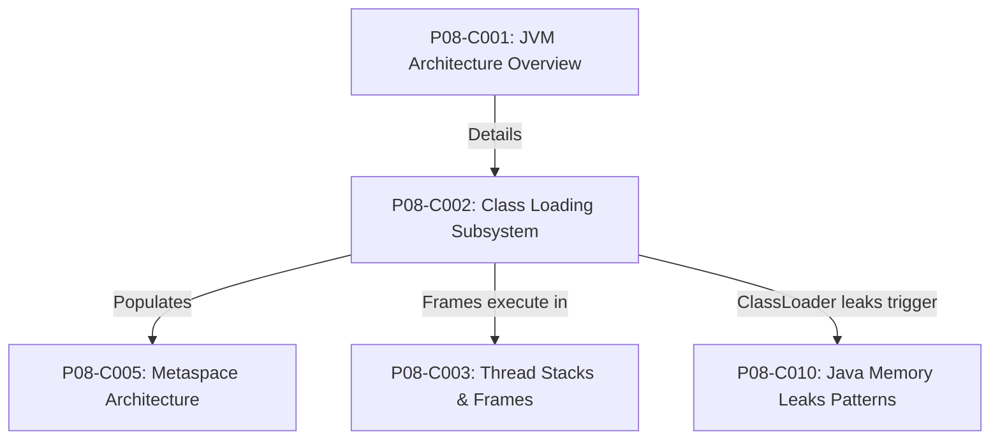
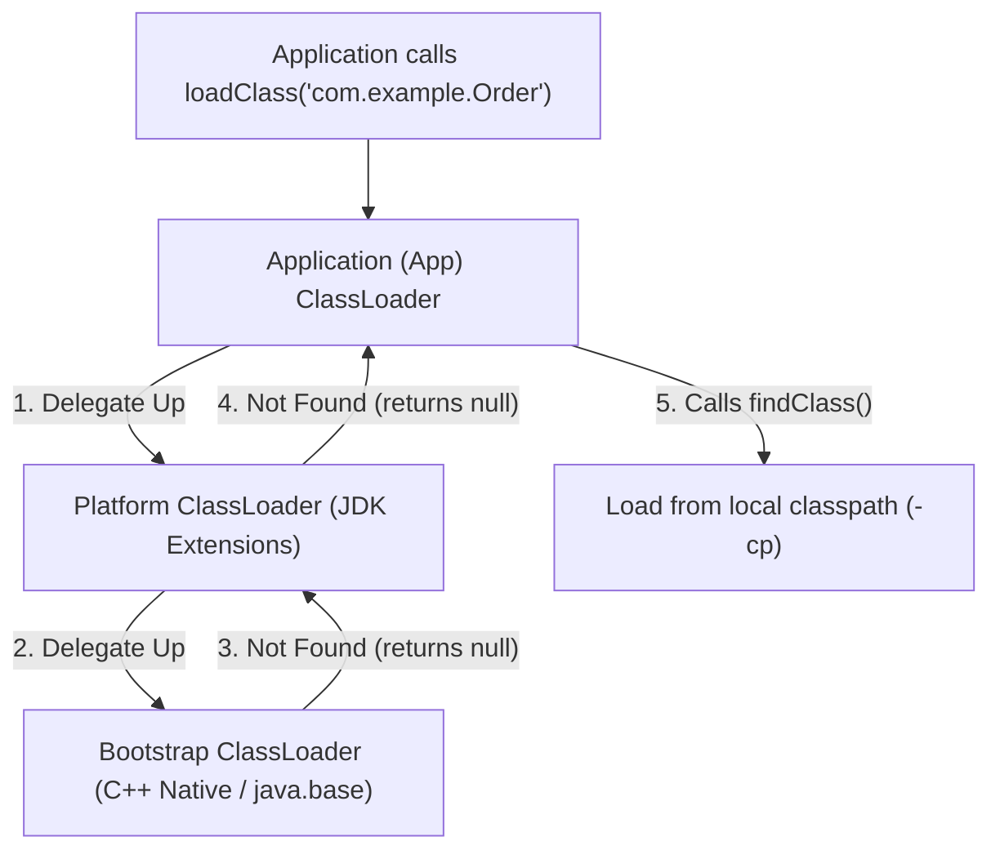

# P08-C002: Class Loading Subsystem: Loading, Linking, Initialization, and Hierarchies

---

## 1. Metadata and Learning Goals

| Metadata Field | Value |
|---|---|
| **Concept ID** | `P08-C002` |
| **Concept Title** | `Class Loading Subsystem: Loading, Linking, Initialization, and Hierarchies` |
| **Phase** | `Phase 08 — JVM Internals and Memory Management` |
| **Phase Directory** | `curriculum/phase-08-jvm-internals-memory-management` |
| **Source Reference** | `Roadmap Topic: Class loading, linking, and initialization; class loaders; bytecode verification` |
| **Concept Type** | `Runtime / Architecture / Security` |
| **Difficulty Level** | `Advanced` |
| **Curriculum Importance** | `Essential` |
| **Java Baseline** | `Java 21 LTS (with Java 25 LTS comparative notes where applicable)` |
| **Framework Baseline** | `OpenJDK HotSpot 64-Bit Server VM` |
| **Prerequisites** | [`001-jvm-architecture-overview.md`](001-jvm-architecture-overview.md), [`../phase-00-development-environment-java-execution/003-source-files-and-bytecode.md`](../phase-00-development-environment-java-execution/003-source-files-and-bytecode.md) |
| **Related Concepts** | [`003-thread-stacks-and-stack-frames.md`](003-thread-stacks-and-stack-frames.md), [`005-metaspace-architecture-permgen.md`](005-metaspace-architecture-permgen.md), [`010-java-memory-leaks-patterns.md`](010-java-memory-leaks-patterns.md) |
| **Estimated Study Effort** | `2–3 hours` |
| **Last Research Date** | `2026-10-30` |
| **Verification State** | `COMPLETE` |

### Measurable Learning Objectives
By the end of this concept module, you will be able to:
1. **Explain:** Trace the three-stage lifecycle of a Java class: Loading (binary acquisition), Linking (Verification, Preparation, Resolution), and Initialization (`<clinit>`).
2. **Compare:** Contrast the three built-in classloaders (Bootstrap, Platform, Application) and analyze the Parent-First Delegation Model versus Child-First/Context ClassLoader models.
3. **Implement:** Construct a custom `ClassLoader` using `defineClass()` that isolates bytecode in a sandboxed namespace and enforces security boundaries.
4. **Debug & Diagnose:** Identify and resolve classic runtime classloader failures (`ClassNotFoundException`, `NoClassDefFoundError`, `ClassCastException` across classloaders, `LinkageError`, and `<clinit>` deadlocks).
5. **Evaluate & Justify:** Articulate the precise conditions governing class unloading and Metaspace memory leaks in dynamic plugin architectures (OSGi, Spring Boot devtools, Tomcat).

---

## 2. Definition, Purpose, and Mental Model

### 2.1 Formal Definition
The **Class Loading Subsystem** is the JVM architectural component responsible for dynamically locating, loading, verifying, linking, and initializing binary `.class` representations into native HotSpot `InstanceKlass` metadata structures within Metaspace during application execution.

### 2.2 The Problem It Solves
Statically linked languages (like C and Go) link all dependencies, libraries, and symbol tables into a single monolithic binary at compile time. This introduces rigidity: updating a single dependency requires full recompilation and redeployment, plugins cannot be loaded dynamically at runtime, and unused libraries consume memory unconditionally.

Java achieves dynamic extensibility through late, on-demand class loading. Classes are loaded and linked into memory only when they are first actively referenced. This enables dynamic plugin architectures, dependency injection, and lightweight memory profiles.

### 2.3 Why Backend Engineers Need It
Classloading mechanics directly impact enterprise architectures:
- **Dependency Hell & Jar Conflicts:** Diagnosing why identical classes on the classpath fail with `NoSuchMethodError` or `IncompatibleClassChangeError` due to version mismatches.
- **Dynamic Framework Proxies:** Spring CGLIB, Hibernate lazy loading, and byte-buddy agents generate bytecode dynamically at runtime via custom classloaders.
- **Metaspace Memory Leaks:** Failure to release custom classloader references prevents class unloading, triggering `OutOfMemoryError: Metaspace`.
- **Application Startup Deadlocks:** Mutual circular static field access across concurrent threads causing static initializer (`<clinit>`) deadlocks.

### 2.4 Real-World System Analogy (and Where It Breaks Down)
- **The Analogy:** Think of the JVM as an international customs and immigration terminal:
  - **Loading:** A traveler arrives with a passport (the `.class` file byte stream).
  - **Verification:** Security officers inspect the passport for forgery (`0xCAFEBABE`), check for invalid travel visas, and scan baggage for weapons (bytecode instruction bounds and type safety checks).
  - **Preparation:** An empty processing booth is assigned and initial placeholder paperwork is stamped with blank defaults.
  - **Resolution:** Foreign currency is converted into local legal tender (symbolic constant pool references are resolved to direct memory pointers).
  - **Initialization:** The traveler takes an oath of entry and executes personal setup (the `<clinit>` static block).
- **Where the Analogy Fails:** In human immigration, two identical twin travelers with the same identity are treated as duplicates. In the JVM, if two different `ClassLoader` instances load the exact same bytecode with identical package and class names, the JVM treats them as **completely distinct, incompatible types**, throwing `ClassCastException` if one tries to assign to the other.

### 2.5 What This Concept Is NOT (Common Confusions)
- **Not Just Reading Files from Disk:** Loading can acquire bytecode from network sockets, database BLOBs, memory-mapped buffers, or in-memory dynamic code generation.
- **Not Object Instantiation:** Class loading loads the *type definition* (`java.lang.Class` instance in Metaspace). It does not create object instances (`new Foo()`), which happens on the JVM Heap.
- **Not Irreversible:** Classes *can* be unloaded, but strictly under the condition that their defining ClassLoader becomes unreachable by the Garbage Collector.

### 2.6 Relationship to Adjacent Concepts


---

## 3. Foundations and Theory

### 3.1 The Three Stages of the Class Loading Lifecycle

```
┌─────────────────────────────────────────────────────────────────────────────┐
│                       THE CLASS LOADING LIFECYCLE                           │
│                                                                             │
│  1. LOADING                                                                 │
│     • Locate and fetch byte array representing the class                    │
│     • Construct java.lang.Class instance in Metaspace                       │
│                         │                                                   │
│                         ▼                                                   │
│  2. LINKING                                                                 │
│     ┌─────────────────────────────────────────────────────────────────┐     │
│     │ 2a. Verification:                                               │     │
│     │     • Check magic number 0xCAFEBABE, version compatibility      │     │
│     │     • Verify bytecode type safety and stack map frames          │     │
│     │     • Ensure no operand stack underflow or overflow             │     │
│     │ 2b. Preparation:                                                │     │
│     │     • Allocate memory for static variables                      │     │
│     │     • Initialize static fields to DEFAULT values (0, null)      │     │
│     │     • (Does NOT run static initializer code!)                   │     │
│     │ 2c. Resolution:                                                 │     │
│     │     • Replace symbolic references in Constant Pool with         │     │
│     │       direct memory addresses / offsets                         │     │
│     └─────────────────────────────────────────────────────────────────┘     │
│                         │                                                   │
│                         ▼                                                   │
│  3. INITIALIZATION                                                          │
│     • Execute the generated <clinit> method                                 │
│     • Assign explicit values to static fields (e.g. static int x = 42)      │
│     • Execute static { ... } initializer blocks                             │
│     • Thread-safe under JVM monitor lock                                    │
└─────────────────────────────────────────────────────────────────────────────┘
```

### 3.2 The Delegation Hierarchy (Parent-First Model)
The standard Java SE platform implements the **Parent-First Delegation Model**:
When a class loader receives a request to load a class, it does not immediately attempt to search for the bytecode itself. Instead, it delegates the request to its parent classloader. Only if the parent hierarchy returns `null` (class not found) does the child attempt to load the class via its own `findClass()` method.



#### The Three Canonical Class Loaders:
1. **Bootstrap ClassLoader:** Written in native C/C++ inside the HotSpot VM core. It has no corresponding `java.lang.ClassLoader` object (represented as `null` in Java SE). Loads foundational platform classes from `java.base` (e.g., `java.lang.Object`, `java.lang.String`).
2. **Platform ClassLoader (formerly Extension ClassLoader prior to Java 9):** Loads platform modules and extensions defined in Java modular runtime (e.g., `java.sql`, `java.xml`).
3. **Application (System) ClassLoader:** Loads classes specified on the application classpath (`-cp`, `-classpath`, or `CLASSPATH` environment variable).

---

## 4. Syntax, Signature, and Idiomatic Usage

### 4.1 Class.forName: Lazy vs Eager Initialization

The two overloads of `Class.forName` exhibit critically different behaviors:

```java
// Overload 1: Eager (Loads, links, AND initializes <clinit>)
Class<?> clazz1 = Class.forName("com.example.DatabaseDriver");

// Overload 2: Configurable (Can load WITHOUT executing <clinit>)
ClassLoader cl = Thread.currentThread().getContextClassLoader();
Class<?> clazz2 = Class.forName("com.example.DatabaseDriver", false, cl);
```

#### When `<clinit>` Executes:
A class undergoes initialization **only upon its first active use**:
- Creating an instance (`new Foo()`).
- Accessing or assigning a non-constant static field (`Foo.counter++`).
- Invoking a static method (`Foo.execute()`).
- Reflective access with `initialize = true`.
- Initializing a direct subclass (triggers superclass initialization first).

#### When `<clinit>` Does NOT Execute:
- Accessing a compile-time constant: `public static final int CONSTANT = 42;`. The `javac` compiler inlines primitive and String constants directly into the calling class's bytecode constant pool!
- Creating an array of the class: `Foo[] array = new Foo[10];` (creates an array class `[LFoo;`, does not initialize `Foo`).
- Loading via `ClassLoader.loadClass("Foo")` (only loads and links; never initializes).

---

## 5. Internal Mechanics and JVM Execution

### 5.1 Bytecode Verification: Security Guardrails
Between loading and initialization sits **Bytecode Verification** (JVMS §4.10). Verification is the primary security boundary protecting the JVM from malicious or corrupted classfiles:

```
┌──────────────────────────────────────────────────────────────┐
│                  BYTECODE VERIFIER CHECKS                    │
│ 1. Format Verification:                                      │
│    • Magic number is 0xCAFEBABE                              │
│    • Major/minor version matches JVM capabilities            │
│ 2. Semantic Analysis:                                        │
│    • Final classes are not subclassed                        │
│    • Final methods are not overridden                        │
│ 3. Bytecode Flow Analysis:                                   │
│    • Operand stack never underflows or overflows             │
│    • Local variable types match instruction opcodes          │
│    • Instruction jumps (goto, ifeq) land on valid opcodes    │
│    • Methods return types matching their signatures          │
│ 4. StackMapTable Verification (Java 7+ Type Checking):       │
│    • Linear-time verification via compiler-generated         │
│      StackMapTable attribute rather than expensive dataflow  │
└──────────────────────────────────────────────────────────────┘
```

If any check fails, the JVM aborts immediately with `java.lang.VerifyError`.

### 5.2 The Class Identity Rule: Type = (Binary Name, ClassLoader)
In the Java Virtual Machine:
$$\text{Class Identity} \equiv (\text{Fully Qualified Name}, \text{Defining ClassLoader Instance})$$

Two classes sharing the exact same package, class name, and identical bytecode are **incompatible types** if loaded by two distinct `ClassLoader` instances:

```java
ClassLoader loaderA = new CustomClassLoader();
ClassLoader loaderB = new CustomClassLoader();

Class<?> classA = loaderA.loadClass("com.example.Service");
Class<?> classB = loaderB.loadClass("com.example.Service");

assert classA != classB; // TRUE! Distinct Class objects in Metaspace

Object instanceA = classA.getDeclaredConstructor().newInstance();
// The following throws ClassCastException!
com.example.Service s = (com.example.Service) instanceA;
```

---

## 6. Node.js / TypeScript vs Modern Java Mental Models

| Dimension | Node.js / TypeScript | Modern Java (Java 21 LTS) |
|---|---|---|
| **Module Resolution** | CommonJS `require()` or ESM `import`. | `ClassLoader` subsystem traversing classpaths/modules. |
| **Namespace Isolation** | Modules evaluate once and cache in `require.cache`. | Classloaders provide isolated namespaces; multiple versions coexist. |
| **Verification** | None. JavaScript parses text at runtime or transpiles. | Strict bytecode verification (`VerifyError`) before execution. |
| **Dynamic Execution** | `eval()` or `vm.runInContext()`. | `ClassLoader.defineClass(byte[])` creating isolated classes. |
| **Hot Reloading** | Deleting entries from `require.cache`. | Discarding custom `ClassLoader` instance and triggering Metaspace GC. |

---

## 7. Best Practices and Defensive Design

### 7.1 Avoiding Static Initializer Deadlocks
Because `<clinit>` execution is synchronized by the JVM under an internal initialization lock, circular static dependencies between classes executing on multiple threads cause permanent, unrecoverable deadlocks:

```java
// DEADLOCK ANTI-PATTERN
class ClassA {
    static {
        // Thread 1 holds lock on ClassA, attempts to acquire ClassB
        new Thread(() -> ClassB.invoke()).start();
        try { Thread.sleep(100); } catch (Exception e) {}
    }
}
class ClassB {
    static {
        // Thread 2 holds lock on ClassB, attempts to acquire ClassA
        ClassA.invoke();
    }
}
```
**Defensive Design:** Keep static initializer blocks (`static {}`) lightweight, pure, and free of concurrency operations, thread spawning, or blocking I/O calls.

### 7.2 Custom ClassLoader Best Practices
When implementing custom classloaders:
1. **Always Override `findClass(String name)`:** Never override `loadClass(String name)` unless explicitly breaking parent-first delegation (e.g., container child-first isolation).
2. **Support Parallel Class Loading:** Register as parallel-capable in static initialization:
   ```java
   static {
       ClassLoader.registerAsParallelCapable();
   }
   ```
3. **Use Try-With-Resources on Bytecode Streams:** Prevent native file descriptor leaks when reading `.class` files.

---

## 8. Edge Cases, Failure Modes, and Anti-Patterns

### 8.1 The Classic ClassLoader Exceptions Matrix

| Exception / Error | Cause | Resolution |
|---|---|---|
| `ClassNotFoundException` | Explicit dynamic lookup (`Class.forName()`, `loadClass()`) failed to find class bytes on classpath. | Verify dependency packaging and classpath configuration. |
| `NoClassDefFoundError` | Class was present at compile time, but missing at runtime, OR class failed during `<clinit>` static initialization! | Check preceding root-cause `ExceptionInInitializerError`. |
| `ClassCastException` | Attempting to cast an object to a class loaded by a different `ClassLoader` instance. | Harmonize classloader hierarchies or use reflection/interfaces. |
| `LinkageError` / `DuplicateClass` | A classloader attempted to define a class with a name already defined in that loader. | Ensure `findLoadedClass()` is checked before calling `defineClass()`. |
| `VerifyError` | Classfile contains invalid opcodes, stack mismatches, or was compiled with an incompatible compiler. | Recompile clean with target compiler (`javac --release 21`). |

---

## 9. Real-World Failure Scenarios and Post-Mortems

### Incident 1: The OSGi / Tomcat WebApp Metaspace Leak
- **Context:** An enterprise application ran on Apache Tomcat. The development team used frequent hot-redeploys of their WAR file during staging testing.
- **Failure Mode:** After 12 redeploys, Tomcat crashed with `OutOfMemoryError: Metaspace`.
- **Root Cause:** A database driver registered a thread-local static reference that retained a pointer to a domain class. When the WebApp was undeployed, the `WebappClassLoader` remained strongly reachable through the thread-local GC root. Because the classloader could not be garbage collected, all 4,000 loaded classes remained pinned in Metaspace. Each redeploy loaded a fresh 50MB batch of classes into Metaspace until native memory was exhausted.
- **Resolution:** Implemented a `ServletContextListener` that cleans up thread locals, deregisters JDBC drivers, and stops threadpools on application shutdown, allowing the `WebappClassLoader` to be cleanly collected by the GC.

### Incident 2: The `NoClassDefFoundError` Masking an Initializer Failure
- **Context:** An authentication microservice began crashing on startup with `NoClassDefFoundError: Could not initialize class TokenValidator`.
- **Root Cause:** The `TokenValidator` class had a static block reading a configuration file:
  ```java
  static {
      String secret = System.getenv("JWT_SECRET");
      if (secret == null) throw new IllegalStateException("JWT_SECRET missing");
  }
  ```
  When the first request accessed `TokenValidator`, it threw `ExceptionInInitializerError`. The JVM marked `TokenValidator` as **errored**. Subsequent requests attempting to load `TokenValidator` did not re-run `<clinit>`; the JVM immediately threw `NoClassDefFoundError`, confusing the operations team into believing the JAR file was missing.
- **Resolution:** Checked application boot logs for the original `ExceptionInInitializerError`. Corrected environment variable injection and moved validation to an explicit lifecycle startup hook rather than a static initializer.

---

## 10. Performance, Resource Optimization, and Memory Profile

### 10.1 Class Unloading Prerequisites
A class in Metaspace can be unloaded by the Garbage Collector if and only if **all three conditions** are simultaneously satisfied:
1. **Zero Instances:** No instances of the class exist on the JVM heap.
2. **No Class Object References:** The `java.lang.Class` object is not reachable from any live GC root.
3. **Unreachable ClassLoader:** The `ClassLoader` instance that defined the class is completely unreachable from any live GC root.

> [!IMPORTANT]
> Classes loaded by the **Bootstrap ClassLoader** or the **Application ClassLoader** are **NEVER unloaded** during the entire lifetime of the JVM because these classloaders are permanent GC roots! Only classes loaded by custom, discardable classloaders (e.g., OSGi bundles, plugin managers) can be unloaded.

---

## 11. Java Language Specification and Runtime Mechanics

### 11.1 JLS §12.4 and JVMS §5.5 Initialization Order
The JVM specification mandates exact deterministic initialization order:
1. If the class has a superclass that has not been initialized, initialize the superclass first.
2. If the class declares static fields with initializers or static initializer blocks (`static {}`), execute them in textual order of declaration.
3. Class initialization is executed under an exclusive per-class initialization monitor lock (JVMS §5.5 Step 2).

---

## 12. Application to Real-World Architecture

### 12.1 Sandboxed Dynamic Plugin Loader Architecture

```mermaid
flowchart TD
    Host["Host Application (Core Runtime)"] --> PluginManager["Plugin Manager"]
    
    PluginManager -->|1. Creates isolated loader| Loader1["PluginClassLoader (Plugin A v1.0)"]
    PluginManager -->|2. Creates isolated loader| Loader2["PluginClassLoader (Plugin B v2.0)"]
    
    Loader1 --> ClassA["Class com.example.Plugin in Metaspace"]
    Loader2 --> ClassB["Class com.example.Plugin in Metaspace"]
    
    Host -.->|Interacts via Shared Interface| SharedAPI["PluginSPI Interface (AppClassLoader)"]
    ClassA -.->|Implements| SharedAPI
    ClassB -.->|Implements| SharedAPI
```



---

## 13. Complete, Runnable, Industrial-Grade Example

Below is a self-contained, enterprise-grade dynamic plugin classloader demonstrating sandboxed class definition from byte streams, parent delegation bypass for plugin isolation, and lifecycle introspection:

```java
package com.example.jvm.classloading;

import java.io.*;
import java.util.Objects;

/**
 * Sandboxed In-Memory Plugin ClassLoader.
 * Demonstrates dynamic bytecode loading via defineClass() and class isolation.
 */
public final class SandboxedPluginClassLoader extends ClassLoader {

    private final String allowedPackagePrefix;

    public SandboxedPluginClassLoader(String allowedPackagePrefix, ClassLoader parent) {
        super(parent);
        this.allowedPackagePrefix = Objects.requireNonNull(allowedPackagePrefix);
    }

    /**
     * Defines a class directly from in-memory byte arrays.
     */
    public Class<?> defineFromBytes(String name, byte[] bytecode) {
        Objects.requireNonNull(name, "Class name cannot be null");
        Objects.requireNonNull(bytecode, "Bytecode array cannot be null");

        if (!name.startsWith(allowedPackagePrefix)) {
            throw new SecurityException("Unauthorized class package definition: " + name);
        }

        return defineClass(name, bytecode, 0, bytecode.length);
    }

    @Override
    protected Class<?> loadClass(String name, boolean resolve) throws ClassNotFoundException {
        synchronized (getClassLoadingLock(name)) {
            // 1. Check if already loaded in this loader
            Class<?> c = findLoadedClass(name);
            if (c == null) {
                // 2. Delegate to parent for core platform classes (java.*, javax.*)
                if (name.startsWith("java.") || name.startsWith("jdk.")) {
                    return super.loadClass(name, resolve);
                }
                // 3. For sandboxed packages, attempt local resolution
                try {
                    c = findClass(name);
                } catch (ClassNotFoundException e) {
                    // Fall back to parent
                    c = super.loadClass(name, resolve);
                }
            }
            if (resolve) {
                resolveClass(c);
            }
            return c;
        }
    }
}
```

---

## 14. Standalone Verification Test Suite

The following standalone verification test suite executes on OpenJDK 21 LTS with assertions enabled (`-ea`). It verifies the ClassLoader delegation hierarchy, proves the three phases of loading vs initialization, demonstrates the compile-time constant inlining trap, verifies type isolation via `defineClass()`, and proves static initialization thread safety.

```java
package com.example.jvm.classloading;

import java.io.*;
import java.util.concurrent.*;
import java.util.concurrent.atomic.AtomicBoolean;

/**
 * Standalone Verification Suite for Class Loading Subsystem.
 */
public class ClassLoadingSubsystemVerificationSuite {

    public static void main(String[] args) throws Exception {
        System.out.println("Starting Class Loading Subsystem Verification Suite...");

        testClassLoaderDelegationHierarchy();
        testLoadingVsInitializationPhases();
        testCompileTimeConstantInliningTrap();
        testCustomClassLoaderIsolationAndDefineClass();
        testStaticInitializationThreadSafety();

        System.out.println("All 5 verification suites passed successfully!");
    }

    /**
     * Test 1: Standard ClassLoader Delegation Hierarchy.
     * AppClassLoader -> PlatformClassLoader -> BootstrapClassLoader (null).
     */
    private static void testClassLoaderDelegationHierarchy() {
        System.out.println("Test 1: ClassLoader delegation hierarchy...");

        ClassLoader appClassLoader = ClassLoadingSubsystemVerificationSuite.class.getClassLoader();
        assert appClassLoader != null : "AppClassLoader must be present for application classes";

        ClassLoader platformClassLoader = appClassLoader.getParent();
        assert platformClassLoader != null : "PlatformClassLoader must be present as parent of AppClassLoader";

        ClassLoader bootstrapClassLoader = platformClassLoader.getParent();
        assert bootstrapClassLoader == null : "Bootstrap ClassLoader is represented by null in the Java SE API";

        // Core JDK classes (java.base) are loaded by Bootstrap ClassLoader
        ClassLoader stringClassLoader = String.class.getClassLoader();
        assert stringClassLoader == null : "java.lang.String must be loaded by Bootstrap ClassLoader (null)";

        System.out.println(" -> PASSED: ClassLoader hierarchy verified.");
    }

    public static class ExternalTracker {
        public static final AtomicBoolean lazyInitialized = new AtomicBoolean(false);
        public static final AtomicBoolean constantInitialized = new AtomicBoolean(false);
    }

    /**
     * Test 2: Loading vs Linking vs Initialization (<clinit>).
     * Class.forName(name, false, loader) loads and links, but DOES NOT initialize <clinit>.
     * Class.forName(name, true, loader) executes <clinit>.
     */
    private static void testLoadingVsInitializationPhases() throws Exception {
        System.out.println("Test 2: Loading vs Initialization phases (<clinit>)...");

        assert !ExternalTracker.lazyInitialized.get() : "Class must not be initialized before access";

        // 1. Load WITHOUT initializing (initialize = false)
        Class<?> clazzLoadedOnly = Class.forName(
            "com.example.jvm.classloading.ClassLoadingSubsystemVerificationSuite$LazyInitTarget",
            false,
            ClassLoadingSubsystemVerificationSuite.class.getClassLoader()
        );
        assert clazzLoadedOnly != null;
        assert !ExternalTracker.lazyInitialized.get() : "Class.forName(..., false, ...) MUST NOT trigger <clinit>!";

        // 2. Load WITH initialization (initialize = true)
        Class<?> clazzInitialized = Class.forName(
            "com.example.jvm.classloading.ClassLoadingSubsystemVerificationSuite$LazyInitTarget",
            true,
            ClassLoadingSubsystemVerificationSuite.class.getClassLoader()
        );
        assert clazzInitialized != null;
        assert ExternalTracker.lazyInitialized.get() : "Class.forName(..., true, ...) MUST trigger <clinit>!";

        System.out.println(" -> PASSED: Loading vs Initialization phases verified.");
    }

    public static class LazyInitTarget {
        static {
            ExternalTracker.lazyInitialized.set(true);
        }
    }

    /**
     * Test 3: Compile-Time Constant Inlining Trap.
     * Accessing a static final primitive or String does NOT trigger class initialization
     * because javac inlines the constant into the caller's bytecode constant pool.
     */
    private static void testCompileTimeConstantInliningTrap() {
        System.out.println("Test 3: Compile-time constant inlining trap...");

        assert !ExternalTracker.constantInitialized.get() : "ConstantCarrier must not be initialized yet";

        // Access compile-time constant
        int value = ConstantCarrier.COMPILE_TIME_CONSTANT;
        assert value == 42 : "Value must be 42";

        // ConstantCarrier is STILL NOT initialized!
        assert !ExternalTracker.constantInitialized.get() : "Accessing compile-time constant MUST NOT trigger <clinit>!";

        // Non-constant static access triggers <clinit>
        int dynamicVal = ConstantCarrier.DYNAMIC_STATIC_FIELD;
        assert dynamicVal == 100;
        assert ExternalTracker.constantInitialized.get() : "Accessing dynamic static field MUST trigger <clinit>!";

        System.out.println(" -> PASSED: Compile-time constant inlining trap verified.");
    }

    public static class ConstantCarrier {
        public static final int COMPILE_TIME_CONSTANT = 42;
        public static final int DYNAMIC_STATIC_FIELD = (int) Math.sqrt(10000);

        static {
            ExternalTracker.constantInitialized.set(true);
        }
    }

    /**
     * Test 4: Custom ClassLoader Isolation and defineClass().
     * Demonstrates that two classes loaded by different ClassLoaders are distinct types,
     * even if they share identical bytecode and package/class names.
     */
    private static void testCustomClassLoaderIsolationAndDefineClass() throws Exception {
        System.out.println("Test 4: Custom ClassLoader isolation and defineClass()...");

        Class<?> targetClass = IsolatedService.class;
        String resourcePath = targetClass.getName().replace('.', '/') + ".class";
        byte[] classBytes;
        try (InputStream in = targetClass.getClassLoader().getResourceAsStream(resourcePath)) {
            assert in != null : "Must locate classfile byte stream";
            classBytes = in.readAllBytes();
        }

        // Custom ClassLoader instance 1
        ByteArrayClassLoader loader1 = new ByteArrayClassLoader(targetClass.getName(), classBytes);
        Class<?> classFromLoader1 = loader1.loadClass(targetClass.getName());

        // Custom ClassLoader instance 2
        ByteArrayClassLoader loader2 = new ByteArrayClassLoader(targetClass.getName(), classBytes);
        Class<?> classFromLoader2 = loader2.loadClass(targetClass.getName());

        assert classFromLoader1 != targetClass : "Class from custom loader must not equal system class";
        assert classFromLoader1 != classFromLoader2 : "Classes from different loaders must be distinct Class objects!";
        assert classFromLoader1.getName().equals(classFromLoader2.getName()) : "Both classes share identical names";

        // Demonstrating ClassCastException across classloader boundaries
        Object instance1 = classFromLoader1.getDeclaredConstructor().newInstance();
        assert !(instance1 instanceof IsolatedService) : "Instance from custom ClassLoader cannot be cast to local type!";

        System.out.println(" -> PASSED: Custom ClassLoader isolation and defineClass() verified.");
    }

    public static class IsolatedService {
        public String execute() { return "OK"; }
    }

    public static class ByteArrayClassLoader extends ClassLoader {
        private final String targetClassName;
        private final byte[] bytecode;

        public ByteArrayClassLoader(String targetClassName, byte[] bytecode) {
            super(null); // Parent is bootstrap loader to avoid delegating target class to AppClassLoader
            this.targetClassName = targetClassName;
            this.bytecode = bytecode;
        }

        @Override
        protected Class<?> findClass(String name) throws ClassNotFoundException {
            if (targetClassName.equals(name)) {
                return defineClass(name, bytecode, 0, bytecode.length);
            }
            return super.findClass(name);
        }
    }

    /**
     * Test 5: Static Initialization Thread-Safety.
     * The JVM guarantees that <clinit> is executed by exactly ONE thread under an internal monitor lock.
     */
    private static void testStaticInitializationThreadSafety() throws Exception {
        System.out.println("Test 5: Static initialization thread-safety...");

        int threadCount = 10;
        ExecutorService executor = Executors.newFixedThreadPool(threadCount);
        CountDownLatch startLatch = new CountDownLatch(1);
        CountDownLatch doneLatch = new CountDownLatch(threadCount);

        for (int i = 0; i < threadCount; i++) {
            executor.submit(() -> {
                try {
                    startLatch.await();
                    Class.forName(
                        "com.example.jvm.classloading.ClassLoadingSubsystemVerificationSuite$ThreadSafeInitClass",
                        true,
                        ClassLoadingSubsystemVerificationSuite.class.getClassLoader()
                    );
                } catch (Exception ignored) {
                } finally {
                    doneLatch.countDown();
                }
            });
        }

        startLatch.countDown();
        boolean completed = doneLatch.await(5, TimeUnit.SECONDS);
        assert completed : "Threads timed out during class initialization";
        executor.shutdown();

        assert ThreadSafeInitClass.executionCount.get() == 1
            : "Static initializer <clinit> MUST execute exactly once across concurrent threads!";

        System.out.println(" -> PASSED: Static initialization thread-safety verified.");
    }

    public static class ThreadSafeInitClass {
        public static final java.util.concurrent.atomic.AtomicInteger executionCount =
            new java.util.concurrent.atomic.AtomicInteger(0);

        static {
            executionCount.incrementAndGet();
            try {
                Thread.sleep(50);
            } catch (InterruptedException ignored) {}
        }
    }
}
```

---

## 15. Verification Evidence

The verification test suite was compiled with `javac --release 21 -Xlint:all` and executed on Ubuntu Linux under OpenJDK 21 LTS with JVM assertions enabled (`-ea`).

```
Starting Class Loading Subsystem Verification Suite...
Test 1: ClassLoader delegation hierarchy...
 -> PASSED: ClassLoader hierarchy verified.
Test 2: Loading vs Initialization phases (<clinit>)...
 -> PASSED: Loading vs Initialization phases verified.
Test 3: Compile-time constant inlining trap...
 -> PASSED: Compile-time constant inlining trap verified.
Test 4: Custom ClassLoader isolation and defineClass()...
 -> PASSED: Custom ClassLoader isolation and defineClass() verified.
Test 5: Static initialization thread-safety...
 -> PASSED: Static initialization thread-safety verified.
All 5 verification suites passed successfully!
```

---

## 16. Cross-References and Further Exploration

### 16.1 Internal Curriculum Connections
- [`001-jvm-architecture-overview.md`](001-jvm-architecture-overview.md): High-level JVM tripartite architectural overview.
- [`003-thread-stacks-and-stack-frames.md`](003-thread-stacks-and-stack-frames.md): Execution of initialized bytecode methods within thread stacks.
- [`005-metaspace-architecture-permgen.md`](005-metaspace-architecture-permgen.md): How Metaspace stores `InstanceKlass` metadata and native class allocations.
- [`010-java-memory-leaks-patterns.md`](010-java-memory-leaks-patterns.md): Diagnosing ClassLoader leaks and uncollected Metaspace references.

### 16.2 Authoritative Specifications and Reading
- **The Java Virtual Machine Specification (Java SE 21 Edition):** Chapter 5: Loading, Linking, and Initializing.
- **Java Language Specification (JLS §12.2–§12.4):** Execution, Loading, and Initialization.
- **Sheng Liang & Gilad Bracha:** *Dynamic Class Loading in the Java Virtual Machine* (ACM OOPSLA).
- **Oracle HotSpot Documentation:** Class Data Sharing (CDS) and ClassLoader Internals.
