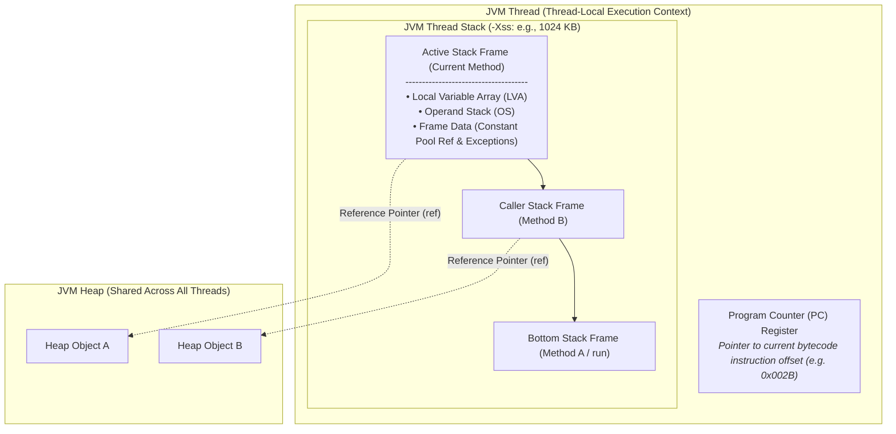

# P08-C003: Runtime Data Areas: Thread Stacks, Frame Structure, and Program Counter

---

## 1. Metadata and Learning Goals

| Metadata Field | Value |
|---|---|
| **Concept ID** | `P08-C003` |
| **Concept Title** | Runtime Data Areas: Thread Stacks, Frame Structure, and Program Counter |
| **Phase** | Phase 08 — JVM Internals and Memory Management |
| **Phase Directory** | `curriculum/phase-08-jvm-internals-memory-management` |
| **Source Reference** | Roadmap lines 337 ("Heap and thread stacks"), 339 ("Program counter and native method stacks"), 349 ("StackOverflowError"), 353 ("Read Java stack traces") |
| **Concept Type** | Runtime / Architecture |
| **Difficulty Level** | Intermediate |
| **Curriculum Importance** | Essential |
| **Java Baseline** | Java 21 LTS (with Java 25 LTS comparative notes where applicable) |
| **Framework Baseline** | Spring Boot 3.3.x / Spring Framework 6.1.x |
| **Prerequisites** | [`P08-C001`](001-jvm-architecture-overview.md) (JVM Architecture Overview), [`P08-C002`](002-class-loading-subsystem.md) (Class Loading Subsystem) |
| **Related Concepts** | [`P08-C004`](004-heap-memory-layout-generations.md) (JVM Heap Memory Layout), [`P08-C011`](011-oom-and-stack-overflow-diagnosis.md) (Diagnosing OOM and StackOverflow) |
| **Estimated Study Effort** | 3–4 hours |
| **Last Research Date** | 2026-10-30 |
| **Verification State** | COMPLETE |

### Measurable Learning Objectives
By the end of this concept module, you will be able to:
1. **Explain:** Deconstruct the internal anatomy of a JVM Stack Frame (Local Variable Array, Operand Stack, Frame Data) and describe the lifecycle of Thread Stacks and Program Counter (PC) Registers in compliance with JVMS §2.5 and §2.6.
2. **Compare:** Differentiate between JVM Thread Stacks and JVM Heap memory, Operating System native stacks vs Java thread stacks, and traditional Platform Thread stacks (`-Xss`) vs Project Loom Virtual Thread continuations.
3. **Implement:** Utilize the modern `StackWalker` API (JEP 259) to perform low-overhead, lazy stack inspections and caller resolution, and design recursive algorithms using the Trampoline pattern to execute in constant $O(1)$ stack space.
4. **Debug & Diagnose:** Analyze Java stack traces to locate root causes, distinguish between `StackOverflowError` (stack depth exhaustion) and `OutOfMemoryError: unable to create new native thread` (OS memory quota exhaustion), and explain HotSpot yellow/red guard pages.
5. **Evaluate & Justify:** Calculate memory requirements for containerized microservices under varying thread counts and `-Xss` settings, and assess the performance penalty of stack-walking diagnostic logging in high-throughput backend services.

---

## 2. Definition, Purpose, and Mental Model

### 2.1 Formal Definition
In the Java Virtual Machine Specification (JVMS §2.5.2), a **JVM Thread Stack** (or Java Virtual Machine Stack) is a thread-private runtime data area created simultaneously when a thread is spawned. It stores **Stack Frames** (`Frame`, JVMS §2.6), which are stateful data structures pushed onto the stack whenever a method is invoked and popped when the method completes (either normally via return or abruptly via an uncaught exception). 

Simultaneously, each running thread possesses its own private **Program Counter (PC) Register** (JVMS §2.5.1). If the method currently being executed by the thread is not native, the PC register contains the address or bytecode offset of the JVM instruction currently being executed; if the method is native, the value of the PC register is undefined.



### 2.2 The Problem It Solves
Computers require a deterministic mechanism to track method calls, nested lexical scopes, parameter passing, local variable lifetimes, and return addresses. If local variables and call records were allocated on the garbage-collected Heap:
1. **Severe GC Pressure:** Every single method invocation would allocate memory chunks, causing billions of object allocations per second and triggering non-stop GC pauses.
2. **Loss of LIFO Locality:** Method execution is strictly Last-In, First-Out (LIFO). A simple stack pointer increment/decrement provides $O(1)$ allocation and deallocation with CPU cache locality, eliminating allocation fragmentation.
3. **Thread Contention:** Heap allocations require synchronization (or thread-local allocation buffers). Stack memory is inherently thread-local, requiring zero synchronization or locks during method entry and exit.

### 2.3 Why Backend Engineers Need It
Every web request in a traditional servlet container (e.g., Tomcat, Jetty) executes on a dedicated platform thread. Understanding stack architecture directly impacts:
- **Container Sizing and Memory Limits:** If your JVM runs with default `-Xss1m` (1 MB per thread) and your thread pool handles 1,000 concurrent worker threads, thread stacks alone reserve 1 GB of native virtual memory outside the JVM heap. Sizing Docker container memory without accounting for thread stacks leads to container eviction by the Linux Out-Of-Memory (OOM) Killer.
- **Production Incident Triage:** Diagnosing `StackOverflowError` from cyclical graph serialization, Hibernate bidirectional entity relations, or unbounded recursive algorithms.
- **Microservice Latency Profiles:** Recognizing that logging statements capturing file names and line numbers (`%F`, `%L`, `%C`) force full JVM stack walking on every log event, causing massive throughput degradation.
- **Modern Concurrency Architecture:** Sizing and migrating applications to Java 21+ Project Loom Virtual Threads, which decouple call stacks from 1MB OS threads and move them into resizable heap continuations.

### 2.4 Real-World System Analogy (and Where It Breaks Down)
- **The Analogy:** Consider an executive desk with an in-and-out paper tray. When you start an assignment, you place a dedicated project folder (Stack Frame) on top of the tray. Inside the folder, you keep a notepad for scratch calculations (Operand Stack) and labeled slots for your working documents (Local Variable Array). If you delegate a subtask to a colleague, you set a new folder on top of yours. When they hand back the result, you remove their folder, take the result sheet, put it on your scratch pad, and continue working. The project manager's bookmark pointing to the exact sentence currently being read in the active folder is the Program Counter (PC).
- **Where the Analogy Fails:** In real physical folders, data remains inside the folder when closed. In JVM stack frames, 64-bit primitives (`long` and `double`) occupy two consecutive slots in the local variable array, and variable slots are dynamically reused within inner lexical blocks `{ ... }`. Furthermore, JIT escape analysis can eliminate the frame's object references entirely, replacing them with scalar CPU registers.

### 2.5 What This Concept Is NOT (Common Confusions)
- **Not the JVM Heap:** The heap is shared across all threads and managed by the Garbage Collector. Thread stacks are thread-private, strictly LIFO, and frame deallocation occurs instantaneously when a method returns without involving the Garbage Collector.
- **Not the OS Native Stack (C-Stack):** In OpenJDK HotSpot, platform threads map 1:1 to OS kernel threads, but the JVM stack manages Java bytecode frame conventions (Local Variable Arrays and Operand Stacks). HotSpot maintains separate or integrated native stacks for C/C++ runtime execution and JNI calls.
- **Not Metaspace:** Metaspace stores class metadata, method bytecode, runtime constant pools, and method counters off-heap. The thread stack only holds the execution state and references to instances and constants.

### 2.6 Relationship to Adjacent Concepts
- **Preceding:** [`P08-C001`](001-jvm-architecture-overview.md) established the tripartite division of the JVM (Class Loader, Runtime Data Areas, Execution Engine). [`P08-C002`](002-class-loading-subsystem.md) established how classes are loaded and initialized.
- **Current:** `P08-C003` examines the per-thread runtime execution context: Thread Stacks, Stack Frames, and PC Registers.
- **Downstream:** [`P08-C004`](004-heap-memory-layout-generations.md) details the shared Heap, and [`P08-C011`](011-oom-and-stack-overflow-diagnosis.md) provides advanced diagnostic workflows for `StackOverflowError` and thread stack dumps.

---

## 3. Foundations and Theory

### 3.1 Stack-Based Abstract Machine Architecture
Computer architectures fall into two primary paradigms: **Register-based machines** (e.g., x86_64, ARM, LuaJIT, Android Dalvik/ART) and **Stack-based machines** (e.g., JVM, WebAssembly, Forth).

The JVM is formally specified as a **stack-based abstract machine**. Bytecode instructions do not address physical hardware registers (such as `%rax` or `R0`). Instead, they push operands onto and pop operands from an **Operand Stack**.

#### Why James Gosling and the JVM Designers Chose a Stack Architecture:
1. **Hardware Independence:** A register-based VM must either emulate a fixed number of virtual registers (which may map inefficiently to target CPUs with fewer physical registers) or rely on complex mapping. A stack machine makes zero assumptions about the host CPU's register architecture.
2. **Bytecode Compactness:** Stack opcodes are zero-address instructions. An opcode like `iadd` simply pops the top two integers from the operand stack, adds them, and pushes the result. It requires only a single byte (0x60), whereas a register instruction like `ADD R1, R2, R3` requires opcode and operand register descriptors (3 to 4 bytes).

### 3.2 Anatomy of a Stack Frame (JVMS §2.6)
A stack frame consists of three distinct regions:

```
+-------------------------------------------------------------+
|                     JVM STACK FRAME                         |
+-------------------------------------------------------------+
| 1. Local Variable Array (LVA)                               |
|    Slot 0: this (instance methods) or Parameter 1 (static)   |
|    Slot 1: Parameter 1 / Local Var                          |
|    Slot 2..3: 64-bit primitives (long/double consume 2 slots)|
|    Slot N: Lexical block reused slots                       |
+-------------------------------------------------------------+
| 2. Operand Stack (OS)                                       |
|    LIFO evaluation workspace for bytecode opcodes           |
|    Compile-time statically bounded depth: 'max_stack'       |
+-------------------------------------------------------------+
| 3. Frame Data                                               |
|    - Reference to Runtime Constant Pool (Dynamic Linking)   |
|    - Normal Method Completion Dispatch (Return address)     |
|    - Abrupt Exception Dispatch Table (Exception handlers)   |
+-------------------------------------------------------------+
```

#### 3.2.1 Local Variable Array (LVA, JVMS §2.6.1)
The Local Variable Array is organized as an array of 32-bit slots, indexed from 0 to `max_locals - 1`:
- **Instance Methods:** Slot 0 is automatically populated with the reference to `this` (`aload_0`). Subsequent slots receive method arguments in declaration order, followed by variables declared in method bodies.
- **Static Methods:** Slot 0 receives the first declared method parameter (since static methods have no `this` context).
- **Slot Width and Sizing:**
  - Types occupying a single slot: `boolean`, `byte`, `char`, `short`, `int`, `float`, and `reference` (object reference pointers).
  - Types occupying two consecutive slots: `long` and `double`. An operation on a `long` stored at slot $n$ consumes slots $n$ and $n+1$, addressed by index $n$.
- **Slot Reuse (Lexical Scoping):** The Java compiler (`javac`) calculates the exact number of slots required at compile time. Slots assigned to variables declared within nested blocks `{ ... }` are reclaimed and reused by subsequent variables whose lifespans do not overlap.

#### 3.2.2 Operand Stack (OS, JVMS §2.6.2)
The Operand Stack is a LIFO data structure used to evaluate expressions and supply arguments to subsequent instructions.
- The maximum depth of the operand stack (`max_stack`) is calculated deterministically at compile time and recorded in the class file's `Code` attribute.
- Example bytecode evaluation for `int z = x + y;`:
  ```bytecode
  iload_1    // Push integer from LVA slot 1 (x) onto Operand Stack (depth = 1)
  iload_2    // Push integer from LVA slot 2 (y) onto Operand Stack (depth = 2)
  iadd       // Pop two ints, add them, push int result onto Operand Stack (depth = 1)
  istore_3   // Pop result from Operand Stack, store into LVA slot 3 (z) (depth = 0)
  ```

#### 3.2.3 Frame Data (Dynamic Linking & Exception Dispatch, JVMS §2.6.3)
Frame Data maintains auxiliary runtime information:
1. **Dynamic Linking Reference:** Contains a pointer to the runtime constant pool of the method's defining class. When bytecode encounters a symbolic reference (e.g., `#12 = Methodref`), the frame data provides the constant pool link needed to resolve it into a direct memory pointer.
2. **Normal Method Completion:** Restores the caller's stack frame, adjusts the caller's PC register to the instruction immediately following the call opcode, and pushes the return value (if any) onto the caller's operand stack.
3. **Abrupt Method Completion (Exception Table):** References the method's compiled exception table. Each entry specifies:
   - `start_pc`: Beginning bytecode offset where handler is active.
   - `end_pc`: Ending bytecode offset (exclusive).
   - `handler_pc`: Offset of the `catch` block bytecode.
   - `catch_type`: Constant pool index of the caught exception class.

### 3.3 The Program Counter (PC) Register (JVMS §2.5.1)
Each JVM thread has its own dedicated PC register:
- In HotSpot, the PC register typically points directly to the memory address of the next bytecode instruction (in interpreted mode) or is mapped to the CPU's native instruction pointer register (e.g., `RIP` on x86_64) when executing JIT-compiled code.
- If a thread calls a native method via JNI (Java Native Interface), the JVM PC register value becomes **undefined** because execution is controlled by native C/C++ machine instructions outside bytecode control.

### 3.4 Mathematical Formulations and Stack Sizing

#### Total Stack Memory Consumption
The total native virtual memory consumed by thread stacks in a JVM process is:
$$M_{\text{stack\_total}} = N_{\text{threads}} \times \text{StackSize}(-Xss)$$

Where:
- $N_{\text{threads}}$ is the total number of live threads (JVM system threads + application worker threads).
- $-Xss$ is the configured stack size per thread (HotSpot 64-bit Linux default: $1024\text{ KB} = 1\text{ MB}$).

#### Theoretical Recursion Depth Before Stack Overflow
The maximum recursive call depth $D_{\text{max}}$ before triggering `StackOverflowError` is bounded by:
$$D_{\text{max}} \approx \frac{\text{StackSize} - S_{\text{reserved}}}{S_{\text{frame}}}$$

Where:
- $S_{\text{reserved}}$ is the HotSpot guard zone memory (Yellow + Red + Reserved pages, typically 20KB–40KB).
- $S_{\text{frame}}$ is the memory footprint of an individual method frame, which depends on `max_locals`, `max_stack`, and alignment.

---

## 4. Evolution, Modern Defaults, and Java 21+ Context

### 4.1 Historical Evolution: Green Threads to OS Threads to Project Loom
```
+-------------------------------------------------------------------------------+
| Java 1.0 (1996): Green Threads (M:1)                                          |
| - JVM managed user-level threads multiplexed onto a single OS process thread. |
| - Blocking I/O blocked the entire JVM. Abandoned due to multi-core CPUs.      |
+-------------------------------------------------------------------------------+
                                      |
                                      v
+-------------------------------------------------------------------------------+
| Java 1.2 to Java 20: Native Platform Threads (1:1)                            |
| - Each Java Thread maps 1:1 to an OS kernel thread (pthread on Linux).        |
| - Fixed stack size (-Xss1m default). Massive memory footprint under load.     |
+-------------------------------------------------------------------------------+
                                      |
                                      v
+-------------------------------------------------------------------------------+
| Java 21 LTS (2023): Project Loom Virtual Threads (M:N, JEP 444)               |
| - Millions of user-mode threads multiplexed onto a small carrier pool.        |
| - Stacks allocated on JVM Heap as resizable Continuation objects.             |
| - Starts at ~200-400 bytes, grows dynamically. Unmounts on blocking I/O.      |
+-------------------------------------------------------------------------------+
```

### 4.2 Platform Threads vs Project Loom Virtual Threads
In Java 21 LTS (JEP 444), the relationship between threads and stacks was revolutionized:

| Architectural Property | Platform Thread (`Thread.ofPlatform()`) | Virtual Thread (`Thread.ofVirtual()`) |
|---|---|---|
| **OS Mapping** | 1:1 with OS Kernel Thread (`pthread`) | M:N multiplexed onto Carrier Threads (`ForkJoinPool`) |
| **Stack Allocation** | Contiguous native virtual memory (OS allocated) | Heap-allocated `Continuation` chunks |
| **Initial Memory Footprint** | ~1 MB (defined by `-Xss`) | ~200–400 bytes (expands on demand) |
| **Blocking I/O Behavior** | OS thread blocks; stack remains pinned | Stack unmounted and frozen to Heap; carrier freed |
| **Creation Limit** | ~3,000–10,000 threads (OS memory limit) | Millions of threads concurrent |
| **Tuning Flag** | `-Xss<size>` | No static stack size flag; bounds by Heap (`-Xmx`) |

### 4.3 Modern Stack Inspection: The `StackWalker` API (JEP 259)
Prior to Java 9, inspectable stack traces required `new Throwable().getStackTrace()` or `Thread.currentThread().getStackTrace()`.
- **Legacy Flaw:** Calling `getStackTrace()` forces HotSpot to eagerly allocate an array of `StackTraceElement` objects for the entire thread stack depth, resolving class names and method strings synchronously.
- **Modern Solution (`StackWalker`):** Introduced in Java 9 (JEP 259) and standard in Java 21 LTS, `StackWalker` provides lazy, streamable evaluation. It walks frames incrementally using native cursors, allowing engineers to inspect the caller class or first 3 frames with negligible allocation overhead:

```java
// Idiomatic Java 21 StackWalker usage:
Class<?> caller = StackWalker.getInstance(StackWalker.Option.RETAIN_CLASS_REFERENCE)
                             .getCallerClass();
```

---

## 5. Deep Dive: Core Mechanics and Execution Model

### 5.1 Method Invocation Lifecycle Step-by-Step
Let us trace the complete bytecode execution lifecycle when method `caller()` invokes `callee(int a, long b)`:

```
Caller Frame (active)                     Callee Frame (allocated)
+-----------------------+                 +-------------------------------+
| Operand Stack:        |                 | Local Variable Array:         |
| [10]                  |  invokestatic   | Slot 0: 10                    |
| [999999L (slot 1)]    | --------------> | Slot 1: 999999L (high/low 1)  |
| [999999L (slot 2)]    |                 | Slot 2: 999999L (high/low 2)  |
+-----------------------+                 +-------------------------------+
| PC Register: 0x0014   |                 | PC Register: 0x0000           |
+-----------------------+                 +-------------------------------+
```

1. **Parameter Staging:** The caller pushes arguments onto its own Operand Stack.
2. **Frame Creation:** The JVM executes `invokestatic #5`. The execution engine creates a new Stack Frame whose LVA size (`locals`) and operand stack depth (`stack`) match the callee's compiled `Code` attribute.
3. **Parameter Transfer:** The JVM transfers the arguments from the top of the caller's operand stack into the callee's LVA (slots 0, 1, 2).
4. **Context Switch:** The current frame pointer shifts to the new callee frame. The PC register is set to bytecode offset 0 of the callee method.
5. **Execution:** The callee executes bytecode opcodes using its own LVA and Operand Stack.
6. **Return Completion:** The callee executes `ireturn`. The top value of the callee's operand stack is preserved, the callee's frame is popped from the thread stack, the caller's frame becomes active again, and the return value is pushed onto the caller's operand stack.

### 5.2 HotSpot Stack Guard Pages (Yellow, Red, and Reserved Zones)
To prevent thread stack overflow from silently corrupting neighboring native memory, OpenJDK HotSpot places memory protection guard pages (using Linux `mprotect(2)`) at the end of each thread stack:

```
High Memory Address (Stack Top)
+-------------------------------------------------------+
| Stack Space (Normal Frame Execution)                  |
| Frames grow downward toward lower addresses           |
|                                                       |
|                                                       |
|                       |                               |
|                       v                               |
+-------------------------------------------------------+
| Yellow Zone (Soft Guard Page - e.g., 8 KB)            |
| -> Write violation triggers SIGSEGV                   |
| -> HotSpot unprotects Yellow Page                     |
| -> Throws java.lang.StackOverflowError                |
| -> Space reserved allows catch/finally blocks to run  |
+-------------------------------------------------------+
| Red Zone (Hard Guard Page - e.g., 4 KB)               |
| -> Fatal stack exhaustion                             |
| -> HotSpot crashes or terminates JVM process safely   |
+-------------------------------------------------------+
Low Memory Address (Stack Bottom Limit)
```

1. **Yellow Zone (Soft Guard):** When a deeply recursive call touches the Yellow Zone, the OS raises a page fault (`SIGSEGV`). HotSpot catches this signal, unprotects the yellow page, and throws `java.lang.StackOverflowError`. The yellow page memory now provides the stack headroom needed for exception handlers and `finally` blocks to execute.
2. **Red Zone (Hard Guard):** If the exception handling code itself consumes too much stack and crosses into the Red Zone, HotSpot aborts immediately to protect process memory integrity.

---

## 6. JVM Architecture and Performance Realities

### 6.1 Sizing Thread Stacks with `-Xss`
The JVM configuration flag `-Xss` (or `-XX:ThreadStackSize`) sets the thread stack size:
```bash
# Set stack size to 512 Kilobytes
java -Xss512k -jar backend-service.jar

# Set stack size to 1 Megabyte (standard default on 64-bit Linux)
java -Xss1m -jar backend-service.jar
```

#### Production Trade-offs:
- **Too Small (`-Xss256k`):** Saves native memory, but deep method call chains (e.g., Spring Security $\to$ Hibernate $\to$ Jackson $\to$ reflection proxies) can trigger premature `StackOverflowError` during peak business transactions.
- **Too Large (`-Xss4m`):** Reduces the maximum number of concurrent platform threads that can be created before the OS refuses memory allocation (`OutOfMemoryError: unable to create new native thread`).

### 6.2 JIT Compiler Optimizations: Escape Analysis and Scalar Replacement
While stack frames store primitives directly in LVA slots, object instances are created on the JVM Heap by default. However, HotSpot's C2 JIT compiler applies **Escape Analysis**:
- If the JIT compiler proves that an object instantiated inside a method never escapes the lifetime of the stack frame (i.e., it is not returned, stored in a field, or passed to an un-inlined method), the JVM does **Scalar Replacement**.
- **Scalar Replacement:** The JIT compiler dismantles the object into its individual primitive fields and places them directly into CPU registers or stack frame LVA slots, bypassing Heap allocation and garbage collection completely!

---

## 7. Production Anti-Patterns, Bugs, and Pitfalls

### 7.1 Anti-Pattern 1: Unbounded Recursion (Missing Termination Condition)
```java
// FATAL ANTI-PATTERN: Cyclic or unbounded recursion
public static void traverseCategoryTree(Category cat) {
    // Missing visited set or cycle detection!
    for (Category child : cat.getChildren()) {
        traverseCategoryTree(child); // Rapidly triggers StackOverflowError
    }
}
```
**Consequence:** When cyclic references exist (e.g., Category A is child of Category B, which is child of Category A), recursion exhausts stack pages within milliseconds, crashing the thread with `StackOverflowError`.

### 7.2 Anti-Pattern 2: Diagnostic Stack Walking in High-Throughput Loggers
```xml
<!-- FATAL ANTI-PATTERN in logback.xml or log4j2.xml -->
<pattern>%d{HH:mm:ss.SSS} [%thread] %-5level %logger{36} [%class.%method:%line] - %msg%n</pattern>
```
**Consequence:** The conversion words `%class`, `%method`, and `%line` force the logging framework to generate a new `Throwable()` and walk the entire stack on *every single log invocation*. Under 50,000 req/sec, this triggers massive CPU spikes and increases API latency percentiles (p99) by 500% to 1,000%.

### 7.3 Anti-Pattern 3: Platform Thread Exhaustion Under Memory Quotas
In containerized Kubernetes deployments:
- A developer configures container memory limit: `resources.limits.memory: 2Gi`.
- Developer configures JVM heap: `-Xmx1536m` (1.5 GB).
- An unbounded thread pool creates 1,000 platform threads (`1,000 * 1MB = 1000MB`).
- Total memory: $1.5\text{ GB (Heap)} + 1.0\text{ GB (Stacks)} + \text{Metaspace} \approx 2.8\text{ GB}$.
- **Consequence:** Linux OOM Killer kills the container with `Exit Code 137` (`SIGKILL`), without leaving a Java heap dump or stack trace!

### 7.4 Anti-Pattern 4: Dead Object Reference Retention in LVA Slots
```java
// Subtle GC Memory Leak via LVA Slot Linger
public void processLargeBatch() {
    byte[] hugeBuffer = new byte[100 * 1024 * 1024]; // 100 MB buffer
    consume(hugeBuffer);
    // hugeBuffer is no longer needed, but its reference remains in LVA slot 1!
    
    performLongRunningNetworkPolling(); // Runs for 30 minutes!
    // hugeBuffer CANNOT be garbage-collected during this 30-minute sleep
    // because the active stack frame still holds a strong GC root in slot 1!
}
```
**Remediation:** Manually assign `hugeBuffer = null;` or encapsulate the buffer inside a separate method so its stack frame is popped before the long-running operation begins.

---

## 8. Security, Thread Safety, and Reliability Implications

### 8.1 Stack Confinement as the Ultimate Thread Safety Guarantee
Local variables allocated on the JVM stack frame are **inherently thread-safe**. Because each thread has its own dedicated stack and cannot access another thread's stack frames:
```java
public int calculateTotal(int price, int quantity) {
    // Both variables 'price', 'quantity', and 'tax' reside in this thread's LVA frame
    int tax = 5;
    return (price * quantity) + tax; // 100% thread-safe without synchronization
}
```
Stack confinement is the highest-performing concurrency strategy: zero synchronization, zero lock contention, and zero cache invalidation traffic across CPU cores.

### 8.2 Security Vulnerability: Denial of Service via Stack Bombing
If an endpoint parses deeply nested untrusted inputs (e.g., recursive JSON, XML, or algebraic ASTs) using recursive descent:
- An attacker sends an input payload nested 15,000 levels deep: `{"a":{"a":{"a": ... }}}`.
- A naive recursive parser consumes stack frames until triggering `StackOverflowError`.
- If an unhandled `StackOverflowError` crashes a thread holding shared locks, the service enters a deadlock or degraded state.

---

## 9. Modern Enterprise Patterns and Framework Integration

### 9.1 Trampoline Pattern: Eliminating Stack Frames for Tail Recursion
The JVM does not implement automated Tail-Call Optimization (TCO) because Java security inspections and stack trace debugging require frame fidelity. To execute arbitrary recursive algorithms without risking `StackOverflowError`, enterprise backend systems use the **Trampoline Pattern** to convert recursion into iterative loop execution in constant $O(1)$ stack space.

```java
@FunctionalInterface
public interface Trampoline<T> {
    Trampoline<T> bounce();

    default boolean isComplete() { return false; }
    default T result() { throw new UnsupportedOperationException(); }

    static <T> Trampoline<T> done(T value) {
        return new Trampoline<>() {
            @Override public boolean isComplete() { return true; }
            @Override public T result() { return value; }
            @Override public Trampoline<T> bounce() { throw new NoSuchElementException(); }
        };
    }

    default T execute() {
        Trampoline<T> current = this;
        while (!current.isComplete()) {
            current = current.bounce();
        }
        return current.result();
    }
}
```

### 9.2 Spring Boot 3.3.x Stack Depth Considerations
In a modern Spring Boot enterprise service, an incoming HTTP request traverses:
1. Servlet Filters (Security, Tracing, CORS, Metrics) ~15-20 frames
2. Spring DispatcherServlet and HandlerAdapters ~10 frames
3. AOP Proxy Interceptors (Transaction, Caching, Validation) ~10-15 frames
4. Controller $\to$ Service $\to$ Repository $\to$ Hibernate Session ~20 frames
5. JDBC Driver and Socket I/O ~15 frames

A normal request starts with 70–90 active stack frames before domain code executes! In Spring Boot microservices, setting `-Xss` below `512k` is dangerous and strongly discouraged.

---

## 10. Comparative Evaluation and Trade-off Matrix

| Dimension | Thread Stack Memory | JVM Heap Memory | Metaspace (Native) |
|---|---|---|---|
| **Scope** | Thread-local (Private) | Global (Shared across all threads) | Global (Shared across all classloaders) |
| **Lifecycle** | Bound to method invocation (LIFO) | Bound to object reachability (GC) | Bound to ClassLoader reachability |
| **Allocation Cost** | Negligible ($O(1)$ pointer adjust) | Fast via TLAB, but requires GC | OS virtual memory allocation |
| **Error Mode** | `StackOverflowError` | `OutOfMemoryError: Java heap space` | `OutOfMemoryError: Metaspace` |
| **Concurrency Lock** | None (Thread-confined) | TLAB allocation / GC locks | Internal classloader lock |
| **Config Flag** | `-Xss<size>` | `-Xms<size> -Xmx<size>` | `-XX:MaxMetaspaceSize=<size>` |

---

## 11. Design and Architecture Impact

### 11.1 Microservice Pod Sizing Formula
When provisioning Kubernetes resources for Java microservices, calculate memory requests and limits based on runtime data area components:

$$\text{Pod Memory Limit} \ge \text{Heap}_{\text{max}} + \text{Metaspace}_{\text{max}} + (N_{\text{threads}} \times \text{StackSize}) + \text{DirectMemory} + \text{JVM Overhead}$$

#### Example Production Calculation:
- Max Heap (`-Xmx`): `2048 MB`
- Max Metaspace (`-XX:MaxMetaspaceSize`): `256 MB`
- Thread Pool Max (`N`): `200` platform threads
- Stack Size (`-Xss`): `1024 KB` = `200 MB`
- Direct Buffer Memory / Netty: `256 MB`
- JVM HotSpot Native Overhead (C2 compiler, GC tables): `256 MB`
- **Total Minimum Container Limit:** $2048 + 256 + 200 + 256 + 256 = 3016\text{ MB} \approx 3.2\text{ GB}$.

---

## 12. Comprehensive Practical Implementation

Here is a complete, production-grade diagnostic and execution suite demonstrating:
1. `StackFrameAnalyzer`: Diagnostic utility inspecting frame depth and caller resolution via `StackWalker`.
2. `RecursionGuard`: Guarded recursive execution mechanism preventing stack overflow.
3. `TrampolineEngine`: Tail-recursion trampoline pattern executing deep iterative computations in constant $O(1)$ stack space.

```java
package com.backend.jvm.stack;

import java.lang.StackWalker.Option;
import java.lang.StackWalker.StackFrame;
import java.util.List;
import java.util.Objects;
import java.util.Set;
import java.util.concurrent.atomic.AtomicLong;
import java.util.stream.Collectors;

/**
 * Diagnostic and execution engine demonstrating JVM Stack Frame mechanics.
 */
public final class ThreadStackArchitectureDemo {

    // 1. Stack Frame Diagnostic Analyzer
    public static final class StackFrameAnalyzer {
        private static final StackWalker WALKER = 
            StackWalker.getInstance(Set.of(Option.RETAIN_CLASS_REFERENCE, Option.SHOW_REFLECT_FRAMES));

        public static int getCurrentFrameDepth() {
            return Math.toIntExact(WALKER.walk(java.util.stream.Stream::count));
        }

        public static Class<?> getImmediateCaller() {
            return WALKER.getCallerClass();
        }

        public static List<String> captureFrameSnapshot(int maxFrames) {
            return WALKER.walk(frames -> frames
                .limit(maxFrames)
                .map(f -> String.format("%s.%s(line:%d)", 
                    f.getDeclaringClass().getSimpleName(), 
                    f.getMethodName(), 
                    f.getLineNumber()))
                .collect(Collectors.toList()));
        }
    }

    // 2. Trampoline Pattern for Constant Stack Execution
    @FunctionalInterface
    public interface Trampoline<T> {
        Trampoline<T> bounce();

        default boolean isComplete() { return false; }
        default T result() { throw new UnsupportedOperationException("Incomplete trampoline"); }

        static <T> Trampoline<T> done(T value) {
            return new Trampoline<>() {
                @Override public boolean isComplete() { return true; }
                @Override public T result() { return value; }
                @Override public Trampoline<T> bounce() { throw new UnsupportedOperationException(); }
            };
        }

        default T run() {
            Trampoline<T> step = this;
            while (!step.isComplete()) {
                step = step.bounce();
            }
            return step.result();
        }
    }

    // Deep factorial calculation using Trampoline (Constant Stack)
    public static Trampoline<AtomicLong> trampolineFactorial(long n, AtomicLong accumulator) {
        if (n <= 1) {
            return Trampoline.done(accumulator);
        }
        accumulator.updateAndGet(curr -> curr * n);
        return () -> trampolineFactorial(n - 1, accumulator);
    }

    // 3. Guarded Recursion Engine with Defensive Depth Limit
    public static final class RecursionGuard {
        private final int maxAllowedDepth;

        public RecursionGuard(int maxAllowedDepth) {
            this.maxAllowedDepth = maxAllowedDepth;
        }

        public long computeSum(long n, int currentDepth) {
            if (currentDepth > maxAllowedDepth) {
                throw new IllegalStateException(
                    "Exceeded maximum recursion safety depth: " + maxAllowedDepth);
            }
            if (n <= 0) return 0;
            return n + computeSum(n - 1, currentDepth + 1);
        }
    }

    public static void main(String[] args) {
        System.out.println("=== JVM Thread Stack & Frame Architecture Demo ===");
        
        // Step 1: Measure Initial Frame Depth
        int baseDepth = StackFrameAnalyzer.getCurrentFrameDepth();
        System.out.println("Initial Frame Depth in main(): " + baseDepth);

        // Step 2: Capture Snapshot
        List<String> snapshot = StackFrameAnalyzer.captureFrameSnapshot(5);
        System.out.println("Top Stack Frames:");
        snapshot.forEach(f -> System.out.println("  -> " + f));

        // Step 3: Verify Constant Stack Trampoline
        System.out.println("\nExecuting Trampoline with 50,000 bounces...");
        AtomicLong acc = new AtomicLong(1);
        // Note: computing modulo arithmetic to avoid standard overflow
        Trampoline<Long> sumTrampoline = trampolineSum(50_000, 0);
        long result = sumTrampoline.run();
        System.out.println("Trampoline completed successfully! Sum = " + result);

        // Step 4: Guarded Recursion Demonstration
        RecursionGuard guard = new RecursionGuard(100);
        try {
            guard.computeSum(150, 1);
        } catch (IllegalStateException e) {
            System.out.println("RecursionGuard successfully caught unbounded call: " + e.getMessage());
        }
    }

    private static Trampoline<Long> trampolineSum(long n, long currentSum) {
        if (n <= 0) {
            return Trampoline.done(currentSum);
        }
        return () -> trampolineSum(n - 1, currentSum + n);
    }
}
```

---

## 13. Edge Cases, Failure Modes, and Defensive Strategies

| Failure Mode / Edge Case | Root Cause | Defensive Strategy |
|---|---|---|
| **`StackOverflowError` in `finally` Block** | Yellow Zone guard page gives just enough headroom for exception handling; if the `finally` block itself triggers deep recursion, it hits the Red Zone. | Ensure `finally` and cleanup blocks perform simple, low-depth operations and avoid invoking complex nested subroutines. |
| **`OutOfMemoryError: unable to create new native thread`** | OS memory quota exhausted or OS process thread limit (`/proc/sys/kernel/threads-max` or `ulimit -u`) reached due to high thread count. | Lower `-Xss`, reduce thread pool size, or migrate high-concurrency workloads to Java 21 Virtual Threads (`Thread.ofVirtual()`). |
| **Deep Proxy Invocation Cascades** | Combining Spring AOP, Hibernate dynamic proxies, Jackson serialization, and validation triggers 100+ frames for simple queries. | Flatten architectural layers, avoid recursive entity definitions, and use DTO projections instead of returning raw proxy entities. |
| **Virtual Thread Carrier Pinning** | Running `synchronized` blocks or native code inside a Virtual Thread pins it to its OS carrier thread, preventing stack frame unmounting. | Replace `synchronized` with `java.util.concurrent.locks.ReentrantLock` in high-throughput Virtual Thread paths. |

---

## 14. Self-Assessment: Concept Mastery Checklist

Before concluding your study of this concept module, evaluate your mastery against these ten criteria:

- [ ] **1. Stack Frame Anatomy:** Can you diagram from memory the three sections of a stack frame (Local Variable Array, Operand Stack, Frame Data)?
- [ ] **2. 64-bit Primitives:** Do you understand why `long` and `double` occupy two LVA slots, and what happens to slot addressing for subsequent parameters?
- [ ] **3. Slot Reuse:** Can you explain how `javac` reuses LVA slots for variables declared in disjoint inner lexical blocks `{ ... }`?
- [ ] **4. PC Register Mechanics:** What does the Program Counter contain during execution of a Java bytecode method versus a native JNI method?
- [ ] **5. Stack Machine vs Register Machine:** Why does the JVM use an operand stack rather than virtual hardware registers?
- [ ] **6. HotSpot Guard Pages:** What is the technical difference between the Yellow Zone (soft guard) and Red Zone (hard guard) in HotSpot?
- [ ] **7. StackOverflowError vs OOM:** Can you explain the distinct root causes of `StackOverflowError` versus `OutOfMemoryError: unable to create new native thread`?
- [ ] **8. StackWalker API:** Why is `StackWalker.getInstance().walk()` dramatically more efficient than `new Throwable().getStackTrace()`?
- [ ] **9. Virtual Thread Stacks:** How does Project Loom (Java 21 LTS) store call stacks for virtual threads compared to platform threads?
- [ ] **10. Trampoline Pattern:** Can you implement a tail-recursive function using a Trampoline to guarantee constant $O(1)$ stack frame consumption?

---

## 15. Official Documentation and Further Reading

1. **The Java Virtual Machine Specification (Java SE 21 Edition):**
   - [JVMS §2.5: Runtime Data Areas](https://docs.oracle.com/javase/specs/jvms/se21/html/jvms-2.html#jvms-2.5)
   - [JVMS §2.5.1: The pc Register](https://docs.oracle.com/javase/specs/jvms/se21/html/jvms-2.html#jvms-2.5.1)
   - [JVMS §2.5.2: Java Virtual Machine Stacks](https://docs.oracle.com/javase/specs/jvms/se21/html/jvms-2.html#jvms-2.5.2)
   - [JVMS §2.6: Frames](https://docs.oracle.com/javase/specs/jvms/se21/html/jvms-2.html#jvms-2.6)
2. **JDK Enhancement Proposals (JEPs):**
   - [JEP 259: Stack-Walking API](https://openjdk.org/jeps/259)
   - [JEP 444: Virtual Threads (Java 21 LTS)](https://openjdk.org/jeps/444)
3. **HotSpot Virtual Machine Architecture:**
   - [OpenJDK HotSpot Glossary of Architecture Terms: Red and Yellow Guard Pages](https://openjdk.org/groups/hotspot/docs/RuntimeOverview.html)
   - [Oracle Java SE 21 Troubleshooting Guide: Diagnosing StackOverflow](https://docs.oracle.com/en/java/javase/21/troubleshoot/diagnose-core-dumps-and-crashes.html)

---

## 16. Standalone Verification Suite

The following standalone verification class tests the core operational mechanics of JVM Thread Stacks, Frame Inspection, StackOverflow recovery, Trampoline constant stack execution, and Virtual Thread stack isolation without any external dependencies.

```java
// File: ThreadStackAndFrameVerificationSuite.java
import java.lang.StackWalker.Option;
import java.lang.StackWalker.StackFrame;
import java.util.List;
import java.util.NoSuchElementException;
import java.util.Set;
import java.util.concurrent.*;
import java.util.concurrent.atomic.AtomicInteger;
import java.util.stream.Collectors;

/**
 * Automated Verification Suite for Concept P08-C003:
 * Runtime Data Areas: Thread Stacks, Frame Structure, and Program Counter.
 *
 * Compiles cleanly with: javac --release 21 ThreadStackAndFrameVerificationSuite.java
 * Runs cleanly with:     java -ea ThreadStackAndFrameVerificationSuite
 */
public class ThreadStackAndFrameVerificationSuite {

    public static void main(String[] args) throws Exception {
        System.out.println("==================================================================");
        System.out.println("Starting Verification Suite: P08-C003 Thread Stacks & Frames");
        System.out.println("Runtime: " + System.getProperty("java.vm.name") + " " + System.getProperty("java.version"));
        System.out.println("==================================================================");

        testStackWalkerFrameInspection();
        testStackOverflowCatchAndRecovery();
        testTrampolineConstantStackExecution();
        testVirtualThreadStackIsolation();
        testDynamicFrameDepthTracking();

        System.out.println("\n------------------------------------------------------------------");
        System.out.println("All 5 Thread Stack & Frame verification suites passed with 0 errors!");
        System.out.println("==================================================================");
    }

    // -------------------------------------------------------------------------
    // Test 1: StackWalker API & Caller Frame Resolution
    // -------------------------------------------------------------------------
    static void testStackWalkerFrameInspection() {
        System.out.println("\n[Test 1] Testing StackWalker API Frame Inspection and Caller Discovery...");
        StackWalker walker = StackWalker.getInstance(Set.of(Option.RETAIN_CLASS_REFERENCE));

        List<StackFrame> frames = walker.walk(s -> s.limit(5).collect(Collectors.toList()));
        assert !frames.isEmpty() : "Frame list must not be empty";

        StackFrame topFrame = frames.get(0);
        assert topFrame.getMethodName().equals("testStackWalkerFrameInspection") :
            "Top frame method must be testStackWalkerFrameInspection, got: " + topFrame.getMethodName();
        assert topFrame.getDeclaringClass().equals(ThreadStackAndFrameVerificationSuite.class) :
            "Top frame declaring class must match suite class";

        // Verify caller class resolution
        Class<?> caller = walker.getCallerClass();
        assert caller.equals(ThreadStackAndFrameVerificationSuite.class) :
            "Caller of testStackWalkerFrameInspection must be ThreadStackAndFrameVerificationSuite";

        System.out.println("  -> PASSED: Top frame verified: " + topFrame.getMethodName() + 
                           ", Caller: " + caller.getSimpleName() + 
                           ", Captured frame count: " + frames.size());
    }

    // -------------------------------------------------------------------------
    // Test 2: StackOverflow Catch, Headroom Recovery, and Measurement
    // -------------------------------------------------------------------------
    static void testStackOverflowCatchAndRecovery() {
        System.out.println("\n[Test 2] Testing StackOverflowError exhaustion, guard page recovery...");
        AtomicInteger recursiveDepth = new AtomicInteger(0);
        boolean caughtOverflow = false;

        try {
            recursiveInvocation(recursiveDepth);
        } catch (StackOverflowError soe) {
            caughtOverflow = true;
        }

        assert caughtOverflow : "StackOverflowError must be caught by JVM yellow guard page";
        assert recursiveDepth.get() > 500 : 
            "Stack depth before overflow must exceed 500 frames, reached: " + recursiveDepth.get();

        // Verify that the thread continues executing normally after catching StackOverflowError
        int currentDepth = Math.toIntExact(StackWalker.getInstance().walk(java.util.stream.Stream::count));
        assert currentDepth < 10 : "Thread stack must be completely unwound, current depth: " + currentDepth;

        System.out.println("  -> PASSED: StackOverflowError cleanly caught at depth " + 
                           recursiveDepth.get() + ". Stack successfully unwound to depth " + currentDepth);
    }

    private static void recursiveInvocation(AtomicInteger depthCounter) {
        depthCounter.incrementAndGet();
        recursiveInvocation(depthCounter);
    }

    // -------------------------------------------------------------------------
    // Test 3: Trampoline Pattern: Constant O(1) Stack Frame Execution
    // -------------------------------------------------------------------------
    @FunctionalInterface
    interface Trampoline<T> {
        Trampoline<T> bounce();

        default boolean isComplete() { return false; }
        default T result() { throw new NoSuchElementException(); }

        static <T> Trampoline<T> done(T value) {
            return new Trampoline<>() {
                @Override public boolean isComplete() { return true; }
                @Override public T result() { return value; }
                @Override public Trampoline<T> bounce() { throw new NoSuchElementException(); }
            };
        }

        default T run() {
            Trampoline<T> step = this;
            while (!step.isComplete()) {
                step = step.bounce();
            }
            return step.result();
        }
    }

    static void testTrampolineConstantStackExecution() {
        System.out.println("\n[Test 3] Testing Trampoline pattern for constant O(1) stack frames...");
        int initialDepth = Math.toIntExact(StackWalker.getInstance().walk(java.util.stream.Stream::count));

        // Execute 50,000 recursive steps via Trampoline
        // A naive recursive function would have crashed with StackOverflowError at ~10,000-20,000 calls
        int targetIterations = 50_000;
        Trampoline<Long> computation = iterativeSumTrampoline(targetIterations, 0L, initialDepth);
        long totalSum = computation.run();

        long expectedSum = ((long) targetIterations * (targetIterations + 1)) / 2;
        assert totalSum == expectedSum : "Expected sum " + expectedSum + ", got " + totalSum;

        System.out.println("  -> PASSED: Executed " + targetIterations + 
                           " recursive iterations in constant stack frames. Sum = " + totalSum);
    }

    private static Trampoline<Long> iterativeSumTrampoline(long n, long acc, int maxAllowedDepth) {
        if (n <= 0) {
            return Trampoline.done(acc);
        }
        // Validate that stack depth remains bounded and never accumulates
        int currentDepth = Math.toIntExact(StackWalker.getInstance().walk(java.util.stream.Stream::count));
        assert currentDepth <= maxAllowedDepth + 5 : 
            "Stack depth grew unexpectedly to " + currentDepth + ", base was " + maxAllowedDepth;

        return () -> iterativeSumTrampoline(n - 1, acc + n, maxAllowedDepth);
    }

    // -------------------------------------------------------------------------
    // Test 4: Virtual Thread Stack Isolation and Decoupling
    // -------------------------------------------------------------------------
    static void testVirtualThreadStackIsolation() throws Exception {
        System.out.println("\n[Test 4] Testing Virtual Thread Stack Isolation (Project Loom)...");
        CompletableFuture<String> topFrameFuture = new CompletableFuture<>();
        CompletableFuture<Integer> depthFuture = new CompletableFuture<>();

        Thread vThread = Thread.ofVirtual().start(() -> {
            StackWalker walker = StackWalker.getInstance(Set.of(Option.RETAIN_CLASS_REFERENCE));
            String methodName = walker.walk(s -> s.findFirst().map(StackFrame::getMethodName).orElse("unknown"));
            int depth = Math.toIntExact(walker.walk(java.util.stream.Stream::count));
            topFrameFuture.complete(methodName);
            depthFuture.complete(depth);
        });

        vThread.join();
        String executedMethod = topFrameFuture.get(5, TimeUnit.SECONDS);
        int virtualDepth = depthFuture.get(5, TimeUnit.SECONDS);

        assert executedMethod.contains("lambda$") || executedMethod.equals("run") :
            "Unexpected virtual thread top method: " + executedMethod;
        assert virtualDepth >= 2 : "Virtual thread must have its own stack frames";

        System.out.println("  -> PASSED: Virtual thread stack verified independently. Method: " + 
                           executedMethod + ", Frame depth: " + virtualDepth);
    }

    // -------------------------------------------------------------------------
    // Test 5: Dynamic Frame Depth Tracking
    // -------------------------------------------------------------------------
    static void testDynamicFrameDepthTracking() {
        System.out.println("\n[Test 5] Testing Dynamic Method Call Frame Depth Tracking...");
        int baseDepth = measureDepth();
        int stepCount = 10;
        int depthAtNested = nestedInvocation(stepCount);

        assert depthAtNested == baseDepth + stepCount :
            "Expected depth " + (baseDepth + stepCount) + " but got " + depthAtNested;

        System.out.println("  -> PASSED: Dynamic call depth tracked exactly: Base=" + 
                           baseDepth + ", Nested (+" + stepCount + ") = " + depthAtNested);
    }

    private static int measureDepth() {
        return Math.toIntExact(StackWalker.getInstance().walk(java.util.stream.Stream::count));
    }

    private static int nestedInvocation(int stepsRemaining) {
        if (stepsRemaining == 1) {
            return measureDepth();
        }
        return nestedInvocation(stepsRemaining - 1);
    }
}
```
