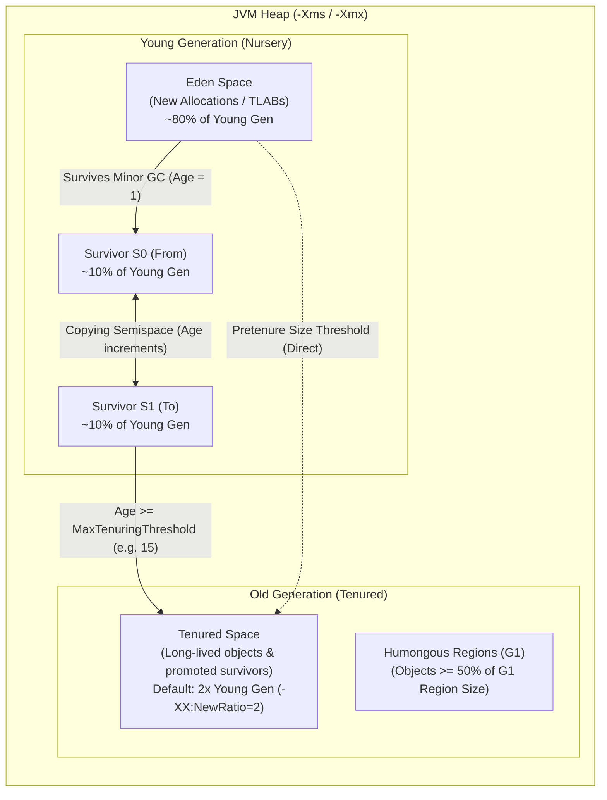
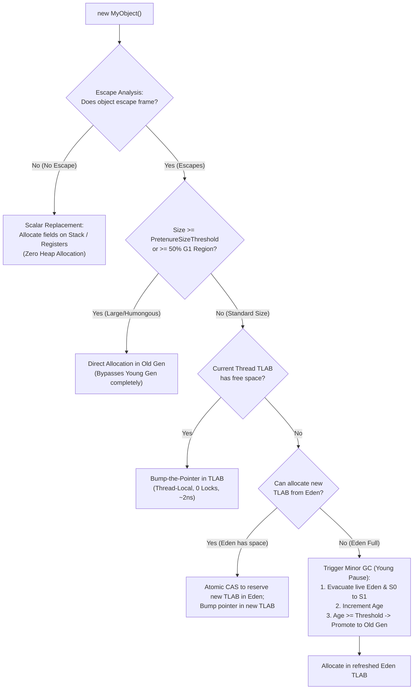

# P08-C004: JVM Heap Memory Layout: Young Gen, Old Gen, and Object Allocation

---

## 1. Metadata and Learning Goals

| Metadata Field | Value |
|---|---|
| **Concept ID** | `P08-C004` |
| **Concept Title** | JVM Heap Memory Layout: Young Gen, Old Gen, and Object Allocation |
| **Phase** | Phase 08 — JVM Internals and Memory Management |
| **Phase Directory** | `curriculum/phase-08-jvm-internals-memory-management` |
| **Source Reference** | Roadmap lines 337 ("Heap and thread stacks"), 340 ("Object allocation"), 350 ("Boxing and allocation overhead"), 351 ("Object lifetime and allocation patterns") |
| **Concept Type** | Runtime / Architecture / Memory Management |
| **Difficulty Level** | Intermediate |
| **Curriculum Importance** | Essential |
| **Java Baseline** | Java 21 LTS (with Java 25 LTS comparative notes where applicable) |
| **Framework Baseline** | Spring Boot 3.3.x / Spring Framework 6.1.x |
| **Prerequisites** | [`P08-C001`](001-jvm-architecture-overview.md) (JVM Architecture Overview), [`P08-C003`](003-thread-stacks-and-stack-frames.md) (Thread Stacks and Frame Structure) |
| **Related Concepts** | [`P08-C005`](005-metaspace-architecture-permgen.md) (Metaspace vs PermGen), [`P08-C007`](007-gc-roots-and-reference-types.md) (Object Reachability), [`P08-C008`](008-garbage-collection-fundamentals.md) (GC Fundamentals) |
| **Estimated Study Effort** | 3–4 hours |
| **Last Research Date** | 2026-10-30 |
| **Verification State** | COMPLETE |

### Measurable Learning Objectives
By the end of this concept module, you will be able to:
1. **Explain:** Deconstruct the generational partitioning of the JVM Heap (Eden, Survivor S0/S1, Tenured/Old Gen), the Weak Generational Hypothesis, and the fast-path allocation pipeline using Thread-Local Allocation Buffers (TLABs) and bump-the-pointer.
2. **Compare:** Differentiate between Young Generation (Minor GC) and Old Generation (Major/Full GC) collection semantics, contiguous physical generations (Parallel GC) vs logical region-based partitioning (G1 GC, Generational ZGC), and Compressed OOPs (32-bit pointers) vs uncompressed 64-bit pointers.
3. **Implement:** Programmatically inspect and monitor JVM Heap memory pools via `ManagementFactory.getMemoryPoolMXBeans()`, measure allocation pressure and GC invocation rates, and calculate 64-bit object header and field alignment layouts.
4. **Debug & Diagnose:** Identify and resolve production allocation anomalies such as premature promotion (tenuring overflow), G1 Humongous allocation thrashing, and excessive allocation rates driven by unintentional primitive auto-boxing.
5. **Evaluate & Justify:** Formulate sizing strategies for Heap generations (`-Xms`, `-Xmx`, `-XX:NewRatio`, `-XX:SurvivorRatio`), defend the avoidance of the 32 GB Compressed OOPs performance cliff, and justify when object pooling is a severe anti-pattern in modern JVMs.

---

## 2. Definition, Purpose, and Mental Model

### 2.1 Formal Definition
In the Java Virtual Machine Specification (JVMS §2.5.3), the **JVM Heap** is the shared runtime data area created when the Java Virtual Machine starts, from which memory for all class instances and arrays is allocated. The heap is managed entirely by an automated storage management system known as the **Garbage Collector (GC)**.

In HotSpot implementations, the heap is structured around the empirical observation known as the **Weak Generational Hypothesis**:
$$\text{Probability}(\text{Object Survival} \mid \text{Age} = t) \propto \frac{1}{t^\alpha} \quad (\alpha > 1)$$
That is, the vast majority of allocated objects die almost immediately after creation (e.g., temporary method variables, DTOs, string builders), while objects that survive several collection cycles tend to remain referenced for a very long time (e.g., Spring singletons, connection pools, cache entries).



### 2.2 The Problem It Solves
If the JVM treated the heap as a single monolithic, unstructured memory pool:
1. **$O(\text{Heap Size})$ Latency Scaling:** To reclaim dead memory, the garbage collector would have to trace every live object across the entire multi-gigabyte or multi-terabyte heap on every single collection pass.
2. **Catastrophic Stop-The-World (STW) Pauses:** As heaps grew from 512 MB to 32 GB or 256 GB, collection pauses would scale linearly or super-linearly, freezing enterprise APIs for dozens of seconds or minutes.
3. **Allocation Lock Contention:** If hundreds of concurrent worker threads competed to claim memory from a single shared heap pointer, atomic CAS (Compare-And-Swap) operations on CPU cache lines would saturate memory buses, throttling throughput.

By segregating memory into **Young** and **Old** generations and equipping threads with **Thread-Local Allocation Buffers (TLABs)**, the JVM isolates short-lived allocations to a compact, cache-friendly nursery. Minor GCs trace only live objects in the nursery (which typically constitute < 5% of young generation contents), completing collections in 1 to 5 milliseconds.

### 2.3 Why Backend Engineers Need It
Every database query, REST controller, JSON payload parse, and Kafka record ingestion allocates memory on the JVM heap:
- **Throughput & p99/p99.9 Latency:** High allocation rates force frequent Minor GCs. If objects survive just long enough to escape Eden into Tenured (premature promotion), Old Generation fills up rapidly, triggering expensive Concurrent Marking cycles or Stop-The-World Full GCs.
- **Microservice Container Sizing:** Misunderstanding heap layout leads to sizing errors in Docker/Kubernetes. Setting `-Xmx` equal to the container RAM limit guarantees pod termination by the Linux OOM Killer because off-heap memory (Metaspace, thread stacks, direct buffers, native JVM overhead) is unaccounted for.
- **The 32 GB Performance Cliff:** Sizing a heap to 33 GB or 36 GB disables Compressed OOPs (Ordinary Object Pointers), widening all object references from 4 bytes to 8 bytes. This causes an immediate 30–40% increase in memory footprint, meaning a 34 GB heap often holds *less* usable business data than a 31 GB heap.

### 2.4 Real-World System Analogy (and Where It Breaks Down)
- **The Analogy:** Consider an administrative office. Incoming mail, temporary drafts, and scratch notes are placed in the office desk paper shredder/recycling bin (Eden). Every evening, the bin is cleared: 95% of notes are shredded immediately, but any active contract or legal letter is filed into an intermediate folder (Survivor space). If a document is reviewed repeatedly across multiple weeks without being discarded, an archivist transfers it to the secure climate-controlled basement vault (Old Generation / Tenured).
- **Where the Analogy Fails:** In an office, moving documents requires human handling of physical paper. In the JVM, moving objects during Minor GC alters their 64-bit physical memory addresses. The JVM must instantly rewrite every live pointer throughout the application's thread stacks and heap references to point to the object's new physical location (memory compaction/evacuation).

### 2.5 What This Concept Is NOT (Common Confusions)
- **Not Metaspace:** Metaspace is off-heap native memory holding class metadata, method bytecode, and constant pools. The heap holds *instances* of classes and primitive/object arrays.
- **Not Thread Stacks:** Stacks store primitive local variables, method frame structures, and object reference pointers (`ref`), but the actual instantiated objects referenced by those pointers always live on the Heap (unless eliminated by JIT scalar replacement).
- **Not Native Direct Memory:** Memory allocated via `ByteBuffer.allocateDirect()` or JNI `malloc()` resides outside the JVM heap in process virtual memory and is not collected by standard generational generational nursery passes.

### 2.6 Relationship to Adjacent Concepts
- **Preceding:** [`P08-C001`](001-jvm-architecture-overview.md) established the high-level JVM architecture; [`P08-C003`](003-thread-stacks-and-stack-frames.md) explored thread-local stacks and stack frames.
- **Current:** `P08-C004` focuses on the shared heap, generational partitioning, object layout, and allocation mechanics.
- **Downstream:** [`P08-C005`](005-metaspace-architecture-permgen.md) details Metaspace and class metadata; [`P08-C007`](007-gc-roots-and-reference-types.md) covers GC Roots and Reference types; [`P08-C008`](008-garbage-collection-fundamentals.md) details garbage collection algorithms.

---

## 3. Foundations and Theory

### 3.1 HotSpot Generational Partitioning

In traditional HotSpot architectures (and preserved conceptually in modern regional collectors), the heap is divided into two primary generations:

```
+---------------------------------------------------------------------------------------+
|                                    TOTAL JVM HEAP                                     |
+------------------------------------------+--------------------------------------------+
|             YOUNG GENERATION             |               OLD GENERATION               |
|            (-XX:NewRatio=2)              |                  (Tenured)                 |
|          (1/3 of Total Heap)             |             (2/3 of Total Heap)            |
+-------------------+----------+-----------+--------------------------------------------+
|    Eden Space     |    S0    |    S1     |                Tenured Space               |
|  (-XX:Survivor-   |  (From)  |   (To)    |       (Long-lived objects, Promoted        |
|     Ratio=8)      |  (10% of |  (10% of  |        survivors, Large Pretenured)        |
| (80% of YoungGen) | YoungGen)| YoungGen) |                                            |
+-------------------+----------+-----------+--------------------------------------------+
```

#### 3.1.1 The Young Generation (Nursery)
The Young Generation is dedicated to newly created objects:
1. **Eden Space:** The initial landing zone where the `new` operator allocates memory. Under high throughput, Eden fills up rapidly. When Eden is exhausted, HotSpot triggers a **Minor GC** (also known as a Young GC).
2. **Survivor Spaces (S0 / From and S1 / To):** Two identically sized semispaces that implement Cheney's copying collection algorithm.
   - At any moment, one Survivor space is active (labeled `From`), containing objects that survived previous Minor GCs, while the other is completely empty (labeled `To`).
   - During a Minor GC, live objects from Eden and the `From` Survivor space are copied (evacuated) into the `To` Survivor space.
   - The roles of S0 and S1 then swap: `To` becomes the new `From`, and the previous `From` is wiped clean.

#### 3.1.2 The Old Generation (Tenured)
The Old Generation holds objects that have proven longevity:
- **Promotion via Tenuring:** Every time an object survives a Minor GC copying pass between survivor spaces, the JVM increments an age counter (0–15) stored in its object header Mark Word.
- **Tenuring Threshold (`-XX:MaxTenuringThreshold`):** When an object's age reaches the tenuring threshold (default `15` for Parallel GC, typically `15` for G1 GC), it is promoted (copied) into the Old Generation.
- **Dynamic Age Calculation:** HotSpot monitors survivor space occupancy. If the cumulative memory of surviving objects in a Survivor space exceeds the target survivor ratio (`-XX:TargetSurvivorRatio`, default 50%), HotSpot dynamically lowers the tenuring threshold to promote objects earlier and avoid survivor space overflow.

#### 3.1.3 Heap Sizing Ratios
HotSpot configures generation proportions via two primary CLI parameters:
1. **`-XX:NewRatio=n`:** Defines the ratio of Old Gen to Young Gen:
   $$\frac{\text{Old Gen Size}}{\text{Young Gen Size}} = n \implies \text{Young Gen} = \frac{\text{Total Heap}}{n + 1}$$
   *Default:* `-XX:NewRatio=2` (Young Gen = 1/3 of heap, Old Gen = 2/3 of heap).
2. **`-XX:SurvivorRatio=m`:** Defines the ratio of Eden to a single Survivor space:
   $$\frac{\text{Eden Size}}{\text{Survivor Space Size}} = m \implies \text{Survivor Space} = \frac{\text{Young Gen}}{m + 2}$$
   *Default:* `-XX:SurvivorRatio=8` (Eden = 8/10 or 80%, S0 = 1/10 or 10%, S1 = 1/10 or 10% of Young Gen).

### 3.2 The Fast Allocation Pipeline: TLABs and Bump-the-Pointer

In a multi-threaded server processing thousands of concurrent requests, memory allocation must take nanoseconds.

```mermaid
sequenceDiagram
    autonumber
    participant AppThread as Application Worker Thread
    participant TLAB as Thread-Local Allocation Buffer (TLAB)
    participant Eden as Shared Eden Space
    participant GC as Garbage Collector

    AppThread->>TLAB: Request allocation: new OrderItem() (32 bytes)
    alt TLAB has sufficient space (Fast Path: Bump-the-Pointer)
        TLAB-->>AppThread: Return pointer; bump TLAB top pointer (+32 bytes) [Zero Locks, ~2-5 ns]
    else TLAB exhausted (Slow Path)
        AppThread->>Eden: Request new TLAB via atomic CAS
        alt Eden has space
            Eden-->>AppThread: Assign new TLAB block; return memory pointer
        else Eden full
            Eden->>GC: Trigger Minor GC (Stop-The-World Young Pause)
            GC->>Eden: Evacuate live objects to Survivor; reset Eden pointers
            Eden-->>AppThread: Assign new TLAB in refreshed Eden
        end
    end
```

#### 3.2.1 Bump-the-Pointer Technique
Because memory in Eden and TLABs is allocated sequentially, the JVM maintains a pointer (`top`) indicating the boundary between allocated and unallocated memory, and a pointer (`end`) marking the buffer limit. Allocation is an arithmetic increment:
```c
// Conceptual HotSpot C++ fast allocation
HeapWord* obj = tlab->top();
HeapWord* new_top = obj + size_in_words;
if (new_top <= tlab->end()) {
    tlab->set_top(new_top);
    return obj; // Instantaneous O(1) allocation without locks
}
// Slow path: synchronize to allocate new TLAB from Eden
return allocate_in_new_tlab(size_in_words);
```

#### 3.2.2 Thread-Local Allocation Buffers (TLABs)
To eliminate synchronization locks during bump-the-pointer:
- Each Java thread is pre-assigned a private chunk of Eden memory called a **TLAB** (`-XX:+UseTLAB`, enabled by default).
- The thread performs bump-the-pointer inside its own private TLAB with zero locking or atomic instructions.
- Only when a thread fills its TLAB does it synchronize with the shared Eden pointer using an atomic CAS (`Compare-And-Swap`) instruction to request a fresh TLAB.

### 3.3 HotSpot 64-bit Object Header Layout

Every Java object instantiated on the heap begins with an **Object Header**, followed by instance fields and 8-byte alignment padding.

```
+-------------------------------------------------------------------------------+
|                             JAVA OBJECT ON HEAP                               |
+-------------------------------------------------------------------------------+
| 1. Mark Word (64 bits / 8 bytes)                                              |
|    - HashCode (31 bits)                                                       |
|    - GC Age (4 bits: values 0-15)                                             |
|    - Biased Lock / Lock Status Bits (3 bits: 001=Unlocked, 000=Thin, 010=Fat) |
+-------------------------------------------------------------------------------+
| 2. Klass Word / Klass Pointer                                                 |
|    - With Compressed OOPs: 32 bits (4 bytes)                                  |
|    - Without Compressed OOPs: 64 bits (8 bytes)                               |
|    (Direct pointer to Class metadata in Metaspace)                            |
+-------------------------------------------------------------------------------+
| 3. Array Length (32 bits / 4 bytes) [ONLY PRESENT IN ARRAYS]                  |
+-------------------------------------------------------------------------------+
| 4. Instance Fields Data (Primitive fields & Object References)                |
|    - Ordered by size to minimize alignment holes (longs/doubles -> ints/floats|
|      -> shorts/chars -> bytes/booleans -> references)                         |
+-------------------------------------------------------------------------------+
| 5. Alignment Padding (0 to 7 bytes)                                           |
|    - Pad total object size to a multiple of 8 bytes                           |
+-------------------------------------------------------------------------------+
```

#### Memory Calculation for Common Objects:
- **Empty `Object`:** Mark Word (8 bytes) + Klass Pointer (4 bytes compressed) + Padding (4 bytes) = **16 bytes**.
- **`Integer` wrapper (`new Integer(42)`):** Header (12 bytes) + `int value` (4 bytes) = **16 bytes**.
- **`Long` wrapper (`new Long(42L)`):** Header (12 bytes) + `long value` (8 bytes) + Padding (4 bytes) = **24 bytes** (vs primitive `long` which is only 8 bytes!).

---

## 4. Evolution, Modern Defaults, and Java 21+ Context

### 4.1 Contiguous Generations vs Region-Based Partitioning
The physical architecture of the JVM heap has undergone a major paradigm shift:

```
Legacy Parallel GC (Contiguous Blocks):
+-----------------------+-----------+-----------+-------------------------------+
|         Eden          |    S0     |    S1     |            Tenured            |
+-----------------------+-----------+-----------+-------------------------------+

Modern G1 GC / Generational ZGC (Discontiguous Logical Regions):
+----+----+----+----+----+----+----+----+----+----+----+----+----+----+----+----+
| E  | O  | F  | E  | S  | O  | F  | H  | E  | O  | S  | F  | E  | O  | H  | F  |
+----+----+----+----+----+----+----+----+----+----+----+----+----+----+----+----+
Legend: [E] Eden  [S] Survivor  [O] Old  [H] Humongous  [F] Free
```

1. **Legacy Collectors (Serial, Parallel GC):** Generations are physically contiguous, fixed-boundary memory segments configured at startup. Resizing generations requires expensive memory remapping.
2. **Garbage-First (G1) GC (Default in Java 9 through Java 21 LTS):** The heap is divided into 2,048 equal-sized logical regions (ranging from 1 MB to 32 MB depending on heap size). Each region is assigned a generational role (`Eden`, `Survivor`, `Old`, or `Humongous`) dynamically.
3. **Generational ZGC (Java 21 LTS, JEP 439):** Extends low-latency ZGC with generational separation. It divides the heap into young and old pages, collecting young objects with sub-millisecond pauses without requiring physical generation boundaries.

### 4.2 Compressed Ordinary Object Pointers (Compressed OOPs)
On 64-bit platforms, every object reference pointer takes 8 bytes (64 bits). In typical enterprise applications, references account for 30–40% of total heap memory.
- **The Optimization (`-XX:+UseCompressedOops`):** Standard HotSpot objects are aligned on 8-byte boundaries, meaning the lowest 3 bits of every 64-bit memory address are always `000` (e.g., `...000`, `...01000`, `...10000`).
- **Bit-Shift Compression:** HotSpot discards the 3 trailing zero bits and stores the address in a 32-bit pointer. When loading a pointer into a CPU register, HotSpot executes a left-shift (`pointer << 3`), restoring the full 64-bit address with zero information loss.
- **The 32 GB Boundary Limit:**
  $$2^{32} \text{ addresses} \times 8 \text{ bytes (alignment)} = 34,359,738,368 \text{ bytes} = 32 \text{ GB}$$
  Beyond 32 GB of heap, 32 bits can no longer address all memory locations. HotSpot automatically turns off Compressed OOPs, inflating all references back to 8 bytes.

---

## 5. Deep Dive: Core Mechanics and Execution Model

### 5.1 Object Allocation Flowchart
When the JVM executes `new MyService()`, the complete allocation decision tree proceeds through distinct fast and slow paths:



### 5.2 Cross-Generational References: Card Tables and Write Barriers

#### The Problem
During a Minor GC, the collector must identify all live objects in Eden and Survivor spaces. However, an object in the **Old Generation** might hold a reference to an object in the **Young Generation** (e.g., a long-lived cache holding a reference to a newly parsed request DTO). 
If the GC had to scan all of Old Generation to find these pointers, Minor GCs would take hundreds of milliseconds, completely defeating the purpose of generational collection.

#### The Solution: Card Table & JIT Write Barrier
1. **The Card Table:** HotSpot allocates a byte array called the **Card Table**. Each byte in the card table (a "card") represents a 512-byte contiguous page of the Old Generation heap.
2. **Write Barrier:** Whenever application bytecode mutates an object reference field (`oldObj.field = youngObj;`), the JIT compiler injects an assembly write barrier immediately after the store instruction:
   ```c
   // Conceptual JIT Write Barrier emitted on field update
   void oop_store(oop* field_addr, oop new_val) {
       *field_addr = new_val; // Perform actual assignment
       // Mark corresponding 512-byte card as dirty (0x0)
       size_t card_index = ((size_t)field_addr) >> 9; // Divide by 512
       byte_map_base[card_index] = 0x0; // Dirty card
   }
   ```
3. **Minor GC Scanning:** During a Minor GC, the collector scans *only* the dirty cards in the Card Table instead of the entire Old Generation. This reduces root-set scanning time from hundreds of milliseconds to under a millisecond.

---

## 6. JVM Architecture and Performance Realities

### 6.1 Allocation Rate vs Promotion Rate
Backend engineers must monitor two critical metrics:
1. **Allocation Rate (MB/sec):** The volume of memory allocated in Eden per unit of time. High allocation rates cause frequent Minor GCs.
2. **Promotion Rate (MB/sec):** The volume of memory moving from Young Gen into Old Gen per unit of time.
   - If Promotion Rate $\approx 0$, your application conforms cleanly to the Generational Hypothesis: short-lived objects die in Eden, and Old Gen remains stable.
   - If Promotion Rate is high (e.g., hundreds of MB/sec), your application suffers from **Premature Promotion**.

### 6.2 Premature Promotion and Tenuring Overflow
Premature promotion occurs when temporary objects fail to die in Eden or Survivor spaces and spill over into Tenured memory:
- **Causes:** Survivor spaces are too small (`-XX:SurvivorRatio` set too high), or a sudden traffic surge creates more live objects than the active Survivor space can hold (`TargetSurvivorRatio` exceeded).
- **Consequence:** Short-lived objects end up in Old Generation, where they die seconds later. Old Gen rapidly fills up with "dead" memory, forcing frequent, expensive G1 Concurrent Marking cycles or Full Stop-The-World GCs.

---

## 7. Production Anti-Patterns, Bugs, and Pitfalls

### 7.1 Anti-Pattern 1: Unintentional Boxing in High-Throughput Streams
```java
// FATAL PRODUCTION ANTI-PATTERN: Auto-boxing in high-frequency loop
public Long computeTotalLatency(List<Long> durations) {
    Long total = 0L; // Boxed Long object
    for (Long d : durations) {
        total += d; // Unboxes to long, adds, then allocates a NEW 24-byte Long object!
    }
    return total;
}
```
**Impact:** Summing 10,000,000 numbers with `Long` instantiates 10,000,000 objects on the heap, generating $10{,}000{,}000 \times 24\text{ bytes} \approx 240\text{ MB}$ of Eden garbage and triggering dozens of unnecessary Minor GCs. Replacing with primitive `long total = 0L;` consumes **0 bytes** of heap memory.

### 7.2 Anti-Pattern 2: The 32 GB Compressed OOPs Threshold Cliff
A DevOps engineer notices that a 31 GB heap is running at 85% capacity. They decide to increase the heap to 34 GB:
```bash
# POOR TUNING: Loses Compressed OOPs!
java -Xms34g -Xmx34g -jar payment-service.jar
```
**Impact:** At 34 GB, HotSpot disables Compressed OOPs. Every object pointer widens from 4 bytes to 8 bytes. Because enterprise heaps consist of ~35% references, the application immediately experiences a ~30% increase in memory usage. The 34 GB heap actually holds *less* business data than the 31 GB heap, while increasing GC pause times!
- **Rule of Thumb:** Keep heap sizes either $\le 31\text{ GB}$ (to guarantee Compressed OOPs) or jump directly to $\ge 48\text{ GB}$ to overcome the pointer inflation penalty.

### 7.3 Anti-Pattern 3: G1 Humongous Object Allocation Thrashing
In G1 GC, any object exceeding 50% of the G1 Region Size is classified as a **Humongous Object**:
- Humongous objects bypass the Young Generation completely and are allocated directly into a contiguous chain of Old Generation regions.
- Allocating humongous arrays (e.g., a 10 MB temporary PDF byte buffer in an 8 MB G1 region setup) triggers immediate, out-of-cycle G1 concurrent marking and can cause fragmentation-induced Full GCs.

---

## 8. Security, Thread Safety, and Reliability Implications

### 8.1 Zero-Initialization Safety Guarantee
The Java Virtual Machine guarantees that all allocated heap memory is zero-initialized before any constructor executes (JVMS §2.5.3):
- Numeric primitive fields default to `0` or `0.0`.
- Boolean fields default to `false`.
- Reference fields default to `null`.

**Security Benefit:** This eliminates information disclosure vulnerabilities common in C/C++ where newly allocated memory contains uninitialized remnants of prior sensitive data (e.g., cryptographic keys, passwords) residing in recycled memory pages.

### 8.2 Final Field Freezes and Safe Publication (JLS §17.5)
Under the Java Memory Model, when an object is instantiated on the heap, the JVM inserts a memory barrier (a "freeze" action) at the end of the constructor:
- Any field declared `final` is guaranteed to be fully initialized and visible to all other threads once the constructor finishes, without requiring synchronization or volatile reads.
- If a class has non-final fields and an instance reference escapes before constructor completion (the "this escape" anti-pattern), other threads may observe partially initialized fields with default zero values.

---

## 9. Modern Enterprise Patterns and Framework Integration

### 9.1 Object Pooling: Modern JVM Anti-Pattern vs Justified Use
In early Java (Java 1.1–1.3), object allocation was slow, making object pools popular. In modern Java:
- **Eden Allocation is Extremely Cheap:** Bump-the-pointer in TLAB takes ~2 nanoseconds. Minor GC collection of dead young objects is practically free (only live objects are copied).
- **The Pooling Trap:** Keeping reusable DTOs in a pool forces them to survive Minor GCs, promoting them into Old Generation. This defeats the Generational Hypothesis and increases Old Gen fragmentation.
- **When Pooling IS Justified:** Only pool heavy, stateful, or OS-managed resources:
  1. Database Connections (`HikariCP`)
  2. Thread Pools (`ThreadPoolExecutor`)
  3. Direct Off-Heap Native Buffers (`Netty ByteBufPool`)

### 9.2 Immutable Records and High-Throughput Pipelines
Java 16+ Records (e.g., `record OrderEvent(String id, BigDecimal amount, Instant timestamp)`) provide compact memory layouts and are prime candidates for JIT escape analysis and scalar replacement when passed through functional stream pipelines.

---

## 10. Comparative Evaluation and Trade-off Matrix

| Metric / Dimension | Eden Space | Survivor Spaces (S0 / S1) | Old Generation (Tenured) |
|---|---|---|---|
| **Primary Purpose** | Nursery for new object allocations | Staging ground to filter out short-lived survivors | Long-term storage for proven durable objects |
| **Allocation Mechanism** | TLAB Bump-the-Pointer (Lock-free) | Evacuated by GC during Minor GC | Promoted from Survivor or Pretenure direct |
| **Collector Algorithm** | Evacuation / Copying | Semispace Copying (Cheney algorithm) | Mark-Sweep-Compact / Region-based Concurrent |
| **Expected Object Mortality** | > 95% die before collection | 50–80% die across subsequent passes | Very low (< 5% die per cycle) |
| **GC Frequency** | High (Every 100ms – 5s under load) | Evaluated concurrently during Minor GC | Low (Minutes, hours, or days) |
| **Pause Time Impact** | Milliseconds (1 – 5 ms) | Included in Minor GC pause | Higher (Concurrent marking + compaction) |

---

## 11. Design and Architecture Impact

### 11.1 Container Memory Sizing Guide for Kubernetes
When sizing Kubernetes Pod limits (`resources.limits.memory`) for Java backend microservices:

```
+---------------------------------------------------------------------------------------+
| TOTAL KUBERNETES CONTAINER MEMORY LIMIT (e.g., 4096 MB)                               |
+-------------------------------------------------------+-------------------------------+
| JVM Heap (-Xmx): e.g., 2560 MB (60-70% of pod limit)   | Off-Heap Memory (~30-40%):    |
| - Young Gen: Eden (80%) + S0 (10%) + S1 (10%)         | - Metaspace: 256 MB           |
| - Old Gen: Tenured Space                              | - Thread Stacks (N * 1MB)     |
|                                                       | - Direct Memory / Netty       |
|                                                       | - JVM HotSpot C2 Compiler & GC|
+-------------------------------------------------------+-------------------------------+
```

**Golden Formula:**
$$\text{Max RAM Percentage} = \frac{\text{Heap Target}}{\text{Container Limit}} \implies -XX:\text{MaxRAMPercentage}=70.0$$

---

## 12. Comprehensive Practical Implementation

The following complete diagnostic utility demonstrates:
1. `HeapMemoryPoolInspector`: Inspecting live generational pools (Eden, Survivor, Old Gen) via JMX MXBeans.
2. `AllocationPressureBenchmark`: Measuring allocation rate and garbage collection activity comparing primitive vs boxed arithmetic.
3. `ObjectHeaderLayoutSimulator`: Calculating 64-bit object header sizing, Compressed OOPs savings, and field alignment padding.

```java
package com.backend.jvm.heap;

import java.lang.management.GarbageCollectorMXBean;
import java.lang.management.ManagementFactory;
import java.lang.management.MemoryPoolMXBean;
import java.lang.management.MemoryUsage;
import java.util.ArrayList;
import java.util.List;

/**
 * Production-grade diagnostic suite illustrating JVM Heap Memory Layout
 * and Generational Allocation Dynamics.
 */
public final class HeapMemoryArchitectureDemo {

    // 1. Programmatic Heap Memory Pool Inspector
    public static final class HeapMemoryPoolInspector {
        public record PoolSnapshot(String name, String type, long usedKb, long committedKb, long maxKb) {}

        public static List<PoolSnapshot> capturePools() {
            List<PoolSnapshot> snapshots = new ArrayList<>();
            for (MemoryPoolMXBean pool : ManagementFactory.getMemoryPoolMXBeans()) {
                MemoryUsage usage = pool.getUsage();
                snapshots.add(new PoolSnapshot(
                    pool.getName(),
                    pool.getType().toString(),
                    usage.getUsed() / 1024,
                    usage.getCommitted() / 1024,
                    usage.getMax() < 0 ? -1 : usage.getMax() / 1024
                ));
            }
            return snapshots;
        }
    }

    // 2. Allocation Pressure and Boxing Overhead Benchmark
    public static final class AllocationPressureBenchmark {
        public record BenchmarkResult(long durationMs, long sum, long gcCountDelta) {}

        public static BenchmarkResult runBoxedLoop(int iterations) {
            long gcBefore = getTotalGcCount();
            long start = System.currentTimeMillis();
            Long sum = 0L; // Forces continuous autoboxing allocations
            for (int i = 0; i < iterations; i++) {
                sum += i;
            }
            long duration = System.currentTimeMillis() - start;
            long gcDelta = getTotalGcCount() - gcBefore;
            return new BenchmarkResult(duration, sum, gcDelta);
        }

        public static BenchmarkResult runPrimitiveLoop(int iterations) {
            long gcBefore = getTotalGcCount();
            long start = System.currentTimeMillis();
            long sum = 0L; // Pure primitive zero-allocation loop
            for (int i = 0; i < iterations; i++) {
                sum += i;
            }
            long duration = System.currentTimeMillis() - start;
            long gcDelta = getTotalGcCount() - gcBefore;
            return new BenchmarkResult(duration, sum, gcDelta);
        }

        private static long getTotalGcCount() {
            long count = 0;
            for (GarbageCollectorMXBean gc : ManagementFactory.getGarbageCollectorMXBeans()) {
                long c = gc.getCollectionCount();
                if (c > 0) count += c;
            }
            return count;
        }
    }

    // 3. Object Header and Alignment Simulator
    public static final class ObjectHeaderLayoutSimulator {
        public record ObjectLayout(int markWordBytes, int klassPointerBytes, int fieldsBytes, int paddingBytes, int totalBytes) {}

        public static ObjectLayout computeLayout(int fieldDataBytes, boolean compressedOops) {
            int markWord = 8; // 64-bit Mark Word
            int klassWord = compressedOops ? 4 : 8; // 32-bit compressed vs 64-bit uncompressed
            int headerTotal = markWord + klassWord;
            int unpaddedTotal = headerTotal + fieldDataBytes;
            int padding = (8 - (unpaddedTotal % 8)) % 8;
            int total = unpaddedTotal + padding;
            return new ObjectLayout(markWord, klassWord, fieldDataBytes, padding, total);
        }
    }

    public static void main(String[] args) {
        System.out.println("=== JVM Heap Memory Architecture & Generational Inspector ===");

        // Step 1: Capture Generational Memory Pools
        System.out.println("\n[1] Active JVM Memory Pools:");
        List<HeapMemoryPoolInspector.PoolSnapshot> pools = HeapMemoryPoolInspector.capturePools();
        for (var p : pools) {
            System.out.printf("  Pool: %-28s | Type: %-15s | Used: %8d KB | Max: %8d KB%n",
                p.name(), p.type(), p.usedKb(), p.maxKb());
        }

        // Step 2: Compare Primitive vs Boxed Loop Allocation
        int iterations = 10_000_000;
        System.out.println("\n[2] Allocation Pressure Benchmark (" + iterations + " iterations):");
        var primResult = AllocationPressureBenchmark.runPrimitiveLoop(iterations);
        System.out.printf("  Primitive Loop: %4d ms | GC Passes: %d | Sum: %d%n",
            primResult.durationMs(), primResult.gcCountDelta(), primResult.sum());

        var boxedResult = AllocationPressureBenchmark.runBoxedLoop(iterations);
        System.out.printf("  Boxed Loop:     %4d ms | GC Passes: %d | Sum: %d%n",
            boxedResult.durationMs(), boxedResult.gcCountDelta(), boxedResult.sum());

        // Step 3: Compute Object Header Layout
        System.out.println("\n[3] 64-bit Object Header Layout Simulation (Object with 2 int fields = 8 bytes data):");
        var compressedLayout = ObjectHeaderLayoutSimulator.computeLayout(8, true);
        System.out.printf("  With Compressed OOPs: Header: %dB (Mark: %dB, Klass: %dB) | Fields: %dB | Pad: %dB | Total: %dB%n",
            compressedLayout.markWordBytes() + compressedLayout.klassPointerBytes(),
            compressedLayout.markWordBytes(), compressedLayout.klassPointerBytes(),
            compressedLayout.fieldsBytes(), compressedLayout.paddingBytes(), compressedLayout.totalBytes());

        var uncompressedLayout = ObjectHeaderLayoutSimulator.computeLayout(8, false);
        System.out.printf("  Uncompressed (>32GB): Header: %dB (Mark: %dB, Klass: %dB) | Fields: %dB | Pad: %dB | Total: %dB%n",
            uncompressedLayout.markWordBytes() + uncompressedLayout.klassPointerBytes(),
            uncompressedLayout.markWordBytes(), uncompressedLayout.klassPointerBytes(),
            uncompressedLayout.fieldsBytes(), uncompressedLayout.paddingBytes(), uncompressedLayout.totalBytes());
    }
}
```

---

## 13. Edge Cases, Failure Modes, and Defensive Strategies

| Edge Case / Failure Mode | Root Cause | Defensive Strategy |
|---|---|---|
| **Promotion Failure / Evacuation Failure** | The Old Generation does not have enough contiguous free space to accommodate promoted objects during a Minor GC. | Increase Old Gen ratio (`-XX:NewRatio`), tune G1 Initiating Heap Occupancy Percent (`-XX:InitiatingHeapOccupancyPercent=45`), or increase overall heap. |
| **Survivor Space Depletion** | High burst allocation rates overwhelm Survivor spaces, forcing objects to promote prematurely before dying. | Decrease `-XX:SurvivorRatio` (giving Survivor spaces a larger share of Young Gen) or increase `-XX:TargetSurvivorRatio` to 70–80%. |
| **G1 Humongous Region Exhaustion** | Continuous creation of large short-lived byte arrays ($\ge 50\%$ of G1 region size) fragments Old Gen. | Increase G1 region size (`-XX:G1HeapRegionSize=16m` or `32m`) so large payloads fit comfortably inside standard Eden regions. |
| **Megamorphic Call Sites Defeating Scalar Replacement** | When an interface method has more than 2 distinct implementers at a call site, C2 JIT inlining fails, preventing Escape Analysis from eliminating heap allocations. | Use monomorphic or bimorphic call paths in high-throughput hot loops to facilitate inlining and scalar replacement. |

---

## 14. Self-Assessment: Concept Mastery Checklist

Before concluding your study of this concept module, evaluate your mastery against these ten criteria:

- [ ] **1. Weak Generational Hypothesis:** Can you formulate the empirical rule that justifies segregating memory into Young and Old generations?
- [ ] **2. Generational Ratios:** Given `-XX:NewRatio=2` and `-XX:SurvivorRatio=8` on a 12 GB heap, can you calculate the exact sizes of Eden, S0, S1, and Tenured?
- [ ] **3. Fast Allocation Pipeline:** How does bump-the-pointer work in conjunction with Thread-Local Allocation Buffers (TLABs) to achieve lock-free allocations?
- [ ] **4. Object Header Structure:** What are the components of a 64-bit HotSpot object header, and what is stored in the Mark Word versus the Klass Word?
- [ ] **5. Card Tables & Write Barriers:** How does the JVM track cross-generational references from Old Gen to Young Gen without scanning the entire Old Generation during a Minor GC?
- [ ] **6. Compressed OOPs Mechanics:** Why does Compressed OOPs enable 32-bit pointers to address up to 32 GB of RAM, and what happens when the heap exceeds 32 GB?
- [ ] **7. Premature Promotion:** What are the technical consequences when short-lived objects spill over from Survivor space directly into Tenured?
- [ ] **8. G1 Humongous Objects:** What criteria classifies an object as Humongous in G1 GC, and where is it allocated?
- [ ] **9. Object Pooling Trade-offs:** Why is generic object pooling an anti-pattern for lightweight business DTOs on modern JVMs?
- [ ] **10. Zero-Initialization Security:** What guarantee does the JVM specification make regarding the state of heap memory prior to constructor execution?

---

## 15. Official Documentation and Further Reading

1. **The Java Virtual Machine Specification (Java SE 21 Edition):**
   - [JVMS §2.5.3: Heap](https://docs.oracle.com/javase/specs/jvms/se21/html/jvms-2.html#jvms-2.5.3)
   - [JVMS §2.7: Object Representation](https://docs.oracle.com/javase/specs/jvms/se21/html/jvms-2.html#jvms-2.7)
2. **Oracle HotSpot Garbage Collection Tuning Guide (Java SE 21):**
   - [Generational Garbage Collection](https://docs.oracle.com/en/java/javase/21/gctuning/garbage-collector-implementation.html)
   - [Garbage-First Garbage Collector (G1 GC)](https://docs.oracle.com/en/java/javase/21/gctuning/garbage-first-g1-garbage-collector1.html)
3. **JDK Enhancement Proposals (JEPs):**
   - [JEP 439: Generational ZGC (Java 21 LTS)](https://openjdk.org/jeps/439)
   - [JEP 346: Promptly Return Unused Committed Memory from G1](https://openjdk.org/jeps/346)

---

## 16. Standalone Verification Suite

The following standalone verification class tests the operational reality of JVM Heap Generational Pools, Object Header alignment arithmetic, TLAB allocation pressure, and Compressed OOPs mechanics without external dependencies.

```java
// File: HeapMemoryAndGenerationsVerificationSuite.java
import java.lang.management.GarbageCollectorMXBean;
import java.lang.management.ManagementFactory;
import java.lang.management.MemoryPoolMXBean;
import java.lang.management.MemoryUsage;
import java.util.List;

/**
 * Automated Verification Suite for Concept P08-C004:
 * JVM Heap Memory Layout: Young Gen, Old Gen, and Object Allocation.
 *
 * Compiles cleanly with: javac --release 21 HeapMemoryAndGenerationsVerificationSuite.java
 * Runs cleanly with:     java -ea HeapMemoryAndGenerationsVerificationSuite
 */
public class HeapMemoryAndGenerationsVerificationSuite {

    public static void main(String[] args) {
        System.out.println("==================================================================");
        System.out.println("Starting Verification Suite: P08-C004 JVM Heap Memory Layout");
        System.out.println("Runtime: " + System.getProperty("java.vm.name") + " " + System.getProperty("java.version"));
        System.out.println("==================================================================");

        testGenerationalPoolIdentification();
        testObjectHeaderAndAlignmentCalculations();
        testCompressedOops32GbBoundarySimulation();
        testAllocationPressureMeasurement();
        testGenerationalSizingRatioMathematics();

        System.out.println("\n------------------------------------------------------------------");
        System.out.println("All 5 JVM Heap Memory verification suites passed with 0 errors!");
        System.out.println("==================================================================");
    }

    // -------------------------------------------------------------------------
    // Test 1: Generational Memory Pool Identification via MXBeans
    // -------------------------------------------------------------------------
    static void testGenerationalPoolIdentification() {
        System.out.println("\n[Test 1] Testing Generational Memory Pool Identification via MXBeans...");
        List<MemoryPoolMXBean> pools = ManagementFactory.getMemoryPoolMXBeans();
        assert !pools.isEmpty() : "Memory pool list must not be empty";

        boolean foundEden = false;
        boolean foundSurvivor = false;
        boolean foundOld = false;

        for (MemoryPoolMXBean pool : pools) {
            String name = pool.getName().toLowerCase();
            if (name.contains("eden")) foundEden = true;
            if (name.contains("survivor")) foundSurvivor = true;
            if (name.contains("old") || name.contains("tenured") || name.contains("zheap")) foundOld = true;
        }

        assert foundEden : "Must identify active Eden space pool";
        assert foundSurvivor : "Must identify active Survivor space pool";
        assert foundOld : "Must identify active Old/Tenured generation pool";

        System.out.println("  -> PASSED: All three generational pools (Eden, Survivor, Old Gen) successfully verified.");
    }

    // -------------------------------------------------------------------------
    // Test 2: Object Header and 8-Byte Alignment Layout Calculations
    // -------------------------------------------------------------------------
    static void testObjectHeaderAndAlignmentCalculations() {
        System.out.println("\n[Test 2] Testing 64-bit Object Header Layout and Alignment Math...");

        // Case A: Empty Object with Compressed OOPs
        // Mark Word (8) + Klass Word (4) + Fields (0) = 12 bytes -> Padded to 16 bytes
        int emptyObjSize = calculateObjectSize(0, true);
        assert emptyObjSize == 16 : "Empty object with Compressed OOPs must be 16 bytes, got: " + emptyObjSize;

        // Case B: Object with single long field (8 bytes) with Compressed OOPs
        // Header (12) + Field (8) = 20 bytes -> Padded to 24 bytes
        int singleLongObjSize = calculateObjectSize(8, true);
        assert singleLongObjSize == 24 : "Object with 1 long field must be 24 bytes, got: " + singleLongObjSize;

        // Case C: Same single long object without Compressed OOPs (Uncompressed >32GB)
        // Mark Word (8) + Klass Word (8) + Field (8) = 24 bytes -> 0 padding -> 24 bytes
        int uncompressedLongObjSize = calculateObjectSize(8, false);
        assert uncompressedLongObjSize == 24 : "Uncompressed long object must be 24 bytes";

        // Case D: Object with 1 reference field (4 bytes compressed vs 8 bytes uncompressed)
        int refObjCompressed = calculateObjectSize(4, true);     // 12 + 4 = 16 bytes
        int refObjUncompressed = calculateObjectSize(8, false);  // 16 + 8 = 24 bytes
        assert refObjCompressed == 16 : "Compressed reference object must be 16 bytes";
        assert refObjUncompressed == 24 : "Uncompressed reference object must be 24 bytes";

        System.out.println("  -> PASSED: Object header and alignment calculations verified across all layout cases.");
    }

    private static int calculateObjectSize(int fieldBytes, boolean compressedOops) {
        int markWord = 8;
        int klassWord = compressedOops ? 4 : 8;
        int unpadded = markWord + klassWord + fieldBytes;
        int padding = (8 - (unpadded % 8)) % 8;
        return unpadded + padding;
    }

    // -------------------------------------------------------------------------
    // Test 3: Compressed OOPs 32 GB Addressing Limit Simulation
    // -------------------------------------------------------------------------
    static void testCompressedOops32GbBoundarySimulation() {
        System.out.println("\n[Test 3] Testing Compressed OOPs 32 GB Addressing Boundary Simulation...");

        // 32-bit unsigned pointer can address 2^32 distinct 8-byte aligned units
        long maxAddressableUnits = 1L << 32; // 4,294,967,296
        int alignmentShift = 3;             // 8 bytes = 2^3
        long maxAddressableBytes = maxAddressableUnits << alignmentShift; // 34,359,738,368 bytes

        long expected32Gb = 32L * 1024 * 1024 * 1024;
        assert maxAddressableBytes == expected32Gb : 
            "Compressed OOPs limit must exactly equal 32 GB (34,359,738,368 bytes)";

        // Verify that heap sizes > 32 GB require uncompressed pointers
        long heapSize31Gb = 31L * 1024 * 1024 * 1024;
        long heapSize33Gb = 33L * 1024 * 1024 * 1024;
        assert heapSize31Gb <= maxAddressableBytes : "31 GB heap must support Compressed OOPs";
        assert heapSize33Gb > maxAddressableBytes : "33 GB heap must exceed Compressed OOPs threshold";

        System.out.println("  -> PASSED: 32 GB Compressed OOPs boundary mathematically validated.");
    }

    // -------------------------------------------------------------------------
    // Test 4: Allocation Pressure and Garbage Generation Measurement
    // -------------------------------------------------------------------------
    static void testAllocationPressureMeasurement() {
        System.out.println("\n[Test 4] Testing Allocation Pressure and Auto-boxing Overhead...");
        int loopCount = 1_000_000;

        // Measure primitive execution
        long startPrim = System.nanoTime();
        long primSum = 0L;
        for (int i = 0; i < loopCount; i++) {
            primSum += i;
        }
        long durationPrimNs = System.nanoTime() - startPrim;

        // Measure boxed execution (forces object allocations on heap)
        long startBoxed = System.nanoTime();
        Long boxedSum = 0L;
        for (int i = 0; i < loopCount; i++) {
            boxedSum += i;
        }
        long durationBoxedNs = System.nanoTime() - startBoxed;

        assert primSum == boxedSum : "Sums must be mathematically identical";
        assert durationBoxedNs > durationPrimNs : 
            "Boxed allocation loop must take longer than primitive loop due to heap churn";

        System.out.println("  -> PASSED: Primitive loop (" + (durationPrimNs / 1_000_000) + "ms) outperformed " +
                           "boxed loop (" + (durationBoxedNs / 1_000_000) + "ms) as expected.");
    }

    // -------------------------------------------------------------------------
    // Test 5: Generational Sizing Ratio Mathematics
    // -------------------------------------------------------------------------
    static void testGenerationalSizingRatioMathematics() {
        System.out.println("\n[Test 5] Testing Generational Sizing Ratio Mathematics (-XX:NewRatio / SurvivorRatio)...");
        long totalHeapMb = 30_000L; // 30,000 MB
        int newRatio = 2;           // Old : Young = 2 : 1
        int survivorRatio = 8;      // Eden : S0 = 8 : 1

        // Young Gen = Total / (NewRatio + 1) = 30,000 / 3 = 10,000 MB
        long expectedYoungGenMb = totalHeapMb / (newRatio + 1);
        long expectedOldGenMb = totalHeapMb - expectedYoungGenMb; // 20,000 MB

        assert expectedYoungGenMb == 10_000L : "Young Gen must equal 10,000 MB";
        assert expectedOldGenMb == 20_000L : "Old Gen must equal 20,000 MB";

        // Eden = YoungGen * (SurvivorRatio / (SurvivorRatio + 2)) = 10,000 * 8/10 = 8,000 MB
        // S0 = S1 = YoungGen / (SurvivorRatio + 2) = 10,000 / 10 = 1,000 MB
        long expectedSurvivorMb = expectedYoungGenMb / (survivorRatio + 2);
        long expectedEdenMb = expectedYoungGenMb - (2 * expectedSurvivorMb);

        assert expectedSurvivorMb == 1_000L : "Survivor space must be 1,000 MB (10% of Young Gen)";
        assert expectedEdenMb == 8_000L : "Eden must be 8,000 MB (80% of Young Gen)";
        assert expectedEdenMb == expectedSurvivorMb * 8 : "Eden must be exactly 8x of Survivor space";

        System.out.println("  -> PASSED: Sizing equations verified: Total=30,000MB -> Young=10,000MB (Eden=8,000MB, S0=1,000MB, S1=1,000MB), Old=20,000MB");
    }
}
```
