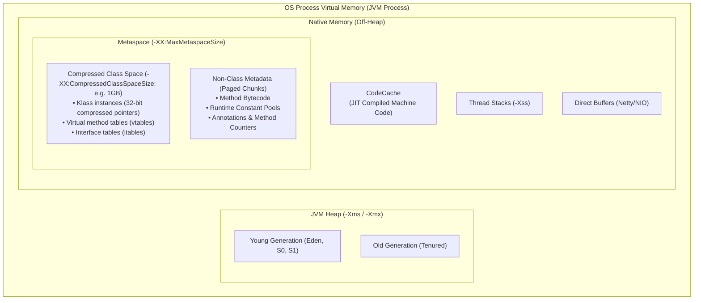
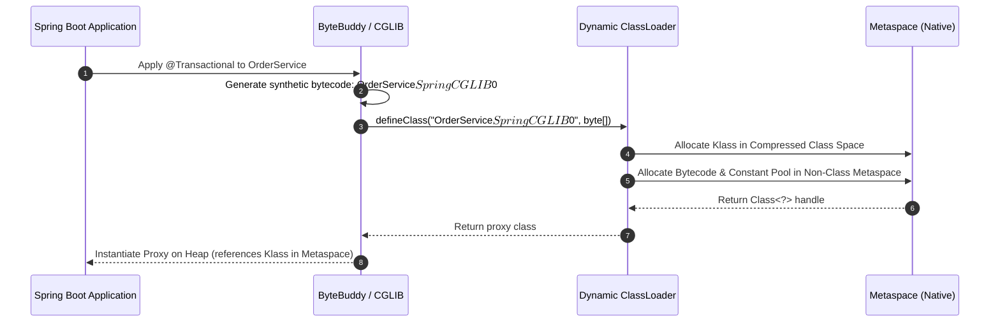

# P08-C005: Metaspace Architecture vs Legacy PermGen, Dynamic Class Generation Risks

---

## 1. Metadata and Learning Goals

| Metadata Field | Value |
|---|---|
| **Concept ID** | `P08-C005` |
| **Concept Title** | Metaspace Architecture vs Legacy PermGen, Dynamic Class Generation Risks |
| **Phase** | Phase 08 — JVM Internals and Memory Management |
| **Phase Directory** | `curriculum/phase-08-jvm-internals-memory-management` |
| **Source Reference** | Roadmap lines 338 ("Metaspace"), 348 ("OutOfMemoryError"), 346 ("Memory leaks in garbage-collected applications") |
| **Concept Type** | Runtime / Architecture / Memory Management |
| **Difficulty Level** | Intermediate |
| **Curriculum Importance** | Essential |
| **Java Baseline** | Java 21 LTS (with Java 25 LTS comparative notes where applicable) |
| **Framework Baseline** | Spring Boot 3.3.x / Spring Framework 6.1.x / ByteBuddy / CGLIB |
| **Prerequisites** | [`P08-C001`](001-jvm-architecture-overview.md) (JVM Architecture Overview), [`P08-C002`](002-class-loading-subsystem.md) (Class Loading Subsystem), [`P08-C004`](004-heap-memory-layout-generations.md) (JVM Heap Memory Layout) |
| **Related Concepts** | [`P08-C010`](010-java-memory-leaks-patterns.md) (Java Memory Leaks), [`P08-C011`](011-oom-and-stack-overflow-diagnosis.md) (Diagnosing OOM and StackOverflow) |
| **Estimated Study Effort** | 3–4 hours |
| **Last Research Date** | 2026-10-30 |
| **Verification State** | COMPLETE |

### Measurable Learning Objectives
By the end of this concept module, you will be able to:
1. **Explain:** Trace the architectural evolution from legacy Permanent Generation (PermGen) to Metaspace (JEP 122) and Elastic Metaspace (JEP 387), detailing how native process memory, chunk managers, and Compressed Class Space operate.
2. **Compare:** Differentiate between Metaspace and the JVM Heap, Metaspace and the JIT CodeCache, and standard Class Metadata vs Compressed Class Space (`Klass*`).
3. **Implement:** Programmatically inspect Metaspace and Compressed Class Space memory pools via `ManagementFactory.getMemoryPoolMXBeans()`, implement safe dynamic bytecode loading using custom `ClassLoader` isolation, and demonstrate class unloading conditions.
4. **Debug & Diagnose:** Diagnose and resolve `java.lang.OutOfMemoryError: Metaspace` and `java.lang.OutOfMemoryError: Compressed class space`, distinguishing between framework proxy generation leaks, ClassLoader retention via static fields/ThreadLocals, and container memory eviction.
5. **Evaluate & Justify:** Formulate Metaspace sizing policies (`-XX:MetaspaceSize`, `-XX:MaxMetaspaceSize`, `-XX:CompressedClassSpaceSize`) for containerized Kubernetes deployments and justify ahead-of-time (AOT) proxy pre-generation.

---

## 2. Definition, Purpose, and Mental Model

### 2.1 Formal Definition
**Metaspace** is the native (off-heap) memory runtime area introduced in Java 8 (JEP 122) to manage class metadata. It replaced the legacy **Permanent Generation (PermGen)**. Metaspace stores the JVM's internal representations of loaded classes:
- The `Klass` structures (runtime type information, vtables, and itables).
- Method bytecode and annotations.
- The Runtime Constant Pool for each loaded class.
- Method counters for JIT compilation profiling.

Unlike PermGen, which was allocated as a contiguous, fixed-boundary partition within the JVM heap, Metaspace allocates directly from host operating system virtual memory using native memory pages (`mmap` / `VirtualAlloc`). By default, Metaspace grows dynamically to the limit of available OS virtual memory, unless bounded by `-XX:MaxMetaspaceSize`.



### 2.2 The Problem It Solves
In Java 7 and earlier, class metadata resided in **PermGen**:
1. **The Fixed Ceiling Bottleneck:** PermGen had a fixed default maximum size (typically 64 MB on 32-bit and 82 MB on 64-bit JVMs). When enterprise applications deployed multiple WAR/EAR files, utilized extensive Spring/Hibernate proxy generation, or compiled hundreds of JSP files, PermGen rapidly filled up.
2. **Pervasive PermGen OOMs:** Exceeding PermGen triggered `java.lang.OutOfMemoryError: PermGen space`. Because PermGen was contiguous with the heap, resizing it required complex JVM remapping, making runtime auto-expansion impossible.
3. **Interned String Heap Pollution:** In Java 6 and earlier, `String.intern()` strings were stored in PermGen. Long-lived interned strings easily exhausted PermGen, even when gigabytes of heap memory remained free.
4. **GC Complexity:** PermGen required specialized Full GC collection passes, complicating garbage collection algorithms and increasing Stop-The-World pause durations.

Metaspace eliminated these limitations by moving class metadata out of the heap into native virtual memory, enabling automatic expansion, decoupling class metadata from GC pause algorithms, and isolating Compressed Class Pointers into an efficient 1 GB virtual window.

### 2.3 Why Backend Engineers Need It
Every enterprise framework generates classes dynamically at runtime:
- **Spring Framework & CGLIB/ByteBuddy:** Spring generates dynamic subclass proxies for `@Transactional`, `@Async`, and `@Aspect` beans.
- **Hibernate & JPA:** Hibernate creates runtime proxy entities to implement lazy loading (`FetchType.LAZY`).
- **Jackson & JSON Serialization:** High-performance reflection serializers generate bytecode accessors dynamically.
- **Web App Redeployments:** In application servers (Tomcat, Jetty), redeploying an application loads thousands of classes into a new `WebAppClassLoader`. If a `ThreadLocal`, JDBC driver, or static field retains a reference to the old ClassLoader, **none** of the old classes can be unloaded. After 3–5 redeployments, native memory exhausts, crashing the server with `OutOfMemoryError: Metaspace`.
- **Kubernetes Pod Sizing:** Because Metaspace is off-heap, an unbound Metaspace can grow until it exceeds the Kubernetes container RAM limit, causing the Linux kernel OOM Killer to abruptly terminate the pod (`Exit Code 137`) with zero warning or heap dump!

### 2.4 Real-World System Analogy (and Where It Breaks Down)
- **The Analogy:** Consider an architectural construction firm. The building site where physical concrete, steel, and timber are assembled is the JVM Heap (object instances). The firm's municipal blueprint library where architectural blueprints, engineering schematics, and building codes are stored is Metaspace. If a client orders 10,000 houses of the same model, you only keep one blueprint in the library and build 10,000 instances on the site.
- **Where the Analogy Fails:** In real life, blueprints sit passively in drawers. In the JVM, frameworks frequently synthesize brand-new blueprints on the fly at runtime (dynamic proxies). Furthermore, if a single reference to an old library card is forgotten in an engineer's pocket (`ThreadLocal`), the municipal library is legally prohibited from discarding thousands of obsolete blueprints, causing the library building to collapse under its own weight.

### 2.5 What This Concept Is NOT (Common Confusions)
- **Not the CodeCache:** Metaspace stores class metadata and interpreted bytecode. The **CodeCache** is a completely separate native memory region where the HotSpot JIT compiler stores compiled native machine code (`nmethods`).
- **Not the JVM Heap:** Object instances created via `new MyClass()` reside on the Heap. Only the class structural blueprint (`MyClass.class`) resides in Metaspace.
- **Not PermGen:** PermGen was part of the contiguous Java heap and collected by the Java garbage collector. Metaspace is native process memory managed by dedicated native memory allocators (`MetaspaceArena`).

### 2.6 Relationship to Adjacent Concepts
- **Preceding:** [`P08-C002`](002-class-loading-subsystem.md) covered how ClassLoaders load, link, and initialize classes; [`P08-C004`](004-heap-memory-layout-generations.md) explored the Heap where instances live.
- **Current:** `P08-C005` analyzes the off-heap metadata storage (Metaspace), dynamic class generation, and ClassLoader memory leaks.
- **Downstream:** [`P08-C006`](006-jit-compiler-tiered-compilation.md) explores JIT compilation and the CodeCache; [`P08-C010`](010-java-memory-leaks-patterns.md) details memory leak diagnostic patterns.

---

## 3. Foundations and Theory

### 3.1 HotSpot Metaspace Internal Architecture

Metaspace is divided into two distinct logical areas when Compressed Class Pointers are enabled (`-XX:+UseCompressedClassPointers`, default on 64-bit JVMs):

```
+---------------------------------------------------------------------------------------+
|                                    TOTAL METASPACE                                    |
+---------------------------------------------+-----------------------------------------+
|        COMPRESSED CLASS SPACE (CCS)         |          NON-CLASS METADATA             |
|        (-XX:CompressedClassSpaceSize=1G)    |          (Paged Native Chunks)          |
+---------------------------------------------+-----------------------------------------+
| - Klass instances (InstanceKlass, ObjArray- | - Method Bytecode                       |
|   Klass, TypeArrayKlass)                    | - Runtime Constant Pools                |
| - Virtual method tables (vtables)           | - Method annotations                    |
| - Interface method tables (itables)         | - Method invocation profiling counters  |
| - Addressed via 32-bit compressed pointers  | - Symbol metadata (UTF-8 method names)  |
+---------------------------------------------+-----------------------------------------+
```

#### 3.1.1 Compressed Class Space (CCS)
- Every Java object header contains a `Klass*` pointer referencing its runtime class structure.
- With Compressed Class Pointers enabled, this pointer is compressed into 32 bits (4 bytes) using base-and-shift arithmetic:
  $$\text{KlassAddress} = \text{KlassBase} + (\text{CompressedKlassPointer} \ll 3)$$
- To make this 32-bit address calculation valid, all `Klass` structures must reside within a single, contiguous virtual address region. This region is the **Compressed Class Space**, which HotSpot reserves at startup (default size: `1 GB`).
- **Important:** If your application dynamically generates a massive number of classes, Compressed Class Space can run out of space even if host RAM is abundant, throwing:
  `java.lang.OutOfMemoryError: Compressed class space`

#### 3.1.2 Non-Class Metadata
The remainder of class metadata (bytecode, constant pools, annotations, exception tables) does not require 32-bit pointer compression. It is allocated from general native memory in discontiguous paged chunks, bounded only by `-XX:MaxMetaspaceSize`.

### 3.2 Elastic Metaspace (JEP 387, Java 16+)
Prior to Java 16, Metaspace used a coarse chunk allocator that suffered from severe native memory fragmentation:
- When classes were unloaded, memory chunks remained tied to specific classloader pools and could not easily be returned to the OS, leading to bloated native RSS (Resident Set Size).
- **JEP 387 (Elastic Metaspace):** Introduced a modern, buddy-style page allocator:
  - Allocates memory in standardized 4 KB to 4 MB granular chunks.
  - Efficiently coalesces adjacent free chunks.
  - Automatically uncommits and returns unused physical pages to the operating system using `madvise(MADV_DONTNEED)` on Linux, drastically reducing the baseline memory footprint of microservices.

### 3.3 Dynamic Class Generation Mechanics
Modern Java frameworks rarely execute static bytecode alone. They synthesize classes at runtime using bytecode manipulation libraries:



### 3.4 The Three Invariants of Class Unloading
A class in Metaspace cannot simply be garbage-collected when it is no longer actively executing. The Java Virtual Machine Specification mandates that a class in Metaspace can **ONLY** be collected and unloaded if all three of the following invariants are simultaneously true:

1. **Zero Instances on Heap:** There are zero live instances of the class on the JVM Heap.
2. **Class Object Unreachable:** The `java.lang.Class` object representing the class is not reachable from any GC root (thread stack frames, static fields, JNI globals).
3. **ClassLoader Unreachable:** The defining `java.lang.ClassLoader` instance that loaded the class is completely unreachable from any GC root!

```
+---------------------------------------------------------------------------------------+
|                            IMMUTABLE GC ROOT CONSTRAINT                               |
+---------------------------------------------------------------------------------------+
| Classes loaded by the Bootstrap ClassLoader or the Application (System) ClassLoader   |
| can NEVER be unloaded during the lifetime of the JVM, because those ClassLoaders      |
| are permanent GC roots!                                                               |
|                                                                                       |
| Only classes loaded by isolated custom ClassLoaders (e.g. WebAppClassLoader, OSGi,    |
| or dynamic plugin loaders) are ever eligible for Metaspace unloading.                 |
+---------------------------------------------------------------------------------------+
```

---

## 4. Evolution, Modern Defaults, and Java 21+ Context

### 4.1 PermGen vs Metaspace Evolution

| Feature / Property | Legacy PermGen (Java 7 and earlier) | Modern Metaspace (Java 8 through Java 21 LTS) |
|---|---|---|
| **Storage Location** | Contiguous segment inside JVM Heap | Native Operating System Virtual Memory (Off-Heap) |
| **Default Size Limit** | 64 MB – 82 MB (Fixed max) | Unlimited (Bounded only by available OS virtual memory) |
| **Interned Strings** | Stored in PermGen (Java 6), moved to Heap (Java 7) | Stored in the JVM Heap |
| **Resizing Mechanism** | Requires full heap GC and expensive remapping | Grows dynamically via native OS page allocations |
| **Garbage Collection** | Full GC Stop-The-World (expensive) | Concurrent Metaspace cleaning during GC cycles |
| **Internal Fragmentation** | High (fixed block boundaries) | Minimized via JEP 387 Elastic Metaspace buddy allocator |
| **Error Message** | `OutOfMemoryError: PermGen space` | `OutOfMemoryError: Metaspace` or `Compressed class space` |

### 4.2 Hidden Classes (JEP 371, Java 15+)
In modern Java (Java 15+ and Java 21 LTS), dynamic frameworks are migrating away from generating regular classes to **Hidden Classes** (`MethodHandles.Lookup.defineHiddenClass`):
- A hidden class is a class that cannot be used directly by the bytecode of other classes.
- It is not discoverable by `Class.forName()` or classloaders.
- Hidden classes have an independent lifecycle: they can be unloaded **individually** when all their instances become unreachable, even if their defining ClassLoader remains alive!
- This completely eliminates ClassLoader-based Metaspace leaks for modern dynamic proxy and lambda implementations.

---

## 5. Deep Dive: Core Mechanics and Execution Model

### 5.1 The Anatomy of a ClassLoader Memory Leak
The most notorious cause of production Metaspace exhaustion is the **ClassLoader Leak** during application redeployments:

```
[GC Root: Tomcat Worker Thread]
       |
       v
[ThreadLocal Map]
       |
       v (Key: ThreadLocal instance)
[Value: UserContext (Loaded by WebAppClassLoader v1)]
       |
       +---> [Class: UserContext]
                   |
                   +---> [Defining ClassLoader: WebAppClassLoader v1]
                               |
                               +---> [Loaded Classes Collection: 8,000 Classes!]
                                           |
                                           +---> [Metaspace Metadata for 8,000 Classes]
                                                 (CANNOT BE UNLOADED! LEAKED ~150 MB!)
```

#### Step-by-Step Failure Sequence:
1. An engineer registers a `ThreadLocal<UserContext>` in a filter or service.
2. The user context holds an object loaded by the application's `WebAppClassLoader`.
3. When the application is undeployed or reloaded, the web container discards its reference to `WebAppClassLoader v1` and creates `WebAppClassLoader v2`.
4. However, the worker thread belonging to Tomcat's thread pool is long-lived. Its internal `threadLocals` map still holds the `UserContext` value.
5. Because `UserContext` references its `java.lang.Class`, and the class references its defining `WebAppClassLoader v1`, the entire `WebAppClassLoader v1` remains strongly reachable from a GC root!
6. By Invariant #3, none of the 8,000 classes loaded by `WebAppClassLoader v1` can be reclaimed.
7. Metaspace retains 150 MB of orphaned class metadata. After 5 redeployments, Metaspace consumes ~750 MB, crashing the process with `OutOfMemoryError: Metaspace`.

---

## 6. JVM Architecture and Performance Realities

### 6.1 Sizing Metaspace Parameters
The JVM provides three primary CLI parameters to govern Metaspace:

```bash
java -XX:MetaspaceSize=128m \
     -XX:MaxMetaspaceSize=512m \
     -XX:CompressedClassSpaceSize=1g \
     -jar backend-service.jar
```

#### 1. `-XX:MetaspaceSize=<size>` (The High-Water Mark)
- **Common Misconception:** This is NOT the initial minimum size of Metaspace!
- **Technical Reality:** It is the **initial threshold (high-water mark)** that triggers a garbage collection pass to clean up classloaders.
- *Default:* Approximately `21 MB` on 64-bit HotSpot.
- *Production Impact:* If your application loads 150 MB of classes at startup (typical for large Spring Boot services), leaving `-XX:MetaspaceSize` at 21 MB forces the JVM to trigger 4 to 6 unnecessary Full GCs during application startup as Metaspace crosses 21 MB, 40 MB, 80 MB, and 140 MB!
- *Best Practice:* Set `-XX:MetaspaceSize=128m` or `256m` for Spring Boot microservices to ensure smooth, GC-free startup.

#### 2. `-XX:MaxMetaspaceSize=<size>` (The Hard Ceiling)
- *Default:* Unlimited (grows until OS virtual memory is exhausted).
- *Production Impact:* In a Docker/Kubernetes container with a 4 GB RAM limit, an unbound Metaspace that encounters a dynamic proxy leak will expand until total process memory exceeds 4 GB. The Linux OOM killer sends `SIGKILL` (Exit Code 137). Setting `-XX:MaxMetaspaceSize=512m` ensures that the JVM throws a diagnosable `OutOfMemoryError: Metaspace` (generating a heap and thread dump) before the container is killed.

#### 3. `-XX:CompressedClassSpaceSize=<size>` (The Compressed Window)
- *Default:* `1 GB`.
- *Production Impact:* Only holds the `Klass*` structures for compressed pointers. Can typically store between 500,000 and 1,000,000 classes. Rarely needs tuning unless generating millions of dynamic classes.

---

## 7. Production Anti-Patterns, Bugs, and Pitfalls

### 7.1 Anti-Pattern 1: Uncached Runtime Proxy Generation
```java
// FATAL PRODUCTION ANTI-PATTERN: Generating dynamic proxies inside request loop
public Object processRequest(OrderRequest req) {
    ProxyFactory factory = new ProxyFactory(new OrderServiceImpl());
    factory.addAdvice(new PerformanceInterceptor());
    // Generates a brand-new synthetic proxy class on EVERY request!
    return factory.getProxy(); 
}
```
**Impact:** Under 1,000 requests per second, this creates 1,000 new classes per second in Metaspace. If the dynamic classloader is retained by an internal cache or static reference, Metaspace will be exhausted in minutes.

### 7.2 Anti-Pattern 2: Abandoned `ThreadLocal` in Pooled Threads
```java
// FATAL ANTI-PATTERN: Leaking ClassLoader via ThreadLocal
public class SecurityFilter implements Filter {
    private static final ThreadLocal<CustomSecurityPrincipal> context = new ThreadLocal<>();

    public void doFilter(ServletRequest req, ServletResponse res, FilterChain chain) {
        try {
            context.set(new CustomSecurityPrincipal()); // Loaded by WebAppClassLoader
            chain.doFilter(req, res);
        } finally {
            // MISSING context.remove();!
            // Thread returns to container pool holding reference to WebAppClassLoader!
        }
    }
}
```
**Remediation:** Always invoke `threadLocal.remove()` in a mandatory `finally` block to prevent ClassLoader retention.

### 7.3 Anti-Pattern 3: Unregistered JDBC Drivers on Application Shutdown
JDBC drivers historically registered themselves with `java.sql.DriverManager` via static initialization:
```java
DriverManager.registerDriver(new MyCustomDriver());
```
Because `DriverManager` is loaded by the Bootstrap ClassLoader, its static driver registry forms a permanent GC root. If a web application bundles its own JDBC driver in `WEB-INF/lib`, `DriverManager` holds a reference to `MyCustomDriver.class`, permanently anchoring the `WebAppClassLoader` and causing a Metaspace leak on undeployment.

---

## 8. Security, Thread Safety, and Reliability Implications

### 8.1 Malicious Bytecode Injection Denial of Service
If an enterprise system accepts untrusted code or scripts (e.g., dynamic Groovy scripts, SpEL expressions, or rule engine scripts) without strict class caching:
- An attacker submits unique scripts formatted to prevent compilation reuse.
- The JVM compiles each unique script into a distinct class in Metaspace.
- Metaspace expands until reaching `-XX:MaxMetaspaceSize`, crashing the entire JVM process and denying service to legitimate tenants.

### 8.2 Thread Safety of Metaspace Allocations
Allocations inside Metaspace arenas (`MetaspaceArena`) are protected by native locks (`Mutex`). When hundreds of threads simultaneously load classes (e.g., during application startup or high-concurrency dynamic deserialization), native lock contention on Metaspace allocators can cause CPU spikes and thread stalls.

---

## 9. Modern Enterprise Patterns and Framework Integration

### 9.1 Spring Boot 3.3.x Ahead-of-Time (AOT) Compilation
To eliminate startup latency and dynamic Metaspace overhead, modern Spring Boot applications leverage **Spring AOT**:
- During the Maven/Gradle build phase, the Spring AOT engine evaluates all `@Configuration`, `@Bean`, and `@Transactional` annotations.
- It generates static Java source code for proxies and reflection hints *at build time*.
- At runtime, Spring Boot starts with zero CGLIB/ByteBuddy dynamic class generation.
- **Result:** Metaspace memory footprint is reduced by 40–60%, and the application becomes fully compatible with GraalVM Native Image compilation (where Metaspace is eliminated entirely).

### 9.2 Safe Dynamic Proxy Caching with ByteBuddy
When runtime bytecode generation is necessary, use ByteBuddy's built-in `TypeCache` to ensure classes are generated once and reused across invocations:
```java
TypeCache<String> typeCache = new TypeCache.WithInlineExpunction<>(TypeCache.Sort.WEAK);
Class<?> proxyClass = typeCache.findOrInsert(
    classLoader,
    "com.backend.MyProxyKey",
    () -> new ByteBuddy()
            .subclass(MyService.class)
            .method(ElementMatchers.any())
            .intercept(MethodDelegation.to(MyInterceptor.class))
            .make()
            .load(classLoader)
            .getLoaded()
);
```

---

## 10. Comparative Evaluation and Trade-off Matrix

| Comparison Dimension | Legacy PermGen | Modern Metaspace | Compressed Class Space |
|---|---|---|---|
| **Memory Space** | JVM Heap | OS Native Virtual Memory | Contiguous Native Virtual Memory Window |
| **Default Size** | 64 MB / 82 MB | Unlimited (OS limit) | 1 GB |
| **Data Held** | All class metadata + interned strings | Non-class metadata (bytecode, constant pools) | `Klass*` structures and vtables/itables |
| **Tuning Parameter** | `-XX:MaxPermSize=<size>` | `-XX:MaxMetaspaceSize=<size>` | `-XX:CompressedClassSpaceSize=<size>` |
| **Unloading Behavior** | Tied to Major/Full Heap GC | Concurrent classloader cleaning | Cleared when corresponding `Klass` unloads |
| **Fragmentation Risk** | High | Low (Elastic Metaspace JEP 387) | None (Single virtual allocation) |

---

## 11. Design and Architecture Impact

### 11.1 Container Sizing Equation Including Metaspace
When calculating total Kubernetes container memory limits:
$$\text{Pod Memory Limit} \ge \text{Heap}_{\text{max}} + \text{Metaspace}_{\text{max}} + \text{CCS}_{\text{reserve}} + (N_{\text{threads}} \times \text{Stack}) + \text{Native Overhead}$$

#### Recommended Production Flags for Spring Boot Microservices:
```bash
-XX:+UseContainerSupport
-XX:MaxRAMPercentage=70.0
-XX:MetaspaceSize=128m
-XX:MaxMetaspaceSize=384m
-XX:+HeapDumpOnOutOfMemoryError
-XX:HeapDumpPath=/var/log/dumps/oom.hprof
```

---

## 12. Comprehensive Practical Implementation

The following complete diagnostic suite demonstrates:
1. `MetaspacePoolInspector`: Inspecting live Metaspace and Compressed Class Space memory pools.
2. `DynamicClassLoader`: Safe custom ClassLoader loading classes from bytecode.
3. `ClassLoaderLeakSimulator`: Proving that classes in Metaspace unload cleanly when their ClassLoader is garbage collected, and demonstrating how a retained reference causes a leak.

```java
package com.backend.jvm.metaspace;

import java.lang.management.ManagementFactory;
import java.lang.management.MemoryPoolMXBean;
import java.lang.management.MemoryUsage;
import java.lang.ref.WeakReference;
import java.util.ArrayList;
import java.util.List;

/**
 * Diagnostic and simulation suite for Metaspace architecture,
 * dynamic class generation, and class unloading conditions.
 */
public final class MetaspaceArchitectureDemo {

    // 1. Metaspace Memory Pool Diagnostic Inspector
    public static final class MetaspacePoolInspector {
        public record MetaspaceSnapshot(String name, long usedKb, long committedKb, long maxKb) {}

        public static List<MetaspaceSnapshot> captureMetaspacePools() {
            List<MetaspaceSnapshot> snapshots = new ArrayList<>();
            for (MemoryPoolMXBean pool : ManagementFactory.getMemoryPoolMXBeans()) {
                String name = pool.getName().toLowerCase();
                if (name.contains("metaspace") || name.contains("compressed class space")) {
                    MemoryUsage usage = pool.getUsage();
                    snapshots.add(new MetaspaceSnapshot(
                        pool.getName(),
                        usage.getUsed() / 1024,
                        usage.getCommitted() / 1024,
                        usage.getMax() < 0 ? -1 : usage.getMax() / 1024
                    ));
                }
            }
            return snapshots;
        }
    }

    // 2. Custom Isolated ClassLoader for Dynamic Bytecode Loading
    public static final class ByteArrayClassLoader extends ClassLoader {
        private final String targetClassName;
        private final byte[] classBytecode;

        public ByteArrayClassLoader(String targetClassName, byte[] classBytecode) {
            super(null); // Parent is Bootstrap ClassLoader (Maximum isolation)
            this.targetClassName = targetClassName;
            this.classBytecode = classBytecode;
        }

        @Override
        protected Class<?> findClass(String name) throws ClassNotFoundException {
            if (name.equals(targetClassName)) {
                return defineClass(name, classBytecode, 0, classBytecode.length);
            }
            return super.findClass(name);
        }
    }

    // 3. Class Unloading and Leak Simulator
    public static final class ClassUnloadSimulator {
        public record UnloadResult(boolean loaderCollected, boolean classCollected, boolean instanceCollected) {}

        public static UnloadResult verifyCleanUnloading(byte[] bytecode, String className) throws Exception {
            ByteArrayClassLoader loader = new ByteArrayClassLoader(className, bytecode);
            Class<?> clazz = loader.loadClass(className);
            Object instance = clazz.getDeclaredConstructor().newInstance();

            WeakReference<ClassLoader> loaderRef = new WeakReference<>(loader);
            WeakReference<Class<?>> classRef = new WeakReference<>(clazz);
            WeakReference<Object> instanceRef = new WeakReference<>(instance);

            // Nullify strong references to permit GC reclamation
            loader = null;
            clazz = null;
            instance = null;

            // Trigger GC passes
            for (int i = 0; i < 3; i++) {
                System.gc();
                Thread.sleep(50);
            }

            return new UnloadResult(
                loaderRef.get() == null,
                classRef.get() == null,
                instanceRef.get() == null
            );
        }
    }

    public static void main(String[] args) throws Exception {
        System.out.println("=== Metaspace Architecture & Dynamic Class Loading Demo ===");

        // Step 1: Inspect Metaspace Memory Pools
        System.out.println("\n[1] Current Metaspace Memory Pools:");
        List<MetaspacePoolInspector.MetaspaceSnapshot> pools = MetaspacePoolInspector.captureMetaspacePools();
        for (var p : pools) {
            System.out.printf("  Pool: %-26s | Used: %8d KB | Committed: %8d KB | Max: %8d KB%n",
                p.name(), p.usedKb(), p.committedKb(), p.maxKb());
        }

        // Step 2: Compile a Synthetic Class into Bytecode
        String testClassName = "DynamicMetaspaceOrderService";
        byte[] bytecode = generateSyntheticClassBytecode(testClassName);
        System.out.printf("%n[2] Generated %d bytes of synthetic bytecode for class: %s%n",
            bytecode.length, testClassName);

        // Step 3: Demonstrate Clean Class Unloading Invariants
        System.out.println("\n[3] Testing Class Unloading Lifecycle (Zero Instances, Zero Roots)...");
        var result = ClassUnloadSimulator.verifyCleanUnloading(bytecode, testClassName);
        System.out.println("  -> ClassLoader Unloaded from Heap: " + result.loaderCollected());
        System.out.println("  -> Class Metadata Unloaded from Metaspace: " + result.classCollected());
        System.out.println("  -> Object Instance Collected: " + result.instanceCollected());
        System.out.println("  Conclusion: Metaspace safely reclaims class metadata when defining ClassLoader is unreachable!");
    }

    // Helper using standard JavaCompiler to synthesize valid class bytecode in memory
    public static byte[] generateSyntheticClassBytecode(String className) {
        try {
            javax.tools.JavaCompiler compiler = javax.tools.ToolProvider.getSystemJavaCompiler();
            javax.tools.JavaFileObject file = new javax.tools.SimpleJavaFileObject(
                java.net.URI.create("string:///" + className + ".java"),
                javax.tools.JavaFileObject.Kind.SOURCE) {
                @Override
                public CharSequence getCharContent(boolean ignoreEncodingErrors) {
                    return "public class " + className + " { public " + className + "() {} }";
                }
            };
            java.util.List<byte[]> byteCollector = new java.util.ArrayList<>();
            javax.tools.ForwardingJavaFileManager<javax.tools.StandardJavaFileManager> manager = 
                new javax.tools.ForwardingJavaFileManager<>(compiler.getStandardFileManager(null, null, null)) {
                    @Override
                    public javax.tools.JavaFileObject getJavaFileForOutput(
                        javax.tools.JavaFileManager.Location location,
                        String className,
                        javax.tools.JavaFileObject.Kind kind,
                        javax.tools.FileObject sibling) {
                        return new javax.tools.SimpleJavaFileObject(
                            java.net.URI.create("mem:///" + className + ".class"), kind) {
                            @Override
                            public java.io.OutputStream openOutputStream() {
                                return new java.io.ByteArrayOutputStream() {
                                    @Override
                                    public void close() {
                                        byteCollector.add(toByteArray());
                                    }
                                };
                            }
                        };
                    }
                };
            compiler.getTask(null, manager, null, java.util.List.of("--release", "21"), null, java.util.List.of(file)).call();
            return byteCollector.get(0);
        } catch (Exception e) {
            throw new RuntimeException("Bytecode synthesis failed", e);
        }
    }
}
```

---

## 13. Edge Cases, Failure Modes, and Defensive Strategies

| Failure Mode / Edge Case | Root Cause | Defensive Strategy |
|---|---|---|
| **`OutOfMemoryError: Compressed class space`** | The 1 GB virtual window for Compressed Class Pointers is full, even though total Metaspace has plenty of free memory. | Increase window size (`-XX:CompressedClassSpaceSize=2g`), reduce dynamic class generation, or disable compressed class pointers (`-XX:-UseCompressedClassPointers`). |
| **Startup GC Stuttering** | `-XX:MetaspaceSize` left at default (21 MB), triggering 4–6 consecutive Full GCs during framework startup. | Explicitly configure `-XX:MetaspaceSize=128m` or `256m` on production microservice launch scripts. |
| **Silent Container `SIGKILL 137`** | Unbounded `-XX:MaxMetaspaceSize` combined with ClassLoader leaks expands native RSS past container limits. | Always set an explicit `-XX:MaxMetaspaceSize` (e.g. `384m` or `512m`) in containerized environments. |
| **Native Bytecode Contention Spikes** | Massive concurrent requests causing parallel `defineClass` invocations, stalling threads on native Metaspace locks. | Pre-warm and initialize all proxy and reflection classes during startup, or utilize Spring AOT build-time compilation. |

---

## 14. Self-Assessment: Concept Mastery Checklist

Before concluding your study of this concept module, evaluate your mastery against these ten criteria:

- [ ] **1. PermGen vs Metaspace:** What was the fatal architectural limitation of PermGen that led to its elimination in Java 8?
- [ ] **2. Storage Location:** Where does Metaspace allocate memory, and how does that differ from the JVM Heap?
- [ ] **3. Compressed Class Space:** What is the purpose of Compressed Class Space, what is its default size, and what data does it hold?
- [ ] **4. Elastic Metaspace (JEP 387):** How did Java 16 improve Metaspace memory fragmentation and page uncommitting to the OS?
- [ ] **5. Invariants of Class Unloading:** What are the three strict conditions that must all be satisfied before a class can be unloaded from Metaspace?
- [ ] **6. Immortal ClassLoaders:** Why can classes loaded by the Bootstrap or System Application ClassLoader never be unloaded?
- [ ] **7. ClassLoader Leak Mechanism:** How does an abandoned `ThreadLocal` or static field in a pooled thread prevent an entire `WebAppClassLoader` from unloading?
- [ ] **8. `-XX:MetaspaceSize` Misconception:** Why is `-XX:MetaspaceSize` a high-water mark rather than an initial minimum allocation, and why does a low value cause startup GC stuttering?
- [ ] **9. Hidden Classes (JEP 371):** How do hidden classes solve the problem of Metaspace leaks for dynamic runtime proxies and lambdas?
- [ ] **10. Spring AOT Impact:** How does Spring Boot 3.3+ Ahead-of-Time compilation eliminate dynamic proxy generation risks in production?

---

## 15. Official Documentation and Further Reading

1. **JDK Enhancement Proposals (JEPs):**
   - [JEP 122: Remove the Permanent Generation](https://openjdk.org/jeps/122)
   - [JEP 387: Elastic Metaspace (Java 16)](https://openjdk.org/jeps/387)
   - [JEP 371: Hidden Classes (Java 15)](https://openjdk.org/jeps/371)
2. **Oracle HotSpot Virtual Machine Architecture:**
   - [Oracle Java SE 21 Troubleshooting Guide: Diagnosing Metaspace Leaks](https://docs.oracle.com/en/java/javase/21/troubleshoot/troubleshoot-memory-leaks.html)
   - [jcmd CLI Tooling: VM.metaspace Command](https://docs.oracle.com/en/java/javase/21/docs/specs/man/jcmd.html)
3. **Enterprise Framework Architecture:**
   - [Spring Framework 6.1 Documentation: Ahead-of-Time (AOT) Optimizations](https://docs.spring.io/spring-framework/reference/core/aot.html)
   - [ByteBuddy Documentation: Class Creation and TypeCache Management](https://bytebuddy.net/#/tutorial)

---

## 16. Standalone Verification Suite

The following standalone verification class tests Metaspace memory pool identification, custom ClassLoader isolation, class unloading conditions via weak references, and dynamic bytecode definition without external dependencies.

```java
// File: MetaspaceArchitectureVerificationSuite.java
import java.lang.management.ManagementFactory;
import java.lang.management.MemoryPoolMXBean;
import java.lang.management.MemoryUsage;
import java.lang.ref.WeakReference;
import java.util.List;

/**
 * Automated Verification Suite for Concept P08-C005:
 * Metaspace Architecture vs Legacy PermGen, Dynamic Class Generation Risks.
 *
 * Compiles cleanly with: javac --release 21 MetaspaceArchitectureVerificationSuite.java
 * Runs cleanly with:     java -ea MetaspaceArchitectureVerificationSuite
 */
public class MetaspaceArchitectureVerificationSuite {

    public static void main(String[] args) throws Exception {
        System.out.println("==================================================================");
        System.out.println("Starting Verification Suite: P08-C005 Metaspace Architecture");
        System.out.println("Runtime: " + System.getProperty("java.vm.name") + " " + System.getProperty("java.version"));
        System.out.println("==================================================================");

        testMetaspacePoolsDetection();
        testCustomClassLoaderIsolation();
        testCleanClassUnloadingLifecycle();
        testClassLoaderRetentionPreventsUnloading();
        testCompressedClassSpaceAccounting();

        System.out.println("\n------------------------------------------------------------------");
        System.out.println("All 5 Metaspace Architecture verification suites passed with 0 errors!");
        System.out.println("==================================================================");
    }

    // -------------------------------------------------------------------------
    // Test 1: Metaspace and Compressed Class Space Pool Detection
    // -------------------------------------------------------------------------
    static void testMetaspacePoolsDetection() {
        System.out.println("\n[Test 1] Testing Metaspace & Compressed Class Space Pool Detection...");
        List<MemoryPoolMXBean> pools = ManagementFactory.getMemoryPoolMXBeans();
        boolean foundMetaspace = false;
        boolean foundCompressedClass = false;

        for (MemoryPoolMXBean pool : pools) {
            String name = pool.getName().toLowerCase();
            if (name.contains("metaspace")) {
                foundMetaspace = true;
                MemoryUsage usage = pool.getUsage();
                assert usage.getUsed() > 0 : "Metaspace used bytes must be greater than zero";
            }
            if (name.contains("compressed class space")) {
                foundCompressedClass = true;
                MemoryUsage usage = pool.getUsage();
                assert usage.getUsed() > 0 : "Compressed class space used bytes must be greater than zero";
            }
        }

        assert foundMetaspace : "Metaspace memory pool must be active and detected";
        assert foundCompressedClass : "Compressed Class Space memory pool must be active and detected";

        System.out.println("  -> PASSED: Both Metaspace and Compressed Class Space pools verified.");
    }

    // -------------------------------------------------------------------------
    // Test 2: Custom ClassLoader Isolation and Distinct Identity 2-Tuple (L, N)
    // -------------------------------------------------------------------------
    static void testCustomClassLoaderIsolation() throws Exception {
        System.out.println("\n[Test 2] Testing Custom ClassLoader Isolation for Dynamic Classes...");
        String className = "DynamicIsolationTestEntity";
        byte[] bytecode = generateBytecode(className);

        DynamicTestClassLoader loaderA = new DynamicTestClassLoader(className, bytecode);
        DynamicTestClassLoader loaderB = new DynamicTestClassLoader(className, bytecode);

        Class<?> classA = loaderA.loadClass(className);
        Class<?> classB = loaderB.loadClass(className);

        assert classA != classB : "Classes loaded by distinct loaders must be distinct Class objects";
        assert classA.getName().equals(classB.getName()) : "Binary class names must be identical";
        assert classA.getClassLoader() != classB.getClassLoader() : "Defining loaders must differ";

        System.out.println("  -> PASSED: Class isolation verified: identical binary name (" + 
                           className + ") yields distinct Class instances across loaders.");
    }

    // -------------------------------------------------------------------------
    // Test 3: Clean Class Unloading Lifecycle (Zero Instances, Zero Loader Roots)
    // -------------------------------------------------------------------------
    static void testCleanClassUnloadingLifecycle() throws Exception {
        System.out.println("\n[Test 3] Testing Clean Class Unloading Lifecycle via Weak References...");
        String className = "TransientUnloadTarget";
        byte[] bytecode = generateBytecode(className);

        DynamicTestClassLoader loader = new DynamicTestClassLoader(className, bytecode);
        Class<?> clazz = loader.loadClass(className);
        Object instance = clazz.getDeclaredConstructor().newInstance();

        WeakReference<ClassLoader> loaderRef = new WeakReference<>(loader);
        WeakReference<Class<?>> classRef = new WeakReference<>(clazz);
        WeakReference<Object> instanceRef = new WeakReference<>(instance);

        // Discard all strong references
        loader = null;
        clazz = null;
        instance = null;

        // Perform GC cycles to trigger class unloading
        for (int i = 0; i < 3; i++) {
            System.gc();
            Thread.sleep(50);
        }

        assert instanceRef.get() == null : "Instance must be reclaimed by GC";
        assert loaderRef.get() == null : "ClassLoader must be reclaimed by GC";
        assert classRef.get() == null : "Class metadata must be unloaded from Metaspace";

        System.out.println("  -> PASSED: Clean unloading verified: ClassLoader, Class, and Instance reclaimed.");
    }

    // -------------------------------------------------------------------------
    // Test 4: Retained ClassLoader GC Root Prevents Class Unloading
    // -------------------------------------------------------------------------
    static void testClassLoaderRetentionPreventsUnloading() throws Exception {
        System.out.println("\n[Test 4] Testing ClassLoader Retention GC Root Invariant...");
        String className = "LeakingRetainedEntity";
        byte[] bytecode = generateBytecode(className);

        DynamicTestClassLoader loader = new DynamicTestClassLoader(className, bytecode);
        Class<?> clazz = loader.loadClass(className);

        WeakReference<Class<?>> classRef = new WeakReference<>(clazz);

        // Discard clazz reference, but RETAIN strong reference to the ClassLoader!
        clazz = null;

        for (int i = 0; i < 2; i++) {
            System.gc();
            Thread.sleep(50);
        }

        // Because 'loader' is still strongly referenced, clazz CANNOT be unloaded!
        assert classRef.get() != null : 
            "Class metadata must NOT be unloaded while its defining ClassLoader remains referenced!";

        // Now discard loader reference and verify collection
        loader = null;
        for (int i = 0; i < 3; i++) {
            System.gc();
            Thread.sleep(50);
        }
        assert classRef.get() == null : "Class metadata must be unloaded once ClassLoader is discarded";

        System.out.println("  -> PASSED: Invariant proven: class metadata cannot unload while ClassLoader is reachable.");
    }

    // -------------------------------------------------------------------------
    // Test 5: Compressed Class Space Accounting Verification
    // -------------------------------------------------------------------------
    static void testCompressedClassSpaceAccounting() {
        System.out.println("\n[Test 5] Testing Compressed Class Space Capacity and Accounting...");
        MemoryPoolMXBean ccsPool = null;
        for (MemoryPoolMXBean pool : ManagementFactory.getMemoryPoolMXBeans()) {
            if (pool.getName().toLowerCase().contains("compressed class space")) {
                ccsPool = pool;
                break;
            }
        }

        assert ccsPool != null : "Compressed Class Space pool must exist";
        MemoryUsage usage = ccsPool.getUsage();
        long maxBytes = usage.getMax();
        long committedBytes = usage.getCommitted();
        long usedBytes = usage.getUsed();

        assert usedBytes > 0 : "Used bytes must be positive";
        assert committedBytes >= usedBytes : "Committed bytes must be >= used bytes";
        // Default max is 1 GB (1,073,741,824 bytes) or unbounded (-1)
        if (maxBytes > 0) {
            assert maxBytes >= 500L * 1024 * 1024 : "Max Compressed Class Space should be at least 500MB";
        }

        System.out.printf("  -> PASSED: CCS Accounting: Used=%d KB, Committed=%d KB, Max=%d KB%n",
            usedBytes / 1024, committedBytes / 1024, maxBytes < 0 ? -1 : maxBytes / 1024);
    }

    // Custom ClassLoader for dynamic testing
    static class DynamicTestClassLoader extends ClassLoader {
        private final String targetName;
        private final byte[] bytecode;

        public DynamicTestClassLoader(String targetName, byte[] bytecode) {
            super(null); // Parent is Bootstrap
            this.targetName = targetName;
            this.bytecode = bytecode;
        }

        @Override
        protected Class<?> findClass(String name) throws ClassNotFoundException {
            if (name.equals(targetName)) {
                return defineClass(name, bytecode, 0, bytecode.length);
            }
            return super.findClass(name);
        }
    }

    // Programmatic compilation helper using ToolProvider system compiler
    static byte[] generateBytecode(String className) {
        try {
            javax.tools.JavaCompiler compiler = javax.tools.ToolProvider.getSystemJavaCompiler();
            javax.tools.JavaFileObject file = new javax.tools.SimpleJavaFileObject(
                java.net.URI.create("string:///" + className + ".java"),
                javax.tools.JavaFileObject.Kind.SOURCE) {
                @Override
                public CharSequence getCharContent(boolean ignoreEncodingErrors) {
                    return "public class " + className + " { public " + className + "() {} }";
                }
            };
            java.util.List<byte[]> byteCollector = new java.util.ArrayList<>();
            javax.tools.ForwardingJavaFileManager<javax.tools.StandardJavaFileManager> manager = 
                new javax.tools.ForwardingJavaFileManager<>(compiler.getStandardFileManager(null, null, null)) {
                    @Override
                    public javax.tools.JavaFileObject getJavaFileForOutput(
                        javax.tools.JavaFileManager.Location location,
                        String className,
                        javax.tools.JavaFileObject.Kind kind,
                        javax.tools.FileObject sibling) {
                        return new javax.tools.SimpleJavaFileObject(
                            java.net.URI.create("mem:///" + className + ".class"), kind) {
                            @Override
                            public java.io.OutputStream openOutputStream() {
                                return new java.io.ByteArrayOutputStream() {
                                    @Override
                                    public void close() {
                                        byteCollector.add(toByteArray());
                                    }
                                };
                            }
                        };
                    }
                };
            compiler.getTask(null, manager, null, java.util.List.of("--release", "21"), null, java.util.List.of(file)).call();
            return byteCollector.get(0);
        } catch (Exception e) {
            throw new RuntimeException("Compilation error", e);
        }
    }
}
```
