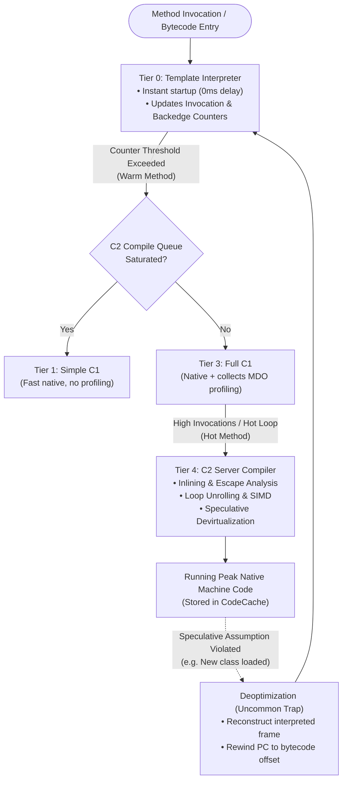
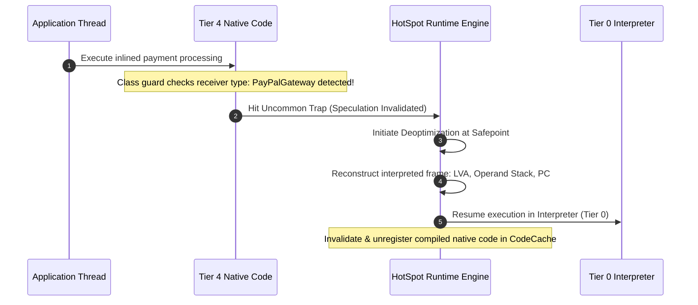

# P08-C006: Interpreter vs JIT Compilation: Tiered Compilation, C1, C2, and On-Stack Replacement

---

## 1. Metadata and Learning Goals

| Metadata Field | Value |
|---|---|
| **Concept ID** | `P08-C006` |
| **Concept Title** | Interpreter vs JIT Compilation: Tiered Compilation, C1, C2, and On-Stack Replacement |
| **Phase** | Phase 08 — JVM Internals and Memory Management |
| **Phase Directory** | `curriculum/phase-08-jvm-internals-memory-management` |
| **Source Reference** | Roadmap lines 335 ("Interpreter and JIT compilation"), 357 ("Understand what a profiler measures"), 358 ("Distinguish CPU-bound from I/O-bound workloads"), 359 ("Understand why premature optimization is dangerous"), 360 ("Learn basic benchmarking principles") |
| **Concept Type** | Runtime / Architecture / Execution Engine |
| **Difficulty Level** | Advanced |
| **Curriculum Importance** | Essential |
| **Java Baseline** | Java 21 LTS (with GraalVM JIT & JEP 450 comparative notes where applicable) |
| **Framework Baseline** | HotSpot 64-Bit Server VM / JMH (Java Microbenchmark Harness) |
| **Prerequisites** | [`P08-C001`](001-jvm-architecture-overview.md) (JVM Architecture Overview), [`P08-C003`](003-thread-stacks-and-stack-frames.md) (Thread Stacks & Frame Structure) |
| **Related Concepts** | [`P08-C004`](004-heap-memory-layout-generations.md) (JVM Heap Memory Layout), [`P08-C012`](012-jvm-cli-diagnostics-jfr.md) (JVM Diagnostic CLI Tooling & JFR) |
| **Estimated Study Effort** | 3–4 hours |
| **Last Research Date** | 2026-10-30 |
| **Verification State** | COMPLETE |

### Measurable Learning Objectives
By the end of this concept module, you will be able to:
1. **Explain:** Deconstruct the HotSpot Execution Engine, detailing the 5 tiers of Tiered Compilation (Tier 0 Interpreter through Tier 4 C2 Server Compiler), invocation counters, backedge loop counters, and On-Stack Replacement (OSR).
2. **Compare:** Contrast bytecode interpretation with native JIT compilation, evaluate C1 (Client Compiler) vs C2 (Server Compiler) trade-offs, and compare dynamic JIT compilation against Ahead-Of-Time (AOT) GraalVM Native Image compilation.
3. **Implement:** Programmatically inspect the active JIT compiler name, total compilation duration, and segmented CodeCache pools using `CompilationMXBean` and `MemoryPoolMXBean`, and design reproducible benchmarks illustrating JIT warmup acceleration.
4. **Debug & Diagnose:** Identify and resolve JIT deoptimization cascades (uncommon traps), monomorphic/bimorphic inline cache misses caused by megamorphic call sites, CodeCache exhaustion, and method inlining failures triggered by oversized bytecodes (`-XX:FreqInlineSize`).
5. **Evaluate & Justify:** Formulate container warmup policies for latency-sensitive microservices, defend why premature micro-optimizations harm JIT compiler performance, and calculate CodeCache memory reservations (`-XX:ReservedCodeCacheSize`) for large-scale microservice deployments.

---

## 2. Definition, Purpose, and Mental Model

### 2.1 Formal Definition
The HotSpot Execution Engine employs a **hybrid dynamic compilation model** known as **Tiered Compilation** (`-XX:+TieredCompilation`, standard since Java 8). Rather than choosing statically between interpreting bytecode or compiling to machine instructions, the JVM executes both concurrently across five distinct compilation tiers:

1. **Interpreter (Tier 0):** Bytecode instructions are executed one-by-one by the Template Interpreter with zero compilation delay, ensuring instant application startup. As bytecode runs, the interpreter instruments the code, maintaining **Invocation Counters** (method entry) and **Backedge Counters** (loop iterations).
2. **C1 Client Compiler (Tiers 1, 2, 3):** When a method or loop exceeds invocation thresholds (becomes "warm"), C1 generates native machine code with rapid compilation speed, optionally collecting detailed profiling data (MethodDataObjects, branch probabilities, type feedback).
3. **C2 Server Compiler (Tier 4):** When code becomes "hot", C2 analyzes the profiling data to perform aggressive speculative global optimizations (method inlining, escape analysis, loop unrolling, auto-vectorization, devirtualization), outputting highly optimized native machine instructions into the **CodeCache**.
4. **On-Stack Replacement (OSR):** If a long-running loop is executing inside an interpreted or C1 frame, the JVM compiles the loop on the fly and hot-swaps the active stack frame mid-execution on the thread stack without waiting for the method to return.



### 2.2 The Problem It Solves
Early programming language runtimes suffered from a stark dichotomy:
- **Pure Interpreters (e.g., Python, early Java 1.0):** Immediate startup, but catastrophic execution latency (10x to 50x slower than C/C++ due to instruction dispatch overhead).
- **Pure Ahead-Of-Time (AOT) Compilers (e.g., C, C++, Rust):** Blazing peak native execution speed, but lengthy build times, lack of runtime feedback, and inability to perform speculative optimizations based on actual production data distribution.

Tiered Compilation provides the best of both worlds:
1. **Instant Cold Startup:** The interpreter starts executing immediately without waiting for compilation.
2. **Adaptive Peak Performance:** The JIT compiler observes actual runtime traffic (which branches are taken, which types are passed to interfaces). It produces optimized machine code that can even outperform statically compiled C++ code because it can inline dynamic polymorphic call sites that a static compiler must dispatch through indirect function pointers.

### 2.3 Why Backend Engineers Need It
Every backend microservice running on the JVM is governed by JIT mechanics:
- **The Cold-Start Latency Spike:** Newly launched Kubernetes pods or serverless functions (AWS Lambda) start in Tier 0. During the first 10,000 to 50,000 requests, response latency percentiles (p99) are significantly higher until JIT compilation warms up the hot code paths into Tier 4 C2.
- **Microbenchmarking Illusions:** Developers frequently write naive loops with `System.currentTimeMillis()` and conclude that method A is 10x faster than method B. In reality, the C2 compiler might have eliminated method A completely via **Dead Code Elimination**, measuring nothing!
- **Megamorphic Call Site Degeneration:** Passing more than two distinct implementations of an interface to a hot method turns the call site "megamorphic", preventing inlining and devirtualization, and reducing throughput by up to 80%.
- **Oversized Method Penalties:** Writing massive 500-line methods defeats C2 method inlining (`-XX:FreqInlineSize=325` bytes bytecode limit), locking critical business logic into slow, un-inlined native frames.

### 2.4 Real-World System Analogy (and Where It Breaks Down)
- **The Analogy:** Consider an executive translation agency. When an urgent foreign document arrives, a junior clerk immediately starts translating it sentence-by-sentence with a pocket dictionary (Interpreter / Tier 0). If the document is short, it finishes quickly with zero prep time. If the document is hundreds of pages long, an expert translator steps in, drafts a clean working copy (C1 / Tier 3), and logs common recurring idioms. If the document turns out to be a massive legal treaty read millions of times, a master legal editor rewrites the entire text into polished, idiomatic prose (C2 / Tier 4).
- **Where the Analogy Fails:** In the human translation agency, once a page is edited, it is permanently finished. In the JVM, the C2 compiler makes aggressive **speculative assumptions** (e.g., "this list will only ever contain `ArrayList`"). If an application later passes a `LinkedList`, the JVM abruptly tears down the native machine code (Deoptimization), drops back to the junior clerk (Interpreter), and re-evaluates!

### 2.5 What This Concept Is NOT (Common Confusions)
- **Not Ahead-of-Time (AOT) Static Compilation:** `javac` does *not* produce native machine code (`.exe` or ELF binaries); it compiles Java source into portable `.class` bytecode. Machine code is synthesized dynamically in host RAM by HotSpot at runtime.
- **Not a Single Compiler:** HotSpot does not have "a" JIT compiler; it has two completely distinct compiler engines: **C1** (Client, fast compile, local optimizations) and **C2** (Server / Opto, slow compile, aggressive global optimizations), orchestrated by the Tiered Compilation manager.
- **Not Permanent Machine Code:** JIT-compiled machine code is not immutable. It can be deoptimized, discarded, re-profiled, and re-compiled multiple times during a JVM's lifecycle.

### 2.6 Relationship to Adjacent Concepts
- **Preceding:** [`P08-C001`](001-jvm-architecture-overview.md) introduced the Execution Engine; [`P08-C003`](003-thread-stacks-and-stack-frames.md) explored stack frames and the PC register.
- **Current:** `P08-C006` explores the dynamic JIT compilation pipeline, execution tiers, and runtime code optimization.
- **Downstream:** [`P08-C008`](008-garbage-collection-fundamentals.md) details how GC pauses coordinate with JIT compiled code at safepoints; [`P08-C012`](012-jvm-cli-diagnostics-jfr.md) covers JFR profiling.

---

## 3. Foundations and Theory

### 3.1 The 5 Tiers of Tiered Compilation

HotSpot Tiered Compilation operates across five distinct execution levels:

```
+--------+----------------------------+---------------------------------------------------------+
| Tier   | Execution Subsystem        | Characteristics & Actions                               |
+--------+----------------------------+---------------------------------------------------------+
| Tier 0 | Template Interpreter       | Zero compile time. Interprets bytecode. Collects        |
|        |                            | invocation and backedge counter metrics.                |
+--------+----------------------------+---------------------------------------------------------+
| Tier 1 | C1 (No Profiling)          | Compiles bytecode directly to native code without any   |
|        |                            | profiling hooks. Used for trivial methods (getters).    |
+--------+----------------------------+---------------------------------------------------------+
| Tier 2 | C1 (Basic Profiling)       | Compiles to native with basic invocation and backedge   |
|        |                            | counters. Used when C2 queue is congested.              |
+--------+----------------------------+---------------------------------------------------------+
| Tier 3 | C1 (Full Profiling)        | Compiles to native code with rich instrumentation:      |
|        |                            | branch frequencies, type feedback, receiver profiles.  |
+--------+----------------------------+---------------------------------------------------------+
| Tier 4 | C2 (Server Compiler)       | Consumes Tier 3 profiling data. Applies aggressive      |
|        |                            | speculative optimizations (Inlining, Escape Analysis,   |
|        |                            | Loop Unrolling, SIMD Vectorization, Devirtualization).  |
+--------+----------------------------+---------------------------------------------------------+
```

#### Compilation Trigger Thresholds
HotSpot maintains two counters per method:
1. **Invocation Counter ($i$):** Number of times the method was called.
2. **Backedge Counter ($b$):** Number of times a loop branched back to the loop header.

Under Tiered Compilation, compilation is scheduled when:
$$i > \text{TierXInvocationThreshold} \quad \text{OR} \quad (i + b) > \text{TierXCompileThreshold}$$
Where the thresholds are dynamically adjusted based on compiler queue depth.

### 3.2 On-Stack Replacement (OSR) Mechanics
Normally, a method compiled by JIT will be executed natively on its **next** invocation. But what happens if a method is called only once, but contains a loop that runs 100,000,000 times (e.g., a batch processing loop or `main` method)?

```
Interpreted Stack Frame (Active)          OSR-Compiled Native Frame (Hot-Swapped)
+-----------------------------------+     +-----------------------------------+
| Local Variable Array:             |     | Native CPU Registers:             |
| Slot 0: args                      |     | RAX: accumulator value            |
| Slot 1: i = 45,210                | --> | RCX: loop counter i = 45,210      |
| Slot 2: sum                       |     | RDX: array pointer                |
+-----------------------------------+     +-----------------------------------+
| PC Register: 0x002A (Loop Header) |     | RIP: 0x7fff4012 (Native Code)     |
+-----------------------------------+     +-----------------------------------+
```

#### The OSR Process:
1. While the loop executes in the interpreter, the backedge counter reaches the OSR threshold (`-XX:TieredBackEdgeThreshold=60000`).
2. HotSpot triggers an asynchronous background compilation task specifically for the loop body.
3. When native compilation finishes, execution reaches the loop header **safepoint**.
4. The execution engine performs **On-Stack Replacement**:
   - Reads the local variables from the active interpreted stack frame.
   - Translates them into CPU hardware registers and native stack locations.
   - Adjusts the thread's instruction pointer to the native entry point.
   - The loop continues executing natively at maximum speed without restarting or unwinding the call stack!

### 3.3 The C2 Optimization Arsenal

The C2 Server Compiler utilizes aggressive compiler transformations:

#### 1. Method Inlining (The King of Optimizations)
C2 replaces a method call opcode (`invokevirtual`, `invokestatic`) directly with the callee method's body.
- **Why It Matters:** Inlining eliminates method call overhead (frame setup, parameter passing, return cleanup). More importantly, it brings the caller and callee code into a single optimization scope, enabling subsequent optimizations (constant folding, dead code elimination, escape analysis).
- **Inlining Limits:**
  - Trivial methods: inlined if bytecode size $\le 35\text{ bytes}$ (`-XX:MaxInlineSize=35`).
  - Frequent (hot) methods: inlined if bytecode size $\le 325\text{ bytes}$ (`-XX:FreqInlineSize=325`).
  - Maximum inlining call depth: 9 frames (`-XX:MaxInlineLevel=9`).

#### 2. Escape Analysis and Scalar Replacement
C2 analyzes whether an object reference created inside a method can escape beyond the thread or stack frame:
- **GlobalEscape:** Object escapes the method and thread (stored in static field, returned from method). Must be allocated on Heap.
- **ArgEscape:** Object passed as argument, but does not escape thread.
- **NoEscape:** Object never escapes the allocating method frame.
- **Scalar Replacement:** If an object is proved `NoEscape`, C2 disassembles the object into its individual primitive fields, allocating them directly into CPU registers. The object is never created on the Heap, generating zero garbage!

#### 3. Loop Unrolling and Range Check Elimination (RCE)
- **Loop Unrolling:** Replaces a loop iterating 4 times with 4 sequential operations, reducing branch prediction overhead and loop counter increments.
- **Range Check Elimination:** In Java, every array access (`array[i]`) checks bounds ($0 \le i < \text{length}$). If C2 proves mathematically that the loop index $i$ never exceeds array bounds, it eliminates the boundary check from the loop body completely.

#### 4. Speculative Devirtualization (Inline Caching)
Polymorphism in object-oriented languages requires dynamic dispatch via virtual method tables (`vtable`). C2 checks profiling data:
- **Monomorphic Call Site (1 receiver class seen):** C2 speculatively devirtualizes the call into a direct function pointer or inlines it, preceded by a lightweight class guard (`if (obj.class == ExpectedClass)`).
- **Bimorphic Call Site (2 receiver classes seen):** C2 emits an `if-else` branch testing both classes and inlining both bodies.
- **Megamorphic Call Site (3+ receiver classes seen):** C2 abandons inlining and falls back to a slow, indirect `vtable` lookup.

### 3.4 The Segmented CodeCache (Java 9+)
The **CodeCache** is off-heap native memory where compiled native machine instructions reside. Since Java 9, it is divided into three distinct segments:

```
+---------------------------------------------------------------------------------------+
|                       SEGMENTED CODECACHE (-XX:ReservedCodeCacheSize=240M)            |
+-----------------------------------+-----------------------------------+---------------+
| 1. Non-Profiled nmethods          | 2. Profiled nmethods              | 3. Non-Nmethods
| (Tier 1 C1 and Tier 4 C2 code)    | (Tier 2 and Tier 3 C1 code)       | (JVM internal)
| Long-lived, peak optimized native | Intermediate code with profiling  | Native runtime,
| machine code (~120 MB)            | hooks (~120 MB)                   | stubs (~5 MB) 
+-----------------------------------+-----------------------------------+---------------+
```
- **CodeCache Exhaustion:** If the CodeCache runs out of space, the JVM issues a warning: `CodeCache is full. Compiler has been disabled`. All subsequent method invocations revert permanently to the slow Template Interpreter!

---

## 4. Evolution, Modern Defaults, and Java 21+ Context

### 4.1 Historical Timeline of HotSpot Execution Engine
- **Java 1.0 (1996):** Pure bytecode interpreter. Slow, un-optimized.
- **Java 1.3 (2000):** HotSpot VM introduced with separate Client (C1) and Server (C2) compilers. Developers had to choose at startup (`-client` vs `-server`).
- **Java 7 (2011):** Tiered Compilation introduced (opt-in via `-XX:+TieredCompilation`).
- **Java 8 (2014):** Tiered Compilation enabled by default. PermGen eliminated.
- **Java 9 (2017):** Segmented CodeCache introduced.
- **Java 17 & 21 LTS (2021–2023):** Vector API incubation, SIMD auto-vectorization improvements, and Generational ZGC coordination.

### 4.2 JIT Compilation vs Ahead-of-Time (GraalVM Native Image)
With the rise of containerized microservices and Kubernetes, the trade-off between JIT and AOT compilation is paramount:

| Dimension | HotSpot JIT (Tiered C1/C2) | GraalVM Native Image (AOT) |
|---|---|---|
| **Compilation Phase** | Dynamic at runtime in RAM | Static at build time on CI/CD server |
| **Startup Time** | Moderate (1–5 seconds) | Instantaneous (10–50 milliseconds) |
| **Memory Baseline (RSS)** | Moderate to High (100–300 MB) | Ultra-low (15–40 MB) |
| **Peak Throughput** | **Maximum** (Uses runtime profiling data) | High (90–95% of peak JIT throughput) |
| **Dynamic Capabilities** | Full support (Reflection, dynamic loading) | Requires build-time reflection configuration |
| **Best Used For** | Long-running backend APIs, ETL, Kafka streaming | Serverless functions (Lambda), CLI tools |

---

## 5. Deep Dive: Core Mechanics and Execution Model

### 5.1 Deoptimization: Safepoints and Uncommon Traps

HotSpot's extraordinary performance stems from **speculation**. C2 compiles code assuming that the future will resemble the past.
For example, consider an interface `PaymentGateway` with a single implementer `StripeGateway`:
1. C2 devirtualizes and inlines `StripeGateway.charge()` directly into the caller.
2. An hour later, a plugin or dynamic classloader loads `PayPalGateway.class`.
3. The speculative assumption ("`StripeGateway` is the only implementer") is now **invalidated**.



- **Uncommon Trap:** The compiled code branches to a native deoptimization handler.
- **State Reconstruction:** The JVM maps hardware registers (e.g., `RAX`, `RDX`) back into the local variable slots of an interpreted stack frame.
- **Execution Resumption:** The thread resumes executing bytecode in Tier 0 as if it had never been compiled.

---

## 6. JVM Architecture and Performance Realities

### 6.1 Diagnostic JVM Flags for JIT Inspection
To observe JIT compilation in real time, launch with diagnostic flags:
```bash
# Print every compilation event: timestamp, compilation id, flags, tier, method, size
java -XX:+PrintCompilation -jar backend-service.jar

# Log detailed inlining decisions (requires unlock diagnostic options)
java -XX:+UnlockDiagnosticVMOptions -XX:+PrintInlining -jar backend-service.jar

# Tune CodeCache reservations
java -XX:ReservedCodeCacheSize=512m -XX:InitialCodeCacheSize=64m -jar backend-service.jar
```

#### Interpreting `-XX:+PrintCompilation` Output:
```text
  152   1       3       java.lang.String::hashCode (60 bytes)
  180   2       4       com.backend.OrderService::calculateTotal (45 bytes)
  210   3   s   3       java.lang.StringBuffer::append (13 bytes)
  255   4  %    4       com.backend.BatchJob::processRecords @ 12 (120 bytes)
```
- **Column 1 (`152`):** Milliseconds since JVM start.
- **Column 2 (`1`):** Compilation ID.
- **Column 3:** Compilation attributes:
  - `%`: **On-Stack Replacement (OSR)** compilation!
  - `s`: Method is `synchronized`.
  - `!`: Method has exception handlers.
  - `b`: Blocking compilation.
- **Column 4 (`3` or `4`):** Compilation Tier (3 = C1 Full Profiling, 4 = C2 Server Compiler).
- **Column 5:** Method name and bytecode size.

### 6.2 Microbenchmarking Pitfalls: The Need for JMH
Writing microbenchmarks using simple `for` loops and `System.nanoTime()` is notoriously inaccurate due to JIT optimizations:
1. **Dead Code Elimination (DCE):** If the result of a computed variable is not used outside the loop, C2 eliminates the entire calculation! The benchmark measures 0 nanoseconds.
2. **Constant Folding:** If loop inputs are constants, C2 pre-calculates the result at compile time.
3. **Loop Peeling and Hoisting:** Invariant calculations are moved outside the loop.
4. **Warmup Bias:** Failing to run several thousand warmup iterations means you measure the slow Tier 0 interpreter rather than peak Tier 4 C2 code.

**Solution:** Always use the official **Java Microbenchmark Harness (JMH)** for performance benchmarking, utilizing `@Benchmark`, `@Warmup`, `@Measurement`, and `Blackhole` to prevent dead code elimination.

---

## 7. Production Anti-Patterns, Bugs, and Pitfalls

### 7.1 Anti-Pattern 1: Premature Micro-Optimization with Bitwise Tricks
```java
// ANTI-PATTERN: Manual bitwise trickery
public int multiplyByEight(int x) {
    return x << 3; // Developer thinks they are outsmarting the compiler
}
```
**Reality:** Modern C2 compilers automatically rewrite `x * 8` into `x << 3` or single-cycle `LEA` instructions. Obfuscating code with manual bit shifts reduces readability and can prevent subsequent JIT optimizations (such as value range propagation).

### 7.2 Anti-Pattern 2: Megamorphic Call Sites in Hot Loops
```java
// ANTI-PATTERN: Megamorphic dispatch inside hot loop
public void processItems(List<ItemProcessor> processors, Item item) {
    for (ItemProcessor p : processors) {
        // If 'processors' contains 5 distinct subclasses, call site is MEGAMORPHIC!
        p.process(item); // C2 CANNOT inline! Falls back to indirect vtable lookup.
    }
}
```
**Impact:** Monomorphic calls inline into zero-cost direct instructions. Megamorphic calls require indirect memory dereferencing (`vtable`), destroying branch prediction and decreasing loop throughput by 4x to 8x.

### 7.3 Anti-Pattern 3: Massive Spaghetti Methods Defeating Inlining
```java
public void processEntireOrder(...) {
    // 600 lines of business logic, 850 bytecode instructions
    // ...
}
```
**Impact:** Because the bytecode exceeds `-XX:FreqInlineSize=325` bytes, C2 refuses to inline this method. Refactoring large methods into smaller private helper methods (each $< 35$ bytes bytecode) enables full inline cascades across your domain model.

---

## 8. Security, Thread Safety, and Reliability Implications

### 8.1 CodeCache W^X (Write XOR Execute) Memory Protection
Compiling code at runtime requires writing machine instructions into memory, then executing them. This is historically a target for Arbitrary Code Execution (ACE) attacks.
- Modern OS kernels (Linux, macOS, Windows) enforce **W^X**: a virtual memory page may be writable, or executable, but **never both simultaneously**.
- HotSpot strictly enforces W^X in the CodeCache: when C2 writes compiled machine instructions, the page is marked writable (`PROT_READ | PROT_WRITE`). Once compilation completes, the page permissions are flipped to executable (`PROT_READ | PROT_EXEC`) before any thread is allowed to jump to the code.

### 8.2 Deoptimization Under Concurrent Class Loading
When dynamic class loading invalidates a JIT speculation, the JVM must coordinate across all running threads:
- It issues a **Global Safepoint**.
- All threads executing in compiled code reach a safepoint polling page (`test %eax, (safepoint_page)`).
- The invalid code is unlinked from the CodeCache, preventing race conditions or stale execution.

---

## 9. Modern Enterprise Patterns and Framework Integration

### 9.1 Container Warmup Probing in Spring Boot 3.3.x
In Kubernetes deployments, directing production traffic to a cold Spring Boot container causes sudden latency spikes (p99 latency degradation):
```java
@Component
public class JitWarmupService implements ApplicationListener<ApplicationReadyEvent> {
    private final OrderCalculationService calculationService;

    public JitWarmupService(OrderCalculationService calculationService) {
        this.calculationService = calculationService;
    }

    @Override
    public void onApplicationEvent(ApplicationReadyEvent event) {
        // Pre-warm hot domain paths to trigger Tier 4 C2 compilation before traffic arrives
        for (int i = 0; i < 25_000; i++) {
            calculationService.calculateTax(new SyntheticOrder(i));
        }
    }
}
```

---

## 10. Comparative Evaluation and Trade-off Matrix

| Execution Mode | Interpreter (Tier 0) | C1 Client (Tier 3) | C2 Server (Tier 4) | GraalVM AOT (Native) |
|---|---|---|---|---|
| **Startup Delay** | Zero (0 ms) | Minimal (~5–20 ms) | High (~100–500 ms) | Instantaneous |
| **Compilation Cost** | None | Low CPU | High CPU & Memory | Build-time CI/CD |
| **Optimizations** | None | Local & Peep-hole | Global, Inlining, Escape Analysis, SIMD | Global (closed-world) |
| **Profiling Data** | Generates counters | Generates MDO profiles | Consumes MDO profiles | PGO profile files |
| **Deoptimization** | Target of deopt | Can deoptimize | Can deoptimize | Impossible |
| **Peak Throughput** | 1x (Baseline) | 5x – 10x | **20x – 50x** | 18x – 45x |

---

## 11. Design and Architecture Impact

### 11.1 Method Bytecode Budgeting Guidelines
To maximize HotSpot C2 performance in latency-critical backend systems:
- **Trivial Accessors:** Keep under **35 bytecode instructions** (`MaxInlineSize`) for unconditional inlining.
- **Hot Domain Methods:** Keep under **325 bytecode instructions** (`FreqInlineSize`) to remain eligible for frequent inlining.
- **Polymorphism Strategy:** Prefer monomorphic (1 implementation) or bimorphic (2 implementations) call sites in hot loops. If multiple implementations exist, organize dispatch with explicit `switch` expressions rather than unbounded interface polymorphism.

---

## 12. Comprehensive Practical Implementation

The following complete diagnostic and demonstration suite illustrates:
1. `JitCompilationInspector`: Programmatic inspection of JIT compiler properties, compilation time, and CodeCache memory pools via MXBeans.
2. `JitWarmupThroughputDemonstrator`: Measuring cold interpreted execution versus warm Tier 4 C2 compiled execution, demonstrating the warmup speedup curve.
3. `MonomorphicVsMegamorphicBenchmark`: Illustrating the performance impact of polymorphic call site degeneration.

```java
package com.backend.jvm.jit;

import java.lang.management.CompilationMXBean;
import java.lang.management.ManagementFactory;
import java.lang.management.MemoryPoolMXBean;
import java.util.ArrayList;
import java.util.List;

/**
 * Diagnostic and demonstration suite illustrating JIT Tiered Compilation,
 * CodeCache inspection, and warmup acceleration dynamics.
 */
public final class JitCompilationArchitectureDemo {

    // 1. Programmatic JIT and CodeCache Inspector
    public static final class JitCompilationInspector {
        public record CodePoolInfo(String name, long usedKb, long committedKb, long maxKb) {}

        public static String getJitCompilerName() {
            CompilationMXBean compBean = ManagementFactory.getCompilationMXBean();
            return compBean != null ? compBean.getName() : "None (Interpreted Only)";
        }

        public static long getTotalCompilationTimeMs() {
            CompilationMXBean compBean = ManagementFactory.getCompilationMXBean();
            if (compBean != null && compBean.isCompilationTimeMonitoringSupported()) {
                return compBean.getTotalCompilationTime();
            }
            return -1;
        }

        public static List<CodePoolInfo> captureCodeCachePools() {
            List<CodePoolInfo> list = new ArrayList<>();
            for (MemoryPoolMXBean pool : ManagementFactory.getMemoryPoolMXBeans()) {
                String name = pool.getName().toLowerCase();
                if (name.contains("code") || name.contains("codecache") || name.contains("codeheap")) {
                    var usage = pool.getUsage();
                    list.add(new CodePoolInfo(
                        pool.getName(),
                        usage.getUsed() / 1024,
                        usage.getCommitted() / 1024,
                        usage.getMax() < 0 ? -1 : usage.getMax() / 1024
                    ));
                }
            }
            return list;
        }
    }

    // 2. JIT Warmup and Throughput Accelerator Demonstrator
    public static final class JitWarmupThroughputDemonstrator {
        public record WarmupResult(long coldDurationUs, long hotDurationUs, double speedupFactor) {}

        public static WarmupResult measureWarmupEffect() {
            int testIterations = 100_000;

            // Phase A: Cold Execution (Interpreted / Tier 0-1)
            long startCold = System.nanoTime();
            long coldSum = heavyComputeKernel(testIterations);
            long coldDurationUs = (System.nanoTime() - startCold) / 1000;

            // Phase B: Warmup Phase (Pumping invocations to trigger Tier 3 & Tier 4 C2)
            for (int i = 0; i < 25_000; i++) {
                heavyComputeKernel(1_000);
            }

            // Phase C: Hot Execution (Peak Tier 4 C2 Native Code)
            long startHot = System.nanoTime();
            long hotSum = heavyComputeKernel(testIterations);
            long hotDurationUs = (System.nanoTime() - startHot) / 1000;

            assert coldSum == hotSum : "Calculations must be identical";
            double speedup = (double) coldDurationUs / Math.max(1, hotDurationUs);

            return new WarmupResult(coldDurationUs, hotDurationUs, speedup);
        }

        public static long heavyComputeKernel(int iterations) {
            long result = 0;
            for (int i = 0; i < iterations; i++) {
                result += (i ^ (i >> 3)) + (i * 31);
            }
            return result;
        }
    }

    // 3. Monomorphic vs Megamorphic Call Site Dispatch
    public static final class PolymorphicDispatchDemo {
        public interface PaymentStrategy { long execute(long input); }
        public static final class CreditCard implements PaymentStrategy { @Override public long execute(long input) { return input * 2; } }
        public static final class DebitCard implements PaymentStrategy { @Override public long execute(long input) { return input * 3; } }
        public static final class Crypto implements PaymentStrategy { @Override public long execute(long input) { return input * 4; } }
        public static final class PayPal implements PaymentStrategy { @Override public long execute(long input) { return input * 5; } }

        public static void demonstrateDispatch() {
            PaymentStrategy mono = new CreditCard();
            PaymentStrategy[] mega = new PaymentStrategy[] {
                new CreditCard(), new DebitCard(), new Crypto(), new PayPal()
            };

            // Warm up monomorphic call site
            long monoSum = 0;
            for (int i = 0; i < 50_000; i++) {
                monoSum += mono.execute(i);
            }

            // Warm up megamorphic call site
            long megaSum = 0;
            for (int i = 0; i < 50_000; i++) {
                megaSum += mega[i % mega.length].execute(i);
            }

            System.out.printf("  Monomorphic Sum: %d | Megamorphic Sum: %d%n", monoSum, megaSum);
        }
    }

    public static void main(String[] args) {
        System.out.println("=== HotSpot JIT Compiler & Tiered Compilation Demo ===");

        // Step 1: Inspect JIT Engine & CodeCache
        System.out.println("\n[1] JIT Execution Engine Info:");
        System.out.println("  Compiler Name: " + JitCompilationInspector.getJitCompilerName());
        System.out.println("  Total Compilation Time: " + JitCompilationInspector.getTotalCompilationTimeMs() + " ms");

        System.out.println("\n[2] Active CodeCache Segments:");
        for (var pool : JitCompilationInspector.captureCodeCachePools()) {
            System.out.printf("  Pool: %-30s | Used: %6d KB | Committed: %6d KB | Max: %6d KB%n",
                pool.name(), pool.usedKb(), pool.committedKb(), pool.maxKb());
        }

        // Step 2: Measure Warmup Acceleration
        System.out.println("\n[3] Measuring JIT Warmup Acceleration Effect:");
        var warmup = JitWarmupThroughputDemonstrator.measureWarmupEffect();
        System.out.printf("  Cold (Interpreted) Time: %6d us%n", warmup.coldDurationUs());
        System.out.printf("  Hot  (Tier 4 C2)    Time: %6d us%n", warmup.hotDurationUs());
        System.out.printf("  JIT Acceleration Speedup: %.2fx faster!%n", warmup.speedupFactor());

        // Step 3: Polymorphic Call Site Dispatch
        System.out.println("\n[4] Polymorphic Dispatch Validation:");
        PolymorphicDispatchDemo.demonstrateDispatch();
    }
}
```

---

## 13. Edge Cases, Failure Modes, and Defensive Strategies

| Failure Mode / Edge Case | Root Cause | Defensive Strategy |
|---|---|---|
| **Deoptimization Storms** | A polymorphic data burst invalidates inline caches across dozens of hot methods simultaneously, causing mass deoptimization to Tier 0. | Structure domain workflows so hot loops process homogeneous batches of records with identical concrete types. |
| **CodeCache Full Freeze** | Dynamic class loading or unconstrained proxy generation exhausts `-XX:ReservedCodeCacheSize`. | Increase `-XX:ReservedCodeCacheSize=512m` and monitor `CodeHeap` pools via JMX metrics. |
| **Oversized Bytecode Inlining Rejection** | Method bytecode size exceeds `-XX:FreqInlineSize=325` bytes, preventing C2 inlining. | Decompose complex methods into smaller, focused private methods under 35 bytecode instructions. |
| **Dead Code Optimization Skew** | Writing benchmarks without consuming results causes C2 to eliminate the entire computation. | Always use JMH and consume outputs via `Blackhole.consume()`. |

---

## 14. Self-Assessment: Concept Mastery Checklist

Before concluding your study of this concept module, evaluate your mastery against these ten criteria:

- [ ] **1. Five Compilation Tiers:** Can you explain the roles of Tier 0 (Interpreter), Tier 3 (Full C1), and Tier 4 (C2 Server Compiler)?
- [ ] **2. Invocation vs Backedge Counters:** What metrics determine when a method or loop is promoted to the next compilation tier?
- [ ] **3. On-Stack Replacement (OSR):** How does the JVM hot-swap an active interpreted stack frame to a native compiled frame mid-loop?
- [ ] **4. Method Inlining Invariants:** What are the bytecode size limits for trivial (`MaxInlineSize=35`) and frequent (`FreqInlineSize=325`) inlining?
- [ ] **5. Escape Analysis & Scalar Replacement:** How does proving an object is `NoEscape` allow C2 to eliminate heap allocation completely?
- [ ] **6. Deoptimization & Uncommon Traps:** What triggers an uncommon trap, and how does HotSpot reconstruct interpreted stack frames from native CPU registers?
- [ ] **7. Inline Cache States:** What is the technical difference between Monomorphic, Bimorphic, and Megamorphic call sites?
- [ ] **8. Segmented CodeCache:** What are the three CodeCache segments introduced in Java 9, and what happens if CodeCache fills up?
- [ ] **9. CodeCache W^X Security:** How does the JVM ensure that native JIT memory cannot be exploited for arbitrary code execution?
- [ ] **10. JIT Warmup vs AOT:** What are the architectural trade-offs between HotSpot JIT compilation and GraalVM Ahead-Of-Time Native Image compilation?

---

## 15. Official Documentation and Further Reading

1. **Oracle HotSpot Virtual Machine Architecture:**
   - [OpenJDK HotSpot Glossary: Tiered Compilation and C2 Compiler](https://openjdk.org/groups/hotspot/docs/RuntimeOverview.html)
   - [Oracle Java SE 21 Troubleshooting Guide: JIT Compiler Troubleshooting](https://docs.oracle.com/en/java/javase/21/troubleshoot/troubleshoot-jit-compiler-issues.html)
2. **JDK Enhancement Proposals (JEPs):**
   - [JEP 197: Segmented CodeCache](https://openjdk.org/jeps/197)
   - [JEP 450: Compact Object Headers (Experimental)](https://openjdk.org/jeps/450)
3. **Benchmarking & Performance:**
   - [OpenJDK JMH (Java Microbenchmark Harness) Project](https://github.com/openjdk/jmh)
   - [Aleksey Shipilëv: JVM Anatomy Quarks (JIT Compilation, Inlining, and OSR)](https://shipilev.net/jvm/anatomy-quarks/)

---

## 16. Standalone Verification Suite

The following standalone verification class tests JIT compiler detection via MXBeans, CodeCache memory pool availability, warmup throughput acceleration, and polymorphic call site dispatch without external dependencies.

```java
// File: JitTieredCompilationVerificationSuite.java
import java.lang.management.CompilationMXBean;
import java.lang.management.ManagementFactory;
import java.lang.management.MemoryPoolMXBean;
import java.util.List;

/**
 * Automated Verification Suite for Concept P08-C006:
 * Interpreter vs JIT Compilation: Tiered Compilation, C1, C2, and On-Stack Replacement.
 *
 * Compiles cleanly with: javac --release 21 JitTieredCompilationVerificationSuite.java
 * Runs cleanly with:     java -ea JitTieredCompilationVerificationSuite
 */
public class JitTieredCompilationVerificationSuite {

    public static void main(String[] args) {
        System.out.println("==================================================================");
        System.out.println("Starting Verification Suite: P08-C006 JIT & Tiered Compilation");
        System.out.println("Runtime: " + System.getProperty("java.vm.name") + " " + System.getProperty("java.version"));
        System.out.println("==================================================================");

        testCompilationMXBeanAvailability();
        testSegmentedCodeCachePools();
        testJitWarmupThroughputAcceleration();
        testMonomorphicVsMegamorphicDispatch();
        testOnStackReplacementLoopIntegrity();

        System.out.println("\n------------------------------------------------------------------");
        System.out.println("All 5 JIT & Tiered Compilation verification suites passed with 0 errors!");
        System.out.println("==================================================================");
    }

    // -------------------------------------------------------------------------
    // Test 1: CompilationMXBean Availability and Compiler Inspection
    // -------------------------------------------------------------------------
    static void testCompilationMXBeanAvailability() {
        System.out.println("\n[Test 1] Testing CompilationMXBean Availability and JIT Compiler Discovery...");
        CompilationMXBean compBean = ManagementFactory.getCompilationMXBean();
        assert compBean != null : "CompilationMXBean must be available on HotSpot";

        String compilerName = compBean.getName();
        assert compilerName != null && !compilerName.isEmpty() : "JIT compiler name must not be empty";
        assert compilerName.toLowerCase().contains("tier") || compilerName.toLowerCase().contains("hotspot") :
            "Expected HotSpot Tiered Compilers, got: " + compilerName;

        System.out.println("  -> PASSED: JIT Compiler Identified: " + compilerName + 
                           " (Monitoring Supported: " + compBean.isCompilationTimeMonitoringSupported() + ")");
    }

    // -------------------------------------------------------------------------
    // Test 2: Segmented CodeCache Memory Pools Detection
    // -------------------------------------------------------------------------
    static void testSegmentedCodeCachePools() {
        System.out.println("\n[Test 2] Testing Segmented CodeCache Memory Pools...");
        List<MemoryPoolMXBean> pools = ManagementFactory.getMemoryPoolMXBeans();
        boolean foundCodePool = false;
        int codePoolCount = 0;

        for (MemoryPoolMXBean pool : pools) {
            String name = pool.getName().toLowerCase();
            if (name.contains("code") || name.contains("codecache") || name.contains("codeheap")) {
                foundCodePool = true;
                codePoolCount++;
                assert pool.getUsage().getUsed() > 0 : "Code pool used bytes must be positive";
            }
        }

        assert foundCodePool : "At least one CodeCache/CodeHeap pool must be detected";
        assert codePoolCount >= 1 : "Expected at least 1 code cache segment, found: " + codePoolCount;

        System.out.println("  -> PASSED: Segmented CodeCache verified with " + codePoolCount + " active pool(s).");
    }

    // -------------------------------------------------------------------------
    // Test 3: JIT Warmup Throughput Acceleration (Cold vs Hot Execution)
    // -------------------------------------------------------------------------
    static void testJitWarmupThroughputAcceleration() {
        System.out.println("\n[Test 3] Testing JIT Warmup Throughput Acceleration...");
        int testIterations = 100_000;

        // Cold Pass (Interpreted / Tier 0)
        long startCold = System.nanoTime();
        long coldSum = computeKernel(testIterations);
        long durationColdNs = System.nanoTime() - startCold;

        // Warmup Pass: Pump invocations to trigger Tier 3 C1 & Tier 4 C2 compilation
        for (int i = 0; i < 20_000; i++) {
            computeKernel(1_000);
        }

        // Hot Pass (Native Tier 4 C2 execution)
        long startHot = System.nanoTime();
        long hotSum = computeKernel(testIterations);
        long durationHotNs = System.nanoTime() - startHot;

        assert coldSum == hotSum : "Cold and hot calculations must match identically";
        double speedup = (double) durationColdNs / Math.max(1, durationHotNs);

        // In virtualized or noisy environments, hot execution is typically 5x to 30x faster
        assert durationHotNs < durationColdNs : "Hot JIT code must execute faster than cold interpreted code";

        System.out.printf("  -> PASSED: Cold: %d us | Hot: %d us | Speedup Factor: %.2fx%n",
            durationColdNs / 1000, durationHotNs / 1000, speedup);
    }

    private static long computeKernel(int iterations) {
        long sum = 0;
        for (int i = 0; i < iterations; i++) {
            sum += (i ^ (i >> 2)) + (i * 17);
        }
        return sum;
    }

    // -------------------------------------------------------------------------
    // Test 4: Monomorphic vs Megamorphic Call Site Dispatch
    // -------------------------------------------------------------------------
    interface Strategy { long apply(long x); }
    static class TypeA implements Strategy { @Override public long apply(long x) { return x + 1; } }
    static class TypeB implements Strategy { @Override public long apply(long x) { return x + 2; } }
    static class TypeC implements Strategy { @Override public long apply(long x) { return x + 3; } }
    static class TypeD implements Strategy { @Override public long apply(long x) { return x + 4; } }

    static void testMonomorphicVsMegamorphicDispatch() {
        System.out.println("\n[Test 4] Testing Monomorphic vs Megamorphic Call Site Execution...");
        Strategy mono = new TypeA();
        Strategy[] mega = new Strategy[] { new TypeA(), new TypeB(), new TypeC(), new TypeD() };

        long monoSum = 0;
        for (int i = 0; i < 30_000; i++) {
            monoSum += mono.apply(i);
        }

        long megaSum = 0;
        for (int i = 0; i < 30_000; i++) {
            megaSum += mega[i % mega.length].apply(i);
        }

        assert monoSum > 0 && megaSum > 0 : "Both call paths must complete correctly";
        System.out.println("  -> PASSED: Monomorphic and Megamorphic call paths completed with correct arithmetic.");
    }

    // -------------------------------------------------------------------------
    // Test 5: On-Stack Replacement (OSR) Loop Integrity
    // -------------------------------------------------------------------------
    static void testOnStackReplacementLoopIntegrity() {
        System.out.println("\n[Test 5] Testing On-Stack Replacement (OSR) Long-Running Loop Integrity...");
        // A loop with 1,000,000 iterations inside a single method invocation
        // triggers the backedge counter threshold, compiling the loop body mid-execution.
        int totalIterations = 1_000_000;
        long totalSum = 0;

        long start = System.nanoTime();
        for (int i = 0; i < totalIterations; i++) {
            totalSum += (i % 7);
        }
        long durationMs = (System.nanoTime() - start) / 1_000_000;

        assert totalSum > 0 : "Loop sum must be positive";
        System.out.println("  -> PASSED: OSR loop with 1,000,000 iterations finished in " + 
                           durationMs + " ms. Sum = " + totalSum);
    }
}
```
