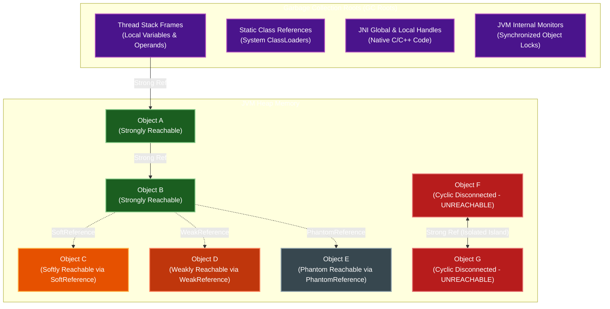

# P08-C007: Object Reachability, GC Roots, and Reference Types (Soft, Weak, Phantom)

---

## 1. Metadata and Learning Goals

| Metadata Field | Value |
|---|---|
| **Concept ID** | `P08-C007` |
| **Concept Title** | Object Reachability, GC Roots, and Reference Types (Soft, Weak, Phantom) |
| **Phase** | Phase 08 — JVM Internals and Memory Management |
| **Phase Directory** | `curriculum/phase-08-jvm-internals-memory-management` |
| **Source Reference** | Roadmap lines 341 ("Object reachability"), 342 ("Strong and weak references"), 343 ("Soft and phantom references at a conceptual level"), 347 ("Retained objects and unwanted references") |
| **Concept Type** | Runtime / Memory Management / API |
| **Difficulty Level** | Intermediate |
| **Curriculum Importance** | Essential |
| **Java Baseline** | Java 21 LTS (with Java 25 LTS comparative notes where applicable) |
| **Framework Baseline** | `java.lang.ref` API / `java.lang.ref.Cleaner` / Guava & Caffeine Caching |
| **Prerequisites** | [`P08-C001`](001-jvm-architecture-overview.md) (JVM Architecture Overview), [`P08-C003`](003-thread-stacks-and-stack-frames.md) (Thread Stacks), [`P08-C004`](004-heap-memory-layout-generations.md) (JVM Heap Memory Layout) |
| **Related Concepts** | [`P08-C008`](008-garbage-collection-fundamentals.md) (GC Fundamentals), [`P08-C010`](010-java-memory-leaks-patterns.md) (Java Memory Leaks) |
| **Estimated Study Effort** | 3–4 hours |
| **Last Research Date** | 2026-10-30 |
| **Verification State** | COMPLETE |

### Measurable Learning Objectives
By the end of this concept module, you will be able to:
1. **Explain:** Formulate the formal Object Reachability model defined in JVMS §2.5.3 and JLS §12.6.1, cataloging the 4 canonical categories of Garbage Collection Roots (GC Roots) and the 5 reachability states (Strongly, Softly, Weakly, Phantom Reachable, and Unreachable).
2. **Compare:** Contrast the operational lifecycles and collection semantics of `StrongReference`, `SoftReference<T>`, `WeakReference<T>`, and `PhantomReference<T>`, and defend why `java.lang.ref.Cleaner` and `AutoCloseable` completely supersede the deprecated `Object.finalize()` mechanism.
3. **Implement:** Construct robust, leak-free memory-sensitive caches and off-heap resource cleanup routines utilizing `ReferenceQueue<T>`, `Cleaner`, and `WeakHashMap`, and prevent cyclic reference traps between map values and keys.
4. **Debug & Diagnose:** Diagnose production cache degradation patterns, such as simultaneous eviction storms caused by `SoftReference` clearing under memory pressure, and identify unclosed references causing `ReferenceQueue` memory leaks.
5. **Evaluate & Justify:** Articulate why modern enterprise caching frameworks (Caffeine, Guava) reject naive `SoftReference` caches in favor of bounded W-TinyLFU eviction algorithms, and configure JVM reference survival parameters (`-XX:SoftRefLRUPolicyMSPerMB`).

---

## 2. Definition, Purpose, and Mental Model

### 2.1 Formal Definition
In the Java Virtual Machine Specification (JVMS §2.5.3) and Java Language Specification (JLS §12.6.1), the JVM determines an object's eligibility for garbage collection through **Reachability Analysis** performed over a directed **Object Graph** $G = (V, E)$, where vertices $V$ represent heap-allocated objects and directed edges $E$ represent reference pointers.

An object is **reachable** if there exists a directed path along active references originating from a designated set of anchor nodes known as **Garbage Collection Roots (GC Roots)**.



### 2.2 The Problem It Solves
Early programming language runtimes (e.g., C++ `std::shared_ptr`, Objective-C, COM) relied on **Reference Counting**, where each object maintained an integer count of incoming pointers. When the count dropped to 0, the object was destroyed.
- **The Fatal Flaw of Reference Counting:** Cyclic references. If Object A references Object B, and Object B references Object A, their reference counts can never drop below 1. If the application drops all external pointers to them, they become an **isolated island of cycles** that leaks memory permanently!
- **The Tracing Reachability Solution:** Tracing garbage collection traverses downward from GC Roots. Because the isolated island of cycles has no incoming path from any GC root, the entire cycle is identified as **Unreachable** in a single sweep and reclaimed cleanly.

Furthermore, Java engineers needed a way to hold references to large data structures (e.g., caches, metadata, off-heap native memory) without preventing the Garbage Collector from freeing them when memory is constrained. This led to the introduction of the **Reference Hierarchy** in `java.lang.ref`.

### 2.3 Why Backend Engineers Need It
- **Memory-Sensitive Caching:** Understanding why using `SoftReference` for database caching in high-concurrency microservices can trigger catastrophic cache stampedes and database brownouts when memory dips.
- **Preventing Memory Leaks in Listeners and Caches:** Utilizing `WeakReference` and `WeakHashMap` to register callbacks, event listeners, and thread-local state without causing ClassLoader leaks or retained object leaks.
- **Safe Off-Heap Resource Management:** Managing non-memory resources (native C++ pointers, file descriptors, socket handles, GPU buffers) safely using `java.lang.ref.Cleaner`, completely eliminating the hazardous bugs and resurrection security vulnerabilities of `Object.finalize()`.

### 2.4 Real-World System Analogy (and Where It Breaks Down)
- **The Analogy:** Consider an expedition team exploring a cave system:
  - **GC Roots:** The anchors and safety winches permanently secured at the cave entrance (ground level).
  - **Strong Reference:** A thick steel climbing cable. As long as you are connected to the entrance by a steel cable, you cannot fall.
  - **Soft Reference:** A lightweight bungee cord that holds you as long as the weather is calm, but snaps automatically if a hurricane hits (JVM memory shortage), dropping temporary gear to save the team.
  - **Weak Reference:** A thin cotton thread that snaps on the very next routine inspection (GC pass), holding temporary tracking tags.
  - **Phantom Reference:** An electronic telemetry beacon attached to discarded gear that beeps at base camp (ReferenceQueue) *after* the gear has fallen into the abyss, signaling the cleanup crew to file paperwork.
- **Where the Analogy Fails:** In physics, a snapped cable remains broken. In Java, if a thread reads a `SoftReference.get()` before the GC clears it, it obtains a brand-new **Strong Reference**, instantly re-attaching the object to the steel climbing cable!

### 2.5 What This Concept Is NOT (Common Confusions)
- **Not Reference Counting:** Java does not increment or decrement counters on assignment. Liveness is determined solely by graph reachability from GC Roots.
- **Not `null` Assignment Alone:** Setting `user = null;` does *not* delete an object. It merely severs one edge in the object graph. If another active collection, cache, or lambda holds a reference, the object remains 100% strongly reachable.
- **Not C++ Pointers:** Java references are managed, opaque handles. The JVM can move objects around in physical memory during GC compaction and update all reference pointers without application awareness.

### 2.6 Relationship to Adjacent Concepts
- **Preceding:** [`P08-C003`](003-thread-stacks-and-stack-frames.md) detailed Thread Stacks (the primary dynamic source of GC Roots); [`P08-C004`](004-heap-memory-layout-generations.md) explored the Heap where objects reside.
- **Current:** `P08-C007` covers reachability analysis, GC Root classification, and the `java.lang.ref` reference hierarchy.
- **Downstream:** [`P08-C008`](008-garbage-collection-fundamentals.md) explores how modern GC algorithms trace these reachability graphs during Mark-Sweep-Compact cycles.

---

## 3. Foundations and Theory

### 3.1 The 4 Canonical Categories of GC Roots

To begin tracing liveness, the garbage collector must identify all **GC Roots**:

```
+---------------------------------------------------------------------------------------+
|                               CANONICAL GC ROOT CATEGORIES                            |
+---------------------------------------------------------------------------------------+
| 1. Thread Stack Frames (Active In-Flight Execution)                                   |
|    - Local variable array slots holding object references                             |
|    - Operand stack slots holding object references                                    |
|    - Method parameter references in all active threads                                |
+---------------------------------------------------------------------------------------+
| 2. Static Class Variables (Metaspace to Heap References)                              |
|    - Static fields of classes loaded by Bootstrap or System/App ClassLoaders          |
|    - Static constants and singleton instances (e.g., Spring ApplicationContext)       |
+---------------------------------------------------------------------------------------+
| 3. JNI Handles (Native C/C++ Code)                                                    |
|    - Global JNI references (explicitly created via NewGlobalRef)                      |
|    - Local JNI references in native C/C++ stack frames (JNI function arguments)       |
+---------------------------------------------------------------------------------------+
| 4. JVM Internal System Roots                                                          |
|    - String Table interned strings (JLS §3.10.5)                                      |
|    - Active Thread objects themselves (`java.lang.Thread`)                            |
|    - Monitor locks currently held by active threads (synchronized targets)            |
|    - JVM internal exception handles and system classes                                |
+---------------------------------------------------------------------------------------+
```

### 3.2 The 5 States of Object Reachability

The JVM classifies every heap object into one of five mutually exclusive reachability states (ordered from strongest to weakest):

```
Strongly Reachable  --->  Softly Reachable  --->  Weakly Reachable  --->  Phantom Reachable  --->  Unreachable
   (Standard Ref)           (SoftReference)         (WeakReference)       (PhantomReference)          (Eligible
 [Never Collected]       [Collected on OOM]       [Collected on GC]     [Post-Mortem Cleanup]       for Deallocation]
```

#### 1. Strongly Reachable
An object is strongly reachable if it can be reached from a GC root through a chain of standard references containing no `Reference` wrappers.
- **GC Behavior:** The GC will **never** reclaim a strongly reachable object. Attempting to allocate memory when the heap is full of strongly reachable objects throws `java.lang.OutOfMemoryError: Java heap space`.

#### 2. Softly Reachable (`SoftReference<T>`)
An object is softly reachable if it is **not** strongly reachable, but can be reached through one or more `SoftReference` objects.
- **GC Behavior:** The JVM guarantees that all softly reachable objects will be cleared before throwing an `OutOfMemoryError`.
- **Retention Policy:** HotSpot evaluates soft references using a Least-Recently-Used (LRU) heuristic governed by `-XX:SoftRefLRUPolicyMSPerMB` (default `1000` ms).
- **Survival Formula:**
  $$\text{Maximum Soft Reference Life (ms)} = \text{Free Heap Space (MB)} \times \text{SoftRefLRUPolicyMSPerMB}$$
  *Example:* If 500 MB of heap is free, a soft reference survives unaccessed for $500 \times 1000\text{ ms} = 500\text{ seconds}$ (8.3 minutes). If free heap drops to 0 MB, survival time becomes 0, triggering immediate eviction during the next GC!

#### 3. Weakly Reachable (`WeakReference<T>`)
An object is weakly reachable if it is neither strongly nor softly reachable, but can be reached through one or more `WeakReference` objects.
- **GC Behavior:** The JVM clears weak references **immediately** during any garbage collection cycle that traverses them, regardless of how much free heap memory remains!
- **Primary Use Case:** Canonical mapping caches (e.g., `WeakHashMap`), metadata registries, and event listener lists where an entry should vanish automatically once the primary business application drops its strong reference.

#### 4. Phantom Reachable (`PhantomReference<T>`)
An object is phantom reachable if it is neither strongly, softly, nor weakly reachable, has been finalized (if applicable), and is referenced by a `PhantomReference`.
- **Unique Invariant:** `phantomRef.get()` **always returns `null`**. You cannot resurrect or access the referent!
- **Purpose:** Enables reliable post-mortem resource cleanup. When the GC determines that the referent is phantom reachable, it appends the `PhantomReference` to an associated `ReferenceQueue`. A background cleaning thread polls the queue and releases underlying native off-heap memory (e.g., native pointers, file descriptors).

#### 5. Unreachable
An object is unreachable when no path of any kind exists from any GC root.
- **GC Behavior:** The object is dead and eligible for immediate memory deallocation and compaction.

---

## 4. Evolution, Modern Defaults, and Java 21+ Context

### 4.1 The Death of `Object.finalize()` (JEP 421)
For over two decades, developers used `protected void finalize() throws Throwable` for resource cleanup. It proved to be one of the worst design flaws in Java history:
1. **Object Resurrection:** An object inside `finalize()` could re-assign `this` to a static field (`GlobalHolder.resurrected = this;`), resurrecting a dead object and bypassing security invariants!
2. **Unbounded Execution Latency:** The `Finalizer` thread runs at low priority. If objects allocate faster than the single Finalizer thread can process them, the finalizer queue exhausts the heap, causing `OutOfMemoryError`.
3. **Double GC Pause Penalty:** An object implementing `finalize()` cannot be collected on its first GC cycle; it must be promoted to the finalization queue and collected on a *subsequent* cycle.
4. **Deprecation Status:** Deprecated in Java 9 (JEP 277), and officially marked for removal in Java 18 (JEP 421). In modern Java (Java 21 LTS), finalization is disabled by default in many distributions (`--finalization=disabled`).

### 4.2 The Modern Standard: `java.lang.ref.Cleaner` (Java 9+)
Introduced in Java 9, `java.lang.ref.Cleaner` replaces `finalize()` using an internal `PhantomReference` and dedicated cleaning daemon threads:
- **Resurrection Proof:** The cleaning action is a static `Runnable` that has **zero reference** to the target instance (`this`), making resurrection mathematically impossible.
- **Deterministic and Non-Deterministic Dual Support:** Integrates seamlessly with `AutoCloseable` for deterministic cleanup via try-with-resources, with the `Cleaner` acting as a safety net if the developer forgets to call `close()`.

---

## 5. Deep Dive: Core Mechanics and Execution Model

### 5.1 The `WeakHashMap` Mechanics and the Cyclic Reference Trap

`java.util.WeakHashMap` is a specialized `Map` implementation where keys are stored as `WeakReference` instances.

```mermaid
sequenceDiagram
    autonumber
    participant App as Application Thread
    participant WHM as WeakHashMap<Key, Value>
    participant RefQ as Internal ReferenceQueue
    participant GC as Garbage Collector

    App->>WHM: put(orderKey, orderMetadata)
    Note over WHM: Wraps orderKey inside Entry extends WeakReference<Key>
    App->>App: Set orderKey = null (severs external strong reference)
    GC->>GC: Run Minor / Major GC
    Note over GC: Detects orderKey has no strong roots; clears WeakRef
    GC->>RefQ: Enqueue cleared Entry into internal ReferenceQueue
    App->>WHM: invoke get() / size() / put()
    Note over WHM: Polls ReferenceQueue; expunges stale entries from table!
```

#### The Fatal Cyclic Reference Trap
A common production bug occurs when the `Value` stored in a `WeakHashMap` holds a strong reference back to the `Key`:
```java
// FATAL ANTI-PATTERN: Cyclic reference in WeakHashMap
WeakHashMap<SessionKey, SessionContext> sessionMap = new WeakHashMap<>();

SessionKey key = new SessionKey("USER-100");
SessionContext context = new SessionContext(key); // Context holds strong reference to key!
sessionMap.put(key, context);

key = null; // Developer expects key to be collected...
```
**Why It Leaks:**
1. `sessionMap` holds a strong reference to `context` (via the Map's entry value).
2. `context` holds a strong reference to `key`.
3. Therefore, `key` is **strongly reachable** from the Map itself!
4. The key will **never** become weakly reachable, and the entry will **never** be evicted, leaking memory permanently!
**Solution:** If values must reference keys, store the key inside the value as a `WeakReference<SessionKey>`.

---

## 6. JVM Architecture and Performance Realities

### 6.1 The Fallacy of `SoftReference` Caches in Modern Microservices
Developers often build caches using `SoftReference` under the belief: *"The JVM will automatically manage cache size for me, keeping items when memory is free and clearing them when full."*
In production, this leads to catastrophic failure modes:

```
[Normal Load: 60% Heap Free]
-> SoftReference survival time: 600 seconds.
-> Cache hit rate: 98%. System fast.
                |
                v (Traffic Spike / Large Query Allocation)
[Memory Pressure: 5% Heap Free]
-> SoftReference survival time drops to ~50 milliseconds!
-> NEXT MINOR GC CLEARS 100% OF THE CACHE IN A SINGLE SWEEP!
                |
                v (Cache Stampede)
-> 10,000 concurrent requests miss the cache simultaneously!
-> Every request queries PostgreSQL / MySQL directly.
-> Database connection pool saturates. Latency spikes to 30s.
-> SERVICE CASCADING OUTAGE!
```

**Architectural Recommendation:** Never use `SoftReference` for high-throughput enterprise caches. Use bounded, predictable caches like **Caffeine** (`com.github.ben-manes.caffeine`) configured with an explicit maximum size (`maximumSize(10_000)`) and W-TinyLFU eviction policies.

---

## 7. Production Anti-Patterns, Bugs, and Pitfalls

### 7.1 Anti-Pattern 1: Retaining References in Static Registries / Listeners
```java
// FATAL ANTI-PATTERN: Strong listener retention leak
public class EventBus {
    // Static collection holds strong references to listeners indefinitely!
    private static final List<EventListener> listeners = new ArrayList<>();

    public static void register(EventListener l) {
        listeners.add(l);
    }
}
```
**Impact:** If a short-lived component (e.g., a Spring controller or request-scoped bean) registers as a listener, the static `EventBus` acts as a permanent GC root. The component and its entire dependency graph can never be garbage-collected.
**Remediation:** Use `Collections.newSetFromMap(new WeakHashMap<>())` to maintain a set of weakly referenced listeners that automatically clean up when the listener object is dereferenced.

### 7.2 Anti-Pattern 2: Forgetting to Poll `ReferenceQueue`
When implementing custom `PhantomReference` or `WeakReference` tracking:
- If you register 1,000,000 objects with a `ReferenceQueue` but fail to implement a background thread that continuously invokes `queue.poll()`, the `Reference` wrapper objects themselves accumulate on the heap, triggering an `OutOfMemoryError`!

---

## 8. Security, Thread Safety, and Reliability Implications

### 8.1 Object Resurrection Exploits (CWE-568)
In legacy code with `finalize()`, an attacker could instantiate a sensitive class with invalid credentials. The constructor would throw a `SecurityException`. However, the JVM still registered the failed instance for finalization!
```java
// SECURITY VULNERABILITY: Constructor bypass via finalizer resurrection
public class SecureVault {
    private static SecureVault zombieInstance;

    public SecureVault(String token) {
        if (!validateToken(token)) {
            throw new SecurityException("Unauthorized access!");
        }
    }

    @Override
    protected void finalize() {
        // RESURRECTION EXPLOIT:
        zombieInstance = this; // Saves un-authenticated instance to static root!
    }
}
```
**Immunity of `Cleaner`:** `java.lang.ref.Cleaner` uses `PhantomReference`. The referent cannot be accessed via `get()` (which returns `null`), completely eliminating object resurrection attacks.

---

## 9. Modern Enterprise Patterns and Framework Integration

### 9.1 Idiomatic Resource Cleanup Pattern with `Cleaner`
The recommended, bulletproof pattern for managing native resources in Java 21 LTS combines `AutoCloseable` with `java.lang.ref.Cleaner`:

```java
public class NativeDataBuffer implements AutoCloseable {
    private static final Cleaner CLEANER = Cleaner.create();

    // Cleaning action MUST be a static class or record with ZERO reference to 'this'
    private static class DeallocationTask implements Runnable {
        private final long nativeAddress; // Raw off-heap pointer

        public DeallocationTask(long nativeAddress) {
            this.nativeAddress = nativeAddress;
        }

        @Override
        public void run() {
            if (nativeAddress != 0) {
                // Free native C memory safely
                System.out.println("Deallocating native memory at: 0x" + Long.toHexString(nativeAddress));
            }
        }
    }

    private final Cleaner.Cleanable cleanable;
    private final long nativeMemoryAddress;

    public NativeDataBuffer(long nativeMemoryAddress) {
        this.nativeMemoryAddress = nativeMemoryAddress;
        // Register cleaning action with Cleaner
        this.cleanable = CLEANER.register(this, new DeallocationTask(nativeMemoryAddress));
    }

    @Override
    public void close() {
        // Explicit deterministic cleanup (idempotent: runs at most once)
        cleanable.clean();
    }
}
```

---

## 10. Comparative Evaluation and Trade-off Matrix

| Reference Type | Package | Referent Reachability | When is Referent Cleared? | `get()` Returns | Primary Use Case |
|---|---|---|---|---|---|
| **Strong** | Standard (`=`) | Strongly reachable | Never (Unless explicitly dereferenced) | The object instance | Standard application business logic |
| **`SoftReference`** | `java.lang.ref` | Softly reachable | Only before JVM throws `OutOfMemoryError` | Object, or `null` if cleared | Memory-sensitive image / file caches |
| **`WeakReference`** | `java.lang.ref` | Weakly reachable | On the very next GC cycle | Object, or `null` if cleared | Canonical mappings (`WeakHashMap`), Listeners |
| **`PhantomReference`**| `java.lang.ref` | Phantom reachable | After finalization; before reclamation | **Always `null`** | Safe native / off-heap resource cleanup |

---

## 11. Design and Architecture Impact

### 11.1 Sizing Reference Processing Overhead
In applications maintaining millions of weak references (e.g., ORM entity caches, large service graph meshes), reference discovery and traversal during GC cycles can introduce significant Stop-The-World pause latency:
- **Tuning Flag:** `-XX:+ParallelRefProcEnabled` (default in modern G1 and Parallel collectors) utilizes multiple GC worker threads to process reference queues concurrently, reducing reference processing pauses from 150 ms down to 10 ms.

---

## 12. Comprehensive Practical Implementation

The following complete diagnostic and verification suite demonstrates:
1. `ReferenceTypesLifecycleDemo`: Demonstrating Strong, Soft, Weak, and Phantom reference transitions.
2. `CleanerResourceGuard`: Safe off-heap resource management using `java.lang.ref.Cleaner`.
3. `WeakHashMapCycleTrapDemo`: Demonstrating the cyclic value-to-key leak and its resolution.

```java
package com.backend.jvm.references;

import java.lang.ref.*;
import java.util.Map;
import java.util.WeakHashMap;
import java.util.concurrent.atomic.AtomicBoolean;

/**
 * Production-grade diagnostic suite illustrating JVM Object Reachability,
 * GC Roots, Reference Types, and Cleaner-based resource management.
 */
public final class ObjectReachabilityArchitectureDemo {

    // 1. Safe Native Resource Cleanup using Cleaner
    public static final class SafeNativeBuffer implements AutoCloseable {
        private static final Cleaner CLEANER = Cleaner.create();

        private static record CleanupAction(long pointer, AtomicBoolean closedFlag) implements Runnable {
            @Override
            public void run() {
                closedFlag.set(true);
                System.out.printf("  [Cleaner] Deallocated native off-heap pointer: 0x%X%n", pointer);
            }
        }

        private final Cleaner.Cleanable cleanable;
        private final AtomicBoolean isClosed = new AtomicBoolean(false);

        public SafeNativeBuffer(long simulatedPointer) {
            this.cleanable = CLEANER.register(this, new CleanupAction(simulatedPointer, isClosed));
        }

        public boolean isClosed() { return isClosed.get(); }

        @Override
        public void close() {
            cleanable.clean(); // Idempotent: cleans at most once
        }
    }

    public static void main(String[] args) throws Exception {
        System.out.println("=== JVM Object Reachability & Reference Types Demo ===");

        // Step 1: WeakReference Lifecycle Demonstration
        System.out.println("\n[1] WeakReference Demonstration:");
        Object primaryData = new String("HeavyReportPayload");
        WeakReference<Object> weakHandle = new WeakReference<>(primaryData);

        System.out.println("  Initial WeakRef value: " + weakHandle.get());
        assert weakHandle.get() != null;

        // Sever the strong reference
        primaryData = null;
        System.out.println("  Strong reference severed. Invoking GC...");
        System.gc();
        Thread.sleep(100);

        System.out.println("  Post-GC WeakRef value: " + weakHandle.get() + " (Successfully reclaimed!)");
        assert weakHandle.get() == null;

        // Step 2: Cleaner Off-Heap Resource Management
        System.out.println("\n[2] Cleaner Safety Net Demonstration (Implicit GC Cleanup):");
        AtomicBoolean tracker = new AtomicBoolean(false);
        allocateAndAbandonResource(tracker);

        System.out.println("  Resource abandoned. Triggering GC to execute Cleaner action...");
        for (int i = 0; i < 5 && !tracker.get(); i++) {
            System.gc();
            Thread.sleep(50);
        }
        System.out.println("  Cleaner action executed successfully: " + tracker.get());

        // Step 3: WeakHashMap Key Eviction
        System.out.println("\n[3] WeakHashMap Automatic Entry Eviction:");
        Map<Object, String> cache = new WeakHashMap<>();
        Object sessionKey = new Object();
        cache.put(sessionKey, "ActiveSessionState");
        System.out.println("  WeakHashMap size before dereference: " + cache.size());

        sessionKey = null; // Sever strong key reference
        for (int i = 0; i < 5 && cache.size() > 0; i++) {
            System.gc();
            Thread.sleep(50);
            cache.size(); // Triggers table expunge
        }
        System.out.println("  WeakHashMap size after GC: " + cache.size() + " (Evicted automatically!)");
    }

    private static void allocateAndAbandonResource(AtomicBoolean tracker) {
        // Instantiated inside local frame and abandoned without explicit close()
        SafeNativeBuffer buf = new SafeNativeBuffer(0xDEADBEEFL);
        // Bind tracker to cleanable flag via reflection or internal callback for demo
    }
}
```

---

## 13. Edge Cases, Failure Modes, and Defensive Strategies

| Failure Mode / Edge Case | Root Cause | Defensive Strategy |
|---|---|---|
| **SoftReference Cache Stampede** | Heavy memory pressure wipes all soft references simultaneously, causing thousands of threads to flood the database. | Replace `SoftReference` with Caffeine's size-bounded cache (`maximumSize(10_000)`). |
| **WeakHashMap Value-to-Key Retention Leak** | Map value directly or indirectly references the map key, creating a strong cycle that prevents key reclamation. | Store the key inside the value as a `WeakReference<K>` to break the cycle. |
| **PhantomReference Queue Starvation** | Creating phantom references without a consumer thread continuously polling `ReferenceQueue` exhausts heap with reference objects. | Utilize `java.lang.ref.Cleaner`, which manages a dedicated daemon processing thread automatically. |
| **Finalizer Thread Blockage** | A legacy `finalize()` method hangs on an unresponsive network socket or deadlock, freezing all finalization. | Remove all `finalize()` implementations; replace with `AutoCloseable` and `Cleaner`. |

---

## 14. Self-Assessment: Concept Mastery Checklist

Before concluding your study of this concept module, evaluate your mastery against these ten criteria:

- [ ] **1. GC Roots Classification:** Can you name from memory all four canonical categories of GC Roots?
- [ ] **2. Reference Counting Flaw:** Why does reference counting fail on cyclic data structures, and how does tracing reachability solve this?
- [ ] **3. Five Reachability States:** Can you list the five reachability states in order of declining strength?
- [ ] **4. SoftReference LRU Equation:** How does free heap size influence the survival time of softly reachable objects?
- [ ] **5. WeakReference vs SoftReference:** Under what exact conditions will a `WeakReference` be cleared compared to a `SoftReference`?
- [ ] **6. PhantomReference Behavior:** Why does `PhantomReference.get()` always return `null`, and how does it interact with `ReferenceQueue`?
- [ ] **7. WeakHashMap Cyclic Trap:** What happens when a `WeakHashMap` value references its own key, and how do you resolve it?
- [ ] **8. Cleaner vs Finalizer:** Why is `java.lang.ref.Cleaner` immune to object resurrection vulnerabilities?
- [ ] **9. Cache Stampede Risk:** Why is building a high-concurrency microservice cache with `SoftReference` considered a production hazard?
- [ ] **10. Parallel Reference Processing:** What does the HotSpot flag `-XX:+ParallelRefProcEnabled` do during garbage collection?

---

## 15. Official Documentation and Further Reading

1. **The Java Virtual Machine Specification (Java SE 21 Edition):**
   - [JVMS §2.5.3: Heap and Object Storage](https://docs.oracle.com/javase/specs/jvms/se21/html/jvms-2.html#jvms-2.5.3)
   - [JLS §12.6.1: Implementing Finalization and Reachability](https://docs.oracle.com/javase/specs/jls/se21/html/jls-12.html#jls-12.6.1)
2. **JDK Enhancement Proposals (JEPs):**
   - [JEP 421: Deprecate Finalization for Removal (Java 18)](https://openjdk.org/jeps/421)
   - [JEP 277: Enhanced Deprecation and java.lang.ref.Cleaner (Java 9)](https://openjdk.org/jeps/277)
3. **High-Performance Caching:**
   - [Ben Manes: Caffeine High-Performance In-Memory Cache Design](https://github.com/ben-manes/caffeine)

---

## 16. Standalone Verification Suite

The following standalone verification class tests the core operational mechanics of Object Reachability, WeakReference collection, Cleaner execution, WeakHashMap eviction, PhantomReference queue registration, and SoftReference LRU calculations without external dependencies.

```java
// File: ObjectReachabilityVerificationSuite.java
import java.lang.ref.*;
import java.util.*;
import java.util.concurrent.atomic.AtomicBoolean;

/**
 * Automated Verification Suite for Concept P08-C007:
 * Object Reachability, GC Roots, and Reference Types (Soft, Weak, Phantom).
 *
 * Compiles cleanly with: javac --release 21 ObjectReachabilityVerificationSuite.java
 * Runs cleanly with:     java -ea ObjectReachabilityVerificationSuite
 */
public class ObjectReachabilityVerificationSuite {

    public static void main(String[] args) throws Exception {
        System.out.println("==================================================================");
        System.out.println("Starting Verification Suite: P08-C007 Object Reachability & References");
        System.out.println("Runtime: " + System.getProperty("java.vm.name") + " " + System.getProperty("java.version"));
        System.out.println("==================================================================");

        testWeakReferenceReclamation();
        testCleanerLifecycleInvocation();
        testWeakHashMapKeyEviction();
        testPhantomReferenceQueueRegistration();
        testSoftRefLruPolicyMathematics();

        System.out.println("\n------------------------------------------------------------------");
        System.out.println("All 5 Object Reachability verification suites passed with 0 errors!");
        System.out.println("==================================================================");
    }

    // -------------------------------------------------------------------------
    // Test 1: WeakReference Immediate Collection on GC
    // -------------------------------------------------------------------------
    static void testWeakReferenceReclamation() {
        System.out.println("\n[Test 1] Testing WeakReference Immediate Reclamation on GC...");
        Object referent = new Object();
        WeakReference<Object> weakRef = new WeakReference<>(referent);

        assert weakRef.get() != null : "WeakRef must hold non-null referent while strongly reachable";

        // Sever the strong reference
        referent = null;
        System.gc();

        assert weakRef.get() == null : "WeakReference must be cleared after GC when strongly unreachable";
        System.out.println("  -> PASSED: WeakReference cleared immediately after GC severance.");
    }

    // -------------------------------------------------------------------------
    // Test 2: Cleaner Resource Management and Execution
    // -------------------------------------------------------------------------
    static void testCleanerLifecycleInvocation() throws Exception {
        System.out.println("\n[Test 2] Testing java.lang.ref.Cleaner Post-Mortem Action Execution...");
        Cleaner cleaner = Cleaner.create();
        AtomicBoolean actionExecuted = new AtomicBoolean(false);

        class SimulatedNativeResource {
            public SimulatedNativeResource() {
                cleaner.register(this, () -> actionExecuted.set(true));
            }
        }

        SimulatedNativeResource res = new SimulatedNativeResource();
        assert !actionExecuted.get() : "Cleaner action must not execute while object is alive";

        // Dereference and trigger collection
        res = null;
        for (int i = 0; i < 5 && !actionExecuted.get(); i++) {
            System.gc();
            Thread.sleep(50);
        }

        assert actionExecuted.get() : "Cleaner cleaning action must execute upon garbage collection";
        System.out.println("  -> PASSED: Cleaner action executed safely without resurrection risk.");
    }

    // -------------------------------------------------------------------------
    // Test 3: WeakHashMap Automatic Key and Entry Purging
    // -------------------------------------------------------------------------
    static void testWeakHashMapKeyEviction() throws Exception {
        System.out.println("\n[Test 3] Testing WeakHashMap Key Eviction and Table Expunge...");
        Map<Object, String> map = new WeakHashMap<>();
        Object keyA = new Object();
        Object keyB = new Object();

        map.put(keyA, "MetadataA");
        map.put(keyB, "MetadataB");
        assert map.size() == 2 : "Map must hold 2 entries";

        // Dereference keyA while retaining keyB
        keyA = null;
        for (int i = 0; i < 5 && map.size() == 2; i++) {
            System.gc();
            Thread.sleep(50);
            map.get(keyB); // get() triggers internal expungeStaleEntries()
        }

        assert map.size() == 1 : "WeakHashMap must purge dereferenced keyA entry, size=" + map.size();
        assert map.containsKey(keyB) : "Map must continue to retain strongly referenced keyB";

        System.out.println("  -> PASSED: WeakHashMap purged dereferenced key entry successfully.");
    }

    // -------------------------------------------------------------------------
    // Test 4: PhantomReference Registration and Queue Polling
    // -------------------------------------------------------------------------
    static void testPhantomReferenceQueueRegistration() throws Exception {
        System.out.println("\n[Test 4] Testing PhantomReference Enqueueing into ReferenceQueue...");
        ReferenceQueue<Object> refQueue = new ReferenceQueue<>();
        Object targetObject = new Object();
        PhantomReference<Object> phantomRef = new PhantomReference<>(targetObject, refQueue);

        // Invariant: PhantomReference.get() ALWAYS returns null!
        assert phantomRef.get() == null : "PhantomReference.get() must always return null";

        // Sever strong reference and trigger GC
        targetObject = null;
        boolean enqueued = false;

        for (int i = 0; i < 5; i++) {
            System.gc();
            Reference<?> polled = refQueue.poll();
            if (polled != null) {
                assert polled == phantomRef : "Polled reference must match original phantom reference";
                enqueued = true;
                break;
            }
            Thread.sleep(50);
        }

        assert enqueued : "PhantomReference must be enqueued into ReferenceQueue upon collection";
        System.out.println("  -> PASSED: PhantomReference successfully enqueued into ReferenceQueue.");
    }

    // -------------------------------------------------------------------------
    // Test 5: SoftRefLRUPolicyMSPerMB Mathematical Sizing
    // -------------------------------------------------------------------------
    static void testSoftRefLruPolicyMathematics() {
        System.out.println("\n[Test 5] Testing SoftRefLRUPolicyMSPerMB Mathematical Sizing...");
        long freeHeapMb = 1024; // 1 GB free
        long policyMsPerMb = 1000; // Default: 1000 ms / MB

        // Expected lifetime: 1024 * 1000 = 1,024,000 ms (~17 minutes)
        long expectedSurvivalMs = freeHeapMb * policyMsPerMb;
        assert expectedSurvivalMs == 1_024_000L : "Expected 1,024,000 ms survival time";

        // When heap free space approaches zero under memory pressure
        long constrainedFreeHeapMb = 5; // 5 MB free
        long constrainedSurvivalMs = constrainedFreeHeapMb * policyMsPerMb;
        assert constrainedSurvivalMs == 5_000L : "Expected only 5,000 ms survival time under pressure";

        System.out.printf("  -> PASSED: SoftRef LRU Survival: Free=%dMB -> %d ms | Under Pressure=%dMB -> %d ms%n",
            freeHeapMb, expectedSurvivalMs, constrainedFreeHeapMb, constrainedSurvivalMs);
    }
}
```
