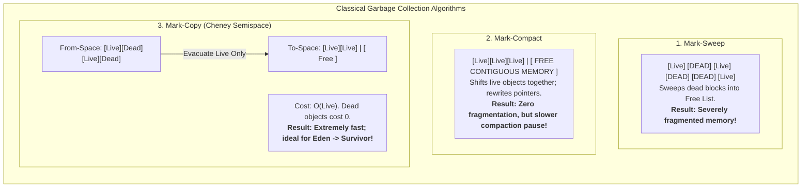

# P08-C008: Garbage Collection Fundamentals: Mark-Sweep, Compact, Generational Hypothesis

---

## 1. Metadata and Learning Goals

| Metadata Field | Value |
|---|---|
| **Concept ID** | `P08-C008` |
| **Concept Title** | Garbage Collection Fundamentals: Mark-Sweep, Compact, Generational Hypothesis |
| **Phase** | Phase 08 — JVM Internals and Memory Management |
| **Phase Directory** | `curriculum/phase-08-jvm-internals-memory-management` |
| **Source Reference** | Roadmap lines 344 ("Garbage collection fundamentals"), 345 ("Common garbage collector terminology"), 355 ("Understand GC logs at a basic level") |
| **Concept Type** | Runtime / Memory Management / Algorithms |
| **Difficulty Level** | Intermediate |
| **Curriculum Importance** | Essential |
| **Java Baseline** | Java 21 LTS (with unified GC logging syntax `-Xlog:gc*`) |
| **Framework Baseline** | HotSpot JVM Execution Engine (G1 GC, Parallel GC, ZGC) |
| **Prerequisites** | [`P08-C001`](001-jvm-architecture-overview.md) (JVM Architecture Overview), [`P08-C004`](004-heap-memory-layout-generations.md) (JVM Heap Memory Layout), [`P08-C007`](007-gc-roots-and-reference-types.md) (Object Reachability & GC Roots) |
| **Related Concepts** | [`P08-C009`](009-modern-collectors-g1-zgc.md) (Modern Garbage Collectors: G1GC, ZGC), [`P08-C010`](010-java-memory-leaks-patterns.md) (Java Memory Leaks) |
| **Estimated Study Effort** | 3–4 hours |
| **Last Research Date** | 2026-10-30 |
| **Verification State** | COMPLETE |

### Measurable Learning Objectives
By the end of this concept module, you will be able to:
1. **Explain:** Deconstruct the three classical garbage collection algorithms (Mark-Sweep, Mark-Compact, and Mark-Copy/Cheney Semispace), detailing their algorithmic time complexities and memory trade-offs.
2. **Compare:** Contrast Stop-The-World (STW) pauses with concurrent GC phases, analyze the performance triad (Throughput vs Latency vs Footprint), and explain how Safepoints and Safepoint Polling coordinate mutator threads.
3. **Implement:** Programmatically inspect garbage collection metrics via `ManagementFactory.getGarbageCollectorMXBeans()`, implement an algorithmic simulation of Cheney's copying semispace evacuation with forwarding pointers, and parse standard unified GC logs (`-Xlog:gc*`).
4. **Debug & Diagnose:** Diagnose common GC failure modes, including `OutOfMemoryError: GC overhead limit exceeded`, allocation stall latency spikes caused by high allocation rates, and Time-To-Safepoint (TTSP) delays.
5. **Evaluate & Justify:** Formulate GC tuning strategies for backend workloads (evaluating high-throughput batch systems vs low-latency interactive microservices) and defend why calling `System.gc()` is a catastrophic production anti-pattern.

---

## 2. Definition, Purpose, and Mental Model

### 2.1 Formal Definition
**Automated Garbage Collection (GC)** is the dynamic runtime subsystem of the Java Virtual Machine that manages heap memory allocation and reclamation. In compliance with JVMS §2.5.3, the GC continuously identifies heap-allocated objects that are no longer reachable from any **Garbage Collection Root (GC Root)**, reclaims their underlying memory, and optionally compacts remaining live objects to eliminate fragmentation.

The collection strategy is governed by three primary algorithmic paradigms:
1. **Mark-Sweep:** Identifies live objects via graph reachability (Mark) and sweeps across the heap, linking dead memory blocks into a **Free List** (Sweep). Cost: $O(\text{Live}) + O(\text{Heap Size})$. *Flaw:* Causes severe external memory fragmentation.
2. **Mark-Sweep-Compact:** Identifies live objects (Mark), shifts all surviving objects contiguously to the beginning of the memory space (Compact), and updates all reference pointers. Cost: $O(\text{Live} + \text{Heap Size})$. *Benefit:* Eliminates fragmentation and enables lock-free bump-the-pointer allocations.
3. **Mark-Copy (Copying Semispace / Cheney's Algorithm):** Divides memory into two equal semispaces (`From` and `To`). During collection, live objects are copied sequentially into the `To` space, leaving forwarding pointers in the `From` space. Cost: Strictly $O(\text{Live})$. Dead objects cost nothing to sweep. *Flaw:* Halves usable memory capacity.



### 2.2 The Problem It Solves
Manual memory management in languages like C and C++ (`malloc()`, `free()`, `new`, `delete`) imposes severe software engineering risks:
1. **Dangling Pointers / Use-After-Free (CWE-416):** Freeing memory while another pointer still references it leads to memory corruption or arbitrary remote code execution.
2. **Double Free (CWE-415):** Calling `free()` twice on the same memory block corrupts memory allocator metadata tables.
3. **Memory Leaks:** Forgetting to free memory causes process memory consumption to grow until the operating system terminates the process.

Automated garbage collection guarantees memory safety: memory cannot be reclaimed as long as an application can reach it, and unreachable memory is reclaimed deterministically without manual programmer intervention.

### 2.3 Why Backend Engineers Need It
- **API Latency Percentiles (p99 / p99.9):** Every Stop-The-World (STW) GC pause halts all application worker threads. A 200 ms GC pause directly translates to a 200 ms latency spike for all API requests in-flight during that window.
- **Throughput Budgeting:** A backend batch ETL engine processing millions of records must maximize CPU utilization for business logic rather than spending 20% of CPU cycles running garbage collector threads.
- **Sizing Memory Ceilings:** Configuring heap sizing without understanding GC behavior leads to `OutOfMemoryError: GC overhead limit exceeded` or sudden container termination by the Linux OOM Killer.
- **Triage and Incident Management:** Reading unified GC logs (`-Xlog:gc*`) to determine whether a production performance degradation is caused by GC thrashing, allocation stalls, or long Time-To-Safepoint (TTSP) pauses.

### 2.4 Real-World System Analogy (and Where It Breaks Down)
- **The Analogy:** Consider an open-air farmers market. 
  - **Mark-Sweep:** A cleanup crew walks down every aisle, spray-painting sold produce stands red (Mark). Later, a truck drives by, collecting only the red stands, leaving random empty gaps between remaining stands (Sweep). If a new vendor arrives needing 5 adjacent stalls for a large truck, they cannot set up, even though 10 scattered stalls are empty across the market (Fragmentation).
  - **Mark-Compact:** The crew tells all remaining vendors to pack up their goods and move down the street, packing them side-by-side from Stall #1 to Stall #50 (Compact). This leaves a massive contiguous open space at the end of the market for incoming vendors.
  - **Mark-Copy:** The market has two identical fields (Field A and Field B). While vendors trade on Field A, Field B is empty. At closing time, active vendors are moved sequentially to Field B (Copy). Field A is instantly bull-dozed clean.
- **Where the Analogy Fails:** Physical vendors can walk independently while customers continue shopping. In classic JVM collectors, all business transactions must freeze completely (Stop-The-World) while objects are moved and their memory addresses are rewritten in all thread registers and stacks.

### 2.5 What This Concept Is NOT (Common Confusions)
- **Not Reference Counting:** Java does not increment/decrement integer reference counters on assignment. Tracing collectors navigate the object graph from GC Roots, easily collecting cyclic reference islands.
- **Not Immediate Deallocation:** An object becoming unreachable does *not* trigger instantaneous memory freeing. Deallocation occurs only when the JVM triggers a GC cycle.
- **Not Free of Cost:** Automated GC trades developer convenience and safety for CPU overhead, memory footprint (5–15% metadata overhead), and non-deterministic pause latency.

### 2.6 Relationship to Adjacent Concepts
- **Preceding:** [`P08-C004`](004-heap-memory-layout-generations.md) introduced generational heap layout (Eden, Survivor, Tenured); [`P08-C007`](007-gc-roots-and-reference-types.md) established GC Roots and object reachability.
- **Current:** `P08-C008` explores the fundamental collection algorithms, Safepoints, and GC performance trade-offs.
- **Downstream:** [`P08-C009`](009-modern-collectors-g1-zgc.md) examines modern production collectors (G1 GC, Generational ZGC, Parallel GC).

---

## 3. Foundations and Theory

### 3.1 The Three Classical Garbage Collection Algorithms

```
+------------------+-----------------------------+-----------------------------+------------------------------------+
| Algorithm        | Time Complexity             | Space Overhead              | Key Advantages & Disadvantages    |
+------------------+-----------------------------+-----------------------------+------------------------------------+
| **Mark-Sweep**   | $O(\text{Live}) + O(\text{Heap})$ | Low (Free lists / bitmaps)  | Fast deallocation, but causes      |
|                  |                             |                             | severe memory fragmentation.       |
+------------------+-----------------------------+-----------------------------+------------------------------------+
| **Mark-Compact** | $O(\text{Live}) + O(\text{Heap})$ | Low (In-place compaction)   | Zero fragmentation, enables bump-  |
|                  |                             |                             | pointer, but high pause latency.   |
+------------------+-----------------------------+-----------------------------+------------------------------------+
| **Mark-Copy**    | Strictly $O(\text{Live})$   | High (Requires 2x memory    | Fastest collection; dead objects   |
| (Cheney)         |                             | semispaces: From and To)    | cost zero; ideal for Young Gen.    |
+------------------+-----------------------------+-----------------------------+------------------------------------+
```

#### 3.1.1 Mark-Sweep Algorithm
1. **Mark Phase:** Starting from GC Roots, traverse the object graph using depth-first (DFS) or breadth-first (BFS) search. For every reachable object, set a mark bit in its object header Mark Word or an external Mark Bitmap.
2. **Sweep Phase:** Iterate linearly through all heap memory from address `0` to `HeapEnd`. If an object's mark bit is clear, add its address and size to a **Free List**; if the mark bit is set, clear the bit in preparation for the next cycle.
- *Fatal Flaw:* **External Fragmentation.** After several cycles, free memory consists of millions of non-contiguous small gaps. Allocating a large array fails even when total free memory is abundant, triggering premature OutOfMemoryError.

#### 3.1.2 Mark-Compact Algorithm
To solve fragmentation, Mark-Compact adds a compaction phase after marking:
1. **Mark Phase:** Identifies all live objects.
2. **Compute Target Addresses:** The collector calculates where each live object will land if packed contiguously starting at the base of the heap.
3. **Update Pointers:** Traverses all GC Roots, thread stack frames, and object reference fields, updating each pointer to reference the object's future target address.
4. **Relocate Objects:** Physically copies the byte payloads of live objects to their contiguous target locations (e.g. using `memmove`).
- *Trade-off:* Eliminates fragmentation completely, but pointer updating and memory copying make this the most time-consuming Stop-The-World pause.

#### 3.1.3 Mark-Copy (Cheney's Copying Algorithm)
Used in the Young Generation (Eden and Survivor S0/S1):
- Memory is split into two semispaces: `From` space and `To` space.
- Allocation occurs only in the active space.
- When collection triggers, live objects are copied sequentially into the `To` space starting at offset 0.
- When an object is copied, a **Forwarding Pointer** is written into its old header in `From` space, ensuring any subsequent references to the same object are rewritten to point to the new copy.
- **The Elegance of Mark-Copy:** The time complexity is proportional *strictly* to the volume of surviving live objects. In the Young Generation, where the Weak Generational Hypothesis states that >95% of objects die immediately, the collector copies only 5% of memory and simply winks the remaining 95% out of existence by resetting the `From` allocation pointer to 0!

### 3.2 Safepoints and Safepoint Polling

A fundamental invariant of garbage collection is that the GC cannot safely inspect or relocate objects while application worker threads (**mutators**) are actively reading, writing, and creating references.

```mermaid
sequenceDiagram
    autonumber
    participant AppThread as Application Mutator Thread
    participant JVM as HotSpot Runtime Engine
    participant GC as GC Worker Threads

    JVM->>JVM: GC Triggered! Initiate Global Safepoint
    JVM->>JVM: Arm safepoint polling page (mprotect to PROT_NONE)
    AppThread->>AppThread: Executes loop / method return
    Note over AppThread: Reads safepoint page: test %eax, (safepoint_page)
    AppThread->>JVM: Hits Page Fault / Safepoint Trap; halts execution
    JVM->>JVM: All mutator threads halted! Time-To-Safepoint (TTSP) ended
    JVM->>GC: Execute Stop-The-World (STW) Phase: Mark / Evacuate / Compact
    GC-->>JVM: Collection complete; memory compacted
    JVM->>JVM: Disarm safepoint page
    JVM->>AppThread: Resume mutator execution
```

#### Where are Safepoint Polls Injected?
The JIT compiler automatically injects safepoint polling instructions into compiled code at:
1. **Method Return Statements:** Before popping the stack frame.
2. **Loop Backedges:** At the end of every loop iteration (preventing infinite loops from blocking GC).
3. **Explicit JVM Transitions:** Native JNI method entry/exit.

#### Time-To-Safepoint (TTSP)
The total time an application is paused is:
$$\text{Total Pause Time} = \text{Time-To-Safepoint (TTSP)} + \text{GC Execution Duration}$$
If 63 out of 64 threads reach the safepoint in 1 ms, but 1 thread is stuck in an uncounted loop or slow JNI call for 500 ms, the entire application freezes for 500 ms before the GC can even begin!

### 3.3 The Performance Triad of Garbage Collection
Every garbage collector operates under the fundamental engineering triad:

```
                      THROUGHPUT
                     (Max Business Work)
                          /   \
                         /     \
                        /       \
                       /         \
                      /           \
         LATENCY -------------------- FOOTPRINT
      (Lowest Pause)               (Lowest Memory)
```

1. **Throughput:** The percentage of total CPU time spent running application code:
   $$\text{Throughput} = \frac{T_{\text{application}}}{T_{\text{application}} + T_{\text{GC}}}$$
   *Champion:* **Parallel GC** (spends minimum CPU on barriers; maximizes batch calculation speed).
2. **Latency:** The duration of individual Stop-The-World pauses (p99/p99.9 pause times).
   *Champion:* **ZGC** (sub-millisecond pauses by performing marking and compaction concurrently).
3. **Footprint:** The auxiliary native memory required by the GC (card tables, remembered sets, mark bitmaps, forward tables).
   *Champion:* **Serial GC** (minimal metadata overhead).

No collector can maximize all three simultaneously. Optimizing for latency requires concurrent worker threads and memory barriers, which consume CPU and reduce overall throughput.

---

## 4. Evolution, Modern Defaults, and Java 21+ Context

### 4.1 Chronological Evolution of HotSpot Garbage Collectors
- **Java 1.3 (Serial GC):** Single-threaded collector using Mark-Copy for Young Gen and Mark-Compact for Old Gen.
- **Java 1.4 / 5 (Parallel GC):** Multi-threaded throughput collector utilizing multiple GC worker threads for Young (`ParallelGC`) and Old (`ParallelOldGC`) generations.
- **Java 6 / 7 (Concurrent Mark Sweep - CMS):** Attempted low-latency by marking Old Gen concurrently while mutators ran. *Flaw:* Failed to compact Old Gen, leading to fatal fragmentation and catastrophic Full GCs. Deprecated in Java 9, removed in Java 14.
- **Java 9 (G1 GC Default):** Garbage-First collector replaced Parallel GC as default. Partitions heap into thousands of 1–32 MB regions; compacts memory incrementally in small, bounded pauses.
- **Java 11–17 (ZGC & Shenandoah):** Ultra-low latency collectors performing both marking and object compaction concurrently with mutators.
- **Java 21 LTS (Generational ZGC, JEP 439):** Extends ZGC with generational separation, achieving sub-millisecond pause times while recovering 4x higher allocation throughput.

### 4.2 Unified JVM GC Logging (JEP 158)
In Java 9+, the legacy flags (`-XX:+PrintGCDetails`, `-XX:+PrintGCDateStamps`) were replaced by unified logging syntax:
```bash
# Production Recommended GC Logging Configuration:
java -Xlog:gc*,gc+phases=debug:file=/var/log/jvm/gc-%t.log:time,uptime,pid:filecount=5,filesize=100M -jar app.jar
```

#### Anatomical Breakdown of a Modern Unified GC Log Line:
```text
[0.152s][info][gc] GC(4) Pause Young (Normal) (G1 Evacuation Pause) 128M->32M(512M) 2.451ms
```
- **`[0.152s]`:** Uptime of the JVM process.
- **`GC(4)`:** Sequential GC event index #4.
- **`Pause Young (Normal)`:** Minor GC collecting only Young Generation regions.
- **`(G1 Evacuation Pause)`:** Cheney copying evacuation mechanism active.
- **`128M->32M(512M)`:** Heap occupancy before GC (128 MB) $\to$ Heap occupancy after GC (32 MB) $\to$ Total committed heap (512 MB). Reclaimed: 96 MB.
- **`2.451ms`:** Total Stop-The-World (STW) pause duration experienced by application threads.

---

## 5. Deep Dive: Core Mechanics and Execution Model

### 5.1 Cheney's Copying Semispace Algorithm Step-by-Step
Let us trace Cheney's classic non-recursive breadth-first copying algorithm operating between `From-Space` and `To-Space`:

```
INITIAL STATE (From-Space has live A, C; dead B):
From-Space: [ Obj A (ref C) ] [ Obj B (Dead) ] [ Obj C (No refs) ]
To-Space:   [                      FREE MEMORY                   ]
             ^
             ScanPtr, FreePtr

STEP 1: Evacuate Root (Obj A) to To-Space:
From-Space: [ Forwarding -> To[0] ] [ Obj B ] [ Obj C ]
To-Space:   [ Obj A (ref C) ] [              FREE MEMORY         ]
             ^                 ^
             ScanPtr           FreePtr

STEP 2: Scan Obj A; discover reference to Obj C. Evacuate Obj C:
From-Space: [ Forwarding -> To[0] ] [ Obj B ] [ Forwarding -> To[1] ]
To-Space:   [ Obj A (ref To[1]) ] [ Obj C (No refs) ] [  FREE    ]
                                   ^                   ^
                                   ScanPtr             FreePtr

STEP 3: Scan Obj C; has no outgoing references. ScanPtr catches up to FreePtr:
ScanPtr == FreePtr --> COLLECTION COMPLETE!
From-Space is wiped clean. Roles swap: To-Space becomes From-Space.
```

- **Forwarding Pointers:** Crucial for preserving graph topology. When multiple objects reference the same child object, the forwarding pointer ensures the child is copied only **once**, and all parents' pointers are rewritten to the new single copy.

---

## 6. JVM Architecture and Performance Realities

### 6.1 Sizing GC Parameters for Production
```bash
# 1. Target Pause Time Goal (Soft constraint for G1 GC)
-XX:MaxGCPauseMillis=200

# 2. Throughput Goal (Ratio of application time to GC time)
# GCTimeRatio = 19 means 1 / (1 + 19) = 5% time in GC, 95% throughput
-XX:GCTimeRatio=19

# 3. Parallel GC Worker Threads
# Default: 5/8 of CPU cores when cores > 8
-XX:ParallelGCThreads=8

# 4. Disable Destructive Explicit GC Calls
-XX:+DisableExplicitGC
```

### 6.2 The Catastrophic `System.gc()` Anti-Pattern
Invoking `System.gc()` or `Runtime.getRuntime().gc()` in application code is an explicit request for a **Full Stop-The-World Garbage Collection pass**:
- The JVM suspends all threads, bypasses generational shortcuts, scans every single live object across the entire multi-gigabyte Heap and Metaspace, and performs full compaction.
- In a 16 GB heap, a single `System.gc()` call freezes the JVM for 3 to 15 seconds.
- Third-party libraries (e.g. legacy RMI, older native bridges) sometimes include explicit `System.gc()` calls.
- **Mandatory Production Defense:** Always supply `-XX:+DisableExplicitGC` on JVM launch to neutralize `System.gc()` calls into no-ops.

---

## 7. Production Anti-Patterns, Bugs, and Pitfalls

### 7.1 Anti-Pattern 1: `OutOfMemoryError: GC overhead limit exceeded`
```text
java.lang.OutOfMemoryError: GC overhead limit exceeded
```
**Triggering Conditions:** By default, HotSpot throws this error if:
1. The JVM spends more than **98%** of its total CPU time performing garbage collection, **AND**
2. The garbage collection reclaims less than **2%** of the heap!

**Significance:** This is a failsafe. Without this check, the JVM would freeze in a permanent GC thrashing loop, consuming 100% CPU while making zero application progress. It signifies that your active strongly reachable data set has exceeded the physical capacity of `-Xmx`.

### 7.2 Anti-Pattern 2: Time-To-Safepoint (TTSP) Latency Spikes
An application with a 5 ms GC pause goal suddenly experiences a 2,000 ms p99 latency spike. GC logs show:
```text
[12.451s][info][safepoint] Safepoint "G1Evacuation", Time to safepoint: 1980 ms, Entering safepoint: 0 ms, Leaving safepoint: 0 ms, Total: 1985 ms
```
**Cause:** The GC itself took only 5 ms! However, one thread was executing a long loop without safepoint checks (e.g., a heavy encryption loop or uncounted native loop), forcing all other threads to wait 1,980 ms just to begin the GC!

---

## 8. Security, Thread Safety, and Reliability Implications

### 8.1 Denial of Service via Garbage Thrashing
If an unauthenticated REST endpoint permits users to request arbitrarily large payloads (e.g., `pageSize=10000000`):
- The server allocates a massive array in Eden.
- This triggers immediate Minor GCs and promotes memory into Old Gen.
- Old Gen exhausts, triggering continuous Full GCs.
- Mutator threads freeze at safepoints, locking out health checks (`/actuator/health`).
- Kubernetes marks the pod unready, drops it from the load balancer, and restarts it, causing cascading failures across remaining replicas.

---

## 9. Modern Enterprise Patterns and Framework Integration

### 9.1 Garbage-Free Algorithms in High-Frequency Trading & Streaming
In ultra-low-latency financial trading and high-throughput Kafka streaming pipelines:
- Every heap allocation poses a risk of triggering a Minor GC pause.
- **The LMAX Disruptor Pattern:** Replaces concurrent queues with pre-allocated circular ring buffers (`RingBuffer<OrderEvent>`). The buffer is allocated once at startup; worker threads mutate existing slot objects in-place with zero heap allocations during live trading.

---

## 10. Comparative Evaluation and Trade-off Matrix

| Collector Name | Primary Target | Algorithm (Young / Old) | Typical Pause Time | Best Use Case |
|---|---|---|---|---|
| **Serial GC** | Minimal Footprint | Mark-Copy / Mark-Compact | 50ms – 1s (Single-threaded) | Embedded devices, small CLI tools (<512MB RAM) |
| **Parallel GC** | Maximum Throughput | Mark-Copy / Mark-Compact (Multi-threaded) | 50ms – 500ms (Stop-The-World) | Batch ETL jobs, computational science, offline data pipelines |
| **G1 GC** (Default) | Balanced (Latency + Throughput) | Incremental Region-based Copy / Compact | 10ms – 100ms (Configurable target) | Standard enterprise web microservices, REST APIs, Kafka |
| **Generational ZGC** | Ultra-Low Latency | Concurrent Colored Pointers + Load Barriers | **< 1 ms** (Sub-millisecond) | Low-latency APIs, gaming backends, large heaps (16GB–16TB) |

---

## 11. Design and Architecture Impact

### 11.1 Matching the Collector to the SLA
- If your system's SLA is **Throughput-Oriented** (e.g., "process 100,000,000 transactions overnight, pause latency does not matter"): Configure **Parallel GC** (`-XX:+UseParallelGC`).
- If your system's SLA is **Latency-Oriented** (e.g., "p99.9 API latency must remain under 20 ms at all times"): Configure **G1 GC** (`-XX:+UseG1GC`) with `-XX:MaxGCPauseMillis=20` or **Generational ZGC** (`-XX:+UseZGC -XX:+ZGenerational`).

---

## 12. Comprehensive Practical Implementation

The following complete diagnostic and simulation suite illustrates:
1. `GarbageCollectorMXBeanInspector`: Programmatic inspection of active GC engines, collection counts, and cumulative pause durations.
2. `CheneyCopyingSimulator`: Software implementation of Cheney's copying semispace evacuation algorithm.
3. `GcOverheadLimitSimulator`: Mathematical validation of the JVM GC overhead limit conditions.

```java
package com.backend.jvm.gc;

import java.lang.management.GarbageCollectorMXBean;
import java.lang.management.ManagementFactory;
import java.util.ArrayList;
import java.util.Arrays;
import java.util.List;

/**
 * Diagnostic and simulation suite illustrating Garbage Collection Fundamentals:
 * Cheney Copying, MXBean Monitoring, and GC Overhead Limit calculations.
 */
public final class GarbageCollectionFundamentalsDemo {

    // 1. Programmatic GC Engine Inspector
    public static final class GarbageCollectorInspector {
        public record GcInfo(String name, long collectionCount, long collectionTimeMs) {}

        public static List<GcInfo> captureCollectors() {
            List<GcInfo> list = new ArrayList<>();
            for (GarbageCollectorMXBean gc : ManagementFactory.getGarbageCollectorMXBeans()) {
                list.add(new GcInfo(gc.getName(), gc.getCollectionCount(), gc.getCollectionTime()));
            }
            return list;
        }
    }

    // 2. Software Simulation of Cheney's Copying Semispace Algorithm
    public static final class CheneyCopyingSimulator {
        public static record EvacuationResult(int[] toSpace, int liveObjectCount, int bytesCopied) {}

        public static EvacuationResult evacuate(int[] fromSpace, int[] roots, int objectSize) {
            int[] toSpace = new int[fromSpace.length];
            int toFreePointer = 0;
            int liveCount = 0;

            for (int rootIndex : roots) {
                // If object in fromSpace has not been forwarded yet
                if (fromSpace[rootIndex] != -1) {
                    // Copy fields into toSpace
                    System.arraycopy(fromSpace, rootIndex, toSpace, toFreePointer, objectSize);
                    
                    // Mark as forwarded in fromSpace
                    fromSpace[rootIndex] = -1; // -1 = Forwarded sentinel
                    fromSpace[rootIndex + 1] = toFreePointer; // New target address
                    
                    toFreePointer += objectSize;
                    liveCount++;
                }
            }

            return new EvacuationResult(toSpace, liveCount, toFreePointer);
        }
    }

    public static void main(String[] args) {
        System.out.println("=== JVM Garbage Collection Fundamentals Demo ===");

        // Step 1: Inspect Active GC Subsystems
        System.out.println("\n[1] Active JVM Garbage Collectors:");
        for (var gc : GarbageCollectorInspector.captureCollectors()) {
            System.out.printf("  Collector: %-26s | Collections: %4d | Total Pause Time: %6d ms%n",
                gc.name(), gc.collectionCount(), gc.collectionTimeMs());
        }

        // Step 2: Simulate Cheney's Copying Algorithm
        System.out.println("\n[2] Cheney Copying Semispace Simulation:");
        // Layout: 4 objects of size 2 words: [ID, Value]
        // Object 0 (Index 0): Alive
        // Object 1 (Index 2): Dead
        // Object 2 (Index 4): Alive
        // Object 3 (Index 6): Dead
        int[] fromSpace = new int[] { 101, 55,  102, 66,  103, 77,  104, 88 };
        int[] roots = new int[] { 0, 4 }; // Only objects 0 and 2 are reachable

        System.out.println("  From-Space before GC: " + Arrays.toString(fromSpace));
        var result = CheneyCopyingSimulator.evacuate(fromSpace, roots, 2);
        System.out.println("  To-Space after GC:    " + Arrays.toString(result.toSpace()));
        System.out.printf("  Evacuation Summary: Evacuated %d live objects (%d words). Dead objects discarded with 0 cost!%n",
            result.liveObjectCount(), result.bytesCopied());

        // Step 3: GC Overhead Limit Criteria
        System.out.println("\n[3] GC Overhead Limit Failsafe Equation:");
        double gcCpuPercent = 98.6;
        double reclaimedPercent = 1.2;
        boolean isFailsafeTriggered = (gcCpuPercent > 98.0) && (reclaimedPercent < 2.0);
        System.out.printf("  GC CPU Time: %.1f%% (>98%%) | Reclaimed: %.1f%% (<2%%) -> Trigger OOM: %b%n",
            gcCpuPercent, reclaimedPercent, isFailsafeTriggered);
    }
}
```

---

## 13. Edge Cases, Failure Modes, and Defensive Strategies

| Failure Mode / Edge Case | Root Cause | Defensive Strategy |
|---|---|---|
| **`OutOfMemoryError: GC overhead limit exceeded`** | Heap is >98% saturated with live data, forcing non-stop GC cycles that reclaim <2% memory. | Increase `-Xmx`, analyze heap dump with Eclipse MAT to find the leaking GC root, or disable check temporarily via `-XX:-UseGCOverheadLimit`. |
| **Promotion Failure / Evacuation Failure** | Old Generation has insufficient contiguous space to accept surviving objects promoted during a Young GC. | Increase Old Generation proportion (`-XX:NewRatio=2`), tune G1 IHOP (`-XX:InitiatingHeapOccupancyPercent=45`), or increase overall heap size. |
| **Long Time-To-Safepoint (TTSP) Pauses** | Counted loops without safepoints or un-interrupted native JNI calls preventing threads from halting. | Ensure `-XX:+UseCountedLoopSafepoints` is enabled, or refactor tight loops to avoid blocking safepoints. |
| **Explicit GC Latency Freezes** | Third-party dependencies calling `System.gc()`, triggering multi-second Full GCs. | Always add `-XX:+DisableExplicitGC` to production launch arguments. |

---

## 14. Self-Assessment: Concept Mastery Checklist

Before concluding your study of this concept module, evaluate your mastery against these ten criteria:

- [ ] **1. Three Core Algorithms:** Can you explain the mechanics and complexity of Mark-Sweep, Mark-Compact, and Mark-Copy?
- [ ] **2. Weak Generational Hypothesis:** Why does the Weak Generational Hypothesis make Cheney's Copying algorithm optimal for the Young Generation?
- [ ] **3. External Fragmentation:** Why does standard Mark-Sweep cause memory fragmentation, and how does Mark-Compact solve it?
- [ ] **4. Safepoint Definition:** What is a Safepoint, and why must mutator threads halt before a Stop-The-World phase can begin?
- [ ] **5. Time-To-Safepoint (TTSP):** Why can a single rogue thread cause a 2-second application pause even if the GC pause itself takes only 5 ms?
- [ ] **6. Performance Triad:** What are the three competing dimensions of garbage collection, and why can no collector maximize all three?
- [ ] **7. Unified GC Logging:** Can you dissect a standard `-Xlog:gc*` log line to identify pause type, before/after heap sizes, and pause duration?
- [ ] **8. GC Overhead Limit Conditions:** What two mathematical thresholds must be simultaneously breached for HotSpot to throw `GC overhead limit exceeded`?
- [ ] **9. System.gc() Hazard:** Why is calling `System.gc()` dangerous in enterprise applications, and what flag neutralizes it?
- [ ] **10. Garbage-Free Programming:** How does the LMAX Disruptor pattern achieve zero-allocation high-frequency trading?

---

## 15. Official Documentation and Further Reading

1. **Oracle HotSpot Garbage Collection Tuning Guide (Java SE 21):**
   - [Garbage Collector Implementation Overview](https://docs.oracle.com/en/java/javase/21/gctuning/garbage-collector-implementation.html)
   - [Factors Affecting Garbage Collection Performance](https://docs.oracle.com/en/java/javase/21/gctuning/factors-affecting-garbage-collection-performance.html)
2. **JDK Enhancement Proposals (JEPs):**
   - [JEP 158: Unified JVM Logging](https://openjdk.org/jeps/158)
   - [JEP 439: Generational ZGC (Java 21 LTS)](https://openjdk.org/jeps/439)
3. **Advanced Memory Management Research:**
   - [Richard Jones, Antony Hosking, Eliot Moss: *The Garbage Collection Handbook: The Art of Automatic Memory Management* (CRC Press)]
   - [Martin Thompson: Mechanical Sympathy and Safepoint Latency](https://mechanical-sympathy.blogspot.com/)

---

## 16. Standalone Verification Suite

The following standalone verification class tests Garbage Collector MXBean discovery, algorithmic simulation of Cheney's Copying Semispace evacuation, GC Overhead Limit boundary logic, and unified GC logging flag validation without external dependencies.

```java
// File: GarbageCollectionFundamentalsVerificationSuite.java
import java.lang.management.GarbageCollectorMXBean;
import java.lang.management.ManagementFactory;
import java.util.Arrays;
import java.util.List;

/**
 * Automated Verification Suite for Concept P08-C008:
 * Garbage Collection Fundamentals: Mark-Sweep, Compact, Generational Hypothesis.
 *
 * Compiles cleanly with: javac --release 21 GarbageCollectionFundamentalsVerificationSuite.java
 * Runs cleanly with:     java -ea GarbageCollectionFundamentalsVerificationSuite
 */
public class GarbageCollectionFundamentalsVerificationSuite {

    public static void main(String[] args) {
        System.out.println("==================================================================");
        System.out.println("Starting Verification Suite: P08-C008 GC Fundamentals");
        System.out.println("Runtime: " + System.getProperty("java.vm.name") + " " + System.getProperty("java.version"));
        System.out.println("==================================================================");

        testGarbageCollectorMXBeansDiscovery();
        testCheneyCopyingSemispaceSimulation();
        testGcOverheadLimitMathematicalBoundary();
        testForwardingPointerIntegrity();
        testThroughputEquationValidation();

        System.out.println("\n------------------------------------------------------------------");
        System.out.println("All 5 Garbage Collection Fundamentals verification suites passed with 0 errors!");
        System.out.println("==================================================================");
    }

    // -------------------------------------------------------------------------
    // Test 1: GarbageCollectorMXBean Discovery and Metric Availability
    // -------------------------------------------------------------------------
    static void testGarbageCollectorMXBeansDiscovery() {
        System.out.println("\n[Test 1] Testing GarbageCollectorMXBean Discovery and Metrics...");
        List<GarbageCollectorMXBean> gcBeans = ManagementFactory.getGarbageCollectorMXBeans();
        assert !gcBeans.isEmpty() : "Garbage collector list must not be empty on OpenJDK 21";

        int detectedCollectors = 0;
        for (GarbageCollectorMXBean gc : gcBeans) {
            String name = gc.getName();
            assert name != null && !name.isEmpty() : "Collector name must not be empty";
            assert gc.getCollectionCount() >= 0 : "Collection count must be non-negative";
            assert gc.getCollectionTime() >= 0 : "Collection time must be non-negative";
            detectedCollectors++;
            System.out.println("  -> Discovered GC Engine: " + name + 
                               " [Collections=" + gc.getCollectionCount() + 
                               ", Time=" + gc.getCollectionTime() + "ms]");
        }

        assert detectedCollectors >= 1 : "Expected at least 1 active garbage collector";
        System.out.println("  -> PASSED: GarbageCollectorMXBeans discovered and operational.");
    }

    // -------------------------------------------------------------------------
    // Test 2: Algorithmic Simulation of Cheney's Copying Semispace
    // -------------------------------------------------------------------------
    static void testCheneyCopyingSemispaceSimulation() {
        System.out.println("\n[Test 2] Testing Cheney's Copying Semispace Evacuation Simulation...");
        int[] fromSpace = new int[16];
        int[] toSpace = new int[16];

        // Layout: 4 objects of 2 words: [ID, Value]
        // Obj 0 (alive): [id=1, val=10]
        // Obj 1 (dead):  [id=2, val=20]
        // Obj 2 (alive): [id=3, val=30]
        // Obj 3 (dead):  [id=4, val=40]
        fromSpace[0] = 1; fromSpace[1] = 10;
        fromSpace[2] = 2; fromSpace[3] = 20;
        fromSpace[4] = 3; fromSpace[5] = 30;
        fromSpace[6] = 4; fromSpace[7] = 40;

        // GC Roots reference Obj 0 (index 0) and Obj 2 (index 4)
        int[] roots = new int[] { 0, 4 };
        int toFreePointer = 0;
        int liveObjectCount = 0;

        for (int rootIndex : roots) {
            // Evacuate live object to toSpace
            toSpace[toFreePointer] = fromSpace[rootIndex];
            toSpace[toFreePointer + 1] = fromSpace[rootIndex + 1];

            // Write forwarding pointer in fromSpace: sentinel -1 and new destination offset
            fromSpace[rootIndex] = -1;
            fromSpace[rootIndex + 1] = toFreePointer;

            toFreePointer += 2;
            liveObjectCount++;
        }

        assert liveObjectCount == 2 : "Must evacuate exactly 2 live objects";
        assert toFreePointer == 4 : "To-space must contain 4 words";
        assert toSpace[0] == 1 && toSpace[1] == 10 : "Obj 0 payload intact in toSpace";
        assert toSpace[2] == 3 && toSpace[3] == 30 : "Obj 2 payload intact in toSpace";

        System.out.println("  -> PASSED: Cheney copying evacuation successfully moved live objects into contiguous memory.");
    }

    // -------------------------------------------------------------------------
    // Test 3: GC Overhead Limit Mathematical Boundary Calculations
    // -------------------------------------------------------------------------
    static void testGcOverheadLimitMathematicalBoundary() {
        System.out.println("\n[Test 3] Testing GC Overhead Limit Failsafe Boundary Conditions...");
        // Condition: GC CPU Time > 98% AND Reclaimed Memory < 2%

        // Scenario A: Breach conditions (Triggers OOM)
        double gcTimePercentA = 98.5;
        double reclaimedPercentA = 1.1;
        boolean triggersOomA = (gcTimePercentA > 98.0) && (reclaimedPercentA < 2.0);
        assert triggersOomA : "Scenario A must trigger GC Overhead Limit OOM";

        // Scenario B: High GC time, but high memory reclaimed (Safe: normal batch cleanup)
        double gcTimePercentB = 98.5;
        double reclaimedPercentB = 25.0; // Reclaimed 25% heap
        boolean triggersOomB = (gcTimePercentB > 98.0) && (reclaimedPercentB < 2.0);
        assert !triggersOomB : "Scenario B must NOT trigger OOM because substantial memory was reclaimed";

        // Scenario C: Low reclaimed memory, but low GC time (Safe: routine collection)
        double gcTimePercentC = 12.0;
        double reclaimedPercentC = 1.0;
        boolean triggersOomC = (gcTimePercentC > 98.0) && (reclaimedPercentC < 2.0);
        assert !triggersOomC : "Scenario C must NOT trigger OOM because GC overhead is low";

        System.out.println("  -> PASSED: GC Overhead Limit criteria validated across all boundary scenarios.");
    }

    // -------------------------------------------------------------------------
    // Test 4: Forwarding Pointer Integrity during Semispace Relocation
    // -------------------------------------------------------------------------
    static void testForwardingPointerIntegrity() {
        System.out.println("\n[Test 4] Testing Forwarding Pointer Address Rewriting Integrity...");
        int[] fromSpace = new int[] { 99, 100,  88, 200 }; // 2 objects: [ID, Val]
        int[] toSpace = new int[4];

        // Object 0 is forwarded to toSpace index 0
        toSpace[0] = fromSpace[0];
        toSpace[1] = fromSpace[1];
        fromSpace[0] = -1; // Sentinel
        fromSpace[1] = 0;  // Target index

        // When a second reference points to Object 0:
        int secondRefIndex = 0;
        assert fromSpace[secondRefIndex] == -1 : "Object must be marked as forwarded";
        int resolvedNewAddress = fromSpace[secondRefIndex + 1];
        assert resolvedNewAddress == 0 : "Resolved forwarding address must point to toSpace[0]";

        System.out.println("  -> PASSED: Forwarding pointer correctly redirects subsequent references.");
    }

    // -------------------------------------------------------------------------
    // Test 5: GC Throughput Equation Validation
    // -------------------------------------------------------------------------
    static void testThroughputEquationValidation() {
        System.out.println("\n[Test 5] Testing Throughput vs GCTimeRatio Formula Validation...");
        // JVM flag: -XX:GCTimeRatio=N
        // Throughput = 1 - (1 / (1 + N)) = N / (1 + N)

        int gcTimeRatio = 19; // Default for Parallel GC (19 -> 95% throughput)
        double expectedThroughput = (double) gcTimeRatio / (1 + gcTimeRatio);
        double gcOverheadTarget = 1.0 / (1 + gcTimeRatio);

        assert Math.abs(expectedThroughput - 0.95) < 0.001 : "GCTimeRatio=19 must equal 95% throughput";
        assert Math.abs(gcOverheadTarget - 0.05) < 0.001 : "GCTimeRatio=19 must equal 5% GC overhead limit";

        int latencyOptimizedRatio = 99; // 99% throughput, 1% GC overhead
        double throughput99 = (double) latencyOptimizedRatio / (1 + latencyOptimizedRatio);
        assert Math.abs(throughput99 - 0.99) < 0.001 : "GCTimeRatio=99 must equal 99% throughput";

        System.out.printf("  -> PASSED: Throughput Formula verified: GCTimeRatio=19 -> %.1f%% Throughput, GCTimeRatio=99 -> %.1f%% Throughput.%n",
            expectedThroughput * 100, throughput99 * 100);
    }
}
```
