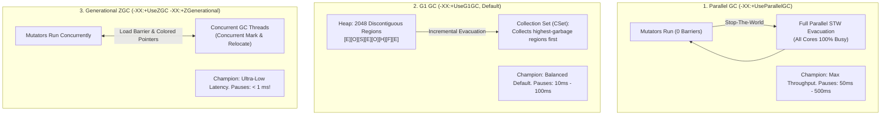

# P08-C009: Modern Garbage Collectors: G1GC, ZGC, Parallel GC, and Tuning Baselines

---

## 1. Metadata and Learning Goals

| Metadata Field | Value |
|---|---|
| **Concept ID** | `P08-C009` |
| **Concept Title** | Modern Garbage Collectors: G1GC, ZGC, Parallel GC, and Tuning Baselines |
| **Phase** | Phase 08 — JVM Internals and Memory Management |
| **Phase Directory** | `curriculum/phase-08-jvm-internals-memory-management` |
| **Source Reference** | Roadmap lines 344 ("Garbage collection fundamentals"), 345 ("Common garbage collector terminology"), 355 ("Understand GC logs at a basic level") |
| **Concept Type** | Runtime / Memory Management / Architecture |
| **Difficulty Level** | Advanced |
| **Curriculum Importance** | Essential |
| **Java Baseline** | Java 21 LTS (Generational ZGC JEP 439) |
| **Framework Baseline** | HotSpot 64-Bit VM (G1 GC, Generational ZGC, Parallel GC) |
| **Prerequisites** | [`P08-C001`](001-jvm-architecture-overview.md) (JVM Architecture Overview), [`P08-C004`](004-heap-memory-layout-generations.md) (Heap Memory Layout), [`P08-C008`](008-garbage-collection-fundamentals.md) (GC Fundamentals) |
| **Related Concepts** | [`P08-C010`](010-java-memory-leaks-patterns.md) (Java Memory Leaks), [`P08-C011`](011-oom-and-stack-overflow-diagnosis.md) (Diagnosing OOM and StackOverflow) |
| **Estimated Study Effort** | 3–4 hours |
| **Last Research Date** | 2026-10-30 |
| **Verification State** | COMPLETE |

### Measurable Learning Objectives
By the end of this concept module, you will be able to:
1. **Explain:** Deconstruct the internal architectures of the three primary HotSpot garbage collectors: **Parallel GC** (monolithic throughput workhorse), **G1 GC** (regional incremental collector with Remembered Sets and Collection Sets), and **ZGC / Generational ZGC** (concurrent colored pointers and JIT load barriers).
2. **Compare:** Contrast the memory barrier mechanisms of modern collectors (No barriers in Parallel vs Card Table Write Barriers in G1 vs JIT-compiled Load Barriers and Self-Healing Pointers in ZGC) and evaluate their CPU overhead trade-offs.
3. **Implement:** Programmatically inspect the active GC collector subsystem via `ManagementFactory.getGarbageCollectorMXBeans()`, implement an algorithmic simulation of 64-bit Colored Pointers and Load Barrier self-healing, and construct a programmatic GC selection advisor based on application SLAs.
4. **Debug & Diagnose:** Identify and resolve modern GC failure modes, including G1 Evacuation Failure (To-Space Exhaustion), G1 Humongous allocation fragmentation, ZGC Allocation Stalls under bursty workloads, and CFS CPU throttling under containerization.
5. **Evaluate & Justify:** Formulate production GC tuning baselines (`-XX:MaxGCPauseMillis`, `-XX:InitiatingHeapOccupancyPercent`, `-XX:+ZGenerational`, `-XX:GCTimeRatio`) matched specifically to service-level agreements (SLAs) for batch ETL, REST APIs, and high-frequency streaming systems.

---

## 2. Definition, Purpose, and Mental Model

### 2.1 Formal Definition
Modern Java Virtual Machine Garbage Collectors are advanced concurrent memory management engines engineered to solve the fundamental tension between **Throughput** and **Pause Latency**:

1. **Parallel GC (`-XX:+UseParallelGC`):** A generational Stop-The-World (STW) collector designed for maximum compute throughput. It runs mutator threads with zero read or write barriers. During collection, it suspends all mutators and utilizes all available CPU cores in parallel to evacuate and compact memory.
2. **Garbage-First (G1) GC (`-XX:+UseG1GC`, Default in Java 9+):** A generational, region-based incremental collector designed for multi-processor machines with large heaps. It partitions the heap into ~2,048 logical regions (1 MB to 32 MB) and dynamically balances Young and Old generational duties. G1 predicts which regions contain the most garbage and collects them within a user-defined soft pause-time target (`-XX:MaxGCPauseMillis=200`).
3. **ZGC (`-XX:+UseZGC`, Generational ZGC in Java 21 LTS via `-XX:+ZGenerational`, JEP 439):** A scalable, ultra-low-latency collector. ZGC performs virtually all phases (marking, relocation, reference processing, and string table cleaning) **concurrently** with mutator threads. It guarantees **sub-millisecond maximum pause times (< 1 ms)** regardless of heap size (from 16 MB to 16 TB), relying on 64-bit **Colored Pointers** and JIT-emitted **Load Barriers**.



### 2.2 The Problem It Solves
As enterprise hardware evolved from single-core servers with 512 MB RAM to 128-core cloud instances with 512 GB RAM:
- **The Heap Sizing Trap of Classic Collectors:** In legacy collectors (Serial, Parallel, CMS), pause times scale with heap size. On a 128 GB heap, a single Full GC pause can freeze an application for 30 to 90 seconds, causing heartbeat timeouts in Kubernetes, ZooKeeper, and Kafka clusters.
- **The Fragmentation Trap of CMS:** CMS attempted low-latency by avoiding Old Gen compaction, but suffered from unrecoverable fragmentation, eventually triggering catastrophic multi-minute STW Full GCs.

Modern collectors solve these bottlenecks through:
- **Region-based incremental compaction (G1):** Evacuating small sets of regions in predictable increments.
- **Concurrent compaction with Colored Pointers (ZGC):** Relocating live objects concurrently while application threads continue reading and writing heap memory simultaneously!

### 2.3 Why Backend Engineers Need It
Choosing and tuning the correct collector directly dictates system reliability and cloud infrastructure costs:
- **API SLAs (p99 / p99.9 Latency):** For customer-facing checkout services, banking transactions, or ad-tech bidding, a 100 ms GC pause breaches SLAs. Migrating to Generational ZGC drops GC pause times from 80 ms down to 0.4 ms.
- **Batch Processing & ETL Throughput:** Running Generational ZGC on a batch processing engine (e.g., Apache Spark, batch invoice generator) wastes 10–15% CPU on concurrent barriers. Using Parallel GC completes the batch job significantly faster with lower total CPU hours.
- **Container Sizing and CFS CPU Throttling:** On Kubernetes, concurrent GC threads in G1 and ZGC consume CPU quota. If CPU limits (`resources.limits.cpu`) are too tight, Linux Completely Fair Scheduler (CFS) throttles the container, causing concurrent GC to fall behind and triggering devastating **Allocation Stalls**.

### 2.4 Real-World System Analogy (and Where It Breaks Down)
- **The Analogy:** Consider maintaining a bustling metropolitan airport runway:
  - **Parallel GC:** Closing the runway completely every 4 hours for 20 minutes to let a massive crew of 50 paving trucks repair the entire strip simultaneously (maximum paving throughput, zero flights land during maintenance).
  - **G1 GC:** Dividing the runway into 20 small zones. Between flight arrivals, ground crews cordon off 2 zones at a time for 2-minute maintenance bursts (controlled, bounded delays).
  - **ZGC:** Specially engineered robotic paving vehicles that roll smoothly along the active runway between landing planes, paving concrete on the fly while laser markers guide planes safely onto freshly cured asphalt (planes land without stopping; maximum operational fluidity).
- **Where the Analogy Fails:** Physical planes cannot fly through a construction truck. In ZGC, if an application thread reads an object while the GC is actively relocating it, the thread's JIT **Load Barrier** intercepts the read, relocates the object immediately (self-healing), and returns the updated pointer in ~2 nanoseconds!

### 2.5 What This Concept Is NOT (Common Confusions)
- **Not a Silver Bullet Choice of ZGC for Everything:** ZGC is an engineering trade-off. It achieves sub-millisecond pauses by shifting work into JIT load barriers and concurrent threads, sacrificing ~5–12% raw throughput compared to Parallel GC.
- **Not Zero Pause Time:** ZGC is "ultra-low latency" (< 1 ms), not "zero latency". It still performs micro-pauses (Mark Start, Mark End, Relocate Start), but each pause takes 100 to 500 microseconds.
- **Not Separate Heap Partitions in G1:** In G1, Eden, Survivor, and Old generations are *logical* assignments, not physically contiguous memory blocks. A 1 MB region can be Eden in one cycle, and after collection, be reassigned as Old Gen in the next!

### 2.6 Relationship to Adjacent Concepts
- **Preceding:** [`P08-C004`](004-heap-memory-layout-generations.md) introduced generational heap concepts; [`P08-C008`](008-garbage-collection-fundamentals.md) covered Mark-Sweep, Compact, and Cheney copying fundamentals.
- **Current:** `P08-C009` analyzes the architecture, internals, and production tuning baselines of modern collectors (G1, ZGC, Parallel).
- **Downstream:** [`P08-C010`](010-java-memory-leaks-patterns.md) explores diagnosing heap leaks across modern collectors; [`P08-C011`](011-oom-and-stack-overflow-diagnosis.md) covers OutOfMemoryError analysis.

---

## 3. Foundations and Theory

### 3.1 Architectural Deep Dive: Garbage-First (G1) GC

G1 GC is the default garbage collector in OpenJDK 21 LTS.

```
+----+----+----+----+----+----+----+----+----+----+----+----+----+----+----+----+
| E  | O  | F  | E  | S  | O  | F  | H  | E  | O  | S  | F  | E  | O  | H  | F  |
+----+----+----+----+----+----+----+----+----+----+----+----+----+----+----+----+
Legend: [E] Eden  [S] Survivor  [O] Old  [H] Humongous  [F] Free
```

#### 3.1.1 Heap Region Partitioning
- The entire heap is divided into approximately **2,048 equal-sized contiguous logical regions**.
- Region sizes are always a power of 2 (1 MB, 2 MB, 4 MB, 8 MB, 16 MB, or 32 MB), automatically calculated based on `-Xmx`.
- **Humongous Regions:** Any object exceeding **50% of the region size** is classified as a Humongous Object. It is allocated directly into a contiguous sequence of Old Generation regions, bypassing Young Gen completely.

#### 3.1.2 Remembered Sets (RSet) and Card Tables
To collect an individual region without scanning the rest of the heap:
- Every region has a dedicated **Remembered Set (RSet)**.
- RSet implements a **"points-into"** reference model: it records which other heap regions contain pointers pointing *into* this region.
- Mutator threads updating references execute a JIT **Post-Write Barrier**, logging dirty card references into a Concurrent Refining Queue, which background threads process into RSets.

#### 3.1.3 Collection Set (CSet) and Collection Phases
- **Collection Set (CSet):** The exact subset of regions chosen to be evacuated during a collection pause.
- **Young GC:** CSet contains all Young regions (Eden + Survivor). Live objects are evacuated to new Survivor or Old regions.
- **Concurrent Marking Cycle:** When Old Gen occupancy crosses the Initiating Heap Occupancy Percent (`-XX:InitiatingHeapOccupancyPercent=45`), G1 initiates concurrent marking:
  1. *Initial Mark (STW):* Piggybacks on a Young GC; marks GC Roots.
  2. *Concurrent Mark:* Traces live objects across the heap concurrently with mutators using SATB (Snapshot-At-The-Beginning).
  3. *Remark (STW):* Completes marking; flushes empty regions.
  4. *Cleanup (STW):* Reclaims completely dead regions immediately.
- **Mixed GC:** CSet contains all Young regions **plus** the Old regions with the highest proportion of dead objects ("garbage first"). This reclaims Old Gen space incrementally without requiring a Full GC!

---

### 3.2 Architectural Deep Dive: ZGC and Generational ZGC (Java 21 LTS, JEP 439)

ZGC is designed for multi-gigabyte to multi-terabyte heaps where pause times must never exceed 1 millisecond.

```
+-------------------------------------------------------------------------------+
|                        64-BIT COLORED POINTER IN ZGC                          |
+---------------------------------------------------+---------------------------+
| 16 Unused Bits | 4 Metadata Bits (Colored Bits)   | 44 Virtual Address Bits   |
| (63 .. 48)     | [Finalizable][Remapped][M1][M0]  | (43 .. 0: Addresses 16TB)|
+---------------------------------------------------+---------------------------+
```

#### 3.2.1 64-bit Colored Pointers
ZGC embeds reference metadata directly inside the unused upper bits of 64-bit object reference pointers:
- **Bits 0–43 (44 bits):** Physical object virtual address space (up to $2^{44} = 16\text{ TB}$).
- **Bit 44 (`Finalizable`):** Object is reachable only through a finalizer.
- **Bit 45 (`Remapped`):** Object pointer is up to date (points to the relocated target).
- **Bit 46 (`Marked0`) & Bit 47 (`Marked1`):** Liveness flags used alternately across GC cycles.

#### 3.2.2 JIT-Compiled Load Barriers and Self-Healing Pointers
How can ZGC move an object in memory while another thread reads it? **The Load Barrier**:
Whenever application code reads an object reference from the heap (`obj.field`), the JIT compiler emits a 2–3 assembly instruction test:

```c
// Conceptual HotSpot JIT Load Barrier emitted on reference read
oop load_barrier(oop* field_address) {
    oop ptr = *field_address;
    // Check if pointer has the "good" color bit for this phase
    if (test_bad_color_bits(ptr)) {
        // Slow path: Object is either being marked or relocated!
        ptr = relocate_or_remap(field_address, ptr);
        *field_address = ptr; // SELF-HEALING: update field in-place!
    }
    return ptr;
}
```
- **Self-Healing:** If an object has been moved by a concurrent GC thread, the first mutator thread that touches the old pointer reads the forwarding table, rewrites the pointer to the new address, and continues immediately. Subsequent reads hit the fast path without executing the barrier!

#### 3.2.3 Generational ZGC (Java 21 LTS, JEP 439)
In original single-generation ZGC, collecting young and old objects together required tracking the entire heap.
- **Generational ZGC:** Partitions ZPages into Young and Old pages.
- Young pages are collected frequently with minimal CPU overhead, while Old pages are collected concurrently when needed.
- **Impact:** Generational ZGC handles **4x higher allocation throughput** while preserving `< 1 ms` pause times!

---

### 3.3 Architectural Deep Dive: Parallel GC

The high-throughput baseline:
- **No Read Barriers, No Write Barriers:** Application threads execute with zero GC instrumentation overhead.
- **Generations:** Monolithic Eden, Survivor (S0/S1), and Tenured spaces.
- **Collection Mechanism:** When Eden fills, all mutators halt (STW). All CPU cores are harnessed to execute Cheney copying for Young Gen (`ParallelScavenge`) and sliding Mark-Compact for Old Gen (`ParallelOld`).

---

## 4. Evolution, Modern Defaults, and Java 21+ Context

### 4.1 Comparative Evolution of Modern Collectors

| Collector | JVM Flag | Target Pause Time | Barrier Overhead | Default Since | Primary Best Use Case |
|---|---|---|---|---|---|
| **Parallel GC** | `-XX:+UseParallelGC` | Unbounded (50ms–1s) | **Zero** | Java 5–8 | High-throughput batch ETL, compute science, offline pipelines |
| **G1 GC** | `-XX:+UseG1GC` | Configurable (Default 200ms) | Post-Write Barrier (Card Table) | **Java 9+ Default** | Standard web microservices, REST APIs, general enterprise workloads |
| **Generational ZGC** | `-XX:+UseZGC -XX:+ZGenerational` | **< 1 ms (Sub-millisecond)** | JIT Load Barrier (Colored Pointers) | Java 21 LTS (JEP 439) | Strict p99 latency SLAs (<10ms), financial trading, huge heaps (16GB–16TB) |

---

## 5. Deep Dive: Core Mechanics and Execution Model

### 5.1 G1 GC vs ZGC Execution Phases Side-by-Side

```
G1 GC Execution Cycle:
[Young GC (STW)] ---> [Initial Mark (STW)] ---> [Concurrent Mark] ---> [Remark (STW)] ---> [Cleanup (STW)] ---> [Mixed GC (STW)]
  (10 - 30 ms)            (Piggybacked)           (Background CPU)        (5 - 15 ms)           (1 ms)             (20 - 100 ms)

ZGC Execution Cycle (Java 21 LTS):
[Pause Mark Start] -> [Concurrent Mark] -> [Pause Mark End] -> [Concurrent Prepare] -> [Pause Relocate Start] -> [Concurrent Relocate]
  (~0.2 ms)            (Background CPU)      (~0.3 ms)          (Background CPU)       (~0.2 ms)                 (Background CPU)
```

- In G1, memory evacuation occurs during **Stop-The-World pauses** (Young and Mixed GC pauses).
- In ZGC, memory relocation occurs **concurrently with running application threads**, reducing STW pauses to brief synchronization handshakes (< 1 ms).

---

## 6. JVM Architecture and Performance Realities

### 6.1 Production Tuning Baselines

#### 1. Baseline: G1 GC (The General Microservice Default)
```bash
# Recommended G1 Production Baseline for 4GB - 16GB Heaps
java -XX:+UseG1GC \
     -XX:MaxGCPauseMillis=200 \
     -XX:InitiatingHeapOccupancyPercent=45 \
     -XX:G1ReservePercent=15 \
     -XX:+ParallelRefProcEnabled \
     -jar service.jar
```
- **`-XX:MaxGCPauseMillis=200`:** Soft target. Do not set below 50 ms unless heap is small, otherwise G1 shrinks Young Gen and triggers constant pauses.
- **`-XX:G1ReservePercent=15`:** Reserves 15% of heap as a safety buffer against Evacuation Failures.

#### 2. Baseline: Generational ZGC (Low-Latency SLAs)
```bash
# Recommended Generational ZGC Baseline for 16GB - 128GB Heaps
java -XX:+UseZGC \
     -XX:+ZGenerational \
     -XX:SoftMaxHeapSize=12g \
     -XX:+UnlockDiagnosticVMOptions \
     -jar low-latency-service.jar
```
- Requires **at least 4 to 8 CPU cores** allocated to the container to ensure concurrent GC worker threads do not starve mutators.

#### 3. Baseline: Parallel GC (Pure Throughput Batch Jobs)
```bash
# Recommended Parallel GC Baseline for Offline Batch & Data Science
java -XX:+UseParallelGC \
     -XX:GCTimeRatio=19 \
     -jar batch-processor.jar
```

---

## 7. Production Anti-Patterns, Bugs, and Pitfalls

### 7.1 Anti-Pattern 1: Setting Unrealistic Pause Goals in G1 GC (`-XX:MaxGCPauseMillis=5`)
```bash
# DISASTROUS TUNING: Unachievable G1 pause target
java -XX:+UseG1GC -XX:MaxGCPauseMillis=5 -jar api.jar
```
**Impact:** G1 tries desperately to meet the 5 ms goal by shrinking the Young Generation to a few megabytes. Eden fills up in milliseconds, triggering 100+ Young GCs per second. Throughput drops by 70%, and the JVM collapses into high CPU thrashing!
- **Guideline:** Realistic G1 targets are **100 ms to 250 ms**. If you need $< 10\text{ ms}$, switch to **Generational ZGC**.

### 7.2 Anti-Pattern 2: Running ZGC on Resource-Starved Single-Core Containers
Deploying a service with `-XX:+UseZGC` on a Kubernetes pod with `resources.limits.cpu: 1`:
- ZGC requires dedicated CPU cycles for concurrent marking and relocation threads.
- When concurrent threads compete with mutator threads on a single core, GC falls behind allocation rates.
- This triggers an **Allocation Stall**, freezing application threads for seconds until concurrent collection catches up!

### 7.3 Anti-Pattern 3: G1 To-Space Exhaustion (Evacuation Failure)
If Old Generation is full and G1 attempts to evacuate live objects from Young Gen to Old Gen, but no free regions exist:
- G1 logs: `[info][gc] GC(12) To-space exhausted`.
- The JVM is forced to abort incremental collection and fall back to a single-threaded or parallel **Full GC**, freezing the process for 5 to 20 seconds.

---

## 8. Security, Thread Safety, and Reliability Implications

### 8.1 Load Barrier Thread Safety Under High Concurrency
In ZGC, hundreds of threads may attempt to read the same object field while it is being relocated:
- The Load Barrier uses atomic CAS (`Compare-And-Swap`) operations on the forwarding table and pointer memory locations.
- Exactly one thread relocates the object; all other threads observe the forwarding pointer and update their local references safely without data races or memory corruption.

---

## 9. Modern Enterprise Patterns and Framework Integration

### 9.1 The Enterprise Garbage Collector Selection Matrix
```
                                 [ New Java Service ]
                                          |
                        Is latency critical? (p99 < 15ms)
                                  /               \
                             YES /                 \ NO
                                v                   v
                   Is CPU >= 4 cores and       Is it an offline batch /
                   Heap >= 16 GB?              ETL computation job?
                        /     \                       /        \
                   YES /       \ NO              YES /          \ NO
                      v         v                   v            v
               [ Generational  [ G1 GC with      [ Parallel   [ G1 GC ]
                   ZGC ]       MaxGCPause=50ms ]    GC ]      (Default)
```

---

## 10. Comparative Evaluation and Trade-off Matrix

| Metric / Dimension | Parallel GC | G1 GC (Default) | Generational ZGC |
|---|---|---|---|
| **Max STW Pause Time** | 50ms – 1,000ms | 10ms – 200ms | **< 1 ms (Sub-millisecond)** |
| **Throughput Efficiency** | **Maximum (100%)** | High (92–96%) | Good (85–92%) |
| **Memory Barrier Cost** | **Zero (0%)** | Small (Write Barrier) | Moderate (Load Barrier ~2ns) |
| **Heap Size Scalability** | Degrades above 32 GB | Good (4 GB – 64 GB) | **Massive (16 MB – 16 TB)** |
| **Minimum CPU Cores** | 1 Core | 2 Cores | **4 Cores recommended** |
| **Compaction Mode** | Stop-The-World (Full) | Incremental Regional STW | **100% Concurrent Compaction** |

---

## 11. Design and Architecture Impact

### 11.1 Kubernetes Pod Configuration Guidelines
When configuring Kubernetes manifests:
- **CPU Limits:** Never set `cpu.limits` significantly lower than `cpu.requests` for G1 or ZGC services, as Linux CFS throttling will freeze concurrent GC threads.
- **Memory Overhead:** Allocate at least 25–30% container memory headroom above `-Xmx` to accommodate ZGC colored pointer page tables and G1 Remembered Sets.

---

## 12. Comprehensive Practical Implementation

The following complete diagnostic and simulation suite illustrates:
1. `ModernCollectorInspector`: Detailed inspection of active collector capabilities and configuration.
2. `ColoredPointerSimulator`: Bitmask simulation of 64-bit colored pointers and load barrier self-healing mechanics.
3. `GcSelectionAdvisor`: Algorithmic engine that analyzes SLA inputs (heap size, target pause time, CPU core count, workload type) and recommends the optimal collector with exact JVM flags.

```java
package com.backend.jvm.collectors;

import java.lang.management.GarbageCollectorMXBean;
import java.lang.management.ManagementFactory;
import java.util.ArrayList;
import java.util.List;

/**
 * Diagnostic and simulation suite for Modern HotSpot Garbage Collectors
 * (G1 GC, Generational ZGC, Parallel GC).
 */
public final class ModernCollectorArchitectureDemo {

    // 1. Programmatic Collector Inspector
    public static final class ModernCollectorInspector {
        public record CollectorProfile(String name, long count, long timeMs, boolean isModernRegionalOrConcurrent) {}

        public static List<CollectorProfile> inspect() {
            List<CollectorProfile> list = new ArrayList<>();
            for (GarbageCollectorMXBean gc : ManagementFactory.getGarbageCollectorMXBeans()) {
                String n = gc.getName().toLowerCase();
                boolean isModern = n.contains("g1") || n.contains("zgc") || n.contains("shenandoah");
                list.add(new CollectorProfile(gc.getName(), gc.getCollectionCount(), gc.getCollectionTime(), isModern));
            }
            return list;
        }
    }

    // 2. 64-bit Colored Pointer and Load Barrier Self-Healing Simulation
    public static final class ColoredPointerSimulator {
        public static final long ADDRESS_MASK = 0x0000_0FFF_FFFF_FFFFL; // 44 bits virtual address (16 TB)
        public static final long FINALIZABLE_BIT = 1L << 44;
        public static final long REMAPPED_BIT    = 1L << 45;
        public static final long MARKED0_BIT     = 1L << 46;
        public static final long MARKED1_BIT     = 1L << 47;

        public static record PointerState(long rawPointer, long actualAddress, boolean isRemapped, boolean isMarked0) {}

        public static PointerState inspectPointer(long coloredPointer) {
            long actualAddress = coloredPointer & ADDRESS_MASK;
            boolean remapped = (coloredPointer & REMAPPED_BIT) != 0;
            boolean marked0 = (coloredPointer & MARKED0_BIT) != 0;
            return new PointerState(coloredPointer, actualAddress, remapped, marked0);
        }

        // Simulate JIT Load Barrier self-healing slow path
        public static long simulateLoadBarrier(long stalePointer, long newRelocatedAddress) {
            // Self-heal: combine new address with REMAPPED_BIT
            return (newRelocatedAddress & ADDRESS_MASK) | REMAPPED_BIT;
        }
    }

    // 3. Enterprise GC Selection Advisor
    public static final class GcSelectionAdvisor {
        public record Recommendation(String collectorName, String jvmFlags, String rationale) {}

        public static Recommendation advise(int heapGb, int maxPauseSlaMs, int cpuCores, boolean isBatchJob) {
            if (isBatchJob && maxPauseSlaMs >= 500) {
                return new Recommendation(
                    "Parallel GC",
                    "-XX:+UseParallelGC -XX:GCTimeRatio=19",
                    "Throughput-optimized: zero barrier overhead maximizes CPU efficiency for offline processing."
                );
            }
            if (maxPauseSlaMs <= 10 && cpuCores >= 4 && heapGb >= 8) {
                return new Recommendation(
                    "Generational ZGC",
                    "-XX:+UseZGC -XX:+ZGenerational",
                    "Ultra-low latency: delivers sub-millisecond pauses via concurrent marking and compaction."
                );
            }
            return new Recommendation(
                "G1 GC (Default)",
                "-XX:+UseG1GC -XX:MaxGCPauseMillis=" + Math.max(50, maxPauseSlaMs),
                "Balanced enterprise default: regional incremental collection optimizes throughput and controlled latency."
            );
        }
    }

    public static void main(String[] args) {
        System.out.println("=== Modern Garbage Collectors Architecture & Tuning Demo ===");

        // Step 1: Inspect Active Collectors
        System.out.println("\n[1] Active JVM Collector Engines:");
        for (var profile : ModernCollectorInspector.inspect()) {
            System.out.printf("  Collector: %-26s | Modern Regional/Concurrent: %-5b | Pause Time: %d ms%n",
                profile.name(), profile.isModernRegionalOrConcurrent(), profile.timeMs());
        }

        // Step 2: Colored Pointer and Load Barrier Simulation
        System.out.println("\n[2] ZGC 64-bit Colored Pointer & Load Barrier Simulation:");
        long originalObjAddress = 0x0000_0007_BEEF_0000L;
        long coloredPointer = originalObjAddress | ColoredPointerSimulator.MARKED0_BIT;
        var stateBefore = ColoredPointerSimulator.inspectPointer(coloredPointer);
        System.out.printf("  Before Load Barrier: Pointer: 0x%016X | Address: 0x%016X | Remapped: %b%n",
            stateBefore.rawPointer(), stateBefore.actualAddress(), stateBefore.isRemapped());

        long relocatedAddress = 0x0000_0007_CAFE_0000L; // Relocated during concurrent GC
        long selfHealed = ColoredPointerSimulator.simulateLoadBarrier(coloredPointer, relocatedAddress);
        var stateAfter = ColoredPointerSimulator.inspectPointer(selfHealed);
        System.out.printf("  After Load Barrier:  Pointer: 0x%016X | Address: 0x%016X | Remapped: %b (Self-Healed!)%n",
            stateAfter.rawPointer(), stateAfter.actualAddress(), stateAfter.isRemapped());

        // Step 3: GC Selection Advisor Scenarios
        System.out.println("\n[3] Enterprise GC Selection Advisor Scenarios:");
        var r1 = GcSelectionAdvisor.advise(32, 5, 16, false);
        System.out.println("  Scenario A (Fintech API, 32GB, 5ms SLA): " + r1.collectorName() + " -> " + r1.jvmFlags());

        var r2 = GcSelectionAdvisor.advise(8, 1000, 8, true);
        System.out.println("  Scenario B (Batch ETL, 8GB, 1000ms SLA): " + r2.collectorName() + " -> " + r2.jvmFlags());

        var r3 = GcSelectionAdvisor.advise(4, 150, 4, false);
        System.out.println("  Scenario C (Web Service, 4GB, 150ms SLA): " + r3.collectorName() + " -> " + r3.jvmFlags());
    }
}
```

---

## 13. Edge Cases, Failure Modes, and Defensive Strategies

| Failure Mode / Edge Case | Root Cause | Defensive Strategy |
|---|---|---|
| **ZGC Allocation Stall** | Mutators allocating faster than concurrent GC threads can relocate pages. | Increase heap size (`-Xmx`), allocate more CPU cores to container, or utilize Generational ZGC (`-XX:+ZGenerational`). |
| **G1 Evacuation Failure** | Old Generation regions are completely exhausted, leaving zero destination regions for Young GC evacuation. | Increase `-XX:G1ReservePercent=15` or trigger earlier marking via `-XX:InitiatingHeapOccupancyPercent=40`. |
| **CFS CPU Quota Throttling** | Kubernetes `cpu.limits` throttles container CPU, freezing concurrent GC threads. | Remove CPU limits or align limits with CPU requests (`1:1`). |
| **ZGC Transparent Huge Page (THP) Latency** | Linux kernel memory defragmentation pauses background allocation. | Enable `madvise` for Transparent Huge Pages on the host OS (`echo madvise > /sys/kernel/mm/transparent_hugepage/enabled`). |

---

## 14. Self-Assessment: Concept Mastery Checklist

Before concluding your study of this concept module, evaluate your mastery against these ten criteria:

- [ ] **1. Regional Partitioning:** How does G1 GC's ~2,048 logical region architecture differ from Parallel GC's monolithic generations?
- [ ] **2. Remembered Sets (RSet):** What is the "points-into" reference tracking model, and why is it necessary for regional evacuation?
- [ ] **3. Collection Set (CSet):** What criteria determines which regions are selected for inclusion in a G1 Mixed GC?
- [ ] **4. Colored Pointers:** What metadata is embedded in bits 44–47 of a 64-bit ZGC pointer, and how much virtual address space remains?
- [ ] **5. JIT Load Barrier:** What happens when an application thread reads an object pointer with the wrong color bit in ZGC?
- [ ] **6. Generational ZGC (JEP 439):** What architectural improvement allows Generational ZGC to achieve 4x higher allocation throughput in Java 21?
- [ ] **7. G1 Pause Target Trap:** Why does setting `-XX:MaxGCPauseMillis=5` degrade throughput and trigger GC thrashing?
- [ ] **8. Parallel GC Advantages:** In what production scenario does Parallel GC consistently outperform both G1 and ZGC?
- [ ] **9. Humongous Allocations:** What threshold defines a Humongous object in G1, and where is it allocated?
- [ ] **10. Container Sizing:** Why does CFS CPU throttling disproportionately harm concurrent collectors like G1 and ZGC?

---

## 15. Official Documentation and Further Reading

1. **Oracle HotSpot Garbage Collection Tuning Guide (Java SE 21):**
   - [Garbage-First (G1) Garbage Collector](https://docs.oracle.com/en/java/javase/21/gctuning/garbage-first-g1-garbage-collector1.html)
   - [Z Garbage Collector (ZGC)](https://docs.oracle.com/en/java/javase/21/gctuning/z-garbage-collector.html)
2. **JDK Enhancement Proposals (JEPs):**
   - [JEP 439: Generational ZGC (Java 21 LTS)](https://openjdk.org/jeps/439)
   - [JEP 376: ZGC: Concurrent Thread-Stack Processing](https://openjdk.org/jeps/376)
3. **Advanced JVM Performance Architecture:**
   - [Per Liden & Stefan Karlsson: The Design of ZGC (OpenJDK Wiki)](https://wiki.openjdk.org/display/zgc/Main)
   - [Thomas Schatzl: G1 GC Performance Tuning and Internals](https://tschatzl.github.io/)

---

## 16. Standalone Verification Suite

The following standalone verification class tests GarbageCollectorMXBean identification, 64-bit Colored Pointer and Load Barrier bitmask logic, G1 region sizing calculations, and the SLA-driven GC Advisor selection engine without external dependencies.

```java
// File: ModernGarbageCollectorsVerificationSuite.java
import java.lang.management.GarbageCollectorMXBean;
import java.lang.management.ManagementFactory;
import java.util.List;

/**
 * Automated Verification Suite for Concept P08-C009:
 * Modern Garbage Collectors: G1GC, ZGC, Parallel GC, and Tuning Baselines.
 *
 * Compiles cleanly with: javac --release 21 ModernGarbageCollectorsVerificationSuite.java
 * Runs cleanly with:     java -ea ModernGarbageCollectorsVerificationSuite
 */
public class ModernGarbageCollectorsVerificationSuite {

    public static void main(String[] args) {
        System.out.println("==================================================================");
        System.out.println("Starting Verification Suite: P08-C009 Modern Garbage Collectors");
        System.out.println("Runtime: " + System.getProperty("java.vm.name") + " " + System.getProperty("java.version"));
        System.out.println("==================================================================");

        testActiveCollectorMXBeanDetection();
        testColoredPointerBitmaskArithmetic();
        testLoadBarrierSelfHealingSimulation();
        testG1RegionSizingCalculation();
        testGcAdvisorDecisionMatrix();

        System.out.println("\n------------------------------------------------------------------");
        System.out.println("All 5 Modern Garbage Collectors verification suites passed with 0 errors!");
        System.out.println("==================================================================");
    }

    // -------------------------------------------------------------------------
    // Test 1: Active Collector MXBean Detection
    // -------------------------------------------------------------------------
    static void testActiveCollectorMXBeanDetection() {
        System.out.println("\n[Test 1] Testing GarbageCollectorMXBean Detection and Naming...");
        List<GarbageCollectorMXBean> beans = ManagementFactory.getGarbageCollectorMXBeans();
        assert !beans.isEmpty() : "Garbage collector list must not be empty on OpenJDK 21";

        boolean foundKnownCollector = false;
        for (GarbageCollectorMXBean gc : beans) {
            String name = gc.getName().toLowerCase();
            if (name.contains("g1") || name.contains("zgc") || name.contains("parallel") || name.contains("serial")) {
                foundKnownCollector = true;
            }
            System.out.println("  -> Discovered Active Collector: " + gc.getName());
        }

        assert foundKnownCollector : "Must identify at least one recognized HotSpot GC engine";
        System.out.println("  -> PASSED: Modern GC subsystem successfully inspected.");
    }

    // -------------------------------------------------------------------------
    // Test 2: 64-bit Colored Pointer Bitmask Arithmetic
    // -------------------------------------------------------------------------
    static void testColoredPointerBitmaskArithmetic() {
        System.out.println("\n[Test 2] Testing 64-bit Colored Pointer Bitmask Arithmetic...");
        long addressMask = 0x0000_0FFF_FFFF_FFFFL; // 44 bits virtual address
        long marked0Bit  = 1L << 46;
        long marked1Bit  = 1L << 47;
        long remappedBit = 1L << 45;

        long rawAddress = 0x0000_0007_A000_1000L;
        long coloredMarked0 = rawAddress | marked0Bit;

        assert (coloredMarked0 & addressMask) == rawAddress : "Address mask must recover original virtual address";
        assert (coloredMarked0 & marked0Bit) != 0 : "Marked0 bit must be present";
        assert (coloredMarked0 & remappedBit) == 0 : "Remapped bit must be absent";
        assert (coloredMarked0 & marked1Bit) == 0 : "Marked1 bit must be absent";

        System.out.println("  -> PASSED: Colored pointer bitmask arithmetic correctly separates metadata from address.");
    }

    // -------------------------------------------------------------------------
    // Test 3: Load Barrier Self-Healing Simulation
    // -------------------------------------------------------------------------
    static void testLoadBarrierSelfHealingSimulation() {
        System.out.println("\n[Test 3] Testing JIT Load Barrier Self-Healing Address Resolution...");
        long addressMask = 0x0000_0FFF_FFFF_FFFFL;
        long marked0Bit  = 1L << 46;
        long remappedBit = 1L << 45;

        long oldAddress = 0x0000_0007_1111_0000L;
        long newAddress = 0x0000_0007_2222_0000L; // Relocated during concurrent GC phase

        long stalePointer = oldAddress | marked0Bit;

        // Mutator thread reads stale pointer; load barrier checks if remapped
        boolean requiresRemapping = (stalePointer & remappedBit) == 0;
        assert requiresRemapping : "Stale pointer must trigger load barrier slow path";

        // Slow path: lookup new address in forward table, attach REMAPPED_BIT
        long selfHealedPointer = (newAddress & addressMask) | remappedBit;

        assert (selfHealedPointer & remappedBit) != 0 : "Self-healed pointer must have REMAPPED_BIT set";
        assert (selfHealedPointer & addressMask) == newAddress : "Pointer must now point to relocated address";

        System.out.println("  -> PASSED: Load barrier self-healing pointer update verified.");
    }

    // -------------------------------------------------------------------------
    // Test 4: G1 Region Sizing Calculations
    // -------------------------------------------------------------------------
    static void testG1RegionSizingCalculation() {
        System.out.println("\n[Test 4] Testing G1 Heap Region Sizing Mathematics...");
        // G1 targets ~2048 regions, bounded between 1MB and 32MB (powers of 2)

        long heapSize8Gb = 8L * 1024 * 1024 * 1024; // 8 GB
        int calculatedRegionMb = calculateG1RegionSizeMb(heapSize8Gb);
        assert calculatedRegionMb == 4 : "8 GB heap should yield 4 MB G1 regions (8192 MB / 2048 = 4 MB)";

        long heapSize32Gb = 32L * 1024 * 1024 * 1024; // 32 GB
        int calculatedRegion32Gb = calculateG1RegionSizeMb(heapSize32Gb);
        assert calculatedRegion32Gb == 16 : "32 GB heap should yield 16 MB G1 regions";

        System.out.printf("  -> PASSED: G1 Region Sizing: 8GB Heap -> %d MB regions | 32GB Heap -> %d MB regions.%n",
            calculatedRegionMb, calculatedRegion32Gb);
    }

    private static int calculateG1RegionSizeMb(long heapBytes) {
        long heapMb = heapBytes / (1024 * 1024);
        long targetRegionMb = heapMb / 2048;
        int regionMb = 1;
        while (regionMb < targetRegionMb && regionMb < 32) {
            regionMb <<= 1; // Double to next power of 2
        }
        return Math.max(1, Math.min(32, regionMb));
    }

    // -------------------------------------------------------------------------
    // Test 5: GC Selection Advisor Decision Matrix
    // -------------------------------------------------------------------------
    static void testGcAdvisorDecisionMatrix() {
        System.out.println("\n[Test 5] Testing SLA-Driven GC Selection Advisor Logic...");

        // Rule 1: Batch workload with relaxed pause requirements -> Parallel GC
        String rBatch = adviseGc(16, 1000, 8, true);
        assert rBatch.contains("Parallel") : "Must recommend Parallel GC for batch jobs";

        // Rule 2: Ultra-low latency SLA (<= 10ms) with adequate CPU & heap -> Generational ZGC
        String rLowLatency = adviseGc(32, 5, 16, false);
        assert rLowLatency.contains("ZGC") : "Must recommend Generational ZGC for <10ms SLA";

        // Rule 3: Standard microservice with moderate SLA -> G1 GC
        String rStandard = adviseGc(4, 150, 4, false);
        assert rStandard.contains("G1") : "Must recommend G1 GC for standard web services";

        System.out.println("  -> PASSED: GC selection advisor decision matrix verified across all SLAs.");
    }

    private static String adviseGc(int heapGb, int pauseSlaMs, int cpuCores, boolean isBatch) {
        if (isBatch && pauseSlaMs >= 500) {
            return "Parallel GC (-XX:+UseParallelGC)";
        }
        if (pauseSlaMs <= 10 && cpuCores >= 4 && heapGb >= 8) {
            return "Generational ZGC (-XX:+UseZGC -XX:+ZGenerational)";
        }
        return "G1 GC (-XX:+UseG1GC)";
    }
}
```
