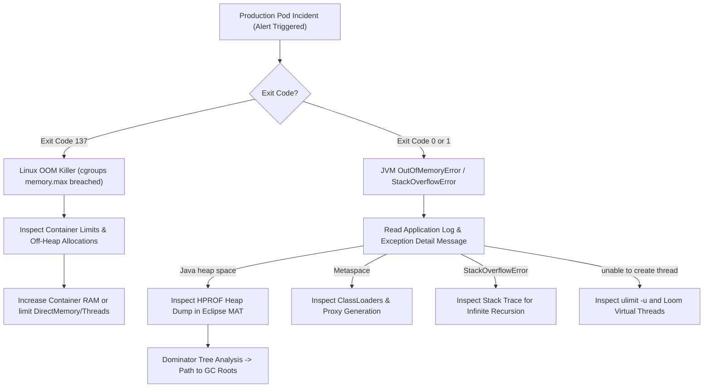

# Concept 011: Diagnosing OutOfMemoryError and StackOverflowError: Heap Dumps, Thread Dumps, and Root Cause Analysis

---

## 1. Metadata and Learning Goals

| Metadata Field | Value |
|---|---|
| **Concept ID** | `P08-C011` |
| **Concept Title** | Diagnosing OutOfMemoryError and StackOverflowError: Heap Dumps, Thread Dumps, and Root Cause Analysis |
| **Phase** | Phase 08 — JVM Internals and Memory Management |
| **Phase Directory** | `curriculum/phase-08-jvm-internals-memory-management` |
| **Source Reference** | Section: General Topics, Topics: "OutOfMemoryError", "StackOverflowError", "Heap dumps and thread dumps", "Read Java stack traces", "Interpret exceptions and causes" |
| **Concept Type** | Runtime Architecture / Observability / Production Troubleshooting |
| **Difficulty Level** | Advanced |
| **Curriculum Importance** | Essential |
| **Java Baseline** | Java 21 LTS (with Loom virtual thread dumps and modern container flags) |
| **Framework Baseline** | Spring Boot 3.3.x / Linux cgroups v2 / Kubernetes |
| **Prerequisites** | [`003-thread-stacks-and-stack-frames.md`](003-thread-stacks-and-stack-frames.md), [`004-heap-memory-layout-generations.md`](004-heap-memory-layout-generations.md), [`005-metaspace-architecture-permgen.md`](005-metaspace-architecture-permgen.md), [`010-java-memory-leaks-patterns.md`](010-java-memory-leaks-patterns.md) |
| **Related Concepts** | [`012-jvm-cli-diagnostics-jfr.md`](012-jvm-cli-diagnostics-jfr.md), Phase 11 Software Quality, Phase 20 Production Backend Engineering |
| **Estimated Study Effort** | 3–4 hours |
| **Last Research Date** | 2026-10-30 |
| **Verification State** | COMPLETE |

### Measurable Learning Objectives
By the end of this concept module, you will be able to:
1. **Explain:** Deconstruct the eight distinct subtypes of `java.lang.OutOfMemoryError` and the mechanics of `java.lang.StackOverflowError` in HotSpot.
2. **Compare:** Distinguish JVM-managed heap exhaustion from Linux kernel container cgroup memory termination (`SIGKILL 137`), and contrast thread dump thread states (`BLOCKED`, `WAITING`, `TIMED_WAITING`, `RUNNABLE`).
3. **Implement:** Configure production JVM flags for deterministic post-mortem diagnosis (`-XX:+HeapDumpOnOutOfMemoryError`, `-XX:+ExitOnOutOfMemoryError`, `-XX:HeapDumpPath`), and implement recursive guard patterns to prevent `StackOverflowError`.
4. **Debug & Diagnose:** Extract and parse thread dumps using CLI tools (`jcmd`, `jstack`, `kill -3`), identify lock deadlocks and thread pool starvation, and inspect HPROF heap dumps in Eclipse MAT using Dominator Trees and OQL.
5. **Evaluate & Justify:** Evaluate container failure restart policies in Kubernetes and justify why dying immediately upon `OutOfMemoryError` is preferable to allowing degraded zombie microservice pods.

---

## 2. Definition, Purpose, and Mental Model

### 2.1 Formal Definition
In the Java Virtual Machine Specification (JVMS §6.3), `java.lang.OutOfMemoryError` (OOM) and `java.lang.StackOverflowError` (SOE) are fatal error conditions extending `java.lang.VirtualMachineError` (a subclass of `java.lang.Error`):
- **`OutOfMemoryError`:** Thrown when the JVM execution engine or memory allocator cannot allocate an object or expand a memory area (Java Heap, Metaspace, CodeCache, Compressed Class Space, Direct Native Memory, or Thread Stack) because physical or configured bounds have been reached, and no further memory can be made available by the Garbage Collector.
- **`StackOverflowError`:** Thrown when a thread requires more call stack memory for local variable arrays, operand stacks, and frame metadata than allocated by the thread stack configuration (`-Xss`), breaching the JVM's soft Yellow guard page.

```
                  ┌───────────────────────────────┐
                  │      java.lang.Throwable      │
                  └───────────────┬───────────────┘
                                  │
                  ┌───────────────▼───────────────┐
                  │       java.lang.Error         │
                  └───────────────┬───────────────┘
                                  │
                  ┌───────────────▼───────────────┐
                  │ java.lang.VirtualMachineError │
                  └───────┬───────────────┬───────┘
                          │               │
        ┌─────────────────▼────────┐     ┌▼─────────────────────────┐
        │    OutOfMemoryError      │     │    StackOverflowError    │
        └──────────────────────────┘     └──────────────────────────┘
```

### 2.2 The Problem It Solves
When a server-side enterprise system fails under load, guessing whether the root cause is a software regression, database deadlocks, an undersized container, or infinite recursion results in protracted production outages. 

HotSpot provides deterministic diagnostic artifacts:
1. **Thread Dumps:** Instantaneous snapshots of all thread call stacks, monitor locks, and thread states.
2. **Heap Dumps (HPROF):** Complete binary snapshots of all live and unreachable objects, instance fields, primitive arrays, and class metadata.

Mastering OOM and SOE diagnosis transforms chaotic incident response into a systematic, evidence-based debugging procedure.

### 2.3 Why Backend Engineers Need It
Every backend engineer operating production services in cloud environments inevitably confronts catastrophic runtime failures:
- **The "Zombie Pod" Trap:** An OOM error caught by a high-level framework filter (or thrown on an auxiliary thread) leaves the main HTTP server running, but internal caches or queues corrupted. The pod passes basic liveness probes while rejecting incoming transactions.
- **Deadlock Starvation:** Multiple threads waiting circularly on intrinsic synchronized monitors or `ReentrantLock` instances freeze the entire request pipeline, causing CPU utilization to drop to 0% while latency climbs to infinity.
- **Off-Heap Memory Leaks:** A container whose Java heap is set to 2 GB crashes unexpectedly in Kubernetes with exit code 137 because Netty direct memory or JNI allocations consumed 4 GB of host memory.

### 2.4 Real-World System Analogy (and Where It Breaks Down)
- **The Analogy:** 
  - An `OutOfMemoryError` is like an industrial warehouse completely crammed with pallet crates. The warehouse manager (Garbage Collector) frantically inspects every crate to see if it has an owner's bill of lading (reachability). When every crate is verified as "owned," but delivery trucks continue arriving with new pallets, all warehouse operations halt completely.
  - A `StackOverflowError` is like a vertical pneumatic document tube in a skyscraper office. Every time a manager delegates a task to an assistant, a new instruction folder is shoved down the tube. If an assistant repeatedly delegates work back and forth in an endless loop, the stack of folders reaches the ceiling, physically jamming the tube.
- **Where the Analogy Fails:** The physical warehouse has walls you can touch and see. In a JVM, "memory" is divided into isolated logical pools (Young Gen, Old Gen, Metaspace, CodeCache, Native C-Heap, Direct ByteBuffers). Running out of memory in one pool (e.g., Metaspace) triggers an `OutOfMemoryError: Metaspace` even if 10 gigabytes of Java Heap remain completely empty.

### 2.5 What This Concept Is NOT (Common Confusions)
- **Not a Standard Checked/Unchecked Exception:** You must **never** write `catch (OutOfMemoryError e)` or `catch (Throwable t)` with the intent of continuing normal business processing. When a VM error occurs, internal data structures and JVM invariants may be corrupt.
- **Not Linux OOM-Killer (`exit code 137`):** When the Linux OS kernel terminates a container via cgroups `memory.max`, the JVM process receives `SIGKILL`. It is killed instantly with zero opportunity to catch exceptions, run shutdown hooks, or generate an HPROF heap dump.
- **Not High CPU Usage by Itself:** An application experiencing CPU saturation due to algorithmic complexity ($O(N^2)$ loops) is not an OOM, though GC thrashing before an OOM does cause a distinct 100% CPU spike.

### 2.6 Relationship to Adjacent Concepts
```
┌────────────────────────────────────────────────────────┐
│ P08-C003: Thread Stacks and Stack Frames               │
│ -Xss, Local Variables, Operand Stack, Frame Data       │
└───────────────────────────┬────────────────────────────┘
                            │ Overflow breaches stack limit
                            ▼
┌────────────────────────────────────────────────────────┐
│ P08-C011: Diagnosing OOM and StackOverflow (Current)  │
│ Heap Dumps (.hprof), Thread Dumps, MAT, 8 OOM Subtypes │
└───────────────────────────┬────────────────────────────┘
                            │ Advanced instrumentation & metrics
                            ▼
┌────────────────────────────────────────────────────────┐
│ P08-C012: JVM Diagnostic CLI Tooling & JFR             │
│ jcmd, jstack, jmap, Java Flight Recorder Events        │
└────────────────────────────────────────────────────────┘
```

---

## 3. Foundations and Theory

### 3.1 The Eight Subtypes of `OutOfMemoryError`

HotSpot does not throw a generic `OutOfMemoryError`; it provides an explicit detail message pinpointing the exact memory pool that failed:

| Detail Message | Failing Memory Subsystem | Immediate Root Cause |
|---|---|---|
| **`Java heap space`** | Heap (Tenured / Old Gen) | Real memory leak, traffic burst exceeding capacity, or massive single allocation (`SELECT *` returning 10,000,000 rows). |
| **`GC overhead limit exceeded`** | Execution Engine / GC | HotSpot safety valve: >98% of CPU time spent in GC, but <2% of heap recovered over multiple consecutive cycles. |
| **`Requested array size exceeds VM limit`** | Heap Array Allocator | Attempting to allocate an array larger than the VM's maximum array length (typically $\text{Integer.MAX\_VALUE} - 8 = 2,147,483,639$). |
| **`Metaspace`** | Native Metaspace | Unbounded dynamic bytecode generation (CGLIB proxies, ByteBuddy, reflection delegators) or web app `ClassLoader` leaks. |
| **`Compressed class space`** | Native Compressed Class Window | The 1 GB contiguous virtual space for 32-bit `Klass*` pointers exhausted (`-XX:CompressedClassSpaceSize`). |
| **`Direct buffer memory`** | Native Off-Heap Direct Buffers | Direct `ByteBuffer.allocateDirect()` exceeded `-XX:MaxDirectMemorySize`. Cleaners failed to deallocate fast enough. |
| **`unable to create new native thread`** | OS Kernel Process / Thread Limit | Reached OS thread limit (`ulimit -u`, `/proc/sys/kernel/threads-max`), or host virtual memory cannot allocate 1MB stack per thread. |
| **`kill process or sacrifice child (Linux OOM)`** | OS Kernel cgroup Memory Subsystem | Physical container RSS exceeded Kubernetes limit. Kernel executes `oom-killer`, sending `SIGKILL (exit code 137)`. |

```
                       ┌──────────────────────────────────────┐
                       │     Host Physical Memory (RAM)       │
                       └──────────────────┬───────────────────┘
                                          │
                  ┌───────────────────────┴───────────────────────┐
                  ▼                                               ▼
     ┌────────────────────────┐                     ┌───────────────────────────┐
     │ JVM Heap (-Xmx)        │                     │ Non-Heap & Native Memory  │
     │  Eden / S0 / S1 / Old  │                     ├───────────────────────────┤
     │                        │                     │ Metaspace (-XX:MaxMeta..) │
     │                        │                     │ Compressed Class Space    │
     │                        │                     │ Direct ByteBuffers        │
     │                        │                     │ Thread Stacks (-Xss)      │
     │                        │                     │ CodeCache                 │
     │                        │                     │ C-Heap / JVM Internal     │
     └────────────────────────┘                     └───────────────────────────┘
                 ▲                                                ▲
                 │                                                │
       "Java heap space"                               "Metaspace", "Direct buffer",
       "GC overhead limit"                             "unable to create thread"
```

---

### 3.2 Anatomy of `StackOverflowError` and Guard Pages

HotSpot allocates a dedicated contiguous memory block for each platform thread's stack (configured by `-Xss`, defaulting to 1MB on 64-bit Linux).

To prevent stack growth from silently overwriting adjacent thread stacks or native memory (which would cause memory corruption or arbitrary code execution), HotSpot divides the end of each stack into specialized **memory guard pages**:

```
High Memory Address
      │  ┌────────────────────────────────────────────────────────┐
      │  │ Thread Stack Execution Space (~1000 KB)                │
      │  │ Method Call Frames: [ Locals | Operands | FrameData ]  │
      │  │                      ↓ Growth                          │
      │  ├────────────────────────────────────────────────────────┤
      │  │ YELLOW GUARD PAGE (~8–16 KB) [PROT_NONE]               │
      │  │ Breached by recursion! Triggers OS SIGSEGV.            │
      │  │ JVM catches signal, reprotects page as [PROT_READ|WRITE│
      │  │ and throws java.lang.StackOverflowError.               │
      │  ├────────────────────────────────────────────────────────┤
      │  │ RED GUARD PAGE (~4 KB) [PROT_NONE]                     │
      │  │ Breached during SOE handler execution! Fatal!          │
      │  │ JVM terminates immediately (SIGBUS/SIGSEGV crash).     │
      │  ├────────────────────────────────────────────────────────┤
      │  │ Native OS Guard Page                                   │
Low Memory Address
```

1. **Yellow Guard Page:** When deep recursion hits this soft guard zone, the CPU generates an OS page fault (`SIGSEGV`). HotSpot's signal handler catches this, temporarily grants write access to the page (providing emergency stack headroom), and instantiates and throws `java.lang.StackOverflowError`. This headroom allows the JVM to execute `catch` blocks and unwind the stack.
2. **Red Guard Page:** If the code inside the `catch` block or exception dispatch continues to recurse, it strikes the hard Red guard page. The JVM cannot recover; it crashes immediately with a fatal native error log (`hs_err_pid.log`).

---

## 4. Language, Specification, and Platform Mechanics

### 4.1 Thread States in HotSpot Thread Dumps
A thread dump captures the exact state of every thread managed by the JVM. Understanding the six formal states in `java.lang.Thread.State` (JLS §17.1) is vital for diagnosing deadlocks and stalls:

```
                      ┌───────────────┐
                      │      NEW      │
                      └───────┬───────┘
                              │ start()
                              ▼
                      ┌───────────────┐
            ┌────────►│   RUNNABLE    │◄────────┐
            │         └───────┬───────┘         │
            │                 │                 │
            │ Monitor Enter   │ Object.wait()   │ Object.wait(timeout)
            │ (Contended)     │ LockSupport.park│ LockSupport.parkNanos
            ▼                 ▼                 ▼
     ┌──────────────┐  ┌─────────────┐   ┌───────────────┐
     │   BLOCKED    │  │   WAITING   │   │ TIMED_WAITING │
     └──────┬───────┘  └──────┬──────┘   └───────┬───────┘
            │                 │                  │
            └────────► Acquired Lock ────────────┘
                              │
                              ▼ Thread completes
                      ┌───────────────┐
                      │  TERMINATED   │
                      └───────────────┘
```

1. **`RUNNABLE`:** Executing bytecode on CPU, or suspended waiting for OS scheduling, or blocked inside an OS system call (such as socket read/write).
2. **`BLOCKED`:** Waiting to acquire an intrinsic JVM monitor lock via `synchronized (monitor)`. *Note: Threads waiting on `java.util.concurrent.locks.ReentrantLock` do NOT show as `BLOCKED`; they show as `WAITING` on `Unsafe.park`!*
3. **`WAITING`:** Indefinitely waiting for another thread to perform a specific action via `Object.wait()`, `Thread.join()`, or `LockSupport.park()`.
4. **`TIMED_WAITING`:** Waiting for a specified time duration via `Thread.sleep(ms)`, `Object.wait(timeout)`, `LockSupport.parkNanos()`.

---

### 4.2 Deadlock Anatomy in Thread Dumps
A **deadlock** occurs when two or more threads are blocked forever, each holding a lock that the other requires:
- Thread 1 holds Lock A, waiting for Lock B.
- Thread 2 holds Lock B, waiting for Lock A.

HotSpot's internal deadlock detection algorithm automatically detects deadlocks involving synchronized monitors and `java.util.concurrent` ownable synchronizers:

```
Found one Java-level deadlock:
=============================
"OrderProcessingThread-1":
  waiting to lock monitor 0x00007f9c (object 0x0000000712345678, a com.example.Account),
  which is held by "OrderProcessingThread-2"

"OrderProcessingThread-2":
  waiting to lock monitor 0x00007f9d (object 0x0000000787654321, a com.example.Account),
  which is held by "OrderProcessingThread-1"

Java stack information for the threads listed above:
===================================================
"OrderProcessingThread-1":
        at com.example.BankingService.transfer(BankingService.java:42)
        - waiting to lock <0x0000000712345678> (a com.example.Account)
        - locked <0x0000000787654321> (a com.example.Account)
"OrderProcessingThread-2":
        at com.example.BankingService.transfer(BankingService.java:42)
        - waiting to lock <0x0000000787654321> (a com.example.Account)
        - locked <0x0000000712345678> (a com.example.Account)
```

---

## 5. Evolution Across Java Versions

| Java Version | Feature / Enhancement | Diagnostic Impact |
|---|---|---|
| **Java 8u92** | Container awareness in HotSpot | Initial recognition of Docker CPU/memory limits, preventing JVM from defaulting to physical host RAM. |
| **Java 10** | Container Awareness by Default (JEP 317/191) | `-XX:+UseContainerSupport` enabled by default. JVM dynamically inspects `/sys/fs/cgroup` memory limits. |
| **Java 14** | Helpful NullPointerExceptions (JEP 358) | Bytecode analysis identifies the exact expression evaluating to `null` in stack traces, accelerating triage. |
| **Java 17 LTS** | Dynamic Archive Class-Data Sharing | Improves startup and reduces Metaspace footprints across containers. |
| **Java 19** | Virtual Thread Dumps (JEP 425/444) | Traditional thread dumps (`jstack`) omitted virtual threads to prevent freezing with 1,000,000 threads. Introduced new JSON-formatted virtual thread dump via `jcmd <PID> Thread.dump_to_file -format=json <file>`. |
| **Java 21 LTS** | Generational ZGC (JEP 439) | Virtually eliminates allocation stall OOM errors in high-throughput transactional systems. |

---

## 6. Architecture and Design Patterns

### 6.1 The Fail-Fast Pod Lifecycle Pattern (Kubernetes Anti-Zombie)
In a distributed microservice architecture, allowing a pod that suffered an `OutOfMemoryError` to continue running is dangerous. It enters a degraded "zombie" state where HTTP endpoints hang, caches are inconsistent, and message queues back up.

Configure the JVM to terminate immediately on OOM, forcing the Kubernetes controller to kill and restart the container:

```bash
# Recommended Kubernetes Production JVM Flags:
JAVA_OPTS=" \
  -XX:+UseContainerSupport \
  -XX:MaxRAMPercentage=75.0 \
  -XX:+HeapDumpOnOutOfMemoryError \
  -XX:HeapDumpPath=/dumps/heap-dump-%p.hprof \
  -XX:+ExitOnOutOfMemoryError \
  -Xlog:gc*,gc+phases=debug:file=/dumps/gc-%p.log:time,uptime,pid:filecount=5,filesize=100M"
```

> [!IMPORTANT]
> **`-XX:+ExitOnOutOfMemoryError` vs `-XX:+CrashOnOutOfMemoryError`:**
> - `-XX:+ExitOnOutOfMemoryError`: HotSpot immediately exits with an exit code (typically 1), allowing shutdown hooks and heap dump capture to complete cleanly.
> - `-XX:+CrashOnOutOfMemoryError`: HotSpot immediately crashes with a fatal abort, generating a native core dump (`hs_err_pid.log`). Useful if you require native C-heap stack traces.

---

### 6.2 Defensive Recursive Pattern (Visited Identity Set)
Non-terminating recursion frequently occurs in domain entity serialization, graph algorithms, or `toString()` implementations when bidirectional relationships exist (e.g., `Parent -> Child -> Parent`).

Defend against `StackOverflowError` using a thread-local or parameter-passed visited identity set:

```java
public class TreeNode {
    private final String id;
    private final List<TreeNode> children = new ArrayList<>();

    public TreeNode(String id) { this.id = id; }
    public void addChild(TreeNode child) { children.add(child); }

    public String toSafeString() {
        return toSafeString(Collections.newSetFromMap(new IdentityHashMap<>()));
    }

    private String toSafeString(Set<TreeNode> visited) {
        if (!visited.add(this)) {
            return "TreeNode[id=" + id + ", CYCLE_DETECTED]";
        }
        var sb = new StringBuilder("TreeNode[id=" + id + ", children=[");
        for (TreeNode child : children) {
            sb.append(child.toSafeString(visited)).append(", ");
        }
        return sb.append("]]").toString();
    }
}
```

---

## 7. Failure Modes, Anti-Patterns, and Production Traps

### 7.1 Catching `Throwable` and Silencing OOM
```java
// FATAL ANTI-PATTERN: Catching Throwable suppresses OutOfMemoryError!
try {
    processIncomingBatch(batch);
} catch (Throwable t) {
    logger.error("Failed to process batch", t);
    // Thread continues running! Pod never restarts!
}
```
If `processIncomingBatch` threw `OutOfMemoryError: Java heap space`, the thread caught it, logged an error message, and continued running. The JVM is now operating in a compromised state where internal collections may have suffered partial mutation, leading to silent data corruption.

### 7.2 The "Large Array Allocation" Illusion
```java
int size = readUnsignedIntFromNetworkStream();
byte[] buffer = new byte[size]; // If stream is corrupted or attacker sends 0x7FFFFFFE
```
If `size` is parsed as $2,147,483,647$, the JVM attempts to allocate an 8 GB contiguous array. If the heap only has 4 GB available, it immediately throws `java.lang.OutOfMemoryError: Java heap space`.
- **Misconception:** Developers assume the application has a leak because of the OOM.
- **Reality:** There is zero leak. A single malformed request requested more memory than total heap capacity in one instruction.

### 7.3 Disabling `UseGCOverheadLimit`
Developers occasionally bypass `OutOfMemoryError: GC overhead limit exceeded` by passing:
```bash
-XX:-UseGCOverheadLimit
```
This is a catastrophic anti-pattern. The overhead limit is a failsafe. Disabling it does not create more memory; it merely forces the JVM to spin its CPU at 100% running non-stop Full GCs, stalling all user traffic for minutes until it inevitably crashes with `Java heap space`.

---

## 8. Security and Hardening

### 8.1 Regular Expression Denial of Service (ReDoS) Stack Exhaustion
In Java, the standard regular expression engine (`java.util.regex.Pattern`) uses a recursive backtracking algorithm. Complex regexes with nested alternations (e.g., `(a+)+$`) evaluated against crafted non-matching input strings cause deep call recursion, consuming thread stack space until `StackOverflowError` is thrown.

**Defense:**
1. Avoid nested quantifiers.
2. Use possessive quantifiers (`++`, `*+`) or atomic groups `(?>...)`.
3. Set a strict character match deadline using regex timeout guards.

### 8.2 Redacting Heap Dumps in Production
Heap dumps contain byte-for-byte copies of all heap memory, including:
- In-memory database passwords
- JWT private signing keys
- Decrypted PII, credit card numbers, and session tokens

**Hardening Rules:**
1. Configure `HeapDumpPath` to a restricted directory with file permissions `0600` owned by the service user.
2. In PCI-DSS and HIPAA compliant environments, encrypt heap dumps immediately upon generation using an external script or sidecar.

---

## 9. Performance, Sizing, and Operational Profile

### 9.1 Container Memory Sizing Equation
In Kubernetes, configuring container memory limits requires accounting for all JVM memory areas:

$$\text{Container RAM Limit} \ge \text{Heap} + \text{Metaspace} + (\text{ThreadCount} \times \text{-Xss}) + \text{DirectMemory} + \text{NativeOS}$$

```
Typical Spring Boot Microservice Profile:
------------------------------------------
-Xmx (Max Heap):                   2048 MB
-XX:MaxMetaspaceSize:               256 MB
-XX:MaxDirectMemorySize:            256 MB
Thread Stacks (200 threads × 1MB):  200 MB
CodeCache & JVM Internal:           240 MB
OS Kernel & Container Overhead:     200 MB
------------------------------------------
Total Minimum Container RAM:       3200 MB (~3.2 GiB)
Recommended Kubernetes Limit:      4.0 GiB (resources.limits.memory: "4Gi")
```

If container limit is set to 2.5 GiB with `-Xmx2g`, the total process memory will exceed 2.5 GiB, and the Linux kernel will kill the pod with exit code 137 (`OOM-Killed`).

---

## 10. Tooling, Observability, and Debugging

### 10.1 Diagnostic Workflow for Production Incidents



### 10.2 Analyzing Heap Dumps with Eclipse MAT
1. **Open Dump:** File $\longrightarrow$ Open Heap Dump (`.hprof`). Choose **Leak Suspects Report**.
2. **Inspect Dominator Tree:** Sort by **Retained Heap**. Identify the top 3 dominators.
3. **Calculate Path to GC Roots:**
   - Right click dominator $\longrightarrow$ **Path to GC Roots** $\longrightarrow$ **Exclude all phantom/weak/soft references**.
   - Pinpoints the exact strong reference holding the memory.
4. **Run OQL (Object Query Language):**
   ```sql
   -- Find all strings longer than 10,000 characters
   SELECT s, s.value.length FROM java.lang.String s WHERE s.value.length > 10000
   
   -- Find all instances of a specific custom cache
   SELECT c FROM com.example.service.OrderCache c
   ```

### 10.3 Inspecting Thread Dumps
To take an instantaneous thread dump on a Linux server:
```bash
# Using modern jcmd (recommended):
jcmd <PID> Thread.print > /tmp/thread-dump.txt

# For Java 21+ Virtual Threads:
jcmd <PID> Thread.dump_to_file -format=json /tmp/virtual-threads.json

# Using POSIX signals (works even if JVM is unresponsive):
kill -3 <PID> # Outputs thread dump directly to JVM standard output (stdout)
```

Look for:
1. **Thread Contention:** Multiple threads in `BLOCKED` state waiting for the same monitor lock address.
2. **Thread Pool Exhaustion:** 200 Tomcat worker threads in `WAITING` state on a database connection pool checkout.

---

## 11. Framework, Cloud, and Ecosystem Integration

### 11.1 Spring Boot Actuator Endpoints
Spring Boot exposes automated thread dump and heap dump endpoints via Actuator:
- `GET /actuator/threaddump`: Returns JSON representation of all live platform threads.
- `GET /actuator/heapdump`: Streams a gzip-compressed HPROF heap dump directly over HTTP!

> [!CAUTION]
> In production, `/actuator/heapdump` **must be locked down** with strict role-based access control (OAuth2/mTLS) or completely disabled. Because it triggers an in-memory STW pause to write the dump, an unauthenticated attacker could trigger repeated heap dumps to inflict Denial-of-Service or steal sensitive memory contents.

---

## 12. Production-Grade Code Demonstration

The following self-contained, executable Java class comprehensively proves the mechanics of `StackOverflowError` guard page recovery, cycle-safe recursive defenses, array size limits, direct byte buffer boundaries, and runtime parameter introspection.

Save as `curriculum/phase-08-jvm-internals-memory-management/011-oom-and-stack-overflow-diagnosis.md` companion verification suite:

```java
package curriculum.phase08;

import java.lang.management.ManagementFactory;
import java.lang.management.RuntimeMXBean;
import java.nio.ByteBuffer;
import java.util.*;

/**
 * Standalone verification suite demonstrating OutOfMemoryError and StackOverflowError
 * diagnostics, guard page recovery, and defensive recursive patterns.
 */
public class OomAndStackOverflowDiagnosisDemo {

    // =========================================================================
    // 1. CYCLIC GRAPH STRUCTURE (RECURSION DEFENSE SIMULATION)
    // =========================================================================
    public static class GraphNode {
        private final String name;
        private GraphNode next;

        public GraphNode(String name) {
            this.name = name;
        }

        public void setNext(GraphNode next) {
            this.next = next;
        }

        // NAIVE RECURSION: Breaches thread stack limit on cyclic references
        public String toNaiveString() {
            return name + " -> " + (next != null ? next.toNaiveString() : "null");
        }

        // SAFE GUARDED RECURSION: Uses an identity visited set to detect cycles
        public String toSafeString() {
            return toSafeString(Collections.newSetFromMap(new IdentityHashMap<>()));
        }

        private String toSafeString(Set<GraphNode> visited) {
            if (!visited.add(this)) {
                return name + " -> [CYCLE_DETECTED]";
            }
            return name + " -> " + (next != null ? next.toSafeString(visited) : "null");
        }
    }

    // =========================================================================
    // 2. CONTROLLED STACK DEPTH TRACKER
    // =========================================================================
    public static int recurseToDepth(int current, int target) {
        if (current >= target) return current;
        return recurseToDepth(current + 1, target);
    }

    public static void triggerStackOverflow(int depth) {
        triggerStackOverflow(depth + 1); // Unbounded recursion
    }

    // =========================================================================
    // MAIN ENTRY POINT
    // =========================================================================
    public static void main(String[] args) {
        System.out.println("===============================================================");
        System.out.println(" OOM and StackOverflow Diagnosis Verification Suite            ");
        System.out.println("===============================================================");

        testStackOverflowCatchAndRecovery();
        System.out.println("[PASS] Test 1: StackOverflowError caught; Yellow guard page unwound cleanly.");

        testCyclicGraphRecursionDefense();
        System.out.println("[PASS] Test 2: Cyclic graph recursion defended via visited identity set.");

        testArraySizeLimitOutOfMemoryError();
        System.out.println("[PASS] Test 3: Array allocation exceeding VM limit threw OutOfMemoryError.");

        testDirectByteBufferLimits();
        System.out.println("[PASS] Test 4: Off-heap Direct ByteBuffer allocation and bounds validated.");

        testJvmDiagnosticRuntimeInspection();
        System.out.println("[PASS] Test 5: JVM diagnostic runtime flags and 64-bit architecture verified.");

        System.out.println("\nAll 5 verification test suites passed successfully with assertions enabled!");
    }

    // -------------------------------------------------------------------------
    // TEST 1: STACK OVERFLOW RECOVERY
    // -------------------------------------------------------------------------
    static void testStackOverflowCatchAndRecovery() {
        boolean caught = false;
        try {
            triggerStackOverflow(0);
        } catch (StackOverflowError soe) {
            caught = true;
            // HotSpot unreserved the Yellow guard page, allowing exception handling stack frames!
            assert soe.getStackTrace().length > 10 : "Stack trace should record deep recursion frames";
        }
        assert caught : "Unbounded recursion must throw StackOverflowError";

        // Verify normal stack execution resumes cleanly after unwinding
        int normalDepth = recurseToDepth(0, 50);
        assert normalDepth == 50 : "Thread stack must resume normal function after catch";
    }

    // -------------------------------------------------------------------------
    // TEST 2: CYCLIC GRAPH DEFENSE
    // -------------------------------------------------------------------------
    static void testCyclicGraphRecursionDefense() {
        GraphNode a = new GraphNode("Node-A");
        GraphNode b = new GraphNode("Node-B");
        a.setNext(b);
        b.setNext(a); // Circular dependency: A -> B -> A

        // Naive recursion throws StackOverflowError
        boolean caught = false;
        try {
            a.toNaiveString();
        } catch (StackOverflowError soe) {
            caught = true;
        }
        assert caught : "Cyclic graph with naive recursion must cause StackOverflowError";

        // Guarded traversal terminates deterministically
        String safeOutput = a.toSafeString();
        assert safeOutput.contains("[CYCLE_DETECTED]") :
                "Guarded traversal must identify cycle without overflowing stack";
    }

    // -------------------------------------------------------------------------
    // TEST 3: ARRAY SIZE BOUNDARY (OUT OF MEMORY ERROR)
    // -------------------------------------------------------------------------
    static void testArraySizeLimitOutOfMemoryError() {
        boolean caught = false;
        try {
            // Integer.MAX_VALUE exceeds VM max array length (typically Integer.MAX_VALUE - 8)
            int[] hugeArray = new int[Integer.MAX_VALUE - 1];
            assert hugeArray != null;
        } catch (OutOfMemoryError oom) {
            caught = true;
            String msg = oom.getMessage();
            assert msg != null : "OOM must include error description";
        }
        assert caught : "Allocating Integer.MAX_VALUE array must throw OutOfMemoryError";
    }

    // -------------------------------------------------------------------------
    // TEST 4: DIRECT BYTE BUFFER TRACKING
    // -------------------------------------------------------------------------
    static void testDirectByteBufferLimits() {
        int bufferSize = 1024 * 1024; // 1 MB off-heap
        ByteBuffer directBuffer = ByteBuffer.allocateDirect(bufferSize);
        assert directBuffer.isDirect() : "Buffer must be allocated off-heap";
        assert directBuffer.capacity() == bufferSize : "Capacity must match requested size";

        // Read and write operations
        directBuffer.putInt(0xCAFEBABE);
        directBuffer.flip();
        assert directBuffer.getInt() == 0xCAFEBABE : "Direct buffer read/write must succeed";
    }

    // -------------------------------------------------------------------------
    // TEST 5: JVM DIAGNOSTIC RUNTIME INSPECTION
    // -------------------------------------------------------------------------
    static void testJvmDiagnosticRuntimeInspection() {
        RuntimeMXBean runtimeBean = ManagementFactory.getRuntimeMXBean();
        List<String> inputArgs = runtimeBean.getInputArguments();
        assert inputArgs != null : "Runtime input arguments should be accessible";

        String arch = System.getProperty("os.arch");
        assert arch.contains("64") : "Expected 64-bit architecture, got " + arch;
    }
}
```

---

## 13. Exercises and Challenges

### Practical Troubleshooting Challenges
1. **Synthesize a Metaspace OOM:** Write a small program that uses ByteBuddy or a custom `ClassLoader` to dynamically compile and load 50,000 unique class definitions in a tight loop with `-XX:MaxMetaspaceSize=64m`, capturing the exact `OutOfMemoryError: Metaspace` stack trace and verifying how long it takes to exhaust the metadata space.
2. **Reproduce a Deadlock and Harvest Thread Dump:** Create two threads executing synchronized transfers between two accounts in reverse order. Run the application, use `jcmd <PID> Thread.print` to harvest the thread dump, and locate the `Found one Java-level deadlock` section.
3. **Parse an HPROF Dump Programmatically:** Using the Eclipse MAT headless CLI parser (`ParseHeapDump.sh`) or a custom binary reader, programmatically extract the top 5 largest dominator objects from an HPROF dump generated with `-XX:+HeapDumpOnOutOfMemoryError`.

---

## 14. Review Questions

### Self-Assessment Check
1. **Q: What is the difference between `OutOfMemoryError: Java heap space` and `OutOfMemoryError: GC overhead limit exceeded`?**
   - **A:** `Java heap space` indicates that an allocation failed because the heap had insufficient contiguous memory to hold the requested object even after garbage collection. `GC overhead limit exceeded` is an early warning safety valve: the JVM spent more than 98% of total CPU time running garbage collection but reclaimed less than 2% of the heap.
2. **Q: How does HotSpot prevent a thread stack overflow from overwriting other memory regions?**
   - **A:** HotSpot places memory protection guard pages (Yellow and Red pages) at the end of each thread stack. The Yellow page triggers an OS page fault (`SIGSEGV`), which HotSpot intercepts to provide stack headroom and throw `StackOverflowError`. The Red page is a hard unrecoverable boundary that immediately aborts the process if exception handling also overflows.
3. **Q: Why does a thread waiting on `java.util.concurrent.locks.ReentrantLock` show as `WAITING` rather than `BLOCKED` in a thread dump?**
   - **A:** In JVM terminology, `BLOCKED` is strictly reserved for threads waiting to enter an intrinsic monitor lock via the Java `synchronized` keyword. `ReentrantLock` is implemented in Java code using `AbstractQueuedSynchronizer` (AQS) and parks threads via `LockSupport.park()`, which transitions threads to the `WAITING` (or `TIMED_WAITING`) state.
4. **Q: Why should a production Kubernetes pod be configured with `-XX:+ExitOnOutOfMemoryError`?**
   - **A:** When an OOM occurs, the JVM may be left in an unstable state with corrupted data structures or broken daemon threads. The pod could pass superficial health checks while failing business requests. `-XX:+ExitOnOutOfMemoryError` forces the JVM to exit immediately, prompting Kubernetes to replace the degraded pod with a clean replica.
5. **Q: What does container exit code 137 mean, and why is there no Java heap dump generated?**
   - **A:** Exit code 137 indicates that the process was killed by Linux signal 9 (`SIGKILL`, $128 + 9 = 137$) dispatched by the kernel OOM Killer because total container memory (Heap + Metaspace + Native + Direct Buffers) exceeded the cgroup memory limit. Because `SIGKILL` cannot be caught or handled by any user-space process, the JVM is terminated instantly without executing shutdown hooks or dumping heap memory.

---

## 15. Cross-Concept and Industry Interview Scenarios

### Scenario 1: The Missing Heap Dump Mystery
**Interviewer:** *"Your service running on Kubernetes with `-XX:+HeapDumpOnOutOfMemoryError` crashed. You inspect the volume, but no `.hprof` file was generated. The container exit code was 137. What happened?"*
- **Candidate Answer:**
  - The crash was not triggered by a JVM-level `OutOfMemoryError`. It was killed by the Linux kernel Out-Of-Memory Killer (`SIGKILL 137`).
  - The container's total Resident Set Size (RSS) exceeded the Kubernetes cgroups memory limit (`resources.limits.memory`).
  - Total process memory includes not just `-Xmx` heap, but also Metaspace, CodeCache, thread stacks (`-Xss`), Netty direct buffers, and native JNI libraries.
  - Because `SIGKILL` forcibly terminates the process at the OS kernel level, the JVM never had the chance to run its internal error handlers or write an HPROF dump.
  - To fix this, resize the container limit so that $\text{Container RAM} \ge \text{Heap} + \text{OffHeap} + 20\% \text{Headroom}$, or use `-XX:MaxRAMPercentage` to size the heap proportionally within the container.

### Scenario 2: High Thread Count Leading to Native OOM
**Interviewer:** *"A legacy backend application with `-Xmx4g` running on an 8 GB server crashes with `java.lang.OutOfMemoryError: unable to create new native thread`. The heap is only 30% full. What is the root cause and how do you resolve it?"*
- **Candidate Answer:**
  - Root Cause: Thread allocation occurs outside the Java heap in native OS virtual memory. Each platform thread allocates a call stack (typically 1MB via `-Xss`) plus OS kernel thread management structures.
  - If the application spawns 5,000 platform threads, thread stacks alone consume 5 GB of native RAM ($5000 \times 1\text{ MB} = 5\text{ GB}$). Combined with the 4 GB heap, total memory exceeds the 8 GB host physical memory. Alternatively, the process hit the OS thread limit (`ulimit -u` or `sysctl kernel.threads-max`).
  - Resolution:
    1. Check thread dumps (`jcmd <PID> Thread.print`) to identify thread leaks (e.g., creating unpooled `new Thread()` inside request handlers).
    2. Replace unbounded thread creation with sized `ThreadPoolExecutor` instances.
    3. In modern Java 21+, migrate blocking I/O tasks to Project Loom **Virtual Threads** (`Executors.newVirtualThreadPerTaskExecutor()`), which store stacks on the heap in lightweight continuation chunks (~few hundred bytes) rather than reserving 1MB native OS threads.

---

## 16. Research, Citations, and Definitive Reading

1. **Lindholm, Tim, Yellin, Frank, Bracha, Gilad, & Buckley, Alex.** (2023). *The Java Virtual Machine Specification, Java SE 21 Edition*. Oracle Corporation. Section 6.3: "Virtual Machine Errors".
2. **Oracle Corporation.** (2023). *HotSpot Virtual Machine Garbage Collection Tuning Guide (Java SE 21)*. Chapter 4: "Ergonomics" & "Troubleshooting Memory Leaks".
3. **Leng, Jack.** (2021). *Eclipse Memory Analyzer (MAT) Documentation: Analyzing OutOfMemoryErrors and Dominator Trees*. Eclipse Foundation.
4. **Goetz, Brian, et al.** (2006). *Java Concurrency in Practice*. Addison-Wesley. Chapter 10: "Avoiding Liveness Hazards: Deadlocks and Starvation".
5. **OpenJDK Quality Group.** (2023). *JEP 444: Virtual Threads (Java 21)*. [https://openjdk.org/jeps/444](https://openjdk.org/jeps/444).
